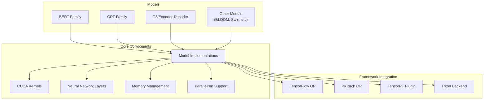
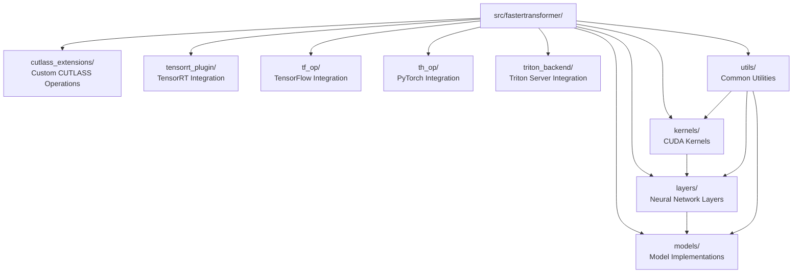
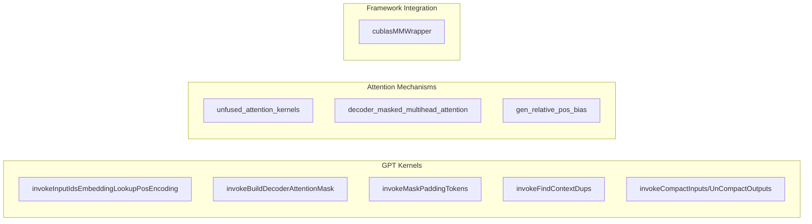
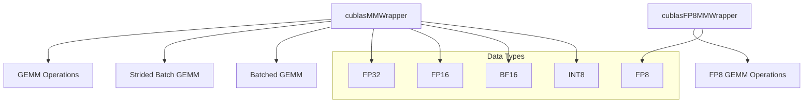
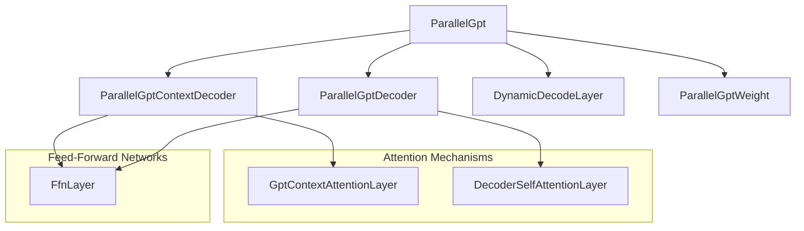
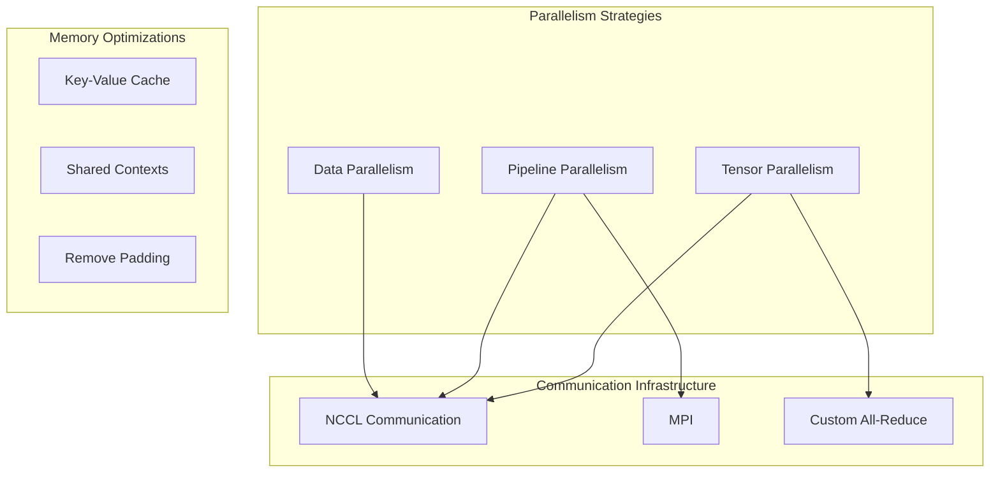
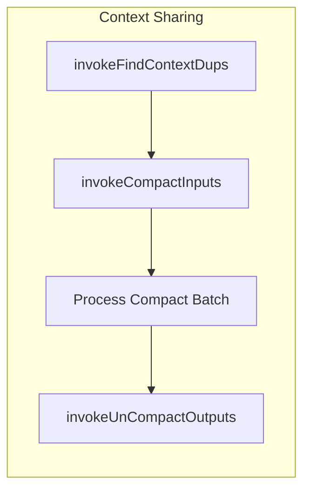
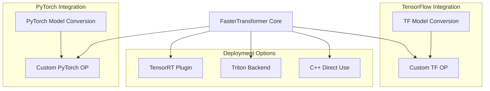
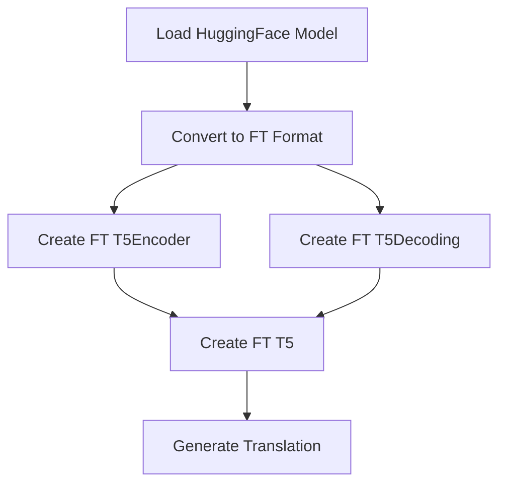
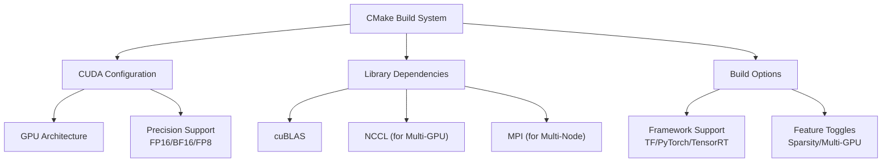

<!-- source: DeepWiki mcp.deepwiki.com · repo NVIDIA/FasterTransformer · page 1 Overview · fetched 2026-10-26 -->

# Overview

Relevant source files

The following files were used as context for generating this wiki page:

- [CMakeLists.txt](CMakeLists.txt)
- [README.md](README.md)
- [cmake/Modules/FindNCCL.cmake](cmake/Modules/FindNCCL.cmake)
- [examples/pytorch/t5/translate_example.py](examples/pytorch/t5/translate_example.py)
- [src/fastertransformer/kernels/gen_relative_pos_bias.cu](src/fastertransformer/kernels/gen_relative_pos_bias.cu)
- [src/fastertransformer/kernels/gpt_kernels.cu](src/fastertransformer/kernels/gpt_kernels.cu)
- [src/fastertransformer/kernels/gpt_kernels.h](src/fastertransformer/kernels/gpt_kernels.h)
- [src/fastertransformer/kernels/stop_criteria_kernels.cu](src/fastertransformer/kernels/stop_criteria_kernels.cu)
- [src/fastertransformer/models/multi_gpu_gpt/ParallelGpt.h](src/fastertransformer/models/multi_gpu_gpt/ParallelGpt.h)
- [src/fastertransformer/th_op/common/GptOps.cc](src/fastertransformer/th_op/common/GptOps.cc)
- [src/fastertransformer/utils/cublasFP8MMWrapper.cu](src/fastertransformer/utils/cublasFP8MMWrapper.cu)
- [src/fastertransformer/utils/cublasMMWrapper.cc](src/fastertransformer/utils/cublasMMWrapper.cc)
- [tests/unittests/test_attention_kernels.cu](tests/unittests/test_attention_kernels.cu)
- [tests/unittests/test_gpt_kernels.cu](tests/unittests/test_gpt_kernels.cu)

FasterTransformer is a highly optimized library for transformer-based model inference on NVIDIA GPUs. It provides efficient implementations of popular transformer architectures with a focus on performance optimization and deployment flexibility.

> **Note**: FasterTransformer development has transitioned to [TensorRT-LLM](#). All developers are encouraged to leverage TensorRT-LLM to get the latest improvements on LLM Inference. The NVIDIA/FasterTransformer repo will stay up, but will not have further development.

## Purpose and Scope

FasterTransformer implements optimized transformer encoder and decoder components for inference workloads. The library is built on top of CUDA, cuBLAS, cuBLASLt and C++, with integration options for TensorFlow, PyTorch, and Triton Inference Server. It supports a wide range of models including BERT, GPT, T5, BLOOM, and many others.

The primary focus of FasterTransformer is to achieve maximum inference performance on NVIDIA GPUs through various optimization techniques including:
- Customized CUDA kernels for transformer operations
- Tensor and pipeline parallelism for multi-GPU execution
- Quantization (INT8, FP8) support
- Memory optimization strategies
- Optimized attention mechanisms

## Architecture Overview

Sources: [README.md:30-32](), [README.md:82-97]()

## Directory Structure

FasterTransformer organizes its code in a hierarchical structure where lower-level components (kernels, layers) are used by higher-level components (models, framework interfaces):

Sources: [README.md:82-97]()

## Supported Models and Features

FasterTransformer supports a wide range of models with varying levels of feature support. The table below shows the model support matrix:

| Models | Framework Support | Precision | Parallelism Support |
|--------|------------------|-----------|---------------------|
| BERT | TensorFlow, PyTorch, Triton, C++ | FP16, INT8, FP8 | Tensor and Pipeline |
| GPT/OPT | PyTorch, Triton | FP16 | Tensor and Pipeline |
| GPT-MoE | PyTorch | FP16 | Tensor and Pipeline |
| BLOOM | PyTorch, Triton | FP16 | Tensor and Pipeline |
| T5/UL2 | PyTorch, TensorFlow 2, Triton, TensorRT | FP16 | Tensor and Pipeline |
| T5-MoE | PyTorch | FP16 | Tensor and Pipeline |
| Swin Transformer | PyTorch, TensorRT | FP16, INT8 | - |
| BART/mBART | PyTorch | FP16 | Tensor and Pipeline |
| Other models | Various | Various | Various |

Sources: [README.md:34-72]()

## Core Components

### CUDA Kernel Optimizations

FasterTransformer implements numerous optimized CUDA kernels for transformer operations, including:

1. Attention mechanisms (fused multi-head attention)
2. Embedding and position encoding
3. Feed-forward networks
4. Layer normalization
5. Specialized decoding operations (beam search, sampling)

These kernels are designed to utilize GPU hardware capabilities efficiently, including Tensor Cores when FP16 precision is used on compatible hardware.

Sources: [src/fastertransformer/kernels/gpt_kernels.cu](), [src/fastertransformer/kernels/gpt_kernels.h](), [src/fastertransformer/kernels/gen_relative_pos_bias.cu](), [src/fastertransformer/utils/cublasMMWrapper.cc]()

### Matrix Multiplication Wrapper

Matrix multiplication is a core operation in transformer models. FasterTransformer provides optimized wrappers around cuBLAS operations with algorithmic selection and specialized implementations for different data types:

Sources: [src/fastertransformer/utils/cublasMMWrapper.cc](), [src/fastertransformer/utils/cublasFP8MMWrapper.cu]()

### Model Implementations

FasterTransformer provides optimized implementations for multiple transformer architectures. One of the key examples is the parallel GPT implementation:

Sources: [src/fastertransformer/models/multi_gpu_gpt/ParallelGpt.h]()

## Parallelism and Scaling

FasterTransformer supports multiple parallelism strategies for handling large models and achieving high throughput:

### Tensor Parallelism

Tensor parallelism divides model layers across multiple GPUs by splitting the weights along the hidden dimension. This allows for efficient distribution of computation for very large models like GPT-3.

### Pipeline Parallelism

Pipeline parallelism divides the model by assigning different layers to different GPUs. This approach is particularly useful for deep models with many layers.

### Context Sharing

FasterTransformer implements context sharing optimization to avoid redundant computation for identical inputs:

Sources: [src/fastertransformer/kernels/gpt_kernels.h:124-167](), [tests/unittests/test_gpt_kernels.cu]()

## Framework Integration

FasterTransformer can be integrated with multiple deep learning frameworks:

Sources: [README.md:31-32](), [README.md:87-90](), [src/fastertransformer/th_op/common/GptOps.cc]()

## Examples and Usage

FasterTransformer provides examples for different models and frameworks. For instance, the T5 translation example shows how to use FasterTransformer with PyTorch for machine translation:

Sources: [examples/pytorch/t5/translate_example.py]()

## Global Environment Variables

FasterTransformer provides convenient environment variables for debugging and testing:

| Environment Variable | Purpose |
|---------------------|---------|
| `FT_LOG_LEVEL` | Controls the log level of debug messages |
| `FT_NVTX` | When set to "ON", inserts NVTX tags for profiling |
| `FT_DEBUG_LEVEL` | When set to "DEBUG", runs cudaDeviceSynchronize() after every kernel |

Sources: [README.md:106-113]()

## Build System

FasterTransformer uses CMake for its build system with various configuration options:

Sources: [CMakeLists.txt](), [cmake/Modules/FindNCCL.cmake]()

## Conclusion

FasterTransformer provides a comprehensive set of optimized components for transformer-based model inference. Its architecture allows for flexibility in model support, precision options, and deployment scenarios, making it suitable for a wide range of applications requiring high-performance transformer inference.

While FasterTransformer development has transitioned to TensorRT-LLM, the repository continues to offer valuable implementations and optimization techniques for transformer models.

---

