<!-- source: DeepWiki mcp.deepwiki.com · repo NVIDIA/FasterTransformer · page 2 Architecture · fetched 2026-10-26 -->

# Architecture

Relevant source files

The following files were used as context for generating this wiki page:

- [README.md](README.md)
- [src/fastertransformer/kernels/decoder_masked_multihead_attention.cu](src/fastertransformer/kernels/decoder_masked_multihead_attention.cu)
- [src/fastertransformer/kernels/decoder_masked_multihead_attention/decoder_masked_multihead_attention_112.cu](src/fastertransformer/kernels/decoder_masked_multihead_attention/decoder_masked_multihead_attention_112.cu)
- [src/fastertransformer/kernels/decoder_masked_multihead_attention/decoder_masked_multihead_attention_48.cu](src/fastertransformer/kernels/decoder_masked_multihead_attention/decoder_masked_multihead_attention_48.cu)
- [src/fastertransformer/kernels/gpt_kernels.cu](src/fastertransformer/kernels/gpt_kernels.cu)
- [src/fastertransformer/kernels/gpt_kernels.h](src/fastertransformer/kernels/gpt_kernels.h)
- [src/fastertransformer/kernels/stop_criteria_kernels.cu](src/fastertransformer/kernels/stop_criteria_kernels.cu)
- [src/fastertransformer/layers/attention_layers/DecoderCrossAttentionLayer.cu](src/fastertransformer/layers/attention_layers/DecoderCrossAttentionLayer.cu)
- [src/fastertransformer/layers/attention_layers/DecoderSelfAttentionLayer.cc](src/fastertransformer/layers/attention_layers/DecoderSelfAttentionLayer.cc)
- [src/fastertransformer/models/multi_gpu_gpt/ParallelGpt.h](src/fastertransformer/models/multi_gpu_gpt/ParallelGpt.h)
- [src/fastertransformer/th_op/common/GptOps.cc](src/fastertransformer/th_op/common/GptOps.cc)
- [src/fastertransformer/utils/CMakeLists.txt](src/fastertransformer/utils/CMakeLists.txt)
- [tests/decoding/tf_fused_self_multihead_attention_unit_test.py](tests/decoding/tf_fused_self_multihead_attention_unit_test.py)
- [tests/unittests/test_gpt_kernels.cu](tests/unittests/test_gpt_kernels.cu)

This document describes the core architecture of FasterTransformer, a library for accelerated transformer model inference. It covers the main components, their interactions, and optimization strategies employed throughout the system. For information about specific model implementations, please see [Models](#3), and for details on performance optimization techniques, see [Optimization Techniques](#5).

## Core Components and Design

FasterTransformer is architected around high-performance CUDA implementations of transformer components with a focus on inference optimization. The library provides specialized implementations for various transformer architectures such as GPT, BERT, T5, and others, while maintaining a unified framework for common operations.

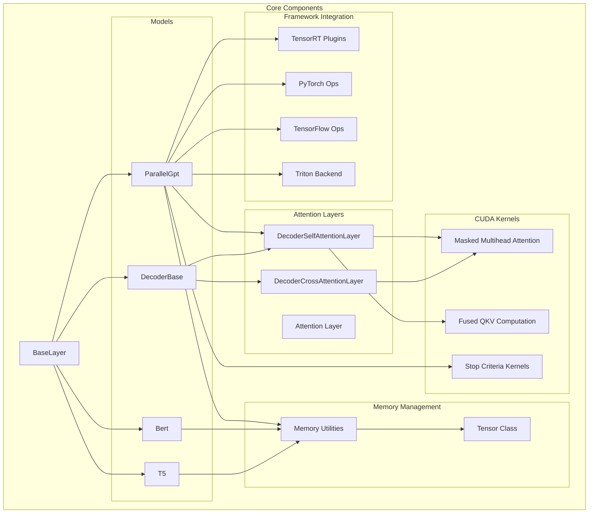

Sources: 
- [README.md:82-97]()
- [src/fastertransformer/models/multi_gpu_gpt/ParallelGpt.h:32-247]()
- [src/fastertransformer/layers/attention_layers/DecoderSelfAttentionLayer.cc:17-22]()
- [src/fastertransformer/utils/CMakeLists.txt:17-105]()

### Class Hierarchy

FasterTransformer organizes its components in a hierarchical structure with `BaseLayer` as the foundation. All model implementations and layer components inherit from this base class, which provides common functionality like memory management.

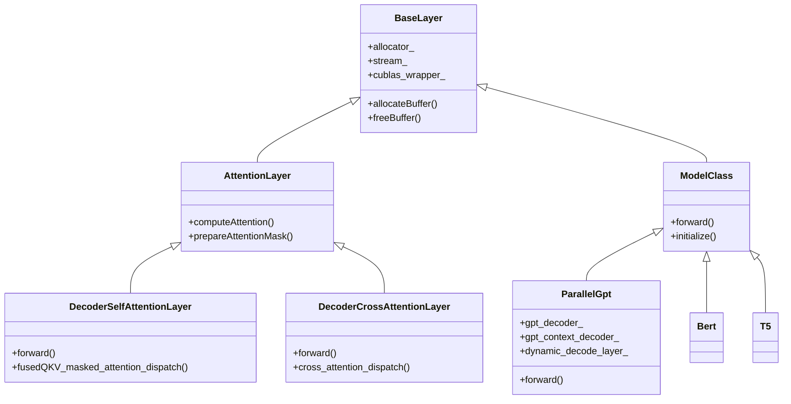

Sources:
- [src/fastertransformer/layers/attention_layers/DecoderSelfAttentionLayer.cc:192-456]()
- [src/fastertransformer/models/multi_gpu_gpt/ParallelGpt.h:32-85]()

## Memory Management

FasterTransformer implements custom memory management to optimize GPU memory utilization for transformer models.

### Memory Allocation Strategy

The library uses a custom allocator system that efficiently handles the allocation and reuse of GPU memory. Each component has `allocateBuffer()` and `freeBuffer()` methods that manage the memory required for operations.

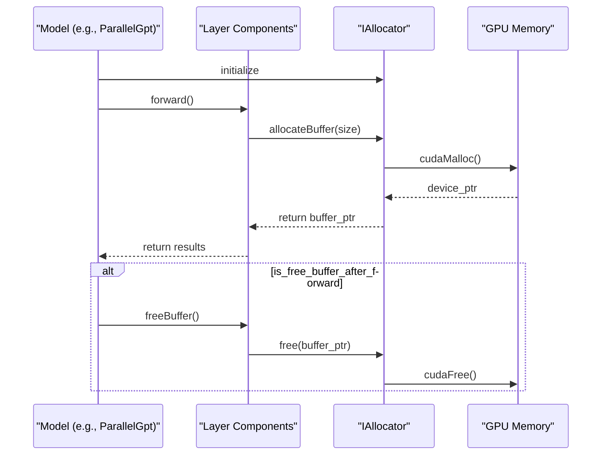

Sources:
- [src/fastertransformer/layers/attention_layers/DecoderSelfAttentionLayer.cc:192-236]()
- [src/fastertransformer/utils/CMakeLists.txt:51-54]()

## Attention Mechanisms

Attention mechanisms are core to transformer models, and FasterTransformer provides highly optimized implementations for both self-attention and cross-attention.

### Self-Attention

The self-attention mechanism allows a model to attend to different positions within its own input sequence. FasterTransformer implements optimized self-attention for decoder models.

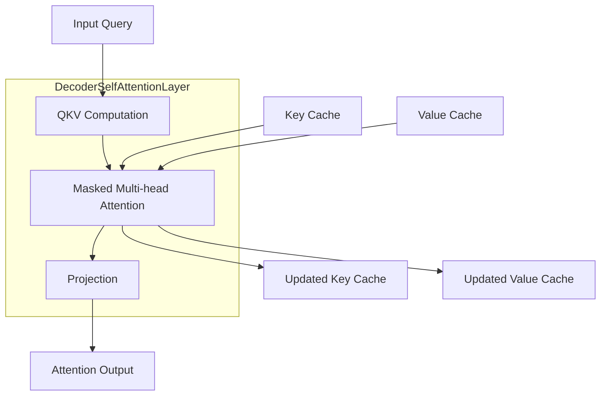

Sources:
- [src/fastertransformer/layers/attention_layers/DecoderSelfAttentionLayer.cc:459-615]()
- [src/fastertransformer/kernels/decoder_masked_multihead_attention.cu:16-139]()

### Cross-Attention

Cross-attention allows the decoder to attend to the encoder's output sequence. It's essential for encoder-decoder architectures like T5 and BART.

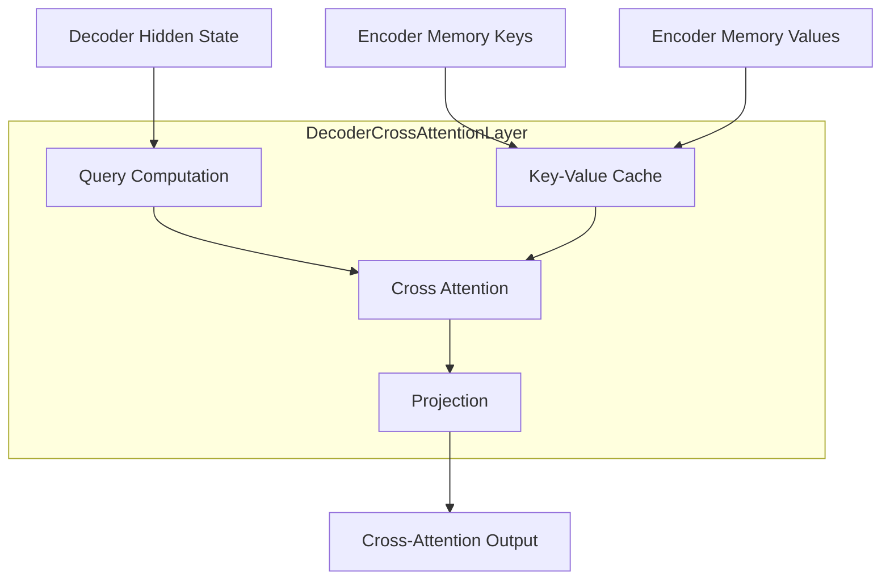

Sources:
- [src/fastertransformer/layers/attention_layers/DecoderCrossAttentionLayer.cu:33-546]()

### Attention Optimizations

FasterTransformer implements several optimizations for attention computation:

1. **Fused QKV Computation**: Computing query, key, and value projections in a single GEMM operation.
2. **Specialized kernels** for different head dimensions (e.g., 48, 64, 80, 128, etc.).
3. **Cache-optimized attention**: Efficiently using K/V caches for auto-regressive decoding.

Sources:
- [src/fastertransformer/kernels/decoder_masked_multihead_attention.cu:28-135]()
- [src/fastertransformer/kernels/decoder_masked_multihead_attention/decoder_masked_multihead_attention_112.cu:27-101]()
- [src/fastertransformer/kernels/decoder_masked_multihead_attention/decoder_masked_multihead_attention_48.cu:27-100]()

## Parallelism Strategies

FasterTransformer supports different parallelism strategies to distribute computation across multiple GPUs for large models.

### Tensor Parallelism

Tensor parallelism splits individual tensors across multiple GPUs, allowing larger model sizes to fit in GPU memory.

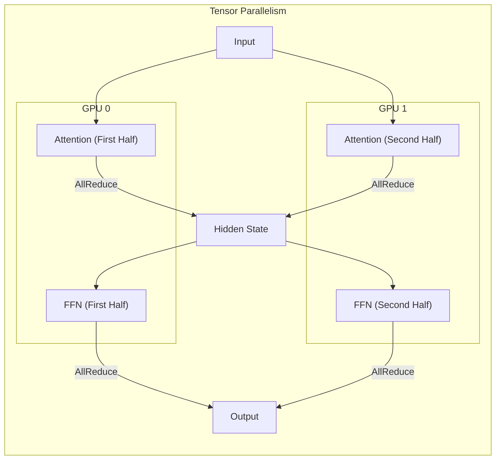

Sources:
- [src/fastertransformer/utils/CMakeLists.txt:63-68]()
- [src/fastertransformer/utils/CMakeLists.txt:83-86]()

### Pipeline Parallelism

Pipeline parallelism distributes transformer layers across multiple GPUs, with each GPU handling a subset of the layers.

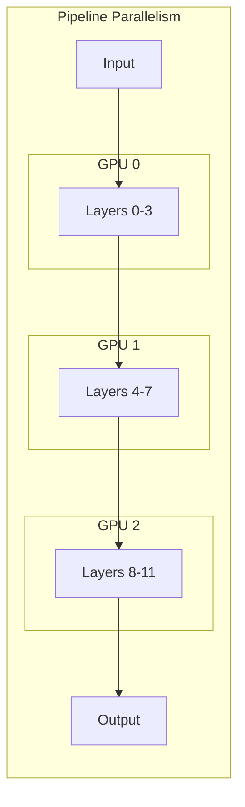

Sources:
- [src/fastertransformer/models/multi_gpu_gpt/ParallelGpt.h:62-63]()

## Data Flows and Components

The following diagram illustrates the data flow in a GPT model implemented in FasterTransformer:

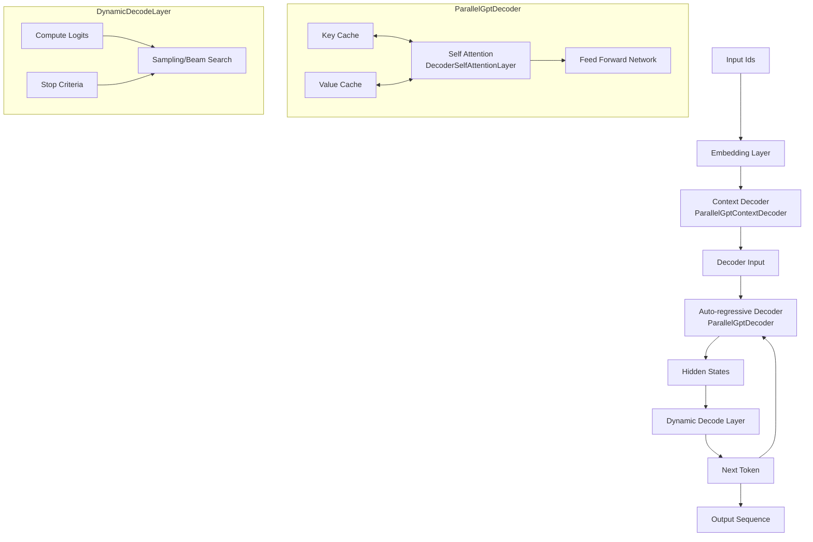

Sources:
- [src/fastertransformer/models/multi_gpu_gpt/ParallelGpt.h:84-176]()
- [src/fastertransformer/kernels/gpt_kernels.cu:29-188]()
- [src/fastertransformer/kernels/stop_criteria_kernels.cu:24-157]()

## CUDA Kernels

FasterTransformer extensively uses custom CUDA kernels to maximize performance for transformer operations:

| Kernel Category | Purpose | Key Functions |
|-----------------|---------|--------------|
| Attention Kernels | Computing self and cross attention | `masked_multihead_attention_kernel`, `cross_attention_kernel` |
| Embedding Kernels | Input embedding and position encoding | `invokeInputIdsEmbeddingLookupPosEncoding` |
| Stop Criteria Kernels | Determining when to stop generation | `invokeStopWordsCriterion`, `invokeLengthCriterion` |
| Memory Optimization | Managing shared contexts, deduplication | `invokeFindContextDups`, `invokeCompactInputs` |
| Transformation Kernels | Data layout transformations | `invokeTransposeAxis01` |

Sources:
- [src/fastertransformer/kernels/decoder_masked_multihead_attention.cu:25-135]()
- [src/fastertransformer/kernels/gpt_kernels.cu:29-103]()
- [src/fastertransformer/kernels/stop_criteria_kernels.cu:24-157]()

## Framework Integration

FasterTransformer provides integration with popular deep learning frameworks through custom operators and plugins.

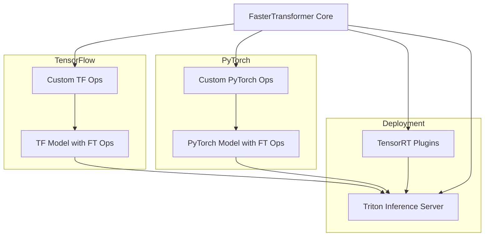

Sources:
- [README.md:82-97]()
- [src/fastertransformer/th_op/common/GptOps.cc:16-69]()
- [tests/decoding/tf_fused_self_multihead_attention_unit_test.py:104-171]()

## Performance Optimization Techniques

FasterTransformer implements several optimization techniques to maximize inference performance:

1. **Kernel Fusion**: Combining multiple operations into a single CUDA kernel to reduce memory traffic and kernel launch overhead.
2. **Context Sharing**: Reusing computations for identical input sequences in a batch.
3. **Memory Management**: Custom memory allocators and reuse strategies to minimize allocation overhead.
4. **Quantization Support**: INT8, FP8, and other reduced precision formats for faster computation.

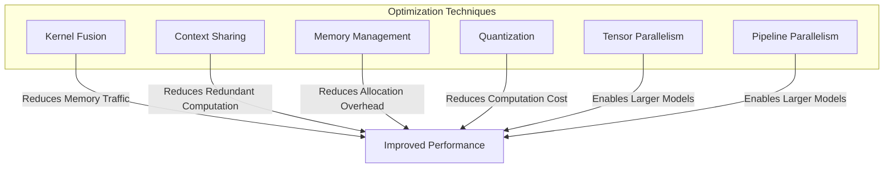

Sources:
- [README.md:28-36]()
- [src/fastertransformer/kernels/gpt_kernels.cu:106-159]()
- [tests/unittests/test_gpt_kernels.cu:42-106]()

## Unique Features

FasterTransformer introduces several unique features for efficient transformer inference:

### Context Deduplication

For batched inference, FasterTransformer can identify and deduplicate identical input contexts to avoid redundant computation.

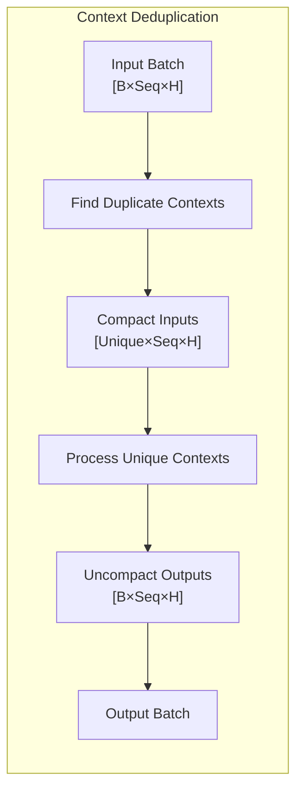

Sources:
- [src/fastertransformer/th_op/common/GptOps.cc:26-62]()
- [tests/unittests/test_gpt_kernels.cu:42-106]()

### Dynamic Shape Support

FasterTransformer supports dynamic shapes for both batch size and sequence length, allowing flexible deployment across various use cases.

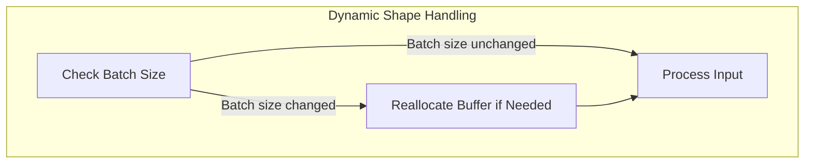

Sources:
- [src/fastertransformer/layers/attention_layers/DecoderSelfAttentionLayer.cc:239-249]()

## Summary

FasterTransformer provides a highly optimized architecture for transformer model inference with a focus on performance and scalability. Its key strengths include:

1. Specialized implementations for different transformer architectures
2. Optimized CUDA kernels for critical operations
3. Support for various parallelism strategies
4. Integration with popular deep learning frameworks
5. Advanced memory management techniques
6. Support for model quantization and other optimizations

These features together make FasterTransformer an efficient solution for deploying transformer models in production environments.

---

