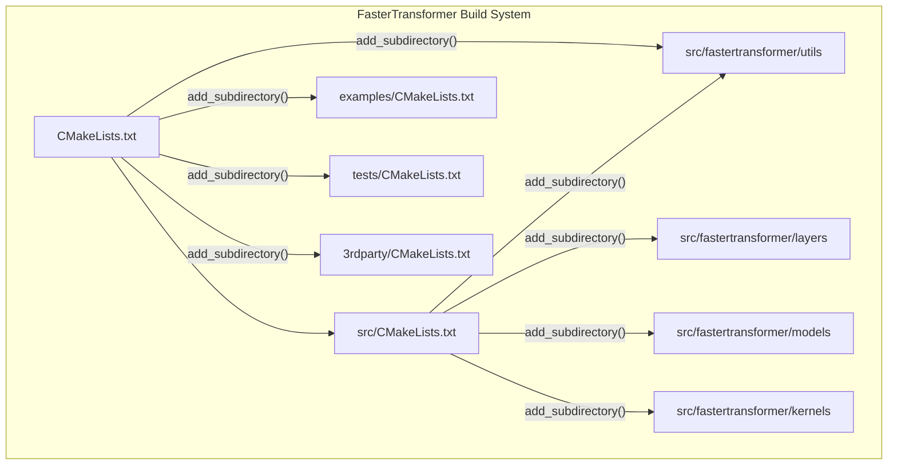
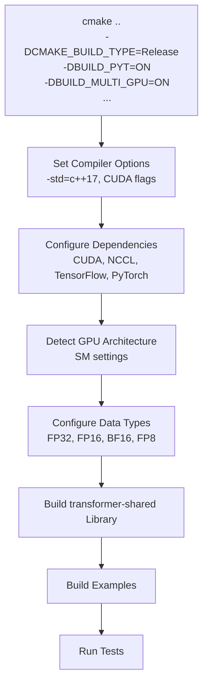
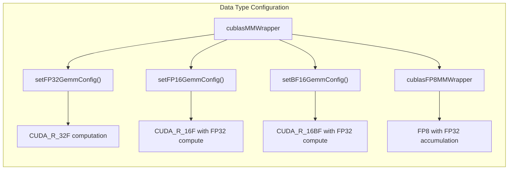
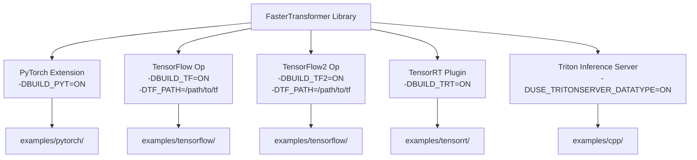
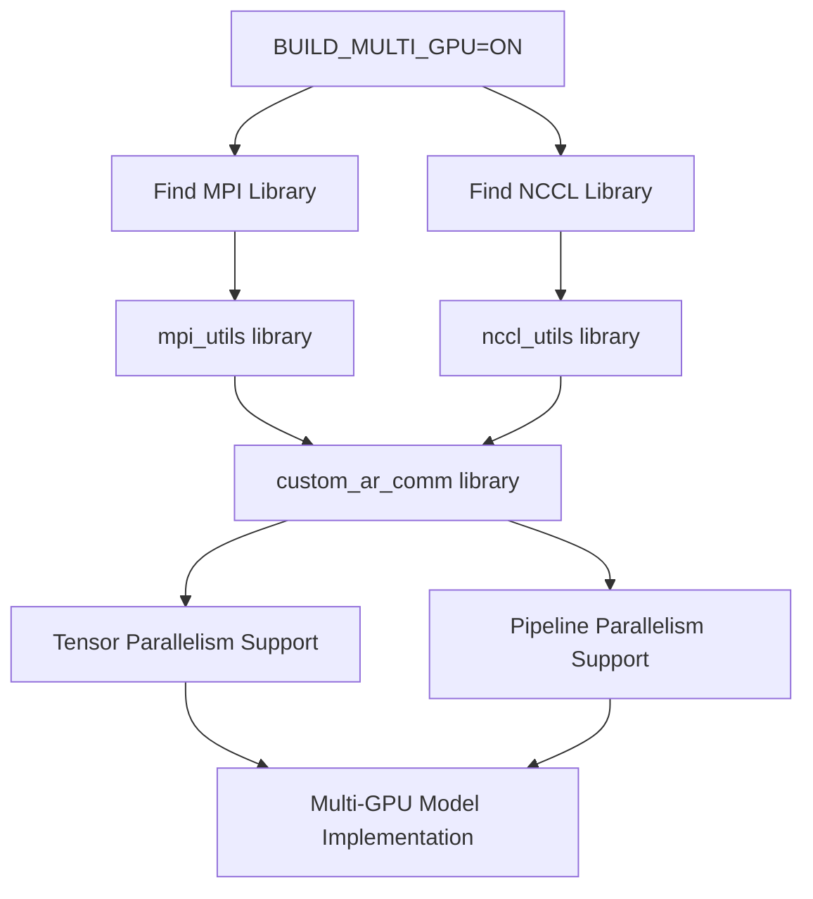
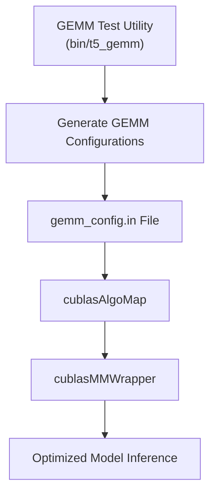
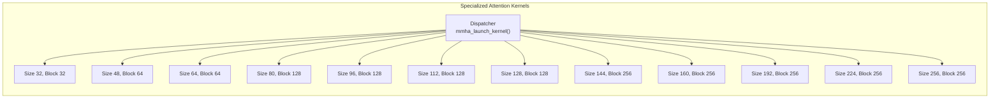

<!-- source: DeepWiki mcp.deepwiki.com · repo NVIDIA/FasterTransformer · page 2.1 Build System · fetched 2026-10-26 -->

# Build System

<details>
<summary>Relevant source files</summary>

The following files were used as context for generating this wiki page:

- [CMakeLists.txt](CMakeLists.txt)
- [cmake/Modules/FindNCCL.cmake](cmake/Modules/FindNCCL.cmake)
- [examples/pytorch/t5/translate_example.py](examples/pytorch/t5/translate_example.py)
- [src/fastertransformer/kernels/decoder_masked_multihead_attention.cu](src/fastertransformer/kernels/decoder_masked_multihead_attention.cu)
- [src/fastertransformer/kernels/decoder_masked_multihead_attention/decoder_masked_multihead_attention_112.cu](src/fastertransformer/kernels/decoder_masked_multihead_attention/decoder_masked_multihead_attention_112.cu)
- [src/fastertransformer/kernels/decoder_masked_multihead_attention/decoder_masked_multihead_attention_48.cu](src/fastertransformer/kernels/decoder_masked_multihead_attention/decoder_masked_multihead_attention_48.cu)
- [src/fastertransformer/kernels/gen_relative_pos_bias.cu](src/fastertransformer/kernels/gen_relative_pos_bias.cu)
- [src/fastertransformer/layers/attention_layers/DecoderCrossAttentionLayer.cu](src/fastertransformer/layers/attention_layers/DecoderCrossAttentionLayer.cu)
- [src/fastertransformer/layers/attention_layers/DecoderSelfAttentionLayer.cc](src/fastertransformer/layers/attention_layers/DecoderSelfAttentionLayer.cc)
- [src/fastertransformer/utils/CMakeLists.txt](src/fastertransformer/utils/CMakeLists.txt)
- [src/fastertransformer/utils/cublasFP8MMWrapper.cu](src/fastertransformer/utils/cublasFP8MMWrapper.cu)
- [src/fastertransformer/utils/cublasMMWrapper.cc](src/fastertransformer/utils/cublasMMWrapper.cc)
- [tests/decoding/tf_fused_self_multihead_attention_unit_test.py](tests/decoding/tf_fused_self_multihead_attention_unit_test.py)
- [tests/unittests/test_attention_kernels.cu](tests/unittests/test_attention_kernels.cu)

</details>


The FasterTransformer build system uses CMake to provide a flexible and configurable compilation process. This page describes the build configuration options, dependencies, supported hardware architectures, and available data types to help you build FasterTransformer for your specific use case. For information about running the built models, refer to the Framework Integration guides in section [Framework Integration](#6).

## Architecture Overview

The build system consists of a set of CMake files that define build targets, dependencies, and configuration options. The main `CMakeLists.txt` at the root of the project is the primary entry point, with additional CMake files in subdirectories handling specific components.



Sources: [CMakeLists.txt:301-305](CMakeLists.txt:301-305)

## Build Requirements

FasterTransformer has the following build requirements:

| Requirement | Minimum Version | Notes |
|-------------|-----------------|-------|
| CMake       | 3.8             | 3.13+ required for PyTorch extensions |
| CUDA        | 10.2            | BF16 support requires CUDA 11.0+, FP8 requires CUDA 11.8+ |
| C++ Compiler| C++17 support   | |
| cuBLAS      | Included with CUDA | |
| Optional: NCCL | | Required for multi-GPU support |
| Optional: MPI | | Required for multi-GPU support |
| Optional: TensorFlow | | Required for TF integration |
| Optional: PyTorch | 1.5.0+ | Required for PyTorch integration |
| Optional: cuSPARSELt | | Required for sparsity support |

Sources: [CMakeLists.txt:14-17](CMakeLists.txt:14-17), [CMakeLists.txt:79-86](CMakeLists.txt:79-86), [CMakeLists.txt:242-255](CMakeLists.txt:242-255)

## Build Configuration Flow



Sources: [CMakeLists.txt:124-203](CMakeLists.txt:124-203), [CMakeLists.txt:317-456](CMakeLists.txt:317-456)

## Build Configuration Options

FasterTransformer provides numerous build options to customize the build for different use cases:

| Option | Description | Default |
|--------|-------------|---------|
| `BUILD_CUTLASS_MOE` | Builds CUTLASS kernels supporting MoE GEMM | ON |
| `BUILD_CUTLASS_MIXED_GEMM` | Builds CUTLASS kernels supporting mixed GEMM | ON |
| `BUILD_TF` | Build in TensorFlow mode | OFF |
| `BUILD_TF2` | Build in TensorFlow2 mode | OFF |
| `BUILD_PYT` | Build in PyTorch TorchScript class mode | OFF |
| `BUILD_TRT` | Build projects about TensorRT | OFF |
| `BUILD_MULTI_GPU` | Build project for multi-GPU support | OFF |
| `USE_TRITONSERVER_DATATYPE` | Build triton backend for triton server | OFF |
| `SPARSITY_SUPPORT` | Build project with Ampere sparsity feature | OFF |
| `BUILD_FAST_MATH` | Build in fast math mode | ON |
| `USE_NVTX` | Enable NVTX profiling | ON |
| `MEASURE_BUILD_TIME` | Measure the build time of each module | OFF |
| `GIT_AUTOCLONE_CUTLASS` | Check CUTLASS submodule during build | ON |

Sources: [CMakeLists.txt:35-56](CMakeLists.txt:35-56), [CMakeLists.txt:75-77](CMakeLists.txt:75-77), [CMakeLists.txt:308-312](CMakeLists.txt:308-312)

### Optional Python Configuration 

When building with PyTorch integration (`BUILD_PYT=ON`), you can specify the Python path using:

```
-DPYTHON_PATH="/path/to/python"
```

This is useful when working with virtual environments or custom Python installations.

Sources: [CMakeLists.txt:241-282](CMakeLists.txt:241-282)

## Data Type Support

FasterTransformer supports multiple floating-point data types, which are enabled based on the CUDA version and build flags:

| Data Type | Description | Required CUDA Version | CMake Flag |
|-----------|-------------|------------------------|------------|
| FP32 | 32-bit floating point | Always supported | | 
| FP16 | 16-bit floating point | Always supported | | 
| BF16 | 16-bit brain floating point | CUDA 11.0+ | Added automatically with CUDA 11.0+ |
| FP8 | 8-bit floating point | CUDA 11.8+ | Added with `-DENABLE_FP8=ON` and CUDA 11.8+ |

These data types can be configured during runtime using the wrapper classes like `cublasMMWrapper`:



Sources: [CMakeLists.txt:19-30](CMakeLists.txt:19-30), [src/fastertransformer/utils/cublasMMWrapper.cc:330-354](src/fastertransformer/utils/cublasMMWrapper.cc:330-354), [src/fastertransformer/utils/cublasFP8MMWrapper.cu:22-76](src/fastertransformer/utils/cublasFP8MMWrapper.cu:22-76)

## GPU Architecture Support

FasterTransformer supports multiple NVIDIA GPU architectures through SM (Streaming Multiprocessor) settings. The supported architectures are:

| SM | GPU Architecture | Example GPUs |
|----|------------------|--------------|
| 52 | Maxwell | Tesla M40, GTX TITAN X |
| 60 | Pascal | Tesla P100 |
| 61 | Pascal | GTX 1080, GTX 1070 |
| 70 | Volta | Tesla V100, Titan V |
| 75 | Turing | RTX 2080, T4 |
| 80 | Ampere | A100 |
| 86 | Ampere | RTX 3090, RTX 3080 |
| 89 | Ada Lovelace | RTX 4090, RTX 4080 |
| 90 | Hopper | H100 |

You can specify which architectures to build for using the `-DSM=XX,YY,ZZ` option. Otherwise, the build system will default to targeting SM 70, 75, 80, and 86.

The build system also enables Tensor Core operations (WMMA) for architectures that support it (SM 70+).

Sources: [CMakeLists.txt:129-162](CMakeLists.txt:129-162)

## Framework Integration

FasterTransformer can be built to integrate with various ML frameworks:



Sources: [CMakeLists.txt:47-56](CMakeLists.txt:47-56), [CMakeLists.txt:108-113](CMakeLists.txt:108-113), [CMakeLists.txt:242-282](CMakeLists.txt:242-282)

## Multi-GPU Support

FasterTransformer supports multi-GPU training and inference through various parallelism strategies:



The build system will automatically search for MPI and NCCL when `BUILD_MULTI_GPU=ON`. The FindNCCL.cmake module helps locate NCCL on your system.

Sources: [CMakeLists.txt:79-86](CMakeLists.txt:79-86), [cmake/Modules/FindNCCL.cmake:77-165](cmake/Modules/FindNCCL.cmake:77-165), [src/fastertransformer/utils/CMakeLists.txt:56-68](src/fastertransformer/utils/CMakeLists.txt:56-68)

## GEMM Configuration

FasterTransformer includes a GEMM (General Matrix Multiplication) test utility to find the optimal configurations for different matrix sizes. This is especially important for achieving maximum performance on different GPU architectures.



This utility is built as part of the examples and is used by the PyTorch and TensorFlow examples to find optimal GEMM configurations. For example, in the T5 example:

```bash
./bin/t5_gemm batch_size beam_width max_seq_len d_model head_num size_per_head d_ff ...
```

Sources: [examples/pytorch/t5/translate_example.py:245-254](examples/pytorch/t5/translate_example.py:245-254), [src/fastertransformer/utils/CMakeLists.txt:29-40](src/fastertransformer/utils/CMakeLists.txt:29-40)

## Kernel Specialization

FasterTransformer includes specialized CUDA kernels for different model sizes. These kernels are highly optimized for specific sizes of attention heads:



Each kernel variant is specialized for a specific attention head size and block size to achieve optimal performance.

Sources: [src/fastertransformer/kernels/decoder_masked_multihead_attention.cu:28-68](src/fastertransformer/kernels/decoder_masked_multihead_attention.cu:28-68), [src/fastertransformer/kernels/decoder_masked_multihead_attention/decoder_masked_multihead_attention_112.cu:28-71](src/fastertransformer/kernels/decoder_masked_multihead_attention/decoder_masked_multihead_attention_112.cu:28-71)

## Building FasterTransformer

### Basic Build Process

Here's a step-by-step guide for building FasterTransformer:

1. Clone the repository:
   ```bash
   git clone https://github.com/NVIDIA/FasterTransformer.git
   cd FasterTransformer
   ```

2. Create a build directory:
   ```bash
   mkdir build
   cd build
   ```

3. Configure with CMake:
   ```bash
   cmake .. -DCMAKE_BUILD_TYPE=Release
   ```

4. Build:
   ```bash
   make -j
   ```

### Advanced Configuration

For more advanced configurations, you can specify additional options:

1. Building with PyTorch support:
   ```bash
   cmake .. -DCMAKE_BUILD_TYPE=Release -DBUILD_PYT=ON
   ```

2. Building with TensorFlow support:
   ```bash
   cmake .. -DCMAKE_BUILD_TYPE=Release -DBUILD_TF=ON -DTF_PATH=/path/to/tensorflow
   ```

3. Building with multi-GPU support:
   ```bash
   cmake .. -DCMAKE_BUILD_TYPE=Release -DBUILD_MULTI_GPU=ON
   ```

4. Building with FP8 support (requires CUDA 11.8+):
   ```bash
   cmake .. -DCMAKE_BUILD_TYPE=Release -DENABLE_FP8=ON
   ```

5. Building for specific GPU architectures:
   ```bash
   cmake .. -DCMAKE_BUILD_TYPE=Release -DSM=80,86
   ```

Sources: [CMakeLists.txt:35-56](CMakeLists.txt:35-56), [CMakeLists.txt:79-86](CMakeLists.txt:79-86), [CMakeLists.txt:129-162](CMakeLists.txt:129-162)

## Common Build Issues

1. **Missing NCCL error when building with Multi-GPU support**:
   - Make sure NCCL is installed and the location is included in your `CMAKE_PREFIX_PATH`
   - You can specify NCCL location explicitly with environment variables:
     ```bash
     export NCCL_INCLUDE_DIR=/path/to/nccl/include
     export NCCL_LIB_DIR=/path/to/nccl/lib
     ```

2. **PyTorch version compatibility**:
   - FasterTransformer requires PyTorch 1.5.0 or newer for TorchScript mode
   - Older versions may cause build errors

3. **Incompatible C++ ABI between TensorFlow and FasterTransformer**:
   - TensorFlow uses the pre-C++11 ABI (`_GLIBCXX_USE_CXX11_ABI=0`)
   - TensorFlow 2 uses the C++11 ABI (`_GLIBCXX_USE_CXX11_ABI=1`)
   - Make sure to build with the matching ABI setting

4. **SM architecture not supported**:
   - Make sure to specify SM architectures compatible with your GPU
   - If no specific SM is provided, the build defaults to SM 70, 75, 80, and 86

Sources: [CMakeLists.txt:93-99](CMakeLists.txt:93-99), [CMakeLists.txt:242-282](CMakeLists.txt:242-282), [cmake/Modules/FindNCCL.cmake:93-100](cmake/Modules/FindNCCL.cmake:93-100)

## Output Structure

After building, you'll find the following outputs in your build directory:

| Path | Description |
|------|-------------|
| `lib/libtransformer-shared.so` | Main FasterTransformer shared library |
| `bin/` | Example executables and GEMM test utilities |
| `lib/lib*.a` | Static library components |
| `lib/libth_transformer.so` | PyTorch extension library (if built with PyTorch) |
| `lib/libtf_transformer.so` | TensorFlow custom op library (if built with TensorFlow) |

Sources: [CMakeLists.txt:205-207](CMakeLists.txt:205-207), [CMakeLists.txt:317-456](CMakeLists.txt:317-456)

---

