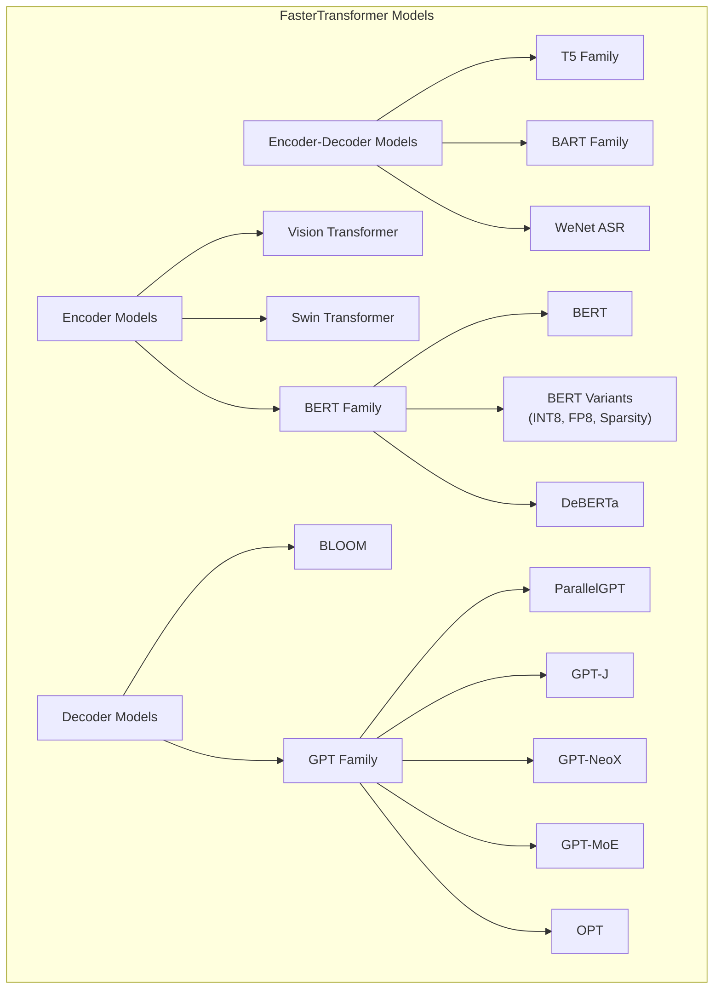
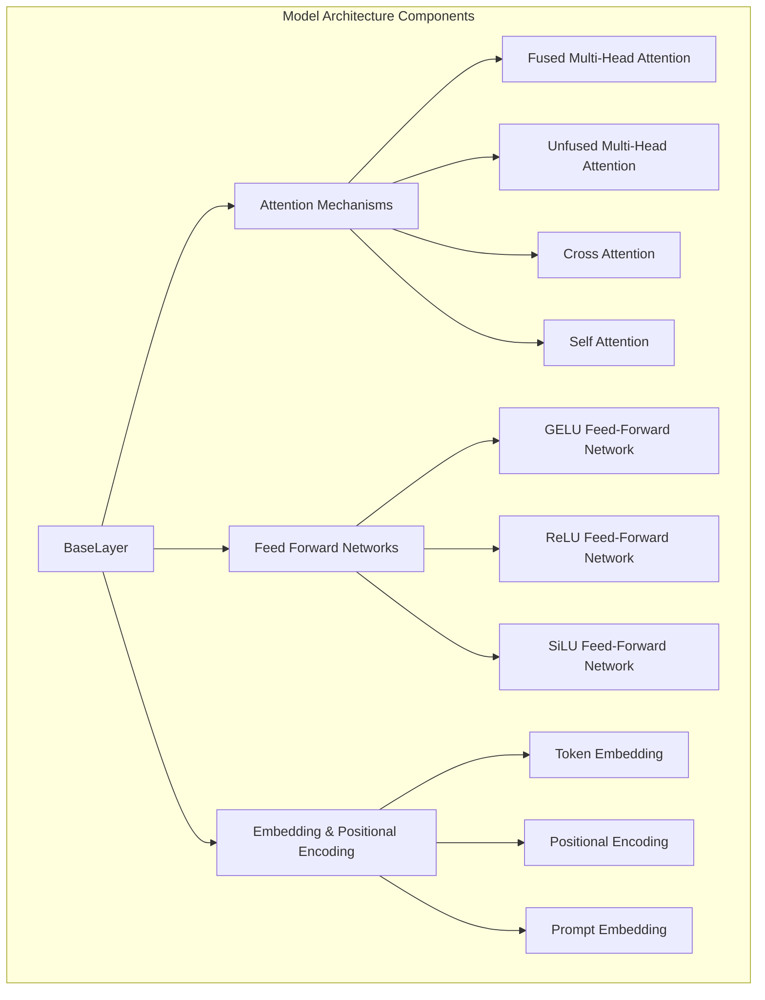
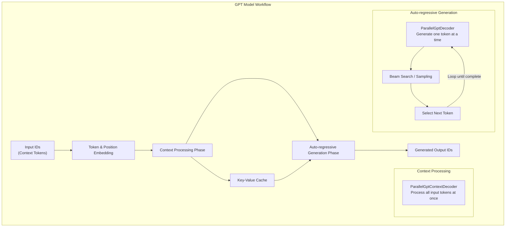
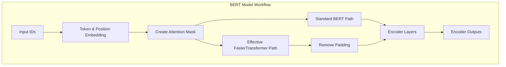
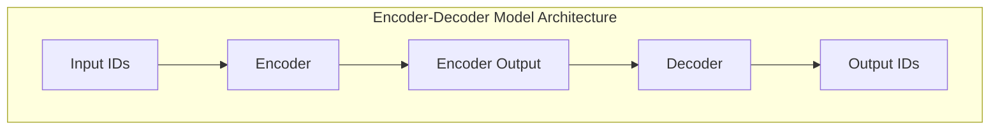
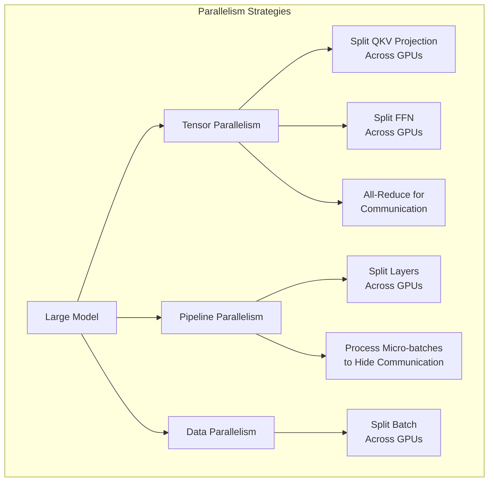
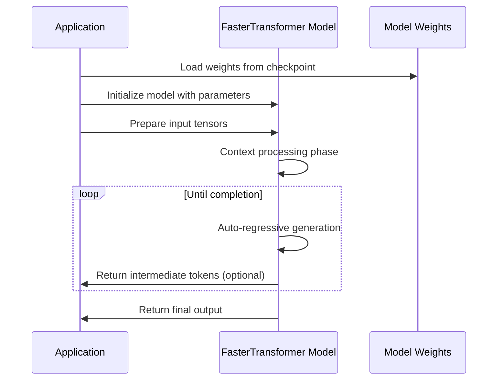

<!-- source: DeepWiki mcp.deepwiki.com · repo NVIDIA/FasterTransformer · page 3 Models · fetched 2026-10-26 -->

# Models

Relevant source files

The following files were used as context for generating this wiki page:

- [README.md](README.md)
- [docs/bert_guide.md](docs/bert_guide.md)
- [docs/decoder_guide.md](docs/decoder_guide.md)
- [docs/gpt_guide.md](docs/gpt_guide.md)
- [docs/gptj_guide.md](docs/gptj_guide.md)
- [src/fastertransformer/kernels/activation_kernels.cu](src/fastertransformer/kernels/activation_kernels.cu)
- [src/fastertransformer/kernels/gpt_kernels.cu](src/fastertransformer/kernels/gpt_kernels.cu)
- [src/fastertransformer/kernels/gpt_kernels.h](src/fastertransformer/kernels/gpt_kernels.h)
- [src/fastertransformer/kernels/stop_criteria_kernels.cu](src/fastertransformer/kernels/stop_criteria_kernels.cu)
- [src/fastertransformer/models/gptj/GptJ.h](src/fastertransformer/models/gptj/GptJ.h)
- [src/fastertransformer/models/gptj/GptJContextDecoder.cc](src/fastertransformer/models/gptj/GptJContextDecoder.cc)
- [src/fastertransformer/models/gptneox/GptNeoXContextDecoder.cc](src/fastertransformer/models/gptneox/GptNeoXContextDecoder.cc)
- [src/fastertransformer/models/multi_gpu_gpt/ParallelGpt.h](src/fastertransformer/models/multi_gpu_gpt/ParallelGpt.h)
- [src/fastertransformer/models/multi_gpu_gpt/ParallelGptContextDecoder.cc](src/fastertransformer/models/multi_gpu_gpt/ParallelGptContextDecoder.cc)
- [src/fastertransformer/th_op/common/GptOps.cc](src/fastertransformer/th_op/common/GptOps.cc)
- [tests/unittests/test_gpt_kernels.cu](tests/unittests/test_gpt_kernels.cu)

This page provides an overview of the model architectures supported by FasterTransformer, their implementations, and key characteristics. FasterTransformer contains highly optimized implementations of transformer-based models for efficient inference on NVIDIA GPUs.

## Supported Model Architectures

FasterTransformer implements various transformer-based models with optimizations for inference performance. The following diagram shows the main model types supported:

Sources: [README.md:28-71](). This support matrix shows a comprehensive list of model architectures, with details on framework support, precision, and parallelism capabilities.

## Model Architecture Components

All transformer-based models in FasterTransformer share common architectural components, although their specific implementations may vary. These components are optimized for inference performance.

Sources: [src/fastertransformer/kernels/activation_kernels.cu:50-165](), [src/fastertransformer/models/multi_gpu_gpt/ParallelGptContextDecoder.cc:28-45]()

### Key Components

1. **Attention Mechanisms**: Implementations of self-attention and cross-attention with various optimizations:
   - Fused multi-head attention for optimized performance
   - Unfused attention for flexibility
   - Support for rotary position embeddings
   - Optimized memory patterns for key/value caches

2. **Feed Forward Networks**: Different implementations based on activation functions:
   - GELU (Gaussian Error Linear Unit)
   - ReLU (Rectified Linear Unit)
   - SiLU/Swish
   - Support for gated activations (like GeGLU)

3. **Embedding Layers**:
   - Token embeddings
   - Positional encodings
   - Support for various prompt embedding techniques:
     - Prefix prompts
     - Soft prompts
     - P/Prompt tuning

## GPT Model Family

The GPT family models are generative decoder-only transformer models. FasterTransformer provides highly optimized implementations for several GPT variants.

### GPT Model Architecture and Workflow

The GPT architecture in FasterTransformer follows a two-phase process:

Sources: [docs/gpt_guide.md:89-107](), [src/fastertransformer/models/multi_gpu_gpt/ParallelGpt.h:85-88]()

### GPT Implementations

FasterTransformer provides several implementations in the GPT family:

1. **ParallelGPT**:
   - Main implementation supporting various GPT models
   - Supports tensor and pipeline parallelism
   - Features memory optimization for very large models
   - Implements various decoding strategies (beam search, sampling)

2. **GPT-J**:
   - Implementation of EleutherAI's 6B parameter model
   - Supports rotary position embeddings
   - Similar architecture to GPT but with architectural differences

3. **GPT-NeoX**:
   - Implementation of EleutherAI's GPT-NeoX architecture
   - Supports the NeoX-style rotary embeddings
   - Epsilon value for layer normalization is configurable

4. **OPT**:
   - Support for Meta's Open Pre-trained Transformer models
   - Follows the GPT implementation architecture with OPT-specific modifications

5. **BLOOM**:
   - Supports the BigScience BLOOM models
   - Follows the GPT implementation architecture with BLOOM-specific modifications

### GPT Model Key Classes

The main classes involved in GPT model implementations are:

1. **ParallelGpt**: The main model class that handles the entire workflow
2. **ParallelGptContextDecoder**: Processes the input context/prompt tokens in parallel
3. **ParallelGptDecoder**: Generates output tokens auto-regressively
4. **DynamicDecodeLayer**: Handles beam search and sampling strategies

Sources: [src/fastertransformer/models/multi_gpu_gpt/ParallelGpt.h:31-247](), [src/fastertransformer/models/multi_gpu_gpt/ParallelGptContextDecoder.cc:25-45]()

## BERT Model Family

BERT (Bidirectional Encoder Representations from Transformers) models are encoder-only transformer models designed for representation learning.

### BERT Architecture and Workflow

Sources: [docs/bert_guide.md:37-66]()

### BERT Implementations

FasterTransformer offers several variants of BERT:

1. **Standard BERT**:
   - Basic BERT implementation with optimized kernels
   - Supports various sizes (BERT base, large)

2. **Effective FasterTransformer**:
   - Removes padding to optimize computation
   - Especially effective for batches with variable sequence lengths

3. **BERT with INT8 Quantization**:
   - INT8 quantization for reduced memory footprint and faster inference
   - Optimized INT8 kernels for better performance

4. **BERT with FP8**:
   - Experimental support for FP8 precision
   - Further reduces memory requirements and improves throughput on supported hardware

5. **BERT with Sparsity**:
   - Leverages sparse matrix operations on Ampere GPUs
   - Improves performance through structured sparsity

6. **DeBERTa**:
   - Implementation of DeBERTa architecture
   - Supports disentangled attention mechanism

Sources: [docs/bert_guide.md:67-102]()

## Encoder-Decoder Models

Encoder-decoder models combine an encoder that processes the input sequence and a decoder that generates the output sequence.

### T5 Family

The T5 (Text-to-Text Transfer Transformer) model treats all NLP tasks as text-to-text problems:

- Supports T5, mT5, and T5-v1.1 model variants
- Supports UL2 (Unified Language Learner) with same architecture
- T5-MoE with Mixture of Experts implementation
- Tensor and pipeline parallelism support

### BART Family

BART (Bidirectional and Auto-Regressive Transformers) is a sequence-to-sequence model:

- Supports BART and mBART model variants
- Similar architecture to T5 but with architectural differences
- Tensor and pipeline parallelism support

### WeNet (ASR)

WeNet is a speech recognition model:

- End-to-end speech recognition capability
- Custom architecture for audio processing
- Optimized for streaming audio transcription

## Parallelism Strategies

FasterTransformer implements multiple parallelism strategies to efficiently run large models across multiple GPUs and nodes:

Sources: [docs/gpt_guide.md:199-204](), [src/fastertransformer/models/multi_gpu_gpt/ParallelGptContextDecoder.cc:186-205]()

### Tensor Parallelism

Tensor parallelism splits individual model weights across multiple GPUs:

1. **Weight Partitioning**: 
   - Self-attention weights are split by the head dimension
   - Feed-forward networks split the intermediate dimension
   - Each GPU processes a portion of the model's width

2. **Communication Pattern**:
   - All-reduce operations combine results across GPUs
   - Custom all-reduce communication optimizations for specific hardware
   - Optimized for high bandwidth intra-node communication

Sources: [docs/gpt_guide.md:199]()

### Pipeline Parallelism

Pipeline parallelism splits model layers across multiple GPUs:

1. **Layer Distribution**:
   - Model layers are distributed across GPUs
   - Each GPU processes specific transformer layers

2. **Micro-batching**:
   - Splits the input batch into micro-batches
   - Hides communication overhead by pipelining computation
   - Automatically adjusts micro-batch size for optimal performance

Sources: [docs/gpt_guide.md:200-204](), [src/fastertransformer/models/multi_gpu_gpt/ParallelGptContextDecoder.cc:186-205]()

## Optimization Techniques

FasterTransformer implements various optimization techniques to maximize performance:

### 1. Kernel Fusion

- Combines multiple small operations into single CUDA kernels
- Examples include:
  - Fused multi-head attention
  - AddBiasResidualLayerNorm fusion
  - Activation and bias addition fusion

### 2. Memory Optimization

- Reuses memory buffers between layers
- Implements efficient key-value cache management
- Removes padding from sequences to reduce computation

### 3. Custom CUDA Kernels

- Specialized kernels for transformer operations
- Optimized for specific GPU architectures
- Leverages GPU hardware features (like Tensor Cores)

### 4. Precision Options

FasterTransformer supports multiple precision options:

- **FP32**: Full precision for maximum accuracy
- **FP16**: Half precision using Tensor Cores on Volta+ GPUs
- **BF16**: Brain floating point precision on Ampere+ GPUs
- **INT8**: 8-bit integer quantization for reduced memory and higher throughput
- **FP8**: 8-bit floating point on Hopper architecture (experimental)

Sources: [docs/gpt_guide.md:197-200](), [README.md:36-71]()

## Usage Examples

Each model in FasterTransformer follows a similar pattern for inference:

1. **Model Initialization**: Configure the model with parameters like batch size, sequence length, etc.
2. **Weight Loading**: Load model weights from checkpoints
3. **Input Preparation**: Format input tensors appropriately
4. **Forward Pass**: Execute the model's `forward()` method
5. **Output Processing**: Process generated outputs

Here's an example workflow for GPT models:

## Conclusion

FasterTransformer provides highly optimized implementations of popular transformer-based models for efficient inference. With support for various model architectures, precision options, and parallelism strategies, it enables deployment of large language models with maximum performance on NVIDIA GPUs.

The model implementations are designed with a modular architecture that shares common components while accommodating the unique aspects of each model type. The library's focus on optimization techniques like kernel fusion, memory reuse, and efficient parallelism makes it particularly suitable for serving large models in production environments.

---

