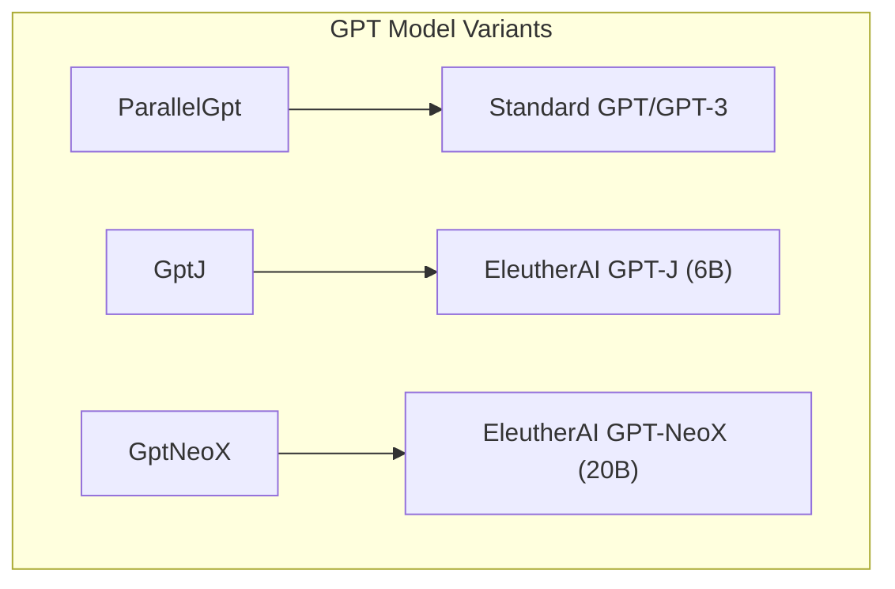
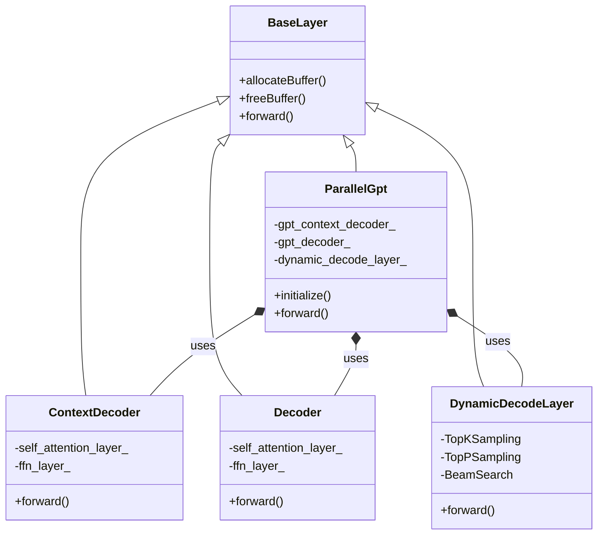
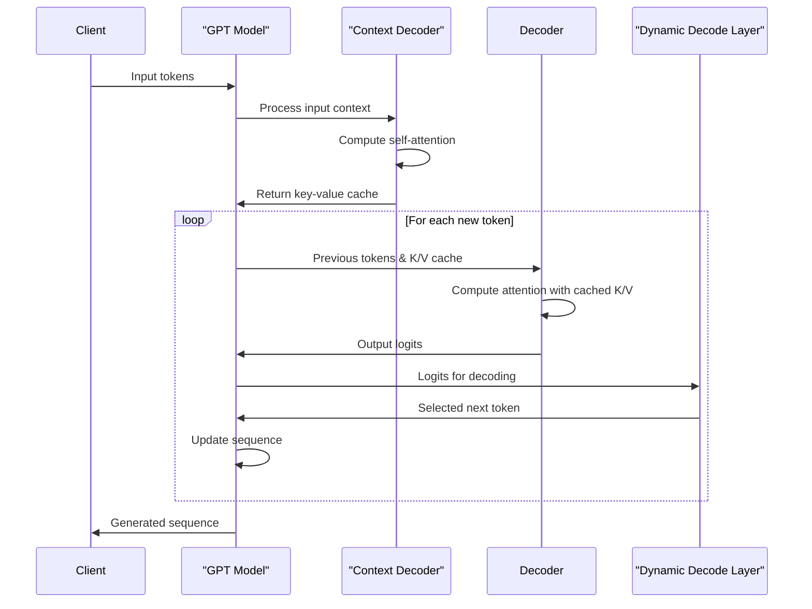
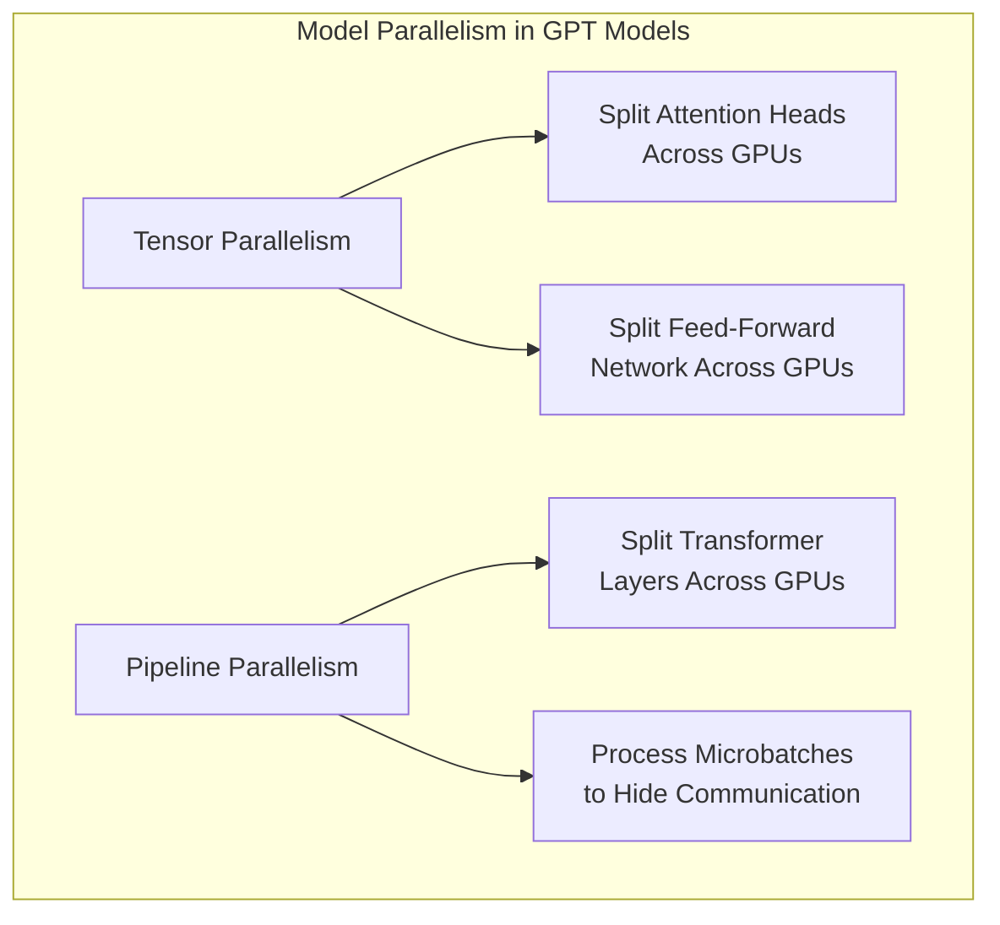
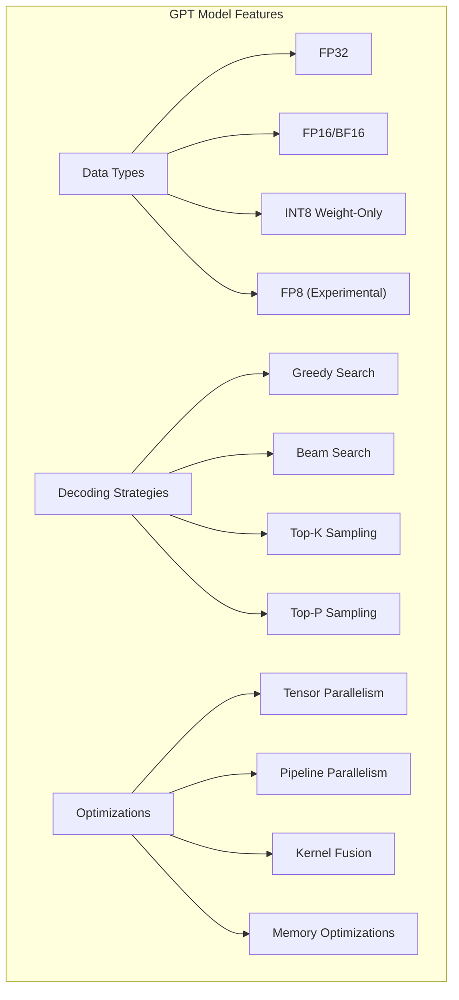
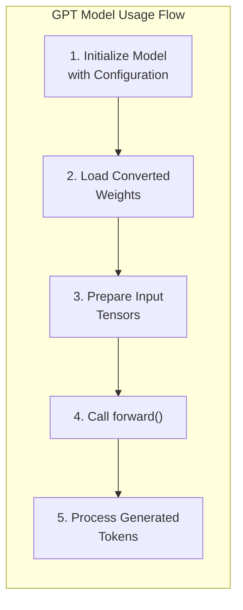

<!-- source: DeepWiki mcp.deepwiki.com · repo NVIDIA/FasterTransformer · page 3.1 GPT Models · fetched 2026-10-26 -->

# GPT Models

Relevant source files

The following files were used as context for generating this wiki page:

- [docs/gpt_guide.md](docs/gpt_guide.md)
- [docs/gptj_guide.md](docs/gptj_guide.md)
- [docs/gptneox_guide.md](docs/gptneox_guide.md)
- [examples/pytorch/gptneox/utils/huggingface_gptneox_convert.py](examples/pytorch/gptneox/utils/huggingface_gptneox_convert.py)
- [src/fastertransformer/models/gptj/GptJ.cc](src/fastertransformer/models/gptj/GptJ.cc)
- [src/fastertransformer/models/gptj/GptJ.h](src/fastertransformer/models/gptj/GptJ.h)
- [src/fastertransformer/models/gptj/GptJContextDecoder.cc](src/fastertransformer/models/gptj/GptJContextDecoder.cc)
- [src/fastertransformer/models/gptneox/GptNeoXContextDecoder.cc](src/fastertransformer/models/gptneox/GptNeoXContextDecoder.cc)
- [src/fastertransformer/models/multi_gpu_gpt/ParallelGpt.cc](src/fastertransformer/models/multi_gpu_gpt/ParallelGpt.cc)
- [src/fastertransformer/models/multi_gpu_gpt/ParallelGptContextDecoder.cc](src/fastertransformer/models/multi_gpu_gpt/ParallelGptContextDecoder.cc)

This document describes the GPT model implementations in FasterTransformer, focusing on their architecture, components, and optimization techniques. It covers ParallelGpt, GPT-J, and GPT-NeoX variants, their shared components, and how they're optimized for efficient inference on GPUs.

## GPT Model Architecture Overview

FasterTransformer provides optimized implementations of several GPT (Generative Pre-trained Transformer) variants designed for autoregressive text generation. These decoder-only transformer models share a common architecture with variations in specific implementation details.

Sources:
- [src/fastertransformer/models/multi_gpu_gpt/ParallelGpt.cc]()
- [src/fastertransformer/models/gptj/GptJ.cc]()
- [src/fastertransformer/models/gptneox/GptNeoX.cc]()

## Core Components

All GPT variants in FasterTransformer share three main components:

1. **Context Decoder**: Processes input context tokens and generates key-value cache
   - `ParallelGptContextDecoder` (Standard GPT)
   - `GptJContextDecoder` (GPT-J)
   - `GptNeoXContextDecoder` (GPT-NeoX)

2. **Decoder**: Generates new tokens based on previous tokens and key-value cache
   - `ParallelGptDecoder` (Standard GPT)
   - `GptJDecoder` (GPT-J)
   - `GptNeoXDecoder` (GPT-NeoX)

3. **Dynamic Decode Layer**: Implements decoding strategies (beam search, sampling)
   - Shared across all variants

Sources:
- [src/fastertransformer/models/multi_gpu_gpt/ParallelGpt.cc:31-87]()
- [src/fastertransformer/models/gptj/GptJ.cc:26-74]()

## Two-Phase Generation Workflow

GPT models in FasterTransformer follow a two-phase workflow for text generation:

### Phase 1: Context Processing

The context phase efficiently processes the input prompt once instead of repeatedly:

1. Input tokens are encoded and passed to the Context Decoder
2. Self-attention is computed across the entire input sequence
3. The resulting key-value cache is stored for the generation phase

### Phase 2: Autoregressive Generation

The generation phase produces one token at a time:

1. The Decoder processes the previously generated tokens using the key-value cache
2. The logits (token probabilities) are calculated 
3. The Dynamic Decode Layer selects the next token (via beam search or sampling)
4. The process repeats until completion

Sources:
- [docs/gpt_guide.md:87-97]()
- [src/fastertransformer/models/multi_gpu_gpt/ParallelGpt.cc:532-626]()

## Model Parallelism Strategies

To handle large models, FasterTransformer implements two forms of model parallelism:

1. **Tensor Parallelism**:
   - Splits individual layers across multiple GPUs
   - Follows Megatron-LM approach (dividing attention heads and FFN)
   - Requires all-reduce operations between GPUs
   - Preferred method within a single node

2. **Pipeline Parallelism**:
   - Distributes model layers across GPUs or nodes
   - Different layers run on different GPUs
   - Uses microbatches to hide communication latency
   - Preferred method across multiple nodes

Sources:
- [docs/gpt_guide.md:196-201]()
- [src/fastertransformer/models/multi_gpu_gpt/ParallelGptContextDecoder.cc:186-213]()

## Key Optimizations

FasterTransformer implements several optimizations to improve GPT inference performance:

1. **Kernel Fusion**:
   - Combines multiple operations into single CUDA kernels
   - Reduces memory bandwidth and kernel launch overhead
   - Includes fused self-attention and specialized fused operators

2. **Memory Optimization**:
   - Reuses memory buffers across decoder layers
   - Removes padding tokens to reduce computation
   - Optimizes key-value cache storage

3. **Quantization Support**:
   - FP16/BF16: Reduces memory usage while maintaining accuracy
   - INT8 weight-only: Further reduces memory for weight matrices
   - FP8 (experimental): Even more efficient precision format

Sources:
- [docs/gpt_guide.md:196-202]()
- [src/fastertransformer/models/multi_gpu_gpt/ParallelGptContextDecoder.cc:94-147]()

## Model Variant Differences

While sharing the same base architecture, each GPT variant has specific implementation differences:

### ParallelGpt (Standard GPT)
- Most feature-rich implementation
- Supports extensive model parallelism
- Handles very large models (up to 530B parameters)
- Supports the most optimizations (INT8, FP8, etc.)

### GPT-J
- Implements rotary position embeddings (RoPE)
- Specialized for EleutherAI's 6B parameter model
- Modified attention mechanism and layer structure

### GPT-NeoX
- Implements NeoX-style rotary embeddings
- Uses parallel residual connections
- Specifically optimized for the 20B parameter model

Sources:
- [docs/gptj_guide.md:21-25]()
- [docs/gptneox_guide.md:17-24]()
- [src/fastertransformer/models/gptj/GptJContextDecoder.cc:134-143]()
- [src/fastertransformer/models/gptneox/GptNeoXContextDecoder.cc:133-169]()

## Input and Output Tensors

The GPT models use a flexible tensor-based interface:

### Input Tensors

| Name | Shape | Description |
|------|-------|-------------|
| `input_ids` | [batch_size, max_input_length] | Input token IDs |
| `input_lengths` | [batch_size] | Length of each input sequence |
| `output_seq_len` | [batch_size] | Desired generation length |
| `runtime_top_k` | [1] or [batch_size] | Top-K sampling parameter (optional) |
| `runtime_top_p` | [1] or [batch_size] | Top-P sampling parameter (optional) |
| `temperature` | [1] or [batch_size] | Sampling temperature (optional) |
| `repetition_penalty` | [1] or [batch_size] | Penalty for repeated tokens (optional) |

### Output Tensors

| Name | Shape | Description |
|------|-------|-------------|
| `output_ids` | [batch_size, beam_width, max_output_seq_len] | Generated token IDs |
| `sequence_length` | [batch_size, beam_width] | Length of each sequence |
| `output_log_probs` | [batch_size, beam_width, output_len] | Log probabilities (optional) |
| `cum_log_probs` | [batch_size, beam_width] | Cumulative sequence log probability (optional) |

Sources:
- [docs/gpt_guide.md:157-193]()
- [docs/gptj_guide.md:64-98]()
- [src/fastertransformer/models/multi_gpu_gpt/ParallelGpt.cc:532-626]()

## Supported Features

FasterTransformer's GPT models support numerous features:

### Data Types
- FP32, FP16, BF16 for all models
- INT8 weight-only quantization (ParallelGpt)
- FP8 (experimental, ParallelGpt)

### Decoding Strategies
- Greedy search
- Beam search with configurable beam width
- Top-K sampling
- Top-P (nucleus) sampling
- Temperature scaling
- Repetition penalty

### Additional Features
- Multi-GPU and multi-node inference
- Checkpoint converters for various formats
- Stop token detection
- Bad words list filtering
- Prompt learning (prefix tuning, p-tuning)

Sources:
- [docs/gpt_guide.md:53-85]()
- [docs/gptj_guide.md:110-125]()
- [docs/gptneox_guide.md:35-48]()

## Framework Integration

FasterTransformer supports integration with multiple frameworks:

1. **PyTorch**:
   - Custom operators for seamless integration
   - Converter utilities for HuggingFace models

2. **TensorFlow**:
   - Custom operators for TensorFlow models
   - Support for TensorFlow checkpoints

3. **Triton Inference Server**:
   - Dedicated backend for deployment
   - Optimized for production environments

Sources:
- [docs/gpt_guide.md:199-200]()
- [examples/pytorch/gptneox/utils/huggingface_gptneox_convert.py]()

## Model Initialization and Usage

The initialization process for GPT models follows this pattern:

1. Initialize the model with parameters:
   - Model dimensions (head_num, size_per_head, etc.)
   - Parallelism configuration
   - Decoding parameters

2. Load weights from converted checkpoints:
   - HuggingFace models
   - Megatron-LM models
   - Custom formats

3. Prepare input tensors with prompt tokens and generation parameters

4. Call the forward method to generate text

5. Process the output tokens (convert to text)

Sources:
- [src/fastertransformer/models/multi_gpu_gpt/ParallelGpt.cc:273-353]()
- [src/fastertransformer/models/gptj/GptJ.cc:212-327]()
- [docs/gpt_guide.md:116-124]()

---

