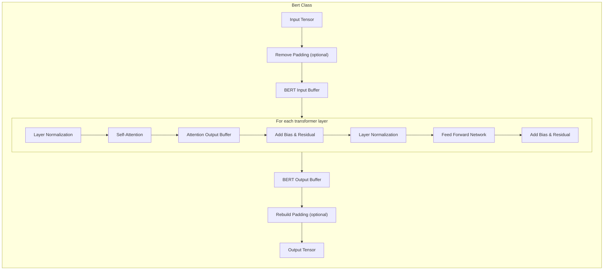
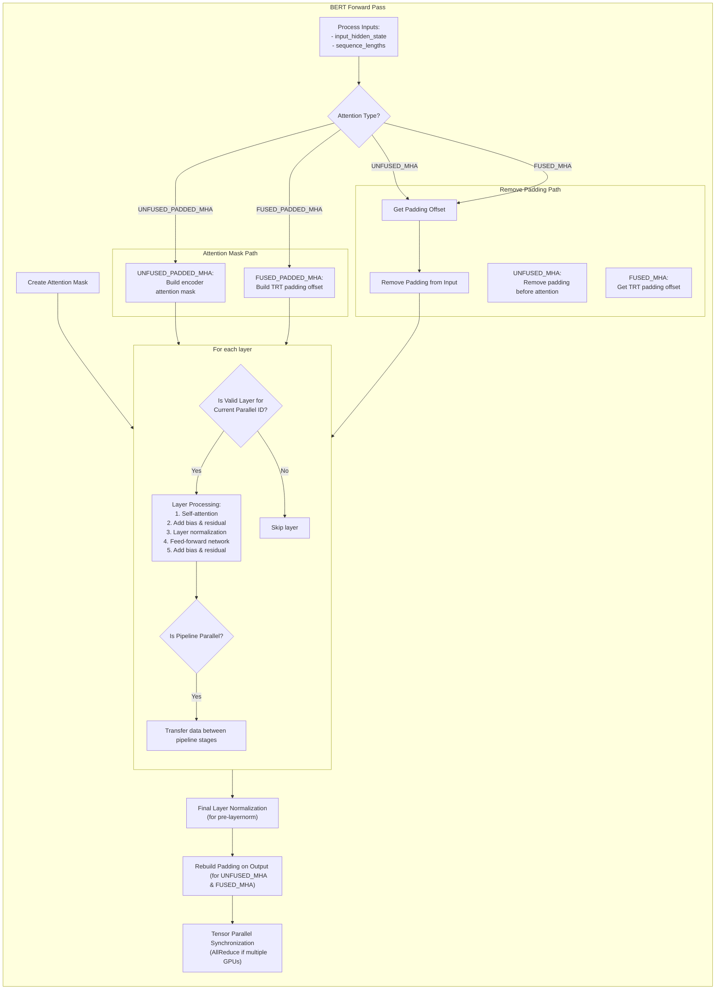
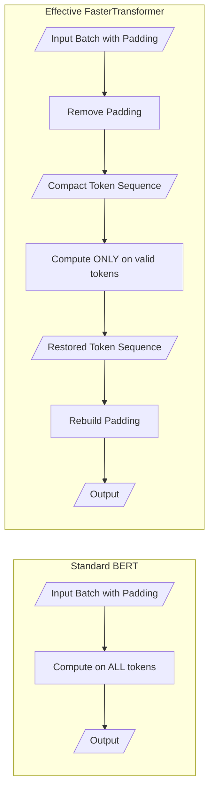
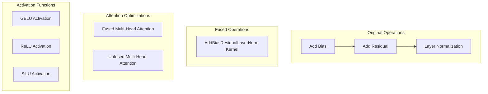
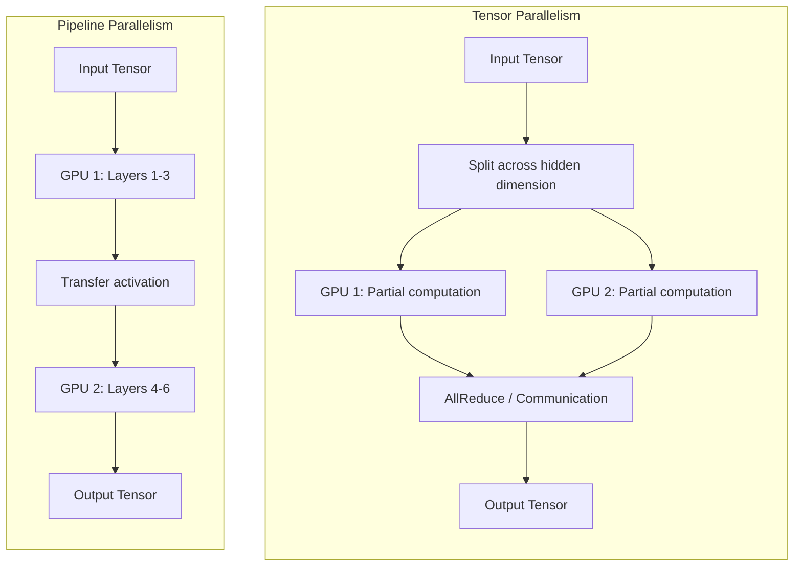
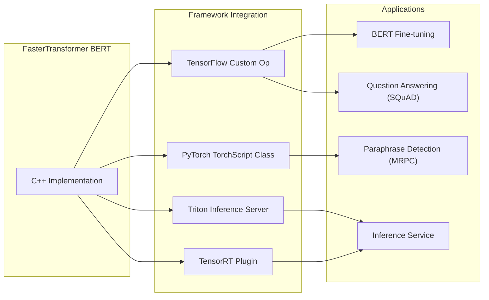

<!-- source: DeepWiki mcp.deepwiki.com · repo NVIDIA/FasterTransformer · page 3.2 BERT Models · fetched 2026-10-26 -->

# BERT Models

<details>
<summary>Relevant source files</summary>

The following files were used as context for generating this wiki page:

- [docs/bert_guide.md](docs/bert_guide.md)
- [docs/decoder_guide.md](docs/decoder_guide.md)
- [src/fastertransformer/kernels/activation_kernels.cu](src/fastertransformer/kernels/activation_kernels.cu)
- [src/fastertransformer/layers/TensorParallelGeluFfnLayer.cc](src/fastertransformer/layers/TensorParallelGeluFfnLayer.cc)
- [src/fastertransformer/layers/TensorParallelReluFfnLayer.cc](src/fastertransformer/layers/TensorParallelReluFfnLayer.cc)
- [src/fastertransformer/layers/TensorParallelSiluFfnLayer.cc](src/fastertransformer/layers/TensorParallelSiluFfnLayer.cc)
- [src/fastertransformer/layers/attention_layers/TensorParallelDecoderCrossAttentionLayer.cc](src/fastertransformer/layers/attention_layers/TensorParallelDecoderCrossAttentionLayer.cc)
- [src/fastertransformer/layers/attention_layers/TensorParallelDecoderSelfAttentionLayer.cc](src/fastertransformer/layers/attention_layers/TensorParallelDecoderSelfAttentionLayer.cc)
- [src/fastertransformer/layers/attention_layers/TensorParallelDisentangledAttentionLayer.cc](src/fastertransformer/layers/attention_layers/TensorParallelDisentangledAttentionLayer.cc)
- [src/fastertransformer/layers/attention_layers/TensorParallelGptContextAttentionLayer.cc](src/fastertransformer/layers/attention_layers/TensorParallelGptContextAttentionLayer.cc)
- [src/fastertransformer/layers/attention_layers/TensorParallelUnfusedAttentionLayer.cc](src/fastertransformer/layers/attention_layers/TensorParallelUnfusedAttentionLayer.cc)
- [src/fastertransformer/models/bert/Bert.cc](src/fastertransformer/models/bert/Bert.cc)

</details>


This page documents the BERT (Bidirectional Encoder Representations from Transformers) model implementation in FasterTransformer. It covers the architecture, optimization techniques, available variants, and usage patterns. For information about GPT models, see [GPT Models](#3.1), and for encoder-decoder architectures like T5, see [T5 and Encoder-Decoder Models](#3.3).

## BERT Architecture in FasterTransformer

The BERT model in FasterTransformer is a highly optimized implementation of the encoder-only transformer architecture. It consists of multiple transformer layers, each containing self-attention mechanisms and feed-forward networks.



The core components of BERT include:

1. **Attention Mechanisms**: 
   - Supports both fused and unfused attention implementations
   - Different attention types (FUSED_MHA, UNFUSED_MHA, FUSED_PADDED_MHA, UNFUSED_PADDED_MHA)

2. **Feed-Forward Networks**: 
   - Configurable with different activation functions (GELU, ReLU)
   - Supports tensor parallel computation

3. **Layer Normalization**:
   - Supports both pre-layer normalization and post-layer normalization

Sources: [src/fastertransformer/models/bert/Bert.cc:22-91](https://github.com/NVIDIA/FasterTransformer/blob/master/src/fastertransformer/models/bert/Bert.cc), [docs/bert_guide.md:38-67](https://github.com/NVIDIA/FasterTransformer/blob/master/docs/bert_guide.md)

## Execution Flow



Sources: [src/fastertransformer/models/bert/Bert.cc:316-706](https://github.com/NVIDIA/FasterTransformer/blob/master/src/fastertransformer/models/bert/Bert.cc)

## Key Optimizations

FasterTransformer implements several optimizations to accelerate BERT inference:

### 1. Effective FasterTransformer

Effective FasterTransformer removes padding from input sequences to avoid computing on unnecessary tokens, which improves performance when the average sequence length is much shorter than the maximum sequence length.



Sources: [docs/bert_guide.md:49-65](https://github.com/NVIDIA/FasterTransformer/blob/master/docs/bert_guide.md)

### 2. Quantization Options

FasterTransformer supports multiple precision modes for BERT:

| Precision | Description | GPU Requirements |
|-----------|-------------|------------------|
| FP32      | Full precision floating point | Any CUDA-capable GPU |
| FP16      | Half precision floating point | Pascal+ (better on Volta+) |
| BF16      | Brain floating point | Ampere+ |
| INT8      | 8-bit integer quantization | Turing+ (T4, A100, etc.) |
| FP8       | 8-bit floating point (experimental) | Hopper+ (H100) |

There are two INT8 quantization modes available:

| Feature | int8_mode == 1 | int8_mode == 2 |
|---------|----------------|----------------|
| Quantize residual | No | Yes |
| INT8 output GEMM | No | Yes |
| Per-channel quantization for weights | Yes | No |
| Typical use case | Higher accuracy | Better performance |

Sources: [docs/bert_guide.md:109-120](https://github.com/NVIDIA/FasterTransformer/blob/master/docs/bert_guide.md)

### 3. Kernel Fusion and Optimization



Sources: [src/fastertransformer/kernels/activation_kernels.cu:27-125](https://github.com/NVIDIA/FasterTransformer/blob/master/src/fastertransformer/kernels/activation_kernels.cu), [docs/bert_guide.md:55-56](https://github.com/NVIDIA/FasterTransformer/blob/master/docs/bert_guide.md)

### 4. Model Parallelism Support

FasterTransformer BERT supports both tensor parallelism (splitting model weights across GPUs) and pipeline parallelism (distributing layers across GPUs).



The tensor parallelism implementation includes specialized classes:
- `TensorParallelGeluFfnLayer`
- `TensorParallelReluFfnLayer`
- `TensorParallelSiluFfnLayer`
- `TensorParallelUnfusedAttentionLayer`

Sources: [src/fastertransformer/layers/TensorParallelGeluFfnLayer.cc](https://github.com/NVIDIA/FasterTransformer/blob/master/src/fastertransformer/layers/TensorParallelGeluFfnLayer.cc), [src/fastertransformer/layers/TensorParallelReluFfnLayer.cc](https://github.com/NVIDIA/FasterTransformer/blob/master/src/fastertransformer/layers/TensorParallelReluFfnLayer.cc), [src/fastertransformer/layers/attention_layers/TensorParallelUnfusedAttentionLayer.cc](https://github.com/NVIDIA/FasterTransformer/blob/master/src/fastertransformer/layers/attention_layers/TensorParallelUnfusedAttentionLayer.cc)

## BERT Class Interface

The BERT model class accepts the following key parameters:

### Constructor Arguments

| Parameter | Description |
|-----------|-------------|
| head_num | Number of attention heads |
| size_per_head | Size of each attention head |
| inter_size | Intermediate size of the feed-forward network |
| num_layer | Number of transformer layers |
| sm | Compute capability of the GPU |
| q_scaling | Query scaling factor for attention |
| attention_type | Type of attention implementation (FUSED_MHA, UNFUSED_MHA, etc.) |
| sparse | Whether to use sparse GEMM operations |
| activation_type | Activation function type (GELU, RELU) |
| layernorm_type | Layer normalization type (pre or post) |
| tensor_para | Tensor parallelism configuration |
| pipeline_para | Pipeline parallelism configuration |

### Input Tensors

| Name | Shape | Description |
|------|-------|-------------|
| input_hidden_state | [batch_size, sequence_length, hidden_dimension] | The input embeddings or features |
| sequence_lengths | [batch_size] | The lengths of input sequences |

### Output Tensors

| Name | Shape | Description |
|------|-------|-------------|
| output_hidden_state | [batch_size, sequence_length, hidden_dimension] | The output features after transformer processing |

Sources: [src/fastertransformer/models/bert/Bert.cc:93-133](https://github.com/NVIDIA/FasterTransformer/blob/master/src/fastertransformer/models/bert/Bert.cc), [docs/bert_guide.md:69-106](https://github.com/NVIDIA/FasterTransformer/blob/master/docs/bert_guide.md)

## Usage Example

FasterTransformer provides multiple interfaces to use BERT:

1. **C++ API**: Direct integration through the native C++ interface
2. **TensorFlow API**: Integration with TensorFlow using custom operators
3. **PyTorch API**: Integration with PyTorch using TorchScript custom classes

### Basic C++ Usage Pattern

1. Generate GEMM configuration for optimal performance
```bash
./bin/bert_gemm <batch_size> <seq_len> <head_num> <size_per_head> <data_type> <int8_mode>
```

2. Run BERT inference
```bash
./bin/bert_example <batch_size> <num_layers> <seq_len> <head_num> <size_per_head> <data_type> <is_remove_padding> <int8_mode>
```

Sources: [docs/bert_guide.md:232-295](https://github.com/NVIDIA/FasterTransformer/blob/master/docs/bert_guide.md)

## Supported Configurations and Limitations

FasterTransformer BERT supports the following configurations:

- Batch size: ≤ 4096
- Sequence length: ≤ 4096 (for INT8 mode=1, must be multiple of 32 when length > 384)
- Size per head: Even number and < 128
- Head number: Any number satisfying head_num * size_per_head ≤ 1024 for FP32, or ≤ 2048 for FP16
- Data types: FP32, FP16, BF16, INT8, and FP8 (experimental)
- Any number of layers (limited by available memory)

Sources: [docs/bert_guide.md:42-48](https://github.com/NVIDIA/FasterTransformer/blob/master/docs/bert_guide.md)

## Integration with Machine Learning Frameworks

FasterTransformer BERT can be integrated with popular ML frameworks:



Sources: [docs/bert_guide.md:232-413](https://github.com/NVIDIA/FasterTransformer/blob/master/docs/bert_guide.md)

## Performance Optimizations and Considerations

When using BERT in FasterTransformer, consider the following for optimal performance:

1. **Generate optimal GEMM configuration**: Always generate a `gemm_config.in` file for your specific hardware and model configuration.

2. **Choose the right precision**: Lower precision (FP16, BF16, INT8) offers faster inference but with potential accuracy tradeoffs.

3. **Use Effective FasterTransformer**: When your input sequences have variable lengths with significant padding, removing padding can provide substantial speedups.

4. **Leverage tensor parallelism**: For large models, distributing computation across multiple GPUs can improve throughput.

5. **Select appropriate attention type**: Different attention implementations have different performance characteristics based on sequence length and batch size.

6. **Hardware considerations**:
   - Turing or newer GPUs (T4, A100, etc.) for INT8 support
   - Ampere or newer GPUs for BF16 support
   - Hopper (H100) for FP8 support

Sources: [docs/bert_guide.md:183-194](https://github.com/NVIDIA/FasterTransformer/blob/master/docs/bert_guide.md), [docs/bert_guide.md:232-413](https://github.com/NVIDIA/FasterTransformer/blob/master/docs/bert_guide.md)

---

