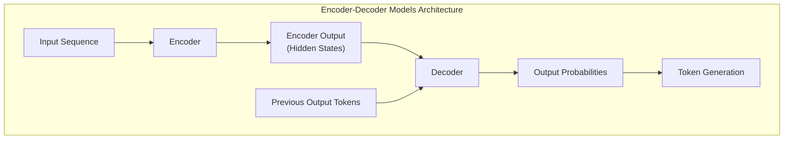
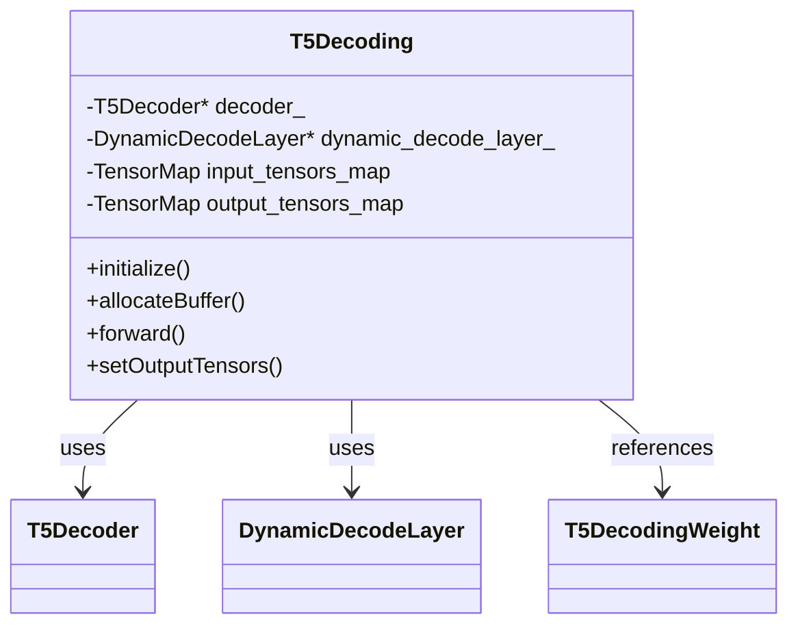
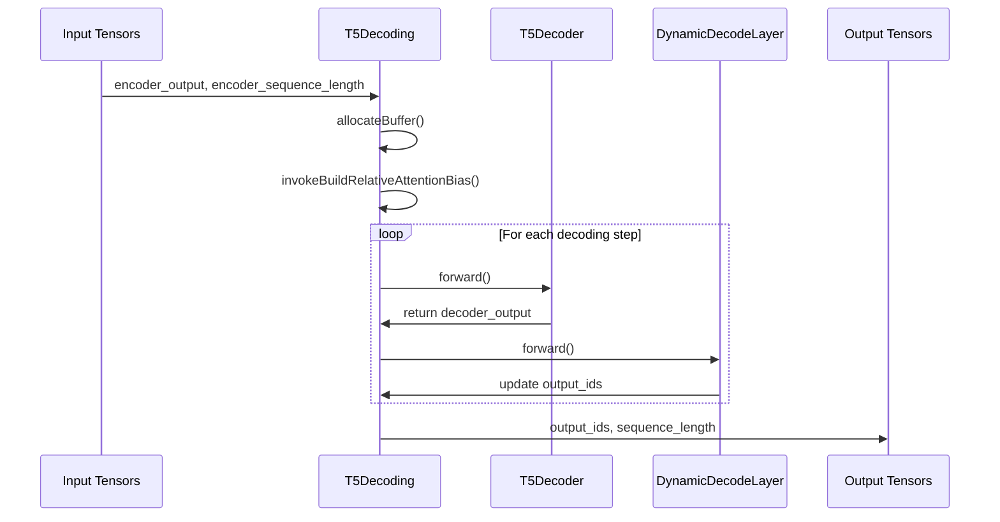
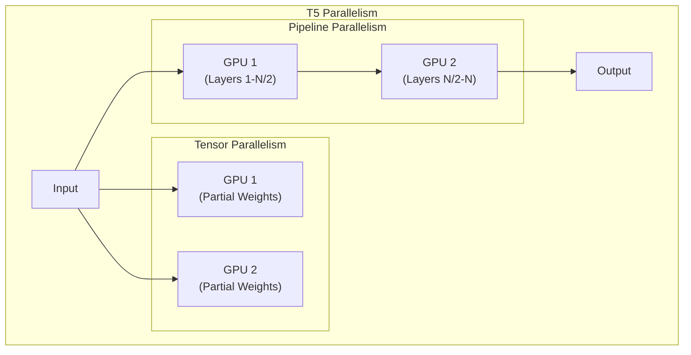
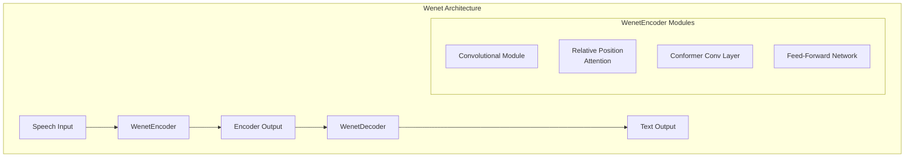
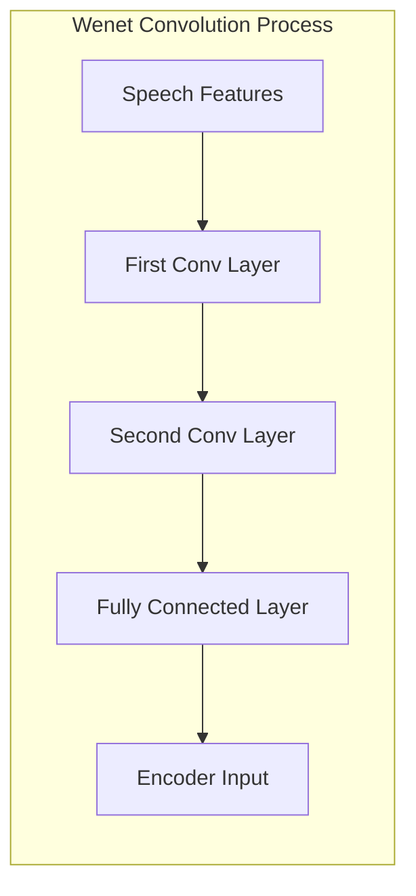

<!-- source: DeepWiki mcp.deepwiki.com · repo NVIDIA/FasterTransformer · page 3.3 T5 and Encoder-Decoder Models · fetched 2026-10-26 -->

# T5 and Encoder-Decoder Models

Relevant source files

The following files were used as context for generating this wiki page:

- [src/fastertransformer/models/t5/T5Decoding.cc](src/fastertransformer/models/t5/T5Decoding.cc)
- [src/fastertransformer/models/wenet/WenetEncoder.cc](src/fastertransformer/models/wenet/WenetEncoder.cc)
- [src/fastertransformer/tensorrt_plugin/wenet/DecoderPlugin.cc](src/fastertransformer/tensorrt_plugin/wenet/DecoderPlugin.cc)
- [src/fastertransformer/tensorrt_plugin/wenet/EncoderPlugin.cc](src/fastertransformer/tensorrt_plugin/wenet/EncoderPlugin.cc)
- [src/fastertransformer/tensorrt_plugin/wenet/EncoderPlugin.h](src/fastertransformer/tensorrt_plugin/wenet/EncoderPlugin.h)
- [src/fastertransformer/utils/cuda_utils.h](src/fastertransformer/utils/cuda_utils.h)
- [src/fastertransformer/utils/wenet_conv2d.h](src/fastertransformer/utils/wenet_conv2d.h)

This document provides a technical overview of T5 (Text-to-Text Transfer Transformer) and other encoder-decoder models implemented in FasterTransformer. The focus is on the architecture, key components, decoding process, and integration with other system elements. For information about other model types like GPT or BERT, see their respective pages ([GPT Models](#3.1) and [BERT Models](#3.2)).

## 1. Encoder-Decoder Model Overview

Encoder-decoder models in FasterTransformer consist of two primary components: an encoder that processes the input sequence and produces a representation, and a decoder that generates the output sequence based on this representation. The library includes implementations of several encoder-decoder architectures:

- **T5**: Text-to-Text Transfer Transformer for generalized text tasks
- **BART**: Bidirectional Auto-Regressive Transformers for text generation
- **Wenet**: An end-to-end speech recognition framework

Sources: [src/fastertransformer/models/t5/T5Decoding.cc:17-42](). [src/fastertransformer/models/wenet/WenetEncoder.cc:17-42]().

## 2. T5 Implementation

T5 is implemented through a set of specialized classes that handle the encoding and decoding processes with support for various optimization techniques.

### 2.1 T5Decoding Class

The `T5Decoding` class serves as the main entry point for T5 inference. It coordinates the decoding process, manages memory, and handles the generation of output sequences.

Key components:
- **Constructor**: Initializes model parameters like head count, size per head, vocabulary size, and parallelism settings
- **Buffer Management**: Allocates and manages memory for tensors used during decoding
- **Forward Pass**: Orchestrates the entire decoding process

Sources: [src/fastertransformer/models/t5/T5Decoding.cc:218-294](). [src/fastertransformer/models/t5/T5Decoding.cc:25-133]().

### 2.2 Decoding Process

The T5 decoding process follows these steps:

1. Initialize buffers and prepare input tensors
2. Build relative attention bias matrices
3. For each step in the sequence generation:
   - Embed the input tokens
   - Process through the decoder layers
   - Generate logits for next token prediction
   - Select tokens using beam search or sampling
4. Finalize output sequences

The decoding process handles both beam search (for higher quality outputs by maintaining multiple candidates) and sampling strategies (for diverse outputs).

Sources: [src/fastertransformer/models/t5/T5Decoding.cc:354-388](). [src/fastertransformer/models/t5/T5Decoding.cc:560-672]().

### 2.3 Memory Management

T5Decoding carefully manages GPU memory through strategic allocation of buffers for various components:

- **Key Cache and Value Cache**: Stores attention keys and values for efficient decoding
- **Encoder Output Tiles**: For beam search, replicates encoder outputs for each beam
- **Output Buffers**: Stores generated token IDs and associated metadata

Memory is allocated based on batch size, beam width, sequence length, and model dimensions to optimize performance while minimizing memory usage.

Sources: [src/fastertransformer/models/t5/T5Decoding.cc:66-152](). [src/fastertransformer/models/t5/T5Decoding.cc:154-207]().

## 3. Implementation Details

### 3.1 Input and Output Handling

The T5 implementation accepts these inputs:
- `encoder_output`: Hidden states from the encoder [batch_size, mem_max_seq_len, memory_hidden_dimension]
- `encoder_sequence_length`: Length of each input sequence [batch_size]
- Optional parameters for controlling generation (stop words, beam search settings, etc.)

It produces these outputs:
- `output_ids`: Generated token IDs [batch_size, beam, max_seq_len]
- `sequence_length`: Length of each generated sequence [batch_size, beam]
- Optional outputs like log probabilities and cumulative scores

Sources: [src/fastertransformer/models/t5/T5Decoding.cc:566-596]().

### 3.2 Parallelism Support

T5 supports two key parallelism strategies:

1. **Tensor Parallelism**: Splits model weights across multiple GPUs to handle larger models
2. **Pipeline Parallelism**: Distributes transformer layers across multiple GPUs

When using pipeline parallelism, the implementation includes methods for communicating between pipeline stages, such as `sendTensorsToFirstPipelineNode()`.

Sources: [src/fastertransformer/models/t5/T5Decoding.cc:487-559]().

## 4. Wenet: Automatic Speech Recognition

Wenet is an encoder-decoder model specialized for automatic speech recognition (ASR). It extends the encoder-decoder architecture with specific components for processing speech input.

### 4.1 Wenet Architecture

The Wenet implementation includes:
- **Encoder**: Processes speech features using conformer blocks (self-attention + convolution)
- **Decoder**: Generates text from the encoded speech representation
- **CTC Layer**: For alignment between speech and text

Sources: [src/fastertransformer/models/wenet/WenetEncoder.cc:17-96](). [src/fastertransformer/models/wenet/WenetEncoder.cc:281-621]().

### 4.2 TensorRT Integration

FasterTransformer provides TensorRT plugins for Wenet, enabling efficient deployment in TensorRT-based inference systems:

- **WenetEncoderPlugin**: Wraps the WenetEncoder for TensorRT integration
- **WenetDecoderPlugin**: Wraps the WenetDecoder for TensorRT integration

These plugins translate between TensorRT's tensor formats and FasterTransformer's internal representations, while preserving the optimizations of the native implementation.

Sources: [src/fastertransformer/tensorrt_plugin/wenet/EncoderPlugin.cc:17-65](). [src/fastertransformer/tensorrt_plugin/wenet/DecoderPlugin.cc:17-65]().

## 5. Core Components and Implementation Details

### 5.1 Attention Mechanisms

The encoder-decoder models use specialized attention mechanisms:

- **Self-Attention**: Within encoder or decoder layers (tokens attending to other tokens in the same sequence)
- **Cross-Attention**: Decoder attends to encoder outputs
- **Relative Position Attention**: Used in Wenet for modeling relative positions in speech

For T5, the implementation supports relative position bias through the `invokeBuildRelativeAttentionBias()` function.

Sources: [src/fastertransformer/models/t5/T5Decoding.cc:673-682]().

### 5.2 Feed-Forward Networks

All encoder-decoder models include feed-forward networks after attention layers. FasterTransformer supports multiple activation functions:

- **Gelu**: Used in T5
- **Relu**: Alternative activation function
- **Silu**: Used in some Wenet configurations

Sources: [src/fastertransformer/models/wenet/WenetEncoder.cc:44-82]().

### 5.3 Convolution in Wenet

Wenet uses convolution layers for processing speech features, implemented with cuDNN for performance:

The convolution implementation includes:
- **2D Convolution**: For processing speech spectrograms
- **ReLU Activation**: After convolution operations
- **Layer Normalization**: Optional normalization in convolution modules

Sources: [src/fastertransformer/utils/wenet_conv2d.h:28-195]().

## 6. Performance Considerations

### 6.1 Memory Optimization

The implementations include several memory optimizations:
- **Buffer Reuse**: Buffers are allocated once and reused across forward passes
- **Padding Removal**: Options to remove padding for more efficient computation
- **Customized Memory Allocation**: Memory is allocated based on exact batch size and sequence length requirements

### 6.2 CUDA Optimization

GPU operations are carefully optimized:
- **CUDA Streams**: Operations are scheduled on CUDA streams for overlapping computation
- **cuBLAS Integration**: Optimized matrix multiplications through cuBLAS
- **Kernel Fusion**: Multiple operations combined into single CUDA kernels where possible

Source: [src/fastertransformer/utils/cuda_utils.h:17-175]().

## 7. Summary

FasterTransformer's encoder-decoder model implementations provide highly optimized versions of T5, BART, and Wenet for inference. The implementation focuses on:

1. Efficient memory usage through careful buffer management
2. Parallel execution using tensor and pipeline parallelism
3. Support for different generation strategies (beam search, sampling)
4. Integration with TensorRT for deployment
5. Specialized optimizations for different model architectures

These implementations enable efficient deployment of encoder-decoder models for various sequence-to-sequence tasks, from text generation to speech recognition.

---

