<!-- source: DeepWiki mcp.deepwiki.com · repo NVIDIA/FasterTransformer · page 4.1 Attention Mechanisms · fetched 2026-10-26 -->

# Attention Mechanisms

<details>
<summary>Relevant source files</summary>

The following files were used as context for generating this wiki page:

- [3rdparty/trt_fused_multihead_attention/fused_multihead_attention_v2.h](3rdparty/trt_fused_multihead_attention/fused_multihead_attention_v2.h)
- [3rdparty/trt_fused_multihead_attention/fused_multihead_attention_v2_fp16_512_32_kernel.sm75.cpp](3rdparty/trt_fused_multihead_attention/fused_multihead_attention_v2_fp16_512_32_kernel.sm75.cpp)
- [3rdparty/trt_fused_multihead_attention/fused_multihead_attention_v2_fp16_512_32_kernel.sm80.cpp](3rdparty/trt_fused_multihead_attention/fused_multihead_attention_v2_fp16_512_32_kernel.sm80.cpp)
- [3rdparty/trt_fused_multihead_attention/fused_multihead_attention_v2_fp16_512_64_kernel.sm80.cpp](3rdparty/trt_fused_multihead_attention/fused_multihead_attention_v2_fp16_512_64_kernel.sm80.cpp)
- [3rdparty/trt_fused_multihead_attention/qkvToContext.cu](3rdparty/trt_fused_multihead_attention/qkvToContext.cu)
- [src/fastertransformer/kernels/activation_kernels.h](src/fastertransformer/kernels/activation_kernels.h)
- [src/fastertransformer/kernels/beam_search_topk_kernels.cu](src/fastertransformer/kernels/beam_search_topk_kernels.cu)
- [src/fastertransformer/kernels/decoder_masked_multihead_attention.cu](src/fastertransformer/kernels/decoder_masked_multihead_attention.cu)
- [src/fastertransformer/kernels/decoder_masked_multihead_attention/decoder_masked_multihead_attention_112.cu](src/fastertransformer/kernels/decoder_masked_multihead_attention/decoder_masked_multihead_attention_112.cu)
- [src/fastertransformer/kernels/decoder_masked_multihead_attention/decoder_masked_multihead_attention_48.cu](src/fastertransformer/kernels/decoder_masked_multihead_attention/decoder_masked_multihead_attention_48.cu)
- [src/fastertransformer/kernels/unfused_attention_kernels.cu](src/fastertransformer/kernels/unfused_attention_kernels.cu)
- [src/fastertransformer/layers/FfnLayer.cc](src/fastertransformer/layers/FfnLayer.cc)
- [src/fastertransformer/layers/FfnLayer.h](src/fastertransformer/layers/FfnLayer.h)
- [src/fastertransformer/layers/attention_layers/DecoderCrossAttentionLayer.cu](src/fastertransformer/layers/attention_layers/DecoderCrossAttentionLayer.cu)
- [src/fastertransformer/layers/attention_layers/DecoderSelfAttentionLayer.cc](src/fastertransformer/layers/attention_layers/DecoderSelfAttentionLayer.cc)
- [src/fastertransformer/layers/attention_layers/GptContextAttentionLayer.cc](src/fastertransformer/layers/attention_layers/GptContextAttentionLayer.cc)
- [src/fastertransformer/layers/attention_layers/GptContextAttentionLayer.h](src/fastertransformer/layers/attention_layers/GptContextAttentionLayer.h)
- [src/fastertransformer/utils/CMakeLists.txt](src/fastertransformer/utils/CMakeLists.txt)
- [tests/decoding/tf_fused_self_multihead_attention_unit_test.py](tests/decoding/tf_fused_self_multihead_attention_unit_test.py)

</details>


This page documents the attention mechanism implementations in FasterTransformer, which serve as the core building blocks for all transformer-based models. Attention mechanisms are responsible for computing relationships between tokens and are a fundamental operation in transformer architectures. For model-specific implementations of attention, see [Models](#3).

## Attention Types and Implementations

FasterTransformer implements several variants of attention mechanisms optimized for different use cases:

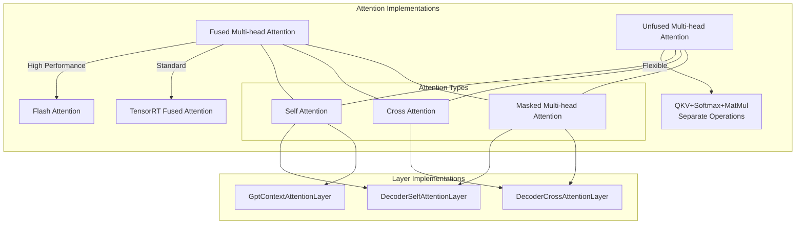

Sources:
- [src/fastertransformer/layers/attention_layers/DecoderSelfAttentionLayer.cc]()
- [src/fastertransformer/layers/attention_layers/DecoderCrossAttentionLayer.cu]()
- [src/fastertransformer/kernels/unfused_attention_kernels.cu]()
- [3rdparty/trt_fused_multihead_attention/qkvToContext.cu]()

### Fused vs Unfused Attention

FasterTransformer provides two main implementation approaches for attention:

#### Fused Multi-head Attention

Fused attention combines multiple operations (QK^T calculation, softmax, and attention-value multiplication) into a single CUDA kernel, dramatically reducing memory traffic and improving performance. The fused implementation is optimized for specific model sizes and hardware capabilities.

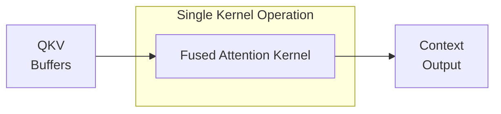

Key implementation:
- `Fused_multihead_attention_params_v2` structure in [3rdparty/trt_fused_multihead_attention/fused_multihead_attention_v2.h:24-115]() defines the parameters for fused attention
- `qkvToContext` function in [3rdparty/trt_fused_multihead_attention/qkvToContext.cu]() performs the fused operation

Sources:
- [3rdparty/trt_fused_multihead_attention/fused_multihead_attention_v2.h]()
- [3rdparty/trt_fused_multihead_attention/qkvToContext.cu]()

#### Unfused Multi-head Attention

Unfused attention separates the operations into discrete steps, allowing for more flexibility but typically with lower performance compared to fused implementations.

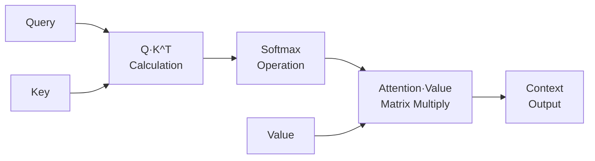

Key implementations:
- `invokeAddQKVBiasIA3Transpose` [src/fastertransformer/kernels/unfused_attention_kernels.cu:132-228]() handles the QKV bias addition and transpose
- `softmax_kernel` [src/fastertransformer/kernels/unfused_attention_kernels.cu:255-332]() calculates softmax on attention scores

Sources:
- [src/fastertransformer/kernels/unfused_attention_kernels.cu]()

## Self-Attention vs. Cross-Attention

### Self-Attention

Self-attention relates different positions of a single sequence to compute a representation of the sequence. It's used in both encoder and decoder layers.

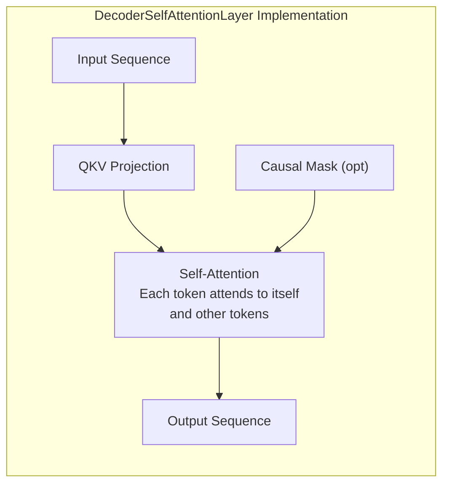

Key implementation:
- `fusedQKV_masked_attention_dispatch` [src/fastertransformer/layers/attention_layers/DecoderSelfAttentionLayer.cc:36-146]() dispatches the self-attention computation

Sources:
- [src/fastertransformer/layers/attention_layers/DecoderSelfAttentionLayer.cc]()

### Cross-Attention

Cross-attention relates different positions of two separate sequences. In encoder-decoder models, the decoder uses cross-attention to attend to encoder outputs.

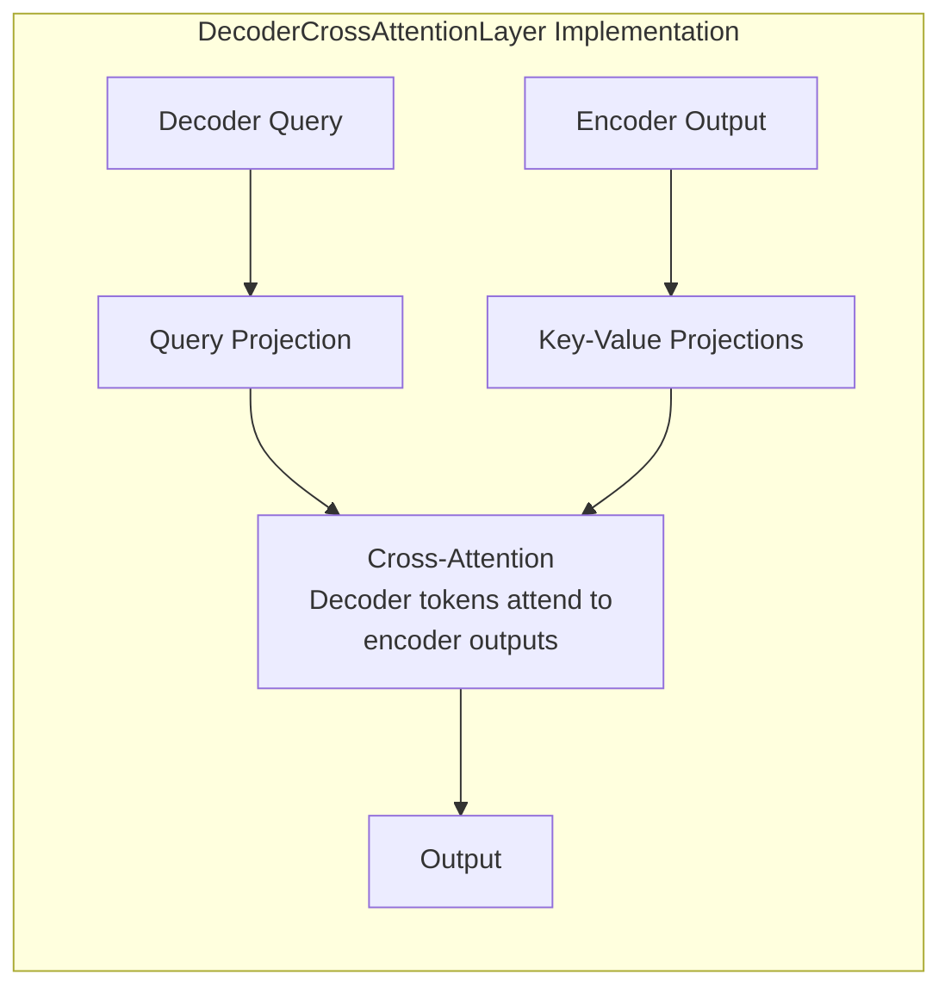

Key implementation:
- `cross_attention_dispatch` [src/fastertransformer/layers/attention_layers/DecoderCrossAttentionLayer.cu:361-504]() coordinates cross-attention computation

Sources:
- [src/fastertransformer/layers/attention_layers/DecoderCrossAttentionLayer.cu]()

## Masked Multi-head Attention

Masked attention prevents attending to future tokens in auto-regressive models like GPT.

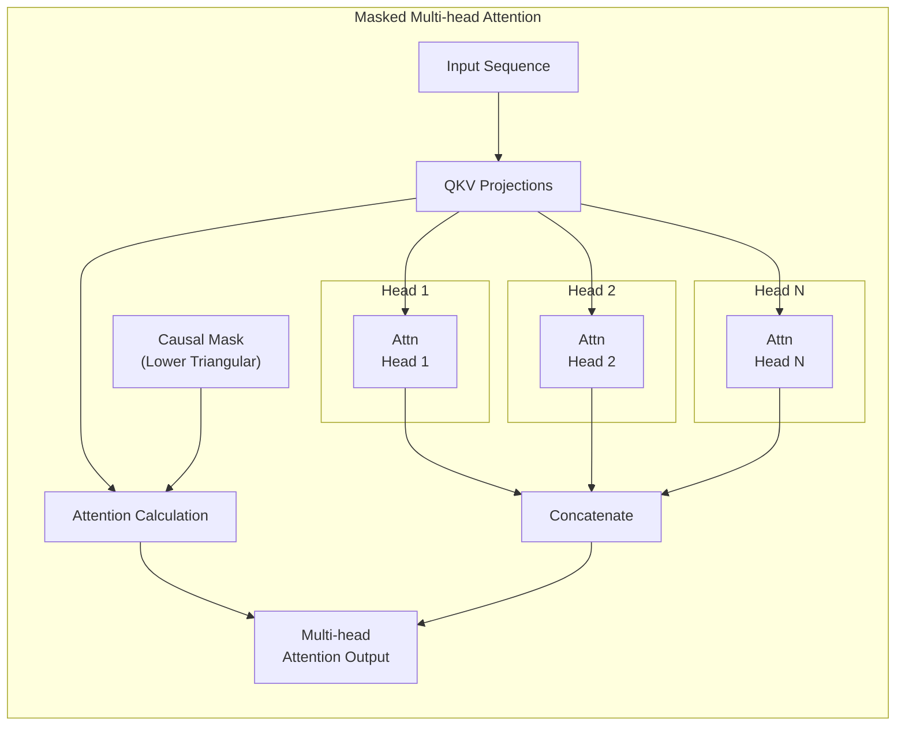

Key implementations:
- `masked_multihead_attention` [src/fastertransformer/kernels/decoder_masked_multihead_attention.cu:72-82]() for fp32
- `masked_multihead_attention` [src/fastertransformer/kernels/decoder_masked_multihead_attention.cu:79-91]() for fp16

Sources:
- [src/fastertransformer/kernels/decoder_masked_multihead_attention.cu]()
- [src/fastertransformer/kernels/decoder_masked_multihead_attention/decoder_masked_multihead_attention_48.cu]()
- [src/fastertransformer/kernels/decoder_masked_multihead_attention/decoder_masked_multihead_attention_112.cu]()

## Attention Parameters and Data Structures

The main data structures for attention mechanisms are:

### Fused Attention Parameters

The `Fused_multihead_attention_params_v2` structure [3rdparty/trt_fused_multihead_attention/fused_multihead_attention_v2.h:24-115]() contains all parameters needed for the fused attention operation, including:

```
struct Fused_multihead_attention_params_v2 {
    // The QKV matrices
    void* qkv_ptr;
    // The mask for implementing dropout
    void* packed_mask_ptr;
    // The output matrix
    void* o_ptr;
    
    // Various strides and dimensions
    int64_t qkv_stride_in_bytes;
    int64_t packed_mask_stride_in_bytes;
    int64_t o_stride_in_bytes;
    
    // Dimensions
    int b, h, s, d;
    
    // Scaling factors
    uint32_t scale_bmm1, scale_softmax, scale_bmm2;
    
    // Additional parameters for variations
    bool enable_i2f_trick;
    int* cu_seqlens;
    bool interleaved;
    
    // ... other parameters for specific implementations
}
```

Sources:
- [3rdparty/trt_fused_multihead_attention/fused_multihead_attention_v2.h]()

### Masked Multihead Attention Parameters

Similar structures exist for masked multihead attention:

```
template<typename T>
struct Masked_multihead_attention_params {
    // QKV inputs and outputs
    const T* q;
    const T* k;
    const T* v;
    const T* q_bias;
    const T* k_bias;
    const T* v_bias;
    T* k_cache;
    T* v_cache;
    T* out;
    
    // Various dimensions and parameters
    int batch_size;
    int head_num;
    int sequence_length;
    int hidden_size_per_head;
    float inv_sqrt_dh;
    
    // ... other parameters for variations
}
```

Sources:
- [src/fastertransformer/kernels/decoder_masked_multihead_attention.h]()

## Attention Implementation Details

### Key Computation Steps

The attention mechanism in transformer models follows this general computation pattern:

1. **Project input** to Query (Q), Key (K), and Value (V) representations
2. **Compute attention scores**: Q·K^T / sqrt(d_k)
3. **Apply scaling and optional mask**
4. **Apply softmax** to get attention weights
5. **Multiply** attention weights with Value matrix to get the output context

In code, these steps are implemented differently based on the attention type:

#### Fused Implementation

For fused attention, all steps are combined in a single kernel, as seen in `qkvToContext.cu`. The main execution happens in the `run` method [3rdparty/trt_fused_multihead_attention/qkvToContext.cu:265-281]().

#### Unfused Implementation

For unfused attention, the steps are broken down:

1. **QKV Computation**: `invokeAddQKVBiasIA3Transpose` [src/fastertransformer/kernels/unfused_attention_kernels.cu:132-228]()
2. **Attention and Softmax**: `softmax_kernel` [src/fastertransformer/kernels/unfused_attention_kernels.cu:255-332]()

### Specialized Variations

FasterTransformer includes specialized implementations for different model sizes and hardware capabilities:

- Various head sizes (32, 48, 64, 80, 96, 112, 128, etc.)
- Different GPU architectures (SM 70, SM 75, SM 80, SM 86, SM 89)
- Tensor precision (FP16, FP32, BF16, INT8)

Sources:
- [src/fastertransformer/kernels/decoder_masked_multihead_attention.cu]()
- [src/fastertransformer/kernels/decoder_masked_multihead_attention/decoder_masked_multihead_attention_48.cu]()
- [src/fastertransformer/kernels/decoder_masked_multihead_attention/decoder_masked_multihead_attention_112.cu]()
- [3rdparty/trt_fused_multihead_attention/fused_multihead_attention_v2.h]()

## Optimization Techniques

FasterTransformer implements several optimization techniques to improve attention performance:

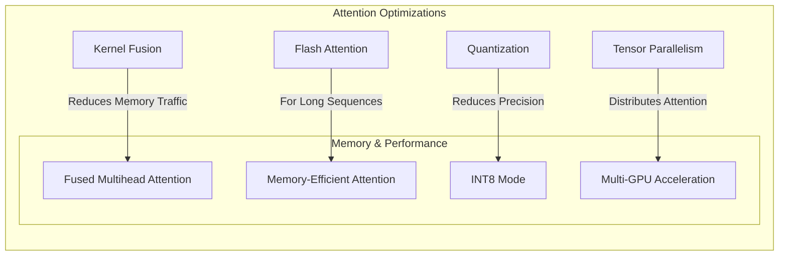

### Kernel Fusion

FasterTransformer uses kernel fusion to combine multiple operations into a single CUDA kernel, reducing memory traffic and increasing performance.

The class `FusedMHARunnerFP16v2` in [3rdparty/trt_fused_multihead_attention/qkvToContext.cu]() implements the fused multihead attention kernel.

### Flash Attention

For long sequences, FasterTransformer uses Flash Attention, which optimizes attention computation by utilizing the GPU's memory hierarchy efficiently.

This is implemented as a flag in the fused attention parameters [3rdparty/trt_fused_multihead_attention/qkvToContext.cu:158-159]():
```cpp
use_flash_attention = (params.s >= 512);
params.force_unroll = use_flash_attention;
```

### INT8 Mode

FasterTransformer supports different INT8 modes for quantization:

- `int8_mode_ == 0`: No INT8 quantization
- `int8_mode_ == 1`: Weight quantized only gemm for GPT
- `int8_mode_ == 2`: SmoothQuant optimization

Sources:
- [3rdparty/trt_fused_multihead_attention/qkvToContext.cu]()
- [src/fastertransformer/kernels/unfused_attention_kernels.cu]()
- [src/fastertransformer/layers/attention_layers/DecoderSelfAttentionLayer.cc]()

## Attention in Different Model Types

Different models use attention mechanisms differently:

| Model Type | Attention Usage |
|------------|-----------------|
| GPT/Decoder-only | Uses masked self-attention to prevent attending to future tokens |
| BERT/Encoder-only | Uses bidirectional self-attention where each token can attend to all other tokens |
| T5/Encoder-Decoder | Uses self-attention in both encoder and decoder, plus cross-attention in decoder |

### GPT Context Attention

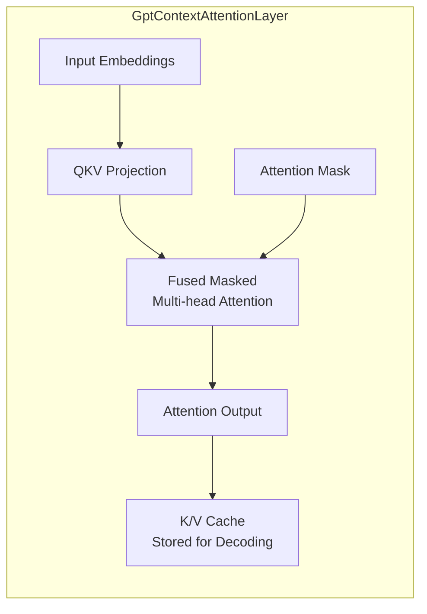

Sources:
- [src/fastertransformer/layers/attention_layers/GptContextAttentionLayer.cc]()
- [src/fastertransformer/layers/attention_layers/GptContextAttentionLayer.h]()

### Decoder Self-Attention

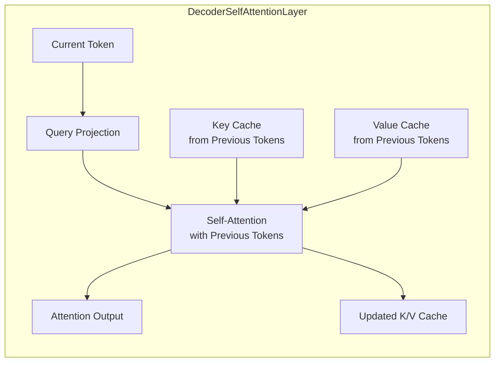

Sources:
- [src/fastertransformer/layers/attention_layers/DecoderSelfAttentionLayer.cc]()

### Decoder Cross-Attention

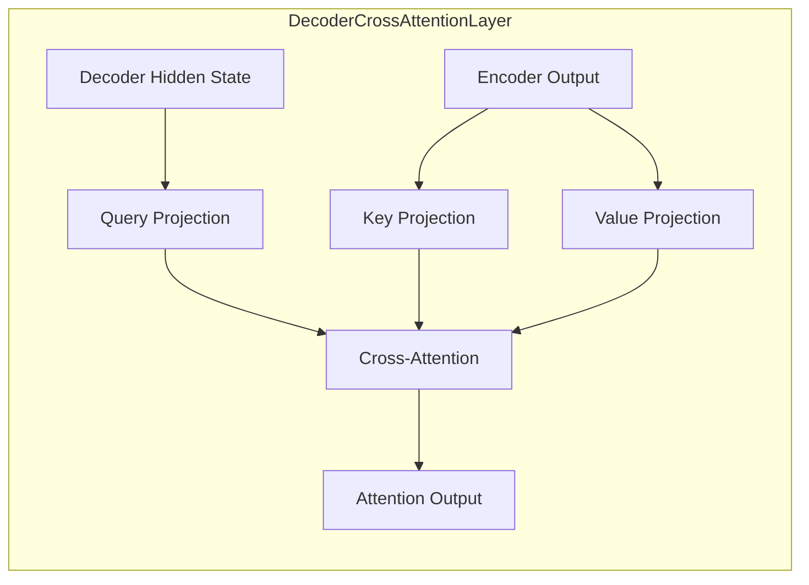

Sources:
- [src/fastertransformer/layers/attention_layers/DecoderCrossAttentionLayer.cu]()

## Advanced Features

### Relative Position Bias

Some attention implementations support relative position bias, which adds a bias term based on the relative positions of tokens:

```cpp
if (linear_bias_slopes != nullptr) {
    qk_bias += static_cast<float>(linear_bias_slope * (ki - qi));
}
```

Sources:
- [src/fastertransformer/kernels/unfused_attention_kernels.cu:293-298]()

### Rotary Position Embeddings

For models like GPT-J and GPT-NeoX, rotary position embeddings are supported as an alternative to absolute positional encodings.

This is handled in the attention parameters with:
```cpp
params.rotary_embedding_dim = rotary_embedding_dim;
params.neox_rotary_style = neox_rotary_style;
```

Sources:
- [src/fastertransformer/layers/attention_layers/DecoderSelfAttentionLayer.cc:116-117]()

## Integration with Other Components

The attention mechanisms are integrated with other FasterTransformer components:

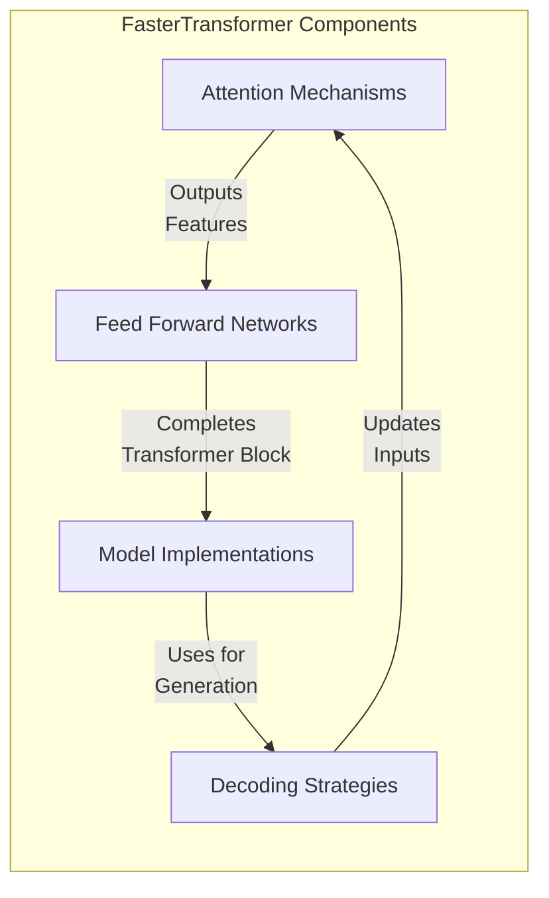

Sources:
- [src/fastertransformer/layers/FfnLayer.h]()
- [src/fastertransformer/layers/attention_layers/GptContextAttentionLayer.cc]()
- [src/fastertransformer/layers/attention_layers/DecoderSelfAttentionLayer.cc]()

## Performance Considerations

When using attention mechanisms in FasterTransformer, consider:

1. **Fused vs. Unfused**: Fused attention is typically faster but less flexible
2. **INT8 Quantization**: Can significantly improve performance with minimal accuracy impact
3. **Head Size Compatibility**: Ensure your model's head size matches one of the optimized implementations (32, 48, 64, 80, 96, 112, 128, 144, 160, 192, 224, 256)
4. **Flash Attention**: Automatically enabled for sequence lengths ≥ 512
5. **GPU Architecture**: Different optimizations exist for different NVIDIA architectures (SM 70, 75, 80, 86, 89)

Sources:
- [src/fastertransformer/layers/attention_layers/DecoderSelfAttentionLayer.cc:280-282]()
- [3rdparty/trt_fused_multihead_attention/qkvToContext.cu:158-159]()

---

