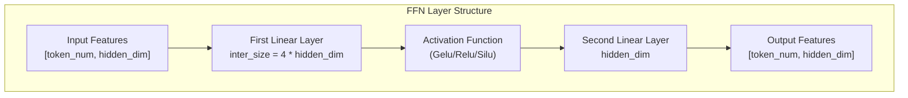
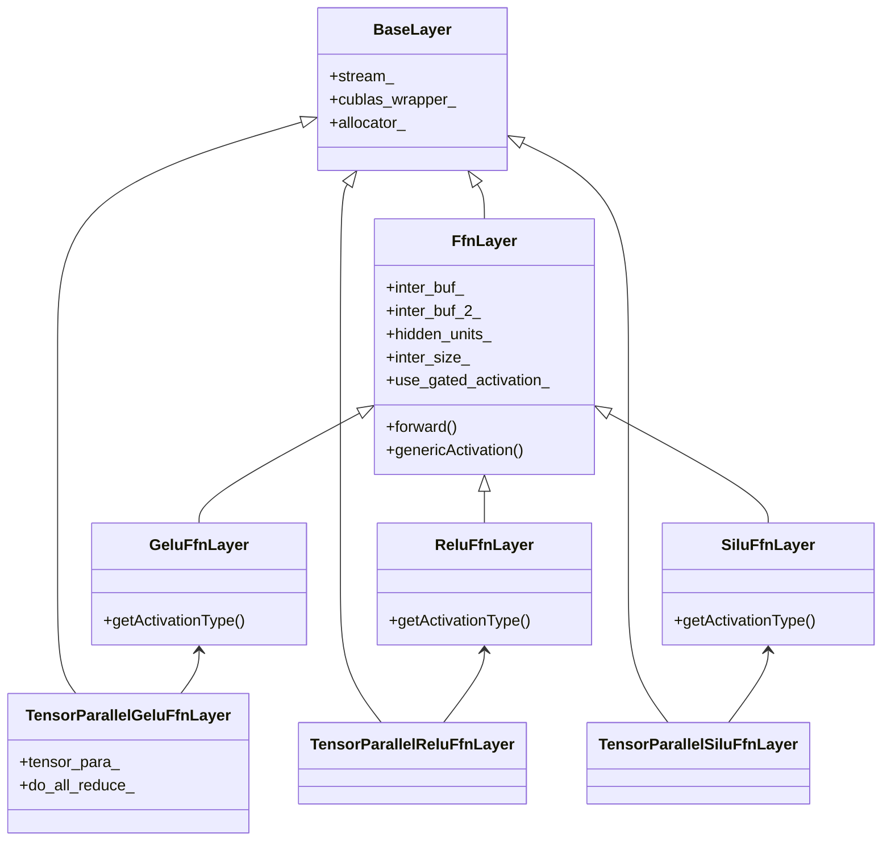
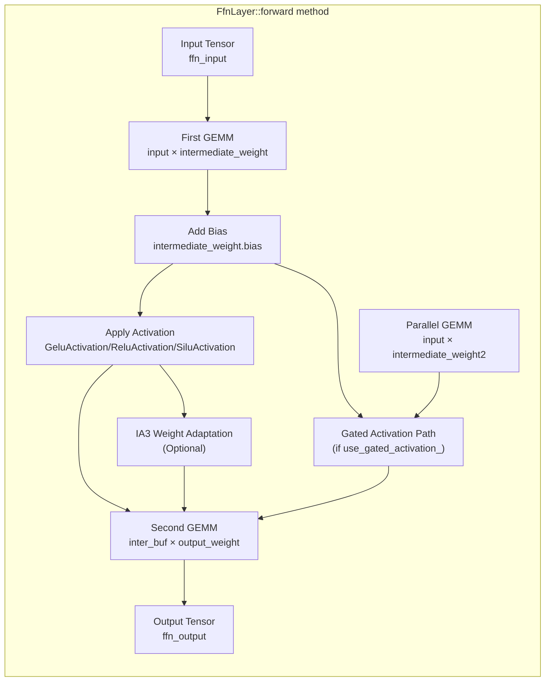
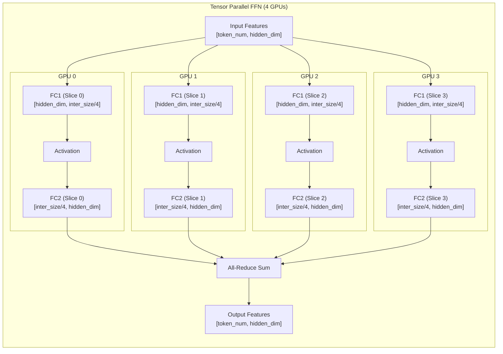
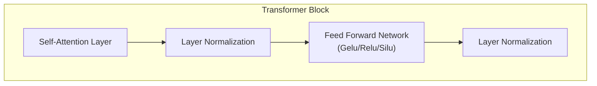

<!-- source: DeepWiki mcp.deepwiki.com · repo NVIDIA/FasterTransformer · page 4.2 Feed Forward Networks · fetched 2026-10-26 -->

# Feed Forward Networks

<details>
<summary>Relevant source files</summary>

The following files were used as context for generating this wiki page:

- [docs/bert_guide.md](docs/bert_guide.md)
- [docs/decoder_guide.md](docs/decoder_guide.md)
- [src/fastertransformer/kernels/activation_kernels.cu](src/fastertransformer/kernels/activation_kernels.cu)
- [src/fastertransformer/kernels/activation_kernels.h](src/fastertransformer/kernels/activation_kernels.h)
- [src/fastertransformer/kernels/beam_search_topk_kernels.cu](src/fastertransformer/kernels/beam_search_topk_kernels.cu)
- [src/fastertransformer/kernels/unfused_attention_kernels.cu](src/fastertransformer/kernels/unfused_attention_kernels.cu)
- [src/fastertransformer/layers/FfnLayer.cc](src/fastertransformer/layers/FfnLayer.cc)
- [src/fastertransformer/layers/FfnLayer.h](src/fastertransformer/layers/FfnLayer.h)
- [src/fastertransformer/layers/TensorParallelGeluFfnLayer.cc](src/fastertransformer/layers/TensorParallelGeluFfnLayer.cc)
- [src/fastertransformer/layers/TensorParallelReluFfnLayer.cc](src/fastertransformer/layers/TensorParallelReluFfnLayer.cc)
- [src/fastertransformer/layers/TensorParallelSiluFfnLayer.cc](src/fastertransformer/layers/TensorParallelSiluFfnLayer.cc)
- [src/fastertransformer/layers/attention_layers/TensorParallelDecoderCrossAttentionLayer.cc](src/fastertransformer/layers/attention_layers/TensorParallelDecoderCrossAttentionLayer.cc)
- [src/fastertransformer/layers/attention_layers/TensorParallelDecoderSelfAttentionLayer.cc](src/fastertransformer/layers/attention_layers/TensorParallelDecoderSelfAttentionLayer.cc)
- [src/fastertransformer/layers/attention_layers/TensorParallelDisentangledAttentionLayer.cc](src/fastertransformer/layers/attention_layers/TensorParallelDisentangledAttentionLayer.cc)
- [src/fastertransformer/layers/attention_layers/TensorParallelGptContextAttentionLayer.cc](src/fastertransformer/layers/attention_layers/TensorParallelGptContextAttentionLayer.cc)
- [src/fastertransformer/layers/attention_layers/TensorParallelUnfusedAttentionLayer.cc](src/fastertransformer/layers/attention_layers/TensorParallelUnfusedAttentionLayer.cc)
- [src/fastertransformer/models/bert/Bert.cc](src/fastertransformer/models/bert/Bert.cc)

</details>


This document describes the Feed Forward Network (FFN) components in FasterTransformer. FFN layers are a crucial part of transformer architectures, positioned after attention mechanisms to process and transform features. For information about attention mechanisms, see [Attention Mechanisms](#4.1).

## Overview

Feed Forward Networks in transformer models typically consist of two linear transformations with a non-linear activation function in between. FasterTransformer implements different variants of FFNs with multiple activation functions and supports various optimization techniques including tensor parallelism, integer quantization, and sparsity.



Sources: [src/fastertransformer/layers/FfnLayer.h](src/fastertransformer/layers/FfnLayer.h), [src/fastertransformer/layers/FfnLayer.cc](src/fastertransformer/layers/FfnLayer.cc)

## Class Hierarchy

FasterTransformer implements multiple FFN variants with different activation functions and optimization strategies. The base `FfnLayer` class provides common functionality, while specialized child classes implement specific activation functions.



Sources: [src/fastertransformer/layers/FfnLayer.h:33-134](src/fastertransformer/layers/FfnLayer.h:33-134), [src/fastertransformer/layers/TensorParallelGeluFfnLayer.cc](src/fastertransformer/layers/TensorParallelGeluFfnLayer.cc), [src/fastertransformer/layers/TensorParallelReluFfnLayer.cc](src/fastertransformer/layers/TensorParallelReluFfnLayer.cc), [src/fastertransformer/layers/TensorParallelSiluFfnLayer.cc](src/fastertransformer/layers/TensorParallelSiluFfnLayer.cc)

## Activation Functions

FasterTransformer supports several activation functions for FFN layers. Each activation type has a corresponding implementation in the `activation_kernels.cu` file.

| Activation Name | Description | Code Structure | Gated Variant |
| --------------- | ----------- | ------------- | ------------- |
| GELU | Gaussian Error Linear Unit, smooth approximation of ReLU | `GeluActivation<T>` | GeGLU |
| ReLU | Rectified Linear Unit, max(0, x) | `ReluActivation<T>` | ReGLU |
| SiLU | Sigmoid Linear Unit, x * sigmoid(x) | `SiluActivation<T>` | SiGLU |
| Identity | No activation, f(x) = x | `IdentityActivation<T>` | N/A |

Each activation type has specialized kernels for different data types (FP32, FP16, BF16) with optimizations for tensor core operations where applicable.

Sources: [src/fastertransformer/kernels/activation_kernels.cu:28-165](src/fastertransformer/kernels/activation_kernels.cu:28-165), [src/fastertransformer/kernels/activation_kernels.h:26-110](src/fastertransformer/kernels/activation_kernels.h:26-110), [src/fastertransformer/utils/activation_types.h](src/fastertransformer/utils/activation_types.h)

## Data Flow in FFN Forward Pass

The core functionality of the FFN layer is implemented in the `forward` method, which processes input tensors through two matrix multiplications with an activation in between.



Sources: [src/fastertransformer/layers/FfnLayer.cc:171-305](src/fastertransformer/layers/FfnLayer.cc:171-305)

### Key Steps in Forward Pass:

1. **First Linear Transformation**: 
   - Multiply input tensor with intermediate weight matrix (`intermediate_weight.kernel`)
   - Result is stored in `inter_buf_`
   - For gated activations, a parallel computation with `intermediate_weight2.kernel` is stored in `inter_buf_2_`

2. **Activation Function**:
   - Add bias to the intermediate result
   - Apply non-linear activation function (GELU/ReLU/SiLU)
   - For gated activations, element-wise multiply the activated result with the gating signal

3. **Second Linear Transformation**:
   - Multiply activated intermediate result with output weight matrix (`output_weight.kernel`)
   - Result is stored in the output tensor

Sources: [src/fastertransformer/layers/FfnLayer.cc:33-180](src/fastertransformer/layers/FfnLayer.cc:33-180)

## Tensor-Parallel FFN Layers

To enable efficient multi-GPU training and inference, FasterTransformer implements tensor-parallel variants of FFN layers. These layers split the computation across multiple GPUs and use all-reduce operations to gather results.



The key aspects of tensor-parallel FFN layers are:

1. **Weight Partitioning**: 
   - The intermediate size dimension is divided by the number of GPUs
   - Each GPU processes a slice of the FFN weights

2. **Activation Function**:
   - Each GPU applies the activation function to its local portion

3. **All-Reduce Communication**:
   - After the second linear transformation, results from all GPUs are combined using an all-reduce operation
   - Custom all-reduce implementations can be used for better performance

Sources: [src/fastertransformer/layers/TensorParallelGeluFfnLayer.cc:22-66](src/fastertransformer/layers/TensorParallelGeluFfnLayer.cc:22-66), [src/fastertransformer/layers/TensorParallelReluFfnLayer.cc:22-66](src/fastertransformer/layers/TensorParallelReluFfnLayer.cc:22-66), [src/fastertransformer/layers/TensorParallelSiluFfnLayer.cc:22-62](src/fastertransformer/layers/TensorParallelSiluFfnLayer.cc:22-62)

## Optimization Techniques

FasterTransformer implements several optimization techniques to improve the performance of FFN layers:

### 1. INT8 Quantization

FFN layers support three INT8 modes:
- `int8_mode = 0`: No quantization (default)
- `int8_mode = 1`: Weight-only quantization for reduced memory footprint
- `int8_mode = 2`: SmoothQuant with per-tensor scales

INT8 quantization reduces memory bandwidth requirements and can leverage INT8 tensor cores on NVIDIA GPUs.

### 2. Fusion of Operations

FasterTransformer fuses multiple operations to reduce kernel launches and memory traffic:
- Bias addition and activation are fused in the `genericActivation` function
- In some cases, GEMM, bias, and activation are fused in a single operation

### 3. Sparsity Support

When enabled and supported by hardware (NVIDIA Ampere GPUs), sparsity can accelerate matrix multiplications:
- Uses specialized sparse GEMM operations via the cublas wrapper
- Particularly effective for the large intermediate matrices in FFN layers

### 4. Gated Activations

Gated activation variants (GeGLU, ReGLU, SiGLU) use a parallel path to compute a gating signal:
- Two parallel linear projections from the input
- One branch applies the activation function while the other acts as a gate
- Results are multiplied element-wise before the second linear transformation

Sources: [src/fastertransformer/layers/FfnLayer.cc:171-305](src/fastertransformer/layers/FfnLayer.cc:171-305), [src/fastertransformer/kernels/activation_kernels.cu:155-244](src/fastertransformer/kernels/activation_kernels.cu:155-244)

## Usage in Transformer Models

FFN layers are typically used as part of transformer blocks, alternating with attention layers. In the BERT implementation, FFN layers are selected based on the specified activation type:



The initialization code in `Bert.cc` demonstrates how the FFN layer is selected based on the activation type:

```
if (activation_type_ == ActivationType::Gelu) {
    ffn_layer_ = new TensorParallelGeluFfnLayer<T>(...);
}
else if (activation_type_ == ActivationType::Relu) {
    ffn_layer_ = new TensorParallelReluFfnLayer<T>(...);
}
```

Sources: [src/fastertransformer/models/bert/Bert.cc:53-90](src/fastertransformer/models/bert/Bert.cc:53-90)

## Conclusion

Feed Forward Networks in FasterTransformer are implemented with a focus on performance and flexibility. They support various activation functions, optimization techniques, and parallel execution strategies to efficiently handle transformer models of different sizes and configurations.

The modular design allows for easy extension with new activation functions or optimization techniques, while maintaining compatibility with the overall transformer architecture.

---

