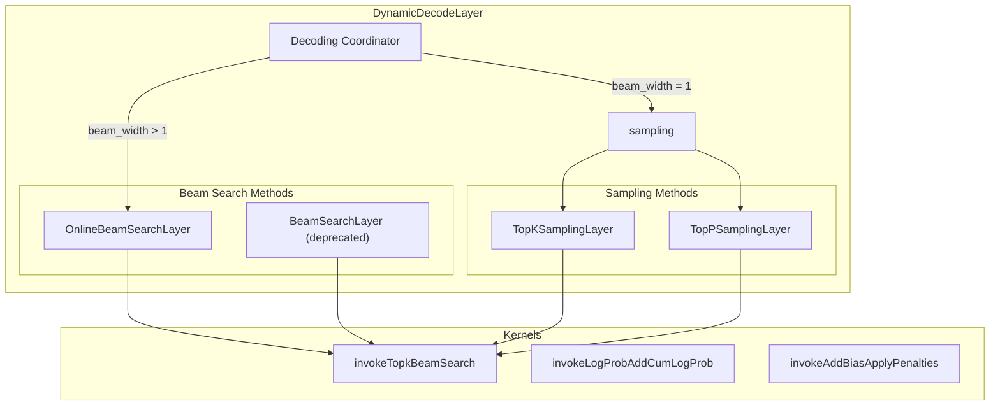
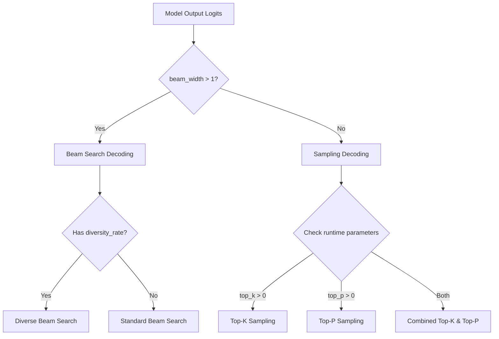
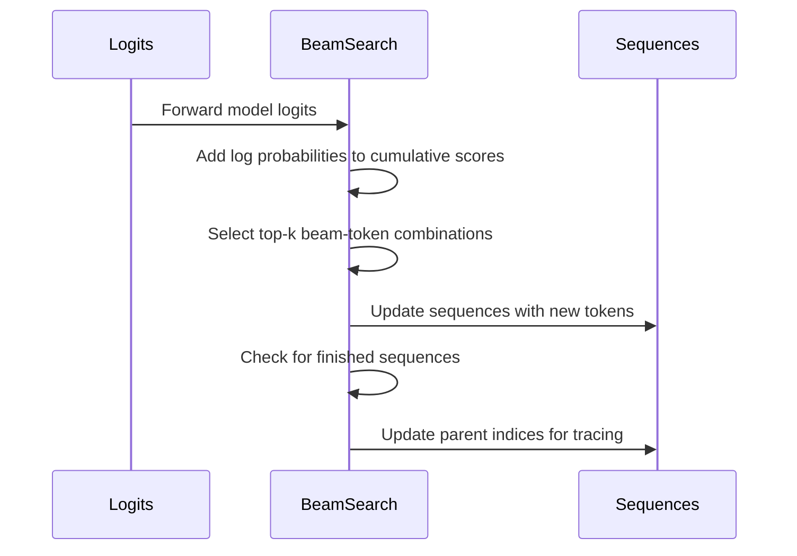
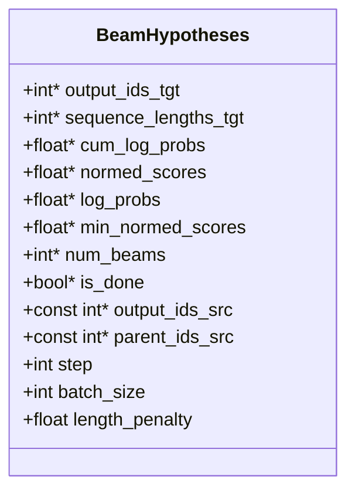
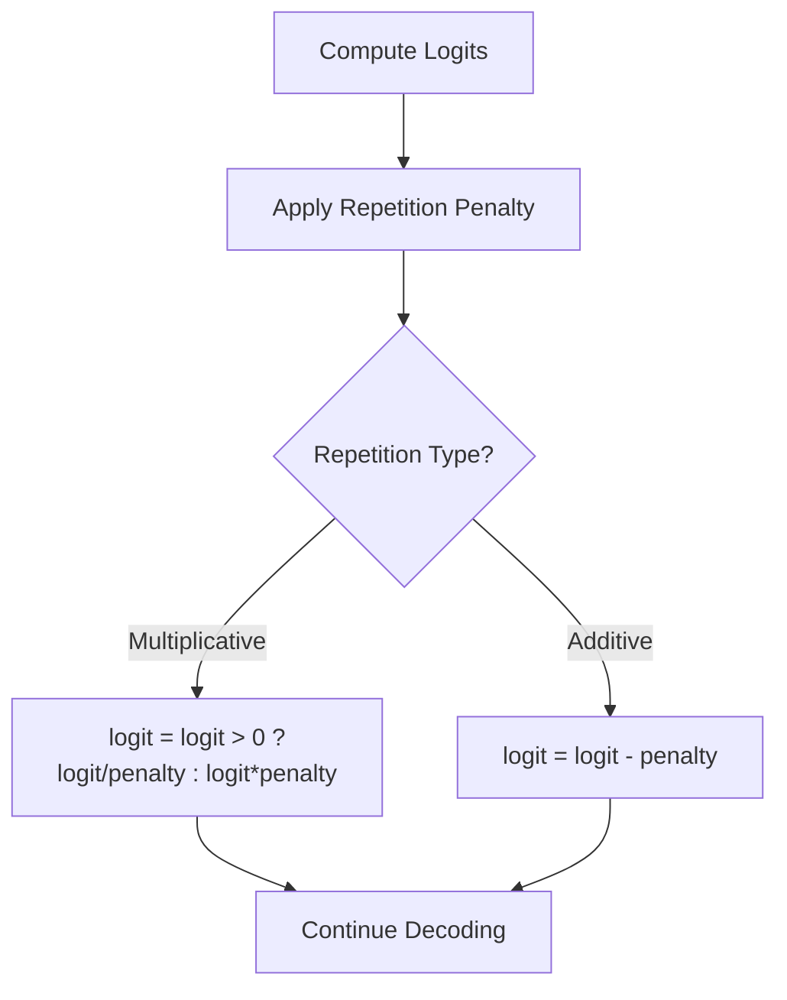
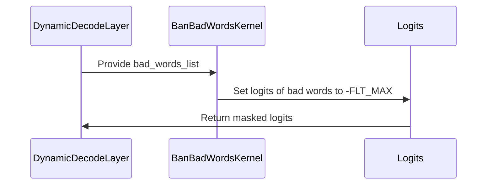
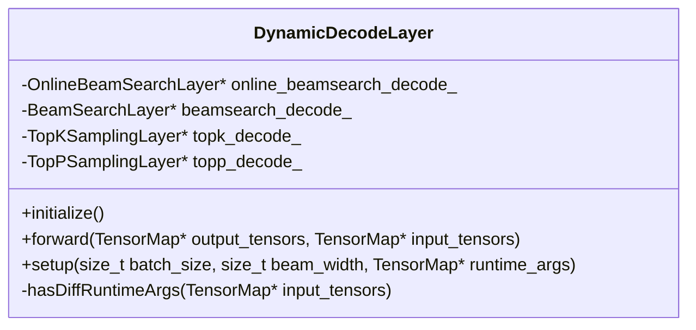

<!-- source: DeepWiki mcp.deepwiki.com · repo NVIDIA/FasterTransformer · page 4.3 Decoding Strategies · fetched 2026-10-26 -->

# Decoding Strategies

<details>
<summary>Relevant source files</summary>

The following files were used as context for generating this wiki page:

- [src/fastertransformer/kernels/beam_search_penalty_kernels.cu](src/fastertransformer/kernels/beam_search_penalty_kernels.cu)
- [src/fastertransformer/kernels/beam_search_topk_kernels.h](src/fastertransformer/kernels/beam_search_topk_kernels.h)
- [src/fastertransformer/kernels/decoding_kernels.cu](src/fastertransformer/kernels/decoding_kernels.cu)
- [src/fastertransformer/kernels/decoding_kernels.h](src/fastertransformer/kernels/decoding_kernels.h)
- [src/fastertransformer/kernels/online_softmax_beamsearch_kernels.cu](src/fastertransformer/kernels/online_softmax_beamsearch_kernels.cu)
- [src/fastertransformer/layers/DynamicDecodeLayer.cc](src/fastertransformer/layers/DynamicDecodeLayer.cc)
- [src/fastertransformer/layers/beam_search_layers/BaseBeamSearchLayer.cu](src/fastertransformer/layers/beam_search_layers/BaseBeamSearchLayer.cu)
- [src/fastertransformer/layers/beam_search_layers/BeamSearchLayer.cu](src/fastertransformer/layers/beam_search_layers/BeamSearchLayer.cu)
- [src/fastertransformer/layers/beam_search_layers/OnlineBeamSearchLayer.cu](src/fastertransformer/layers/beam_search_layers/OnlineBeamSearchLayer.cu)
- [src/fastertransformer/models/bart/BartDecoding.cc](src/fastertransformer/models/bart/BartDecoding.cc)
- [src/fastertransformer/models/bart/BartEncoder.cc](src/fastertransformer/models/bart/BartEncoder.cc)
- [src/fastertransformer/models/bert_fp8/BertFP8.cc](src/fastertransformer/models/bert_fp8/BertFP8.cc)
- [src/fastertransformer/models/bert_int8/BertINT8.cc](src/fastertransformer/models/bert_int8/BertINT8.cc)
- [src/fastertransformer/models/deberta/Deberta.cc](src/fastertransformer/models/deberta/Deberta.cc)
- [src/fastertransformer/models/gptneox/GptNeoX.cc](src/fastertransformer/models/gptneox/GptNeoX.cc)

</details>


This document provides a comprehensive explanation of the decoding strategies implemented in FasterTransformer. Decoding strategies are methods used to generate text from transformer models by selecting output tokens at each generation step. These strategies are critical for controlling how the model generates text, balancing between quality, diversity, and computational efficiency.

## Overview of Decoding Architecture

The decoding architecture in FasterTransformer is built around a central `DynamicDecodeLayer` class that coordinates different decoding strategies and provides a unified interface.



Sources: 
- [src/fastertransformer/layers/DynamicDecodeLayer.cc:28-107]()
- [src/fastertransformer/layers/DynamicDecodeLayer.cc:190-446]()

## Decision Flow for Decoding Strategy Selection

Decoding strategy selection in FasterTransformer depends primarily on the `beam_width` parameter:



Sources:
- [src/fastertransformer/layers/DynamicDecodeLayer.cc:284-386]() (Beam search path)
- [src/fastertransformer/layers/DynamicDecodeLayer.cc:387-446]() (Sampling path)

## Beam Search Decoding

Beam search maintains multiple hypotheses (beams) at each decoding step, selecting the top-k most probable sequences to continue exploring.

### Standard Beam Search

Standard beam search in FasterTransformer is implemented primarily through the `OnlineBeamSearchLayer`, despite the existence of a legacy `BeamSearchLayer` class. The algorithm:

1. Computes log probabilities for all possible next tokens for each beam
2. Adds these to the cumulative log probabilities of current beams
3. Selects the top-k (where k is the beam width) token-beam combinations
4. Updates the sequence with the selected tokens



Sources:
- [src/fastertransformer/layers/beam_search_layers/OnlineBeamSearchLayer.cu:89-176]()
- [src/fastertransformer/layers/beam_search_layers/BeamSearchLayer.cu:172-269]()

### Diverse Beam Search

Diverse beam search adds a diversity penalty to promote variety in the generated sequences. This is controlled by the `diversity_rate` parameter:

```
score = log_prob - diversity_rate * beam_index
```

A higher diversity rate encourages more diverse outputs by penalizing tokens that appear in multiple beams.

Sources:
- [src/fastertransformer/kernels/online_softmax_beamsearch_kernels.cu:157-158]()
- [src/fastertransformer/layers/beam_search_layers/BaseBeamSearchLayer.cu:238-241]()

### Tracking Beam Hypotheses

FasterTransformer uses a specialized structure called `BeamHypotheses` to track and manage beam candidates:



This structure keeps track of:
- Finished sequences that have met ending criteria
- Scores normalized by length penalty
- Traceback information to reconstruct sequences

Sources:
- [src/fastertransformer/kernels/beam_search_topk_kernels.h:31-58]()
- [src/fastertransformer/kernels/online_softmax_beamsearch_kernels.cu:169-237]()

## Sampling Strategies

When beam width is 1, FasterTransformer uses sampling strategies to generate text with controlled randomness.

### Top-K Sampling

Top-K sampling restricts token selection to the k most probable tokens, then samples from this reduced set according to their relative probabilities:

1. Find the k tokens with highest probability
2. Normalize their probabilities
3. Sample one token from this distribution

Top-K sampling is effective at eliminating low-probability, potentially nonsensical outputs while maintaining reasonable diversity.

Sources:
- [src/fastertransformer/layers/DynamicDecodeLayer.cc:80-92]()
- [src/fastertransformer/layers/DynamicDecodeLayer.cc:443]()

### Top-P (Nucleus) Sampling

Top-P sampling, also known as nucleus sampling, selects from the smallest set of tokens whose cumulative probability exceeds threshold p:

1. Sort tokens by probability
2. Keep adding tokens to the selection until their cumulative probability exceeds p
3. Normalize probabilities within this set
4. Sample one token from the distribution

This method adaptively adjusts the candidate pool size based on the confidence of the model's predictions.

Sources:
- [src/fastertransformer/layers/DynamicDecodeLayer.cc:94-107]()
- [src/fastertransformer/layers/DynamicDecodeLayer.cc:444]()

### Temperature Scaling

Temperature scaling controls the randomness of sampling by modifying the probability distribution:

```
p(token) = exp(logit/temperature) / sum(exp(logits/temperature))
```

- Lower temperature (< 1.0): Makes distribution more peaked, more deterministic
- Higher temperature (> 1.0): Makes distribution more uniform, more random

Sources:
- [src/fastertransformer/kernels/beam_search_penalty_kernels.cu:25-97]()

## Decoding Penalties and Constraints

FasterTransformer implements several mechanisms to control the quality and characteristics of generated text.

### Length Penalty

Length penalty adjusts scores to favor shorter or longer sequences:

```
score = log_prob / (length)^length_penalty
```

- length_penalty > 0: Favors longer sequences
- length_penalty < 0: Favors shorter sequences
- length_penalty = 0: No penalty

Sources:
- [src/fastertransformer/kernels/online_softmax_beamsearch_kernels.cu:36-44]()

### Repetition Penalty

Repetition penalty discourages the model from repeating tokens that have already appeared in the generated sequence:



The algorithm tracks previously generated tokens and applies a penalty to their probabilities when they appear again.

Sources:
- [src/fastertransformer/kernels/beam_search_penalty_kernels.cu:88-154]()
- [src/fastertransformer/kernels/beam_search_penalty_kernels.cu:210-254]()

### Minimum Length Constraint

FasterTransformer can enforce a minimum sequence length by masking the end token until the minimum length is reached:

```
if (sequence_length + 1 - max_input_length < min_length) {
    logits[end_id] = -FLT_MAX;  // Mask the end token
}
```

Sources:
- [src/fastertransformer/kernels/beam_search_penalty_kernels.cu:156-173]()
- [src/fastertransformer/kernels/beam_search_penalty_kernels.cu:258-266]()

### Bad Words List

FasterTransformer can prohibit certain tokens from being generated using a bad words list:



This functionality masks out the probability of selected tokens, ensuring they won't be chosen during generation.

Sources:
- [src/fastertransformer/layers/DynamicDecodeLayer.cc:247-283]()

## Implementation of Key Components

### Dynamic Decode Layer

The `DynamicDecodeLayer` acts as the central coordinator for all decoding strategies:



It initializes different decoding strategies during construction and selects the appropriate one at runtime based on input parameters.

Sources:
- [src/fastertransformer/layers/DynamicDecodeLayer.cc:28-109]()
- [src/fastertransformer/layers/DynamicDecodeLayer.cc:152-190]()

### CUDA Kernels for Decoding

FasterTransformer implements highly optimized CUDA kernels for key decoding operations:

1. **Log probability calculation** - Computes softmax and adds to cumulative log probabilities
2. **Top-K selection** - Efficiently finds top-k candidates from large vocabularies
3. **Penalties application** - Applies various penalties to the logits
4. **State updates** - Updates sequence states including parent indices and finished flags

These kernels are designed for high performance on NVIDIA GPUs, with careful attention to memory access patterns and parallel execution.

Sources:
- [src/fastertransformer/kernels/decoding_kernels.cu:23-102]()
- [src/fastertransformer/kernels/online_softmax_beamsearch_kernels.cu:36-268]()
- [src/fastertransformer/kernels/beam_search_penalty_kernels.cu:24-267]()

## Usage and Configuration

The decoding strategies can be configured through various parameters passed to the `DynamicDecodeLayer`:

| Parameter | Type | Description |
|-----------|------|-------------|
| `beam_width` | int | Number of beams for beam search (1 = sampling) |
| `top_k` | int | Number of top tokens to consider in top-k sampling |
| `top_p` | float | Probability threshold for nucleus sampling (0.0-1.0) |
| `temperature` | float | Controls randomness of sampling (> 0.0) |
| `repetition_penalty` | float | Penalty for repeated tokens (≥ 1.0) |
| `presence_penalty` | float | Alternative penalty applied to all previously present tokens |
| `len_penalty` | float | Controls preference for sequence length |
| `beam_search_diversity_rate` | float | Controls diversity in beam search |
| `random_seed` | int | Seed for sampling randomness |
| `min_length` | int | Minimum sequence length before considering end token |

These parameters can be set dynamically for each batch, allowing flexible control over generation characteristics.

Sources:
- [src/fastertransformer/layers/DynamicDecodeLayer.cc:153-170]()
- [src/fastertransformer/layers/DynamicDecodeLayer.cc:196-221]()

## Conclusion

FasterTransformer's decoding strategies provide a comprehensive suite of options for controlling text generation from transformer models. The implementation balances flexibility with performance, allowing users to select and fine-tune the decoding approach most appropriate for their specific needs.

For more details on how these decoding strategies integrate with specific models like GPT, BART, or T5, refer to the respective model implementations in the codebase.

---

