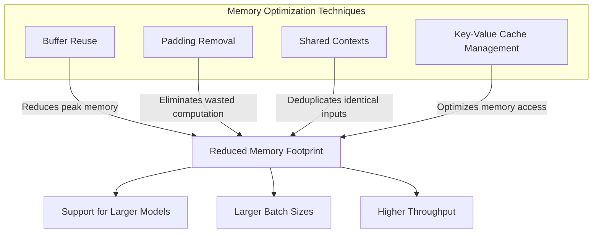
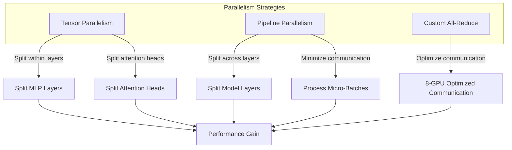
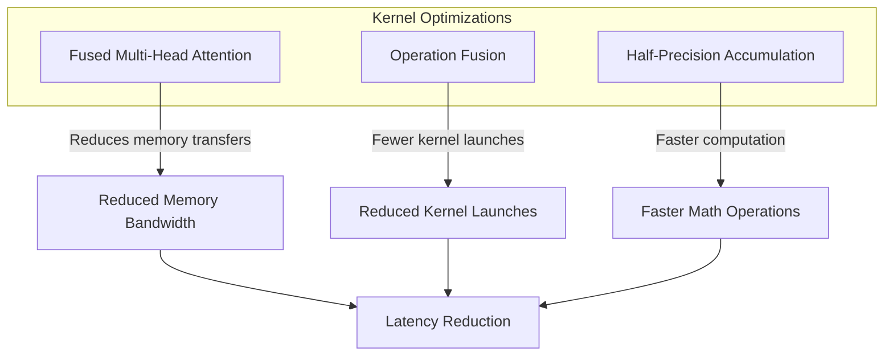
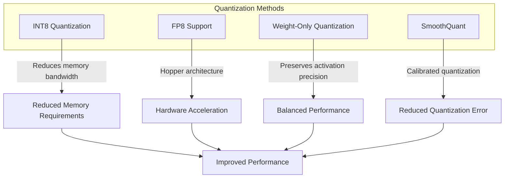
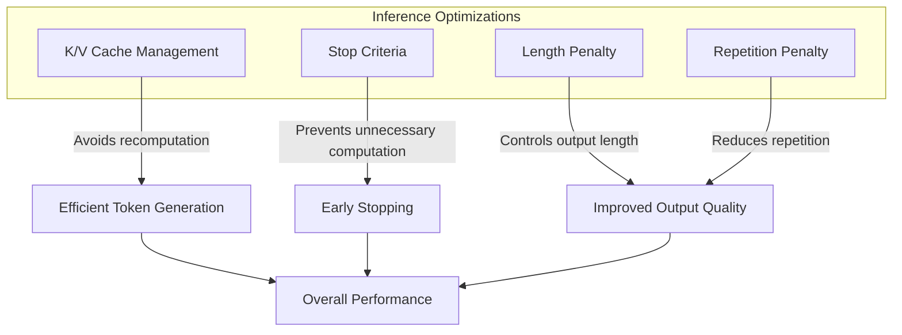

<!-- source: DeepWiki mcp.deepwiki.com · repo NVIDIA/FasterTransformer · page 5 Optimization Techniques · fetched 2026-10-26 -->

# Optimization Techniques

<details>
<summary>Relevant source files</summary>

The following files were used as context for generating this wiki page:

- [README.md](README.md)
- [docs/gpt_guide.md](docs/gpt_guide.md)
- [docs/gptj_guide.md](docs/gptj_guide.md)
- [src/fastertransformer/kernels/gpt_kernels.cu](src/fastertransformer/kernels/gpt_kernels.cu)
- [src/fastertransformer/kernels/gpt_kernels.h](src/fastertransformer/kernels/gpt_kernels.h)
- [src/fastertransformer/kernels/stop_criteria_kernels.cu](src/fastertransformer/kernels/stop_criteria_kernels.cu)
- [src/fastertransformer/models/gptj/GptJ.h](src/fastertransformer/models/gptj/GptJ.h)
- [src/fastertransformer/models/gptj/GptJContextDecoder.cc](src/fastertransformer/models/gptj/GptJContextDecoder.cc)
- [src/fastertransformer/models/gptneox/GptNeoXContextDecoder.cc](src/fastertransformer/models/gptneox/GptNeoXContextDecoder.cc)
- [src/fastertransformer/models/multi_gpu_gpt/ParallelGpt.h](src/fastertransformer/models/multi_gpu_gpt/ParallelGpt.h)
- [src/fastertransformer/models/multi_gpu_gpt/ParallelGptContextDecoder.cc](src/fastertransformer/models/multi_gpu_gpt/ParallelGptContextDecoder.cc)
- [src/fastertransformer/th_op/common/GptOps.cc](src/fastertransformer/th_op/common/GptOps.cc)
- [tests/unittests/test_gpt_kernels.cu](tests/unittests/test_gpt_kernels.cu)

</details>


This document outlines the key optimization techniques implemented in FasterTransformer to achieve high-performance inference for transformer-based models. These optimizations enable efficient execution of large language models across different hardware configurations, from single GPUs to multi-node deployments. For model-specific optimizations, see [Model Parallelism](5.1) and [Quantization](5.2).

## Memory Optimization Techniques

FasterTransformer implements several memory optimization strategies to reduce VRAM requirements, enabling larger models and batch sizes.



### Buffer Reuse

FasterTransformer minimizes memory usage by reusing intermediate buffers whenever possible:

- The decoder layer reuses the same buffer for intermediate computations across layers instead of allocating separate buffers for each layer.
- The `is_free_buffer_after_forward` flag controls whether buffers are freed after the forward pass, which helps balance memory usage against allocation overhead.

This approach is especially valuable for large models with many layers, as it reduces memory requirements by a factor proportional to the number of layers.

```cpp
// Buffer allocation with reuse pattern
void allocateBuffer() {
    // Allocate buffers once
    decoder_normed_input_ = allocator_->reMalloc(decoder_normed_input_, size);
    // Reuse the same buffer for normed output
    normed_self_attn_output_ = decoder_normed_input_;  // reuse the buffer
}
```

Sources: [src/fastertransformer/models/multi_gpu_gpt/ParallelGptContextDecoder.cc:94-133]()

### Padding Removal

For variable-length inputs, FasterTransformer removes padding tokens from the computation to avoid wasting compute resources:

- The `invokeRemovePadding` kernel removes padding tokens before processing, creating a compact representation.
- After computation, padding is restored to maintain the expected output format.
- This optimization is controlled via the `remove_padding` parameter.

```cpp
// Remove padding before computation
invokeRemovePadding(decoder_layer_output_,
                   decoder_input + ite * local_batch_size * seq_len * hidden_units_,
                   padding_offset_,
                   h_token_num,
                   hidden_units_,
                   stream_);
```

Sources: [src/fastertransformer/models/multi_gpu_gpt/ParallelGptContextDecoder.cc:297-301]()

### Shared Contexts Optimization

This optimization detects duplicate input contexts in a batch and processes them only once:

1. The `invokeFindContextDups` kernel identifies duplicate contexts in the batch
2. Creates a compact batch containing only unique contexts
3. Processes the compact batch
4. Maps the results back to the original batch structure

The `shared_contexts_ratio` parameter controls when this optimization is activated - if the compact size is less than `ratio * batch_size`, the optimized implementation is used.

```cpp
// Find duplicate contexts to create compact batch
invokeFindContextDups(shared_contexts,
                     batch_to_compact,
                     compact_to_batch,
                     compact_size,
                     input_ids,
                     batch_size,
                     1, // beam_width
                     input_seq_len,
                     stream);
```

Sources: [src/fastertransformer/kernels/gpt_kernels.h:124-132](), [tests/unittests/test_gpt_kernels.cu:43-105]()

### Memory-Limited Attention

The `memory_len` parameter limits the tokens used in attention computation, reducing memory usage at the potential cost of generation quality:

```cpp
// Optional memory_len parameter in input_tensors
memory_len = input_tensors->at("memory_len").getVal<uint32_t>();
```

This allows handling very long sequences even with limited GPU memory by constraining the attention window.

Sources: [src/fastertransformer/models/multi_gpu_gpt/ParallelGpt.h:113]()

## Parallelism Techniques

FasterTransformer supports model parallelism to distribute large models across multiple GPUs, enabling inference for models too large to fit in a single GPU's memory.



### Tensor Parallelism

Tensor parallelism splits individual model layers across multiple GPUs:

- Attention heads are distributed across GPUs
- MLP (feed-forward) layers are partitioned across GPUs
- Each GPU processes a portion of the layer and synchronizes via all-reduce operations

This implementation follows the Megatron-LM approach, splitting weights of matrix multiplications to reduce communication overhead.

```cpp
// Tensor-parallel attention layer initialization
self_attention_layer_ = new TensorParallelGptContextAttentionLayer<T>(
    max_batch_size_,
    max_seq_len_,
    head_num_,
    size_per_head_,
    tensor_para_,
    stream_,
    cublas_wrapper_,
    allocator_,
    true,
    is_free_buffer_after_forward_,
    is_qk_buf_float_,
    sparse_,
    int8_mode_,
    custom_all_reduce_comm_,
    enable_custom_all_reduce_);
```

Sources: [src/fastertransformer/models/multi_gpu_gpt/ParallelGptContextDecoder.cc:29-43]()

### Pipeline Parallelism

Pipeline parallelism distributes model layers across multiple GPUs:

- The model is split vertically, with different GPUs handling different layers
- Data flows through the GPUs in a pipeline
- Micro-batches are used to hide communication overhead

The `isValidLayerParallelId`, `isFirstLayerParallelId`, and `isLastLayerParallelId` methods manage the layer assignment for pipeline parallelism.

```cpp
// Layer assignment for pipeline parallelism
bool isValidLayerParallelId(uint l) {
    int local_num_layer = (int)(ceil(num_layer_ * 1.0f / pipeline_para_.world_size_));
    return l < num_layer_ && (l >= local_num_layer * pipeline_para_.rank_)
           && (l < local_num_layer * (pipeline_para_.rank_ + 1));
}
```

Sources: [src/fastertransformer/models/multi_gpu_gpt/ParallelGptContextDecoder.cc:186-191]()

### Custom All-Reduce Communication

For specific hardware configurations, FasterTransformer implements customized all-reduce operations to optimize communication:

- Only supported for 8-way tensor parallelism currently
- Requires CUDA with cudaMallocAsync
- Provides specialized communication patterns optimized for GPU topologies

```cpp
// Usage of custom all-reduce communication
custom_all_reduce_comm_ = custom_all_reduce_comm;
enable_custom_all_reduce_ = enable_custom_all_reduce;
```

Sources: [src/fastertransformer/models/multi_gpu_gpt/ParallelGpt.h:65-66]()

## Kernel Optimization Techniques

FasterTransformer employs various kernel optimizations to maximize GPU utilization and minimize latency.



### Fused Multi-Head Attention

Fused Multi-Head Attention (FMHA) combines multiple operations of the attention mechanism into a single kernel:

- Controlled via the `FMHA_ENABLE` environment variable
- Reduces memory bandwidth requirements by avoiding intermediate writes to global memory
- Uses FP16 accumulation for improved performance with minimal accuracy impact

```
FMHA_ENABLE=ON ./bin/gpt_example  # Enable fused multi-head attention
```

Sources: [docs/gpt_guide.md:202-208](), [docs/gptj_guide.md:102-108]()

### Half-Precision Accumulation

The library provides options to control precision of accumulation in attention computations:

- `CONTEXT_ATTENTION_BMM1_HALF_ACCUM` environment variable controls precision of QK matrix multiplication
- By default, FP32 accumulation is used for higher accuracy
- Setting to "ON" enables FP16 accumulation for better performance

```cpp
// Configuration for half-precision accumulation
const bool is_context_qk_buf_float_ =
    (std::getenv("CONTEXT_ATTENTION_BMM1_HALF_ACCUM") == nullptr ||
     std::string(std::getenv("CONTEXT_ATTENTION_BMM1_HALF_ACCUM")) != "ON");
```

Sources: [src/fastertransformer/models/multi_gpu_gpt/ParallelGpt.h:68-70]()

### Operation Fusion

Multiple operations are fused together when possible to reduce kernel launch overhead and memory transfers:

- Fusion of bias addition with activation functions
- Combined softmax with dropout operations
- Specialized kernels for sequence operations

```cpp
// Example of operation fusion in embedding lookup
start_id_embedding_position_lookups_kernel<T, OUTPUT_ID, PROMPT_SRC><<<grid, block, 0, stream>>>(
    from_tensor, output_ids, embedding_table, pos_table,
    prompt_param, input_ids, start_step, length, max_length,
    batch_size, hidden_units);
```

Sources: [src/fastertransformer/kernels/gpt_kernels.cu:32-104]()

## Quantization Techniques

FasterTransformer supports various quantization methods to reduce model size and improve inference speed.



### INT8 Quantization

INT8 quantization reduces memory bandwidth requirements and enables faster computation:

- Weight-only quantization (int8_mode = 1)
- Weight and activation quantization (int8_mode = 2)
- Optimized for specific hardware architectures (Volta and newer)

```cpp
// INT8 mode configuration
int8_mode_ = int8_mode;
```

Sources: [src/fastertransformer/models/multi_gpu_gpt/ParallelGpt.h:72](), [docs/gpt_guide.md:61-73]()

### FP8 Support (Experimental)

FP8 quantization leverages the latest hardware capabilities:

- Supported on Hopper architecture and later
- Experimental feature marked in the documentation
- Provides significant speedup with minimal accuracy loss
- Supports both GPT and BERT models

```
// FP8 support mentioned in the readme
FP8 (after Hopper)
```

Sources: [README.md:36]()

### Weight-Only Quantization

Weight-only quantization provides a balance between performance and accuracy:

- Only model weights are quantized, activations remain in higher precision
- Works best for small batch sizes (typically less than 32 or 64)
- Hidden sizes must be a multiple of 64 after tensor parallelism splitting
- Available for FP16/BF16 compute

Sources: [docs/gpt_guide.md:65-68]()

### SmoothQuant

SmoothQuant is a calibration-based quantization technique:

- Mentioned as supported for GPT models
- Balances quantization between activations and weights
- Reduces quantization error by scaling difficult-to-quantize outliers

Sources: [docs/gpt_guide.md:73]()

## Inference Optimization

FasterTransformer implements several optimizations specifically for efficient inference.



### K/V Cache Management

The key-value cache is a critical optimization for autoregressive generation:

- Stores intermediate key and value states to avoid recomputation
- Specialized layout for efficient memory access
- Support for variable sequence lengths
- Optimized for both context processing and token generation phases

```cpp
// K/V cache tensor allocation
Tensor& k_cache = output_tensors->at("key_cache");
Tensor& v_cache = output_tensors->at("value_cache");
```

Sources: [src/fastertransformer/models/multi_gpu_gpt/ParallelGptContextDecoder.cc:377-378]()

### Stop Criteria and Early Stopping

FasterTransformer implements various stopping mechanisms to avoid unnecessary computation:

- End token detection
- Stop words list support (detecting specific token sequences)
- Maximum length criteria
- Efficient kernel implementation for batch early stopping

```cpp
// Stop words criteria implementation
void invokeStopWordsCriterion(const int*   output_ids,
                              const int*   parent_ids,
                              const int*   stop_words,
                              bool*        finished,
                              size_t       id_offset,
                              size_t       stop_words_len,
                              int          batch_size,
                              int          beam_width,
                              int          step,
                              cudaStream_t stream)
```

Sources: [src/fastertransformer/kernels/stop_criteria_kernels.cu:24-104]()

### Length and Repetition Penalties

FasterTransformer provides configurable penalties to improve generation quality:

- Length penalty encourages either shorter or longer outputs
- Repetition penalty reduces token repetition
- Presence penalty (alternative to repetition penalty)
- Min length penalty to ensure outputs meet minimum length requirements

```cpp
// Length and repetition penalty parameters
repetition_penalty = input_tensors->at("repetition_penalty").getVal<float>();
presence_penalty = input_tensors->at("presence_penalty").getVal<float>();
min_length = input_tensors->at("min_length").getVal<int>();
```

Sources: [docs/gptj_guide.md:81-83]()

### Interactive Generation

For chat applications and interactive use cases, FasterTransformer supports stateful generation:

- Maintains state between generation calls
- Supports session length limits
- Memory window management for very long conversations
- Continue generation flag for seamless interaction

```cpp
// Interactive generation parameters
session_len = input_tensors->at("session_len").getVal<uint32_t>();
continue_gen = input_tensors->at("continue_gen").getVal<bool>();
```

Sources: [src/fastertransformer/models/multi_gpu_gpt/ParallelGpt.h:112-113]()

## Implementation Code Map

Below is a code entity map showing how the key optimization techniques are implemented across different components in FasterTransformer:

```mermaid
graph TD
    subgraph "Core Optimization Components"
        ParallelGpt["ParallelGpt\nsrc/fastertransformer/models/multi_gpu_gpt/ParallelGpt"]
        GptDecoder["GptDecoder\nsrc/fastertransformer/models/multi_gpu_gpt/ParallelGptDecoder"]
        GptContextDecoder["GptContextDecoder\nsrc/fastertransformer/models/multi_gpu_gpt/ParallelGptContextDecoder"]
        GptKernels["GPT Kernels\nsrc/fastertransformer/kernels/gpt_kernels.cu"]
        StopKernels["Stop Criteria Kernels\nsrc/fastertransformer/kernels/stop_criteria_kernels.cu"]
    end
    
    ParallelGpt --> |"Controls model execution"| SharedContexts["shared_contexts_ratio_\nCompact batch optimization"]
    ParallelGpt --> |"Memory management"| MemOpt["allocateBuffer()\nBuffer allocation and reuse"]
    ParallelGpt --> |"Parallelism config"| Parallel["tensor_para_ & pipeline_para_\nModel parallelism"]
    
    GptContextDecoder --> |"Decoder optimization"| RemovePad["invokeRemovePadding()\nPadding removal"]
    GptContextDecoder --> |"Parallelism implementation"| LayerParallel["isValidLayerParallelId()\nPipeline parallelism"]
    
    GptKernels --> |"Context optimization"| FindDups["invokeFindContextDups()\nDuplicate detection"]
    GptKernels --> |"Memory efficiency"| CompactInputs["invokeCompactInputs()\nCompact batch processing"]
    
    StopKernels --> |"Generation efficiency"| StopWords["invokeStopWordsCriterion()\nEarly stopping"]
    StopKernels --> |"Output control"| LengthControl["invokeLengthCriterion()\nLength handling"]
```



Sources: [src/fastertransformer/models/multi_gpu_gpt/ParallelGpt.h](), [src/fastertransformer/models/multi_gpu_gpt/ParallelGptContextDecoder.cc](), [src/fastertransformer/kernels/gpt_kernels.cu](), [src/fastertransformer/kernels/stop_criteria_kernels.cu]()

---

