<!-- source: DeepWiki mcp.deepwiki.com · repo NVIDIA/FasterTransformer · page 5.1 Model Parallelism · fetched 2026-10-26 -->

# Model Parallelism

<details>
<summary>Relevant source files</summary>

The following files were used as context for generating this wiki page:

- [docs/gpt_guide.md](docs/gpt_guide.md)
- [docs/gptj_guide.md](docs/gptj_guide.md)
- [src/fastertransformer/kernels/custom_ar_kernels.cu](src/fastertransformer/kernels/custom_ar_kernels.cu)
- [src/fastertransformer/kernels/custom_ar_kernels.h](src/fastertransformer/kernels/custom_ar_kernels.h)
- [src/fastertransformer/layers/TensorParallelGeluFfnLayer.cc](src/fastertransformer/layers/TensorParallelGeluFfnLayer.cc)
- [src/fastertransformer/layers/TensorParallelReluFfnLayer.cc](src/fastertransformer/layers/TensorParallelReluFfnLayer.cc)
- [src/fastertransformer/layers/TensorParallelSiluFfnLayer.cc](src/fastertransformer/layers/TensorParallelSiluFfnLayer.cc)
- [src/fastertransformer/layers/attention_layers/TensorParallelDecoderCrossAttentionLayer.cc](src/fastertransformer/layers/attention_layers/TensorParallelDecoderCrossAttentionLayer.cc)
- [src/fastertransformer/layers/attention_layers/TensorParallelDecoderSelfAttentionLayer.cc](src/fastertransformer/layers/attention_layers/TensorParallelDecoderSelfAttentionLayer.cc)
- [src/fastertransformer/layers/attention_layers/TensorParallelDisentangledAttentionLayer.cc](src/fastertransformer/layers/attention_layers/TensorParallelDisentangledAttentionLayer.cc)
- [src/fastertransformer/layers/attention_layers/TensorParallelGptContextAttentionLayer.cc](src/fastertransformer/layers/attention_layers/TensorParallelGptContextAttentionLayer.cc)
- [src/fastertransformer/layers/attention_layers/TensorParallelUnfusedAttentionLayer.cc](src/fastertransformer/layers/attention_layers/TensorParallelUnfusedAttentionLayer.cc)
- [src/fastertransformer/models/bert/Bert.cc](src/fastertransformer/models/bert/Bert.cc)
- [src/fastertransformer/models/gptj/GptJ.h](src/fastertransformer/models/gptj/GptJ.h)
- [src/fastertransformer/models/gptj/GptJContextDecoder.cc](src/fastertransformer/models/gptj/GptJContextDecoder.cc)
- [src/fastertransformer/models/gptneox/GptNeoXContextDecoder.cc](src/fastertransformer/models/gptneox/GptNeoXContextDecoder.cc)
- [src/fastertransformer/models/multi_gpu_gpt/ParallelGptContextDecoder.cc](src/fastertransformer/models/multi_gpu_gpt/ParallelGptContextDecoder.cc)

</details>


This page explains how FasterTransformer implements model parallelism strategies to distribute large transformer models across multiple GPUs, enabling efficient training and inference of models too large to fit on a single device. For information on pipeline parallelism implementation specifically, see sections below. For quantization techniques to reduce memory usage, see [Quantization](#5.2).

## Introduction to Model Parallelism

Large language models like GPT-3 (175B parameters) require approximately 350GB of memory even with half-precision weights, exceeding the capacity of even the largest individual GPUs. FasterTransformer addresses this challenge by implementing two primary forms of model parallelism:

1. **Tensor Parallelism (TP)**: Splits individual layers across multiple GPUs by partitioning the underlying tensors
2. **Pipeline Parallelism (PP)**: Distributes different layers of the model across multiple GPUs

These techniques can be used independently or combined to scale models efficiently across hardware resources.

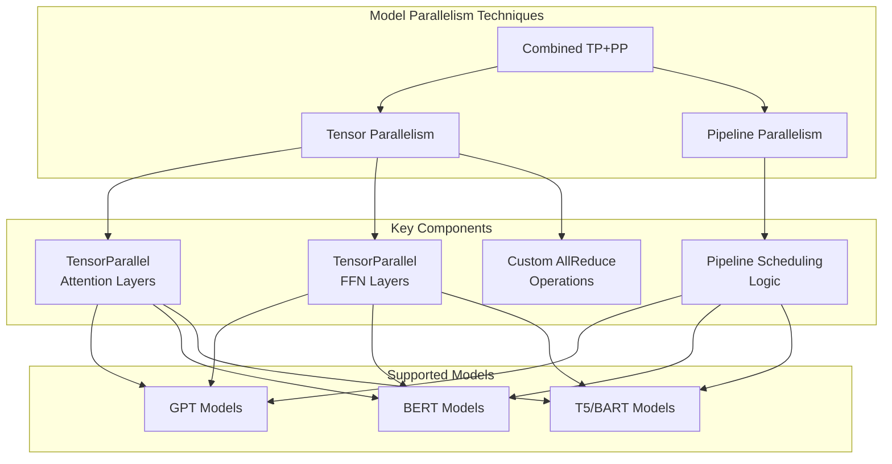

Sources: [docs/gpt_guide.md:196-203](). [src/fastertransformer/models/bert/Bert.cc:273-295](), [src/fastertransformer/models/multi_gpu_gpt/ParallelGptContextDecoder.cc:186-212]()

## Tensor Parallelism

Tensor parallelism divides operations within a single transformer layer across multiple GPUs. FasterTransformer implements tensor parallelism following the approach from the Megatron paper, which splits both self-attention blocks and feed-forward networks.

### Implementation Details

The key insight of tensor parallelism is that neural network operations can be partitioned across devices with minimal communication overhead:

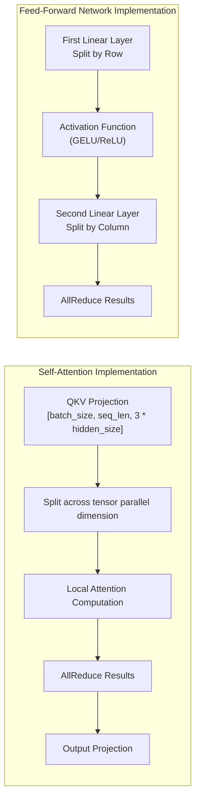

FasterTransformer implements tensor parallelism through specialized layer classes that handle:
1. Weight partitioning
2. Local computation
3. All-reduce communication

Each tensor-parallel layer handles a portion of the computation and communicates only when necessary, typically using efficient all-reduce operations.

Sources: [src/fastertransformer/layers/TensorParallelGeluFfnLayer.cc:23-66](), [src/fastertransformer/layers/attention_layers/TensorParallelGptContextAttentionLayer.cc:23-60]()

### Tensor Parallelism Architecture

The following diagram illustrates how the model weights are split across GPUs in tensor parallelism:

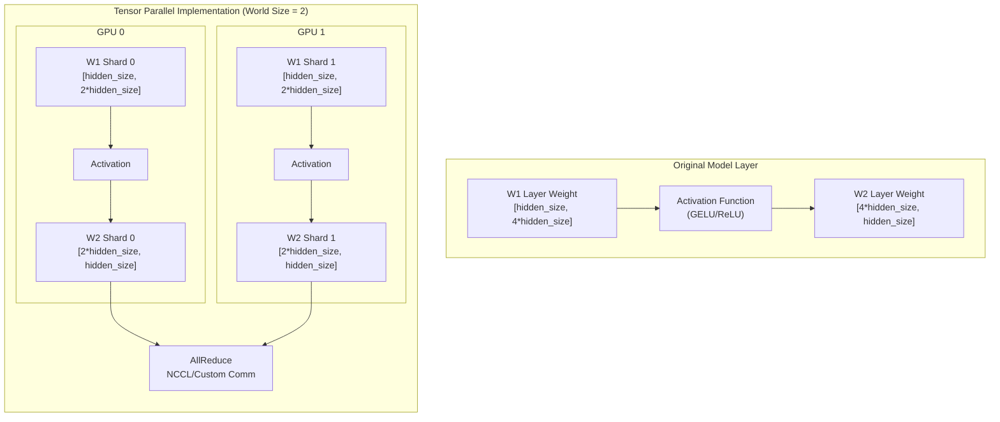

Sources: [src/fastertransformer/layers/TensorParallelGeluFfnLayer.cc:68-106](), [src/fastertransformer/layers/TensorParallelReluFfnLayer.cc:32-66]()

### Key Classes for Tensor Parallelism

FasterTransformer provides specialized classes for tensor parallelism:

| Class | Purpose |
|-------|---------|
| `TensorParallelGptContextAttentionLayer` | Implements tensor parallelism for GPT context attention |
| `TensorParallelDecoderSelfAttentionLayer` | Implements tensor parallelism for decoder self-attention |
| `TensorParallelDecoderCrossAttentionLayer` | Implements tensor parallelism for cross-attention in encoder-decoder models |
| `TensorParallelGeluFfnLayer` | Implements tensor parallelism for feed-forward networks with GELU activation |
| `TensorParallelReluFfnLayer` | Implements tensor parallelism for feed-forward networks with ReLU activation |
| `TensorParallelSiluFfnLayer` | Implements tensor parallelism for feed-forward networks with SiLU activation |

These classes handle the partitioning of weights, local computation, and communication for their respective operations.

Sources: [src/fastertransformer/layers/attention_layers/TensorParallelGptContextAttentionLayer.cc:63-140](), [src/fastertransformer/layers/TensorParallelGeluFfnLayer.cc:68-106]()

## Pipeline Parallelism

Pipeline parallelism distributes layers across multiple GPUs, with each GPU responsible for a subset of the model's layers. This approach is particularly effective for very deep models.

### Implementation Details

Pipeline parallelism divides the model into sequential stages, with each stage assigned to a different GPU. This is implemented through functions that determine which layers belong to which pipeline stage:

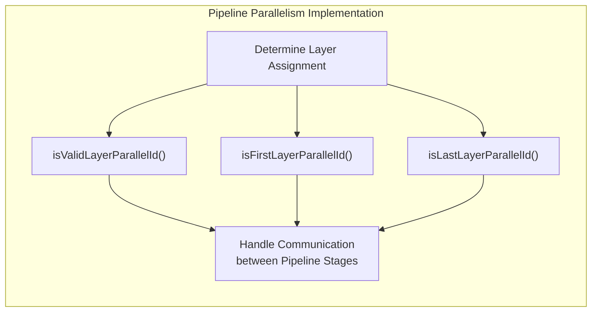

Each GPU processes its assigned layers and communicates with adjacent GPUs in the pipeline. The implementation calculates the local number of layers for each pipeline stage and manages the required communication.

Sources: [src/fastertransformer/models/bert/Bert.cc:273-303](), [src/fastertransformer/models/gptj/GptJContextDecoder.cc:106-132]()

### Pipeline Parallelism Architecture

The following diagram shows how a model is divided across GPUs using pipeline parallelism:

```mermaid
flowchart LR
    subgraph "Original Model (12 Layers)"
        direction TB
        L1["Layer 1"]
        L2["Layer 2"]
        L3["Layer 3"]
        L4["Layer 4"]
        L5["Layer 5"]
        L6["Layer 6"]
        L7["Layer 7"]
        L8["Layer 8"]
        L9["Layer 9"]
        L10["Layer 10"]
        L11["Layer 11"]
        L12["Layer 12"]
        
        L1 --> L2 --> L3 --> L4 --> L5 --> L6 --> L7 --> L8 --> L9 --> L10 --> L11 --> L12
    end
    
    subgraph "Pipeline Parallel Implementation (4 GPUs)"
        direction TB
        subgraph "GPU 0 (Pipeline Stage 0)"
            PL1["Layer 1"]
            PL2["Layer 2"]
            PL3["Layer 3"]
            
            PL1 --> PL2 --> PL3
        end
        
        subgraph "GPU 1 (Pipeline Stage 1)"
            PL4["Layer 4"]
            PL5["Layer 5"]
            PL6["Layer 6"]
            
            PL4 --> PL5 --> PL6
        end
        
        subgraph "GPU 2 (Pipeline Stage 2)"
            PL7["Layer 7"]
            PL8["Layer 8"]
            PL9["Layer 9"]
            
            PL7 --> PL8 --> PL9
        end
        
        subgraph "GPU 3 (Pipeline Stage 3)"
            PL10["Layer 10"]
            PL11["Layer 11"]
            PL12["Layer 12"]
            
            PL10 --> PL11 --> PL12
        end
        
        PL3 --> |"NCCL Communication"| PL4
        PL6 --> |"NCCL Communication"| PL7
        PL9 --> |"NCCL Communication"| PL10
    end
```

The implementation handles:
1. Assignment of layers to pipeline stages
2. Communication between stages
3. Special handling for first and last layers in each stage

Sources: [src/fastertransformer/models/multi_gpu_gpt/ParallelGptContextDecoder.cc:186-212](), [src/fastertransformer/models/gptneox/GptNeoXContextDecoder.cc:106-132]()

## Implementation Mechanisms

### Layer Assignment

Each GPU only processes its assigned subset of layers, determined by the following helper functions:

```cpp
bool isValidLayerParallelId(uint l) {
    int local_num_layer = (int)(ceil(num_layer_ * 1.0f / pipeline_para_.world_size_));
    return l < num_layer_ && (l >= local_num_layer * pipeline_para_.rank_)
           && (l < local_num_layer * (pipeline_para_.rank_ + 1));
}

bool isFirstLayerParallelId(uint l) {
    int local_num_layer = (int)(ceil(num_layer_ * 1.0f / pipeline_para_.world_size_));
    return l < num_layer_ && (l == local_num_layer * pipeline_para_.rank_);
}

bool isLastLayerParallelId(uint l) {
    int local_num_layer = (int)(ceil(num_layer_ * 1.0f / pipeline_para_.world_size_));
    return l < num_layer_ && (l == local_num_layer * (pipeline_para_.rank_ + 1) - 1);
}
```

These functions determine which layers should be processed by the current GPU and handle special cases for the first and last layers of each pipeline stage.

Sources: [src/fastertransformer/models/bert/Bert.cc:273-295](), [src/fastertransformer/models/gptj/GptJContextDecoder.cc:106-132]()

### Communication Patterns

Communication in pipeline parallelism occurs primarily between adjacent GPUs:

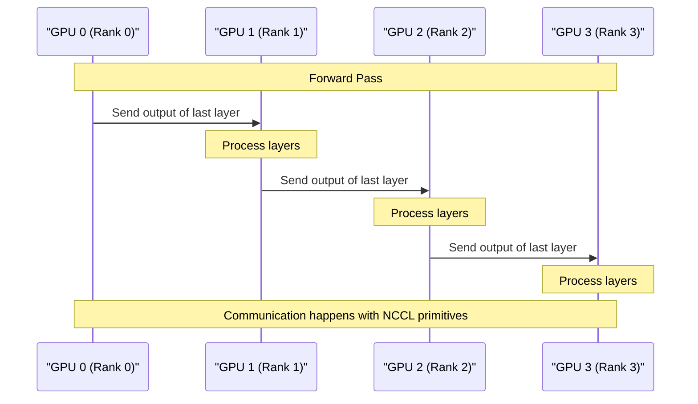

The code uses NCCL operations for communication:
- `ftNcclSend` to send data to the next pipeline stage
- `ftNcclRecv` to receive data from the previous stage
- `ftNcclAllGather` for tensor parallelism within each pipeline stage

Sources: [src/fastertransformer/models/bert/Bert.cc:466-479](), [src/fastertransformer/models/gptj/GptJContextDecoder.cc:322-331]()

## Custom All-Reduce Communication

FasterTransformer implements custom all-reduce operations to optimize communication for tensor parallelism, especially for large models.

### Implementation Details

The custom all-reduce implementation provides two algorithms:
1. One-shot all-reduce for small data sizes
2. Two-shot all-reduce for larger data sizes

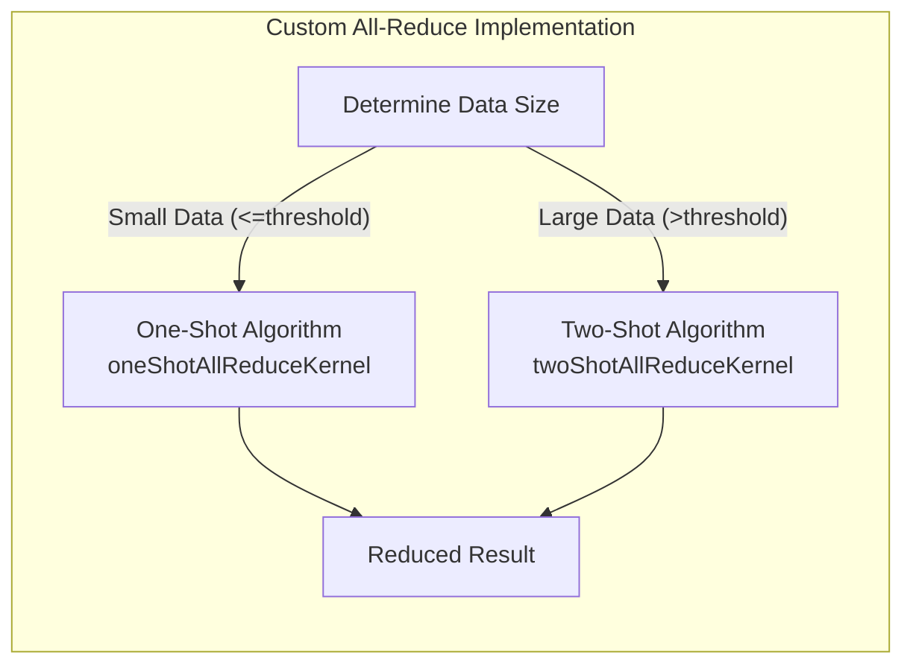

The implementation selects the appropriate algorithm based on the size of data being reduced, with a threshold defined in `DEFALUT_ALGO_AR_SIZE_THRESHOLD`.

Sources: [src/fastertransformer/kernels/custom_ar_kernels.cu:371-388](), [src/fastertransformer/kernels/custom_ar_kernels.h:26-32]()

### Integration with Tensor Parallel Layers

The custom all-reduce operations are integrated with tensor parallel layers through a common interface:

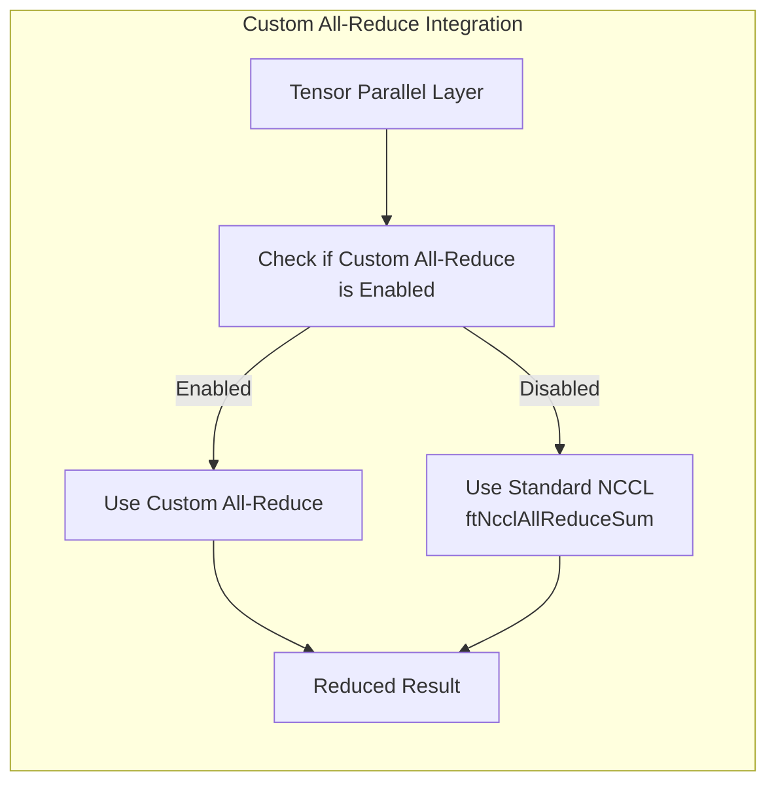

Each tensor parallel layer checks if custom all-reduce is enabled and available, and uses it when possible to optimize communication.

Sources: [src/fastertransformer/layers/TensorParallelGeluFfnLayer.cc:42-65](), [src/fastertransformer/layers/attention_layers/TensorParallelGptContextAttentionLayer.cc:40-60]()

## Combined Model Parallelism

FasterTransformer supports combining tensor and pipeline parallelism for maximum scalability. This is particularly useful for very large models like GPT-3 175B.

### Architecture Diagram

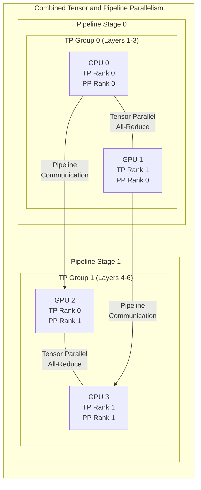

In this setup:
- Horizontal communication is for tensor parallelism (within pipeline stages)
- Vertical communication is for pipeline parallelism (between stages)

Sources: [docs/gpt_guide.md:94-106](), [src/fastertransformer/models/multi_gpu_gpt/ParallelGptContextDecoder.cc:320-331]()

### Implementation Logic

The combined approach requires careful coordination of both tensor and pipeline parallel operations:

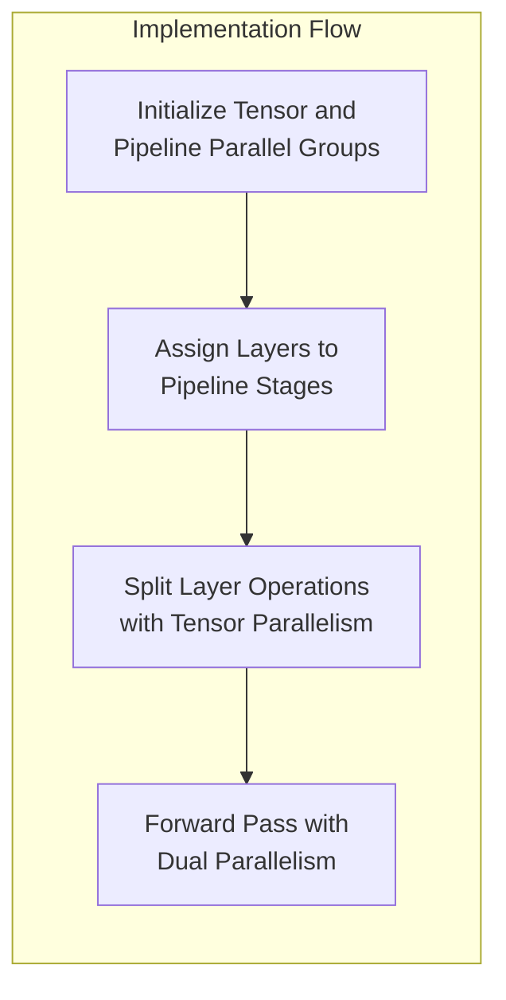

Key considerations in the implementation:
1. Each GPU has both a tensor parallel rank and a pipeline parallel rank
2. Layer assignments depend on pipeline parallel rank
3. Tensor operations are split based on tensor parallel rank
4. Communication patterns must account for both types of parallelism

Sources: [src/fastertransformer/models/bert/Bert.cc:466-479](), [src/fastertransformer/models/multi_gpu_gpt/ParallelGptContextDecoder.cc:416-444]()

## Practical Usage

### Configuration

Model parallelism is configured through parameters in configuration files or directly in code:

```ini
# Example configuration for GPT model
tensor_para_size=8
pipeline_para_size=2
```

These parameters determine how the model is distributed:
- `tensor_para_size`: Number of GPUs for tensor parallelism
- `pipeline_para_size`: Number of pipeline stages

Sources: [docs/gpt_guide.md:418-438]()

### Performance Considerations

When using model parallelism, consider the following trade-offs:

| Parallelism Type | Advantages | Disadvantages |
|------------------|------------|---------------|
| Tensor Parallelism | - Lower communication volume for large batch sizes<br>- Better utilization of GPU compute | - More frequent communication<br>- Requires high-speed interconnect |
| Pipeline Parallelism | - Less frequent communication<br>- Works well with slower interconnects | - Potential for "bubbles" in the pipeline<br>- Lower GPU utilization for small batches |
| Combined | - Maximizes scalability for very large models<br>- Balance between communication patterns | - More complex implementation<br>- Requires careful tuning |

Sources: [docs/gpt_guide.md:196-203]()

### Recommendations

The documentation recommends:
- Use tensor parallelism within nodes (where GPUs are connected by NVLink or similar high-speed interconnects)
- Use pipeline parallelism between nodes (where connection speeds may be slower)
- For very large models like GPT-3 175B, combine both approaches

Sources: [docs/gpt_guide.md:196-203]()

## Implementation Examples

### GPT Model Implementation

Large GPT models use both tensor and pipeline parallelism for inference:

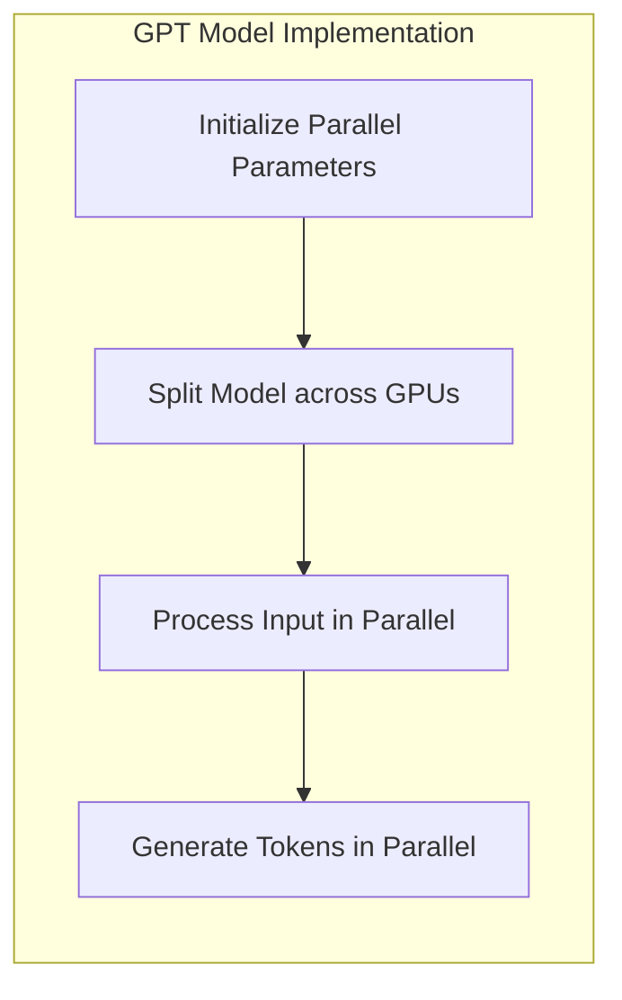

The implementation adjusts the number of micro-batches automatically to optimize the pipeline and minimize "bubbles".

Sources: [docs/gpt_guide.md:109-123](), [docs/gpt_guide.md:432-440]()

### BERT Model Implementation

BERT models can also leverage model parallelism:

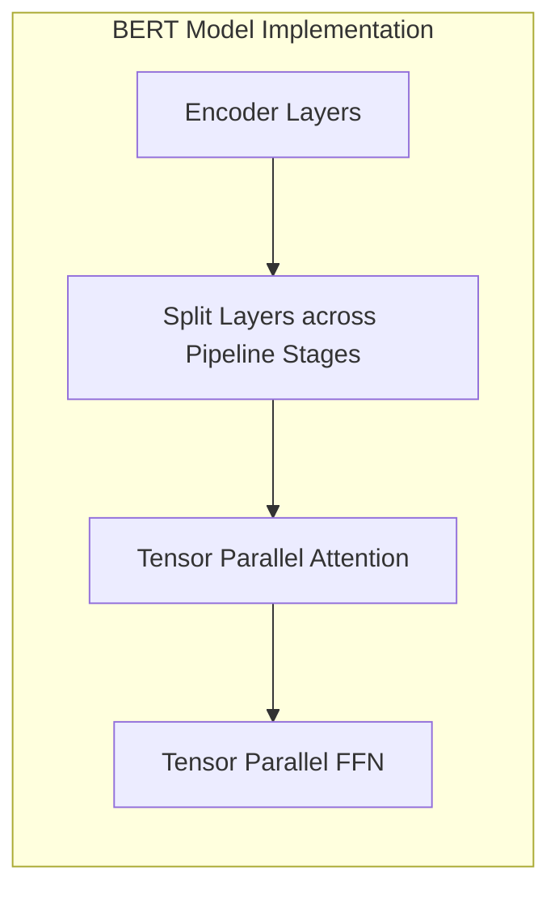

The implementation includes specialized handling for first and last layers in each pipeline stage.

Sources: [src/fastertransformer/models/bert/Bert.cc:466-479]()

---

