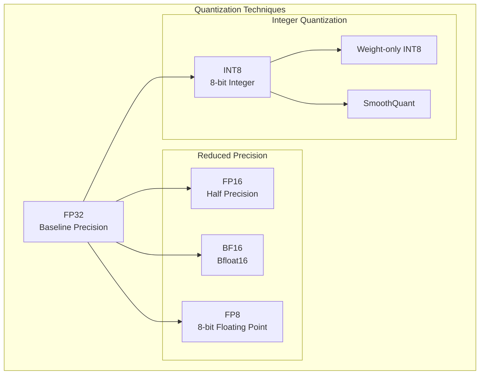
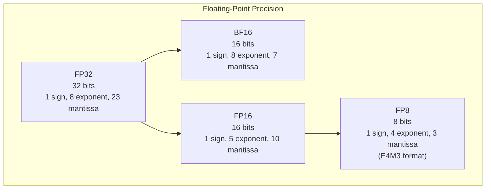
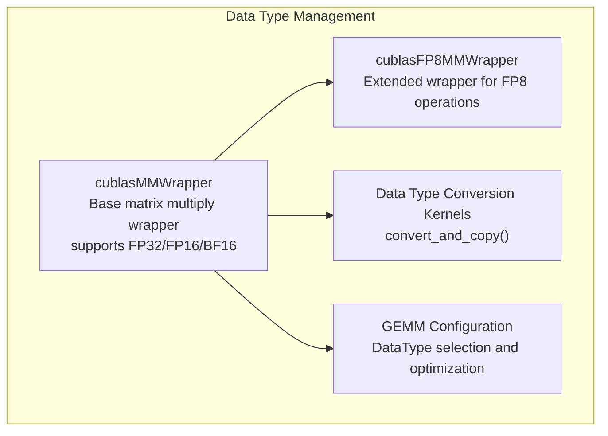
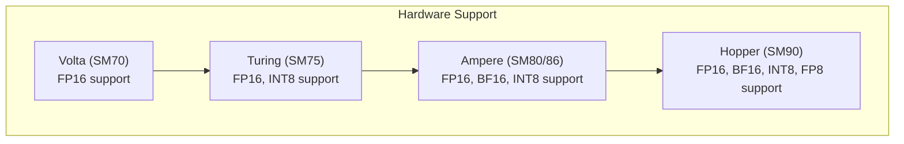

<!-- source: DeepWiki mcp.deepwiki.com · repo NVIDIA/FasterTransformer · page 5.2 Quantization · fetched 2026-10-26 -->

# Quantization

<details>
<summary>Relevant source files</summary>

The following files were used as context for generating this wiki page:

- [CMakeLists.txt](CMakeLists.txt)
- [cmake/Modules/FindNCCL.cmake](cmake/Modules/FindNCCL.cmake)
- [examples/pytorch/t5/translate_example.py](examples/pytorch/t5/translate_example.py)
- [src/fastertransformer/kernels/gen_relative_pos_bias.cu](src/fastertransformer/kernels/gen_relative_pos_bias.cu)
- [src/fastertransformer/layers/TensorParallelGeluFfnLayer.cc](src/fastertransformer/layers/TensorParallelGeluFfnLayer.cc)
- [src/fastertransformer/layers/TensorParallelReluFfnLayer.cc](src/fastertransformer/layers/TensorParallelReluFfnLayer.cc)
- [src/fastertransformer/layers/TensorParallelSiluFfnLayer.cc](src/fastertransformer/layers/TensorParallelSiluFfnLayer.cc)
- [src/fastertransformer/layers/attention_layers/TensorParallelDecoderCrossAttentionLayer.cc](src/fastertransformer/layers/attention_layers/TensorParallelDecoderCrossAttentionLayer.cc)
- [src/fastertransformer/layers/attention_layers/TensorParallelDecoderSelfAttentionLayer.cc](src/fastertransformer/layers/attention_layers/TensorParallelDecoderSelfAttentionLayer.cc)
- [src/fastertransformer/layers/attention_layers/TensorParallelDisentangledAttentionLayer.cc](src/fastertransformer/layers/attention_layers/TensorParallelDisentangledAttentionLayer.cc)
- [src/fastertransformer/layers/attention_layers/TensorParallelGptContextAttentionLayer.cc](src/fastertransformer/layers/attention_layers/TensorParallelGptContextAttentionLayer.cc)
- [src/fastertransformer/layers/attention_layers/TensorParallelUnfusedAttentionLayer.cc](src/fastertransformer/layers/attention_layers/TensorParallelUnfusedAttentionLayer.cc)
- [src/fastertransformer/models/bert/Bert.cc](src/fastertransformer/models/bert/Bert.cc)
- [src/fastertransformer/models/gptj/GptJ.cc](src/fastertransformer/models/gptj/GptJ.cc)
- [src/fastertransformer/models/multi_gpu_gpt/ParallelGpt.cc](src/fastertransformer/models/multi_gpu_gpt/ParallelGpt.cc)
- [src/fastertransformer/utils/cublasFP8MMWrapper.cu](src/fastertransformer/utils/cublasFP8MMWrapper.cu)
- [src/fastertransformer/utils/cublasMMWrapper.cc](src/fastertransformer/utils/cublasMMWrapper.cc)
- [tests/unittests/test_attention_kernels.cu](tests/unittests/test_attention_kernels.cu)

</details>


This document describes the quantization support in FasterTransformer, including available quantization types, implementation details, and usage guidelines. Quantization is a technique that reduces the numerical precision of model parameters and activations to improve inference performance and reduce memory usage.

## Overview

FasterTransformer supports multiple quantization approaches to optimize model inference performance and memory footprint. These techniques allow models to run faster while maintaining reasonable accuracy, making them particularly valuable for large-scale transformer deployments.



Sources: [CMakeLists.txt:23-29](), [src/fastertransformer/utils/cublasMMWrapper.cc:331-344](), [src/fastertransformer/utils/cublasFP8MMWrapper.cu:27-53]()

## Supported Quantization Types

### FP16/BF16 Quantization

FasterTransformer supports FP16 (half precision) by default, which reduces memory usage by half compared to FP32 while maintaining good numerical stability for most transformer models. BF16 (Brain Floating Point) is supported on CUDA 11.0 and later, offering a balance between FP16 and FP32 with better dynamic range than FP16.



To enable BF16 support:
- CUDA 11.0 or later is required
- The support is automatically enabled when a compatible CUDA version is detected
- For FP16 and BF16, specific wrapper functions are provided in the cublasMMWrapper class

Sources: [CMakeLists.txt:19-22](), [src/fastertransformer/utils/cublasMMWrapper.cc:337-353]()

### INT8 Quantization

INT8 quantization represents weights and/or activations using 8-bit integers, which can reduce memory usage and improve computational efficiency by up to 4x compared to FP32. FasterTransformer supports multiple INT8 quantization schemes:

1. **Weight-Only Quantization**: Only the weights are quantized to INT8 while activations remain in higher precision
2. **Full INT8 Quantization**: Both weights and activations are quantized to INT8
3. **SmoothQuant**: A technique that scales activations to improve quantization accuracy

INT8 support is particularly optimized for BERT-like encoder models, with kernels specifically designed for efficient INT8 operations.

Sources: [src/fastertransformer/models/bert/Bert.cc:30-56]()

### FP8 Quantization

FP8 (8-bit floating point) support was added for newer GPU architectures (requiring CUDA 11.8 or later). FP8 provides a good balance between integer quantization and floating-point representation, with implementations primarily in the E4M3 format (4 bits for exponent, 3 bits for mantissa).

To enable FP8 support:
- CUDA 11.8 or later is required
- Set the CMake option `ENABLE_FP8=ON`
- FP8 functionality is implemented through the `cublasFP8MMWrapper` class

Sources: [CMakeLists.txt:24-30](), [src/fastertransformer/utils/cublasFP8MMWrapper.cu:23-75](), [CMakeLists.txt:432-456]()

## Implementation Details

### Data Type Management

FasterTransformer implements flexible data type handling across components, with the core data type conversion and management capabilities in the following components:



The `cublasMMWrapper` and `cublasFP8MMWrapper` classes provide interfaces to cuBLAS and cublasLt libraries, handling precision-specific settings and optimizations. Matrix multiply operations are optimized based on the selected data type.

Sources: [src/fastertransformer/utils/cublasMMWrapper.cc:30-381](), [src/fastertransformer/utils/cublasFP8MMWrapper.cu:23-210]()

### Quantization Implementation by Model Type

Different model architectures have specific quantization implementations optimized for their structure:

| Model Type | Supported Quantization | Implementation Details |
|------------|------------------------|------------------------|
| BERT       | INT8, FP16, BF16, FP8  | Full model INT8 support with dedicated quantized kernels |
| GPT        | FP16, BF16, limited INT8 | Primarily FP16/BF16 with some INT8 support |
| T5         | FP16, BF16            | Primarily supports reduced precision floating point |

Each model implements quantization through specialized layer implementations and kernel selections based on the chosen precision.

Sources: [src/fastertransformer/models/bert/Bert.cc:25-55](), [src/fastertransformer/models/multi_gpu_gpt/ParallelGpt.cc:340-349]()

### Quantization Kernels

For INT8 quantization, FasterTransformer includes specialized kernels for common operations:

- `activation_int8_kernels`: INT8-specific activation functions
- `layernorm_int8_kernels`: Layer normalization for INT8 tensors
- `quantization_int8_kernels`: Quantization/dequantization operations
- `softmax_int8_kernels`: Softmax with INT8 inputs
- `transpose_int8_kernels`: Specialized transpose for INT8 tensors
- `int8_gemm`: INT8 matrix multiplication

For FP8 quantization, specialized kernels are enabled when the ENABLE_FP8 flag is set:

- `activation_fp8_kernels`
- `layernorm_fp8_kernels`
- `unfused_attention_fp8_kernels`
- `fp8_qgmma_1x1_utils`

Sources: [CMakeLists.txt:368-414](), [CMakeLists.txt:432-455]()

## Hardware Considerations

Quantization performance and support depends on the underlying GPU architecture:



- **FP16**: Supported on all NVIDIA architectures since Volta (SM 70+)
- **BF16**: Supported on Ampere (SM 80+) and newer architectures
- **INT8**: Best performance on Turing (SM 75+) and newer architectures
- **FP8**: Requires Hopper architecture (SM 90) for hardware acceleration

FP8 support requires CUDA 11.8 or newer, and is enabled through the CUDA_PTX_FP8_F2FP_ENABLED flag.

Sources: [CMakeLists.txt:129-180](), [CMakeLists.txt:189-195]()

## Usage Guidelines

### Enabling Quantization

#### FP16/BF16

FP16 is enabled by default and can be selected through the API. BF16 is automatically enabled with CUDA 11.0+ and can be selected using:

```cpp
// Set data type to BF16
wrapper->setBF16GemmConfig();
```

#### INT8

For INT8 quantization, the model must be calibrated first. INT8 mode is typically selected when constructing a model instance:

```cpp
// Example of initializing BERT with INT8 quantization
int int8_mode = 1;  // 0: no INT8, 1: weight-only, 2: full quantization
Bert<half> bert(batch_size, 
                seq_len, 
                head_num, 
                size_per_head, 
                inter_size, 
                num_layer, 
                sm,
                q_scaling,
                stream, 
                cublas_wrapper, 
                allocator, 
                false,
                attention_type,
                false,
                activation_type,
                layernorm_type,
                tensor_para,
                pipeline_para,
                custom_all_reduce_comm,
                enable_custom_all_reduce,
                int8_mode);
```

#### FP8

FP8 support requires both enabling it at compile time and selecting it at runtime:

1. Compile with FP8 support: `cmake -DENABLE_FP8=ON ...`
2. Use FP8-specific implementations (e.g., `cublasFP8MMWrapper` instead of `cublasMMWrapper`)

Sources: [src/fastertransformer/utils/cublasMMWrapper.cc:330-354](), [src/fastertransformer/models/bert/Bert.cc:93-133]()

### Performance Expectations

Quantization offers significant performance improvements and memory savings:

| Quantization Type | Memory Reduction | Relative Performance | Accuracy Impact |
|-------------------|-----------------|----------------------|----------------|
| FP16              | 2x              | 1.5-2x               | Minimal        |
| BF16              | 2x              | 1.5-2x               | Minimal        |
| INT8 (weight-only)| 4x (weights)    | 1.5-2.5x             | Small          |
| INT8 (full)       | 4x              | 2-3x                 | Moderate       |
| FP8               | 4x              | 2-3x                 | Small-Moderate |

The actual performance improvements depend on the specific hardware, model architecture, and batch size.

## Related Resources

- For model parallelism optimization techniques, see [Model Parallelism](#5.1)
- For memory optimization techniques, see [Memory Optimization](#5.3)

---

