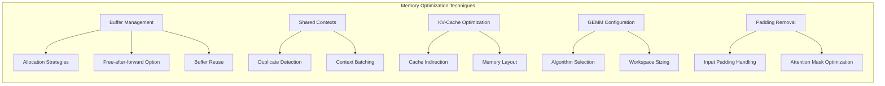
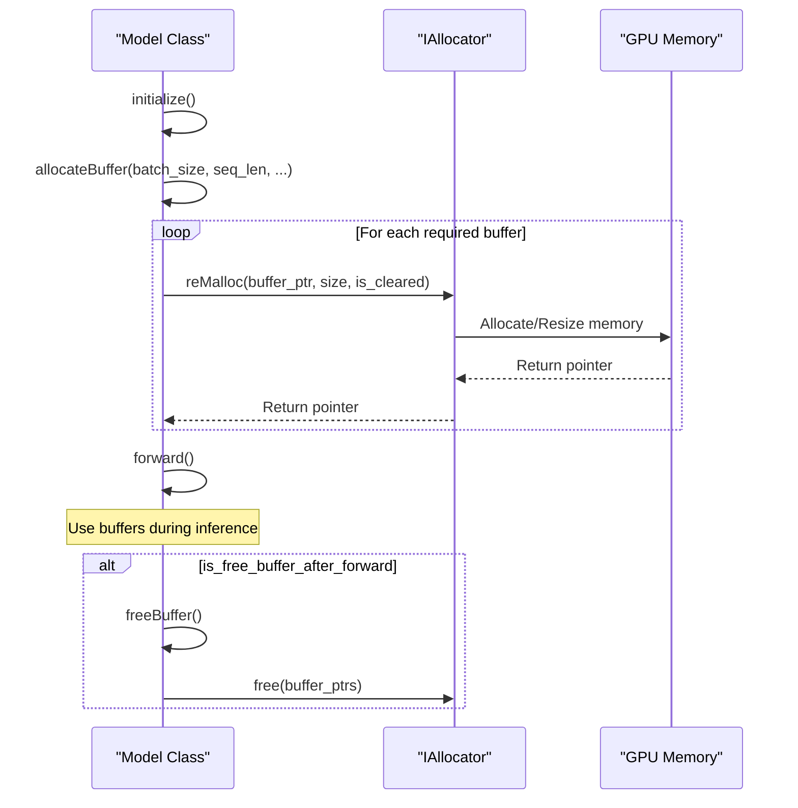
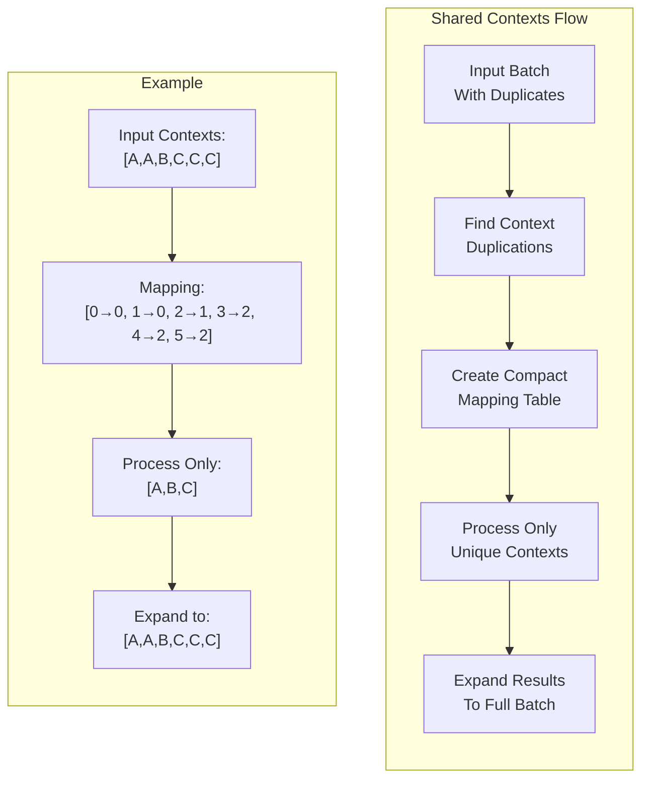
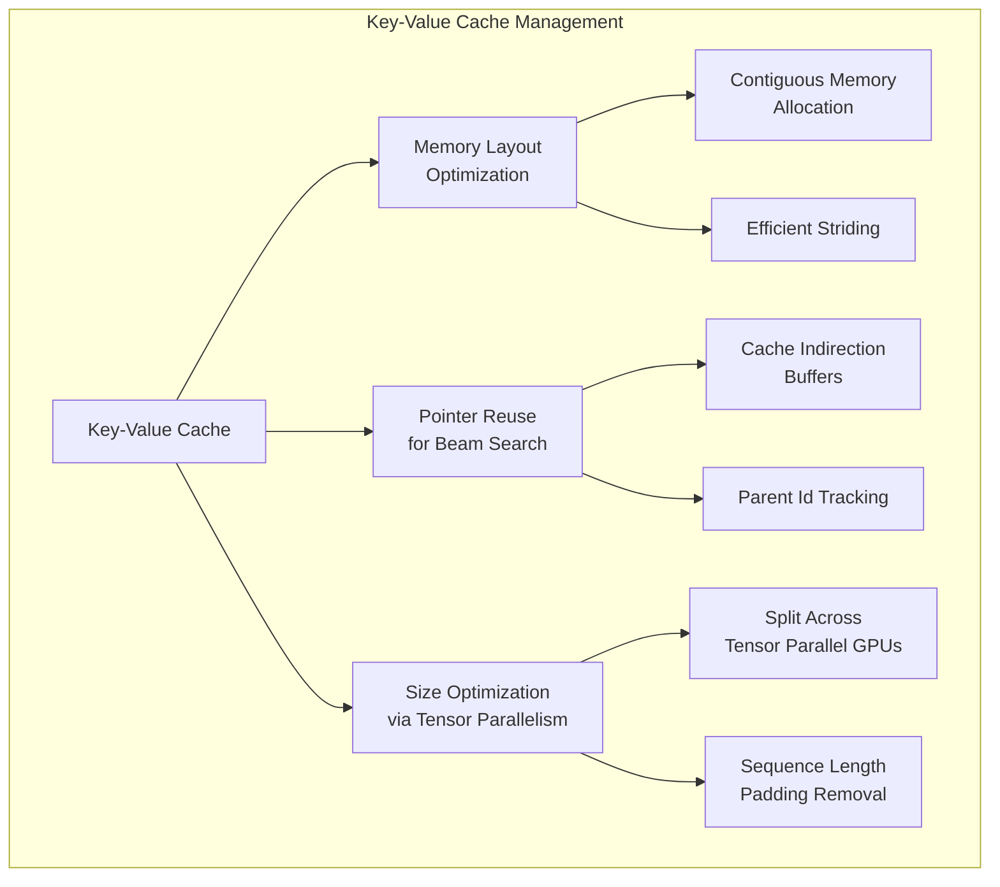
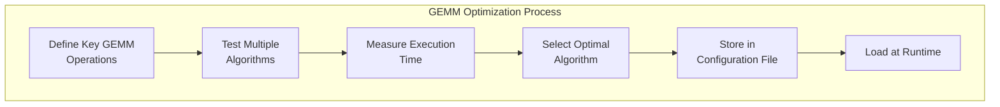

<!-- source: DeepWiki mcp.deepwiki.com · repo NVIDIA/FasterTransformer · page 5.3 Memory Optimization · fetched 2026-10-26 -->

# Memory Optimization

<details>
<summary>Relevant source files</summary>

The following files were used as context for generating this wiki page:

- [README.md](README.md)
- [examples/cpp/multi_gpu_gpt/gpt_example_utils.cc](examples/cpp/multi_gpu_gpt/gpt_example_utils.cc)
- [src/fastertransformer/kernels/gpt_kernels.cu](src/fastertransformer/kernels/gpt_kernels.cu)
- [src/fastertransformer/kernels/gpt_kernels.h](src/fastertransformer/kernels/gpt_kernels.h)
- [src/fastertransformer/kernels/stop_criteria_kernels.cu](src/fastertransformer/kernels/stop_criteria_kernels.cu)
- [src/fastertransformer/models/gptj/GptJ.cc](src/fastertransformer/models/gptj/GptJ.cc)
- [src/fastertransformer/models/multi_gpu_gpt/ParallelGpt.cc](src/fastertransformer/models/multi_gpu_gpt/ParallelGpt.cc)
- [src/fastertransformer/models/multi_gpu_gpt/ParallelGpt.h](src/fastertransformer/models/multi_gpu_gpt/ParallelGpt.h)
- [src/fastertransformer/th_op/common/GptOps.cc](src/fastertransformer/th_op/common/GptOps.cc)
- [src/fastertransformer/utils/gemm_test/decoding_gemm_func.cc](src/fastertransformer/utils/gemm_test/decoding_gemm_func.cc)
- [src/fastertransformer/utils/gemm_test/gpt_gemm_func.cc](src/fastertransformer/utils/gemm_test/gpt_gemm_func.cc)
- [src/fastertransformer/utils/gemm_test/gpt_gemm_func.h](src/fastertransformer/utils/gemm_test/gpt_gemm_func.h)
- [src/fastertransformer/utils/gemm_test/t5_gemm_func.cc](src/fastertransformer/utils/gemm_test/t5_gemm_func.cc)
- [tests/unittests/test_gpt_kernels.cu](tests/unittests/test_gpt_kernels.cu)

</details>


This page explains the memory optimization techniques used in FasterTransformer to reduce memory footprint and improve performance during inference. Memory usage is a critical aspect of transformer-based models, particularly for large language models (LLMs) where model size and sequence length can quickly consume available GPU resources.

For related optimization topics, see [Model Parallelism](#5.1) and [Quantization](#5.2).

## Memory Management Overview

FasterTransformer employs several key memory optimization techniques:



Sources: [src/fastertransformer/models/multi_gpu_gpt/ParallelGpt.cc:90-201](), [README.md:1-420]()

## Buffer Allocation and Management

FasterTransformer implements careful buffer management to minimize memory overhead during inference:

### Allocation Strategies

The library uses a centralized allocation system with:

1. **Single allocation point** - Buffers are allocated in the `allocateBuffer` method of model classes
2. **Reuse across inference steps** - Allocated buffers can be reused across multiple inference requests
3. **Lazy allocation** - Buffers are allocated only when needed based on batch size and sequence length



Sources: [src/fastertransformer/models/multi_gpu_gpt/ParallelGpt.cc:96-201](), [src/fastertransformer/models/gptj/GptJ.cc:82-156]()

### Key Buffer Types

FasterTransformer allocates several types of buffers to support different operations:

| Buffer Type | Purpose | Sizing Factor |
|-------------|---------|---------------|
| Input Buffers | Store input tokens and attention masks | batch_size × max_input_len |
| Intermediate Buffers | Temporary storage for computations | batch_size × hidden_units |
| Output Buffers | Store generated tokens and log probabilities | batch_size × beam_width × max_seq_len |
| Key-Value Cache | Store attention keys and values for autoregressive generation | num_layers × batch_size × max_seq_len × hidden_units |
| Workspace Buffers | Temporary space for GEMM operations | Varies based on operation |

The `ParallelGpt` and other model implementations allocate these buffers with specific sizes based on runtime parameters:

```cpp
// Key-value cache sizing example
const size_t self_cache_size = (num_layer_ / pipeline_para_.world_size_) * batchxbeam * memory_len * hidden_units_ / tensor_para_.world_size_;
key_cache_ = (T*)(allocator_->reMalloc(key_cache_, sizeof(T) * self_cache_size * 2, true));
value_cache_ = key_cache_ + self_cache_size;
```

Sources: [src/fastertransformer/models/multi_gpu_gpt/ParallelGpt.cc:109-135](), [src/fastertransformer/models/gptj/GptJ.cc:88-119]()

### Free-After-Forward Option

FasterTransformer provides an option to automatically free buffers after the forward pass:

1. When `is_free_buffer_after_forward_` is enabled, the model releases memory after each inference
2. This reduces memory usage when processing multiple small batches sequentially
3. Disabling this option improves performance for repeated inferences at the cost of higher memory usage

The `freeBuffer` method is responsible for releasing all allocated memory:

```cpp
void ParallelGpt<T>::freeBuffer()
{
    if (is_allocate_buffer_) {
        // Free all allocated buffers
        allocator_->free((void**)(&input_attention_mask_));
        allocator_->free((void**)(&decoder_input_buf_));
        // ... many more buffer frees
        is_allocate_buffer_ = false;
    }
}
```

Sources: [src/fastertransformer/models/multi_gpu_gpt/ParallelGpt.cc:204-270](), [src/fastertransformer/models/gptj/GptJ.cc:159-209]()

## Shared Contexts Optimization

One of the most effective memory optimizations in FasterTransformer is the shared contexts feature, which detects duplicate input sequences in a batch and avoids redundant computation.

### Context Deduplication

The shared contexts optimization follows these steps:

1. **Detect duplicate contexts** - Identify identical input sequences in the batch
2. **Create compact representation** - Map the batch to a smaller set of unique contexts
3. **Process unique contexts** - Perform computation only on unique contexts
4. **Expand outputs** - Map results back to the original batch size



Sources: [src/fastertransformer/kernels/gpt_kernels.h:124-132](), [tests/unittests/test_gpt_kernels.cu:43-106](), [src/fastertransformer/th_op/common/GptOps.cc:26-63]()

### Implementation Details

The shared context optimization is implemented through a set of CUDA kernels:

1. `invokeFindContextDups` - Identifies duplicate contexts and builds mapping tables
2. `invokeCompactInputs` - Compacts inputs based on the mapping
3. `invokeUnCompactOutputs` - Expands outputs back to the original batch size

The feature is controlled by the `shared_contexts_ratio_` parameter, which can be set between 0.0 (disabled) and 1.0 (fully enabled):

```cpp
// Memory structures for shared contexts
if (shared_contexts_ratio_ > 0.0f) {
    shared_contexts_idx_  = (int*)allocator_->reMalloc(shared_contexts_idx_, batch_size * sizeof(int), false);
    batch_to_compact_idx_ = (int*)allocator_->reMalloc(batch_to_compact_idx_, batchxbeam * sizeof(int), false);
    compact_idx_          = (int*)allocator_->reMalloc(compact_idx_, batch_size * sizeof(int), false);
    compact_size_         = (int*)allocator_->reMalloc(compact_size_, sizeof(int), false);
}
```

Sources: [src/fastertransformer/models/multi_gpu_gpt/ParallelGpt.cc:190-195](), [src/fastertransformer/kernels/gpt_kernels.cu:134-202](), [tests/unittests/test_gpt_kernels.cu:108-199](), [tests/unittests/test_gpt_kernels.cu:201-336]()

## Key-Value Cache Management

Transformer decoding requires maintaining key and value states from previous tokens, which can consume significant memory for long sequences.

### Memory-Efficient KV-Cache

FasterTransformer implements several optimizations for the key-value cache:

1. **Shared memory layout** - Key and value caches are allocated in a contiguous memory block
2. **Compact representation** - Caches are stored in a format optimized for memory access patterns
3. **Cache indirection** - For beam search, uses indirection buffers instead of copying full caches



Sources: [src/fastertransformer/models/multi_gpu_gpt/ParallelGpt.cc:134-140](), [src/fastertransformer/models/gptj/GptJ.cc:119-125]()

### Cache Allocation Strategy

The key-value cache is allocated based on model configuration:

```cpp
// Key-value cache allocation
const size_t self_cache_size = (num_layer_ / pipeline_para_.world_size_) * batchxbeam * memory_len * hidden_units_ / tensor_para_.world_size_;
key_cache_ = (T*)(allocator_->reMalloc(key_cache_, sizeof(T) * self_cache_size * 2, true));
value_cache_ = key_cache_ + self_cache_size;

// For beam search, allocate indirection buffers
if (beam_width > 1) {
    cache_indirections_[0] = (int*)(allocator_->reMalloc(
        cache_indirections_[0], sizeof(int) * batchxbeam * memory_len * 2, true));
    cache_indirections_[1] = cache_indirections_[0] + batchxbeam * memory_len;
}
```

The cache size is proportional to:
- Number of layers (divided by pipeline parallelism)
- Batch size × beam width
- Maximum sequence length
- Hidden dimension size (divided by tensor parallelism)

Sources: [src/fastertransformer/models/multi_gpu_gpt/ParallelGpt.cc:134-140](), [src/fastertransformer/models/gptj/GptJ.cc:119-125]()

## GEMM Configuration Optimization

General Matrix Multiplication (GEMM) operations are the most computation-intensive part of transformer models. FasterTransformer optimizes GEMM memory usage through careful configuration.

### Algorithm Selection

FasterTransformer includes a GEMM testing framework that determines the optimal algorithm for specific matrix dimensions:

1. Tests multiple GEMM algorithms on representative input sizes
2. Measures performance and memory usage for each algorithm
3. Stores optimal configurations in a configuration file for runtime use



Sources: [src/fastertransformer/utils/gemm_test/gpt_gemm_func.cc:27-536](), [src/fastertransformer/utils/gemm_test/t5_gemm_func.cc:27-751](), [src/fastertransformer/utils/gemm_test/decoding_gemm_func.cc:22-404]()

### GEMM Memory Optimization

The GEMM configuration system optimizes several memory-related aspects:

1. **Workspace allocation** - Determines the optimal workspace size for each operation
2. **Buffer reuse** - Identifies opportunities to reuse memory across operations
3. **Algorithm selection** - Chooses algorithms with lower memory requirements

For example, in GPT models, the framework tests configurations for various GEMM operations:

```cpp
// Example GEMM configurations for GPT
// gemm 0: context from_tensor * weightQKV
M[0] = batch_size * beam_width * max_input_len;
K[0] = hidden_units;
N[0] = 3 * local_hidden_units;

// gemm 7: attr * output_kernel
M[7] = batch_size * beam_width;
K[7] = local_hidden_units;
N[7] = hidden_units;
```

Sources: [src/fastertransformer/utils/gemm_test/gpt_gemm_func.cc:107-216](), [src/fastertransformer/utils/gemm_test/gpt_gemm_func.h:25-63]()

## Padding Removal and Attention Optimization

Transformer models process sequences with varying lengths, which typically requires padding shorter sequences to match the longest sequence. FasterTransformer implements optimizations to handle this efficiently.

### Padding Removal

FasterTransformer includes strategies to avoid wasting computation on padding tokens:

1. **Tracking valid lengths** - Maintains input and sequence lengths for each request
2. **Masked computation** - Avoids unnecessary computation for padded regions
3. **Padding count tracking** - Tracks padding to optimize memory usage

```cpp
// Tracking padding counts
invokeUpdatePaddingCount(tiled_total_padding_count_,
                        input_lengths,
                        max_input_length,
                        batch_size,
                        beam_width,
                        stream);
```

Sources: [src/fastertransformer/kernels/gpt_kernels.h:184-202](), [src/fastertransformer/kernels/gpt_kernels.cu:437-468]()

### Attention Mask Optimization

Attention masks are used to prevent tokens from attending to padding or future tokens. FasterTransformer optimizes memory usage for attention masks:

1. **Efficient mask generation** - Creates attention masks directly on GPU
2. **Reuse across layers** - Avoids redundant mask storage
3. **Optimized memory layout** - Uses memory-efficient representation

```cpp
// Building efficient attention masks
invokeBuildDecoderAttentionMask(attention_mask,
                               sequence_lengths,
                               prefix_prompt_lengths,
                               batch_size,
                               max_seq_len,
                               max_prompt_length,
                               stream);
```

Sources: [src/fastertransformer/kernels/gpt_kernels.h:87-93](), [src/fastertransformer/kernels/gpt_kernels.cu:360-426]()

## Memory Optimization Usage

To leverage memory optimizations in FasterTransformer, developers can configure several parameters:

| Parameter | Description | Impact |
|-----------|-------------|--------|
| `is_free_buffer_after_forward` | Whether to free buffers after forward pass | Reduces memory footprint for infrequent use |
| `shared_contexts_ratio` | Ratio of contexts to share (0.0-1.0) | Controls context deduplication feature |
| `remove_padding` | Whether to remove padding from input | Reduces computation on padded tokens |
| `tensor_para_size` | Tensor parallelism degree | Splits KV cache across GPUs |
| `pipeline_para_size` | Pipeline parallelism degree | Splits layers across GPUs |

Example configuration:

```cpp
// Memory optimization configuration
bool is_free_buffer_after_forward = true; // Free memory after each inference
float shared_contexts_ratio = 0.8; // Enable context sharing
bool remove_padding = true; // Remove padding for efficiency

// Create model with memory optimizations
ParallelGpt<half> model(max_batch_size,
                        max_seq_len,
                        max_input_len,
                        beam_width,
                        head_num,
                        size_per_head,
                        inter_size,
                        num_layer,
                        vocab_size,
                        // ... other parameters ...
                        is_free_buffer_after_forward,
                        // ... other parameters ...
                        shared_contexts_ratio);
```

Sources: [examples/cpp/multi_gpu_gpt/gpt_example_utils.cc:97-172](), [examples/cpp/multi_gpu_gpt/gpt_example_utils.cc:173-212]()

## Memory Profiling and Optimization

To determine the optimal memory configuration for a specific use case, FasterTransformer provides utilities for memory profiling:

### GEMM Testing Framework

The GEMM testing framework helps identify optimal configurations:

```bash
# Example usage of GEMM testing
./bin/gpt_gemm_example batch_size seq_len head_num size_per_head inter_size vocab_size data_type tensor_para_size
```

This generates a configuration file with optimal GEMM algorithms for the specified dimensions.

### Memory Footprint Analysis

For advanced memory optimization, analyze the memory footprint of different components:

1. Key-value cache size: `num_layers × batch_size × seq_len × hidden_size`
2. Intermediate activations: `batch_size × hidden_size`
3. Attention memory: `batch_size × seq_len × seq_len`

Sources: [src/fastertransformer/utils/gemm_test/gpt_gemm_func.cc:27-536](), [src/fastertransformer/utils/gemm_test/gpt_gemm_func.h:52-62]()

## Conclusion

Memory optimization in FasterTransformer is critical for efficient inference, especially for large models with long sequences. The key techniques include:

1. **Efficient buffer management** - Careful allocation and reuse of memory
2. **Shared context optimization** - Deduplication of identical input sequences
3. **KV-cache optimization** - Memory-efficient key-value cache for autoregressive generation
4. **GEMM configuration** - Optimized matrix multiplication algorithms
5. **Padding removal** - Avoiding wasted computation on padding tokens

These techniques together enable FasterTransformer to run large models with reduced memory footprint, making it possible to process larger batch sizes and longer sequences on limited hardware resources.

---

