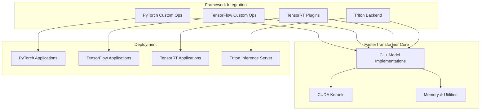
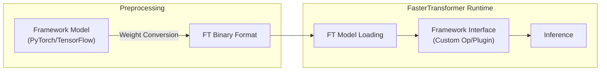
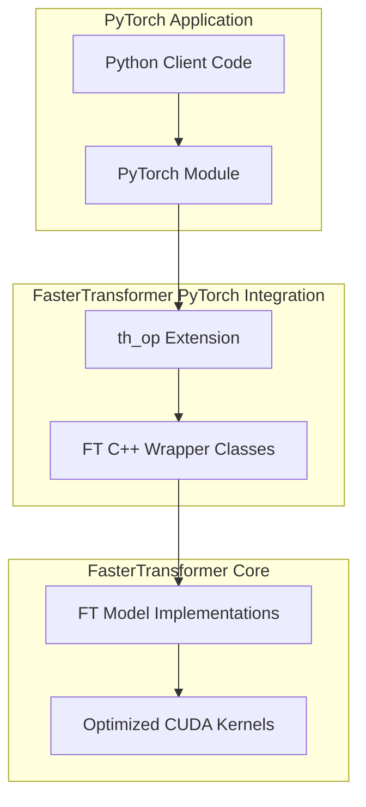
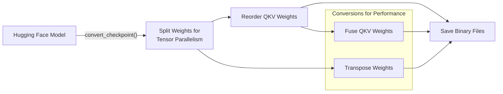
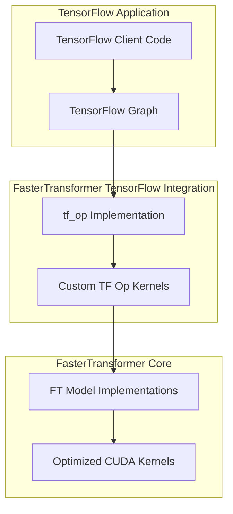
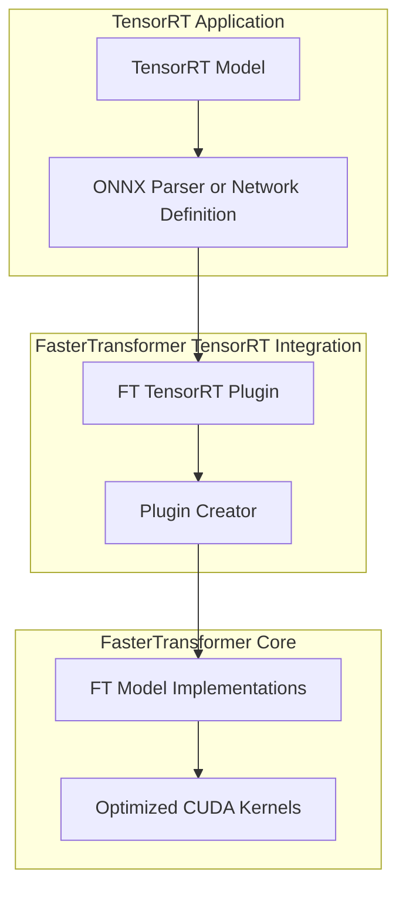
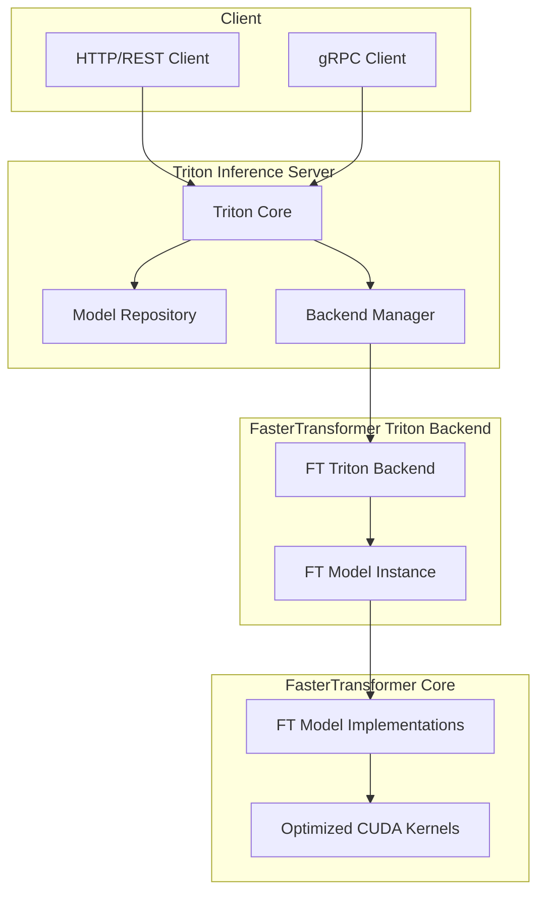
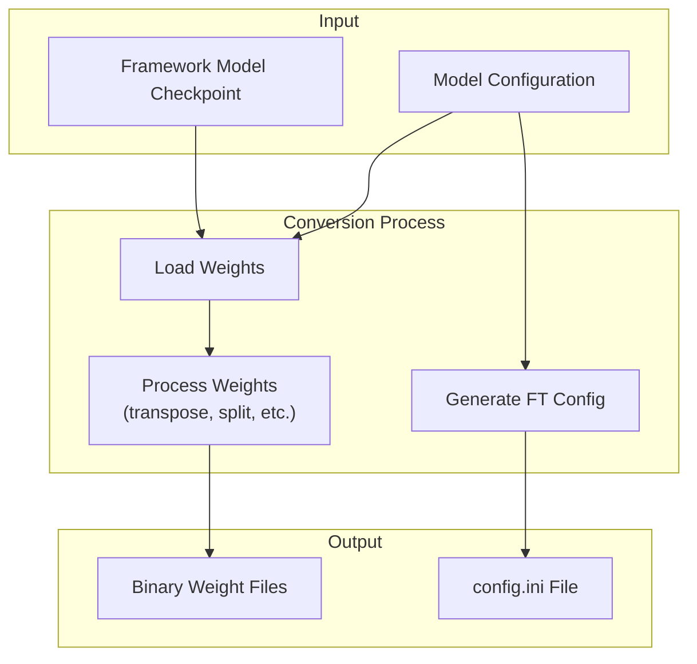

<!-- source: DeepWiki mcp.deepwiki.com · repo NVIDIA/FasterTransformer · page 6 Framework Integration · fetched 2026-10-26 -->

# Framework Integration

<details>
<summary>Relevant source files</summary>

The following files were used as context for generating this wiki page:

- [README.md](README.md)
- [examples/pytorch/gpt/utils/huggingface_bloom_convert.py](examples/pytorch/gpt/utils/huggingface_bloom_convert.py)
- [examples/pytorch/t5/utils/huggingface_t5_ckpt_convert.py](examples/pytorch/t5/utils/huggingface_t5_ckpt_convert.py)
- [src/fastertransformer/kernels/gpt_kernels.cu](src/fastertransformer/kernels/gpt_kernels.cu)
- [src/fastertransformer/kernels/gpt_kernels.h](src/fastertransformer/kernels/gpt_kernels.h)
- [src/fastertransformer/kernels/stop_criteria_kernels.cu](src/fastertransformer/kernels/stop_criteria_kernels.cu)
- [src/fastertransformer/models/multi_gpu_gpt/ParallelGpt.h](src/fastertransformer/models/multi_gpu_gpt/ParallelGpt.h)
- [src/fastertransformer/th_op/common/GptOps.cc](src/fastertransformer/th_op/common/GptOps.cc)
- [tests/unittests/test_gpt_kernels.cu](tests/unittests/test_gpt_kernels.cu)

</details>


This page describes how FasterTransformer integrates with various deep learning frameworks, including PyTorch, TensorFlow, TensorRT, and Triton Inference Server. FasterTransformer is built primarily on C++ and CUDA, with integration layers provided for these frameworks to enable easy use of its optimized transformer implementations.

For information about specific models and their implementations, see [Models](#3). For details about optimization techniques that can be applied across frameworks, see [Optimization Techniques](#5).

## Overview of Framework Integration

FasterTransformer (FT) provides multiple integration options to fit different deployment needs. Each integration approach has similar patterns but with framework-specific implementations:



Sources: [README.md:80-97]()

Each framework integration follows a similar pattern:
1. Convert model weights from framework format to FT's optimized format
2. Create custom operators or plugins to interface with the framework
3. Invoke FT's C++ implementation through these interfaces

## Framework Support Matrix

FasterTransformer provides different levels of support for each framework and model. The table below summarizes the support status:

| Framework      | Key Features | Supported Models | Supported Optimizations |
|----------------|--------------|------------------|-------------------------|
| PyTorch        | Custom C++ extension operators | BERT, GPT, T5, Swin Transformer, ViT, Longformer, BLOOM, GPT-J, GPT-NeoX, BART/mBART | FP16, INT8, Tensor/Pipeline Parallelism, Sparsity |
| TensorFlow     | Custom operators | BERT, Encoder, Decoder, GPT, T5 | FP16, INT8 (for some models) |
| TensorRT       | Custom plugins | T5, Swin Transformer, ViT | Tensor/Pipeline Parallelism (for T5) |
| Triton Backend | Direct backend integration | GPT/OPT, BLOOM, GPT-J, GPT-NeoX, T5/UL2 | Tensor/Pipeline Parallelism |

Sources: [README.md:34-72]()

## Common Integration Workflow

All framework integrations share a common workflow for using FasterTransformer:



Sources: [examples/pytorch/t5/utils/huggingface_t5_ckpt_convert.py:154-202](), [examples/pytorch/gpt/utils/huggingface_bloom_convert.py:382-462]()

## PyTorch Integration

PyTorch integration is implemented through C++ extensions that provide custom operators for FasterTransformer models.

### Architecture



Sources: [src/fastertransformer/th_op/common/GptOps.cc:16-70]()

### Weight Conversion

PyTorch weights must be converted to FT's binary format before use. This conversion:

1. Reorganizes weights for tensor parallelism
2. Optimizes memory layout for efficient computation
3. Creates configuration files for model architecture and execution parameters



Sources: [examples/pytorch/t5/utils/huggingface_t5_ckpt_convert.py:40-63](), [examples/pytorch/t5/utils/huggingface_t5_ckpt_convert.py:70-152](), [examples/pytorch/gpt/utils/huggingface_bloom_convert.py:213-252]()

### Unique Features

PyTorch integration in FasterTransformer provides several optimizations:

1. **Context deduplication**: Detecting and optimizing identical inputs to avoid redundant computation
   ```python
   # Example usage of context deduplication utility
   batch_to_compact, compact_to_batch = fastertransformer::find_context_duplications(input_ids)
   ```

2. **Custom operators for specific operations**: Optimized implementations of key operations
   ```python
   # Example of a custom operator in PyTorch
   results = fastertransformer_bert.forward(input_ids, attention_mask, ...)
   ```

Sources: [src/fastertransformer/th_op/common/GptOps.cc:26-63]()

## TensorFlow Integration

TensorFlow integration is implemented through custom operators that interface with FasterTransformer's C++ implementation.

### Architecture



Sources: [README.md:80-97]()

### Key Components

The TensorFlow integration consists of:

1. Custom operators registered with TensorFlow
2. Weight conversion utilities similar to the PyTorch integration
3. Implementations of various models with TensorFlow-specific interfaces

## TensorRT Integration

TensorRT integration is implemented through plugins that allow FasterTransformer's optimized implementations to be used within TensorRT execution contexts.

### Architecture



Sources: [README.md:80-97]()

### Supported Models

TensorRT plugins are available for specific models:
- T5
- Swin Transformer
- Vision Transformer (ViT)

These plugins allow for seamless integration within TensorRT networks while leveraging FasterTransformer's optimizations.

## Triton Inference Server Integration

FasterTransformer provides a custom backend for the Triton Inference Server, enabling direct deployment of optimized transformer models.

### Architecture



Sources: [README.md:80-97]()

### Key Features

The Triton backend for FasterTransformer provides:

1. **Streaming generation**: Support for token-by-token streaming output
2. **Multi-GPU inference**: Distributed model execution with tensor parallelism
3. **Multi-node deployment**: Support for models that span multiple machines

## Weight Conversion Process

A critical part of using FasterTransformer with any framework is converting model weights from framework-specific formats to FT's optimized format.

### Process Flow



Sources: [examples/pytorch/t5/utils/huggingface_t5_ckpt_convert.py:154-202](), [examples/pytorch/gpt/utils/huggingface_bloom_convert.py:254-306]()

### Key Transformations

During weight conversion, several important transformations occur:

1. **Weight splitting for tensor parallelism**: Dividing weights across multiple GPUs
   ```python
   # Example from T5 conversion script
   split_vals = np.split(val, factor, axis=-1)
   for j in range(factor):
       saved_path = saved_dir / f"{saved_key}.{j:d}.bin"
       split_vals[j].tofile(saved_path.as_posix())
   ```

2. **Fusing QKV weights**: Combining query, key, and value weights for optimized execution
   ```python
   # Example from T5 conversion script
   qkv = torch.cat([
       model_dict[f"decoder.block.{i}.layer.0.SelfAttention.q.weight"].T,
       model_dict[f"decoder.block.{i}.layer.0.SelfAttention.k.weight"].T,
       model_dict[f"decoder.block.{i}.layer.0.SelfAttention.v.weight"].T
   ], dim=-1)
   ```

3. **Configuration generation**: Creating config files with model parameters
   ```python
   # Example from BLOOM conversion script
   config['gpt'] = dict(
       model_name=model_config.name_or_path,
       num_layer=model_config.n_layer,
       head_num=model_config.n_head,
       # Other parameters...
   )
   ```

Sources: [examples/pytorch/t5/utils/huggingface_t5_ckpt_convert.py:49-67](), [examples/pytorch/gpt/utils/huggingface_bloom_convert.py:254-306]()

## Integration Development

When developing a new model integration for any framework, the following components are typically required:

1. **Weight conversion script**: To convert model weights to FT format
2. **Configuration handling**: To specify model architecture parameters
3. **Interface implementation**: Custom operators or plugins for the framework
4. **Examples**: Demonstration of how to use the integration

### Key Considerations

When working with framework integrations, consider:

1. **Memory optimization**: 
   - Shared contexts for avoiding redundant computation
   - Effective weight distribution for tensor parallelism

2. **Performance tuning**:
   - CUDA kernel selection based on hardware
   - Data type selection (FP16, INT8, BF16, FP8)
   - Batch size optimization

3. **Framework-specific patterns**:
   - PyTorch: Extending `torch.nn.Module` and implementing custom CUDA operations
   - TensorFlow: Creating custom ops with registered kernels
   - TensorRT: Implementing IPluginV2 interfaces
   - Triton: Implementing a backend following the Triton backend API

Sources: [src/fastertransformer/kernels/gpt_kernels.h:134-144](), [src/fastertransformer/kernels/gpt_kernels.cu:614-635]()

## Future Directions

As noted in the README, active development on FasterTransformer has transitioned to TensorRT-LLM. However, the integration patterns described in this document remain relevant for understanding how to interface optimized C++/CUDA implementations with various ML frameworks.

Sources: [README.md:1-5]()

---

