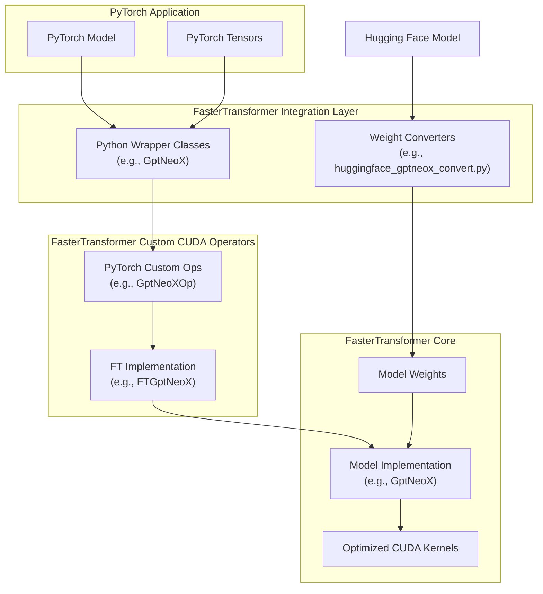
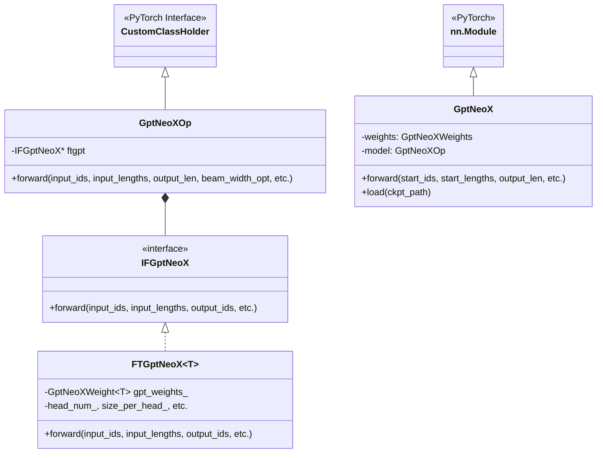
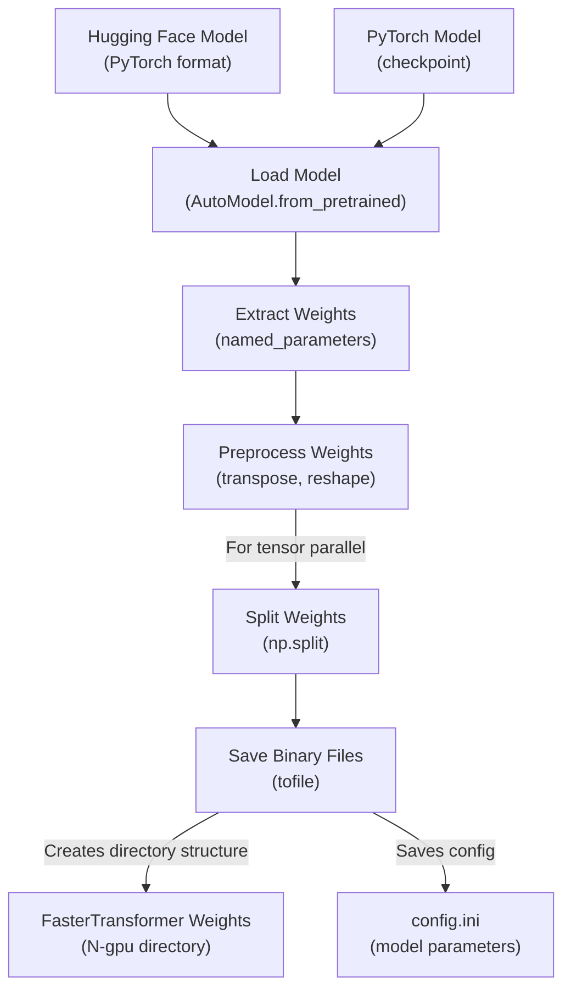
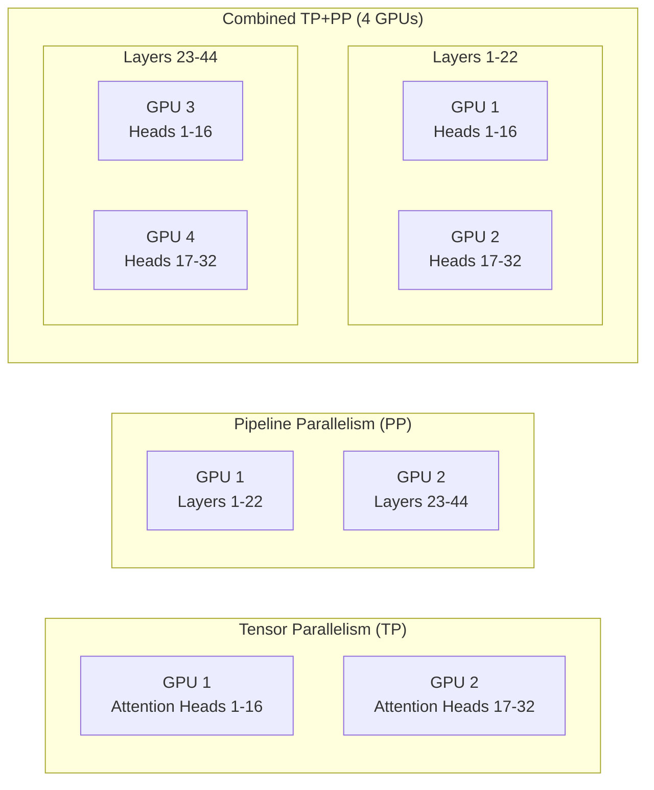

<!-- source: DeepWiki mcp.deepwiki.com · repo NVIDIA/FasterTransformer · page 6.1 PyTorch Integration · fetched 2026-10-26 -->

# PyTorch Integration

<details>
<summary>Relevant source files</summary>

The following files were used as context for generating this wiki page:

- [docs/gptneox_guide.md](docs/gptneox_guide.md)
- [examples/pytorch/gpt/utils/huggingface_bloom_convert.py](examples/pytorch/gpt/utils/huggingface_bloom_convert.py)
- [examples/pytorch/gptneox/gptneox_example.py](examples/pytorch/gptneox/gptneox_example.py)
- [examples/pytorch/gptneox/utils/gptneox.py](examples/pytorch/gptneox/utils/gptneox.py)
- [examples/pytorch/gptneox/utils/huggingface_gptneox_convert.py](examples/pytorch/gptneox/utils/huggingface_gptneox_convert.py)
- [examples/pytorch/t5/utils/huggingface_t5_ckpt_convert.py](examples/pytorch/t5/utils/huggingface_t5_ckpt_convert.py)
- [src/fastertransformer/models/gptneox/GptNeoXDecoderLayerWeight.h](src/fastertransformer/models/gptneox/GptNeoXDecoderLayerWeight.h)
- [src/fastertransformer/models/gptneox/GptNeoXWeight.cc](src/fastertransformer/models/gptneox/GptNeoXWeight.cc)
- [src/fastertransformer/models/gptneox/GptNeoXWeight.h](src/fastertransformer/models/gptneox/GptNeoXWeight.h)
- [src/fastertransformer/th_op/CMakeLists.txt](src/fastertransformer/th_op/CMakeLists.txt)
- [src/fastertransformer/th_op/gptneox/CMakeLists.txt](src/fastertransformer/th_op/gptneox/CMakeLists.txt)
- [src/fastertransformer/th_op/gptneox/GptNeoXOp.cc](src/fastertransformer/th_op/gptneox/GptNeoXOp.cc)
- [src/fastertransformer/th_op/gptneox/GptNeoXOp.h](src/fastertransformer/th_op/gptneox/GptNeoXOp.h)

</details>


This document describes how to integrate FasterTransformer with PyTorch applications. FasterTransformer provides PyTorch bindings that allow seamless integration with existing PyTorch workflows, enabling users to leverage optimized CUDA kernels for transformer models while maintaining a familiar PyTorch interface. For information about TensorFlow integration, see [TensorFlow Integration](#6.2).

## Overview of PyTorch Integration Architecture

FasterTransformer's PyTorch integration consists of three main components:

1. **C++ Custom CUDA Operators**: These expose FasterTransformer's optimized implementations to PyTorch
2. **Python Wrapper Classes**: Pythonic interfaces for the C++ operators
3. **Weight Conversion Utilities**: Tools to convert model weights from PyTorch/Hugging Face format to FasterTransformer's format



Sources: [src/fastertransformer/th_op/gptneox/GptNeoXOp.h:18-92](), [examples/pytorch/gptneox/utils/gptneox.py:175-209]()

## Integration Architecture Details

FasterTransformer's PyTorch integration follows a layered architecture that efficiently bridges PyTorch tensors with optimized CUDA kernels.



Sources: [src/fastertransformer/th_op/gptneox/GptNeoXOp.h:142-345](), [examples/pytorch/gptneox/utils/gptneox.py:175-318]()

## Weight Conversion Process

Before using FasterTransformer with PyTorch, you need to convert model weights to FasterTransformer's format. This conversion accommodates tensor parallelism, pipeline parallelism, and different precision types.



Sources: [examples/pytorch/gptneox/utils/huggingface_gptneox_convert.py:82-250](), [examples/pytorch/gpt/utils/huggingface_bloom_convert.py:207-478]()

### Weight Conversion Utilities

FasterTransformer provides model-specific conversion scripts, located in the `examples/pytorch/[model]/utils/` directory:

| Model | Conversion Utility | Source |
|-------|-------------------|--------|
| GPT-NeoX | `huggingface_gptneox_convert.py` | Hugging Face models |
| T5 | `huggingface_t5_ckpt_convert.py` | Hugging Face models |
| Bloom | `huggingface_bloom_convert.py` | Hugging Face models |

These utilities handle model-specific conversions, including:

- Reshaping attention weights for FasterTransformer's expected format
- Handling model-specific parameter naming and structures
- Splitting weights for tensor parallelism
- Converting weights to the specified precision (FP16 or FP32)

Example conversion command for GPT-NeoX:

```
python huggingface_gptneox_convert.py \
  -i /path/to/huggingface/model \
  -o /path/to/output/directory \
  -i_g 2 \  # tensor parallelism size (2 GPUs)
  -m_n gptneox
```

Sources: [examples/pytorch/gptneox/utils/huggingface_gptneox_convert.py:209-249](), [examples/pytorch/t5/utils/huggingface_t5_ckpt_convert.py:154-227]()

## Using FasterTransformer in PyTorch Applications

### Step 1: Convert Model Weights

First, convert your existing model to FasterTransformer's format using the appropriate conversion utility.

### Step 2: Load the FasterTransformer Library

```python
import torch
import os

# Load the shared library
torch.classes.load_library("/path/to/lib/libth_transformer.so")
```

### Step 3: Initialize the Model

```python
from examples.pytorch.gptneox.utils.gptneox import GptNeoX

# Initialize the model with configuration
model = GptNeoX(
    head_num=32,               # Number of attention heads
    size_per_head=96,          # Size per attention head
    vocab_size=50432,          # Vocabulary size
    rotary_embedding_dim=24,   # Dimension of rotary embeddings
    start_id=0,                # Start token ID
    end_id=2,                  # End token ID
    layer_num=44,              # Number of layers
    max_seq_len=2048,          # Maximum sequence length
    tensor_para_size=2,        # Tensor parallelism size
    pipeline_para_size=1,      # Pipeline parallelism size
    use_gptj_residual=True,    # Whether to use GPT-J style residual
    lib_path="./lib/libth_transformer.so",  # Path to library
    inference_data_type="fp16"  # Data type for inference
)

# Load weights from the converted checkpoint
model.load(ckpt_path="/path/to/converted/weights")
```

Sources: [examples/pytorch/gptneox/gptneox_example.py:143-154](), [examples/pytorch/gptneox/utils/gptneox.py:175-240]()

### Step 4: Execute Inference

```python
# Prepare inputs
input_ids = torch.tensor([[0, 100, 200, 300]], dtype=torch.int32)  # Example input
input_lengths = torch.tensor([4], dtype=torch.int32)  # Length of input

# Run the model
with torch.no_grad():
    output_ids = model(
        start_ids=input_ids,
        start_lengths=input_lengths,
        output_len=100,           # Length of generated output
        beam_width=1,             # Beam width (1 for greedy)
        top_k=50,                 # Top-k for sampling
        top_p=0.9,                # Top-p for sampling
        temperature=0.8,          # Temperature for sampling
        repetition_penalty=1.2    # Repetition penalty
    )

# Process outputs (e.g., decode tokens to text)
```

Sources: [examples/pytorch/gptneox/gptneox_example.py:155-176](), [examples/pytorch/gptneox/utils/gptneox.py:261-307]()

## Tensor and Pipeline Parallelism

FasterTransformer supports both tensor parallelism (splitting individual tensors across GPUs) and pipeline parallelism (splitting layers across GPUs), which can be controlled through the PyTorch interface.



To use multi-GPU parallelism:

1. Set `tensor_para_size` and `pipeline_para_size` when initializing the model
2. Initialize the distributed process group (typically using MPI)
3. Run the model with the appropriate number of processes

```python
import torch.distributed as dist

# Initialize process group
dist.init_process_group(backend=dist.Backend.MPI)

# Total number of GPUs = tensor_para_size * pipeline_para_size
model = GptNeoX(
    # ... other args ...
    tensor_para_size=2,
    pipeline_para_size=2
)
```

Sources: [examples/pytorch/gptneox/gptneox_example.py:109-115](), [examples/pytorch/gptneox/utils/gptneox.py:217-232]()

## Supported Models

FasterTransformer's PyTorch integration supports multiple transformer models:

| Model | PyTorch Integration File | Description |
|-------|-------------------------|-------------|
| GPT-NeoX | `examples/pytorch/gptneox/utils/gptneox.py` | GPT-NeoX model with rotary positional embeddings |
| GPT/GPT-J | `examples/pytorch/gpt/utils/gpt.py` | GPT variants including GPT-J |
| T5 | `examples/pytorch/t5/utils/t5.py` | T5 encoder-decoder model |
| BERT | `examples/pytorch/bert/utils/bert.py` | BERT encoder model |
| BLOOM | `examples/pytorch/gpt/utils/bloom.py` | BLOOM language model |

Sources: [src/fastertransformer/th_op/CMakeLists.txt:22-74]()

## Precision and Performance

FasterTransformer's PyTorch integration supports different precision types:

| Precision | Configuration | Performance Impact |
|-----------|--------------|-------------------|
| FP32 | `inference_data_type="fp32"` | Highest precision, slower performance |
| FP16 | `inference_data_type="fp16"` | Balanced precision and performance (recommended for most cases) |
| INT8 | Model-dependent | Highest performance, may impact accuracy |

Performance can be further optimized by:

1. Using tensor parallelism for large models
2. Setting appropriate batch sizes
3. Using optimized GEMM configurations

## Debugging and Troubleshooting

Common issues when using FasterTransformer with PyTorch:

1. **Library Loading Errors**: 
   - Ensure `libth_transformer.so` is properly compiled and accessible
   - Check that CUDA and PyTorch versions are compatible

2. **Weight Conversion Errors**:
   - Verify model architecture parameters match between source model and FasterTransformer
   - Check tensor shapes in error messages for mismatches

3. **Runtime Errors**:
   - Ensure input tensor shapes and types match expected formats
   - Verify that tensor parallelism and pipeline parallelism configurations match the number of available GPUs

## Advanced Features

FasterTransformer's PyTorch integration supports advanced features like:

- **Custom decoding strategies**: Greedy search, beam search, top-k sampling, top-p sampling
- **Prompt tuning**: For specialized tasks without full model fine-tuning
- **Memory optimization**: Efficient memory management for large models
- **Quantization**: Support for reduced precision for improved performance

## Examples

Complete examples of PyTorch integration can be found in the following files:

- GPT-NeoX: `examples/pytorch/gptneox/gptneox_example.py`
- T5: `examples/pytorch/t5/t5_example.py`
- GPT: `examples/pytorch/gpt/gpt_example.py`

These examples demonstrate the entire workflow, from loading weights to generating output.

Sources: [examples/pytorch/gptneox/gptneox_example.py:33-226](), [docs/gptneox_guide.md:1-187]()

---

