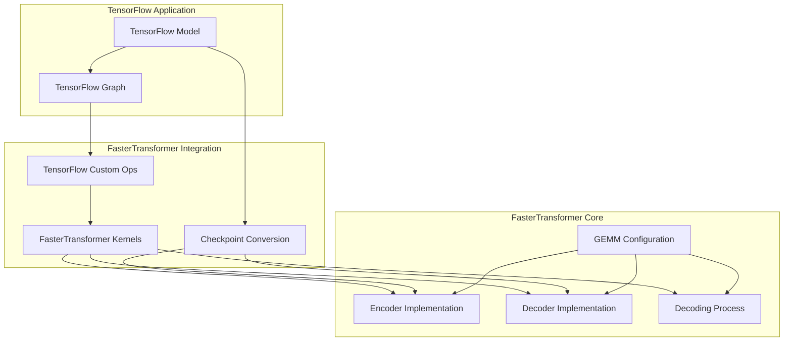
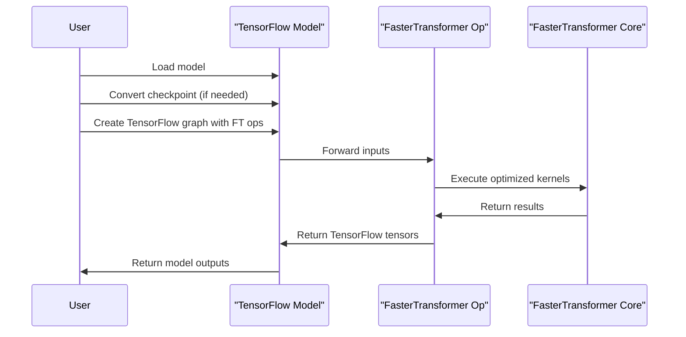
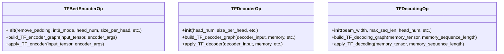

<!-- source: DeepWiki mcp.deepwiki.com · repo NVIDIA/FasterTransformer · page 6.2 TensorFlow Integration · fetched 2026-10-26 -->

# TensorFlow Integration

<details>
<summary>Relevant source files</summary>

The following files were used as context for generating this wiki page:

- [docs/bert_guide.md](docs/bert_guide.md)
- [docs/decoder_guide.md](docs/decoder_guide.md)
- [examples/pytorch/gpt/utils/huggingface_bloom_convert.py](examples/pytorch/gpt/utils/huggingface_bloom_convert.py)
- [examples/pytorch/t5/utils/huggingface_t5_ckpt_convert.py](examples/pytorch/t5/utils/huggingface_t5_ckpt_convert.py)
- [src/fastertransformer/kernels/activation_kernels.cu](src/fastertransformer/kernels/activation_kernels.cu)

</details>


This document describes how to integrate and use FasterTransformer with TensorFlow. FasterTransformer provides custom TensorFlow operations that allow you to replace standard TensorFlow transformer layers with optimized CUDA implementations for improved inference performance. For information about PyTorch integration, see [PyTorch Integration](#6.1), and for TensorRT integration, see [TensorRT Integration](#6.3).

## Architecture Overview

FasterTransformer's TensorFlow integration is implemented as a set of custom operations (ops) that extend TensorFlow's existing functionality. These custom operations encapsulate the optimized CUDA kernels of FasterTransformer while maintaining a TensorFlow-compatible interface.



Sources: 
- [docs/bert_guide.md](docs/bert_guide.md)
- [docs/decoder_guide.md](docs/decoder_guide.md)

## Integration Flow

The following diagram shows the typical workflow for using FasterTransformer with TensorFlow:



Sources: 
- [docs/bert_guide.md:142-152](docs/bert_guide.md)
- [docs/decoder_guide.md:298-367](docs/decoder_guide.md)

## Building FasterTransformer with TensorFlow Support

To use FasterTransformer with TensorFlow, you need to build the library with TensorFlow support enabled. Here's how to do it:

1. Start with an appropriate container:
   ```bash
   nvidia-docker run -ti --shm-size 5g --rm nvcr.io/nvidia/tensorflow:22.09-tf1-py3 bash
   ```

2. Clone and build FasterTransformer:
   ```bash
   git clone https://github.com/NVIDIA/FasterTransformer.git
   mkdir -p FasterTransformer/build
   cd FasterTransformer/build
   git submodule init && git submodule update
   ```

3. Build with TensorFlow support:
   ```bash
   cmake -DSM=xx -DCMAKE_BUILD_TYPE=Release -DBUILD_TF=ON -DTF_PATH=/usr/local/lib/python3.8/dist-packages/tensorflow_core/ ..
   make -j12
   ```

Replace `xx` with the compute capability of your GPU (e.g., 70 for V100, 75 for T4, 80 for A100).

Sources:
- [docs/bert_guide.md:154-212](docs/bert_guide.md)

## Model Usage

### BERT Models in TensorFlow

To use FasterTransformer's BERT encoder implementation in TensorFlow:

1. Generate the GEMM configuration file:
   ```bash
   ./bin/bert_gemm 32 32 12 64 0 0
   ```

2. Run the TensorFlow example:
   ```bash
   python ../examples/tensorflow/bert/bert_example.py \
           --batch_size 32 \
           --max_seq_len 32 \
           --head_number 12 \
           --size_per_head 64 \
           --num_layer 12 \
           --data_type fp32 \
           --test_time 1
   ```

For INT8 quantization:
```bash
./bin/bert_gemm 32 32 12 64 1 1
python ../examples/tensorflow/bert/bert_example.py \
        --batch_size 32 \
        --max_seq_len 32 \
        --head_number 12 \
        --size_per_head 64 \
        --num_layer 12 \
        --data_type fp16 \
        --test_time 1 \
        --int8_mode 1
```

Sources:
- [docs/bert_guide.md:416-534](docs/bert_guide.md)

### Decoder and Translation Models in TensorFlow

To use FasterTransformer's decoder implementation in TensorFlow:

1. Generate the GEMM configuration file:
   ```bash
   ./bin/decoding_gemm 32 4 8 64 2048 30000 32 512 0
   ```

2. Run the decoder example:
   ```bash
   python ../examples/tensorflow/decoder/decoder_example.py \
           --batch_size 32 \
           --beam_width 4 \
           --head_number 8 \
           --size_per_head 64 \
           --vocab_size 30000 \
           --max_seq_len 32 \
           --num_layer 6 \
           --memory_hidden_dim 512 \
           --data_type fp32 \
           --decoder_type 1 \
           --test_time 1
   ```

For translation tasks, you can use the translation example:
```bash
python ../examples/tensorflow/decoding/translate_example.py \
        --batch_size 128 \
        --beam_width 4 \
        --max_seq_len 32 \
        --data_type fp32 \
        --beam_search_diversity_rate 0.0 \
        --sampling_topk 1 \
        --sampling_topp 0.00 \
        --test_time 012345
```

Sources:
- [docs/decoder_guide.md:298-367](docs/decoder_guide.md)
- [docs/decoder_guide.md:624-665](docs/decoder_guide.md)

## Model Conversion

FasterTransformer includes tools for converting pre-trained models from Hugging Face or other frameworks to a format compatible with FasterTransformer.

### Converting Hugging Face T5 Models

```python
python ../examples/pytorch/t5/utils/huggingface_t5_ckpt_convert.py \
        -saved_dir OUTPUT_DIR \
        -in_file INPUT_MODEL_DIR \
        -inference_tensor_para_size GPU_NUM \
        -weight_data_type WEIGHT_DATA_TYPE \
        [--encoder_only]
```

Where:
- `OUTPUT_DIR`: Directory to save the converted model
- `INPUT_MODEL_DIR`: Directory containing the Hugging Face model
- `GPU_NUM`: Number of GPUs for tensor parallelism
- `WEIGHT_DATA_TYPE`: Data type for weights (fp32 or fp16)

Sources:
- [examples/pytorch/t5/utils/huggingface_t5_ckpt_convert.py:154-225](examples/pytorch/t5/utils/huggingface_t5_ckpt_convert.py)

### Converting Hugging Face BLOOM Models

```python
python ../examples/pytorch/gpt/utils/huggingface_bloom_convert.py \
        -i INPUT_MODEL_DIR \
        -o OUTPUT_DIR \
        -tp TENSOR_PARALLEL_SIZE \
        -dt DATA_TYPE
```

Where:
- `INPUT_MODEL_DIR`: Directory containing the Hugging Face BLOOM model
- `OUTPUT_DIR`: Directory to save the converted model
- `TENSOR_PARALLEL_SIZE`: Number of GPUs for tensor parallelism
- `DATA_TYPE`: Data type for weights (fp32 or fp16)

Sources:
- [examples/pytorch/gpt/utils/huggingface_bloom_convert.py:464-480](examples/pytorch/gpt/utils/huggingface_bloom_convert.py)

## TensorFlow Custom Op Interface

The FasterTransformer TensorFlow integration provides custom ops for various transformer components. Here's an example of the BERT encoder op interface:



Sources:
- [docs/bert_guide.md:416-505](docs/bert_guide.md)
- [docs/decoder_guide.md:298-367](docs/decoder_guide.md)

## Data Types and Precision

FasterTransformer supports different data types in TensorFlow:

| Data Type | Flag Value | Description |
|-----------|------------|-------------|
| FP32      | fp32       | Full precision floating point |
| FP16      | fp16       | Half precision floating point |
| BF16      | bf16       | Brain floating point (on supported hardware) |
| INT8      | fp16 with int8_mode | INT8 quantization (requires special model) |

When using INT8 quantization, you need to:
1. Set data_type to fp16
2. Set int8_mode to 1 or 2 (different quantization schemes)
3. Use a properly quantized model

Sources:
- [docs/bert_guide.md:108-121](docs/bert_guide.md)
- [docs/bert_guide.md:286-297](docs/bert_guide.md)

## Performance Comparison

FasterTransformer can significantly improve inference performance in TensorFlow. For example, on BERT models:

| Hardware | Batch Size | Sequence Length | Precision | TensorFlow Time (ms) | FasterTransformer Time (ms) | Speedup |
|----------|------------|-----------------|-----------|----------------------|---------------------------|---------|
| A100     | 32         | 32              | FP32      | 44.49                | 22.83                     | 1.95x   |
| A100     | 32         | 32              | FP16      | 12.27                | 4.98                      | 2.46x   |
| V100     | 8          | 128             | FP16      | 32.66                | 13.89                     | 2.35x   |
| T4       | 8          | 128             | FP16      | 68.97                | 27.14                     | 2.54x   |

For translation tasks (decoder models), the speedups can be even more significant:

| Hardware | Batch Size | Beam Width | Precision | TensorFlow Time (ms) | FasterTransformer Time (ms) | Speedup |
|----------|------------|------------|-----------|----------------------|---------------------------|---------|
| A100     | 128        | 4          | FP16      | 22.75                | 5.27                      | 4.32x   |
| V100     | 128        | 4          | FP16      | 32.66                | 6.78                      | 4.82x   |
| T4       | 128        | 4          | FP16      | 47.12                | 8.34                      | 5.65x   |

Sources:
- [docs/bert_guide.md:440-447](docs/bert_guide.md)
- [docs/decoder_guide.md:789-791](docs/decoder_guide.md)

## Limitations and Considerations

When using FasterTransformer with TensorFlow, consider the following:

1. **Initialization overhead**: The first run may have additional overhead for compiling CUDA kernels.

2. **Memory management**: FasterTransformer manages its own memory buffers, which can be controlled using the `is_free_buffer_after_forward` option.

3. **Model compatibility**: Not all transformer architectures are supported. The main focus is on standard encoder-decoder architectures like BERT, GPT, and T5.

4. **Quantization**: INT8 quantization requires specific model preparation and may result in slight accuracy loss.

5. **GEMM configuration**: For optimal performance, always generate the GEMM configuration for your specific hardware and model parameters.

Sources:
- [docs/bert_guide.md:87-89](docs/bert_guide.md)
- [docs/decoder_guide.md:121-125](docs/decoder_guide.md)

---

