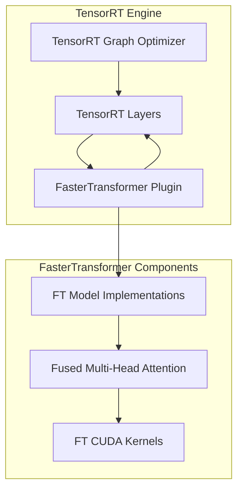
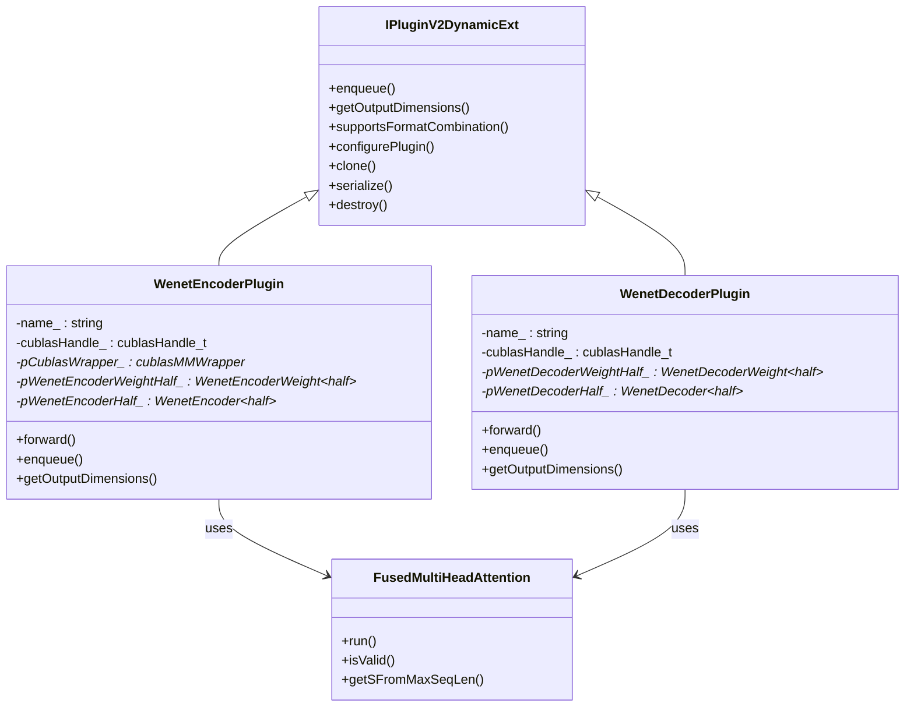
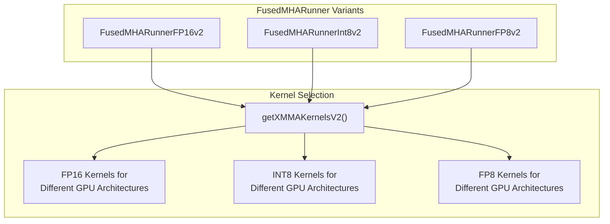
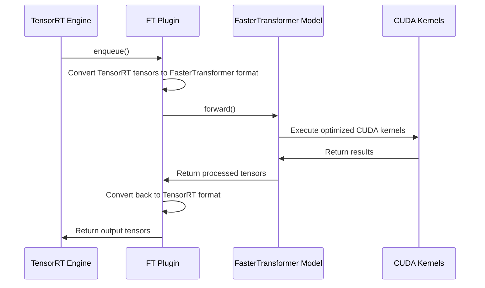
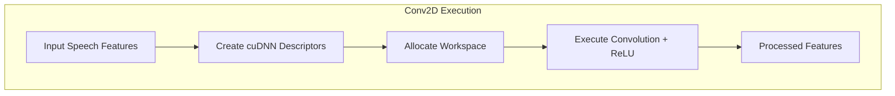

<!-- source: DeepWiki mcp.deepwiki.com · repo NVIDIA/FasterTransformer · page 6.3 TensorRT Integration · fetched 2026-10-26 -->

# TensorRT Integration

<details>
<summary>Relevant source files</summary>

The following files were used as context for generating this wiki page:

- [3rdparty/trt_fused_multihead_attention/fused_multihead_attention_v2.h](3rdparty/trt_fused_multihead_attention/fused_multihead_attention_v2.h)
- [3rdparty/trt_fused_multihead_attention/fused_multihead_attention_v2_fp16_512_32_kernel.sm75.cpp](3rdparty/trt_fused_multihead_attention/fused_multihead_attention_v2_fp16_512_32_kernel.sm75.cpp)
- [3rdparty/trt_fused_multihead_attention/fused_multihead_attention_v2_fp16_512_32_kernel.sm80.cpp](3rdparty/trt_fused_multihead_attention/fused_multihead_attention_v2_fp16_512_32_kernel.sm80.cpp)
- [3rdparty/trt_fused_multihead_attention/fused_multihead_attention_v2_fp16_512_64_kernel.sm80.cpp](3rdparty/trt_fused_multihead_attention/fused_multihead_attention_v2_fp16_512_64_kernel.sm80.cpp)
- [3rdparty/trt_fused_multihead_attention/qkvToContext.cu](3rdparty/trt_fused_multihead_attention/qkvToContext.cu)
- [src/fastertransformer/layers/attention_layers/GptContextAttentionLayer.cc](src/fastertransformer/layers/attention_layers/GptContextAttentionLayer.cc)
- [src/fastertransformer/layers/attention_layers/GptContextAttentionLayer.h](src/fastertransformer/layers/attention_layers/GptContextAttentionLayer.h)
- [src/fastertransformer/models/wenet/WenetEncoder.cc](src/fastertransformer/models/wenet/WenetEncoder.cc)
- [src/fastertransformer/tensorrt_plugin/wenet/DecoderPlugin.cc](src/fastertransformer/tensorrt_plugin/wenet/DecoderPlugin.cc)
- [src/fastertransformer/tensorrt_plugin/wenet/EncoderPlugin.cc](src/fastertransformer/tensorrt_plugin/wenet/EncoderPlugin.cc)
- [src/fastertransformer/tensorrt_plugin/wenet/EncoderPlugin.h](src/fastertransformer/tensorrt_plugin/wenet/EncoderPlugin.h)
- [src/fastertransformer/utils/wenet_conv2d.h](src/fastertransformer/utils/wenet_conv2d.h)

</details>


This page documents how FasterTransformer integrates with NVIDIA's TensorRT inference optimizer. FasterTransformer provides optimized TensorRT plugins that implement high-performance transformer model operations for inference within a TensorRT execution context. This enables accelerated transformer model inference using TensorRT's optimized execution engine while leveraging FasterTransformer's specialized transformer implementations.

## Architecture Overview

FasterTransformer's TensorRT integration is implemented through a plugin architecture, allowing FasterTransformer models to be executed as custom layers within a TensorRT inference engine.



Sources: [src/fastertransformer/tensorrt_plugin/wenet/EncoderPlugin.h:76-190](), [src/fastertransformer/tensorrt_plugin/wenet/DecoderPlugin.cc:25-189]()

## Core Components

The TensorRT integration primarily consists of:

1. **TensorRT Plugins**: Custom implementations of TensorRT's `IPluginV2DynamicExt` interface that wrap FasterTransformer models
2. **Fused Multi-Head Attention**: Optimized CUDA kernels for transformer attention operations
3. **Plugin Factories**: Creator classes that generate plugin instances from serialized data



Sources: [src/fastertransformer/tensorrt_plugin/wenet/EncoderPlugin.h:76-190](), [src/fastertransformer/tensorrt_plugin/wenet/DecoderPlugin.cc:25-189](), [3rdparty/trt_fused_multihead_attention/fused_multihead_attention_v2.h:24-115]()

## Fused Multi-Head Attention

One of the key performance optimizations in the TensorRT integration is the use of fused multi-head attention operations. These operations combine multiple steps of the attention mechanism into a single CUDA kernel, reducing memory bandwidth requirements and improving performance.

### Parameter Structure

The fused multi-head attention implementation is based on a parameter structure that encapsulates all the necessary data for the operation:

```
struct Fused_multihead_attention_params_v2 {
    void* qkv_ptr;                      // QKV matrices
    void* packed_mask_ptr;              // Attention mask
    void* o_ptr;                        // Output matrix
    int64_t qkv_stride_in_bytes;        // Stride between rows of QKV
    int64_t packed_mask_stride_in_bytes; // Stride between mask matrices
    int64_t o_stride_in_bytes;          // Stride between rows of output
    int b, h, s, d;                     // Batch size, head num, seq len, head size
    uint32_t scale_bmm1, scale_softmax, scale_bmm2;  // Scaling factors
    bool enable_i2f_trick;              // Optional INT8 optimization
    int* cu_seqlens;                    // Sequence lengths for batching
    bool interleaved;                   // Use C/32 format
    bool force_unroll;                  // Force kernel unrolling
    void* packed_relative_position_bias_ptr; // Optional relative position bias
};
```

Sources: [3rdparty/trt_fused_multihead_attention/fused_multihead_attention_v2.h:24-115]()

### Multiple Precision Support

The integration supports multiple precision formats:

- FP16 (half-precision floating point)
- INT8 (quantized integer operations)
- FP8 (when enabled via the `ENABLE_FP8` macro)

Each precision format has specialized implementations of the fused attention mechanism.



Sources: [3rdparty/trt_fused_multihead_attention/qkvToContext.cu:62-396](), [3rdparty/trt_fused_multihead_attention/qkvToContext.cu:461-684]()

## TensorRT Plugin Implementation

FasterTransformer provides TensorRT plugins for various transformer models. Let's examine the implementation of the Wenet model plugins as examples.

### Plugin Architecture

Each plugin implements TensorRT's plugin interface, which requires implementing methods to:

1. Describe the plugin's input/output format requirements
2. Compute the plugin's output dimensions
3. Execute the plugin's computation
4. Serialize/deserialize the plugin

The plugin's execution flow consists of these key steps:



Sources: [src/fastertransformer/tensorrt_plugin/wenet/EncoderPlugin.cc:401-490](), [src/fastertransformer/tensorrt_plugin/wenet/DecoderPlugin.cc:350-426]()

### WenetEncoder Plugin

The WenetEncoder plugin encapsulates the speech recognition encoder portion of the Wenet model. It:

1. Takes speech features and sequence length as inputs
2. Processes them through the transformer encoder
3. Returns encoder outputs, encoder output lengths, and CTC log probabilities

```
class WenetEncoderPlugin: public IPluginV2DynamicExt {
    // Fields for model parameters and resources
    cublasHandle_t cublasHandle_;
    WenetEncoderWeight<half>* pWenetEncoderWeightHalf_;
    WenetEncoder<half>* pWenetEncoderHalf_;
    
    // Methods required by TensorRT
    DimsExprs getOutputDimensions(...);
    bool supportsFormatCombination(...);
    int enqueue(...);
    // Other TensorRT plugin methods
};
```

Sources: [src/fastertransformer/tensorrt_plugin/wenet/EncoderPlugin.h:76-190](), [src/fastertransformer/tensorrt_plugin/wenet/EncoderPlugin.cc:278-332]()

### WenetDecoder Plugin

The WenetDecoder plugin implements the decoder portion of the Wenet model. It:

1. Takes encoder outputs, encoder lengths, and decoder inputs
2. Processes them through the transformer decoder
3. Returns decoder outputs and best token indices

Both plugins handle precision configuration (FP16/FP32) based on TensorRT's requirements.

Sources: [src/fastertransformer/tensorrt_plugin/wenet/DecoderPlugin.cc:185-245]()

## CNN Operations Support

The Wenet model requires 2D convolution operations, which are implemented using cuDNN. The implementation provides:

1. A wrapper around cuDNN's convolution API
2. Support for both FP16 and FP32 data types
3. ReLU activation integration



Sources: [src/fastertransformer/utils/wenet_conv2d.h:28-196]()

## Using FasterTransformer TensorRT Plugins

To use FasterTransformer's TensorRT plugins in an application:

1. **Register the Plugin Creators**: Register FasterTransformer's plugin factories with TensorRT
2. **Create Network with Plugins**: Add the plugins to your TensorRT network
3. **Build and Run**: Build the TensorRT engine and execute inference

### Plugin Registration Example

```cpp
// Register the plugin
auto plugin_registry = getPluginRegistry();
auto creator = plugin_registry->getPluginCreator("WenetEncoderPlugin", "1");
```

### Plugin Creation

Each plugin has a corresponding plugin creator that implements the `IPluginCreator` interface. This creator is responsible for:

1. Creating plugins with specific parameters
2. Deserializing plugins from serialized data

For example, the `WenetEncoderPluginCreator` creates instances of the `WenetEncoderPlugin` with specified parameters.

```mermaid
flowchart TD
    subgraph "Plugin Creation"
        CreatorReg["Register Plugin Creator"]
        Parse["Parse Configuration"]
        Create["Create Plugin Instance"]
        AddToNetwork["Add to TensorRT Network"]
        
        CreatorReg --> Parse
        Parse --> Create
        Create --> AddToNetwork
    end
    
    subgraph "Engine Execution"
        BuildEngine["Build TensorRT Engine"]
        CreateContext["Create Execution Context"]
        SetupIO["Setup Input/Output Buffers"]
        Execute["Execute Inference"]
        
        BuildEngine --> CreateContext
        CreateContext --> SetupIO
        SetupIO --> Execute
    end
```



Sources: [src/fastertransformer/tensorrt_plugin/wenet/EncoderPlugin.cc:430-549](), [src/fastertransformer/tensorrt_plugin/wenet/DecoderPlugin.cc:457-547]()

## Performance Considerations

The TensorRT integration is designed with performance in mind:

1. **Specialized CUDA Kernels**: Different kernels for different GPU architectures and sequence lengths
2. **Memory Management**: Careful buffer allocation to minimize memory transfers
3. **Precision Options**: Support for lower precision (FP16, INT8) for improved performance
4. **Flash Attention**: Support for the flash attention algorithm for long sequences

## Limitations and Requirements

- Requires CUDA-capable NVIDIA GPUs
- GPU architecture (compute capability) must be supported by the kernels
- Limited to specific model configurations (sequence lengths, head sizes)
- Requires TensorRT 7.0 or later

## Integration with Other TensorRT Components

The FasterTransformer plugins can be combined with other TensorRT operations in a single network, allowing for end-to-end model inference with custom transformer implementations.

Sources: [src/fastertransformer/tensorrt_plugin/wenet/EncoderPlugin.cc:46-179](), [src/fastertransformer/tensorrt_plugin/wenet/DecoderPlugin.cc:25-134]()

---

