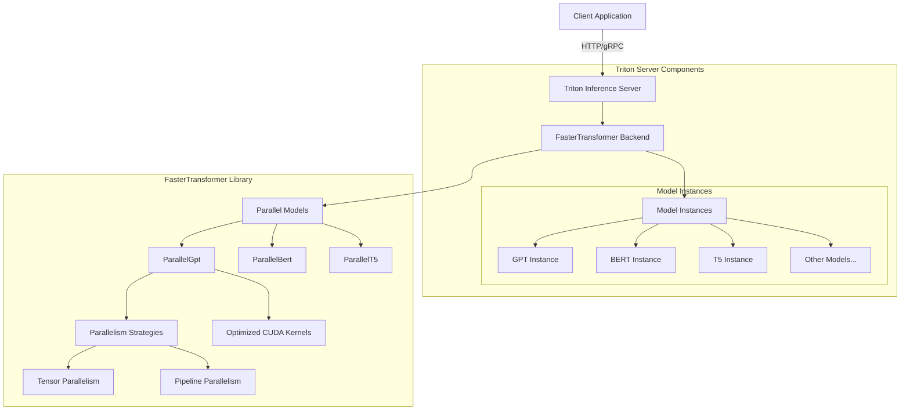
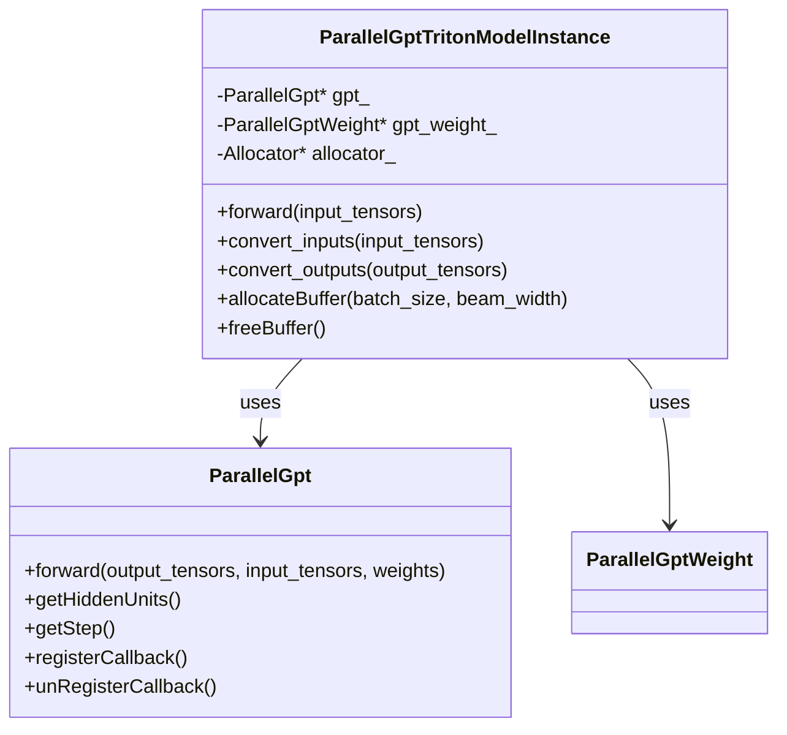
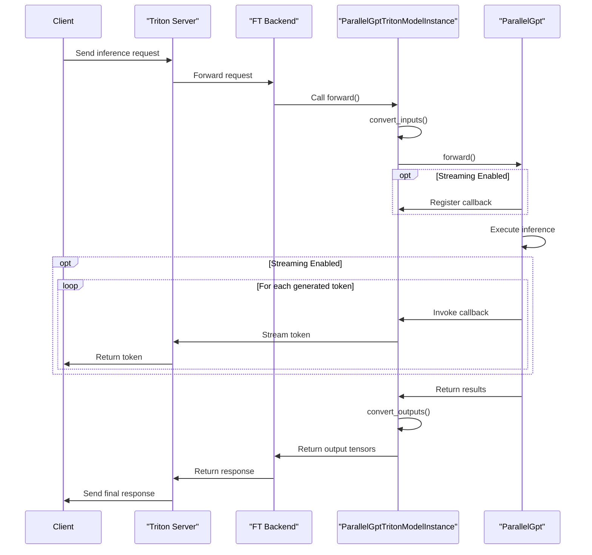

<!-- source: DeepWiki mcp.deepwiki.com · repo NVIDIA/FasterTransformer · page 6.4 Triton Inference Server · fetched 2026-10-26 -->

# Triton Inference Server

<details>
<summary>Relevant source files</summary>

The following files were used as context for generating this wiki page:

- [README.md](README.md)
- [src/fastertransformer/kernels/gpt_kernels.cu](src/fastertransformer/kernels/gpt_kernels.cu)
- [src/fastertransformer/kernels/gpt_kernels.h](src/fastertransformer/kernels/gpt_kernels.h)
- [src/fastertransformer/kernels/stop_criteria_kernels.cu](src/fastertransformer/kernels/stop_criteria_kernels.cu)
- [src/fastertransformer/layers/sampling_layers/BaseSamplingLayer.cc](src/fastertransformer/layers/sampling_layers/BaseSamplingLayer.cc)
- [src/fastertransformer/models/multi_gpu_gpt/ParallelGpt.h](src/fastertransformer/models/multi_gpu_gpt/ParallelGpt.h)
- [src/fastertransformer/th_op/common/GptOps.cc](src/fastertransformer/th_op/common/GptOps.cc)
- [src/fastertransformer/triton_backend/multi_gpu_gpt/ParallelGptTritonModelInstance.cc](src/fastertransformer/triton_backend/multi_gpu_gpt/ParallelGptTritonModelInstance.cc)
- [tests/unittests/test_gpt_kernels.cu](tests/unittests/test_gpt_kernels.cu)

</details>


This document explains how to deploy FasterTransformer models using NVIDIA's Triton Inference Server for high-performance inferencing of transformer-based models in production environments. For information about other framework integrations like PyTorch, TensorFlow, or TensorRT, see their respective documentation pages: [PyTorch Integration](#6.1), [TensorFlow Integration](#6.2), and [TensorRT Integration](#6.3).

## Overview

FasterTransformer provides a custom backend for Triton Inference Server, allowing you to deploy optimized transformer models as inference services. This backend bridges between Triton's standardized inference API and FasterTransformer's highly optimized implementation, benefiting from features like tensor parallelism, pipeline parallelism, and memory optimizations.

The backend supports various models including GPT, GPT-J, GPT-NeoX, BLOOM, BERT, T5/UL2, and BART.



Sources: [README.md:31-33](), [README.md:82-97]()

## Architecture

The Triton backend architecture has several key components that work together to provide efficient model inference:

### Model Instances

Each supported model type has a dedicated model instance class that implements the Triton backend interface. For example, the `ParallelGptTritonModelInstance` class handles GPT model inference requests by:

1. Converting input tensors from Triton format to FasterTransformer format
2. Allocating necessary GPU buffers
3. Executing the model's forward pass
4. Converting output tensors back to Triton format
5. Managing resources and memory



Sources: [src/fastertransformer/triton_backend/multi_gpu_gpt/ParallelGptTritonModelInstance.cc:38-53](), [src/fastertransformer/triton_backend/multi_gpu_gpt/ParallelGptTritonModelInstance.cc:162-255]()

### Inference Flow

The inference process follows these steps:



Sources: [src/fastertransformer/triton_backend/multi_gpu_gpt/ParallelGptTritonModelInstance.cc:162-255](), [src/fastertransformer/triton_backend/multi_gpu_gpt/ParallelGptTritonModelInstance.cc:29-35]()

## Input and Output Tensors

### Input Tensors

The Triton backend accepts the following input tensors:

| Tensor Name | Shape | Type | Description |
|-------------|-------|------|-------------|
| input_ids | [batch_size, seq_len] | INT32 | Token IDs for input text |
| input_lengths | [batch_size] | INT32 | Length of each input sequence |
| request_output_len | [batch_size] | UINT32 | Requested number of tokens to generate |
| beam_width | [1] | UINT32 | Beam width for beam search (optional) |
| temperature | [1] or [batch_size] | FP32 | Temperature for sampling (optional) |
| repetition_penalty | [1] or [batch_size] | FP32 | Repetition penalty (optional) |
| bad_words_list | [batch_size, 2, ...] | INT32 | List of tokens to avoid (optional) |
| stop_words_list | [batch_size, 2, ...] | INT32 | List of tokens that end generation (optional) |
| runtime_top_k | [1] or [batch_size] | INT32 | Top-k value for sampling (optional) |
| runtime_top_p | [1] or [batch_size] | FP32 | Top-p value for sampling (optional) |
| request_prompt_embedding | [...] | FP32/FP16/BF16 | Prompt tuning embeddings (optional) |
| request_prompt_lengths | [batch_size] | INT32 | Prompt lengths (optional) |
| is_return_log_probs | [1] | BOOL | Whether to return token log probs (optional) |
| is_return_context_embeddings | [1] | BOOL | Whether to return context embeddings (optional) |
| START | [1] | INT32 | Flag to start interactive mode (optional) |

### Output Tensors

The backend produces the following output tensors:

| Tensor Name | Shape | Type | Description |
|-------------|-------|------|-------------|
| output_ids | [batch_size, beam_width, seq_len] | UINT32 | Generated token IDs |
| sequence_length | [batch_size, beam_width] | INT32 | Final sequence lengths |
| response_input_lengths | [batch_size, beam_width] | INT32 | Input lengths in response |
| output_log_probs | [batch_size, beam_width, out_len] | FP32 | Log probabilities (optional) |
| cum_log_probs | [batch_size, beam_width] | FP32 | Cumulative log probabilities (optional) |
| context_embeddings | [batch_size, beam_width, hidden_units] | FP32 | Context embeddings (optional) |

Sources: [src/fastertransformer/triton_backend/multi_gpu_gpt/ParallelGptTritonModelInstance.cc:65-144](), [src/fastertransformer/triton_backend/multi_gpu_gpt/ParallelGptTritonModelInstance.cc:201-237]()

## Key Features

### Interactive Generation

FasterTransformer's Triton backend supports interactive text generation, allowing continuous conversation with a model while maintaining context across multiple requests.

When using interactive mode:

1. Start a session with the `START` flag set to 1
2. Continue the session with subsequent requests having `START` set to 0
3. The model uses the previously generated tokens as context

This feature is especially useful for chatbot applications where conversation context needs to be maintained.

Sources: [src/fastertransformer/triton_backend/multi_gpu_gpt/ParallelGptTritonModelInstance.cc:185-190]()

### Streaming Generation

The backend supports token streaming, which returns generated tokens as they become available rather than waiting for the entire sequence to complete:


This streaming capability is implemented using a callback mechanism where:
1. The Triton model instance registers a callback function with the ParallelGpt model
2. When a token is generated, the callback is invoked
3. The token is streamed back to the client
4. This continues until generation is complete

Sources: [src/fastertransformer/triton_backend/multi_gpu_gpt/ParallelGptTritonModelInstance.cc:29-35](), [src/fastertransformer/triton_backend/multi_gpu_gpt/ParallelGptTritonModelInstance.cc:241-249]()

### Model Parallelism

The backend supports two forms of parallelism:

1. **Tensor Parallelism**: Splits model weights across multiple GPUs, enabling inference of larger models than can fit on a single GPU.
2. **Pipeline Parallelism**: Distributes different layers of the model across multiple GPUs, improving throughput.

These parallelism strategies can be combined to efficiently deploy very large models (hundreds of billions of parameters) across multiple GPUs and nodes.

Sources: [README.md:37-67]()

### Memory Optimizations

The backend implements several optimizations to reduce memory usage:

1. **Buffer Reuse**: Allocating buffers once and reusing them for subsequent requests
2. **Shared Context Detection**: Identifying duplicate inputs in a batch to avoid redundant computation
3. **Attention Caching**: Caching key/value tensors for efficient autoregressive generation
4. **Efficient Token Management**: Optimized handling of padding and generation states

Sources: [src/fastertransformer/kernels/gpt_kernels.cu:634-680](), [src/fastertransformer/triton_backend/multi_gpu_gpt/ParallelGptTritonModelInstance.cc:265-284]()

## Deployment

### Model Repository Structure

To deploy a FasterTransformer model with Triton, you need to set up a model repository with the following structure:

```
model_repository/
└── your_model/
    ├── 1/
    │   └── model.plan (or other model files)
    └── config.pbtxt
```

### Model Configuration

Here's a basic configuration example for a GPT model:

```
name: "gpt_model"
backend: "fastertransformer"
max_batch_size: 64

input [
  {
    name: "input_ids"
    data_type: TYPE_INT32
    dims: [ -1 ]
  },
  {
    name: "input_lengths"
    data_type: TYPE_INT32
    dims: [ 1 ]
  },
  {
    name: "request_output_len"
    data_type: TYPE_UINT32
    dims: [ 1 ]
  }
]

output [
  {
    name: "output_ids"
    data_type: TYPE_UINT32
    dims: [ -1, -1 ]
  },
  {
    name: "sequence_length"
    data_type: TYPE_INT32
    dims: [ 1 ]
  }
]

instance_group [
  {
    count: 1
    kind: KIND_GPU
    gpus: [ 0, 1 ]
  }
]

parameters [
  {
    key: "model_type"
    value: { string_value: "GPT" }
  },
  {
    key: "model_checkpoint_path"
    value: { string_value: "/models/checkpoints/gpt2" }
  },
  {
    key: "tensor_para_size"
    value: { string_value: "2" }
  },
  {
    key: "pipeline_para_size"
    value: { string_value: "1" }
  }
]
```

## Client Examples

### Python Client Example

```python
import tritonclient.http as httpclient
import numpy as np

# Create a client
client = httpclient.InferenceServerClient(url="localhost:8000")

# Prepare input data
input_ids = np.array([[101, 2054, 2003, 2026, 2171, 102]], dtype=np.int32)
input_lengths = np.array([6], dtype=np.int32)
request_output_len = np.array([20], dtype=np.uint32)

# Create inference inputs
inputs = [
    httpclient.InferInput("input_ids", input_ids.shape, "INT32"),
    httpclient.InferInput("input_lengths", input_lengths.shape, "INT32"),
    httpclient.InferInput("request_output_len", request_output_len.shape, "UINT32")
]

# Set data for inputs
inputs[0].set_data_from_numpy(input_ids)
inputs[1].set_data_from_numpy(input_lengths)
inputs[2].set_data_from_numpy(request_output_len)

# Create requested outputs
outputs = [
    httpclient.InferRequestedOutput("output_ids"),
    httpclient.InferRequestedOutput("sequence_length")
]

# Send inference request
response = client.infer("gpt_model", inputs, outputs=outputs)

# Process results
output_ids = response.as_numpy("output_ids")
sequence_length = response.as_numpy("sequence_length")
```

### Streaming Client Example

```python
import tritonclient.grpc as grpcclient
import numpy as np

# Create a client
client = grpcclient.InferenceServerClient(url="localhost:8001")

# Prepare input data
input_ids = np.array([[101, 2054, 2003, 2026, 2171, 102]], dtype=np.int32)
input_lengths = np.array([6], dtype=np.int32)
request_output_len = np.array([50], dtype=np.uint32)

# Create inference inputs
inputs = [
    grpcclient.InferInput("input_ids", input_ids.shape, "INT32"),
    grpcclient.InferInput("input_lengths", input_lengths.shape, "INT32"),
    grpcclient.InferInput("request_output_len", request_output_len.shape, "UINT32")
]

# Set data for inputs
inputs[0].set_data_from_numpy(input_ids)
inputs[1].set_data_from_numpy(input_lengths)
inputs[2].set_data_from_numpy(request_output_len)

# Define callback function for streaming
def stream_callback(result, error):
    if error:
        print(f"Error: {error}")
    else:
        # Process streamed token
        token_id = result.as_numpy("output_ids")[0][0][-1]
        print(f"Received token: {token_id}")

# Send asynchronous streaming request
client.start_stream(callback=stream_callback)
client.async_stream_infer("gpt_model", inputs)

# Wait for completion
client.stop_stream()
```

## Performance Considerations

When deploying FasterTransformer models with Triton, consider the following performance optimizations:

1. **Batch Processing**: Process multiple requests in a single batch when possible
2. **Tensor Parallelism**: Use multiple GPUs to distribute model weights
3. **Pipeline Parallelism**: Distribute model layers across GPUs
4. **Memory Management**: Allocate sufficient memory for caching and intermediate results
5. **Shared Context Optimization**: Maximize duplicate context detection in batch processing
6. **Request Batching**: Configure Triton's dynamic batching for optimal throughput

Sources: [README.md:37-67](), [src/fastertransformer/kernels/gpt_kernels.cu:634-680]()

## Limitations and Troubleshooting

- The backend requires matching data types between the client and server
- For very large models, ensure your system has sufficient GPU memory
- When using tensor or pipeline parallelism, verify that NVLink connections are properly configured
- Interactive mode may increase memory usage over time as context grows
- For optimal performance, adjust batch size and sequence length based on your specific hardware

Sources: [README.md:414-419]()

## Additional Resources

- For information about model conversion and preparation, refer to the model-specific documentation
- For details on custom CUDA kernel implementations, see the kernels directory
- For understanding inference flow, review the ParallelGpt implementation
- See examples in the repository to understand how to configure and use the Triton backend