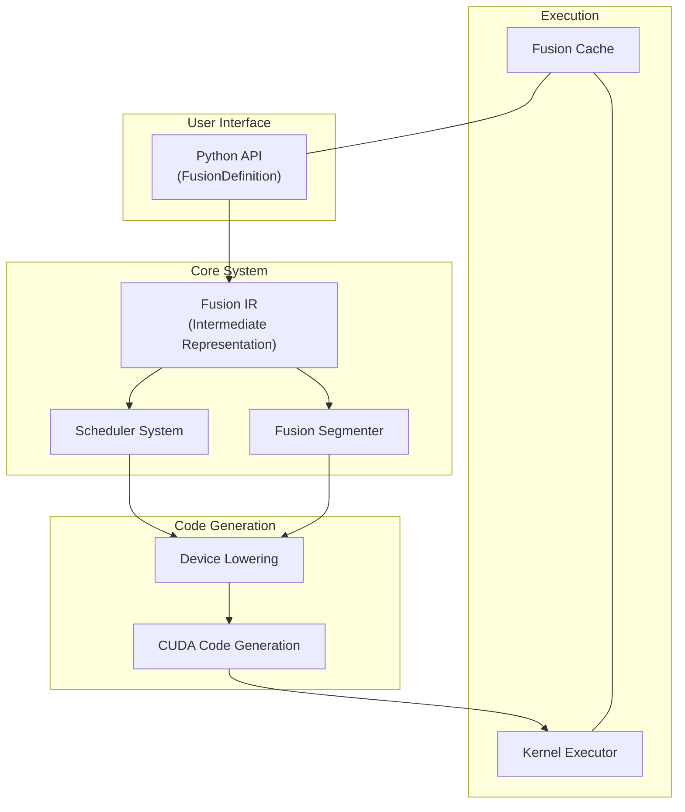
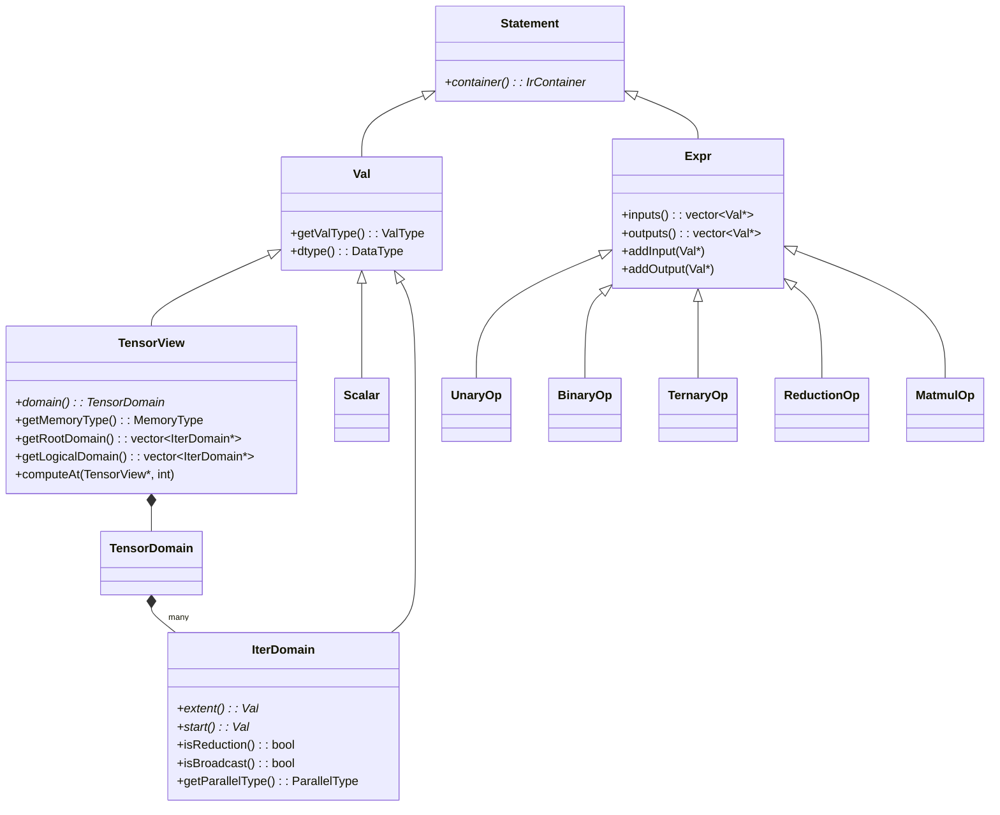
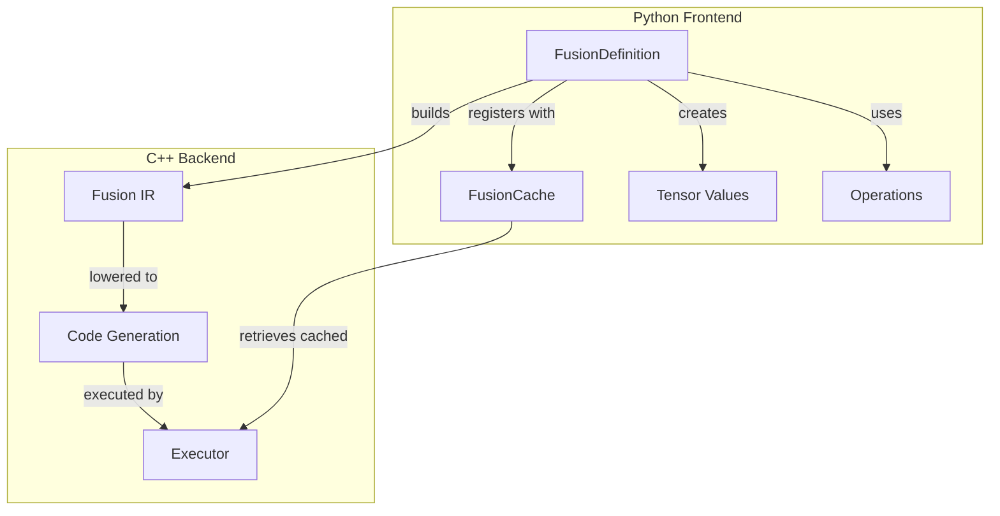
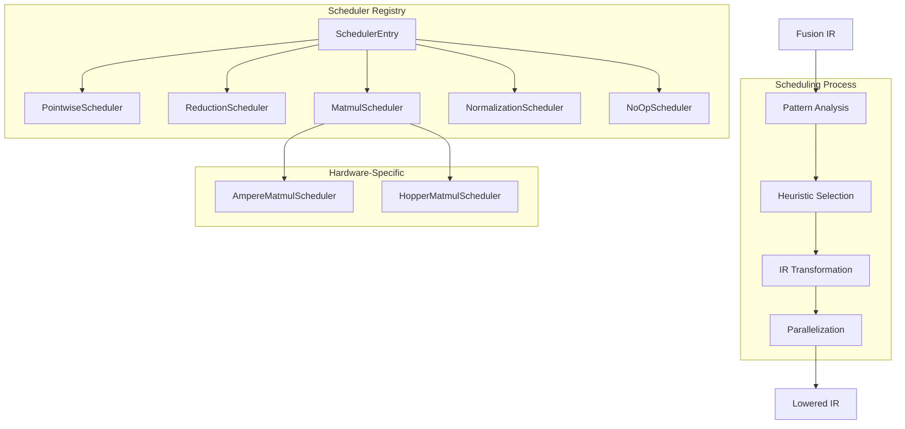
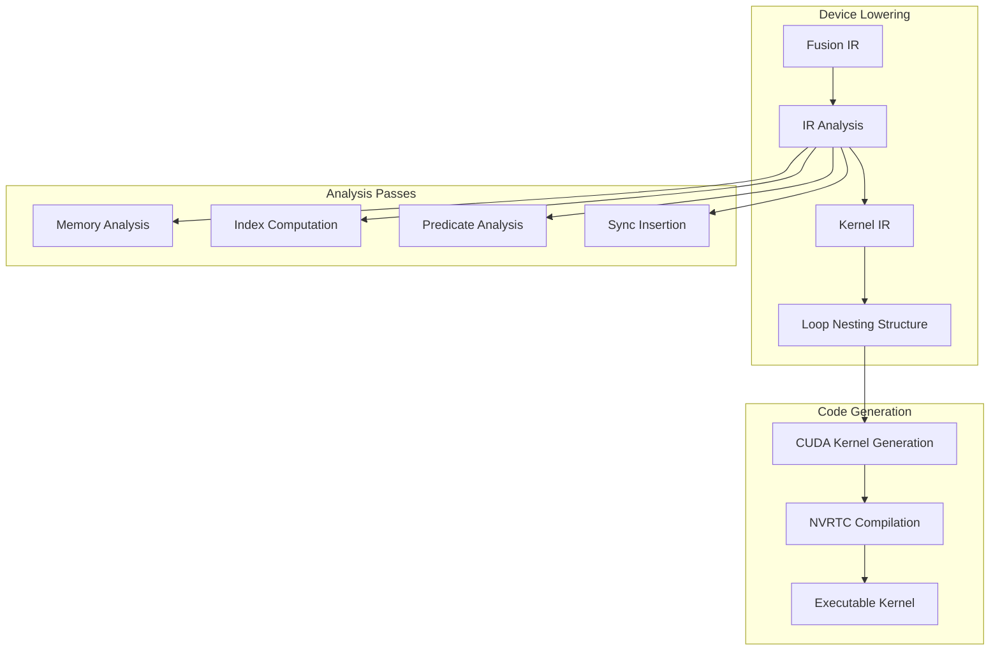
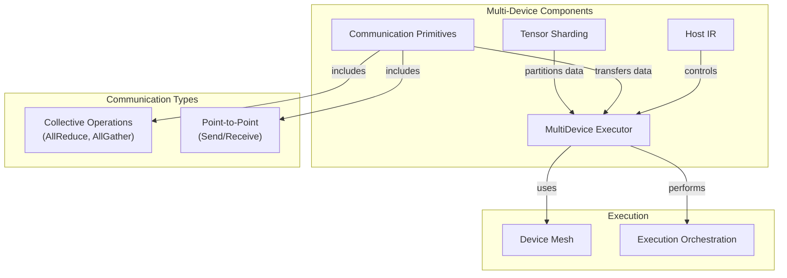
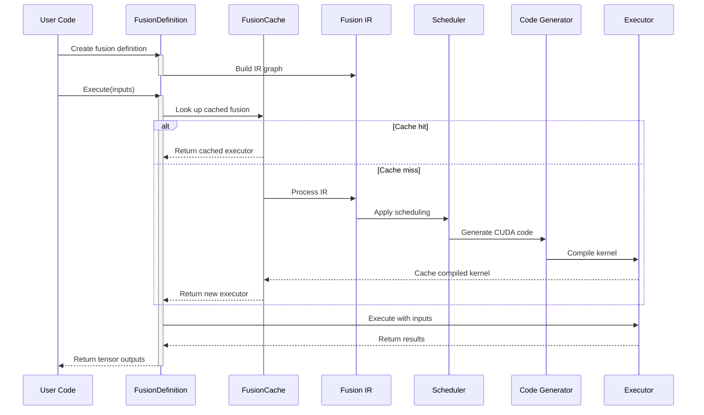
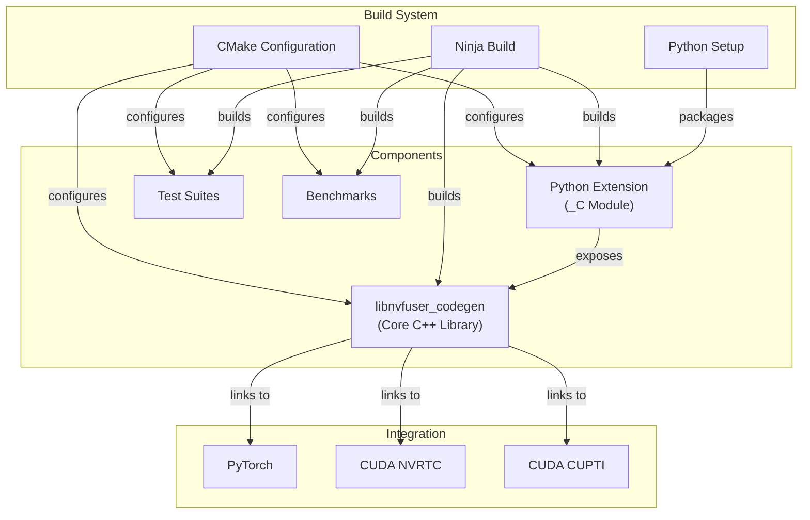

<!-- source: DeepWiki mcp.deepwiki.com · repo NVIDIA/Fuser · page 1 Overview · fetched 2026-10-26 -->

# Overview

<details>
<summary>Relevant source files</summary>

The following files were used as context for generating this wiki page:

- [.github/workflows/build.yml](.github/workflows/build.yml)
- [.github/workflows/lint.yml](.github/workflows/lint.yml)
- [.lintrunner.toml](.lintrunner.toml)
- [CMakeLists.txt](CMakeLists.txt)
- [csrc/device_lower/pass/alias_memory.cpp](csrc/device_lower/pass/alias_memory.cpp)
- [csrc/device_lower/utils.cpp](csrc/device_lower/utils.cpp)
- [csrc/device_lower/utils.h](csrc/device_lower/utils.h)
- [csrc/ir/interface_nodes.h](csrc/ir/interface_nodes.h)
- [csrc/ir/internal_base_nodes.h](csrc/ir/internal_base_nodes.h)
- [csrc/ir/internal_nodes.h](csrc/ir/internal_nodes.h)
- [csrc/ir/nodes.cpp](csrc/ir/nodes.cpp)
- [csrc/serde/fusion_cache.fbs](csrc/serde/fusion_cache.fbs)
- [csrc/serde/fusion_record.cpp](csrc/serde/fusion_record.cpp)
- [csrc/tensor_view.cpp](csrc/tensor_view.cpp)
- [nvfuser/__init__.py](nvfuser/__init__.py)
- [setup.py](setup.py)
- [tests/python/test_python_frontend.py](tests/python/test_python_frontend.py)
- [tests/python/test_schedule_ops.py](tests/python/test_schedule_ops.py)
- [tools/apt-install-things.sh](tools/apt-install-things.sh)
- [tools/gen_nvfuser_version.py](tools/gen_nvfuser_version.py)
- [tools/memory.py](tools/memory.py)
- [tools/pip-install-things.sh](tools/pip-install-things.sh)
- [tools/setup-env.sh](tools/setup-env.sh)

</details>


NVFUSER is a just-in-time (JIT) CUDA kernel compiler for PyTorch tensor operations. It dynamically fuses operations into efficient CUDA kernels, optimizing execution for NVIDIA GPUs. This page provides a high-level overview of the NVFUSER architecture, key components, and execution flow.

NVFUSER enables significant performance improvements by combining multiple tensor operations into single GPU kernels, eliminating intermediate memory accesses and leveraging hardware-specific optimizations. It supports a wide range of operations including pointwise, reduction, matrix multiplication, and normalization operations.

For specific information about the Python frontend, see [Python Frontend](#6), and for multi-device execution capabilities, see [Multi-Device Support](#5).

Sources: [CMakeLists.txt:4-8](), [nvfuser/__init__.py:5-11]()

## System Architecture

NVFUSER is built around a layered architecture with components for defining operations, building an intermediate representation, optimizing execution, and generating efficient CUDA code.



The main system components include:

1. **Python API**: Frontend for defining fusion operations through the `FusionDefinition` class
2. **Fusion IR**: Core representation of operations to be fused
3. **Scheduler System**: Applies optimization strategies based on operation patterns
4. **Fusion Segmenter**: Partitions complex computations into manageable segments
5. **Device Lowering**: Transforms IR into device-specific representations
6. **CUDA Code Generation**: Generates optimized CUDA code
7. **Kernel Executor**: Compiles and runs the generated code
8. **Fusion Cache**: Stores and reuses previously compiled kernels

Sources: [CMakeLists.txt:85-286](), [csrc/ir/nodes.cpp:36-47](), [csrc/ir/interface_nodes.h:37-47](), [csrc/device_lower/utils.cpp:30-46]()

## Core IR System

NVFUSER's IR (Intermediate Representation) is the foundation of the system, providing a flexible and extensible representation of tensor operations. The IR is structured as a hierarchical graph of nodes representing values and operations.



Key components of the IR system:

- **Statement**: Base class for all IR nodes
- **Val**: Represents values (tensors, scalars, domains)
  - **TensorView**: Represents tensors with domains and memory types
  - **IterDomain**: Represents a single dimension of a tensor
  - **Scalar**: Represents scalar values
- **Expr**: Represents operations that transform values
  - **UnaryOp**: Single-input operations (e.g., neg, cast)
  - **BinaryOp**: Two-input operations (e.g., add, mul)
  - **TernaryOp**: Three-input operations (e.g., where, clamp)
  - **ReductionOp**: Reduction operations across dimensions
  - **MatmulOp**: Matrix multiplication operations

The IR system uses a visitor pattern for traversing and transforming the operation graph. This enables optimizations, transformations, and code generation.

Sources: [csrc/ir/internal_nodes.h:41-726](), [csrc/ir/internal_base_nodes.h:34-683](), [csrc/ir/interface_nodes.h:56-393]()

## Python Frontend

The Python frontend provides a user-friendly API for defining fusion operations. It's centered around the `FusionDefinition` class, which serves as a builder for the underlying IR.



The primary components of the Python frontend are:

- **FusionDefinition**: Context manager for defining a fusion through a Python API
- **FusionCache**: Manages caching and retrieval of compiled fusions
- **Tensor operations**: Methods for defining tensor operations in the fusion

Example usage:

```python
with FusionDefinition() as fd:
    # Define input tensors
    t0 = fd.define_tensor(shape=[-1, -1], contiguity=[True, True])
    t1 = fd.define_tensor(shape=[-1, -1], contiguity=[True, True])
    
    # Define operations
    t2 = fd.ops.add(t0, t1)
    t3 = fd.ops.relu(t2)
    
    # Register output
    fd.add_output(t3)

# Execute the fusion with actual tensors
result = fd.execute([input_tensor1, input_tensor2])
```

The Python frontend handles:
- Translation between PyTorch tensors and NVFUSER's representation
- Building the fusion IR graph
- Managing fusion execution
- Caching compiled kernels for reuse

Sources: [nvfuser/__init__.py:52-307](), [tests/python/test_python_frontend.py:42-77]()

## Scheduling System

The scheduling system is responsible for determining efficient execution strategies for different types of operations. It analyzes the fusion graph and applies specialized optimizations based on operation patterns.



The scheduler system includes:

1. **Scheduler Registry**: Collection of specialized schedulers for different operation patterns
2. **Pattern Analysis**: Identifies operation patterns in the fusion graph
3. **Heuristic Selection**: Chooses appropriate optimization strategies
4. **IR Transformation**: Applies transformations like tiling and fusion
5. **Parallelization**: Maps operations to GPU execution resources (threads, blocks)
6. **Hardware-Specific Schedulers**: Optimizations for specific GPU architectures

The scheduler transforms the logical IR representation into an optimized physical representation by:
- Determining optimal tiling sizes
- Selecting thread and block dimensions
- Deciding on memory access patterns
- Applying architecture-specific optimizations

Sources: [CMakeLists.txt:230-267](), [tests/python/test_schedule_ops.py:25-41]()

## Device Lowering and Code Generation

The device lowering and code generation components transform the optimized IR into executable CUDA code. This process involves several stages of lowering, analysis, and code generation.



Key components and processes:

1. **IR Analysis**: Analyzes tensor access patterns, dependencies, and parallelization
2. **Memory Analysis**: Determines memory allocation and access patterns
3. **Index Computation**: Calculates tensor indices based on loop iterators
4. **Predicate Analysis**: Generates predicates for conditional execution
5. **Sync Insertion**: Inserts synchronization barriers where needed
6. **Kernel IR**: Lower-level representation focused on GPU execution
7. **Loop Nesting**: Creates loop structures for tensor iteration
8. **CUDA Code Generation**: Generates CUDA C++ code
9. **Runtime Compilation**: Compiles generated code using NVRTC
10. **Executable Kernel**: Final executable kernel ready for execution

The system includes support for generating various GPU-specific features:
- Thread and block parallelism
- Shared memory usage
- Register allocation
- Warp-level operations
- Tensor core operations for matrix multiplication

Sources: [CMakeLists.txt:98-134](), [csrc/device_lower/utils.cpp:132-201]()

## Multi-Device Support

NVFUSER includes support for distributed execution across multiple GPUs through its multi-device system. This system handles data sharding, communication, and synchronization between devices.



Key components and features:

1. **Multi-Device Executor**: Orchestrates execution across devices
2. **Tensor Sharding**: Partitions tensors across devices
3. **Communication Primitives**: Enables data transfer between devices
   - **Collective Operations**: Global operations like AllReduce and AllGather
   - **Point-to-Point**: Direct device-to-device communication
4. **Host IR**: Represents control flow and synchronization
5. **Device Mesh**: Logical arrangement of devices for execution
6. **Execution Orchestration**: Coordinates computation and communication

This system supports various distributed execution patterns:
- Data parallelism
- Model parallelism
- Pipeline parallelism
- Hybrid parallelism approaches

Sources: [CMakeLists.txt:181-188](), [csrc/device_lower/utils.h:95-102]()

## Execution Flow

The end-to-end execution flow in NVFUSER involves several stages, from fusion definition to compiled kernel execution and result retrieval.



The execution flow consists of these main stages:

1. **Fusion Definition**: User creates a fusion definition using the Python API
2. **IR Construction**: The system builds an IR graph representing the operations
3. **Cache Lookup**: The system checks if this fusion has been compiled before
4. **Scheduling**: If not cached, a scheduler optimizes the execution pattern
5. **Code Generation**: The system generates CUDA code for the fusion
6. **Compilation**: The generated code is compiled into a kernel
7. **Caching**: The compiled kernel is cached for future reuse
8. **Execution**: The kernel is executed with the provided input tensors
9. **Result Return**: Results are returned to the user

For complex fusions, segmentation may occur:
```python
# Segmentation for complex fusions
segments = fusion_definition.segment(inputs)
if segments:
    # Execute each segment in sequence
    results = fusion_definition._execute_segments(inputs)
else:
    # Execute as a single fusion
    results = fusion_definition.execute(inputs)
```

Sources: [nvfuser/__init__.py:118-196](), [tests/python/test_python_frontend.py:70-76]()

## Build System and Integration

NVFUSER uses CMake as its build system and integrates with PyTorch through a Python extension module. The build system handles compilation, library linking, and package generation.



The build system includes:

1. **CMake Configuration**: Manages build settings, dependencies, and targets
2. **Library Targets**:
   - **libnvfuser_codegen**: Core C++ library for fusion compilation
   - **Python Extension**: Python bindings exposing the C++ functionality
   - **Tests**: Test suites for validation
   - **Benchmarks**: Performance benchmarking tools
3. **Dependencies**:
   - **PyTorch**: Integration with the PyTorch ecosystem
   - **CUDA Components**: NVRTC for runtime compilation, CUPTI for profiling
   - **FlatBuffers**: For serialization of fusion cache

Building NVFUSER involves several options:
```bash
# Basic build
python setup.py develop

# With specific options
python setup.py develop --cpp=20 --build-with-ucc --no-benchmark
```

Installation creates a Python package with both high-level API components and the compiled C++ extension.

Sources: [CMakeLists.txt:1-47](), [setup.py:1-47](), [.github/workflows/build.yml:17-36]()

---

