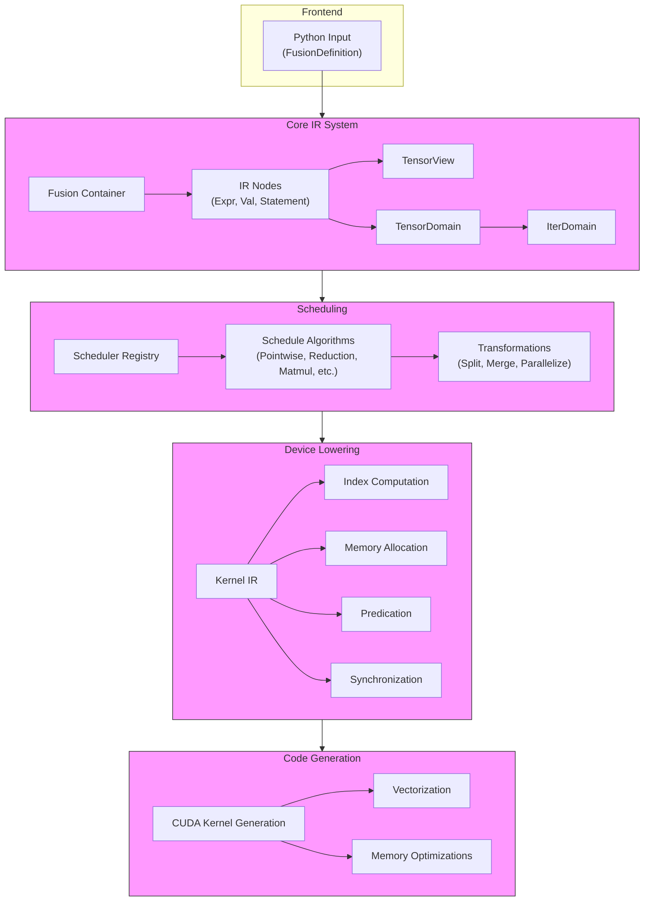
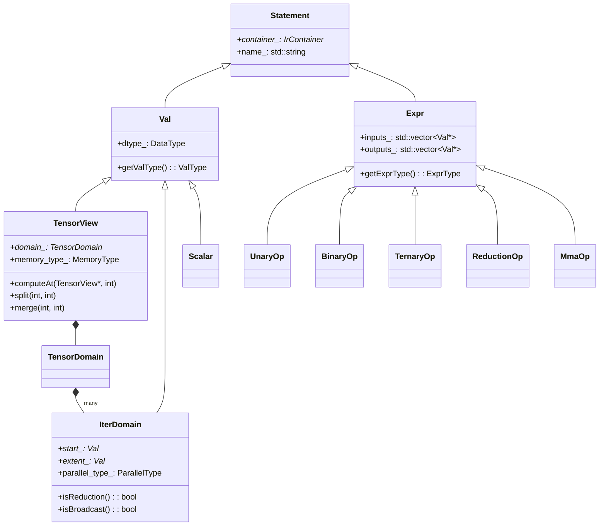
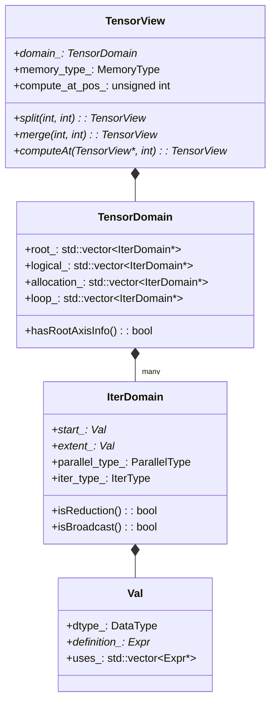
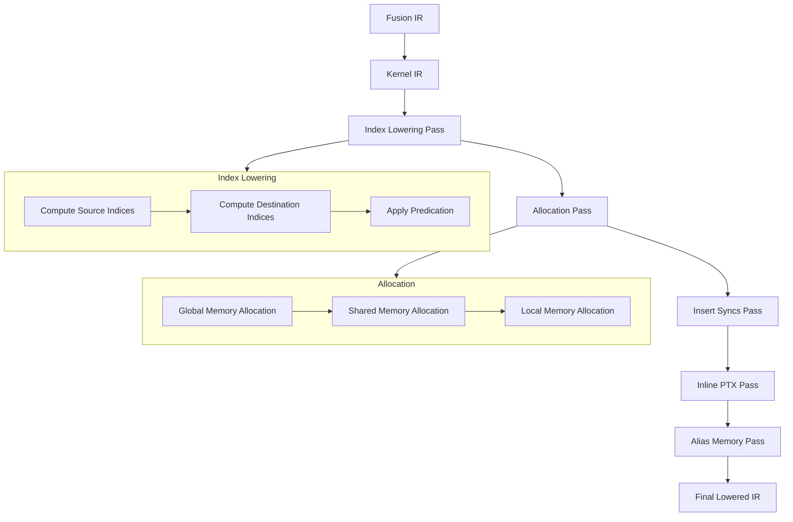
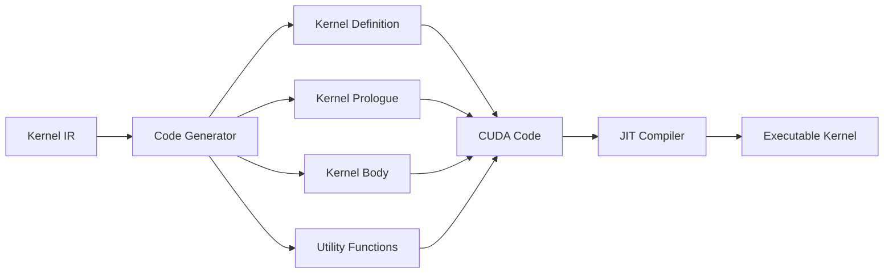
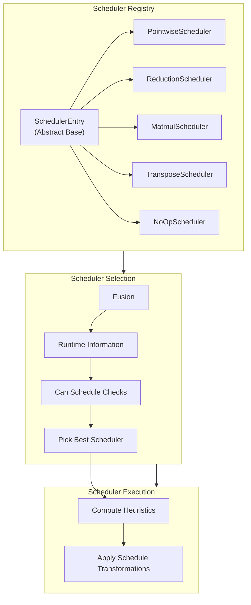
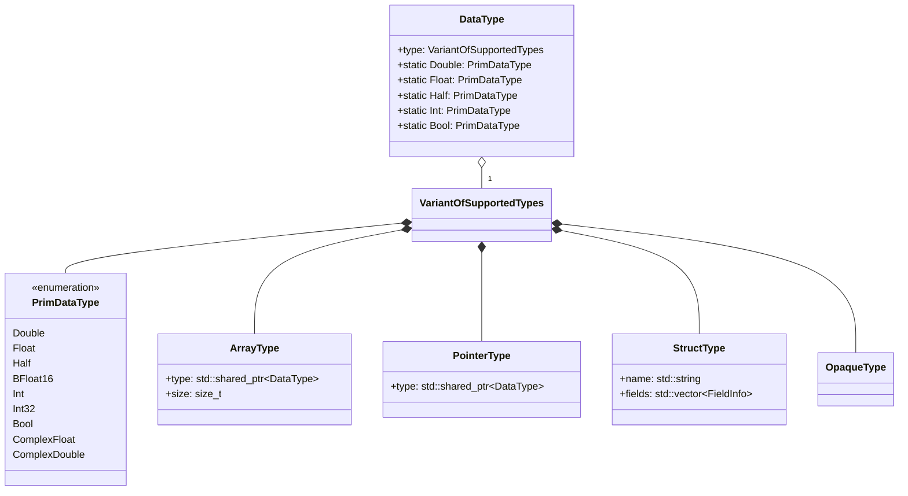

<!-- source: DeepWiki mcp.deepwiki.com · repo NVIDIA/Fuser · page 1.1 System Architecture · fetched 2026-10-26 -->

# System Architecture

<details>
<summary>Relevant source files</summary>

The following files were used as context for generating this wiki page:

- [csrc/codegen.cpp](csrc/codegen.cpp)
- [csrc/device_lower/pass/alias_memory.cpp](csrc/device_lower/pass/alias_memory.cpp)
- [csrc/device_lower/pass/allocation.cpp](csrc/device_lower/pass/allocation.cpp)
- [csrc/device_lower/pass/expr_sort.cpp](csrc/device_lower/pass/expr_sort.cpp)
- [csrc/device_lower/pass/index.cpp](csrc/device_lower/pass/index.cpp)
- [csrc/device_lower/pass/index.h](csrc/device_lower/pass/index.h)
- [csrc/device_lower/pass/inline_ptx.cpp](csrc/device_lower/pass/inline_ptx.cpp)
- [csrc/device_lower/pass/insert_syncs.cpp](csrc/device_lower/pass/insert_syncs.cpp)
- [csrc/device_lower/utils.cpp](csrc/device_lower/utils.cpp)
- [csrc/device_lower/utils.h](csrc/device_lower/utils.h)
- [csrc/fusion.cpp](csrc/fusion.cpp)
- [csrc/fusion.h](csrc/fusion.h)
- [csrc/ir/interface_nodes.h](csrc/ir/interface_nodes.h)
- [csrc/ir/internal_base_nodes.h](csrc/ir/internal_base_nodes.h)
- [csrc/ir/internal_nodes.h](csrc/ir/internal_nodes.h)
- [csrc/ir/nodes.cpp](csrc/ir/nodes.cpp)
- [csrc/kernel_ir.cpp](csrc/kernel_ir.cpp)
- [csrc/kernel_ir.h](csrc/kernel_ir.h)
- [csrc/scheduler/compile_time_info.h](csrc/scheduler/compile_time_info.h)
- [csrc/scheduler/pointwise.cpp](csrc/scheduler/pointwise.cpp)
- [csrc/scheduler/reduction.cpp](csrc/scheduler/reduction.cpp)
- [csrc/scheduler/reduction_utils.cpp](csrc/scheduler/reduction_utils.cpp)
- [csrc/scheduler/reduction_utils.h](csrc/scheduler/reduction_utils.h)
- [csrc/scheduler/registry.cpp](csrc/scheduler/registry.cpp)
- [csrc/scheduler/registry.h](csrc/scheduler/registry.h)
- [csrc/scheduler/transpose.cpp](csrc/scheduler/transpose.cpp)
- [csrc/scheduler/utils.cpp](csrc/scheduler/utils.cpp)
- [csrc/scheduler/utils.h](csrc/scheduler/utils.h)
- [csrc/scheduler/vectorize_helper.cpp](csrc/scheduler/vectorize_helper.cpp)
- [csrc/scheduler/vectorize_helper.h](csrc/scheduler/vectorize_helper.h)
- [csrc/tensor_view.cpp](csrc/tensor_view.cpp)
- [csrc/type.cpp](csrc/type.cpp)
- [csrc/type.h](csrc/type.h)

</details>


This document describes the high-level architecture of NVFUSER, focusing on the core components and their interactions. NVFUSER is a just-in-time (JIT) CUDA code generation system for PyTorch tensors that efficiently executes fused operations on NVIDIA GPUs.

For information about specific scheduling algorithms, see [Scheduling System](#4). For details on the Python API, see [Python Frontend](#6). For multidevice support, see [Multi-Device Support](#5).

## Overview

NVFUSER consists of several key components that work together to analyze, optimize, and generate efficient CUDA code from PyTorch tensor operations. The system follows a compiler-like architecture with distinct phases:

1. **IR (Intermediate Representation) System**: A flexible representation of tensor operations
2. **Fusion Representation**: Management of fused operations
3. **Scheduling System**: Application of optimization strategies
4. **Device Lowering**: Translation to device-specific instructions
5. **Code Generation**: Production of executable CUDA code

### System Components Diagram



Sources: [csrc/ir/nodes.cpp](https://github.com/NVIDIA/Fuser/blob/main/csrc/ir/nodes.cpp), [csrc/fusion.cpp](https://github.com/NVIDIA/Fuser/blob/main/csrc/fusion.cpp), [csrc/scheduler/registry.cpp](https://github.com/NVIDIA/Fuser/blob/main/csrc/scheduler/registry.cpp), [csrc/device_lower/utils.cpp](https://github.com/NVIDIA/Fuser/blob/main/csrc/device_lower/utils.cpp), [csrc/codegen.cpp](https://github.com/NVIDIA/Fuser/blob/main/csrc/codegen.cpp)

## Core IR System

The Intermediate Representation (IR) system is the foundation of NVFUSER, providing a flexible and extensible representation of tensor operations.

### IR Class Hierarchy



Sources: [csrc/ir/internal_nodes.h:365-617](https://github.com/NVIDIA/Fuser/blob/main/csrc/ir/internal_nodes.h), [csrc/ir/interface_nodes.h:38-75](https://github.com/NVIDIA/Fuser/blob/main/csrc/ir/interface_nodes.h), [csrc/tensor_view.cpp:38-106](https://github.com/NVIDIA/Fuser/blob/main/csrc/tensor_view.cpp)

The core IR system is built around these fundamental abstractions:

1. **Statement**: Base class for all IR nodes
2. **Val**: Represents values (tensors, scalars, domains)
3. **Expr**: Represents operations (add, multiply, reduce)
4. **TensorView**: Primary representation of tensors and their transformations
5. **TensorDomain**: Represents the dimensionality of a tensor
6. **IterDomain**: Represents a single dimension in a tensor

The IR system allows for building computational graphs that can then be analyzed, transformed, and optimized before generating executable code.

Sources: [csrc/ir/internal_base_nodes.h](https://github.com/NVIDIA/Fuser/blob/main/csrc/ir/internal_base_nodes.h), [csrc/ir/internal_nodes.h](https://github.com/NVIDIA/Fuser/blob/main/csrc/ir/internal_nodes.h), [csrc/ir/interface_nodes.h](https://github.com/NVIDIA/Fuser/blob/main/csrc/ir/interface_nodes.h)

### Fusion Container

The `Fusion` class serves as a container for the IR graph, managing inputs, outputs, and all expressions within a fusion group. It provides methods for manipulating the graph and serves as the main entry point for the compilation pipeline.

Key responsibilities of the `Fusion` class:
- Managing the IR graph of computation
- Tracking inputs and outputs
- Supporting cloning and manipulation of the IR
- Interfacing with the segmenter to partition large graphs
- Managing producer-consumer relationships

Sources: [csrc/fusion.cpp:31-112](https://github.com/NVIDIA/Fuser/blob/main/csrc/fusion.cpp), [csrc/fusion.h:29-34](https://github.com/NVIDIA/Fuser/blob/main/csrc/fusion.h)

## Data Flow Through the System

The processing pipeline transforms PyTorch tensor operations into optimized CUDA kernels through several stages:

```mermaid
flowchart LR
    subgraph InputStage["1. Input"]
        PyTorch["PyTorch Tensors"] --> FusionDef["FusionDefinition<br>(Python API)"]
    end
    
    subgraph FusionStage["2. Fusion IR"]
        FusionDef --> Fusion["Fusion IR"]
        Fusion --> ValExpr["Values & Expressions"]
        ValExpr --> TVs["TensorViews"]
    end
    
    subgraph ScheduleStage["3. Scheduling"]
        TVs --> Scheduler["Scheduler Selection"]
        Scheduler --> Heuristics["Apply Heuristics"]
        Heuristics --> Transformed["Transformed IR<br>(split, merge, reorder)"]
    end
    
    subgraph LoweringStage["4. Lowering"]
        Transformed --> KernelIR["Kernel IR"]
        KernelIR --> IndexPass["Index Computation"]
        IndexPass --> AllocPass["Allocation Pass"]
        AllocPass --> SyncPass["Insert Syncs"]
    end
    
    subgraph CodeGenStage["5. Code Generation"]
        SyncPass --> CUDAGen["CUDA Code Generator"]
        CUDAGen --> JITCompile["JIT Compilation"]
        JITCompile --> Kernel["Executable Kernel"]
    end
    
    subgraph ExecutionStage["6. Execution"]
        Kernel --> Execute["Execute on GPU"]
        Execute --> Output["Output Tensors"]
    end
    
    classDef stageClass fill:#f9f,stroke:#333,stroke-width:1px;
    class InputStage,FusionStage,ScheduleStage,LoweringStage,CodeGenStage,ExecutionStage stageClass;
```



Sources: [csrc/fusion.cpp](https://github.com/NVIDIA/Fuser/blob/main/csrc/fusion.cpp), [csrc/scheduler/registry.cpp:115-170](https://github.com/NVIDIA/Fuser/blob/main/csrc/scheduler/registry.cpp), [csrc/device_lower/pass/index.cpp:29-35](https://github.com/NVIDIA/Fuser/blob/main/csrc/device_lower/pass/index.cpp), [csrc/device_lower/pass/allocation.cpp](https://github.com/NVIDIA/Fuser/blob/main/csrc/device_lower/pass/allocation.cpp), [csrc/codegen.cpp:159-182](https://github.com/NVIDIA/Fuser/blob/main/csrc/codegen.cpp)

### 1. Input Stage
PyTorch tensor operations are defined through the Python API (FusionDefinition), which builds the initial computation graph.

### 2. Fusion IR Stage
The computation is represented using the Fusion IR system, with nodes for values (tensors, scalars) and expressions (operations).

### 3. Scheduling Stage
A scheduler is selected based on the computation pattern, and scheduling transformations are applied to optimize performance.

### 4. Lowering Stage
The IR is lowered to Kernel IR, with passes for index computation, memory allocation, and synchronization insertion.

### 5. Code Generation Stage
CUDA code is generated from the Kernel IR and just-in-time compiled into an executable kernel.

### 6. Execution Stage
The compiled kernel is executed on the GPU with the provided tensor inputs, producing the output tensors.

## Core Components in Detail

### TensorView and Domain Representation

TensorView is the central abstraction for representing tensors in NVFUSER. It combines:

1. A **TensorDomain** that describes tensor dimensions
2. **Memory type** (Global, Shared, Local)
3. **Data type** (Float, Int, etc.)
4. Transformation state (computeAt positions, etc.)



Sources: [csrc/tensor_view.cpp:38-106](https://github.com/NVIDIA/Fuser/blob/main/csrc/tensor_view.cpp), [csrc/ir/interface_nodes.h:138-500](https://github.com/NVIDIA/Fuser/blob/main/csrc/ir/interface_nodes.h)

TensorView supports various transformations including:
- `split`: Divides a dimension into two dimensions
- `merge`: Combines two dimensions into one
- `computeAt`: Sets computation position relative to another tensor
- `broadcast`: Expands a tensor along a new dimension

These transformations enable the scheduling system to optimize memory access patterns and parallelism.

Sources: [csrc/tensor_view.cpp:428-540](https://github.com/NVIDIA/Fuser/blob/main/csrc/tensor_view.cpp)

### Device Lowering System

The Device Lowering system transforms the high-level IR into a device-specific kernel representation through a series of passes:

1. **IndexLowering**: Computes indices for accessing tensor elements
2. **AllocationPass**: Allocates memory for tensors
3. **InsertSyncs**: Inserts synchronization primitives
4. **InlinePTX**: Inlines PTX assembly for special operations
5. **AliasMemory**: Optimizes memory usage through aliasing



Sources: [csrc/device_lower/pass/index.cpp:29-194](https://github.com/NVIDIA/Fuser/blob/main/csrc/device_lower/pass/index.cpp), [csrc/device_lower/pass/allocation.cpp:23-79](https://github.com/NVIDIA/Fuser/blob/main/csrc/device_lower/pass/allocation.cpp), [csrc/device_lower/pass/insert_syncs.cpp:21-38](https://github.com/NVIDIA/Fuser/blob/main/csrc/device_lower/pass/insert_syncs.cpp), [csrc/device_lower/pass/inline_ptx.cpp](https://github.com/NVIDIA/Fuser/blob/main/csrc/device_lower/pass/inline_ptx.cpp), [csrc/device_lower/pass/alias_memory.cpp](https://github.com/NVIDIA/Fuser/blob/main/csrc/device_lower/pass/alias_memory.cpp)

### Kernel IR

The Kernel IR extends the Fusion IR for device-specific lowering. Key classes include:

- **kir::Kernel**: Container for the lowered kernel
- **kir::TensorIndex**: Device-specific tensor access
- **kir::Predicate**: Execution predicates
- **kir::ForLoop**: Kernel loops and grid mapping
- **kir::IfThenElse**: Conditional execution

The Kernel IR is closer to the generated CUDA code, with explicit constructs for memory access, loops, and control flow.

Sources: [csrc/kernel_ir.h:10-19](https://github.com/NVIDIA/Fuser/blob/main/csrc/kernel_ir.h), [csrc/kernel_ir.cpp:43-113](https://github.com/NVIDIA/Fuser/blob/main/csrc/kernel_ir.cpp)

### Code Generation

The code generation system translates the Kernel IR into executable CUDA code:

1. **CudaKernelGenerator**: Main class for generating kernel code
2. **Kernel definition generation**: Creates function signature and arguments
3. **Prologue generation**: Sets up shared memory and utility functions
4. **Body generation**: Translates Kernel IR to CUDA statements
5. **Expression handling**: Generates code for each expression type



Sources: [csrc/codegen.cpp:155-261](https://github.com/NVIDIA/Fuser/blob/main/csrc/codegen.cpp), [csrc/codegen.cpp:290-384](https://github.com/NVIDIA/Fuser/blob/main/csrc/codegen.cpp)

## Scheduling System

The scheduling system analyzes the computation pattern and applies optimization strategies to maximize performance.

### Scheduler Registry and Selection



Sources: [csrc/scheduler/registry.cpp:21-168](https://github.com/NVIDIA/Fuser/blob/main/csrc/scheduler/registry.cpp), [csrc/scheduler/utils.cpp:50-141](https://github.com/NVIDIA/Fuser/blob/main/csrc/scheduler/utils.cpp)

The scheduling system selects the appropriate scheduler based on the computation pattern:
1. **Pointwise**: Operations like element-wise add/multiply
2. **Reduction**: Operations that reduce dimensions (sum, max, etc.)
3. **Matmul**: Matrix multiplication operations
4. **Transpose**: Tensor transposition operations
5. **NoOp**: Simple pass-through for trivial operations

Each scheduler has specific heuristics and transformation strategies optimized for its computation pattern.

Sources: [csrc/scheduler/pointwise.cpp](https://github.com/NVIDIA/Fuser/blob/main/csrc/scheduler/pointwise.cpp), [csrc/scheduler/reduction.cpp](https://github.com/NVIDIA/Fuser/blob/main/csrc/scheduler/reduction.cpp), [csrc/scheduler/transpose.cpp](https://github.com/NVIDIA/Fuser/blob/main/csrc/scheduler/transpose.cpp)

### Transformation Operations

Key transformation operations used by schedulers:

1. **Split**: Splits an iteration domain into two parts
   ```
   for i in 0..100:  ->  for i_outer in 0..10:
                            for i_inner in 0..10:
   ```

2. **Merge**: Combines two iteration domains
   ```
   for i in 0..10:    ->  for i_j in 0..100:
     for j in 0..10:
   ```

3. **Reorder**: Changes the order of iteration domains
   ```
   for i in 0..10:    ->  for j in 0..10:
     for j in 0..10:        for i in 0..10:
   ```

4. **Parallelize**: Maps an iteration domain to hardware parallelism
   ```
   for i in 0..100:  ->  parallel_for threadIdx.x in 0..100:
   ```

Sources: [csrc/scheduler/utils.cpp:144-292](https://github.com/NVIDIA/Fuser/blob/main/csrc/scheduler/utils.cpp), [csrc/tensor_view.cpp:428-485](https://github.com/NVIDIA/Fuser/blob/main/csrc/tensor_view.cpp)

## Type System

NVFUSER includes a comprehensive type system to represent various data types:



Sources: [csrc/type.h:67-233](https://github.com/NVIDIA/Fuser/blob/main/csrc/type.h), [csrc/type.cpp:25-69](https://github.com/NVIDIA/Fuser/blob/main/csrc/type.cpp)

The type system supports:
- Basic numeric types (Float, Int, Bool)
- Half-precision and BF16 types
- Complex numbers
- Pointer types
- Array types
- Struct types
- Tensor metadata types

This rich type system enables efficient code generation with proper memory layout and alignment.

## Summary

NVFUSER's architecture consists of several key components working together to analyze, optimize, and generate efficient CUDA code:

1. **Core IR System**: Provides a flexible representation of tensor operations
2. **Fusion Management**: Handles fusion of operations for optimization
3. **Scheduling System**: Applies transformation strategies based on computation patterns
4. **Device Lowering**: Translates IR to device-specific kernel representation
5. **Code Generation**: Produces executable CUDA code

This architecture enables NVFUSER to efficiently compile tensor operations on-the-fly, achieving high performance by exploiting hardware-specific optimizations and operation fusion.

Sources: [csrc/fusion.cpp](https://github.com/NVIDIA/Fuser/blob/main/csrc/fusion.cpp), [csrc/tensor_view.cpp](https://github.com/NVIDIA/Fuser/blob/main/csrc/tensor_view.cpp), [csrc/scheduler/registry.cpp](https://github.com/NVIDIA/Fuser/blob/main/csrc/scheduler/registry.cpp), [csrc/device_lower/pass/index.cpp](https://github.com/NVIDIA/Fuser/blob/main/csrc/device_lower/pass/index.cpp), [csrc/codegen.cpp](https://github.com/NVIDIA/Fuser/blob/main/csrc/codegen.cpp)

---

