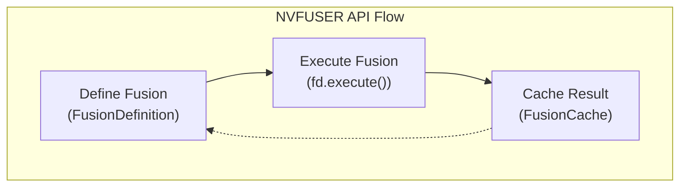
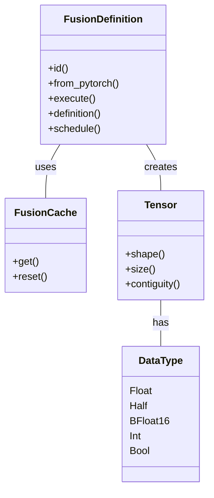

<!-- source: DeepWiki mcp.deepwiki.com · repo NVIDIA/Fuser · page 1.2 Getting Started · fetched 2026-10-26 -->

# Getting Started

<details>
<summary>Relevant source files</summary>

The following files were used as context for generating this wiki page:

- [.github/workflows/build.yml](.github/workflows/build.yml)
- [.github/workflows/lint.yml](.github/workflows/lint.yml)
- [.lintrunner.toml](.lintrunner.toml)
- [CMakeLists.txt](CMakeLists.txt)
- [csrc/serde/fusion_cache.fbs](csrc/serde/fusion_cache.fbs)
- [csrc/serde/fusion_record.cpp](csrc/serde/fusion_record.cpp)
- [nvfuser/__init__.py](nvfuser/__init__.py)
- [setup.py](setup.py)
- [tests/python/test_python_frontend.py](tests/python/test_python_frontend.py)
- [tests/python/test_schedule_ops.py](tests/python/test_schedule_ops.py)
- [tools/apt-install-things.sh](tools/apt-install-things.sh)
- [tools/gen_nvfuser_version.py](tools/gen_nvfuser_version.py)
- [tools/memory.py](tools/memory.py)
- [tools/pip-install-things.sh](tools/pip-install-things.sh)
- [tools/setup-env.sh](tools/setup-env.sh)

</details>


This guide explains how to install, configure, and use NVFUSER to accelerate PyTorch operations on NVIDIA GPUs. NVFUSER is a just-in-time (JIT) CUDA code generation system that enables high-performance fusion of operations in PyTorch. For information about the system architecture, see [System Architecture](#1.1).

## Prerequisites

To use NVFUSER, you'll need:

- NVIDIA GPU with compute capability 7.0+ (Volta, Turing, Ampere, Hopper architectures)
- CUDA Toolkit 11.0+
- PyTorch 2.0+
- Python 3.8+
- C++ compiler compatible with C++17 or higher (GCC 11.4+ recommended)

## Installation Options

NVFUSER can be installed either using pip or by building from source.

### Using pip

```bash
pip install nvfuser
```

Note: The pip package includes pre-compiled binaries for common CUDA versions. If your setup requires a specific configuration, consider building from source.

### Building from Source

Building from source gives you control over the build configuration and allows using the latest code.

1. Clone the repository and its submodules:

```bash
git clone https://github.com/NVIDIA/Fuser.git
cd Fuser
git submodule update --init --recursive
```

2. Install dependencies:

```bash
# Install system dependencies
tools/apt-install-things.sh

# Install Python dependencies
tools/pip-install-things.sh
```

3. Build and install:

```bash
# Basic build
cd python
python setup.py install

# Or with specific options
python setup.py install --cpp=20 --build-with-ucc
```

#### Build Options

NVFUSER provides several build options through the setup.py script:

| Option | Description |
| --- | --- |
| `--cmake-only` | Only generate ./build directory with cmake setup |
| `--no-python` | Skip building Python API (library only) |
| `--no-test` | Skip building C++ tests |
| `--no-benchmark` | Skip building benchmarks |
| `--no-ninja` | Use make instead of ninja for building |
| `--build-with-ucc` | Build with UCC support for communication |
| `--build-without-distributed` | Build without multi-device support |
| `--debug` | Build in debug mode |
| `--build-dir=PATH` | Specify custom build directory |
| `--cpp=STANDARD` | Specify C++ standard (default is 20) |

Sources: [setup.py:6-62](), [CMakeLists.txt:1-54](), [tools/apt-install-things.sh:1-20](), [tools/pip-install-things.sh:1-9]()

## Basic Usage Flow

NVFUSER operates on a fusion definition model where you define a computation graph that is then compiled and executed.



Sources: [nvfuser/__init__.py:52-107](), [tests/python/test_python_frontend.py:45-76]()

### Key Components



Sources: [nvfuser/__init__.py:52-197](), [tests/python/test_python_frontend.py:14-28]()

### Creating Your First Fusion

A basic fusion involves the following steps:

1. Create a `FusionDefinition` using the context manager
2. Import PyTorch tensors into the fusion
3. Define operations
4. Specify outputs
5. Execute the fusion with inputs

Here's a simple example:

```python
import torch
from nvfuser import FusionDefinition, DataType

# Create some input tensors
t0 = torch.randn(2, 3, 4, device="cuda")
t1 = torch.randn(2, 3, 4, device="cuda")

# Define and execute a fusion
with FusionDefinition() as fd:
    # Import PyTorch tensors
    ft0 = fd.from_pytorch(t0)
    ft1 = fd.from_pytorch(t1)
    
    # Define operations
    ft2 = fd.ops.add(ft0, ft1)
    ft3 = fd.ops.relu(ft2)
    
    # Specify output
    fd.add_output(ft3)
    
# Execute the fusion
result = fd.execute([t0, t1])
```

Sources: [tests/python/test_python_frontend.py:42-76](), [nvfuser/__init__.py:197-211]()

### Understanding Tensor Representation

In NVFUSER, tensors are represented by symbolic descriptions to enable JIT compilation. When you use `from_pytorch()`, it extracts the tensor's metadata (shape, strides, dtype) but not the actual data values.

```python
# Static shape (for compilation optimization)
ft0 = fd.from_pytorch(t0, static_sizes=True)

# Dynamic shape (for flexibility)
ft0 = fd.from_pytorch(t0)  # default is dynamic

# Manual tensor definition
ft0 = fd.define_tensor(
    shape=[-1, -1, -1],  # -1 indicates dynamic dimension
    contiguity=[True, True, True],
    dtype=DataType.Float
)
```

Sources: [nvfuser/__init__.py:360-386](), [tests/python/test_python_frontend.py:166-202]()

### Executing and Caching

NVFUSER automatically caches compiled kernels for reuse:

```python
# First execution compiles the kernel
result1 = fd.execute([t0, t1])

# Second execution reuses the cached kernel
result2 = fd.execute([t0, t1])

# Reset cache if needed
from nvfuser import FusionCache
FusionCache.get().reset()
```

The execution can be customized with options:

```python
# Execute with options
result = fd.execute(
    inputs,
    device=0,            # Specific CUDA device
    profile=True,        # Enable profiling
    capture_debug_output=True,  # Capture debug info
)

# Get debug output
debug_info = fd.debug_output()
```

Sources: [nvfuser/__init__.py:197-344](), [tests/python/test_python_frontend.py:61-76]()

## Common Operations

NVFUSER supports a wide range of operations for tensor manipulation:

### Arithmetic Operations

- Basic operations: add, subtract, multiply, divide
- Element-wise functions: relu, sigmoid, tanh
- Reduction operations: sum, mean, max, min

### Shape Manipulation

- Broadcast and reshape
- Transpose and permute
- Concatenation and slicing

### Advanced Operations

- Normalization (batch norm, layer norm)
- Matrix multiplication
- Convolution

Example with reductions and broadcasting:

```python
with FusionDefinition() as fd:
    ft0 = fd.from_pytorch(t0)
    
    # Reduce sum along dimension 2
    ft1 = fd.ops.sum(ft0, dims=[2], keepdim=False)
    
    # Broadcast back to original shape
    ft2 = fd.ops.broadcast_in_dim(ft1, t0.size(), [0, 1])
    
    # Subtract from original
    ft3 = fd.ops.sub(ft0, ft2)
    
    fd.add_output(ft3)
```

Sources: [tests/python/test_python_frontend.py:166-202](), [tests/python/test_python_frontend.py:657-687]()

## Advanced Usage

### Custom Scheduling

For performance optimization, you can create custom schedules:

```python
class CustomFusionDefinition(FusionDefinition):
    def definition(self):
        # Define fusion operations
        self.t0 = self.from_pytorch(input_tensor)
        self.t1 = self.ops.relu(self.t0)
        self.add_output(self.t1)
    
    def schedule(self):
        # Add scheduling directives
        self.sched.merge(self.t1, dim=0)
        self.sched.split(self.t1, dim=0, factor=128)
        self.sched.parallelize(self.t1, axis=0, ParallelType.grid_x)
```

Sources: [tests/python/test_schedule_ops.py:333-371]()

### Fusion Serialization

NVFUSER can automatically serialize the fusion cache to improve startup performance:

```python
from nvfuser import enable_automatic_serialization

# Enable serialization (saves to disk on program exit)
enable_automatic_serialization()
```

Sources: [nvfuser/__init__.py:30-50]()

### Debugging Fusion Kernels

NVFUSER provides tools to examine the generated CUDA code:

```python
# View the generated CUDA code for debugging
cuda_code = fd.last_cuda_code()
print(cuda_code)

# View the scheduled fusion IR
fusion_ir = fd.scheduled_fusion_ir_for(inputs)
print(fusion_ir)

# Create a reproduction script for bug reports
repro_script = fd.repro_script_for(inputs)
print(repro_script)
```

Sources: [nvfuser/__init__.py:397-464](), [nvfuser/__init__.py:500-567]()

## Next Steps

- Explore performance optimization through custom scheduling
- Learn about multi-device execution and sharding for distributed training
- Understand segmentation for complex fusion patterns
- Check out example notebooks and tutorials in the repository

For more details on the core IR system that powers NVFUSER, see [Core IR System](#2).

---

