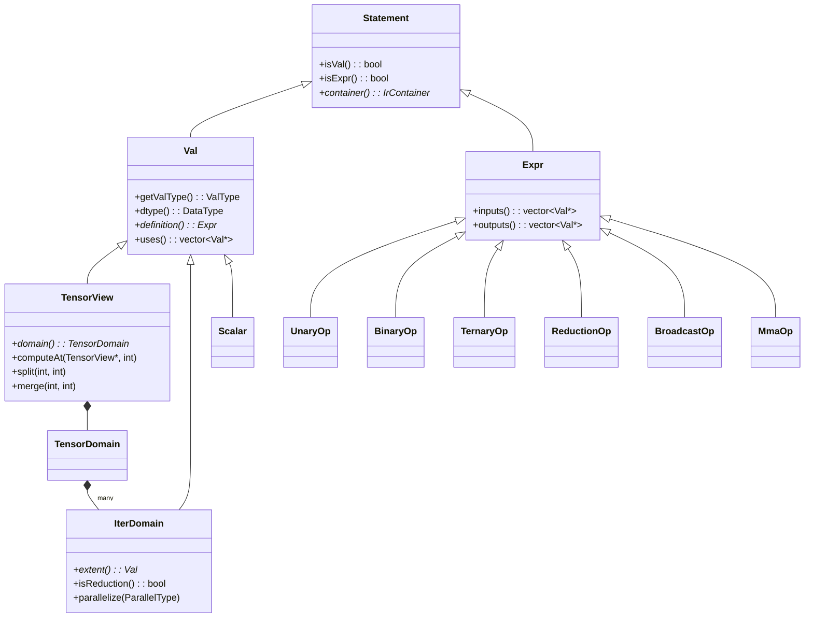
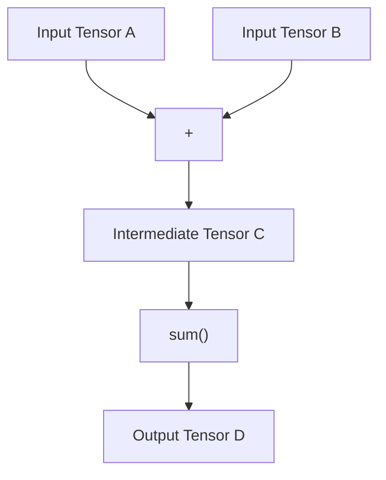
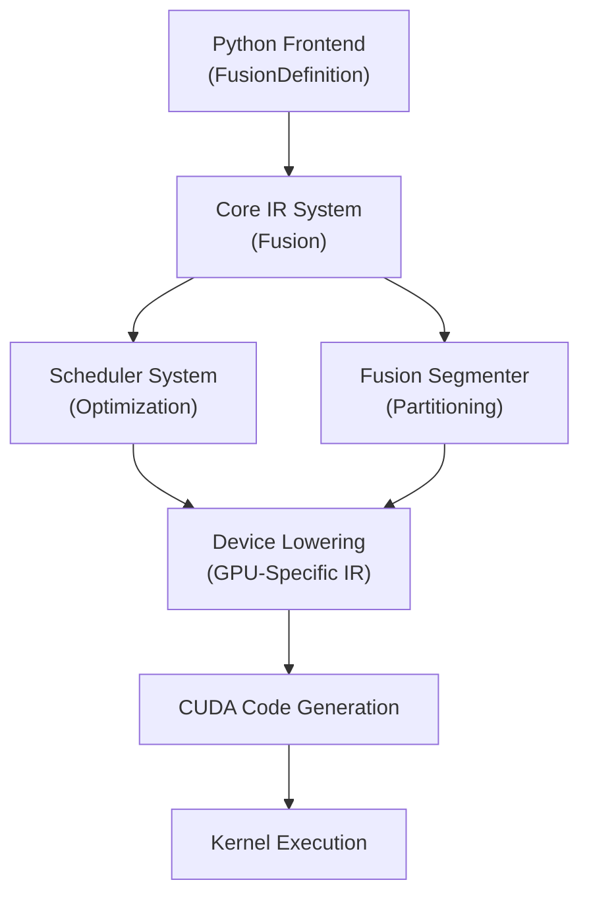

<!-- source: DeepWiki mcp.deepwiki.com · repo NVIDIA/Fuser · page 2 Core IR System · fetched 2026-10-26 -->

# Core IR System

<details>
<summary>Relevant source files</summary>

The following files were used as context for generating this wiki page:

- [csrc/device_lower/pass/alias_memory.cpp](csrc/device_lower/pass/alias_memory.cpp)
- [csrc/device_lower/pass/expr_sort.cpp](csrc/device_lower/pass/expr_sort.cpp)
- [csrc/device_lower/pass/replace_size.cpp](csrc/device_lower/pass/replace_size.cpp)
- [csrc/device_lower/utils.cpp](csrc/device_lower/utils.cpp)
- [csrc/device_lower/utils.h](csrc/device_lower/utils.h)
- [csrc/fusion.cpp](csrc/fusion.cpp)
- [csrc/fusion.h](csrc/fusion.h)
- [csrc/ir/interface_nodes.h](csrc/ir/interface_nodes.h)
- [csrc/ir/internal_base_nodes.h](csrc/ir/internal_base_nodes.h)
- [csrc/ir/internal_nodes.h](csrc/ir/internal_nodes.h)
- [csrc/ir/nodes.cpp](csrc/ir/nodes.cpp)
- [csrc/ir/utils.cpp](csrc/ir/utils.cpp)
- [csrc/ir/utils.h](csrc/ir/utils.h)
- [csrc/iter_visitor.cpp](csrc/iter_visitor.cpp)
- [csrc/iter_visitor.h](csrc/iter_visitor.h)
- [csrc/tensor_view.cpp](csrc/tensor_view.cpp)
- [tests/cpp/test_gpu3.cpp](tests/cpp/test_gpu3.cpp)

</details>


The Core IR System is the fundamental intermediate representation that powers NVFUSER. It provides a hierarchical graph-based structure that represents tensor computations in a way that can be analyzed, transformed, and ultimately compiled into efficient CUDA code. This document explains the key components and concepts of the IR system that forms the foundation for all other subsystems in NVFUSER.

For information about how the Core IR is used by the scheduling system, see [Scheduling System](#4), and for details on code generation, see [Code Generation](#3).

## IR Hierarchy

The NVFUSER Core IR is organized as a directed acyclic graph (DAG) comprising two main types of nodes: values (`Val`) and expressions (`Expr`). These nodes are connected to form a complete representation of tensor computations.



Sources: [csrc/ir/interface_nodes.h](), [csrc/ir/internal_base_nodes.h](), [csrc/ir/internal_nodes.h]()

## Base Components

### Statement

`Statement` is the abstract base class for all IR nodes. It provides common functionality like:
- Checking if a node is a value or expression (`isVal()`, `isExpr()`)
- Access to the container holding the node (`container()`)
- Support for the visitor pattern

Sources: [csrc/ir/base_nodes.h]()

### Val (Values)

Values represent data in the computation graph. Each value:
- Can be created by an expression (`definition()`)
- Can be used by multiple expressions (`uses()`)
- Has a specific data type and value type

Key `Val` subclasses include:

1. **TensorView**: The primary representation for multi-dimensional tensors, with capabilities to:
   - Transform domains through operations like `split()`, `merge()`, and `computeAt()`
   - Specify memory types (Global, Shared, Local)
   - Control parallelization strategies

2. **IterDomain**: Represents a single dimension for iteration with:
   - Start and extent to define the range
   - Flags for reduction dimensions
   - Parallelization settings (threads, blocks)

3. **Scalar**: Represents singular values used in computations

Sources: [csrc/tensor_view.cpp](), [csrc/ir/internal_base_nodes.h]()

### Expr (Expressions)

Expressions represent operations that transform values. Each expression:
- Takes input values (`inputs()`)
- Produces output values (`outputs()`)
- Implements specific computational logic

The primary expression types include:

1. **UnaryOp**: Single-input operations like negation, absolute value, and casting
   ```cpp
   // Example: UnaryOp for negation
   auto negative_x = neg(x);
   ```

2. **BinaryOp**: Two-input operations like addition, multiplication, and division
   ```cpp
   // Example: BinaryOp for addition
   auto sum = add(a, b);
   ```

3. **TernaryOp**: Three-input operations like conditional selection (where)
   ```cpp
   // Example: TernaryOp for where
   auto result = where(condition, true_val, false_val);
   ```

4. **ReductionOp**: Operations that reduce tensor dimensions (sum, max, min)
   ```cpp
   // Example: ReductionOp for sum
   auto reduced = sum(tensor, {0});  // Reduce along dimension 0
   ```

5. **BroadcastOp**: Operations that expand tensor dimensions
   ```cpp
   // Example: BroadcastOp
   auto broadcast_tensor = broadcast(tensor, {true, false});  // Add dimension at index 0
   ```

Sources: [csrc/ir/internal_nodes.h](), [csrc/ir/nodes.cpp]()

## Fusion Container

The `Fusion` class serves as the container for all IR nodes. It's responsible for:
- Managing IR node lifecycle
- Tracking fusion inputs and outputs
- Maintaining the DAG structure
- Providing access to nodes for analysis and transformation

Key operations include:
- `addInput()`: Register a value as an input
- `addOutput()`: Register a value as an output
- `removeExpr()`: Remove an expression from the fusion
- `removeVal()`: Remove a value from the fusion
- `exprs()`: Get all expressions in topological order

Sources: [csrc/fusion.cpp](), [csrc/fusion.h]()

## DAG Structure and Relationships

The IR forms a directed acyclic graph where:
- Values are nodes
- Expressions define edges between nodes
- Inputs are source nodes with no incoming edges
- Outputs are sink nodes explicitly marked for output

The relationships between nodes are key to understanding the computation:



This structure allows for:
- Dependency analysis
- Optimization opportunities (fusion, reordering)
- Parallel execution planning

Sources: [csrc/ir/utils.cpp](), [csrc/iter_visitor.cpp]()

## IR Construction

IR nodes are created through builder functions and connected to form the computational graph:

```cpp
// Create a fusion
Fusion fusion;
FusionGuard fg(&fusion);

// Create input tensors
auto tv0 = makeSymbolicTensor(2);  // 2D tensor
auto tv1 = makeSymbolicTensor(2);  // 2D tensor
fusion.addInput(tv0);
fusion.addInput(tv1);

// Build computation
auto tv2 = add(tv0, tv1);         // Element-wise addition
auto tv3 = sum(tv2, {1});         // Sum reduction along dimension 1
fusion.addOutput(tv3);
```

Each operation (like `add()` or `sum()`) creates the corresponding expression nodes and connects them to their input and output values.

Sources: [csrc/fusion.cpp]()

## Traversal and Manipulation

### Traversal with IterVisitor

The `IterVisitor` class provides mechanisms to traverse the IR graph in topological order:

```cpp
class MyVisitor : public IterVisitor {
protected:
  void handle(Statement* stmt) override {
    // Process each node
  }
};

MyVisitor visitor;
visitor.traverseFrom(&fusion, fusion.outputs());
```

This supports analysis passes like dependency checking and dead code elimination.

Sources: [csrc/iter_visitor.h](), [csrc/iter_visitor.cpp]()

### IR Transformation

The IR can be transformed through various operations:

1. **Domain Transformations**:
   ```cpp
   // Split dimension 0 into two with factor 32
   tv->split(0, 32);
   
   // Merge dimensions 0 and 1
   tv->merge(0, 1);
   ```

2. **Computation Scheduling**:
   ```cpp
   // Compute tv1 at the position corresponding to dimension 1 of tv2
   tv1->computeAt(tv2, 1);
   ```

3. **Parallelization**:
   ```cpp
   // Parallelize dimension 0 with thread blocks
   tv->axis(0)->parallelize(ParallelType::BIDx);
   
   // Parallelize dimension 1 with threads
   tv->axis(1)->parallelize(ParallelType::TIDx);
   ```

Sources: [csrc/tensor_view.cpp](), [csrc/ir/utils.cpp]()

## Integration in NVFUSER

The Core IR is central to NVFUSER's operation:



1. **Creation**: Built by the Python Frontend (FusionDefinition)
2. **Optimization**: Transformed by the Scheduler System
3. **Partitioning**: Split by the Fusion Segmenter when necessary
4. **Lowering**: Converted to device-specific IR for code generation
5. **Execution**: Used to generate and execute CUDA kernels

Sources: [csrc/device_lower/utils.cpp](), [csrc/device_lower/pass/expr_sort.cpp]()

## Key Operations on Values

The Core IR provides numerous operations for creating and manipulating values:

| Operation Category | Examples | Description |
|-------------------|----------|-------------|
| Arithmetic | `add`, `sub`, `mul`, `div` | Basic math operations |
| Comparison | `eq`, `ne`, `gt`, `lt` | Comparison operations |
| Reduction | `sum`, `max`, `min` | Dimension reduction operations |
| Shape Manipulation | `broadcast`, `reshape`, `transpose` | Change tensor shapes |
| Special Functions | `sigmoid`, `tanh`, `relu` | Activation and mathematical functions |
| Matrix Operations | `matmul`, `mma` | Matrix multiplication operations |

Each operation creates the appropriate expression nodes and connects them to input and output values.

Sources: [csrc/ir/nodes.cpp](), [csrc/ir/internal_nodes.h]()

## Common Usage Patterns

### Creating a Simple Fusion

```cpp
Fusion fusion;
FusionGuard fg(&fusion);

// Define inputs
auto x = makeSymbolicTensor(2);  // 2D input tensor
auto y = makeSymbolicTensor(2);  // 2D input tensor
fusion.addInput(x);
fusion.addInput(y);

// Define computation: z = x + y
auto z = add(x, y);
fusion.addOutput(z);
```

### Applying Transformations

```cpp
// Tile the computation for better cache utilization
z->split(0, 32);  // Split the first dimension with factor 32
z->split(2, 4);   // Split the third dimension (previously dimension 1) with factor 4

// Parallelize the computation
z->axis(0)->parallelize(ParallelType::BIDx);  // Distribute across thread blocks
z->axis(1)->parallelize(ParallelType::TIDx);  // Distribute across threads
```

Sources: [csrc/tensor_view.cpp](), [csrc/device_lower/pass/replace_size.cpp]()

## Conclusion

The Core IR System provides a powerful and flexible representation for tensor computations. It serves as the foundation for NVFUSER's ability to generate efficient CUDA kernels by enabling analysis, optimization, and transformation of tensor operations. The hierarchical node structure and the ability to represent complex tensor computations make it suitable for implementing a wide range of deep learning and scientific computing operations.

Sources: [csrc/fusion.cpp](), [csrc/ir/utils.h](), [csrc/device_lower/utils.h]()

---

