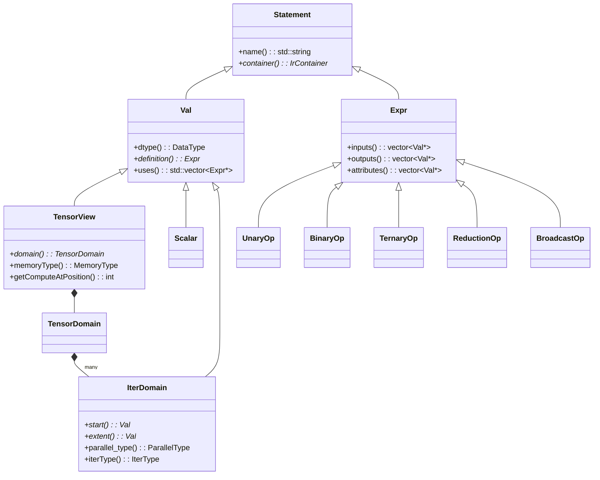
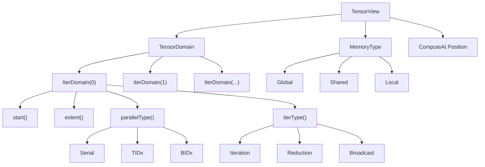
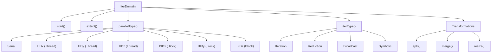
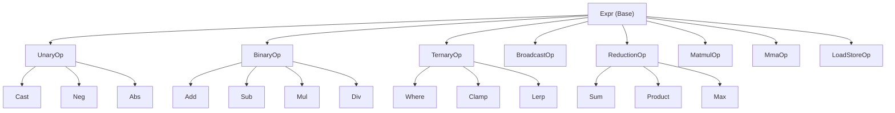
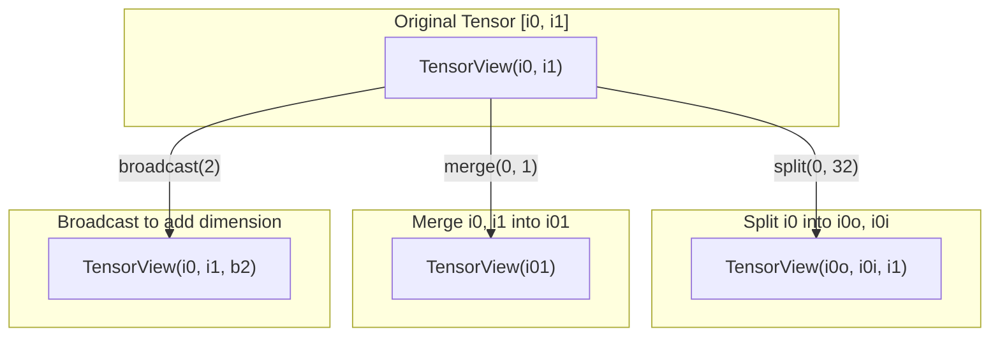
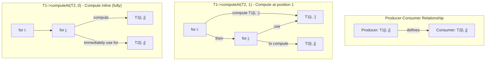
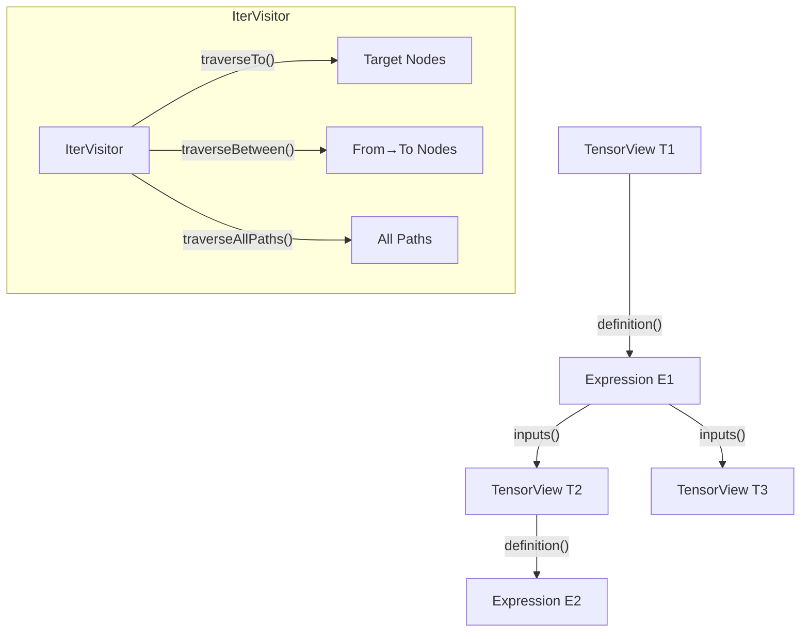
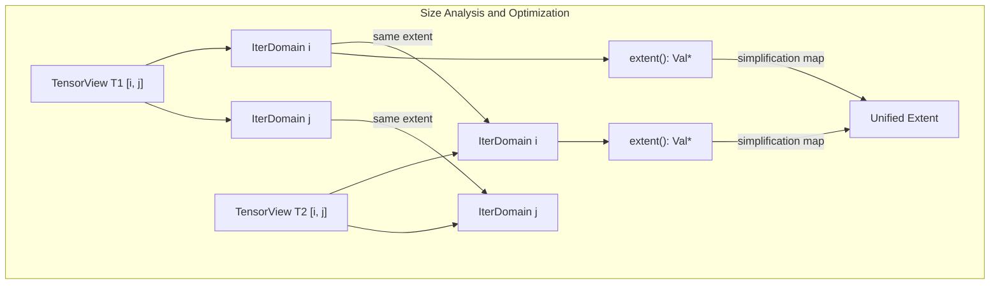
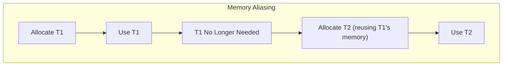

<!-- source: DeepWiki mcp.deepwiki.com · repo NVIDIA/Fuser · page 2.1 IR Nodes and Tensor Views · fetched 2026-10-26 -->

# IR Nodes and Tensor Views

<details>
<summary>Relevant source files</summary>

The following files were used as context for generating this wiki page:

- [csrc/device_lower/pass/alias_memory.cpp](csrc/device_lower/pass/alias_memory.cpp)
- [csrc/device_lower/pass/replace_size.cpp](csrc/device_lower/pass/replace_size.cpp)
- [csrc/device_lower/utils.cpp](csrc/device_lower/utils.cpp)
- [csrc/device_lower/utils.h](csrc/device_lower/utils.h)
- [csrc/ir/interface_nodes.h](csrc/ir/interface_nodes.h)
- [csrc/ir/internal_base_nodes.h](csrc/ir/internal_base_nodes.h)
- [csrc/ir/internal_nodes.h](csrc/ir/internal_nodes.h)
- [csrc/ir/nodes.cpp](csrc/ir/nodes.cpp)
- [csrc/ir/utils.cpp](csrc/ir/utils.cpp)
- [csrc/ir/utils.h](csrc/ir/utils.h)
- [csrc/iter_visitor.cpp](csrc/iter_visitor.cpp)
- [csrc/iter_visitor.h](csrc/iter_visitor.h)
- [csrc/tensor_view.cpp](csrc/tensor_view.cpp)
- [tests/cpp/test_gpu3.cpp](tests/cpp/test_gpu3.cpp)

</details>


This page provides a detailed explanation of the Intermediate Representation (IR) nodes, tensor views, and their role in representing computations within NVFUSER. The IR system forms the foundation of NVFUSER's ability to represent, transform, and optimize tensor operations before lowering them to efficient CUDA code.

For information about how these IR nodes are generated from Python code, see [Python Frontend](#6). For details on code generation from IR, see [Code Generation](#3).

## IR Hierarchy

NVFUSER's IR system is organized as a hierarchy of node types that represent both data (tensors, scalars) and operations (addition, multiplication, etc.). Understanding this hierarchy is crucial for working with the system.



The IR hierarchy consists of:

- **Statement**: Base class for all IR nodes
- **Val**: Represents values (tensors, scalars, iteration domains)
- **Expr**: Represents operations that transform values
- **TensorView**: Represents multi-dimensional tensors
- **IterDomain**: Represents a single dimension of a tensor
- **TensorDomain**: Represents the full domain of a tensor (collection of IterDomains)

Sources: [csrc/ir/interface_nodes.h:26-36](), [csrc/ir/internal_base_nodes.h:14-20]()

## TensorView

TensorView is the central class for representing tensors in NVFUSER. It represents an n-dimensional view into a memory region, with operations to transform how that memory is accessed and computed.



A TensorView contains:

1. **TensorDomain**: Defines the dimensionality and iteration spaces
2. **MemoryType**: Indicates where the tensor data is stored (Global, Shared, Local)
3. **ComputeAt Information**: Controls scheduling relationships with other tensors

TensorView provides methods for transforming tensor dimensions and specifying how computation should be scheduled:

| Operation | Description | Example Usage |
|-----------|-------------|---------------|
| `split(axis, factor)` | Splits a dimension into two | `tv->split(0, 32)` |
| `merge(axis_o, axis_i)` | Merges two dimensions into one | `tv->merge(0, 1)` |
| `computeAt(consumer, pos)` | Sets computation schedule relative to consumer | `tv->computeAt(consumer, 1)` |
| `broadcast(axis)` | Adds a broadcast dimension | `tv->broadcast(0)` |

Sources: [csrc/tensor_view.cpp:38-47](), [csrc/tensor_view.cpp:129-140](), [csrc/ir/interface_nodes.h:422-470]()

## IterDomain and Tensor Domains

IterDomain represents a single dimension of iteration in a tensor. It's a fundamental building block for representing tensor shapes and transformations.



Key properties of IterDomain:

- **start**: Starting point of iteration (typically zero)
- **extent**: Size of the dimension
- **iterType**: Type of iteration (normal, reduction, broadcast, etc.)
- **parallelType**: How the iteration is parallelized (serial, thread, block)

TensorDomain combines multiple IterDomains to represent the full multi-dimensional structure of a tensor. It maintains several sets of IterDomains that represent the tensor at different stages of transformation:

- **rootDomain**: Original tensor dimensions
- **logicalDomain**: Dimensions after logical transformations (split, merge)
- **allocationDomain**: Dimensions for memory allocation
- **loopDomain**: Dimensions for generating loops during code generation

Sources: [csrc/ir/internal_base_nodes.h:79-133](), [csrc/ir/internal_base_nodes.h:709-752]()

## IR Nodes for Operations

NVFUSER has a comprehensive set of IR nodes representing different operations on tensors. These nodes connect the tensor representation to actual computational operations.



Each operation node:
1. Takes input values (tensors, scalars)
2. Performs an operation
3. Produces output values

For example, a BinaryOp represents operations like addition or multiplication:

```
T3 = T1 + T2  // Represented as BinaryOp(Add, T3, T1, T2)
```

The nodes are designed to represent the full range of tensor operations needed for neural network computation, including:

- Basic arithmetic (add, multiply)
- Reductions (sum, max)
- Special operations (matmul, broadcast)
- Type conversions and transformations

Sources: [csrc/ir/internal_nodes.h:359-900](), [csrc/ir/nodes.cpp:38-901]()

## TensorView Transformations

TensorView supports a rich set of transformations that allow restructuring of the computation. These transformations are fundamental to the scheduling system.

Here's a diagram showing key transformations and their effects:



Key transformations include:

1. **Split**: Divides an iteration domain into outer and inner components
   ```
   tv->split(0, 32)  // Split first dimension by factor of 32
   ```

2. **Merge**: Combines two adjacent iteration domains
   ```
   tv->merge(0, 1)  // Combine dimensions 0 and 1
   ```

3. **Reorder**: Changes the order of iteration domains
   ```
   tv->reorder({{0, 1}, {1, 0}})  // Swap dimensions 0 and 1
   ```

4. **Broadcast**: Adds a broadcast dimension
   ```
   tv->broadcast(0)  // Add broadcast dimension at position 0
   ```

These transformations allow for expressing complex loop restructuring operations that are key to performance optimization. They modify the TensorDomain of the TensorView, changing how the tensor is accessed and computed.

Sources: [csrc/tensor_view.cpp:427-631]()

## ComputeAt and Scheduling

The `computeAt` mechanism is a critical feature for scheduling in NVFUSER. It defines producer-consumer relationships and determines when tensors are computed relative to each other.



ComputeAt controls loop nesting and data reuse. When `producer->computeAt(consumer, pos)` is called:

1. The producer is computed inside the consumer's loop at the specified position
2. This affects memory usage, computation order, and data locality
3. Position 0 means compute at the outermost loop, higher values move computation deeper into nested loops

Examples:
- `A->computeAt(B, 0)`: Compute all of A before any of B
- `A->computeAt(B, 1)`: Compute A one row at a time, then use it for B
- `A->computeAt(B, 2)`: Compute each element of A just before it's used in B

ComputeAt is essential for:
- Managing memory hierarchies (registers, shared memory, global memory)
- Controlling data reuse
- Optimizing data locality
- Balancing parallelism and synchronization

Sources: [csrc/tensor_view.cpp:234-264](), [csrc/tensor_view.cpp:146-201](), [csrc/ir/interface_nodes.h:62-69]()

## Traversing the IR Graph

NVFUSER provides utilities for traversing the IR graph, which is essential for analysis, optimization, and code generation.



The `IterVisitor` class is the primary tool for traversing the IR:

- **traverseTo**: Visits nodes in order from inputs to specified targets
- **traverseBetween**: Visits nodes between specified inputs and outputs
- **traverse**: Visits all nodes in the fusion in topological order
- **traverseAllPaths**: Visits all paths through the graph (may visit nodes multiple times)

Example uses of traversal:
- Analyzing dependencies between operations
- Gathering information for optimization
- Generating code in the correct order
- Validating IR structure and consistency

The IR graph can be traversed in different ways:
- Forward (inputs to outputs)
- Backward (outputs to inputs)
- Across specific paths

Sources: [csrc/iter_visitor.h:38-135](), [csrc/iter_visitor.cpp:16-180]()

## IR Node Types

NVFUSER includes a comprehensive set of IR node types to represent various operations and data structures:

| Node Type | Purpose | Example |
|-----------|---------|---------|
| UnaryOp | Single-input operations | Negation, Casting, Absolute value |
| BinaryOp | Two-input operations | Addition, Multiplication, Division |
| TernaryOp | Three-input operations | Where, Clamp, Lerp |
| ReductionOp | Reduces across dimensions | Sum, Product, Max |
| BroadcastOp | Expands dimensions | Broadcasting a vector to a matrix |
| MatmulOp | Matrix multiplication | Performing matrix multiplication |
| LoadStoreOp | Memory operations | Loading/storing data |
| FullOp | Fill tensor with value | Creating constant tensors |
| GatherOp | Indexed data access | Implementing indexing operations |
| RNGOp | Random number generation | Creating random tensors |

Each node type has specific properties and behaviors tailored to its operation. For instance, a `BinaryOp` contains:
- Type of operation (add, multiply, etc.)
- Input values
- Output value
- Evaluation function for constant folding

Sources: [csrc/ir/internal_nodes.h:359-826](), [csrc/ir/nodes.cpp:38-826]()

## IR Node Evaluation

Many IR nodes include an `evaluate` method that enables constant folding and symbolic evaluation during compilation:

```cpp
std::vector<PolymorphicValue> UnaryOp::evaluate(
    const ExpressionEvaluator& ee,
    const std::vector<PolymorphicValue>& inputs) const {
  // Implement operation evaluation
  // For example: negation, absolute value, etc.
}
```

This allows the compiler to:
1. Evaluate constant expressions at compile time
2. Simplify the IR
3. Make better optimization decisions
4. Generate more efficient code

Sources: [csrc/ir/nodes.cpp:438-567](), [csrc/ir/nodes.cpp:634-729](), [csrc/ir/nodes.cpp:811-840]()

## Size Analysis and Optimization

NVFUSER includes utilities for analyzing and optimizing tensor sizes and extents:



The system performs:
1. **Extent Tracking**: Records the sizes of tensor dimensions
2. **Exact Mapping**: Identifies dimensions with identical sizes
3. **Size Simplification**: Unifies expressions for tensor sizes to reduce redundancy

This optimization is particularly important for:
- Reducing the number of size parameters in generated code
- Improving the quality of generated CUDA kernels
- Enabling better CSE (Common Subexpression Elimination)

Sources: [csrc/device_lower/pass/replace_size.cpp:22-138](), [csrc/device_lower/utils.h:78-94]()

## Memory Management and Aliasing

NVFUSER includes mechanisms for memory aliasing and optimization:



The system analyzes:
1. Live ranges of tensors
2. Memory sizes and types
3. Opportunities for memory reuse

This allows the compiler to:
- Reuse memory allocations
- Reduce peak memory usage
- Optimize memory access patterns

Sources: [csrc/device_lower/pass/alias_memory.cpp:26-153]()

## Conclusion

IR Nodes and Tensor Views form the foundation of NVFUSER's representation system. This representation enables:

1. **Flexible Tensor Manipulation**: Transforming tensor computations through splits, merges, and other operations
2. **Performance Optimization**: Scheduling operations for optimal memory usage and computation
3. **Code Generation**: Translating high-level operations into efficient CUDA code
4. **Analysis and Optimization**: Enabling various optimization passes

Understanding this IR system is essential for working with NVFUSER, whether extending the compiler, adding new optimizations, or debugging generated code.

---

