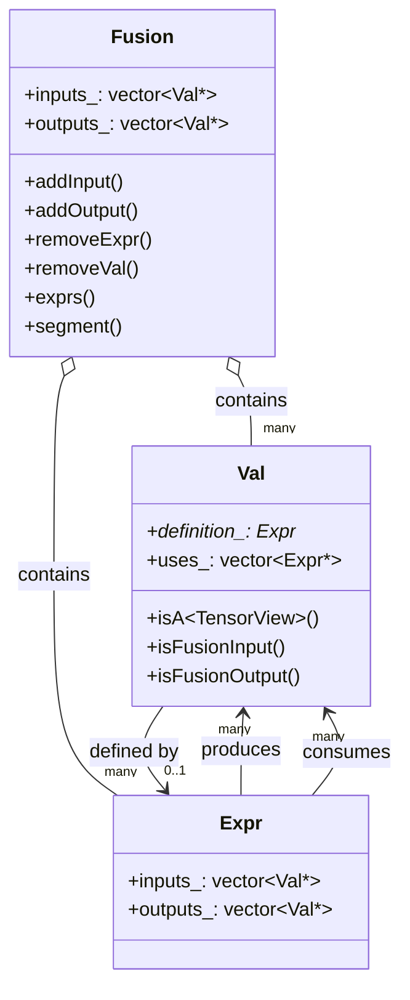
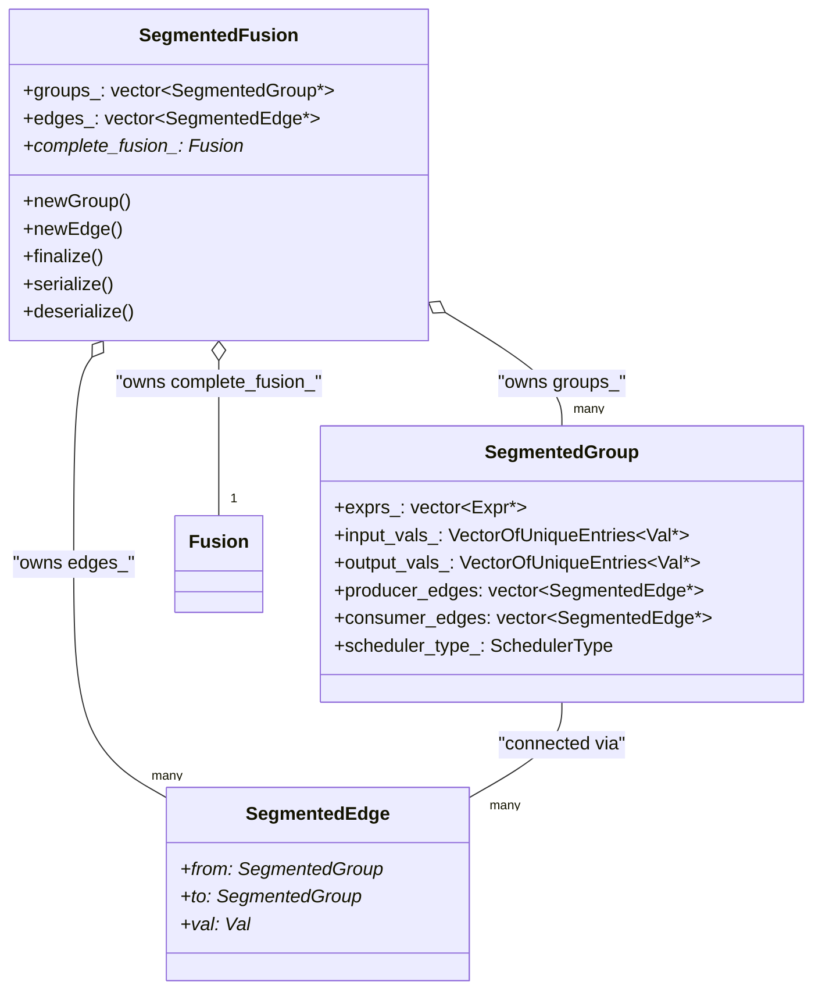
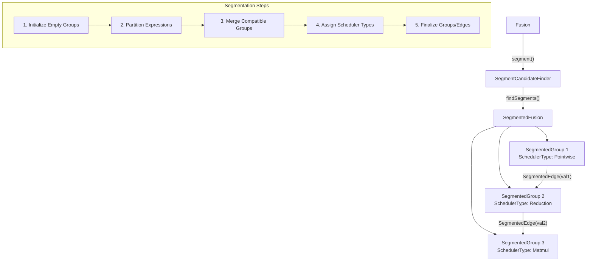
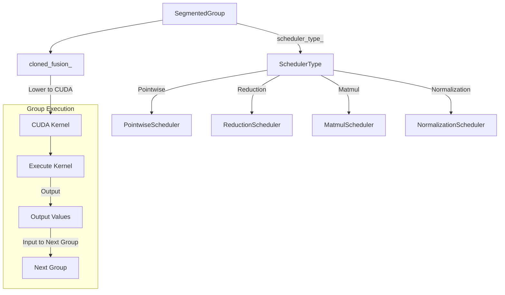
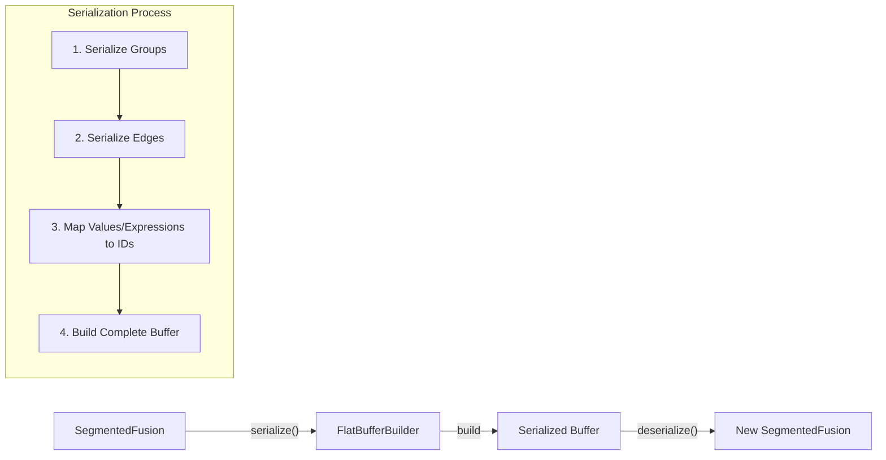

<!-- source: DeepWiki mcp.deepwiki.com · repo NVIDIA/Fuser · page 2.2 Fusion Representation · fetched 2026-10-26 -->

# Fusion Representation

<details>
<summary>Relevant source files</summary>

The following files were used as context for generating this wiki page:

- [csrc/device_lower/pass/expr_sort.cpp](csrc/device_lower/pass/expr_sort.cpp)
- [csrc/fusion.cpp](csrc/fusion.cpp)
- [csrc/fusion.h](csrc/fusion.h)
- [csrc/fusion_segmenter.cpp](csrc/fusion_segmenter.cpp)
- [csrc/fusion_segmenter.h](csrc/fusion_segmenter.h)
- [tests/cpp/test_expr_sort.cpp](tests/cpp/test_expr_sort.cpp)
- [tests/cpp/test_segmentation.cpp](tests/cpp/test_segmentation.cpp)

</details>


This page explains how computational operations are represented within NVFUSER, focusing on the core data structures that form the IR (Intermediate Representation) and how they support segmentation of fusion operations. This document covers the `Fusion` class and the segmented fusion infrastructure, including `SegmentedFusion`, `SegmentedGroup`, and `SegmentedEdge`. For information about code generation from this representation, see [Code Generation](#3).

## Core Fusion Container

The `Fusion` class is the central container for NVFUSER's IR. It manages inputs, outputs, expressions, and relationships between them, forming a directed acyclic graph (DAG) of operations.



### Key Features

1. **DAG Structure**: The fusion represents a computational graph where:
   - `Val` objects represent values (tensors or scalars)
   - `Expr` objects represent operations that produce values
   - Values can be used by multiple expressions

2. **Input/Output Management**:
   - Methods to add, remove, and replace inputs and outputs
   - Validation to ensure inputs are properly defined

3. **Memory Management**:
   - The fusion owns all IR nodes (expressions and values)
   - Registration system keeps track of all nodes

4. **Graph Traversal**:
   - Methods to traverse the graph from inputs to outputs
   - Facilities to track dependencies between nodes

Sources: [csrc/fusion.h:35-527](csrc/fusion.h:35-527), [csrc/fusion.cpp:10-856](csrc/fusion.cpp:10-856)

## Segmented Fusion Representation

When the computation graph grows large or contains operations that would benefit from different execution strategies, the fusion can be segmented into multiple parts, with each part handled by potentially different schedulers.



### SegmentedFusion

`SegmentedFusion` is the container for a segmented computational graph. It:

- Owns the original, complete fusion (`complete_fusion_`)
- Manages groups of expressions that will be executed together (`groups_`)
- Tracks connections between groups (`edges_`)
- Provides methods to create, manipulate, and serialize the segmented structure

### SegmentedGroup

Each `SegmentedGroup` represents a subset of expressions that will be executed together. It contains:

- A list of expressions in the group (`exprs_`)
- Input and output values specific to this group (`input_vals_`, `output_vals_`)
- Connections to producer and consumer groups (`producer_edges`, `consumer_edges`)
- A scheduler type that determines how the group will be executed (`scheduler_type_`)

### SegmentedEdge

A `SegmentedEdge` represents a data dependency between two groups. It contains:

- Source group (`from`)
- Destination group (`to`)
- The value being passed between groups (`val`)

Sources: [csrc/fusion_segmenter.h:35-169](csrc/fusion_segmenter.h:35-169), [csrc/fusion_segmenter.cpp:10-272](csrc/fusion_segmenter.cpp:10-272)

## Segmentation Process

The process of creating a segmented fusion typically follows these steps:



1. **Create Candidate Segments**: The `SegmentCandidateFinder` analyzes the fusion and proposes an initial segmentation.

2. **Merge Compatible Segments**: Groups that can be efficiently computed together are merged, ensuring the graph remains acyclic.

3. **Assign Scheduler Types**: Each group is assigned a scheduler type based on the operations it contains (e.g., pointwise, reduction, matmul).

4. **Finalize Segmentation**: Input and output values for each group are determined, and edges between groups are established.

5. **Prepare for Execution**: Each segment is converted into an executable kernel with appropriate scheduling.

Sources: [csrc/fusion_segmenter.h:470-751](csrc/fusion_segmenter.h:470-751), [tests/cpp/test_segmentation.cpp:10-866](tests/cpp/test_segmentation.cpp:10-866)

## Group Scheduling and Execution

Each `SegmentedGroup` is assigned a `SchedulerType` based on the operations it contains. This determines how the group will be scheduled and executed:



When a `SegmentedGroup` is prepared for execution:

1. **Create Cloned Fusion**: A new `Fusion` is created containing only the expressions and values in this group.

2. **Apply Scheduling**: Based on the `scheduler_type_`, appropriate transformations are applied to optimize execution.

3. **Lower to CUDA**: The optimized group is lowered to CUDA code.

4. **Execute Kernel**: The generated CUDA kernel is executed with appropriate inputs.

5. **Pass Results**: Outputs from this group may become inputs to other groups.

Sources: [csrc/fusion_segmenter.h:58-245](csrc/fusion_segmenter.h:58-245), [csrc/fusion_segmenter.cpp:143-195](csrc/fusion_segmenter.cpp:143-195)

## Serialization and Persistence

Both `SegmentedFusion` and its components support serialization, allowing fusions to be saved and loaded:



The serialization process:
1. Represents all components (groups, edges, values, expressions) as numeric IDs
2. Encodes relationships between components
3. Stores in a flat buffer format for efficient storage and retrieval

This enables:
- Caching of previously compiled fusions
- Sharing optimized fusions between applications
- Persistence of optimized fusion segments

Sources: [csrc/fusion_segmenter.cpp:54-141](csrc/fusion_segmenter.cpp:54-141), [csrc/fusion_segmenter.cpp:476-616](csrc/fusion_segmenter.cpp:476-616)

## Advanced Fusion Features

### Input/Output Aliasing

The fusion representation supports aliasing between inputs and outputs, which enables in-place operations and memory reuse:

```cpp
// Example aliasing an output to an input
fusion.aliasOutputToInput(output_val, input_val, AllocationType::ReuseBuffer);
```

The `AliasInfo` struct tracks:
- The aliasing type (e.g., `ReuseBuffer`, `Evaluate`)
- The input value being aliased
- Whether the output should be hidden from users

Sources: [csrc/fusion.h:70-124](csrc/fusion.h:70-124), [csrc/fusion.cpp:761-820](csrc/fusion.cpp:761-820)

### Expression Sorting

When preparing a fusion for execution, expressions need to be properly ordered. The system uses a sophisticated sorting algorithm that:

1. Ensures values are produced before they are consumed
2. Respects loop nesting requirements for compute-at relationships
3. Handles complex dependencies between operations

The sorting process may involve segmenting expressions into groups that share compatible execution patterns.

Sources: [csrc/device_lower/pass/expr_sort.cpp:10-1097](csrc/device_lower/pass/expr_sort.cpp:10-1097), [tests/cpp/test_expr_sort.cpp:10-247](tests/cpp/test_expr_sort.cpp:10-247)

## Summary

The fusion representation in NVFUSER consists of:

1. **Core Fusion Container**: Manages the complete computational graph
2. **Segmented Fusion Structure**: Divides the graph into executable groups
3. **Scheduling System**: Optimizes each group based on its operation type
4. **Execution Pipeline**: Converts groups to CUDA kernels and manages execution

This architecture enables NVFUSER to efficiently handle complex computations by breaking them into optimally scheduled segments while maintaining correct data dependencies.

---

