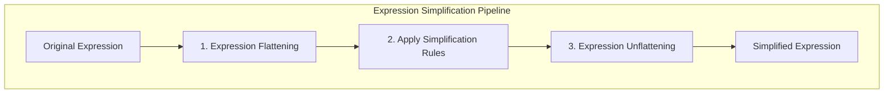
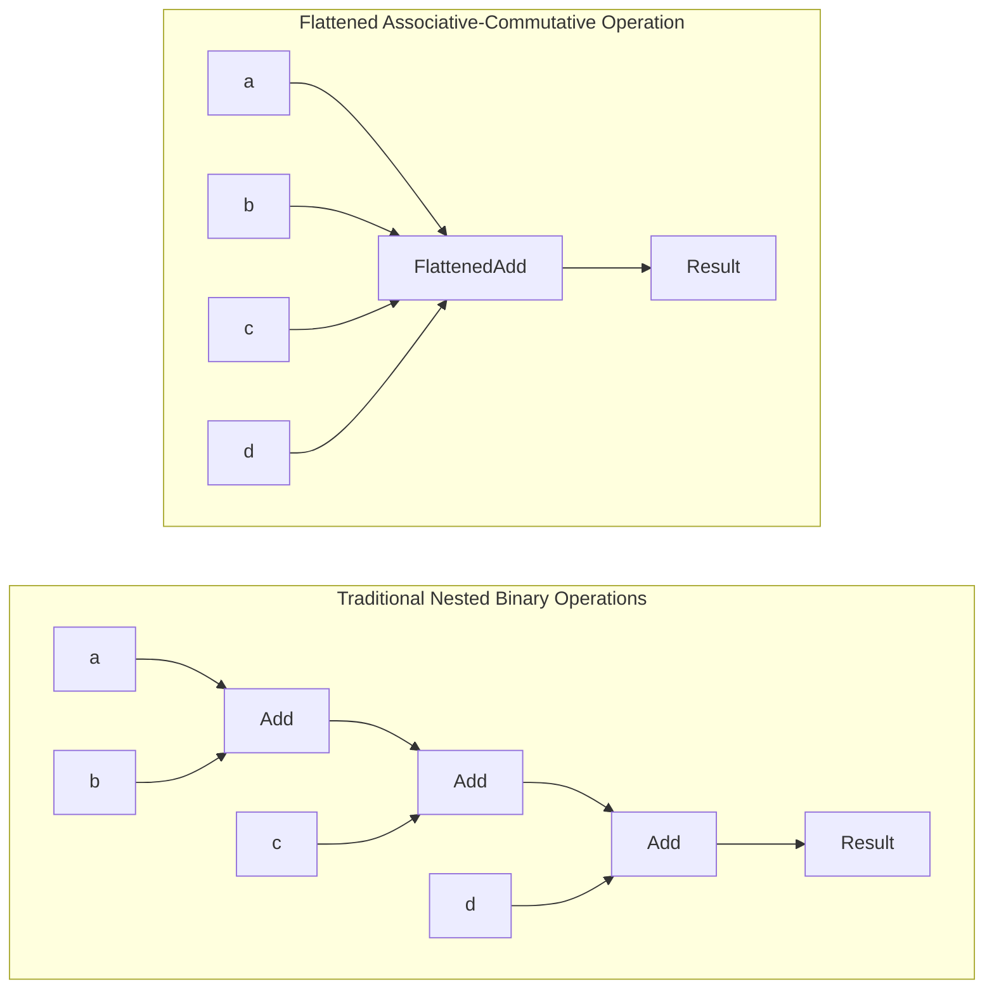
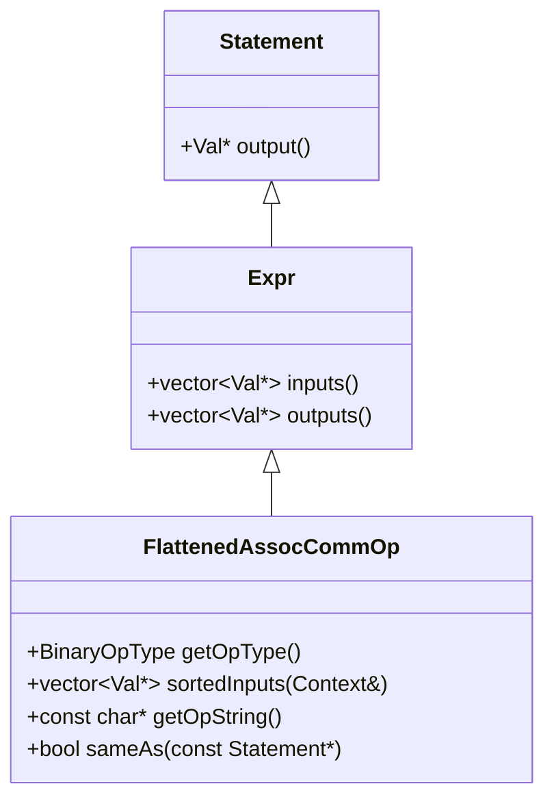
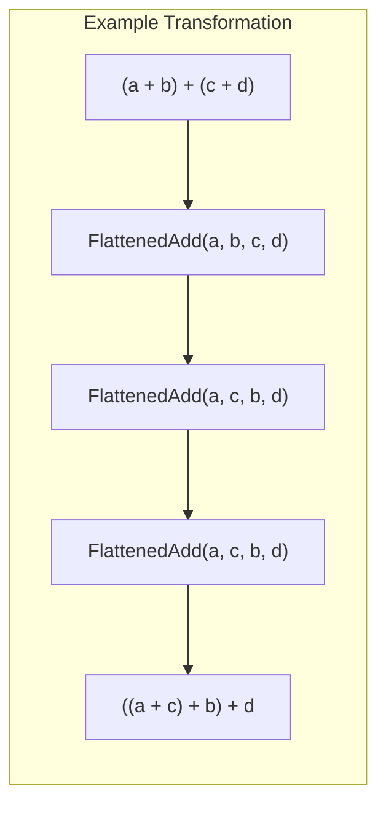
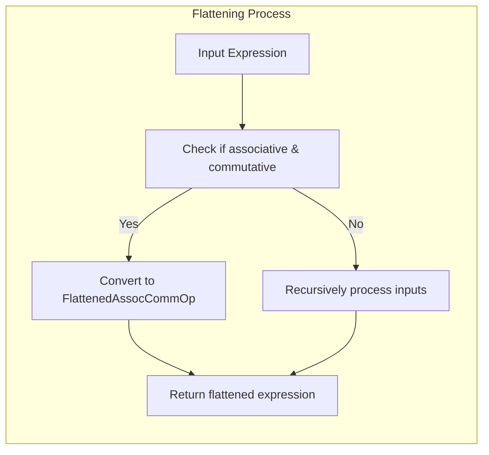
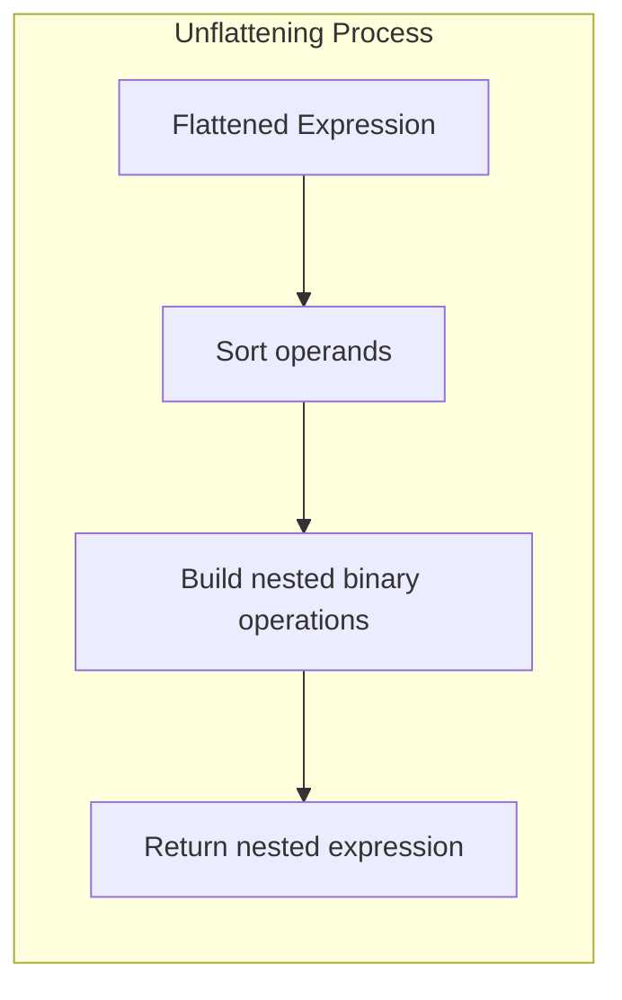
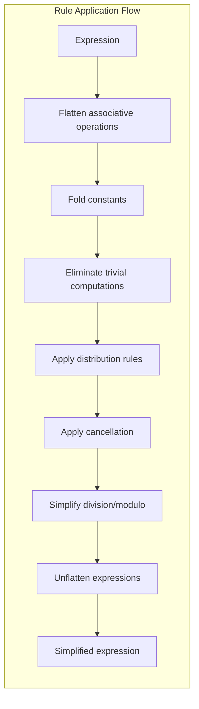

<!-- source: DeepWiki mcp.deepwiki.com · repo NVIDIA/Fuser · page 2.3 Expression Simplification · fetched 2026-10-26 -->

# Expression Simplification

Relevant source files

The following files were used as context for generating this wiki page:

- [csrc/expr_simplifier.cpp](csrc/expr_simplifier.cpp)
- [csrc/fusion_segmenter.cpp](csrc/fusion_segmenter.cpp)
- [csrc/fusion_segmenter.h](csrc/fusion_segmenter.h)
- [tests/cpp/test_expr_simplifier.cpp](tests/cpp/test_expr_simplifier.cpp)
- [tests/cpp/test_expr_sort.cpp](tests/cpp/test_expr_sort.cpp)
- [tests/cpp/test_segmentation.cpp](tests/cpp/test_segmentation.cpp)

The Expression Simplification system in NVFUSER is responsible for transforming complex mathematical expressions into simpler, equivalent forms. This optimization pass improves code generation efficiency, reduces register pressure, and makes the generated code more readable. Expression simplification operates on the Fusion IR's scalar expressions before they are lowered to CUDA code.

For information about the broader IR (Intermediate Representation) system that these expressions belong to, see [Core IR System](#2).

## Overview of the Expression Simplifier

The expression simplifier transforms IR expressions like `(x * 1) + ((y + 0) * (z - z))` into their simplified form `x`. It provides a declarative rule-based system that applies algebraic transformations to expressions while preserving their semantic meaning.

Sources: [csrc/expr_simplifier.cpp:8-159](). The function `simplifyExpr` serves as the main entry point for expression simplification.

## Key Concepts

### Associative and Commutative Operations

The simplifier recognizes and specializes the handling of associative and commutative operations:

- **Associative operations**: Operations where grouping doesn't matter: `(a + b) + c = a + (b + c)`
- **Commutative operations**: Operations where order doesn't matter: `a + b = b + a`

Examples include addition, multiplication, logical AND/OR, and bitwise operations.

Sources: [csrc/expr_simplifier.cpp:470-509]()

### Context for Simplification

The `Context` class encapsulates information needed during simplification:

- Variable ordering for deterministic output
- Sets of variables involved in expressions
- Known relationships between variables (e.g., `x < y`)
- Error preservation flags

Sources: [csrc/expr_simplifier.cpp:165-303]()

### FlattenedAssocCommOp

The `FlattenedAssocCommOp` class represents flattened associative and commutative operations. This representation allows efficient application of simplification rules by working with all operands simultaneously rather than processing nested binary operations.

Sources: [csrc/expr_simplifier.cpp:600-818]()

## Simplification Process

The expression simplification process follows these key steps:

1. **Flattening**: Convert nested binary operations into flattened form
2. **Rule Application**: Apply algebraic simplification rules
3. **Unflattening**: Convert back to a binary operation tree form

Sources: [csrc/expr_simplifier.cpp:850-959](), [csrc/expr_simplifier.cpp:958-1010]()

## Simplification Rules

The expression simplifier applies various algebraic rules to transform expressions:

| Rule Type | Examples | Description |
|-----------|----------|-------------|
| Constant Folding | `2 + 3 → 5` | Evaluate constant expressions at compile time |
| Identity Operations | `x * 1 → x`, `x + 0 → x` | Remove no-op terms |
| Negation Cancellation | `-(-x) → x` | Remove double negations |
| Cancellation | `x - x → 0` | Remove self-cancelling terms |
| Division Simplification | `(a*b)/a → b` | Simplify division with common factors |
| Division/Mod Distribution | `(a*b + c) / a → b + c/a` | Distribute division across terms when appropriate |
| Comparison Simplification | `x <= x → true` | Simplify reflexive comparisons |

Sources: [csrc/expr_simplifier.cpp:542-622]()

## Implementation Details

### Expression Flattening

The `flatten` function (in namespace `assoc_comm`) recursively converts nested binary operations into flattened form:

Sources: [csrc/expr_simplifier.cpp:850-953]()

### Expression Unflattening

The `unflatten` function converts flattened operations back to nested binary operations. It sorts operands to create the most efficient ordering for evaluation:

Sources: [csrc/expr_simplifier.cpp:958-1010]()

## Usage in the Fusion Segmenter

The expression simplifier is used in the fusion segmentation process to simplify expressions when determining if segments can be merged. This helps ensure that equivalent expressions are properly recognized and handled as identical, even if they were originally written in different forms.

Sources: [csrc/fusion_segmenter.cpp:267-278]()

## Debug Features

The expression simplifier includes debug features to track and display the transformations being applied:

- Debug logging with the environment variable `NVFUSER_DUMP="expr_simplify"`
- Ability to trace specific simplification passes

The debug output shows each transformation step, making it easier to understand how expressions are being simplified.

Sources: [csrc/expr_simplifier.cpp:47-158]()

## Core Simplification Rules Implementation

The core simplification rules are implemented through a combination of utility functions and recursive tree traversal:

Sources: [csrc/expr_simplifier.cpp:465-546](), [csrc/expr_simplifier.cpp:1011-1050]()

## Example Transformations

Here are some examples of how the expression simplifier transforms expressions:

1. **Identity elimination**: `x * 1 → x`, `x + 0 → x`
2. **Constant folding**: `2 + 3 → 5`, `4 * 5 → 20`
3. **Cancellation**: `x - x → 0`, `(a + b) - (b + c) → a - c`
4. **Division simplification**: `(x * y) / x → y`, `(x * y + z) / x → y + z/x`
5. **Boolean simplification**: `x && true → x`, `x || false → x`

Sources: [tests/cpp/test_expr_simplifier.cpp:497-622]()

## Conclusion

The Expression Simplification system is a crucial component of NVFUSER that optimizes scalar expressions before code generation. By applying algebraic rules and transformations, it helps generate more efficient and maintainable CUDA code, reducing register pressure and improving performance.

---

