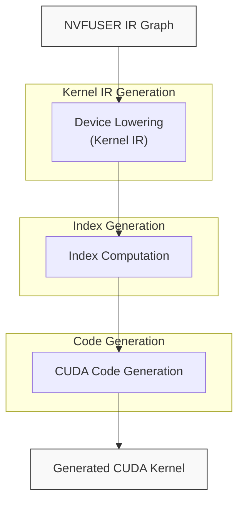
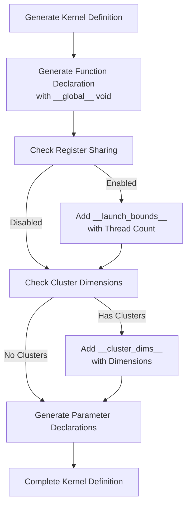
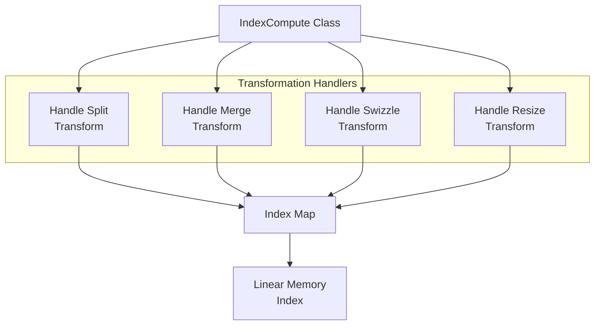
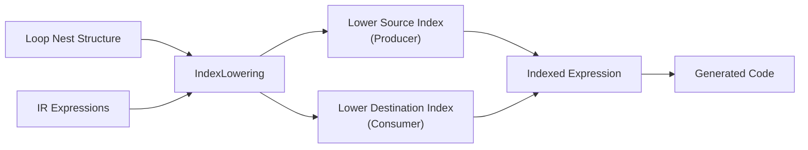
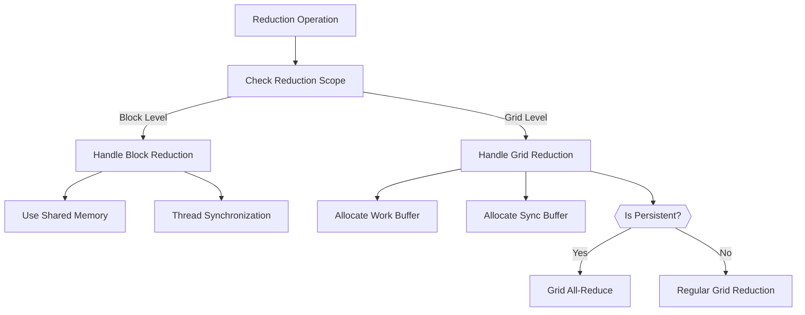
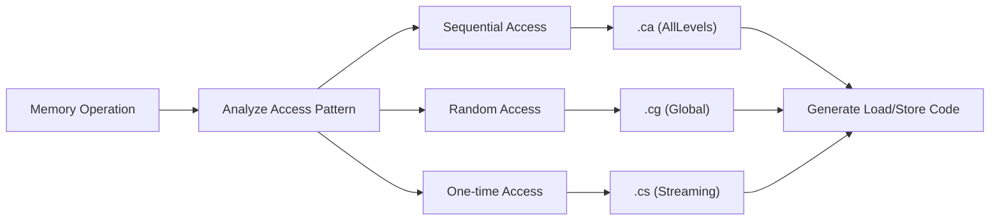
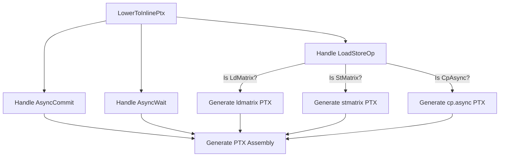

<!-- source: DeepWiki mcp.deepwiki.com · repo NVIDIA/Fuser · page 3 Code Generation · fetched 2026-10-26 -->

# Code Generation

<details>
<summary>Relevant source files</summary>

The following files were used as context for generating this wiki page:

- [csrc/codegen.cpp](csrc/codegen.cpp)
- [csrc/device_lower/pass/allocation.cpp](csrc/device_lower/pass/allocation.cpp)
- [csrc/device_lower/pass/index.cpp](csrc/device_lower/pass/index.cpp)
- [csrc/device_lower/pass/index.h](csrc/device_lower/pass/index.h)
- [csrc/device_lower/pass/inline_ptx.cpp](csrc/device_lower/pass/inline_ptx.cpp)
- [csrc/device_lower/pass/insert_syncs.cpp](csrc/device_lower/pass/insert_syncs.cpp)
- [csrc/id_model/indexing.cpp](csrc/id_model/indexing.cpp)
- [csrc/id_model/indexing.h](csrc/id_model/indexing.h)
- [csrc/index_compute.cpp](csrc/index_compute.cpp)
- [csrc/index_compute.h](csrc/index_compute.h)
- [csrc/kernel_ir.cpp](csrc/kernel_ir.cpp)
- [csrc/kernel_ir.h](csrc/kernel_ir.h)
- [csrc/type.cpp](csrc/type.cpp)
- [csrc/type.h](csrc/type.h)
- [tests/cpp/test_indexing.cpp](tests/cpp/test_indexing.cpp)
- [tests/cpp/test_memory.cpp](tests/cpp/test_memory.cpp)

</details>


This page provides an overview of the code generation system in NVFUSER that transforms the intermediate representation (IR) into executable CUDA code. The code generation process takes the IR graph of operations and produces optimized device code for execution on NVIDIA GPUs.

For related topics, see [Core IR System](#2) for information about the IR nodes that are inputs to code generation, and [CUDA Kernel Generation](#3.1) for details on how specific CUDA kernels are produced.

## Overview of Code Generation

The code generation system is responsible for translating NVFUSER's intermediate representation into optimized CUDA C++ code. This process involves several key steps:

1. Generating kernel declarations with appropriate arguments
2. Creating kernel prologues with memory setup and initialization
3. Converting IR expressions to C++ code
4. Computing and applying memory indexing
5. Optimizing generated code with vectorization and other techniques



The code generation process converts high-level tensor operations into efficient CUDA code, including memory access patterns, thread/block coordination, and specialized optimizations.

Sources: [csrc/codegen.cpp:159-182](). [csrc/device_lower/pass/index.cpp:29-35]().

## CUDA Kernel Generator

The heart of code generation is the `CudaKernelGenerator` class, which is responsible for transforming the lowered kernel IR into CUDA C++ code. This class traverses the IR nodes and generates appropriate code for each type of expression.

```mermaid
classDiagram
    class CudaKernelGenerator {
        -std::stringstream code_
        -std::unordered_map<Val*, std::string> val_to_name_
        -std::unordered_set<Val*> aligned_array_of_regs_
        -int block_nest_level_
        -bool print_inline_
        +generateKernelDefinition(kernel, kernel_name, num_threads_per_cta) std::string
        -genDeclaration(kernel_name, num_threads_per_cta) void
        -genPrologue() void
        -genBody() void
        -handle(Expr*) void
    }
    
    CudaKernelGenerator ..> "Expr Handlers" : dispatches_to
    
    class "Expr Handlers" {
        +handle(UnaryOp*)
        +handle(BinaryOp*)
        +handle(TernaryOp*)
        +handle(ReductionOp*)
        +handle(LoadStoreOp*)
        +handle(ForLoop*)
        +handle(IfThenElse*)
        +handle(kir::TensorIndex*)
    }
```

The kernel generator transforms each expression in the input IR into the corresponding CUDA code by dispatching to type-specific handlers which generate appropriate C++ code.

Sources: [csrc/codegen.cpp:155-182](). [csrc/codegen.cpp:516-566]().

### Kernel Definition Generation

The kernel generation process begins with creating the CUDA kernel function definition, including function parameters and launch bounds:

1. First, a kernel declaration is generated with appropriate attributes such as `__global__` and optional `__launch_bounds__`
2. Parameter declarations are added based on the kernel's inputs
3. Register sharing information is included if enabled
4. Cluster dimensions are specified if the kernel uses CUDA clusters



The kernel declaration includes all tensor and scalar parameters needed by the computation, with appropriate CUDA types.

Sources: [csrc/codegen.cpp:289-383](). 

### Kernel Prologue Generation

The kernel prologue contains setup code that runs before the main kernel body, including:

1. Dynamic shared memory setup
2. Special handling for reductions and parallel Welford operations
3. Initialization of synchronization primitives
4. Type-specific initialization code

```cpp
// Example prologue for shared memory setup
alignas(16) extern __shared__ char array[];
void* shared_mem = array;
const unsigned smem_offset = alignBufferSize(blockDim.x * blockDim.y * blockDim.z * sizeof(float), 16);
```

This prologue code creates the foundation for the kernel execution, particularly for operations that require shared memory or synchronization.

Sources: [csrc/codegen.cpp:390-462]().

## Index Computation

Index computation is a critical part of code generation, translating logical tensor indices to physical memory locations. This involves calculating precise memory access patterns for different memory types and tensor layouts.



The index computation system handles various tensor transformations (split, merge, swizzle, resize) and computes the corresponding memory indices for efficient access.

Sources: [csrc/index_compute.cpp:35-193](). [csrc/device_lower/pass/index.cpp:37-81]().

### Tensor Indexing

For tensor operations, the system computes both source (producer) and destination (consumer) indices:

1. Source indices determine where input data is read from
2. Destination indices determine where output data is written to
3. Special handling exists for operations like reductions, broadcasts, and complex transformations



The indexing system handles complex memory access patterns, including linearization of multi-dimensional arrays, handling of non-contiguous layouts, and optimization of memory access patterns.

Sources: [csrc/device_lower/pass/index.cpp:37-81](). [csrc/id_model/indexing.cpp:141-226]().

## Handling Different Expression Types

The code generator handles various types of expressions differently:

### Binary Operations

Binary operations (add, multiply, etc.) are translated into the appropriate C++ operators or function calls:

```cpp
// Examples of binary operation code generation:
// Inline expression: out = lhs + rhs;
// or
// Split TensorView expressions across multiple lines:
// out
//    = lhs
//    + rhs;
```

Sources: [csrc/codegen.cpp:1044-1106]().

### Reduction Operations

Reductions require special handling for both block-level and grid-level operations:

1. Block reductions use shared memory and thread synchronization
2. Grid reductions use global memory and multiple kernel launches or persistent thread approaches
3. Work buffers and synchronization buffers are allocated as needed



Sources: [csrc/device_lower/pass/index.cpp:591-632](). [csrc/device_lower/pass/index.cpp:726-821]().

### Memory Operations

Load and store operations are handled with various optimizations:

1. Vectorized load/store operations for improved memory bandwidth
2. Different cache hints (e.g., `.ca`, `.cg`, `.cs`) for different memory access patterns
3. Special handling for different memory types (global, shared, local)

```cpp
// Examples of different load code generation:
// Global to local: loadGlobalToLocal<float, /*vec_size=*/4, /*is_volatile=*/false, CacheOp::AllLevels>(&out, &in)
// Local to global: loadLocalToGlobal<float, /*vec_size=*/4, /*is_volatile=*/true>(&out, &in)
// Global to global: loadGlobalToGlobal<float, /*vec_size=*/4, /*is_volatile_to=*/false, /*is_volatile_from=*/false>(&out, &in)
```

Sources: [csrc/codegen.cpp:464-511](). [tests/cpp/test_memory.cpp:48-105]().

## Utilities for Code Generation

The code generator uses several utility classes and functions:

### ArgumentBuilder

The `ArgumentBuilder` class handles creating comma-separated argument lists for function calls, with proper indentation and formatting:

```cpp
// Example using ArgumentBuilder to generate function call arguments
ArgumentBuilder args;
args.arg("blockIdx.x").arg("threadIdx.y").arg(loop_var);
code << "my_function(" << args << ")";
```

Sources: [csrc/codegen.cpp:52-107]().

### Type and Literal Handling

The system handles different data types and literal values with proper C++ syntax:

1. Type translation from IR types to C++ types
2. Special handling for floating-point literals (e.g., NaN, infinity)
3. Array and struct type generation
4. Proper suffix generation for literals (e.g., "f" for float, "LL" for long long)

Sources: [csrc/type.cpp:207-286](). [csrc/codegen.cpp:602-656]().

## Memory Types and Cache Operations

NVFUSER supports different memory types and cache operations:

### Memory Types

1. **Global Memory**: GPU's main DRAM memory
2. **Shared Memory**: On-chip memory shared among threads in a block
3. **Local Memory**: Thread-local registers or spilled registers
4. **Tensor Memory**: Special memory type similar to shared memory (recent GPU architectures)

### Cache Operations

Cache operations provide hints to the hardware about memory access patterns:

1. **AllLevels** (`.ca`): Cache at all levels (L1 and L2)
2. **Global** (`.cg`): Cache at global level only (L2)
3. **Streaming** (`.cs`): Streaming load, indicating data is likely to be used only once

The code generator applies appropriate cache hints based on memory access patterns:



Cache policy refinement analyzes tensor access patterns and automatically selects the appropriate cache hints for optimal performance.

Sources: [tests/cpp/test_memory.cpp:120-177](). [csrc/codegen.cpp:464-511]().

## Vectorization and Optimization

The code generator applies various optimizations:

### Vectorization

Vectorized operations operate on multiple data elements at once:

1. Load/store operations can be vectorized with different vector sizes (2, 4, 8, etc.)
2. Vectorization is applied based on the tensor's access pattern and contiguity
3. Special PTX instructions may be used for optimal performance

Sources: [csrc/codegen.cpp:464-511]().

### Expression Optimization

Complex expressions are optimized during code generation:

1. Simplification of expressions (e.g., replacing `pow(x, 2)` with `x * x`)
2. Type casting and promotion for mixed-type operations
3. Layout optimization for better memory access patterns

Sources: [csrc/codegen.cpp:976-1042]().

## PTX Inline Generation

For certain operations, direct PTX (Parallel Thread Execution) instructions are inlined:

1. Matrix operations (ldmatrix, stmatrix)
2. Asynchronous memory operations (cp.async)
3. Special fence and synchronization operations
4. Warp-level operations and communication



This direct PTX generation allows for leveraging hardware-specific features that may not be easily expressible or optimally compiled through standard C++.

Sources: [csrc/device_lower/pass/inline_ptx.cpp:21-102]().

## Conclusion

The code generation system in NVFUSER translates the intermediate representation into highly optimized CUDA code. By handling various operation types, memory layouts, and optimization opportunities, it produces efficient code for execution on NVIDIA GPUs.

Key aspects of the code generation system include:
- Translation of IR expressions to CUDA C++
- Computation of memory indices for efficient data access
- Application of hardware-specific optimizations
- Support for different memory types and access patterns
- Special handling for complex operations like reductions

The code generator serves as the final step in transforming high-level tensor operations into executable GPU code, enabling high-performance deep learning and scientific computing.

---

