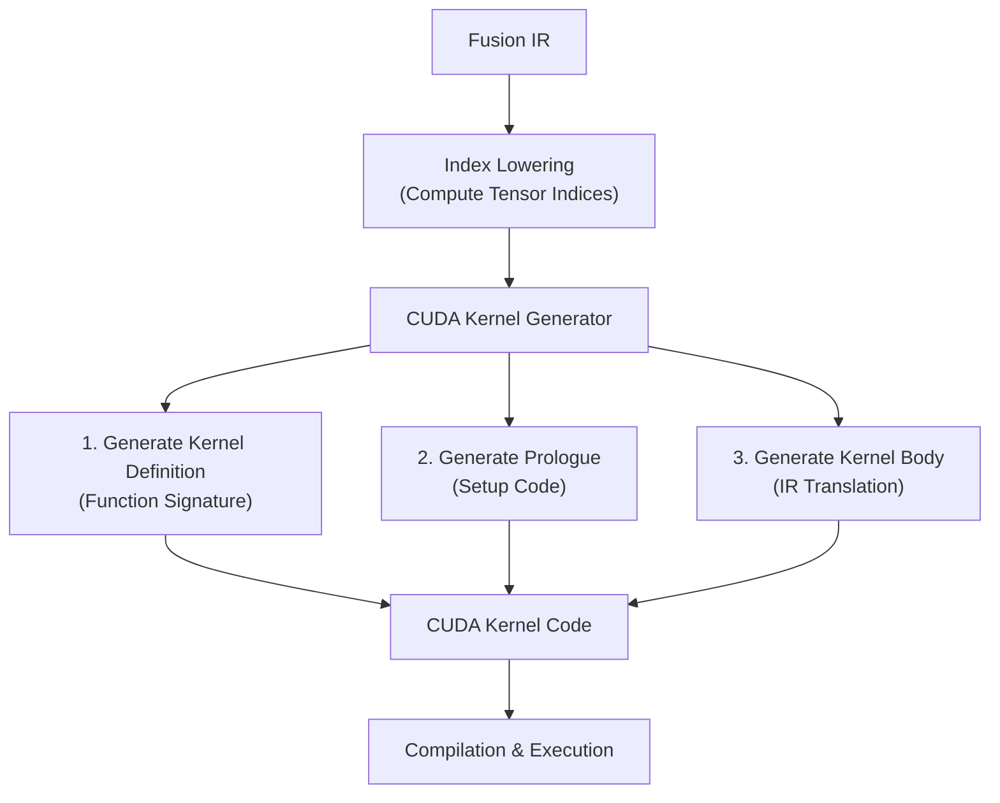
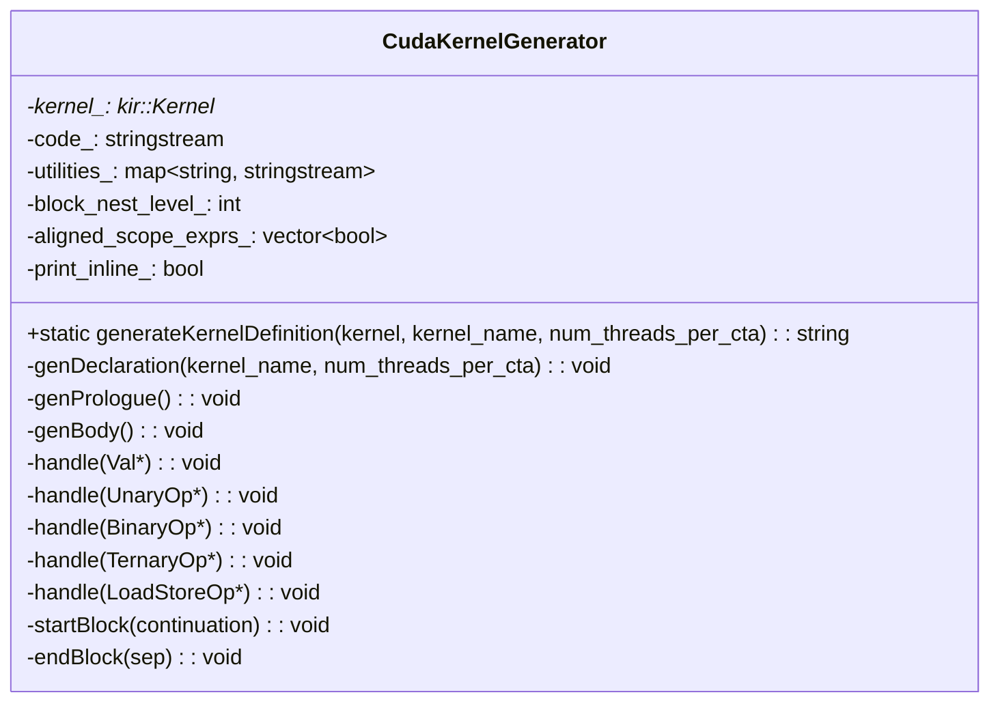
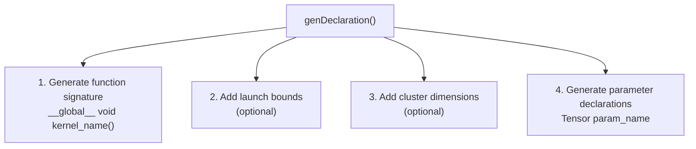
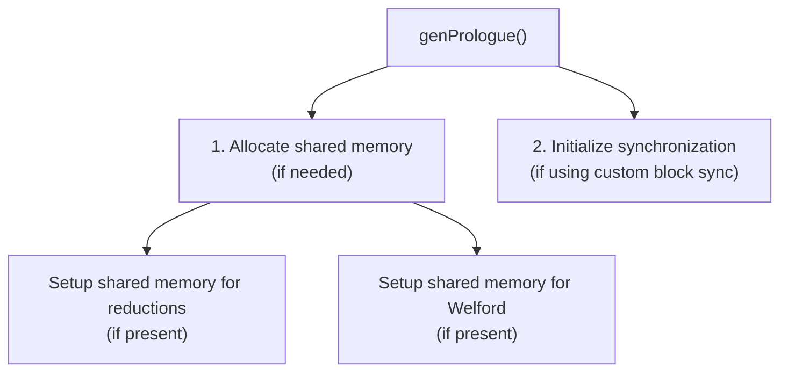
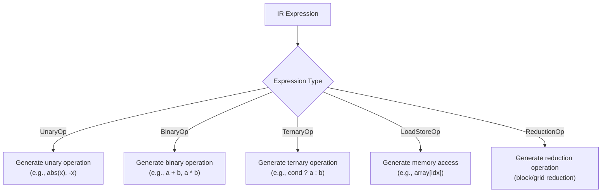
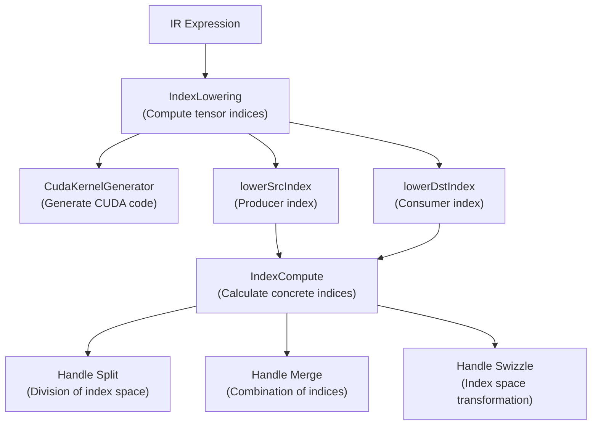
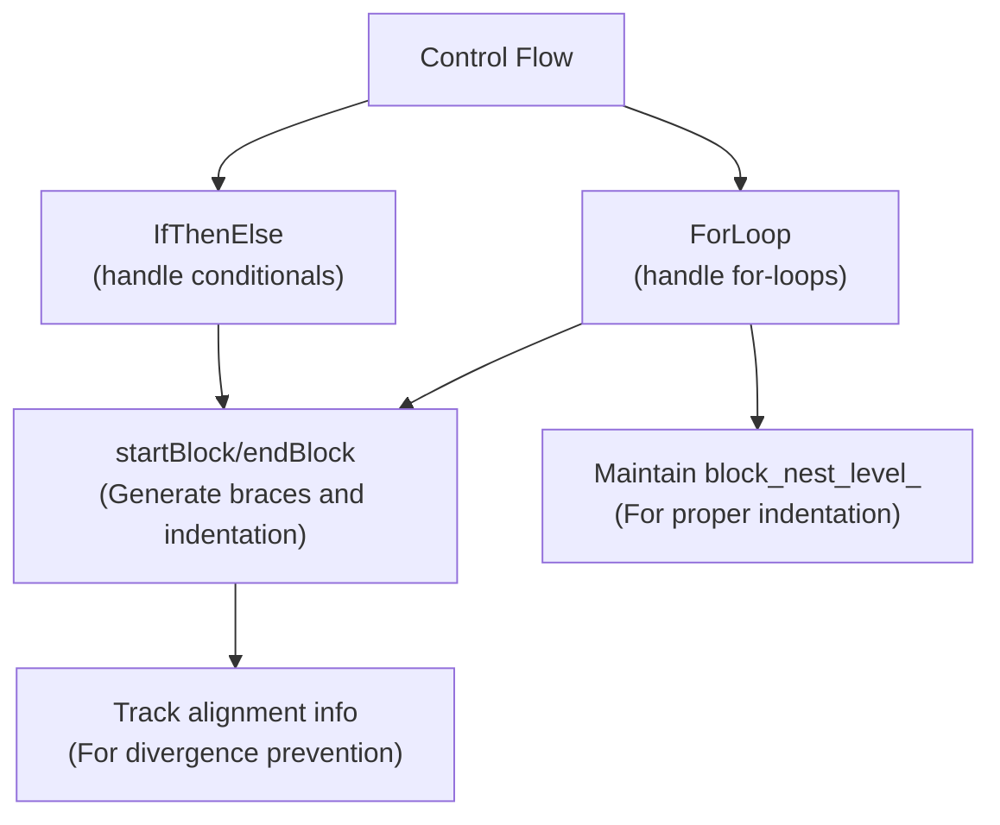

<!-- source: DeepWiki mcp.deepwiki.com · repo NVIDIA/Fuser · page 3.1 CUDA Kernel Generation · fetched 2026-10-26 -->

# CUDA Kernel Generation

<details>
<summary>Relevant source files</summary>

The following files were used as context for generating this wiki page:

- [csrc/codegen.cpp](csrc/codegen.cpp)
- [csrc/device_lower/pass/allocation.cpp](csrc/device_lower/pass/allocation.cpp)
- [csrc/device_lower/pass/index.cpp](csrc/device_lower/pass/index.cpp)
- [csrc/device_lower/pass/index.h](csrc/device_lower/pass/index.h)
- [csrc/device_lower/pass/inline_ptx.cpp](csrc/device_lower/pass/inline_ptx.cpp)
- [csrc/device_lower/pass/insert_syncs.cpp](csrc/device_lower/pass/insert_syncs.cpp)
- [csrc/id_model/indexing.cpp](csrc/id_model/indexing.cpp)
- [csrc/id_model/indexing.h](csrc/id_model/indexing.h)
- [csrc/index_compute.cpp](csrc/index_compute.cpp)
- [csrc/index_compute.h](csrc/index_compute.h)
- [csrc/kernel_ir.cpp](csrc/kernel_ir.cpp)
- [csrc/kernel_ir.h](csrc/kernel_ir.h)
- [csrc/type.cpp](csrc/type.cpp)
- [csrc/type.h](csrc/type.h)
- [tests/cpp/test_indexing.cpp](tests/cpp/test_indexing.cpp)
- [tests/cpp/test_memory.cpp](tests/cpp/test_memory.cpp)

</details>


This document describes how NVFuser transforms its internal Intermediate Representation (IR) into executable CUDA code. The CUDA Kernel Generation system is responsible for translating the optimized IR into efficient CUDA C++ code that can be compiled and executed on NVIDIA GPUs. For information about predicate and index computation that feeds into this system, see [Index Computation](#3.2).

## Overview of the Kernel Generation Process

The kernel generation process takes a lowered, device-specific IR as input and produces CUDA C++ code as output. This transformation occurs through a series of steps, including generating the kernel signature, prologue code, and translating each IR node into corresponding CUDA code.



Sources: [csrc/codegen.cpp:159-186](csrc/codegen.cpp:159-186)

## The `CudaKernelGenerator` Class

The core component of the kernel generation system is the `CudaKernelGenerator` class, which provides methods for transforming IR nodes into CUDA code.



Sources: [csrc/codegen.cpp:155-282](csrc/codegen.cpp:155-282)

### Static Function for Kernel Generation

The entry point for code generation is the static `generateKernelDefinition` method, which orchestrates the entire process:

```cpp
static std::string generateKernelDefinition(
    const kir::Kernel* kernel,
    const std::string& kernel_name,
    std::optional<int64_t> num_threads_per_cta)
```

This method creates a `CudaKernelGenerator` instance, calls methods to generate different parts of the kernel, and assembles the final CUDA code.

Sources: [csrc/codegen.cpp:159-186](csrc/codegen.cpp:159-186)

## Kernel Generation Steps

### 1. Kernel Definition Generation

The kernel definition comprises the function signature, launch bounds, and parameter declarations. The `genDeclaration` method generates this code:



Key aspects of kernel declaration:
- Adds `__global__ void` qualifier for CUDA kernels
- Optionally adds `__launch_bounds__` for register usage optimization
- Optionally adds `__cluster_dims__` for multi-block operations
- Creates properly typed parameters based on tensor dimensions and data types

Sources: [csrc/codegen.cpp:289-383](csrc/codegen.cpp:289-383)

### 2. Prologue Generation

The prologue includes setup code that's executed before the main kernel body. The `genPrologue` method generates this code:



The prologue sets up resources for:
- Dynamic shared memory buffers
- Block reductions and Welford operations
- Custom block synchronization mechanisms

Sources: [csrc/codegen.cpp:390-462](csrc/codegen.cpp:390-462)

### 3. Body Generation

The kernel body translates the IR nodes into CUDA code. The `genBody` method calls `handle` on each top-level expression in the kernel:

```cpp
void genBody() {
  handle(kernel_->topLevelExprs());
}
```

The `handle` methods are overloaded for different IR node types and convert them to CUDA code strings.

Sources: [csrc/codegen.cpp:522-524](csrc/codegen.cpp:522-524)

## IR Node Translation

The `CudaKernelGenerator` class has specialized `handle` methods for different IR node types. These methods translate IR operations into CUDA code.

### Value Handling

Values (scalars, tensor indices, predicates) are converted to appropriate CUDA code representations:

- **Scalar Values**: Translated to literal values with appropriate type specifiers
- **Tensor Indices**: Translated to indexed tensor access with memory type qualifiers
- **Predicates**: Translated to boolean expressions

Sources: [csrc/codegen.cpp:658-746](csrc/codegen.cpp:658-746)

### Expression Handling

Expressions are converted to CUDA operations with appropriate operands:



#### Unary Operations

Unary operations include operations like negation, absolute value, cast, etc. The code generates appropriate CUDA syntax based on the operation type.

Sources: [csrc/codegen.cpp:833-889](csrc/codegen.cpp:833-889)

#### Binary Operations

Binary operations include arithmetic operations (add, multiply), logical operations (and, or), and comparison operations (equal, less than). The code generates appropriate CUDA syntax based on the operation type.

Sources: [csrc/codegen.cpp:915-1106](csrc/codegen.cpp:915-1106)

#### Ternary Operations

Ternary operations are primarily used for conditional operations. The code generates appropriate CUDA syntax based on the operation type.

Sources: [csrc/codegen.cpp:1108-1268](csrc/codegen.cpp:1108-1268)

#### Load/Store Operations

Load/Store operations handle memory accesses. The code generates appropriate CUDA memory access syntax, including vectorized loads/stores when possible.

```cpp
// Vectorized memory access example
void generateVectorizedLdSt(Val* in, Val* out, CacheOp cache_op, int64_t vector_word_size) {
  // Generate optimized load/store operations based on memory types and cache hints
}
```

Sources: [csrc/codegen.cpp:463-511](csrc/codegen.cpp:463-511)

## Memory Management

The generated kernel code includes memory management operations for different memory types:

### Global Memory

Global memory operations are generated with appropriate cache hints (e.g., `.cg`, `.ca`, `.cs`) to optimize memory access patterns.

Sources: [csrc/tests/cpp/test_memory.cpp:107-118](csrc/tests/cpp/test_memory.cpp:107-118)

### Shared Memory

Shared memory operations are generated with appropriate synchronization to ensure correct execution across threads in a block.

```cpp
// Shared memory allocation example in prologue
indent() << "alignas(" << 16 << ") extern __shared__ char array[];\n";
indent() << "void* shared_mem = array;\n";
```

Sources: [csrc/codegen.cpp:404-407](csrc/codegen.cpp:404-407)

### Local Memory

Local (register) memory operations are generated to maximize register usage efficiency while avoiding register spilling.

Sources: [csrc/index_compute.cpp:222-226](csrc/index_compute.cpp:222-226)

## Index Computation Integration

The kernel generation system integrates with the index computation system to generate efficient tensor access code. This includes:



The `IndexLowering` class transforms expressions by adding indexing information, while the `IndexCompute` class calculates tensor indices for various transformations (split, merge, swizzle, etc.).

Sources: [csrc/device_lower/pass/index.cpp:29-35](csrc/device_lower/pass/index.cpp:29-35), [csrc/index_compute.cpp:36-529](csrc/index_compute.cpp:36-529)

## Special Optimizations

### Vectorized Memory Access

The code generator includes optimizations for vectorized memory access, which improves memory access efficiency by using vector load/store instructions when possible.

```cpp
void generateVectorizedLdSt(Val* in, Val* out, CacheOp cache_op, int64_t vector_word_size) {
  // Generate vectorized load/store operations
}
```

Sources: [csrc/codegen.cpp:463-511](csrc/codegen.cpp:463-511)

### Cache Policy Refinement

The code generator applies cache hints based on memory access patterns, using `.ca` (cache all levels) for data likely to be reused and `.cs` (cache streaming) for data unlikely to be reused.

Sources: [csrc/tests/cpp/test_memory.cpp:120-177](csrc/tests/cpp/test_memory.cpp:120-177)

### Tensor Memory Access (TMA)

Support for Tensor Memory Access (TMA) operations, a hardware feature in newer NVIDIA GPUs that provides efficient tensor memory access patterns.

Sources: [csrc/tests/cpp/test_memory.cpp:180-618](csrc/tests/cpp/test_memory.cpp:180-618)

## Handling Control Flow

The kernel generator handles control flow constructs such as loops and conditionals:



Sources: [csrc/codegen.cpp:526-557](csrc/codegen.cpp:526-557)

## Code Formatting and Utilities

The code generator includes utilities for formatting the generated code:

- `indent()`: Adds appropriate indentation based on the current block nesting level
- `startBlock()` and `endBlock()`: Add opening and closing braces with proper indentation
- `genInline()`: Generates code for inline expressions
- `initStringStreamFormat()`: Sets up formatting for numeric literals

Sources: [csrc/codegen.cpp:559-596](csrc/codegen.cpp:559-596)

## Type System Integration

The kernel generator integrates with NVFuser's type system to generate type-correct CUDA code. This includes:

- Proper handling of primitive types (float, int, bool, etc.)
- Support for complex types (arrays, structs, pointers)
- Type conversions and casts

```cpp
// Examples of type handling
void stringify(const PolymorphicValue& value, const DataType dtype) {
  // Convert values to string literals based on their type
}
```

Sources: [csrc/type.h:207-424](csrc/type.h:207-424), [csrc/type.cpp:20-332](csrc/type.cpp:20-332)

## Summary

The CUDA Kernel Generation system in NVFuser transforms the optimized IR into efficient CUDA code through several steps:

1. Generating the kernel definition with appropriate parameters
2. Creating setup code in the prologue
3. Translating IR nodes to CUDA code in the kernel body
4. Optimizing memory access patterns and control flow

This system works closely with the index computation system to ensure efficient tensor access patterns, and integrates with the type system to generate type-correct code.

---

