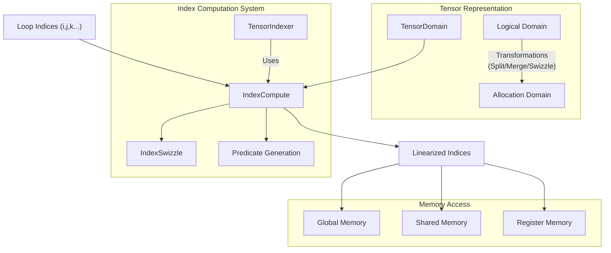
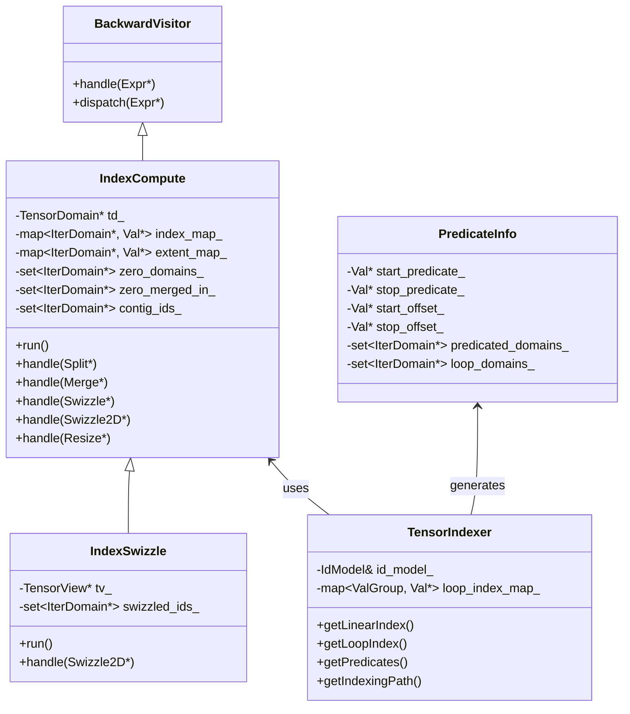
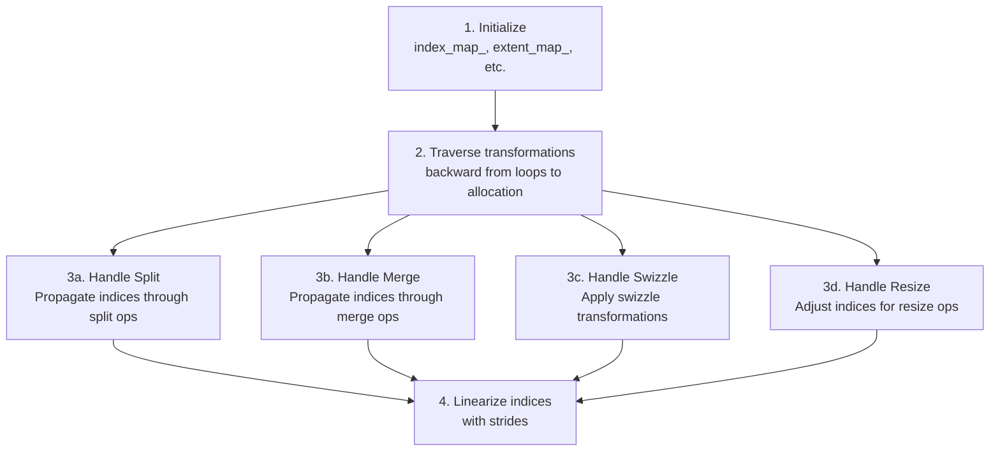
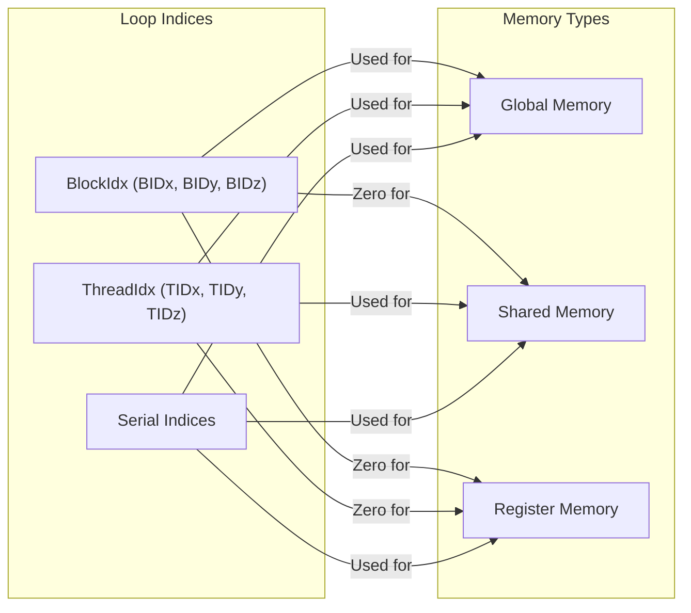

<!-- source: DeepWiki mcp.deepwiki.com · repo NVIDIA/Fuser · page 3.2 Index Computation · fetched 2026-10-26 -->

# Index Computation

<details>
<summary>Relevant source files</summary>

The following files were used as context for generating this wiki page:

- [csrc/id_model/indexing.cpp](csrc/id_model/indexing.cpp)
- [csrc/id_model/indexing.h](csrc/id_model/indexing.h)
- [csrc/index_compute.cpp](csrc/index_compute.cpp)
- [csrc/index_compute.h](csrc/index_compute.h)
- [tests/cpp/test_indexing.cpp](tests/cpp/test_indexing.cpp)
- [tests/cpp/test_memory.cpp](tests/cpp/test_memory.cpp)

</details>


## Purpose and Scope

Index computation is a critical component of the NVFUSER code generation system responsible for mapping logical tensor indices to physical memory locations. This page explains how NVFUSER calculates memory access indices by traversing tensor domain transformations (such as splits, merges, swizzles) to generate the correct addressing expressions for CUDA kernels. For information about CUDA kernel generation more broadly, see [CUDA Kernel Generation](#3.1).

Index computation is the mathematical foundation that enables efficient memory access patterns for various memory types (global, shared, register) while properly handling transformations like split, merge, resize, and swizzle operations that alter the tensor layout.

Sources: [csrc/index_compute.h:17-45]()

## System Overview



Index computation is a backward traversal process that starts with loop indices from the surrounding loop nest and computes indices that correspond to the allocation domains of tensors. This process handles all transformation operations that were applied to the tensor domains.

Sources: [csrc/index_compute.h:31-63](), [csrc/index_compute.cpp:34-96]()

## Key Classes and Components



Sources: [csrc/index_compute.h:72-425](), [csrc/id_model/indexing.h:49-232]()

### IndexCompute Class

The `IndexCompute` class is the core component that calculates indices by traversing tensor transformations backward. It inherits from `BackwardVisitor` and implements handlers for different transformation operations:

- **Split**: Handles index computation for split operations
- **Merge**: Handles index computation for merge operations
- **Swizzle**: Handles index computation for swizzle operations
- **Swizzle2D**: Handles index computation for 2D swizzle operations
- **Resize**: Handles index computation for resize operations

Key data structures maintained by `IndexCompute`:

- `index_map_`: Maps IterDomains to their computed indices
- `extent_map_`: Maps IterDomains to their extents
- `zero_domains_`: Set of domains that do not contribute to indexing
- `zero_merged_in_`: Set of domains that have had a zero merged into them
- `contig_ids_`: Set of IDs resulting from contiguous merges

Sources: [csrc/index_compute.cpp:35-153](), [csrc/index_compute.h:72-309]()

### TensorIndexer Class

`TensorIndexer` is a higher-level interface built on top of `IndexCompute` that uses the IdModel to perform index computation. It provides a more abstract way to compute indices for different memory types.

Key methods:
- `getLinearIndex()`: Computes a linearized index for a tensor
- `getLoopIndex()`: Gets the index of a loop domain
- `getPredicates()`: Generates predicates for bounds checking
- `getIndexingPath()`: Finds the traversal path for indexing

Sources: [csrc/id_model/indexing.h:49-232](), [csrc/id_model/indexing.cpp:35-108]()

### IndexSwizzle Class

`IndexSwizzle` extends `IndexCompute` to specifically handle swizzled indices. It applies swizzle transformations to the computed indices to enable optimized memory access patterns.

Sources: [csrc/index_compute.h:330-359](), [csrc/index_compute.cpp:904-988]()

### PredicateInfo Class

`PredicateInfo` stores information about predicates used for conditional execution:
- `start_predicate_`: Lower bound check
- `stop_predicate_`: Upper bound check
- `predicated_domains_`: Domains covered by the predicates
- `loop_domains_`: Loops used for the predicate domains

Sources: [csrc/index_compute.h:364-424]()

## Index Computation Process

The index computation process follows these general steps:

1. **Initialization**: Create an `IndexCompute` instance with initial maps for indices, extents, and special domains
2. **Traverse**: Perform a backward traversal through tensor domain transformations
3. **Compute**: For each transformation operation, compute how it affects the indices
4. **Linearize**: Combine the computed indices and strides to produce a linear memory index



Sources: [csrc/index_compute.cpp:97-449]()

### Handling Split Operations

When a domain is split, the index computation must map back through this operation. For a split of domain `in` into `outer` and `inner` domains:

```
in_idx = outer_idx * inner_extent + inner_idx
```

The implementation in `IndexCompute::handle(Split*)` handles special cases like zero domains and merged domains to correctly propagate indices.

Sources: [csrc/index_compute.cpp:97-152]()

### Handling Merge Operations

When two domains are merged, the index computation must decompose the merged index back into the original domains. For a merge of `outer` and `inner` domains into `out`:

```
outer_idx = out_idx / inner_extent
inner_idx = out_idx % inner_extent
```

Special care is taken for broadcasts, zero domains, and unswitched predicates.

Sources: [csrc/index_compute.cpp:210-349]()

### Handling Swizzle Operations

Swizzle operations transform indices to create more efficient memory access patterns. The `IndexCompute::handle(Swizzle*)` and `IndexCompute::handle(Swizzle2D*)` methods compute the inverse of these transformations to map back to the original indices.

Sources: [csrc/index_compute.cpp:351-419]()

### Handling Resize Operations

Resize operations change the size of a domain. The index computation adjusts for these changes:

```
in_idx = out_idx - left_expand
```

Sources: [csrc/index_compute.cpp:421-449]()

## Memory Types and Indexing

NVFUSER generates different index computations based on the memory type of a tensor:

### Global Memory Indexing

Global memory tensors use the full allocation domain for indexing. All loops that affect the tensor contribute to the index calculation.

### Shared Memory Indexing

For shared memory tensors, only thread block-local indices are used. Global indices (e.g., block indices) are typically replaced with zeros.

### Register Memory Indexing

For register tensors, indices from parallel dimensions are typically replaced with zeros, as each thread has its own separate registers.



Sources: [csrc/index_compute.cpp:677-835](), [csrc/id_model/indexing.cpp:79-108]()

## Predicate Generation

Predicates are conditional expressions used to guard tensor accesses, ensuring they stay within valid bounds. They're particularly important for:

1. Preventing out-of-bounds accesses
2. Handling partial iterations at boundaries
3. Supporting unrolled or vectorized loops

The `TensorIndexer::getPredicates()` method generates these predicates by:

1. Computing indices for predicate domains
2. Generating start predicates: `index + start_offset >= 0`
3. Generating stop predicates: `index + stop_offset < extent`
4. Adding predicates for non-divisible splits

The resulting `PredicateInfo` objects contain all information needed to guard memory accesses.

Sources: [csrc/id_model/indexing.cpp:367-578](), [csrc/index_compute.h:364-424]()

## Advanced Features

### Contiguous Indexing Optimization

NVFUSER optimizes index computation for contiguous memory access patterns. When domains are merged contiguously, the `ContigIDs` class identifies these patterns, and `IndexCompute` can use this information to generate more efficient indexing.

Sources: [csrc/index_compute.cpp:492-509]()

### Loop Index Substitution

For certain cases, loop indices may be substituted with constants:

- **Vectorized domains**: Indices are replaced with 0
- **Bulk/Mma domains**: Indices are replaced with 0
- **Circular buffer loops**: Special handling for producer/consumer indexing

Sources: [csrc/id_model/indexing.cpp:307-365]()

### Magic Zero Addition

To help the CUDA compiler optimize indexing expressions, NVFUSER can add a "magic zero" to certain indices. This is implemented in `TensorIndexer::protectIndicesWithMagicZero()`.

Sources: [csrc/id_model/indexing.cpp:751-785]()

### Unswitched Index Handling

When loops are unswitched (i.e., a predicate is hoisted out of the loop), indices may need special handling, especially when computing predicates through modulo operations. The `isModuloInvalidUnswitchedIndex()` function detects these cases.

Sources: [csrc/index_compute.cpp:154-208]()

## Example Index Computation

Let's look at how index computation works for a simple tensor transformation:

```
Original: TV[I, J]
After split: TV[I/4, 4, J]
```

For a given set of loop indices `{i, j, k}` corresponding to the transformed dimensions:

1. Start with `index_map_ = {[I/4] -> i, [4] -> j, [J] -> k}`
2. During backward traversal, encounter the split that created `[I/4]` and `[4]` from `[I]`
3. Compute the index for `[I]` as `i * 4 + j`
4. The final indices are `{[I] -> i * 4 + j, [J] -> k}`

These indices can then be used with the tensor's strides to compute the linearized memory address.

Sources: [csrc/index_compute.cpp:97-152](), [tests/cpp/test_indexing.cpp:462-549]()

## Integration with CUDA Kernel Generation

The computed indices are used in the CUDA kernel generation phase to produce the actual memory access code:

1. `TensorIndexer` computes indices for tensors in expressions
2. These indices are used to create `kir::TensorIndex` objects
3. `kir::TensorIndex` objects are used in load/store operations in the generated CUDA code

Sources: [csrc/id_model/indexing.cpp:141-172]()

## Conclusion

Index computation is a fundamental component of NVFUSER that bridges the gap between the logical tensor operations and physical memory access. By carefully tracking transformations and applying inverse operations during backward traversal, NVFUSER can generate efficient memory addressing code for complex tensor operations.

---

