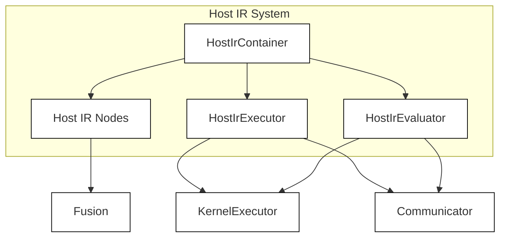
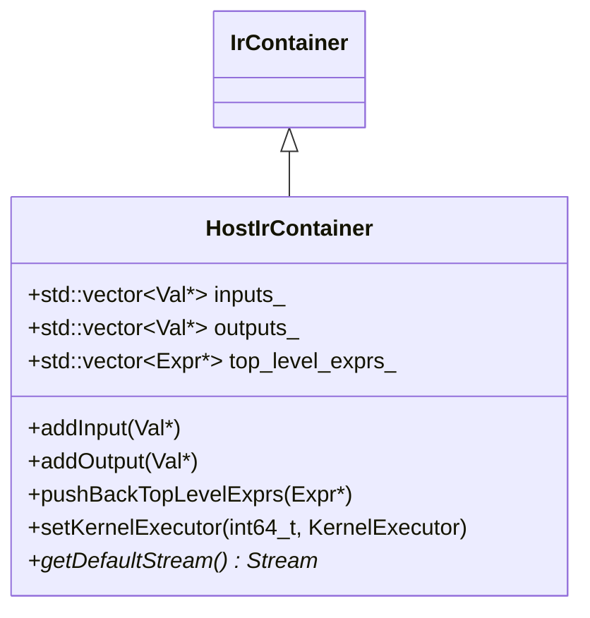
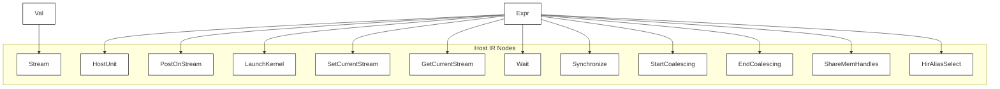
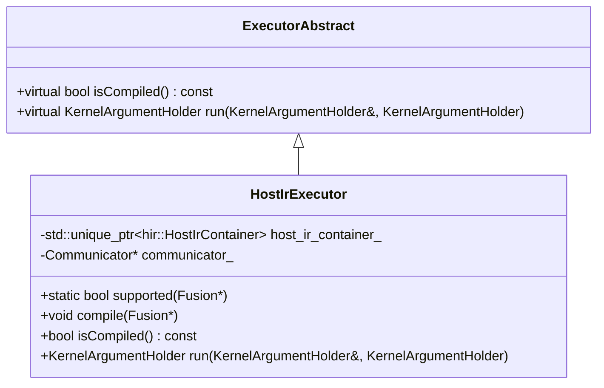
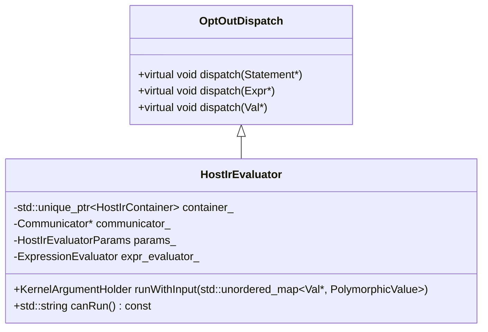
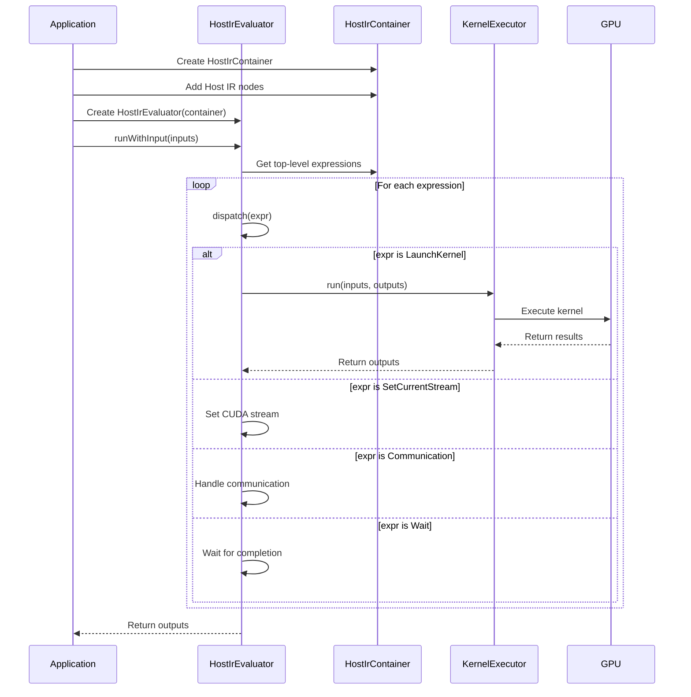
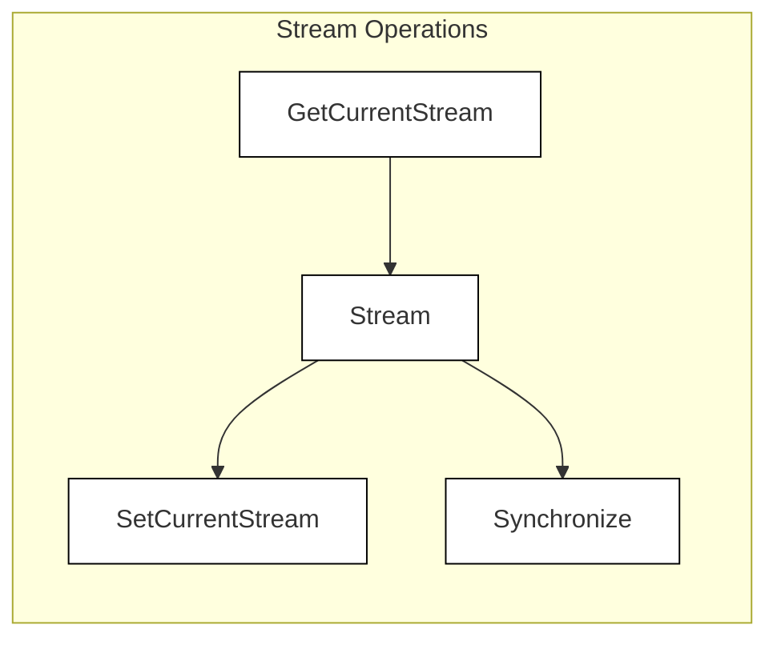
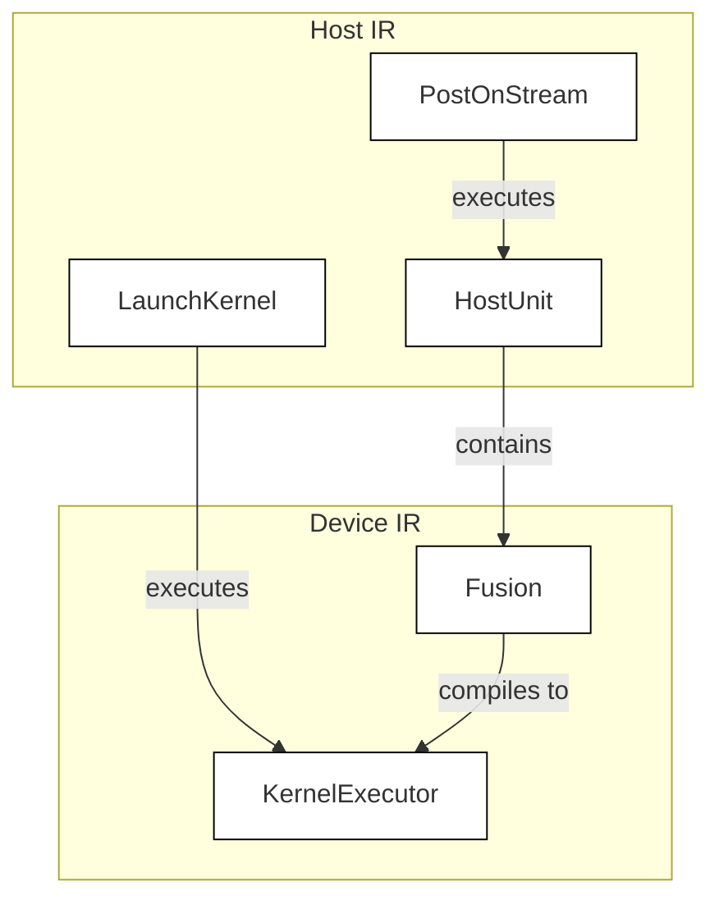
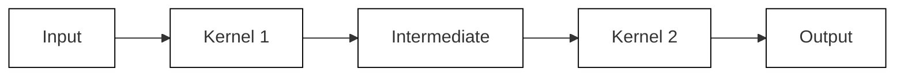
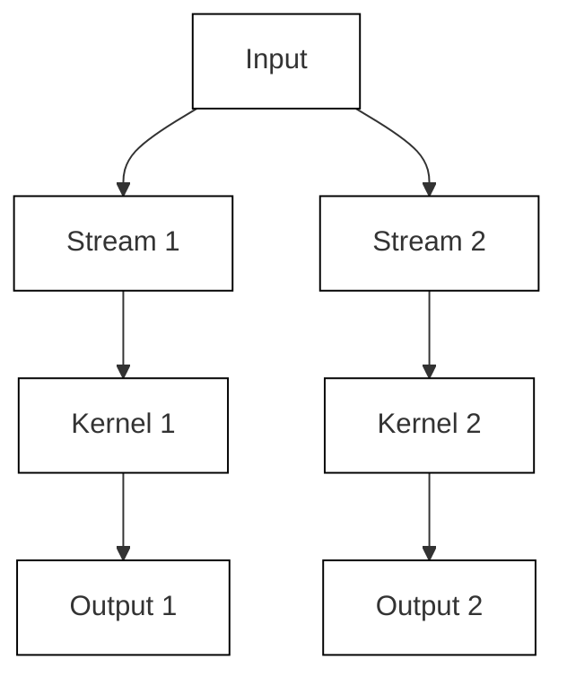

<!-- source: DeepWiki mcp.deepwiki.com · repo NVIDIA/Fuser · page 3.3 Host IR and Execution · fetched 2026-10-26 -->

# Host IR and Execution

<details>
<summary>Relevant source files</summary>

The following files were used as context for generating this wiki page:

- [csrc/dispatch.cpp](csrc/dispatch.cpp)
- [csrc/dispatch.h](csrc/dispatch.h)
- [csrc/host_ir/executor.cpp](csrc/host_ir/executor.cpp)
- [csrc/host_ir/executor.h](csrc/host_ir/executor.h)
- [csrc/host_ir/host_ir.cpp](csrc/host_ir/host_ir.cpp)
- [csrc/host_ir/host_ir.h](csrc/host_ir/host_ir.h)
- [csrc/ir/iostream.cpp](csrc/ir/iostream.cpp)
- [csrc/ir/iostream.h](csrc/ir/iostream.h)
- [csrc/scheduler/mark_aliases.cpp](csrc/scheduler/mark_aliases.cpp)
- [csrc/scheduler/no_op.cpp](csrc/scheduler/no_op.cpp)
- [tests/cpp/test_host_ir_integration.cpp](tests/cpp/test_host_ir_integration.cpp)
- [tests/cpp/test_host_irs.cpp](tests/cpp/test_host_irs.cpp)

</details>


This document describes the Host IR (Intermediate Representation) and execution infrastructure in NVFUSER. The Host IR provides a representation for host-side operations that orchestrate device kernel execution, stream management, and multi-device communication. This system sits above the device IR and kernel generation ([CUDA Kernel Generation](#3.1)) and provides the control flow logic needed to coordinate kernel execution across multiple streams and devices.

## Overview

The Host IR system provides a way to represent, compile, and execute host-side operations in NVFUSER. While NVFUSER's primary focus is generating optimized CUDA kernels, executing these kernels efficiently requires coordination at the host level, especially for multi-stream or multi-device execution. The Host IR system bridges this gap by providing:

1. A representation for host-side operations
2. An executor for interpreting and running these operations
3. Mechanisms for stream management and synchronization
4. Support for multi-device communication



Sources: [csrc/host_ir/executor.h:25-49](), [csrc/host_ir/executor.h:52-196]()

## Host IR Container

The `HostIrContainer` serves as the main container for Host IR operations. It holds a collection of Host IR nodes and manages their execution. The container defines the program's inputs and outputs and maintains the top-level expressions that make up the host program.



Sources: [csrc/host_ir/container.h](), [csrc/ir/iostream.cpp:81-117]()

## Host IR Nodes

The Host IR system defines various node types that represent different host-side operations. These nodes inherit from the base IR classes `Expr` and `Val` and are specialized for host-side operations.



Sources: [csrc/host_ir/host_ir.h:26-395](), [csrc/host_ir/host_ir.cpp:22-403]()

### Key Host IR Nodes

#### HostUnit

Represents a Fusion in the Host Program. It wraps a Fusion object that defines the compute operations to be executed as a single unit.

```cpp
class HostUnit : public Expr {
public:
  Fusion* fusion_to_execute() const;
private:
  std::unique_ptr<Fusion> fusion_;
};
```

Sources: [csrc/host_ir/host_ir.h:48-74](), [csrc/host_ir/host_ir.cpp:24-63]()

#### PostOnStream

Represents the host instruction of executing a HostUnit. It connects the HostUnit with its inputs and outputs, and at runtime, it compiles and launches the kernel lowered from the HostUnit's embedded Fusion.

```cpp
class PostOnStream : public Expr {
public:
  Expr* hostOpToPost() const;
};
```

Sources: [csrc/host_ir/host_ir.h:90-117](), [csrc/host_ir/host_ir.cpp:65-120]()

#### LaunchKernel

Similar to PostOnStream but provides more direct control over launching a kernel with specific parameters.

```cpp
class LaunchKernel : public Expr {
public:
  int64_t getIndex() const;
  const auto& launch_params() const;
  const auto& compile_params() const;
};
```

Sources: [csrc/host_ir/host_ir.h:119-156](), [csrc/host_ir/host_ir.cpp:122-154]()

#### Stream

Represents a CUDA stream that can be used to execute operations asynchronously.

```cpp
class Stream : public Val {
public:
  Val* index() const;
};
```

Sources: [csrc/host_ir/host_ir.h:158-177](), [csrc/host_ir/host_ir.cpp:156-189]()

#### Stream Control Operations

Several Host IR nodes manage stream operations:
- `SetCurrentStream`: Sets the current CUDA stream
- `GetCurrentStream`: Gets the current CUDA stream
- `Synchronize`: Synchronizes streams

Sources: [csrc/host_ir/host_ir.h:179-276](), [csrc/host_ir/host_ir.cpp:191-288]()

#### Communication Operations

Host IR nodes for multi-device communication:
- `Wait`: Waits for a communication operation to complete
- `StartCoalescing`: Starts coalescing communications
- `EndCoalescing`: Ends coalescing communications
- `ShareMemHandles`: Shares memory handles between processes

Sources: [csrc/host_ir/host_ir.h:226-352](), [csrc/host_ir/host_ir.cpp:232-356]()

## Host IR Execution

Two main classes handle the execution of Host IR programs:

### HostIrExecutor

The `HostIrExecutor` compiles and executes Host IR programs, particularly focusing on multi-device communication operations. It inherits from `ExecutorAbstract` and provides methods to check if a fusion is supported, compile the fusion into host IR, and run the host IR program.



Sources: [csrc/host_ir/executor.h:25-49](), [csrc/host_ir/executor.cpp:30-191]()

### HostIrEvaluator

The `HostIrEvaluator` is an interpreter for Host IR programs. It evaluates the host program with concrete inputs by walking through the IR nodes and executing them.



The `HostIrEvaluator` handles various Host IR nodes through dedicated handler methods defined in its class implementation. For example:

- `handle(SetCurrentStream*)`: Sets the current CUDA stream
- `handle(LaunchKernel*)`: Launches a kernel
- `handle(Communication*)`: Handles a communication operation
- `handle(Wait*)`: Waits for a communication operation
- `handle(ForLoop*)`: Executes a for loop

Sources: [csrc/host_ir/executor.h:82-196](), [csrc/host_ir/executor.cpp:195-818]()

## Execution Flow

When executing a Host IR program, the following flow typically occurs:

1. A `HostIrContainer` is created with the program's Host IR nodes
2. The container is passed to a `HostIrEvaluator` or `HostIrExecutor`
3. The evaluator/executor interprets the Host IR nodes and executes them
4. For each kernel execution node, the associated fusion is compiled and executed
5. Stream management and synchronization nodes control the execution flow
6. Communication nodes handle data transfer between devices



Sources: [csrc/host_ir/executor.cpp:110-191](), [csrc/host_ir/executor.cpp:224-249]()

## Stream Management

The Host IR system provides a rich set of operations for managing CUDA streams, which are essential for achieving concurrent execution of kernels:

- `Stream`: Represents a CUDA stream
- `SetCurrentStream`: Sets the current CUDA stream for subsequent operations
- `GetCurrentStream`: Gets the current CUDA stream
- `Synchronize`: Makes the current stream wait on another stream

Stream management is particularly useful for overlapping computation and communication, or for executing independent kernels concurrently.



Example of stream usage in host IR:

```
Stream s1 = new Stream()
Stream s2 = new Stream()
SetCurrentStream(s1)
LaunchKernel(...)  // Executes on s1
SetCurrentStream(s2)
LaunchKernel(...)  // Executes on s2
Synchronize(s1)    // Makes s2 wait for s1
```

Sources: [tests/cpp/test_host_irs.cpp:528-639]()

## Multi-Device Support

The Host IR system provides support for multi-device execution through communication operations. These operations facilitate data transfer between devices and synchronization of execution across devices.

Key communication operations include:

- `Communication`: Represents a collective communication operation (e.g., AllReduce, AllGather)
- `P2PCommunication`: Represents a point-to-point communication (e.g., Send, Receive)
- `Wait`: Waits for a communication operation to complete
- `StartCoalescing` / `EndCoalescing`: Group communications for optimized execution

The `Communicator` class provides the underlying implementation for these communication operations.

Sources: [csrc/host_ir/executor.cpp:446-523]()

## Integration with Device IR

The Host IR system integrates with the device IR system through the `HostUnit` node, which encapsulates a Fusion that defines the device operations to be executed. When a `PostOnStream` or `LaunchKernel` node is executed, the associated Fusion is compiled into a device kernel and executed.



Sources: [csrc/host_ir/executor.cpp:350-431]()

## Usage Examples

The Host IR system can be used to express complex execution patterns that go beyond what a single fusion can represent. Some common use cases include:

### Sequential Kernel Execution



This pattern executes two kernels in sequence, where the output of the first kernel is the input to the second kernel.

Sources: [tests/cpp/test_host_irs.cpp:159-240]()

### Parallel Kernel Execution with Multiple Streams



This pattern executes two kernels in parallel on different streams, both operating on the same input but producing different outputs.

Sources: [tests/cpp/test_host_irs.cpp:641-751]()

### Multi-Device Execution with Communication

```mermaid
graph TD
    subgraph "Device 0"
        I0["Input 0"] --> K0["Kernel 0"] --> O0["Output 0"]
    end
    
    subgraph "Device 1"
        I1["Input 1"] --> K1["Kernel 1"] --> O1["Output 1"]
    end
    
    O0 --> C["Communication"] --> I1
    
    classDef device fill:#fff,stroke:#000
    classDef kernel fill:#fff,stroke:#000
    classDef data fill:#fff,stroke:#000
    classDef comm fill:#fff,stroke:#000
    class "Device 0","Device 1" device
    class K0,K1 kernel
    class I0,O0,I1,O1 data
    class C comm
```

This pattern executes kernels on multiple devices with communication between them. The output from a kernel on one device is transferred to another device as input for its kernel.

Sources: [csrc/host_ir/executor.cpp:446-523]()

## Conclusion

The Host IR and Execution system in NVFUSER provides a flexible framework for orchestrating kernel execution, managing streams, and coordinating multi-device operations. By representing host-side operations as IR nodes, it enables complex execution patterns that go beyond what a single fusion can express, while still leveraging NVFUSER's powerful kernel generation capabilities.

---

