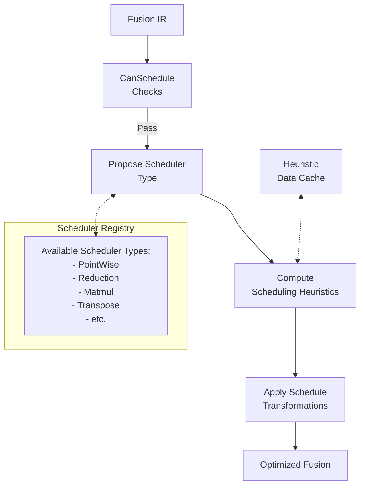
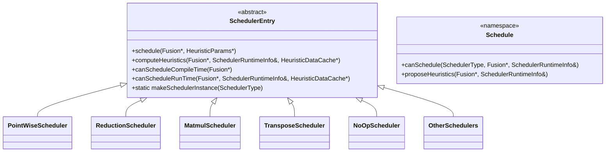
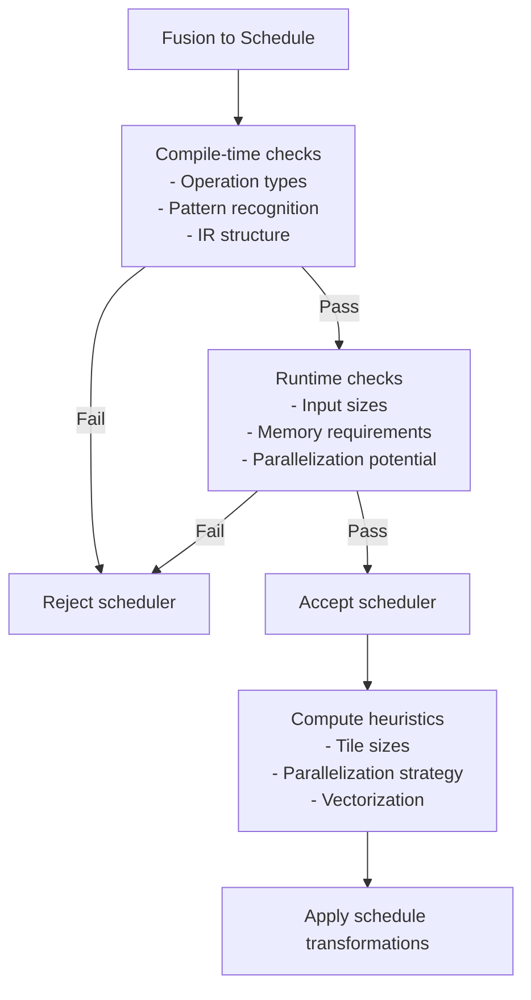
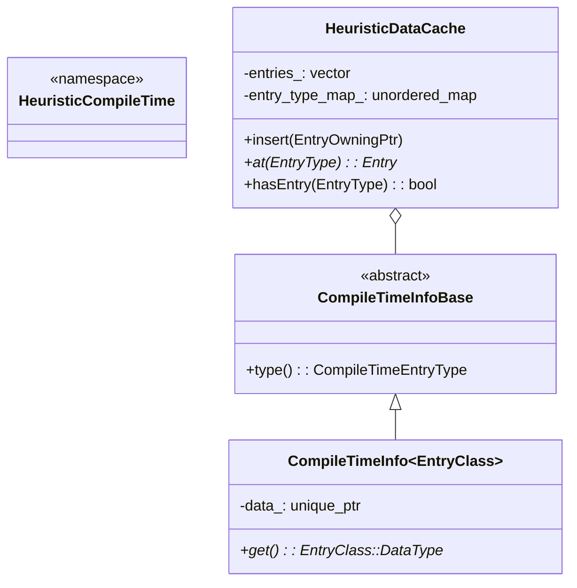
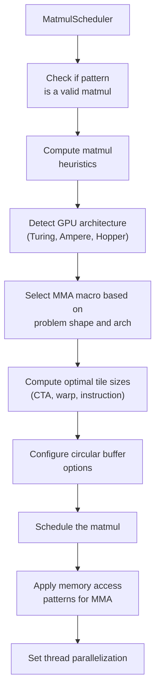
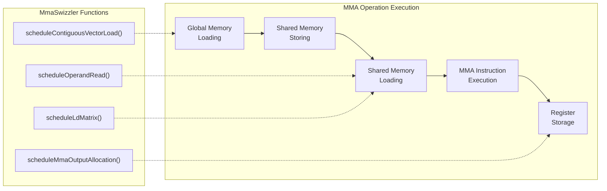
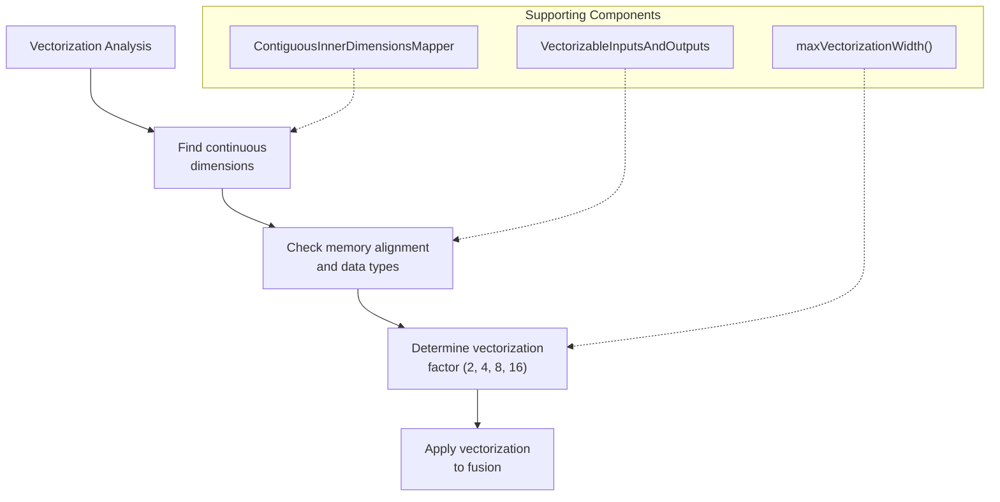

<!-- source: DeepWiki mcp.deepwiki.com · repo NVIDIA/Fuser · page 4 Scheduling System · fetched 2026-10-26 -->

# Scheduling System

<details>
<summary>Relevant source files</summary>

The following files were used as context for generating this wiki page:

- [csrc/mma_type.cpp](csrc/mma_type.cpp)
- [csrc/mma_type.h](csrc/mma_type.h)
- [csrc/scheduler/compile_time_info.h](csrc/scheduler/compile_time_info.h)
- [csrc/scheduler/matmul.cpp](csrc/scheduler/matmul.cpp)
- [csrc/scheduler/matmul_utils.cpp](csrc/scheduler/matmul_utils.cpp)
- [csrc/scheduler/mma_utils.cpp](csrc/scheduler/mma_utils.cpp)
- [csrc/scheduler/mma_utils.h](csrc/scheduler/mma_utils.h)
- [csrc/scheduler/pointwise.cpp](csrc/scheduler/pointwise.cpp)
- [csrc/scheduler/reduction.cpp](csrc/scheduler/reduction.cpp)
- [csrc/scheduler/reduction_utils.cpp](csrc/scheduler/reduction_utils.cpp)
- [csrc/scheduler/reduction_utils.h](csrc/scheduler/reduction_utils.h)
- [csrc/scheduler/registry.cpp](csrc/scheduler/registry.cpp)
- [csrc/scheduler/registry.h](csrc/scheduler/registry.h)
- [csrc/scheduler/transpose.cpp](csrc/scheduler/transpose.cpp)
- [csrc/scheduler/utils.cpp](csrc/scheduler/utils.cpp)
- [csrc/scheduler/utils.h](csrc/scheduler/utils.h)
- [csrc/scheduler/vectorize_helper.cpp](csrc/scheduler/vectorize_helper.cpp)
- [csrc/scheduler/vectorize_helper.h](csrc/scheduler/vectorize_helper.h)
- [runtime/array.cu](runtime/array.cu)
- [tests/cpp/test_mma.cpp](tests/cpp/test_mma.cpp)

</details>


The NVFUSER Scheduling System is responsible for transforming the intermediate representation (IR) of a fusion into an efficient executable form for NVIDIA GPUs. It analyzes fusion patterns, computes heuristics, and applies transformations to optimize memory access patterns, parallelization, and hardware utilization. This document explains the architecture and key components of the scheduling system.

## Key Concepts

The scheduling system is built around several key concepts:

1. **Scheduler Registry** - Maintains a collection of available scheduler types
2. **Scheduler Entries** - Implementations of scheduling strategies for different computation patterns
3. **Heuristics** - Parameters that guide the scheduling process, computed based on fusion properties
4. **Scheduling Transformations** - Operations like tiling, splitting, merging, and parallelizing

Sources: [csrc/scheduler/registry.cpp:80-112](), [csrc/scheduler/registry.h:25-56]()

## Architecture Overview



The scheduler system evaluates fusion operations and selects an appropriate scheduler based on pattern recognition. Once a scheduler is selected, it computes specific heuristic parameters and applies transformations to optimize the fusion for GPU execution.

Sources: [csrc/scheduler/registry.cpp:114-131](), [csrc/scheduler/registry.cpp:133-170]()

## Scheduler Registry

The scheduler registry maintains all available scheduling strategies and provides mechanisms for selecting the most appropriate one for a given fusion.



The `SchedulerEntry` class defines the interface that all scheduler implementations must follow. The `Schedule` namespace provides utility functions for checking compatibility and proposing appropriate schedulers.

Sources: [csrc/scheduler/registry.cpp:80-112](), [csrc/scheduler/registry.h:25-56](), [csrc/scheduler/registry.cpp:133-170]()

## Scheduler Selection Process

1. Check if a fusion can be scheduled with a particular scheduler type using both compile-time and runtime checks
2. Iterate through available schedulers in priority order until finding one that can schedule the fusion
3. If no suitable scheduler is found, fusion segmentation may be required



Sources: [csrc/scheduler/registry.cpp:133-170](), [csrc/scheduler/matmul.cpp:37-49]()

## Heuristic Computation

Heuristics are parameters that guide scheduling decisions, such as:
- Tile sizes for different dimensions
- Parallelization strategies
- Vectorization factors
- Memory usage patterns

Different scheduler types compute different heuristics based on the computation pattern they target. The resulting heuristics are captured in scheduler-specific parameter classes (e.g., `MatmulParams` for matrix multiplication).

### Heuristic Data Cache

The `HeuristicDataCache` stores compile-time information that can be reused across scheduling attempts, avoiding redundant computation.



Sources: [csrc/scheduler/registry.cpp:173-252](), [csrc/scheduler/compile_time_info.h:1-63]()

## Scheduling Transformations

After computing heuristics, the scheduler applies transformations to the IR to implement the chosen strategy. Common transformations include:

1. **Tiling** - Dividing dimensions into chunks for better locality
2. **Splitting** - Dividing a dimension into inner and outer components for different parallelization strategies
3. **Merging** - Combining dimensions for vectorization or more efficient parallelization
4. **Parallelization** - Assigning dimensions to GPU execution resources (threads, warps, blocks)
5. **Swizzling** - Reorganizing data access patterns to improve performance

### Common Transformation Utilities

```
makeTile(tv, tile_sizes) - Split dimensions according to tile sizes
scheduleContiguousVectorLoad(...) - Set up vectorized memory loading
parallelizeAllLike(...) - Propagate parallelization across tensors
merge_3d(tv) - Merge dimensions for 3D scheduling
```

Sources: [csrc/scheduler/mma_utils.cpp:375-446](), [csrc/scheduler/utils.cpp:50-142](), [csrc/scheduler/utils.cpp:294-371]()

## Specialized Schedulers

### Matrix Multiplication (Matmul) Scheduler

The Matmul scheduler is highly specialized for efficient matrix multiplication operations, with specific optimizations for different GPU architectures.



Key components of matmul scheduling:
- **Tile hierarchy**: Hierarchical tiling from grid to warp to instruction level
- **MMA macros**: Hardware-specific matrix multiplication primitives
- **Circular buffering**: Technique to overlap computation and memory access
- **Memory swizzling**: Data layout optimizations for efficient MMA operations

Sources: [csrc/scheduler/matmul.cpp:27-69](), [csrc/scheduler/matmul_utils.cpp:27-250](), [csrc/scheduler/matmul_utils.cpp:423-438](), [csrc/scheduler/mma_utils.cpp:30-76]()

### Other Schedulers

- **PointWise Scheduler**: Optimizes element-wise operations
- **Reduction Scheduler**: Optimizes reduction operations like sum, max, min
- **Transpose Scheduler**: Optimizes tensor transposition operations
- **NoOp Scheduler**: Minimal scheduling for simple operations

Sources: [csrc/scheduler/reduction.cpp:28-76](), [csrc/scheduler/pointwise.cpp:25-85](), [csrc/scheduler/transpose.cpp:23-91]()

## Matrix Multiplication Architecture-Specific Optimizations

The system provides extensive optimizations for matrix multiplication across different NVIDIA GPU architectures:

| Architecture | MMA Macros | Special Features |
|--------------|------------|-----------------|
| Turing       | 16×8×8, 16×8×16, 16×16×16 | Basic tensor core support |
| Ampere       | 16×8×16, 16×16×16 | Enhanced tensor cores, bf16 support |
| Hopper       | 64×n×16 (n=8 to 256) | Warp group MMA, enhanced tensor cores |

The scheduling parameters are tailored to the capabilities of each architecture, with specific strategies for:
- Matrix data layout transformation
- Shared memory access patterns
- Register allocation
- Thread and warp utilization
- Memory transfer optimization

Sources: [csrc/mma_type.h:130-172](), [csrc/scheduler/matmul_utils.cpp:52-172](), [csrc/scheduler/matmul_utils.cpp:244-334]()

## The MmaSwizzler

A key component for matrix multiplication optimization is the `MmaSwizzler`, which transforms memory access patterns to match the requirements of MMA instructions on the GPU.



The `MmaSwizzler` applies specific thread and memory access patterns that match the requirements of MMA instructions on different GPU architectures, ensuring efficient data movement between memory hierarchies.

Sources: [csrc/scheduler/mma_utils.cpp:880-953](), [csrc/scheduler/mma_utils.cpp:998-1082](), [csrc/scheduler/mma_utils.h:197-244]()

## Vectorization and Memory Access Optimization

The scheduling system includes utilities for vectorizing memory access, which allows loading multiple data elements in a single instruction:



Vectorization considerations include:
- Memory alignment constraints
- Data type size
- Hardware capabilities
- Contiguity of tensor dimensions

Sources: [csrc/scheduler/vectorize_helper.cpp:1-206](), [csrc/scheduler/utils.h:47-65]()

## Relationship to Other Systems

The Scheduling System interacts with several other components of NVFUSER:

1. **Fusion IR System**: Provides the operations to be scheduled
2. **Code Generation System**: Uses the scheduled operations to generate CUDA code
3. **Runtime Executor**: Executes the generated code with the provided inputs

For more information on these related systems, see [Core IR System](#2) and [Code Generation](#3).

## Summary

The NVFUSER Scheduling System is a sophisticated component that optimizes fusion operations for efficient execution on NVIDIA GPUs. It employs a variety of specialized schedulers and heuristics to analyze computation patterns and apply appropriate transformations. The system is particularly advanced in handling matrix multiplication operations, with dedicated optimizations for different GPU architectures.

Understanding the scheduling system is essential for comprehending how NVFUSER achieves high performance across a wide range of operations and hardware configurations.

---

