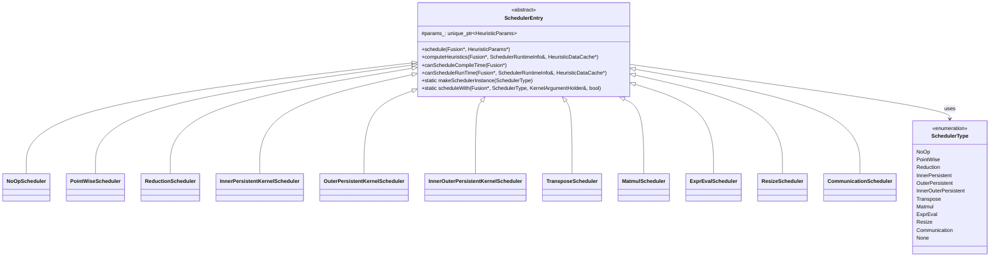
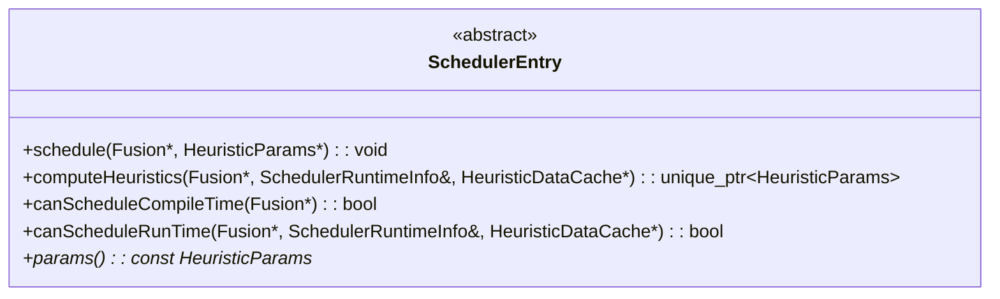
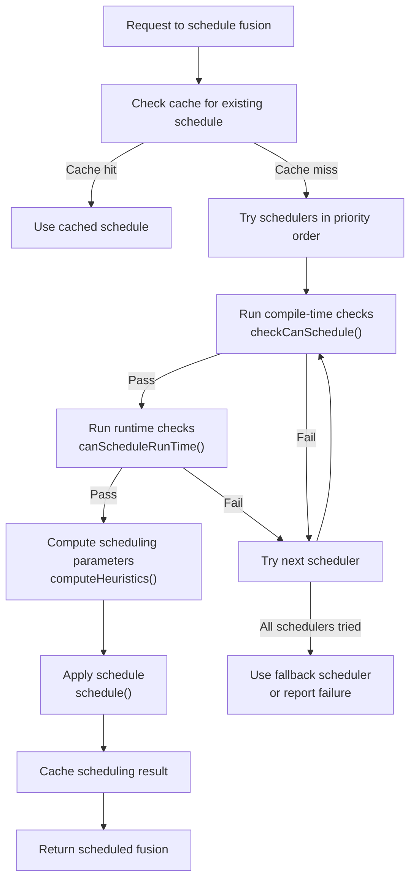
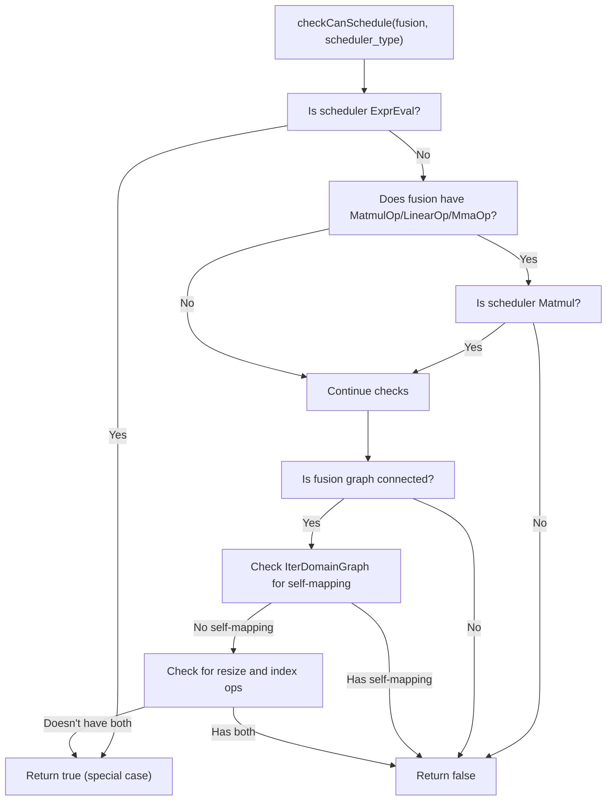
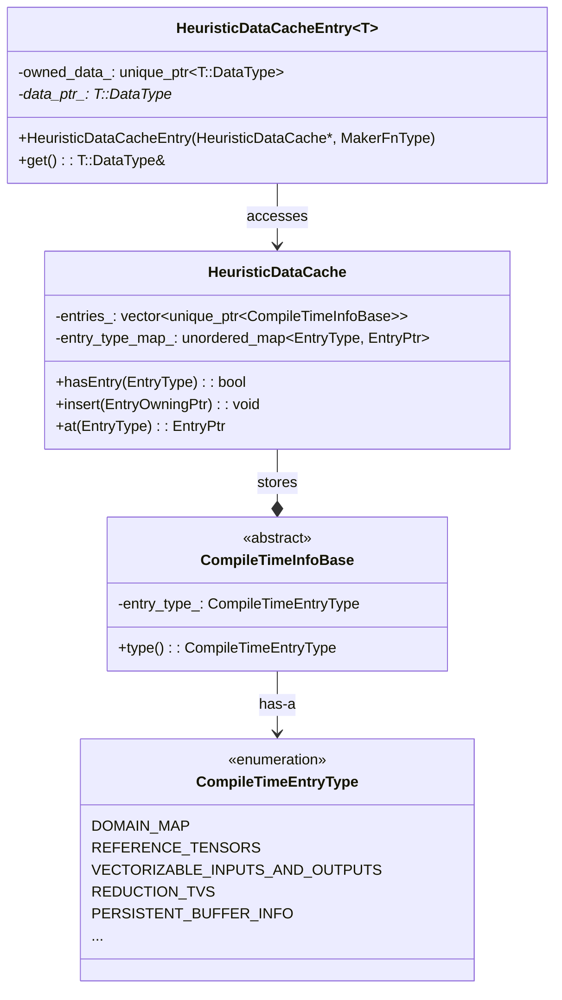
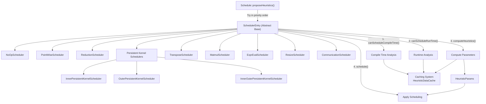

<!-- source: DeepWiki mcp.deepwiki.com · repo NVIDIA/Fuser · page 4.1 Scheduler Registry and Types · fetched 2026-10-26 -->

# Scheduler Registry and Types

<details>
<summary>Relevant source files</summary>

The following files were used as context for generating this wiki page:

- [csrc/scheduler/compile_time_info.h](csrc/scheduler/compile_time_info.h)
- [csrc/scheduler/pointwise.cpp](csrc/scheduler/pointwise.cpp)
- [csrc/scheduler/reduction.cpp](csrc/scheduler/reduction.cpp)
- [csrc/scheduler/reduction_utils.cpp](csrc/scheduler/reduction_utils.cpp)
- [csrc/scheduler/reduction_utils.h](csrc/scheduler/reduction_utils.h)
- [csrc/scheduler/registry.cpp](csrc/scheduler/registry.cpp)
- [csrc/scheduler/registry.h](csrc/scheduler/registry.h)
- [csrc/scheduler/transpose.cpp](csrc/scheduler/transpose.cpp)
- [csrc/scheduler/utils.cpp](csrc/scheduler/utils.cpp)
- [csrc/scheduler/utils.h](csrc/scheduler/utils.h)
- [csrc/scheduler/vectorize_helper.cpp](csrc/scheduler/vectorize_helper.cpp)
- [csrc/scheduler/vectorize_helper.h](csrc/scheduler/vectorize_helper.h)

</details>


## Purpose and Scope

The Scheduler Registry is a core component of NVFUSER responsible for managing different types of specialized kernel scheduling strategies. It provides a framework for registering, selecting, and applying various scheduling techniques based on fusion characteristics and runtime constraints. This page explains the architecture of the registry, available scheduler types, and how the selection process works.

For information about specific scheduling strategies like Matmul scheduling, see [Matrix Multiplication Scheduling](#4.2), and for normalization and reduction details, see [Normalization and Reduction Scheduling](#4.3).

## Architecture Overview

The Scheduler Registry is built around the `SchedulerEntry` abstract class, which provides a common interface for all scheduler implementations. The registry maintains a collection of specialized schedulers, each designed to handle specific types of computation patterns efficiently.



Sources: [csrc/scheduler/registry.h:16-97](), [csrc/scheduler/registry.cpp:80-112]()

## Scheduler Entry Interface

The `SchedulerEntry` abstract class defines the core interface that all scheduler implementations must provide:



Key methods include:
- **schedule**: Applies the scheduling strategy to a fusion
- **computeHeuristics**: Determines optimal parameters for scheduling
- **canScheduleCompileTime**: Static analysis to check if this scheduler can handle the fusion
- **canScheduleRunTime**: Dynamic analysis using runtime information to confirm scheduling capability

Sources: [csrc/scheduler/registry.h:25-76]()

## Scheduler Types

NVFUSER includes multiple specialized scheduler types, each targeted at specific computation patterns:

| Scheduler Type | Purpose |
|----------------|---------|
| NoOp | Basic scheduler that makes minimal changes to the fusion |
| PointWise | Optimizes element-wise operations across tensors |
| Reduction | Specializes in handling reduction operations efficiently |
| InnerPersistent | Persistent kernel scheduler focused on inner dimensions |
| OuterPersistent | Persistent kernel scheduler focused on outer dimensions |
| InnerOuterPersistent | Combines inner and outer persistent kernel strategies |
| Transpose | Optimizes tensor transpose operations |
| Matmul | Specializes in matrix multiplication operations |
| ExprEval | Handles expression evaluation |
| Resize | Handles tensor resize operations |
| Communication | Optimizes multi-device communication patterns |

Sources: [csrc/scheduler/registry.cpp:83-107]()

## Scheduler Selection Process

When a fusion needs to be scheduled, NVFUSER must determine which scheduler is most appropriate. This selection happens through a structured process:



The selection process includes:

1. **Compile-time checks** - Performed first to quickly filter out incompatible schedulers
2. **Runtime checks** - Use runtime information (tensor shapes, data types) to validate further
3. **Priority order** - Schedulers are tried in a priority sequence defined in `all_heuristics_in_priority_order`

Sources: [csrc/scheduler/registry.cpp:158-169](), [csrc/scheduler/registry.cpp:134-156]()

## Scheduler Registration and Creation

Scheduler instances are created through the `makeSchedulerInstance` static factory method which maps `SchedulerType` enum values to concrete scheduler implementations:

```cpp
std::unique_ptr<SchedulerEntry> SchedulerEntry::makeSchedulerInstance(
    SchedulerType scheduler_type) {
  std::unique_ptr<SchedulerEntry> scheduler = nullptr;
  switch (scheduler_type) {
    case SchedulerType::NoOp:
      return std::make_unique<NoOpScheduler>();
    case SchedulerType::PointWise:
      return std::make_unique<PointWiseScheduler>();
    case SchedulerType::Reduction:
      return std::make_unique<ReductionScheduler>();
    // Additional cases for other scheduler types...
    default:
      NVF_THROW("unreachable");
  }
}
```

Sources: [csrc/scheduler/registry.cpp:83-112]()

## Can Schedule Checks

The scheduler selection process relies on two important checks to determine if a scheduler can handle a fusion:

### Compile-Time Checks

These checks examine the fusion structure and operation types without requiring runtime information:



Sources: [csrc/scheduler/registry.cpp:23-76]()

### Runtime Checks

These checks leverage runtime information (tensor shapes, data types) to further validate if a scheduler can handle a fusion:

1. Each scheduler implements a `canScheduleRunTime` method
2. This method typically analyzes tensor dimensions, data types, and other runtime properties
3. Runtime checks happen after compile-time checks pass

Sources: [csrc/scheduler/registry.cpp:134-156]()

## Heuristic Data Caching

The scheduler system uses a caching mechanism to avoid redundant computations when analyzing fusions. This is implemented through the `HeuristicDataCache` and related classes.



The caching system includes:

1. **CompileTimeEntryType** - Enum for different types of cached information
2. **CompileTimeInfoBase** - Base class for cache entries
3. **HeuristicDataCache** - Central storage for cached information
4. **HeuristicDataCacheEntry** - Template utility to access cached data

Sources: [csrc/scheduler/compile_time_info.h:13-332](), [csrc/scheduler/registry.cpp:194-252]()

## Scheduler Implementation Pattern

When implementing a new scheduler, developers typically follow this pattern:

1. Create a derived class from `SchedulerEntry`
2. Implement the required virtual methods:
   - `canScheduleCompileTime` - Static analysis of fusion
   - `canScheduleRunTime` - Runtime analysis of fusion
   - `computeHeuristics` - Determine optimal scheduling parameters
   - `schedule` - Apply the actual scheduling transformations

A scheduler implementation first checks if it can handle a fusion (canSchedule methods), then computes the appropriate parameters (computeHeuristics), and finally applies the scheduling transformations (schedule).

Sources: [csrc/scheduler/registry.h:25-76]()

## Utility Functions for Schedulers

The scheduler infrastructure includes several utility functions to assist in implementing specific schedulers:

### Scheduling Utilities

These are helper functions for common scheduling operations:

- **scheduler_utils::merge3d** - Merges dimensions for 3D scheduling
- **scheduler_utils::splitDims** - Splits dimensions based on specified size
- **scheduler_utils::mergeDims** - Merges multiple dimensions
- **scheduler_utils::mergeReduction** - Merges reduction dimensions
- **scheduler_utils::parallelizeAllLike** - Propagates parallelization from a reference tensor

Sources: [csrc/scheduler/utils.h:50-210](), [csrc/scheduler/utils.cpp:50-348]()

### Reduction Utilities

Specialized utilities for reduction operations:

- **reduction_scheduler_utils::scheduleReductionTV** - Schedules a reduction tensor view
- **reduction_scheduler_utils::propagateTransformation** - Propagates transformations with boundaries
- **reduction_scheduler_utils::propagateRFactor** - Propagates RFactor from one reduction tensor to others

Sources: [csrc/scheduler/reduction_utils.h:20-146](), [csrc/scheduler/reduction_utils.cpp:25-331]()

## Type Hierarchy and Registration Flow

The complete type hierarchy and registration flow in the scheduler system:



Sources: [csrc/scheduler/registry.cpp:83-112](), [csrc/scheduler/registry.cpp:158-169]()

## Conclusion

The Scheduler Registry is a fundamental component of NVFUSER that enables specialized optimization of tensor computations through targeted scheduling strategies. By providing a unified interface through the `SchedulerEntry` class and a selection mechanism through `Schedule::proposeHeuristics`, the system can automatically choose the most appropriate scheduling strategy for a given fusion based on both static analysis and runtime information.

---

