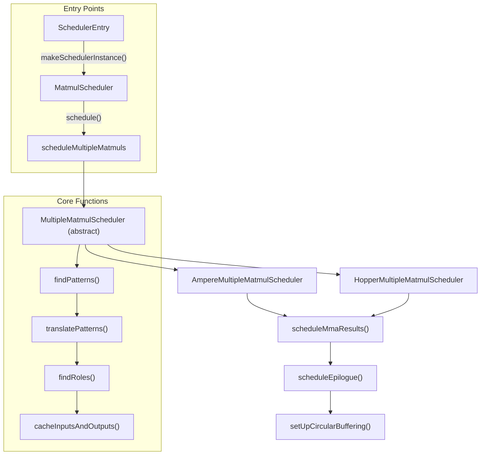
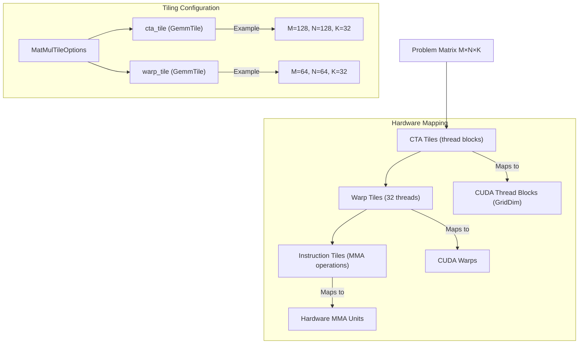
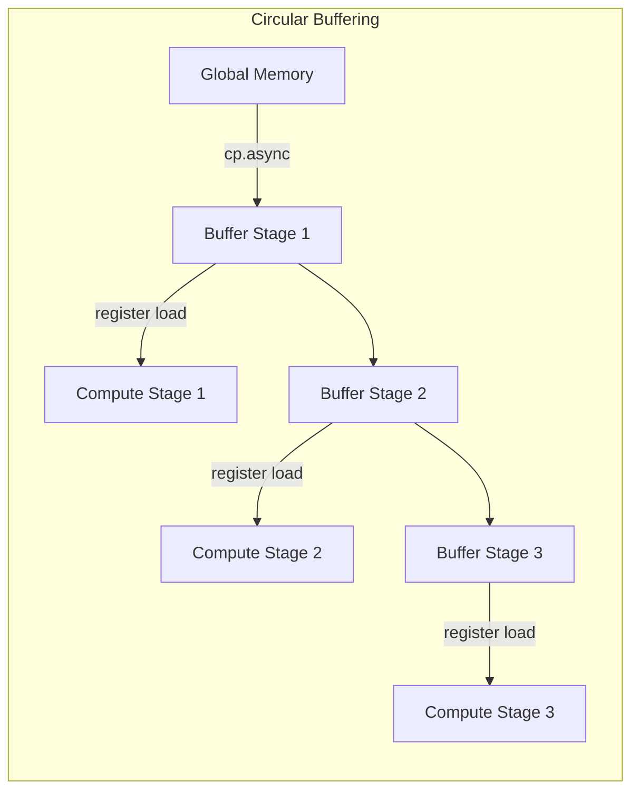
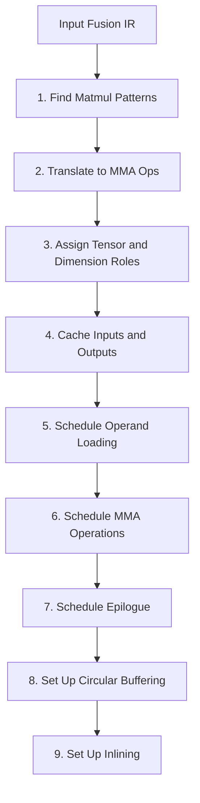

<!-- source: DeepWiki mcp.deepwiki.com · repo NVIDIA/Fuser · page 4.2 Matrix Multiplication Scheduling · fetched 2026-10-26 -->

# Matrix Multiplication Scheduling

<details>
<summary>Relevant source files</summary>

The following files were used as context for generating this wiki page:

- [csrc/mma_type.cpp](csrc/mma_type.cpp)
- [csrc/mma_type.h](csrc/mma_type.h)
- [csrc/scheduler/ampere_multi_matmul.cpp](csrc/scheduler/ampere_multi_matmul.cpp)
- [csrc/scheduler/ampere_multi_matmul.h](csrc/scheduler/ampere_multi_matmul.h)
- [csrc/scheduler/hopper_multi_matmul.cpp](csrc/scheduler/hopper_multi_matmul.cpp)
- [csrc/scheduler/hopper_multi_matmul.h](csrc/scheduler/hopper_multi_matmul.h)
- [csrc/scheduler/matmul.cpp](csrc/scheduler/matmul.cpp)
- [csrc/scheduler/matmul_utils.cpp](csrc/scheduler/matmul_utils.cpp)
- [csrc/scheduler/mma_utils.cpp](csrc/scheduler/mma_utils.cpp)
- [csrc/scheduler/mma_utils.h](csrc/scheduler/mma_utils.h)
- [csrc/scheduler/multi_matmul.cpp](csrc/scheduler/multi_matmul.cpp)
- [csrc/scheduler/multi_matmul.h](csrc/scheduler/multi_matmul.h)
- [runtime/array.cu](runtime/array.cu)
- [tests/cpp/test_matmul.cpp](tests/cpp/test_matmul.cpp)
- [tests/cpp/test_matmul_scheduler.cpp](tests/cpp/test_matmul_scheduler.cpp)
- [tests/cpp/test_mma.cpp](tests/cpp/test_mma.cpp)

</details>


This page documents how NVFUSER schedules matrix multiplication operations (matmul) for optimal performance across different NVIDIA GPU architectures. It covers the hierarchical tiling strategies, memory optimization techniques, and architecture-specific scheduling approaches used to generate efficient CUDA kernels for matmul operations.

For information about the different matmul heuristics, see [Scheduler Registry and Types](#4.1). For details on normalization and reduction operations, see [Normalization and Reduction Scheduling](#4.3).

## Matrix Multiplication Scheduling Architecture

Matrix multiplication scheduling in NVFUSER is implemented through a system of specialized schedulers that handle different GPU architectures and scheduling strategies.



Sources: [csrc/scheduler/matmul.cpp:61-69](), [csrc/scheduler/multi_matmul.cpp:17-68](), [csrc/scheduler/hopper_multi_matmul.cpp:129-169]()

## Matmul Tiling Hierarchy

NVFUSER uses a hierarchical tiling strategy for matrix multiplications. This enables efficient parallelization across the entire GPU programming model, from thread blocks down to individual threads.



The tiling hierarchy is defined by the `MatMulTileOptions` structure, which specifies tile sizes at different levels:

```
struct MatMulTileOptions {
  GemmTile cta_tile;    // Thread block (CTA) level tile
  GemmTile warp_tile;   // Warp level tile
};
```

Where `GemmTile` contains dimensions for the three matmul dimensions:

```
struct GemmTile {
  int64_t m, n, k;
};
```

Sources: [csrc/mma_type.h:48-64](), [csrc/scheduler/mma_utils.cpp:374-511](), [csrc/scheduler/matmul_utils.cpp:139-188]()

## Matrix Multiplication Data Flow

NVFUSER implements a carefully orchestrated data flow for matrix multiplication that maximizes data reuse and computational efficiency:

```mermaid
graph LR
    subgraph "Global Memory"
        A["Input A"] --> |"Load"| AR["A (Register Cache)"]
        B["Input B"] --> |"Load"| BR["B (Register Cache)"]
    end
    
    subgraph "Shared Memory"
        AR --> ACW["acw_smem"]
        BR --> BCW["bcw_smem"]
    end
    
    subgraph "Register Memory"
        ACW --> |"ldmatrix"| ACR["acr (Register)"]
        BCW --> |"ldmatrix"| BCR["bcr (Register)"]
        
        ACR --> |"broadcast"| AB["ab (Formatted A)"]
        BCR --> |"broadcast"| BB["bb (Formatted B)"]
        
        AB --> |"MMA Op"| MmaResult["mma_result (Accumulator)"]
        BB --> |"MMA Op"| MmaResult
    end
    
    subgraph "Epilogue"
        MmaResult --> |"Split-K Reduction"| SplitK["splitk_sum (Optional)"]
        SplitK --> |"Shared Memory Epilogue"| SmemEpilogue["smem_epilogue (Optional)"]
        SmemEpilogue --> |"Other Ops"| Epilogue["Bias/Activation/etc."]
    end
    
    Epilogue --> |"Store"| Output["Output (Global Memory)"]
```

The naming convention follows this pattern:
* **A, B**: Input matrices in global memory
* **acw_smem, bcw_smem**: Shared memory cache for A and B (cache write)
* **acr, bcr**: Register cache for data loaded from shared memory
* **ab, bb**: Broadcast and formatted operands ready for MMA operation
* **mma_result**: The output of the MMA operation (accumulation registers)
* **splitk_sum**: Optional tensor for Split-K reduction
* **smem_epilogue**: Optional shared memory tensor for epilogue operations

Sources: [csrc/scheduler/ampere_multi_matmul.h:15-66](), [csrc/scheduler/hopper_multi_matmul.h:15-62](), [csrc/scheduler/multi_matmul.cpp:427-498]()

## Architecture-Specific Matrix Multiplication 

NVFUSER provides specialized matrix multiplication implementations for different NVIDIA GPU architectures, leveraging hardware-specific features to maximize performance.

### Turing (SM 7.5) Matrix Multiplication

On Turing GPUs, NVFUSER uses:
- **MMA macros**: `Turing_16_8_8`, `Turing_16_8_16`, and `Turing_16_16_16`
- **Memory access**: `ldmatrix` instruction for efficient shared memory to register loading
- **Matrix instructions**: `mma.sync.m16n8k8` and similar instructions

### Ampere (SM 8.0+) Matrix Multiplication

For Ampere GPUs, NVFUSER implements:
- **MMA macros**: `Ampere_16_8_16` and `Ampere_16_16_16` 
- **Data types**: Support for both `Half` and `BFloat16`
- **Async memory operations**: `cp.async` for global to shared memory transfers
- **Circular buffering**: Advanced pipelining with configurable buffer stages



### Hopper (SM 9.0+) Matrix Multiplication

On Hopper GPUs, NVFUSER utilizes:
- **Warp Group MMA**: A variety of `wgmma` instructions with different tile sizes
- **TMA (Tensor Memory Accelerator)**: Efficient bulk transfers from global to shared memory
- **CGA (Cooperative Grid Array)**: Multi-level parallelism including cluster grid arrays
- **Flexible tiles**: Support for various MMA instructions from 64×8×16 up to 64×256×16
- **Memory swizzling**: Advanced swizzling patterns to avoid shared memory bank conflicts

Sources: [csrc/mma_type.h:131-246](), [csrc/scheduler/matmul_utils.cpp:139-335](), [csrc/scheduler/hopper_multi_matmul.cpp:74-510](), [csrc/scheduler/ampere_multi_matmul.cpp:32-152]()

## Scheduling Process for Matrix Multiplication

The scheduling process for matrix multiplication operations in NVFUSER follows a systematic approach that transforms fusion IR into optimized CUDA kernels:



1. **Find Patterns**: Detect matrix multiplication patterns in the fusion IR
2. **Translate Patterns**: Convert these patterns to MMA operations
3. **Find Roles**: Assign roles to tensors (operands, outputs) and dimensions (M, N, K, batch)
4. **Cache I/O**: Set up memory hierarchy with caching operations
5. **Schedule Operands**: Configure efficient loading of operands
6. **Schedule MMA Operations**: Set up the core matrix multiplication computations
7. **Schedule Epilogue**: Configure post-processing operations
8. **Set Up Circular Buffering**: Implement pipeline optimization
9. **Set Up Inlining**: Optimize the fusion structure

### Step 1-2: Finding and Translating Matmul Patterns

The scheduler first identifies matrix multiplication patterns in the fusion IR (e.g., `fusedMultiplySum` operations) and translates them to MMA operations with the appropriate macro.

```cpp
// Pattern identification and translation
void MultipleMatmulScheduler::findPatterns() {
  patterns_ = mma_utils::findMatmulPatterns(fusion_);
}

void MultipleMatmulScheduler::translatePatterns() {
  for (mma_utils::MatmulPattern& pattern : patterns_) {
    mma_utils::MatmulPattern::TranslationResult res = 
        pattern.translateToMmaOp();
    mma_results_.push_back(res.mma->out()->as<TensorView>());
  }
}
```

### Step 3: Assigning Tensor and Dimension Roles

The scheduler assigns roles to tensors (OPERAND_A, OPERAND_B, OUTPUT) and dimensions (M, N, K, Batch) to guide the scheduling process.

```cpp
// Role assignment
void MultipleMatmulScheduler::findRoles() {
  updateIdModel();
  const auto roles_opt = mma_utils::allPatternRoles(id_model_, patterns_);
  std::tie(id_roles_, tensor_roles_) = roles_opt.value();
}
```

### Step 4-9: Setting Up Memory Hierarchy and Scheduling

The scheduler then proceeds to set up the memory hierarchy, schedule the operations, and implement optimizations like circular buffering:

```cpp
// Key scheduling functions
void HopperMultipleMatmulScheduler::run() {
  findPatterns();
  translatePatterns();
  findRoles();
  cacheInputsAndOutputs(/*skip_intermediates=*/true);
  findRoles();
  inspectPrologues();
  setCGADims();
  scheduleOperands();
  scheduleMmaResults();
  scheduleEpilogue();
  scheduleSplitKSum();
  setUpInlining();
  setUpCircularBuffering();
}
```

Sources: [csrc/scheduler/multi_matmul.cpp:17-103](), [csrc/scheduler/hopper_multi_matmul.cpp:129-169](), [csrc/scheduler/ampere_multi_matmul.cpp:234-296]()

## Matrix Multiplication Scheduling Parameters

Matrix multiplication scheduling is controlled by a comprehensive set of parameters defined in the `MatmulParams` structure:

| Parameter | Description |
|-----------|-------------|
| `tile_sizes` | CTA and warp tile dimensions |
| `mma_macro` | The MMA instruction type (Turing, Ampere, Hopper) |
| `splitk_factor` | Factor for splitting K dimension across thread blocks |
| `async_gmem_load_operands` | Use async loads for global memory |
| `circular_buffer_options` | Configuration for circular buffering |
| `tiling_strategy` | How tiles are distributed across SMs |
| `cta_order` | Row or column-major traversal of tiles |
| `grid_traversal_factor` | Swizzle factor for grid traversal |
| `cluster_dims` | Dimensions for cluster grid array (Hopper) |

### Circular Buffer Options

Circular buffering is a key optimization technique that overlaps computation with memory operations:

```cpp
struct CircularBufferOptions {
  // Whether to use circular buffering for shared memory writes
  bool circular_buffer_smem_write = false;
  
  // Whether to use circular buffering for shared memory reads
  bool circular_buffer_smem_read = false;
  
  // Number of stages in the circular buffer
  int smem_circular_buffer_stage = 2;
};
```

Sources: [csrc/scheduler/matmul_heuristic.h:61-209](), [csrc/scheduler/matmul_utils.cpp:116-135](), [csrc/scheduler/mma_utils.cpp:78-98]()

## Scheduling Utilities for Matrix Multiplication

NVFUSER provides a rich set of utilities to implement the various aspects of matrix multiplication scheduling:

### Tile Scheduling Utilities

These functions help create and manage the hierarchical tiling:

```cpp
// Create hierarchical tiles for matmul
void makeTile(TensorView* tv, const std::vector<int64_t>& tile_sizes);

// Schedule warp-level tiles for tensors with reduction
void scheduleWarpTileWithReduction(
    TensorView* tv,
    MatMulTileOptions tile,
    MmaMacro macro);

// Schedule warp-level tiles for tensors without reduction
void scheduleWarpTileWithNoReduction(
    TensorView* tv,
    MatMulTileOptions tile,
    MmaMacro macro);
```

### Memory Access Utilities

These functions optimize memory access patterns:

```cpp
// Schedule vectorized loads from global to shared memory
void scheduleContiguousVectorLoad(
    TensorView* tv,
    MatMulTileOptions tile,
    int64_t vector_word,
    bool vectorize = true);

// Apply MMA swizzle patterns to operands
void scheduleOperandRead(TensorView* tv, MmaOperand operand);

// Schedule TMA loads for Hopper
void scheduleTMALoadForMma(
    TensorView* tv,
    MmaInputSmemSwizzle swizzle);

// Apply shared memory swizzling for bank conflict avoidance
AbstractTensor swizzleSharedMemory(TensorView* shared_mem_tv);
```

Sources: [csrc/scheduler/mma_utils.h:38-151](), [csrc/scheduler/mma_utils.cpp:253-954]()

## Conclusion

Matrix multiplication scheduling in NVFUSER is a sophisticated system that leverages architecture-specific optimizations and careful memory hierarchy management to achieve high performance. By using hierarchical tiling, memory access optimizations, and specialized hardware instructions, NVFUSER generates efficient CUDA kernels for matrix multiplication operations across different NVIDIA GPU architectures.

The scheduling approach adaptively selects the best strategies based on the problem size, GPU architecture, and other factors, ensuring optimal performance for this critical operation in deep learning and scientific computing workloads.

---

