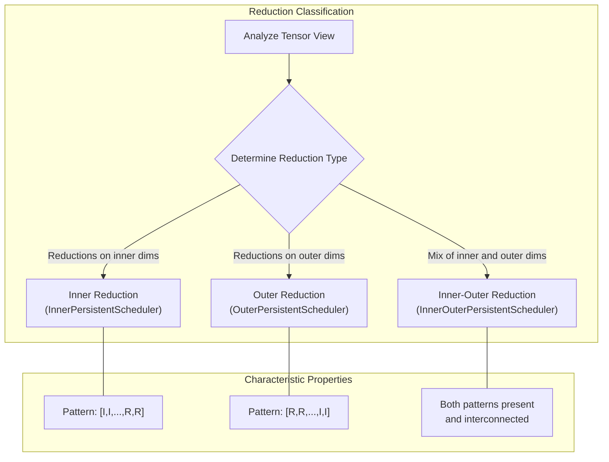
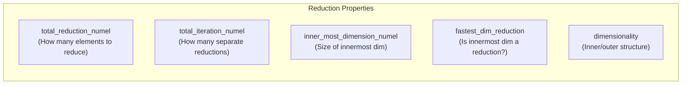
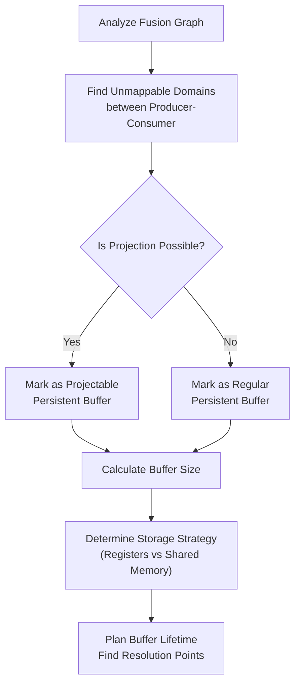
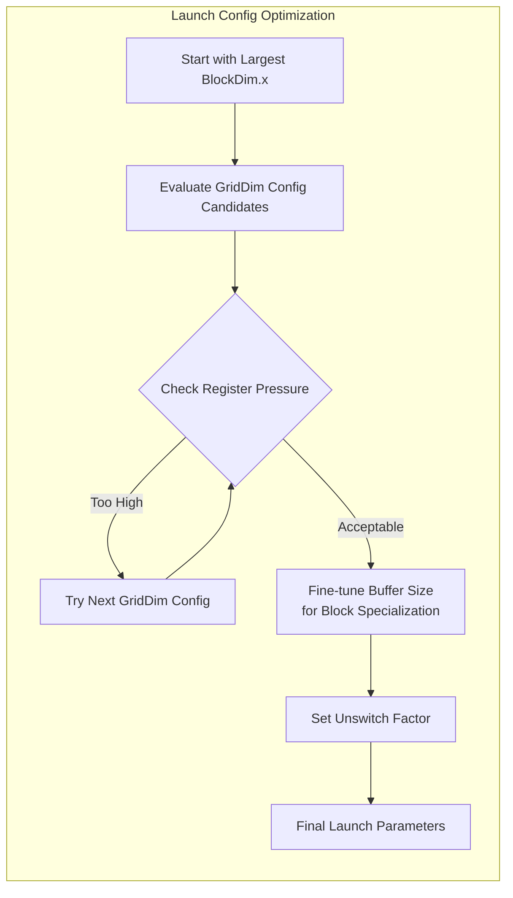
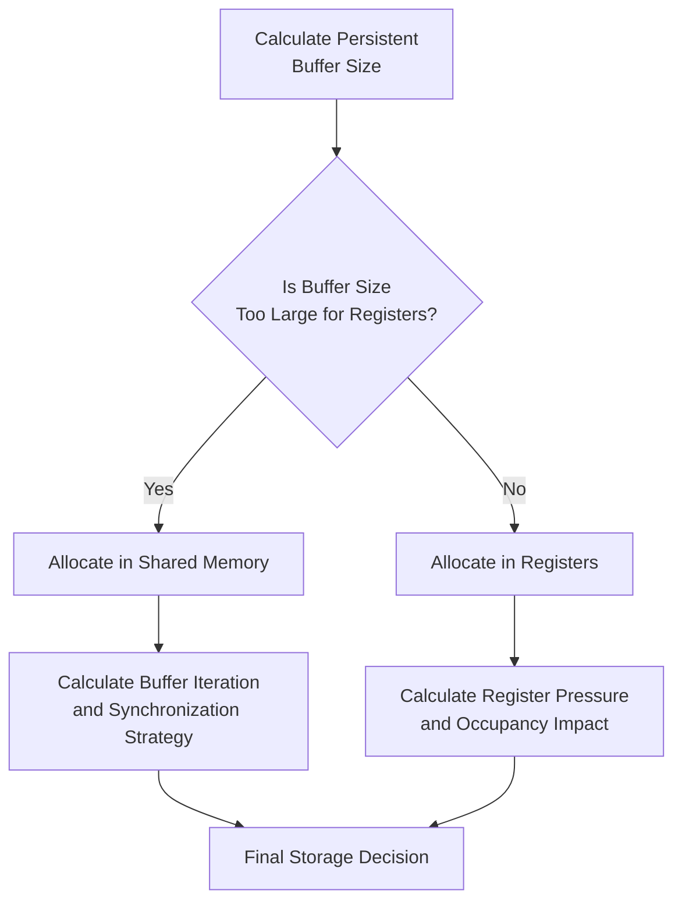
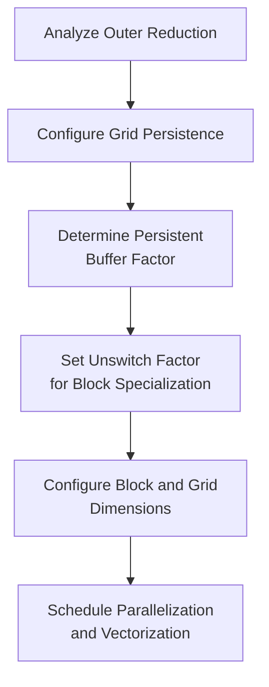
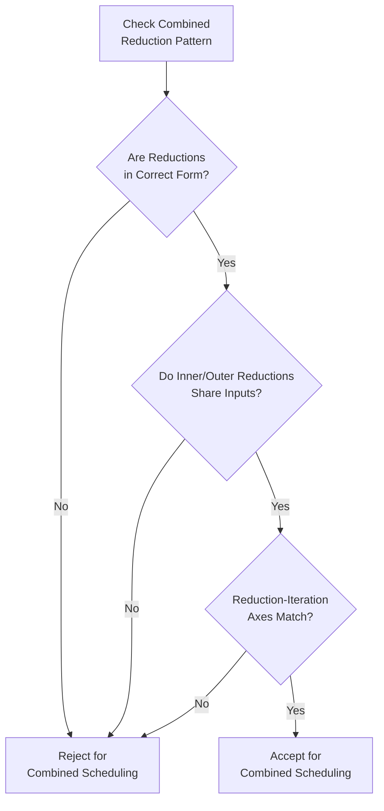
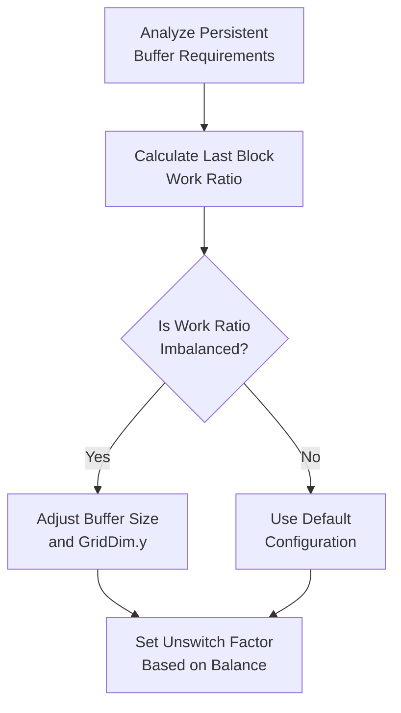
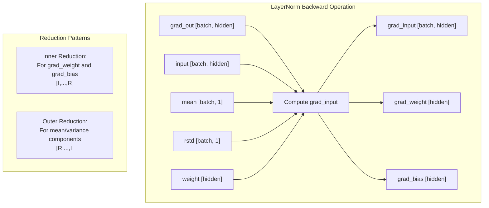
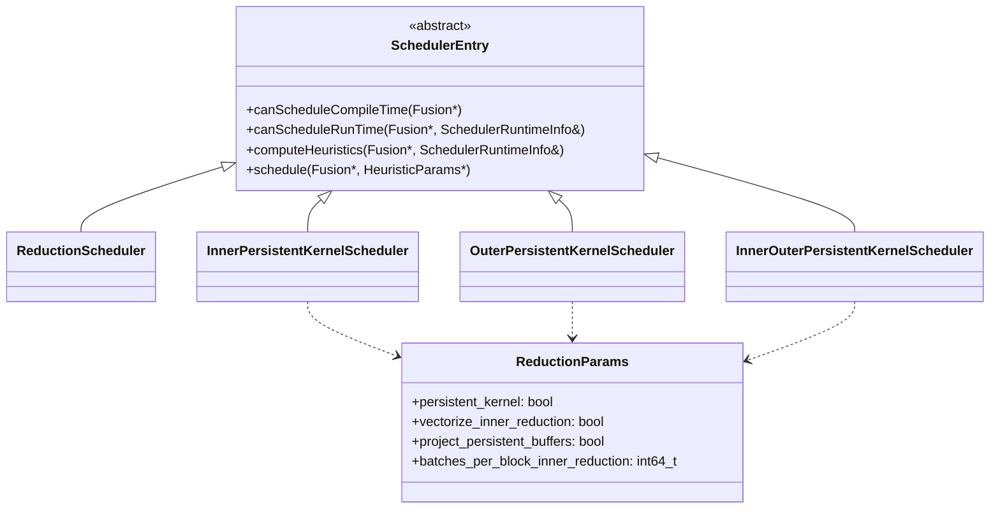

<!-- source: DeepWiki mcp.deepwiki.com · repo NVIDIA/Fuser · page 4.3 Normalization and Reduction Scheduling · fetched 2026-10-26 -->

# Normalization and Reduction Scheduling

<details>
<summary>Relevant source files</summary>

The following files were used as context for generating this wiki page:

- [csrc/scheduler/compile_time_info.h](csrc/scheduler/compile_time_info.h)
- [csrc/scheduler/normalization_inner.cpp](csrc/scheduler/normalization_inner.cpp)
- [csrc/scheduler/normalization_inner_outer.cpp](csrc/scheduler/normalization_inner_outer.cpp)
- [csrc/scheduler/normalization_outer.cpp](csrc/scheduler/normalization_outer.cpp)
- [csrc/scheduler/normalization_utils.cpp](csrc/scheduler/normalization_utils.cpp)
- [csrc/scheduler/normalization_utils.h](csrc/scheduler/normalization_utils.h)
- [csrc/scheduler/pointwise.cpp](csrc/scheduler/pointwise.cpp)
- [csrc/scheduler/reduction.cpp](csrc/scheduler/reduction.cpp)
- [csrc/scheduler/reduction_utils.cpp](csrc/scheduler/reduction_utils.cpp)
- [csrc/scheduler/reduction_utils.h](csrc/scheduler/reduction_utils.h)
- [csrc/scheduler/registry.cpp](csrc/scheduler/registry.cpp)
- [csrc/scheduler/registry.h](csrc/scheduler/registry.h)
- [csrc/scheduler/transpose.cpp](csrc/scheduler/transpose.cpp)
- [csrc/scheduler/utils.cpp](csrc/scheduler/utils.cpp)
- [csrc/scheduler/utils.h](csrc/scheduler/utils.h)
- [csrc/scheduler/vectorize_helper.cpp](csrc/scheduler/vectorize_helper.cpp)
- [csrc/scheduler/vectorize_helper.h](csrc/scheduler/vectorize_helper.h)
- [tests/cpp/test_combined_inner_outer_reduction.cpp](tests/cpp/test_combined_inner_outer_reduction.cpp)
- [tests/cpp/test_persistent_buffer.cpp](tests/cpp/test_persistent_buffer.cpp)

</details>


This page explains how NVFUSER schedules and optimizes normalization operations (like LayerNorm, BatchNorm) and reduction operations (sum, mean, etc.) using specialized scheduling strategies. The document covers how these schedulers analyze fusion patterns, manage persistent buffers, optimize launch configurations, and incorporate vectorization to maximize performance on NVIDIA GPUs.

For general information about the Scheduling System, see [Scheduling System](#4). For detailed information about Matrix Multiplication scheduling, see [Matrix Multiplication Scheduling](#4.2).

## Reduction Types and Scheduling Strategies

NVFUSER identifies three main reduction patterns and provides specialized schedulers for each:



The reduction type classification is determined by the position of reduction domains in tensor views:

- **Inner Reduction**: Reduction axes are innermost, following the iteration axes
- **Outer Reduction**: Reduction axes are outermost, preceding the iteration axes
- **Combined Inner-Outer**: Both patterns exist in the same fusion

Sources: [csrc/scheduler/normalization_inner_outer.cpp:182-207](). [csrc/scheduler/normalization_utils.cpp:517-665]().

### Key Dimensions in Reductions

When scheduling reductions, NVFUSER analyzes the following key properties:



These properties affect thread assignment, block size choices, vectorization, and persistent buffer planning decisions.

Sources: [csrc/scheduler/utils.cpp:761-829](), [csrc/scheduler/reduction_utils.cpp:25-53]().

## Persistent Buffer Management

Normalization and reduction operations often benefit from persistent buffers to avoid recomputing intermediate results. NVFUSER employs sophisticated analysis to identify and manage these buffers.

### Identifying Persistent Buffers

Persistent buffers are identified by mapping relationships between tensor iteration domains:



Resolution points determine how long a persistent buffer must stay live in the kernel.

Sources: [csrc/scheduler/utils.cpp:581-759]().

### Buffer Projection Strategies

NVFUSER can optimize memory usage by projecting persistent buffers:

| Strategy | Description | When Used |
|----------|-------------|-----------|
| **NoProjection** | Use persistent buffer directly | Default approach when projection provides no benefits |
| **ProjectToInputs** | Recompute from inputs instead of storing | When input data is smaller than intermediate buffers |
| **UseSmem** | Store in shared memory | For large buffers that exceed register limits |

The choice depends on buffer size, available resources, and the presence of expensive operators like `exp()` or random number generation.

Sources: [csrc/scheduler/normalization_utils.cpp:806-906](), [csrc/scheduler/utils.cpp:582-759]().

## Launch Configuration Optimization

NVFUSER tunes launch configurations based on reduction properties and persistent buffer requirements.

### Grid Outer Normalization Parameters

For outer reductions, NVFUSER optimizes thread block and grid dimensions using a specialized approach:



The `PreferredLaunchConfig` class manages the search through possible configurations, prioritizing those that minimize register spilling while maximizing occupancy.

Sources: [csrc/scheduler/normalization_utils.cpp:375-515]().

### Register vs. Shared Memory Allocation

NVFUSER carefully balances register usage and shared memory for persistent buffers:



The decision considers overhead factors, thread count, and warp utilization.

Sources: [csrc/scheduler/normalization_utils.cpp:778-806]().

## Inner Reduction Scheduling

Inner reduction scheduling optimizes for scenarios where reduction dimensions appear at the innermost positions of tensors.

### Key Scheduling Steps for Inner Reduction

1. Identify if reduction is on fastest dimensions
2. Determine persistent buffer size and storage location
3. Choose between persistent kernel approaches
4. Configure thread/block parallelization and vectorization

Example inner reduction TensorView scheduling:

```
tv[I0, I1, ..., R0, R1] → Split/Merge → tv[I_merged, R_merged] → 
Parallelization: I_merged(BIDx, TIDy), R_merged(TIDx, Vectorize)
```

This approach maps well to GPU architectures as it allows coalesced memory access for the innermost reduction dimensions.

Sources: [csrc/scheduler/normalization_inner.cpp:130-350](), [csrc/scheduler/reduction.cpp:61-142]().

## Outer Reduction Scheduling

Outer reduction scheduling handles cases where reduction dimensions appear at the outermost positions of tensors.

### Grid Persistent Strategy for Outer Reductions

NVFUSER implements grid persistence for outer reductions to maximize utilization:



The scheduler applies specialized thread block organization and synchronization strategies to optimize performance.

Sources: [csrc/scheduler/normalization_outer.cpp:62-217](), [csrc/scheduler/reduction_utils.cpp:122-145]().

## Combined Inner-Outer Reduction Scheduling

For fusions containing both inner and outer reductions (like many normalization operations), NVFUSER provides an integrated scheduler that handles both patterns simultaneously.

### Qualifying Criteria for Combined Scheduling



Sources: [csrc/scheduler/normalization_inner_outer.cpp:175-274]().

### Multi-Wave vs. Warp-Specialized Implementations

NVFUSER offers two implementation strategies for combined inner-outer scheduling:

| Strategy | Characteristics | Best For |
|----------|----------------|----------|
| **Multi-Wave** | Traditional approach with multiple waves of thread blocks | General case, widely applicable |
| **Warp-Specialized** | Uses specialized warp-level primitives to optimize communication | Newer hardware, can enable better performance |

The choice between these strategies can be controlled through runtime configuration options.

Sources: [csrc/scheduler/normalization_inner_outer.cpp:114-142]().

## Performance Optimization Techniques

NVFUSER employs several optimization techniques for normalization and reduction operations.

### Vectorization in Reduction Scheduling

Vectorization plays a critical role in reduction performance:


Vectorization allows multiple elements to be processed simultaneously, greatly improving memory bandwidth utilization and computational throughput.

Sources: [csrc/scheduler/vectorize_helper.cpp:124-184](), [csrc/scheduler/reduction.cpp:170-197]().

### Block Specialization for Efficient Predication

For persistent reductions, NVFUSER optimizes the handling of edge cases:



This optimization reduces branch divergence and improves efficiency by creating more balanced work distribution across thread blocks.

Sources: [csrc/scheduler/normalization_utils.cpp:259-374]().

## Example: Layer Normalization Backward Pass

Layer normalization backward pass exemplifies the benefits of combined inner-outer reduction scheduling:



This pattern is efficiently handled by the inner-outer persistent kernel scheduler, which balances resource utilization and ensures high performance.

Sources: [tests/cpp/test_combined_inner_outer_reduction.cpp:50-141]().

## Registration in Scheduler System

Normalization and reduction schedulers are registered with NVFUSER's scheduler system to enable automatic selection based on fusion patterns.



The `SchedulerEntry::makeSchedulerInstance` factory method creates the appropriate scheduler based on the identified type.

Sources: [csrc/scheduler/registry.cpp:83-112](), [csrc/scheduler/normalization_utils.cpp:695-706]().

## Summary

NVFUSER's normalization and reduction scheduling system provides specialized optimizations for different reduction patterns. The system:

1. Classifies reductions as inner, outer, or combined
2. Manages persistent buffers to minimize recomputation
3. Optimizes launch configurations for specific reduction patterns
4. Applies vectorization and smart predication handling
5. Projects buffers to inputs when beneficial
6. Balances register and shared memory usage

These capabilities enable high-performance implementations of normalization operations like LayerNorm, BatchNorm, and various reduction operations across diverse workloads.

---

