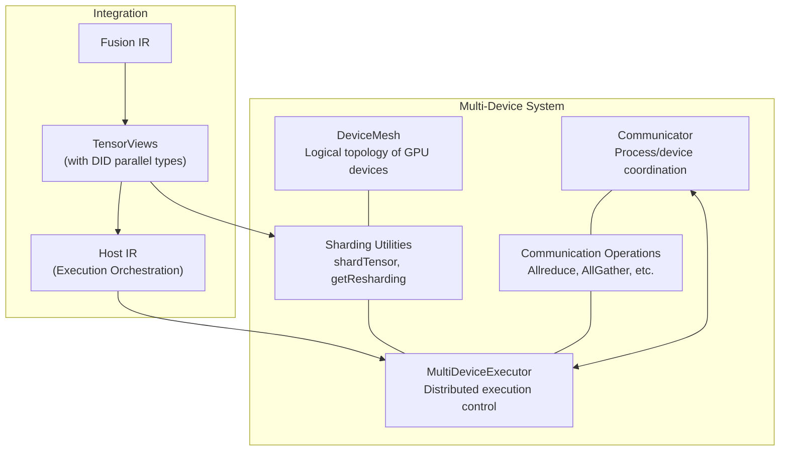
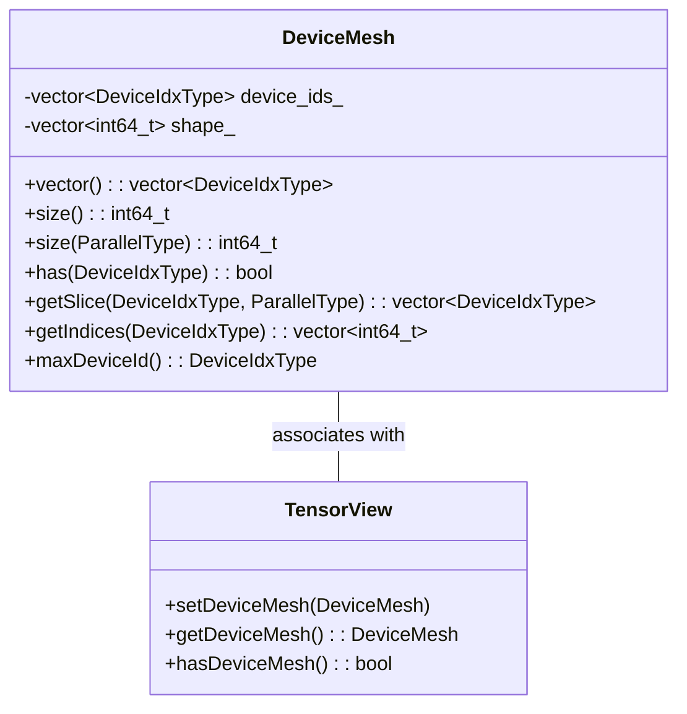
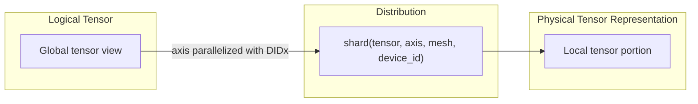
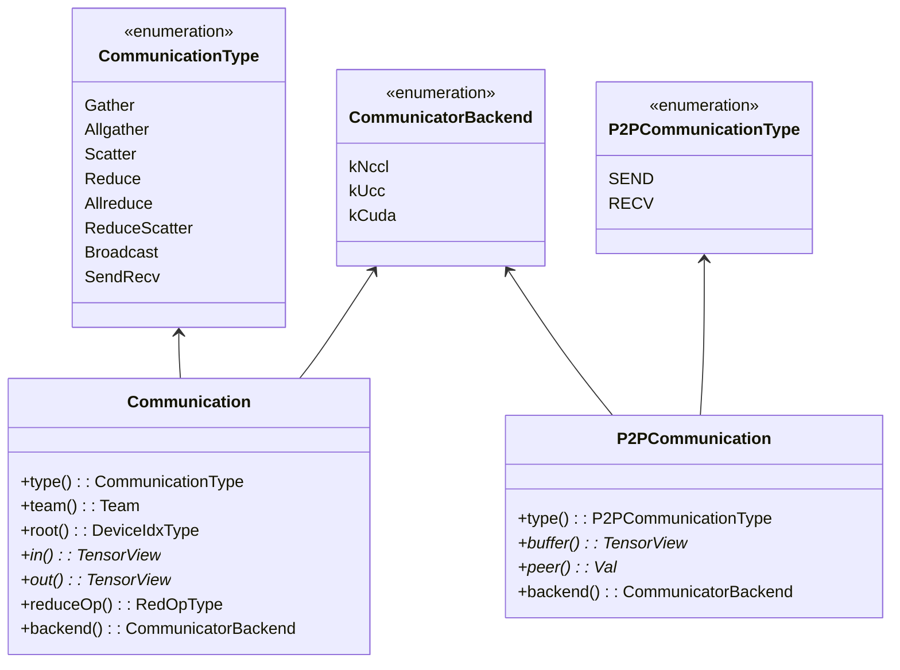
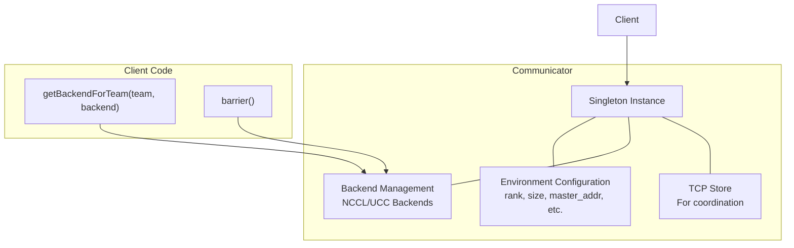
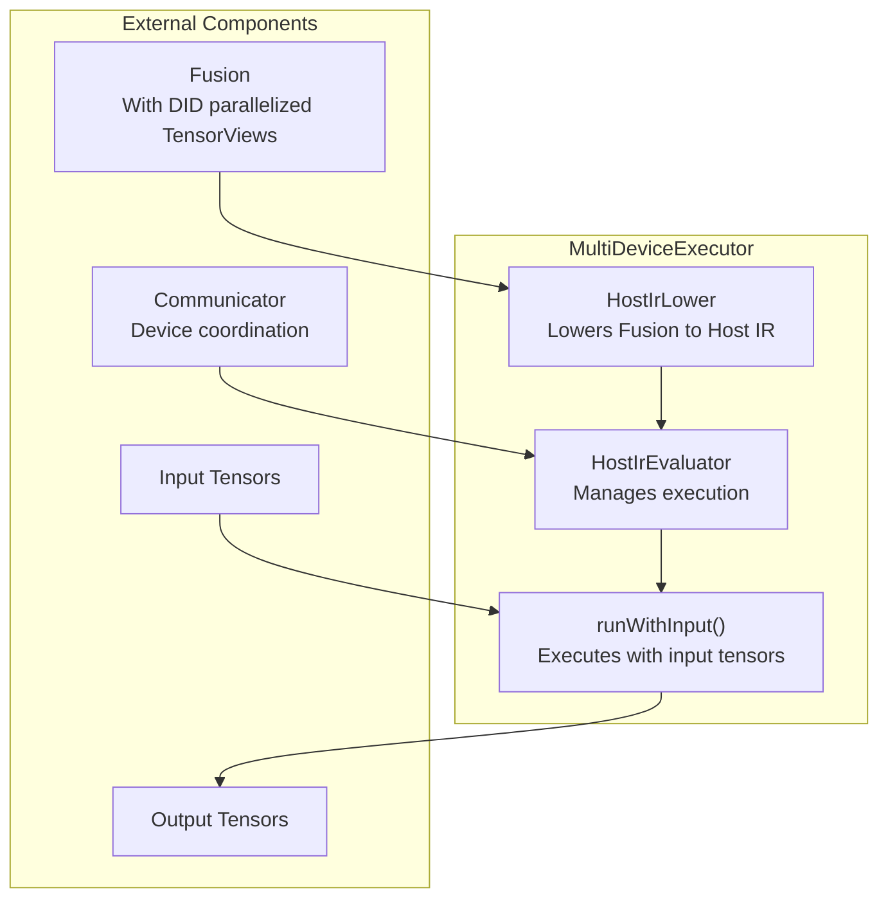

<!-- source: DeepWiki mcp.deepwiki.com · repo NVIDIA/Fuser · page 5 Multi-Device Support · fetched 2026-10-26 -->

# Multi-Device Support

<details>
<summary>Relevant source files</summary>

The following files were used as context for generating this wiki page:

- [csrc/multidevice/c10d_mock.h](csrc/multidevice/c10d_mock.h)
- [csrc/multidevice/communication.cpp](csrc/multidevice/communication.cpp)
- [csrc/multidevice/communication.h](csrc/multidevice/communication.h)
- [csrc/multidevice/communicator.cpp](csrc/multidevice/communicator.cpp)
- [csrc/multidevice/communicator.h](csrc/multidevice/communicator.h)
- [csrc/multidevice/executor.cpp](csrc/multidevice/executor.cpp)
- [csrc/multidevice/executor.h](csrc/multidevice/executor.h)
- [csrc/multidevice/ipc_handle.cpp](csrc/multidevice/ipc_handle.cpp)
- [csrc/multidevice/utils.cpp](csrc/multidevice/utils.cpp)
- [csrc/multidevice/utils.h](csrc/multidevice/utils.h)
- [csrc/preseg_passes/insert_reshardings.cpp](csrc/preseg_passes/insert_reshardings.cpp)
- [tests/cpp/test_multidevice_communications.cpp](tests/cpp/test_multidevice_communications.cpp)
- [tests/cpp/test_multidevice_host_ir.cpp](tests/cpp/test_multidevice_host_ir.cpp)
- [tests/cpp/test_multidevice_ipc.cpp](tests/cpp/test_multidevice_ipc.cpp)
- [tests/cpp/test_multidevice_sharding.cpp](tests/cpp/test_multidevice_sharding.cpp)
- [tests/cpp/test_resharding.cpp](tests/cpp/test_resharding.cpp)
- [tests/cpp/test_sharding.cpp](tests/cpp/test_sharding.cpp)

</details>


This page documents NVFUSER's multi-device support capabilities for executing fused operations across multiple NVIDIA GPUs. It covers the system architecture for tensor sharding, distributed execution, and inter-device communication. For device-specific code generation, see [Code Generation](#3), and for scheduling strategies, see [Scheduling System](#4).

## Architecture Overview

NVFUSER's multi-device system enables distributed tensor operations by providing mechanisms for:

1. **Tensor Sharding**: Distributing tensor data across multiple devices
2. **Communication Primitives**: Transferring data between devices
3. **Coordinated Execution**: Orchestrating execution across the device mesh

The architecture follows a device-mesh model where computations are distributed based on parallel annotations in the IR, with explicit communication operations for data exchange.



Sources: [csrc/multidevice/utils.h:19-164](), [csrc/multidevice/communicator.h:30-160](), [csrc/multidevice/executor.h:25-115]()

## Device Mesh

The `DeviceMesh` represents a logical organization of GPU devices and defines how tensors are distributed across devices.



Device meshes can be:

1. **1D**: Linear array of devices (most common)
2. **2D/3D**: Multi-dimensional arrangement for more complex distribution patterns

Each device in the mesh is identified by a unique `DeviceIdxType` which corresponds to its GPU index (CUDA device ID).

Sources: [csrc/multidevice/utils.h:31-43](), [tests/cpp/test_sharding.cpp:210-235]()

## Tensor Sharding

Tensor sharding is the process of distributing a tensor across multiple devices. NVFUSER implements this through parallelization of TensorView domains with device-specific parallel types.

### Sharding Mechanism

Sharding is applied to tensor dimensions using the `DIDx` parallel type (and other device dimension types):



Key components:

1. **Parallel Types**: `ParallelType::DIDx`, `ParallelType::DIDy`, `ParallelType::DIDz` - Designate dimensions to be distributed
2. **DeviceMesh Association**: Tensors must be associated with a device mesh
3. **Sharding Functions**: Utilities to distribute and recombine tensors

Sources: [csrc/multidevice/utils.cpp:260-291](), [csrc/multidevice/utils.cpp:26-53]()

### Core Sharding Functions

```
shardTensor(at::Tensor tensor, int64_t axis, const DeviceMesh& mesh, DeviceIdxType device_id)
```
Slices a tensor along a specified axis based on the device's position in the mesh.

```
isSharded(const TensorView* tv)
```
Determines if a tensor view has a dimension parallelized with a device dimension.

```
unshardedSizes(const TensorView* tv, c10::IntArrayRef sizes)
```
Calculates the global tensor shape from a local sharded tensor shape.

Sources: [csrc/multidevice/utils.cpp:91-291](), [csrc/multidevice/utils.cpp:260-277]()

### Resharding

Resharding occurs when tensors with different sharding patterns need to interact. The system can detect and handle different sharding patterns through:

```
haveDifferentShardings(const TensorView* producer, const TensorView* consumer)
```
Detects if two tensors have incompatible sharding.

```
isResharding(const Expr* expr)
```
Determines if an expression requires resharding due to different sharding between inputs and outputs.

When resharding is required, the system may insert communication operations automatically.

Sources: [csrc/multidevice/utils.cpp:373-587](), [preseg_passes/insert_reshardings.cpp:20-297]()

## Communication System

NVFUSER's communication system provides primitives for data exchange between devices, built on top of existing communication libraries like NCCL and UCC.

### Communication Types



The communication system supports two main categories:

1. **Collective Operations**: Operations involving multiple devices
   - `Allreduce`: Reduces values across devices and distributes results to all
   - `Allgather`: Gathers values from all devices to all devices
   - `ReduceScatter`: Reduces values and scatters the results
   - `Broadcast`: Distributes values from one device to all others

2. **Point-to-Point Operations**: Direct communications between pairs of devices
   - `Send`: Transmits data from one device to another
   - `Recv`: Receives data from another device

Sources: [csrc/multidevice/communication.h:26-167](), [csrc/multidevice/communication.cpp:19-49]()

### Communicator

The `Communicator` class manages the device coordination and backend creation:



Key capabilities:
- Backend creation and management for device teams
- Process identification and coordination
- Environment parsing for distributed configuration
- Barrier synchronization

Sources: [csrc/multidevice/communicator.cpp:165-401](), [csrc/multidevice/communicator.h:48-160]()

## MultiDevice Execution

The `MultiDeviceExecutor` orchestrates the execution of a fusion across multiple devices:



The execution process involves:
1. **Lowering**: Converting the fusion to host IR with appropriate communication operations
2. **Execution**: Running the host IR program across devices
3. **Synchronization**: Coordinating execution and communication between devices

Sources: [csrc/multidevice/executor.cpp:23-62](), [csrc/multidevice/executor.h:77-115]()

## Practical Usage

To use multi-device capabilities:

1. **Define Device Mesh**:
   ```cpp
   auto mesh = DeviceMesh::createForNumDevices(num_devices);
   ```

2. **Associate Tensors with Mesh**:
   ```cpp
   tv->setDeviceMesh(mesh);
   ```

3. **Apply Parallelization**:
   ```cpp
   tv->axis(axis_index)->parallelize(ParallelType::DIDx);
   ```

4. **Execute with MultiDeviceExecutor**:
   ```cpp
   MultiDeviceExecutor executor(std::move(fusion), communicator);
   auto outputs = executor.runWithInput(inputs);
   ```

### Common Patterns

#### 1. Data-Parallel Execution

Distribute tensors along the batch dimension for data-parallel training.

```cpp
// Shard on the batch dimension (0)
tv->axis(0)->parallelize(ParallelType::DIDx);
```

#### 2. Model-Parallel Execution

Distribute tensors along feature dimensions for model-parallel training.

```cpp
// Shard on a feature dimension
tv->axis(2)->parallelize(ParallelType::DIDx);
```

#### 3. Combining Sharded Operations

```cpp
// Input sharded along dim 0
tv0->axis(0)->parallelize(ParallelType::DIDx);

// Computation preserves sharding
tv1 = add(tv0, tv0);

// Reduction along non-sharded dimension (no communication)
tv2 = sum(tv1, {1});

// Reduction along sharded dimension (requires allreduce)
tv3 = sum(tv1, {0});
```

Sources: [tests/cpp/test_multidevice_sharding.cpp:31-152](), [tests/cpp/test_multidevice_host_ir.cpp:44-237]()

## Performance Considerations

1. **Minimize Resharding**: Avoid operations that change sharding patterns
2. **Coalesce Communications**: Group communications to reduce latency
3. **Choose Appropriate Sharding Dimensions**: Consider computation patterns
4. **Balance Computation and Communication**: Find optimal distribution strategy

Sources: [tests/cpp/test_multidevice_communications.cpp:420-487]()

## Limitations

1. Currently supports 1D device meshes most robustly, with experimental support for multi-dimensional meshes
2. Only one dimension per tensor can be parallelized with `DIDx`
3. Inner resharding (resharding non-outer dimensions) has limited support
4. Auto-scheduling for multi-device is under development

Sources: [csrc/multidevice/executor.h:39-76]()

## Implementation Requirements

1. Distributed environment (multiple GPUs)
2. Proper environment configuration
3. Communication backend support (NCCL or UCC)

Sources: [csrc/multidevice/communicator.cpp:84-124]()

---

