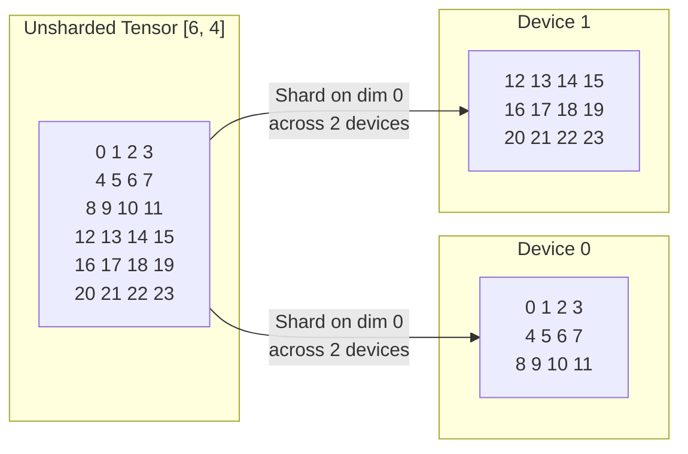
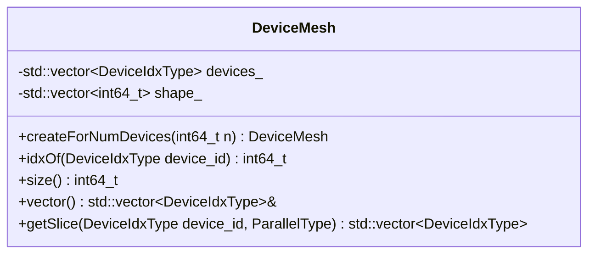
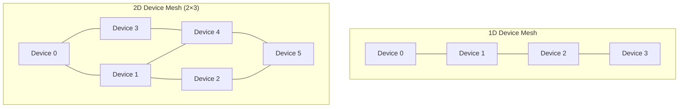
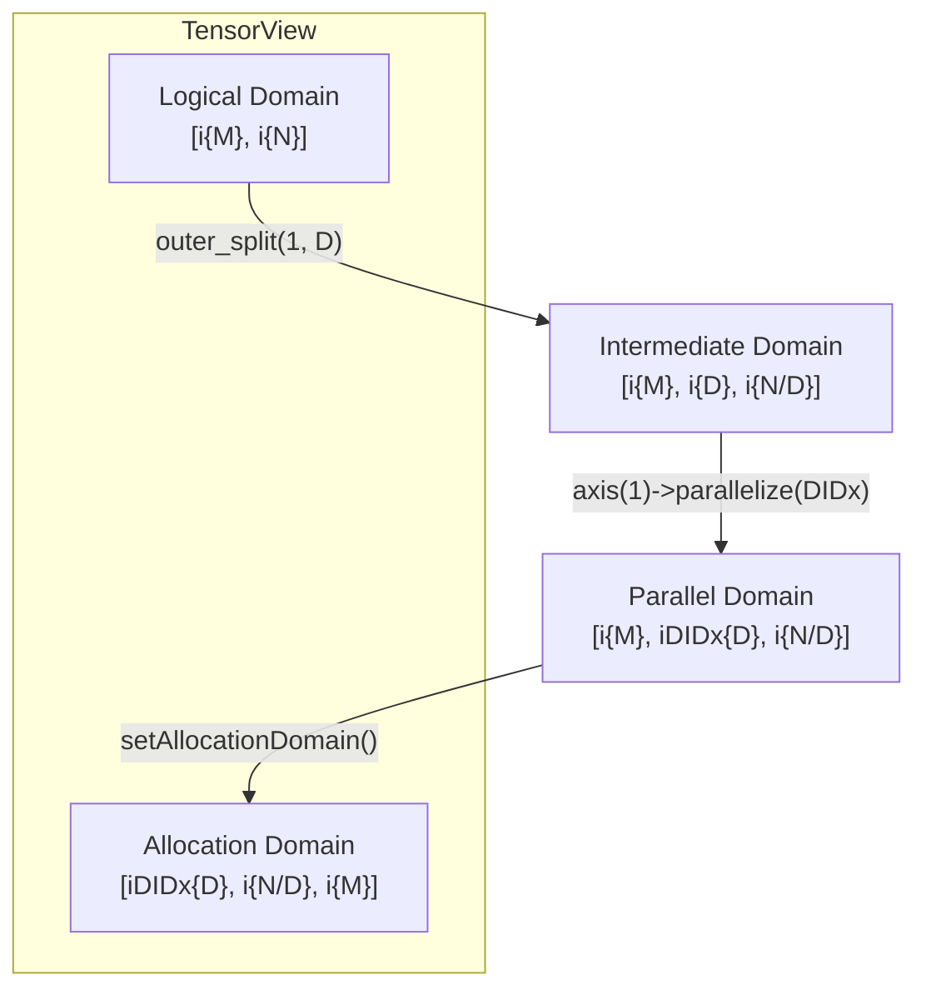
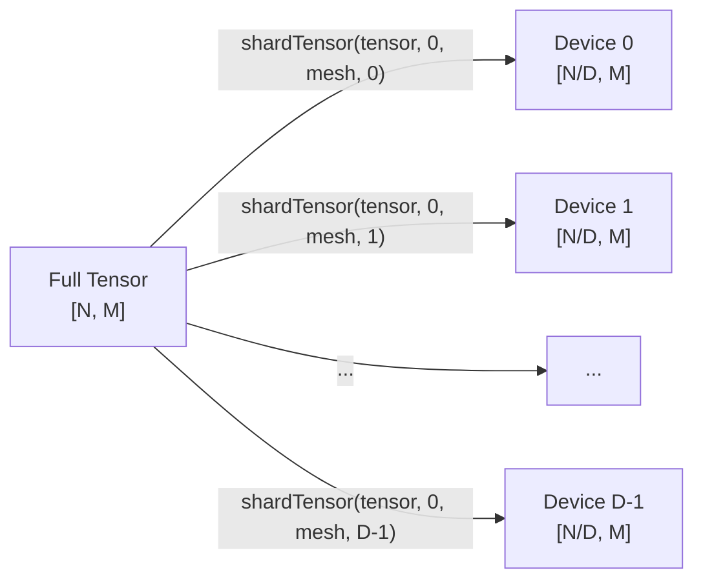
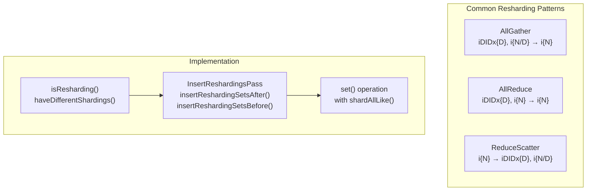
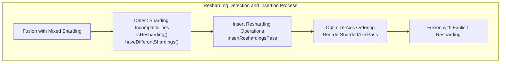
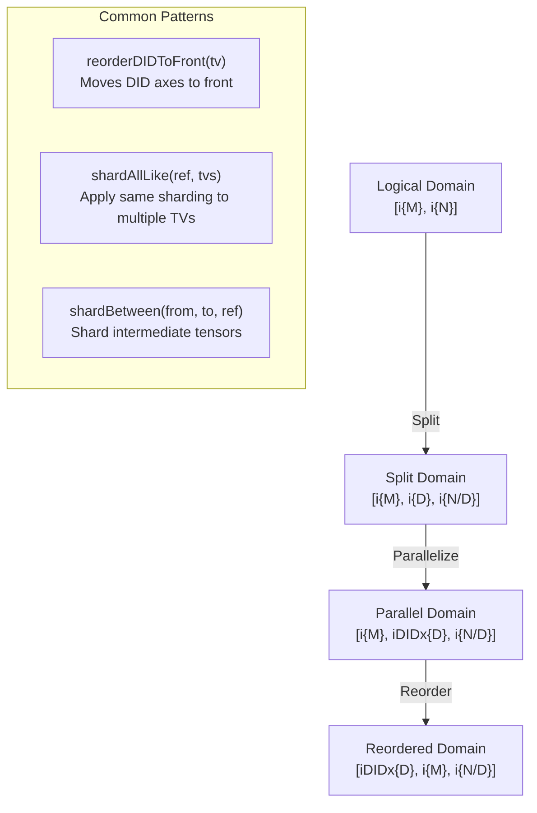
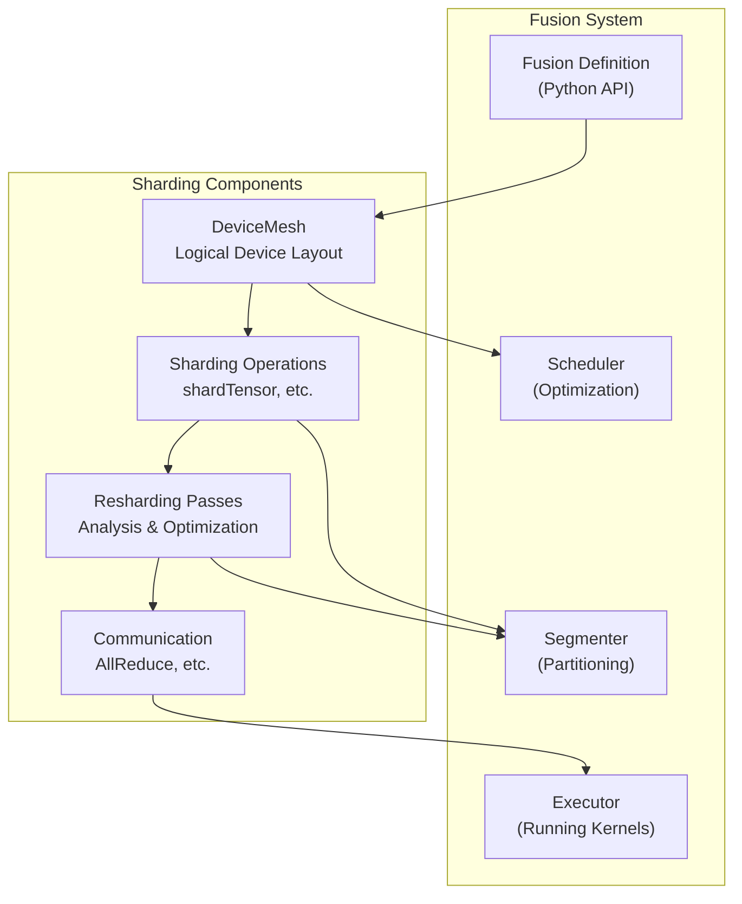

<!-- source: DeepWiki mcp.deepwiki.com · repo NVIDIA/Fuser · page 5.1 Tensor Sharding · fetched 2026-10-26 -->

# Tensor Sharding

<details>
<summary>Relevant source files</summary>

The following files were used as context for generating this wiki page:

- [csrc/multidevice/utils.cpp](csrc/multidevice/utils.cpp)
- [csrc/multidevice/utils.h](csrc/multidevice/utils.h)
- [csrc/preseg_passes/insert_reshardings.cpp](csrc/preseg_passes/insert_reshardings.cpp)
- [tests/cpp/test_multidevice_sharding.cpp](tests/cpp/test_multidevice_sharding.cpp)
- [tests/cpp/test_resharding.cpp](tests/cpp/test_resharding.cpp)
- [tests/cpp/test_sharding.cpp](tests/cpp/test_sharding.cpp)

</details>


This document explains tensor sharding in NVFUSER, which is a key mechanism for distributing tensor computations across multiple GPUs. We'll cover how tensors are partitioned (sharded) across devices, how sharding is represented in the NVFUSER IR system, and how tensor operations across different sharding configurations are handled. For related multi-device communication primitives, see [Communication Primitives](#5.2).

## Introduction to Tensor Sharding

Tensor sharding refers to partitioning a tensor along one or more dimensions and distributing the pieces across multiple compute devices (GPUs). This enables:

1. Parallel computation across devices
2. Processing tensors larger than a single device's memory
3. Communication-efficient distributed algorithms

In NVFUSER, sharding is represented through:
- **Device Meshes**: Logical arrangements of devices
- **Device Parallel Types**: Special parallel types like `DIDx` assigned to IterDomains
- **Sharding Operations**: Functions to partition tensors and analyze sharding properties

### Basic Tensor Sharding Example

Tensor Sharding Visualization


Sources: [csrc/multidevice/utils.cpp:260-277](), [tests/cpp/test_multidevice_sharding.cpp:539-563]()

## Device Mesh

A `DeviceMesh` is a container representing the logical arrangement of CUDA devices used for distributed computation. It may be one-dimensional (a simple array of device indices) or multi-dimensional (a grid of devices).

Device Mesh Structure


### Examples of Device Meshes

Device Mesh Examples


Common creation patterns:
```
// 1D mesh with sequential device IDs
DeviceMesh mesh = DeviceMesh::createForNumDevices(num_devices);

// 2D mesh with specific device IDs and shape
DeviceMesh mesh({0, 1, 2, 3, 4, 5}, {2, 3});
```

Sources: [tests/cpp/test_sharding.cpp:210-235]()

## Sharding Representation in IR

In NVFUSER's IR system, tensor sharding is represented by marking specific IterDomains with device parallel types such as `ParallelType::DIDx`. This indicates that the dimension should be divided across the devices in the mesh.

Tensor Domain and Sharding


Each TensorView in NVFUSER has:
1. **Logical Domain**: The original tensor dimensions before sharding
2. **Loop Domain**: The domain with transformations including splits for sharding
3. **Allocation Domain**: The domain that defines physical memory layout

Sources: [csrc/multidevice/utils.cpp:91-118](), [tests/cpp/test_sharding.cpp:32-64]()

## Sharding Operations

### Sharding a Tensor

The `shardTensor` function divides a tensor along a specified axis for a particular device in the mesh:

```
// Shard a tensor along axis 0 for the current device
at::Tensor sharded = shardTensor(tensor, /*axis=*/0, mesh, device_id);
```

Sharding Operation


Sources: [csrc/multidevice/utils.cpp:260-277](), [tests/cpp/test_multidevice_sharding.cpp:539-563]()

### Analyzing Sharding Properties

NVFUSER provides several functions to analyze the sharding properties of tensors:

| Function | Purpose |
|----------|---------|
| `isSharded(tv)` | Determines if a TensorView has any dimension sharded |
| `getShardedLogicalAxis(tv, PT)` | Returns the logical axis sharded with the given parallel type |
| `getShardedLoopAxis(tv, PT)` | Returns the loop axis parallelized with the given parallel type |
| `haveDifferentShardings(producer, consumer)` | Checks if two tensors have incompatible shardings |
| `numDeviceDims(tv)` | Counts device parallel dimensions in a TensorView |

Sources: [csrc/multidevice/utils.h:37-56](), [csrc/multidevice/utils.cpp:91-118](), [csrc/multidevice/utils.cpp:169-243](), [csrc/multidevice/utils.cpp:373-587]()

## Resharding Operations

When tensors with different sharding patterns need to interact, resharding operations are required. These operations transform the data distribution to ensure compatible tensor layouts.

Resharding Patterns


Common resharding patterns:

1. **AllGather**: Combines sharded data from all devices into a complete tensor
2. **AllReduce**: Reduces values across all devices and broadcasts the result
3. **ReduceScatter**: Reduces values across devices and distributes results

Sources: [csrc/preseg_passes/insert_reshardings.cpp:20-237](), [csrc/multidevice/utils.cpp:56-89](), [tests/cpp/test_resharding.cpp:398-447]()

## Detection and Insertion of Resharding Operations

NVFUSER automatically detects when resharding is needed and inserts appropriate operations. This is handled primarily through pre-segmentation passes.



The resharding insertion process:

1. **Detect incompatibilities** using `isResharding()` and `haveDifferentShardings()`
2. **Insert resharding** with `set()` operations via `InsertReshardingsPass`
3. **Optimize axis ordering** with `ReorderShardedAxisPass`
4. **Make resharding contiguous** with `MakeReshardingContiguousPass`

Sources: [csrc/preseg_passes/insert_reshardings.cpp:30-131](), [tests/cpp/test_resharding.cpp:512-572]()

## Common Sharding Transformations

### Outer Split Sharding

The most common pattern is to use an outer split to create a sharded dimension:

```
// Shard a tensor on dimension 1 across the device mesh
tv->outer_split(1, mesh.size());
tv->axis(1)->parallelize(ParallelType::DIDx);
```

### Sharding with Loop Transformations

Sharding can be combined with other loop transformations:

Sharding with Transformations


Some common sharding transformations:

1. `reorderDIDToFront(tv)`: Reorder loops to place DID-parallelized axes at the beginning
2. `shardAllLike(ref, tvs)`: Apply the same sharding pattern to multiple tensors
3. `shardBetween(from, to, ref)`: Shard all tensors between two sets of expressions

Sources: [csrc/multidevice/utils.cpp:633-683](), [csrc/multidevice/utils.cpp:724-740](), [tests/cpp/test_multidevice_sharding.cpp:714-746]()

## Handling Special Cases

### Broadcast Domains

Broadcast domains require special handling in sharded tensors since they're expanded during computation.

```
// Broadcast with sharding
TensorView* in = makeTensor({D*3, 8});
in->axis(0)->parallelize(ParallelType::DIDx);
TensorView* broadcasted = broadcast(in, {true, false, false}); // [1, D*3, 8]
```

### Reduction Operations

Reduction operations across sharded dimensions result in AllReduce communication patterns:

```
// Reduction with sharding (AllReduce)
TensorView* in = makeTensor({D, N});
in->axis(0)->parallelize(ParallelType::DIDx); // [DIDx{D}, N]
TensorView* out = sum(in, {0}); // Allreduce
```

Sources: [tests/cpp/test_multidevice_sharding.cpp:457-535](), [tests/cpp/test_resharding.cpp:430-447]()

## Practical Sharding Patterns

### Column-Parallel Sharding

```
// Shard tensor along columns (dimension 1)
tv->outer_split(1, mesh.size());
tv->axis(1)->parallelize(ParallelType::DIDx);
```

### Row-Parallel Sharding

```
// Shard tensor along rows (dimension 0)
tv->outer_split(0, mesh.size());
tv->axis(0)->parallelize(ParallelType::DIDx);
```

### Multi-Dimensional Sharding

With 2D or 3D device meshes, tensors can be sharded along multiple dimensions:

```
// 2D sharding pattern
tv->outer_split(0, mesh.size(ParallelType::DIDx));
tv->outer_split(1, mesh.size(ParallelType::DIDy));
tv->axis(0)->parallelize(ParallelType::DIDx);
tv->axis(2)->parallelize(ParallelType::DIDy);
```

Sources: [tests/cpp/test_sharding.cpp:210-235](), [tests/cpp/test_multidevice_sharding.cpp:342-378]()

## Integration with Fusion System

The tensor sharding system integrates with NVFUSER's fusion system through several components:

Sharding in Fusion Context


Key integration points:

1. **Pre-segmentation Passes**: Analyze and optimize sharding before segmentation
2. **Segmentation**: Respect sharding boundaries during fusion segmentation
3. **Scheduling**: Apply device-specific optimizations for sharded tensors
4. **Execution**: Handle device communication during kernel execution

Sources: [csrc/multidevice/utils.cpp:724-775](), [tests/cpp/test_multidevice_sharding.cpp:17-31]()

## Performance Considerations

Tensor sharding introduces several performance considerations:

1. **Resharding Costs**: Communication operations like AllGather and AllReduce can be expensive
2. **Parallelization Benefits**: Sharding enables parallel computation across devices
3. **Memory Distribution**: Sharding allows processing larger tensors by distributing memory requirements

Optimizing sharded tensor operations typically involves:

- Minimizing the number of resharding operations
- Ensuring sharded axes are in optimal positions (using `reorderDIDToFront`)
- Choosing appropriate dimensions to shard based on operation patterns
- Using appropriate device mesh configurations for the algorithm

Sources: [csrc/multidevice/utils.cpp:607-631](), [csrc/multidevice/utils.cpp:724-740]()

---

