<!-- source: DeepWiki mcp.deepwiki.com · repo NVIDIA/Fuser · page 5.2 Communication Primitives · fetched 2026-10-26 -->

# Communication Primitives

Relevant source files

The following files were used as context for generating this wiki page:

- [csrc/multidevice/c10d_mock.h](csrc/multidevice/c10d_mock.h)
- [csrc/multidevice/communication.cpp](csrc/multidevice/communication.cpp)
- [csrc/multidevice/communication.h](csrc/multidevice/communication.h)
- [csrc/multidevice/communicator.cpp](csrc/multidevice/communicator.cpp)
- [csrc/multidevice/communicator.h](csrc/multidevice/communicator.h)
- [csrc/multidevice/executor.cpp](csrc/multidevice/executor.cpp)
- [csrc/multidevice/executor.h](csrc/multidevice/executor.h)
- [csrc/multidevice/ipc_handle.cpp](csrc/multidevice/ipc_handle.cpp)
- [tests/cpp/test_multidevice_communications.cpp](tests/cpp/test_multidevice_communications.cpp)
- [tests/cpp/test_multidevice_host_ir.cpp](tests/cpp/test_multidevice_host_ir.cpp)
- [tests/cpp/test_multidevice_ipc.cpp](tests/cpp/test_multidevice_ipc.cpp)

## Purpose and Scope

This document describes the communication primitives available in NVFUSER's multi-device support system. These primitives enable distributed tensor operations across multiple GPUs by providing efficient inter-device data transfer mechanisms. This page covers both collective operations (like AllReduce, AllGather) and point-to-point communications, along with their implementation details and usage.

For information about tensor sharding across devices, see [Tensor Sharding](#5.1).

## Architecture Overview

NVFUSER's communication system provides abstractions for various types of inter-GPU communications built on top of backend libraries like NCCL and UCC. The system integrates with NVFUSER's Host IR system to execute communication operations as part of tensor computation graphs.

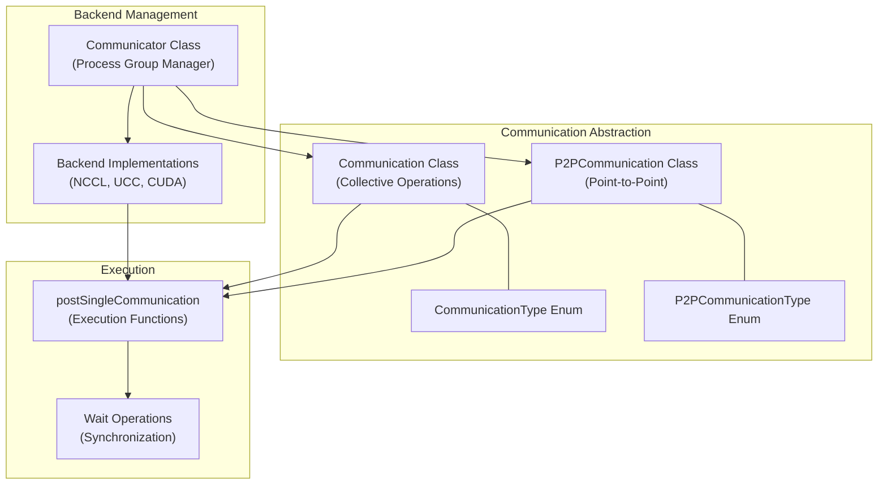

Sources:
- [csrc/multidevice/communication.h:25-168]()
- [csrc/multidevice/communicator.h:26-162]()
- [csrc/multidevice/communication.cpp:17-635]()

## Communication Types

NVFUSER supports two main categories of communication operations:

1. **Collective Operations** - Communication operations involving multiple devices in coordinated patterns
2. **Point-to-Point Operations** - Direct communication between two specific devices

### Collective Communication Types

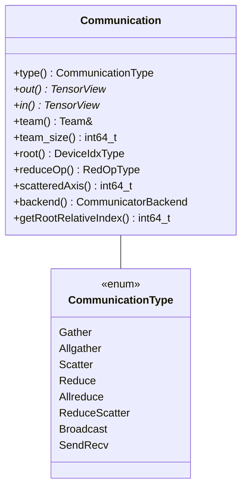

Sources:
- [csrc/multidevice/communication.h:26-122]()
- [csrc/multidevice/communication.cpp:19-218]()

The following collective communication operations are supported:

| Operation | Description | Root Required | Data Pattern |
|-----------|-------------|--------------|--------------|
| **Broadcast** | Copies data from root to all devices | Yes | Single source → Multiple destinations |
| **Gather** | Collects data from all devices to root | Yes | Multiple sources → Single destination |
| **AllGather** | Each device collects data from all devices | No | Multiple sources → Multiple destinations |
| **Scatter** | Distributes data from root to all devices | Yes | Single source → Multiple destinations |
| **Reduce** | Reduces data from all devices to root using specified operation | Yes | Multiple sources → Single destination |
| **AllReduce** | Reduces data from all devices and distributes result to all | No | Multiple sources → Multiple destinations |
| **ReduceScatter** | Reduces data from all devices and scatters results | No | Multiple sources → Multiple destinations |
| **SendRecv** | Direct point-to-point communication | Yes (sender) | Single source → Single destination |

Sources:
- [csrc/multidevice/communication.cpp:104-136]()
- [csrc/multidevice/communication.cpp:550-578]()

### Point-to-Point Communication Types

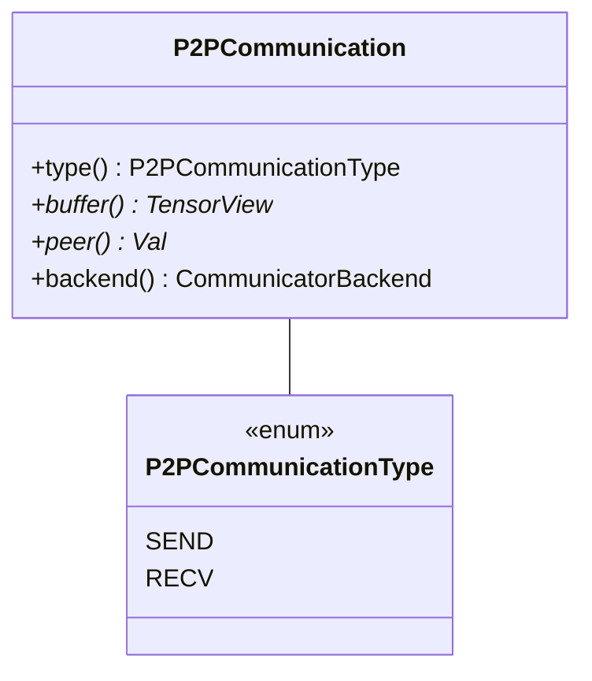

Point-to-point communications allow direct data transfer between two specific devices:
- **SEND**: Sends data from the local device to a specified peer device
- **RECV**: Receives data from a specified peer device to the local device

Sources:
- [csrc/multidevice/communication.h:124-167]()
- [csrc/multidevice/communication.cpp:219-260]()

## Data Flow Patterns

The following diagram illustrates the data flow patterns for the different collective communication operations:

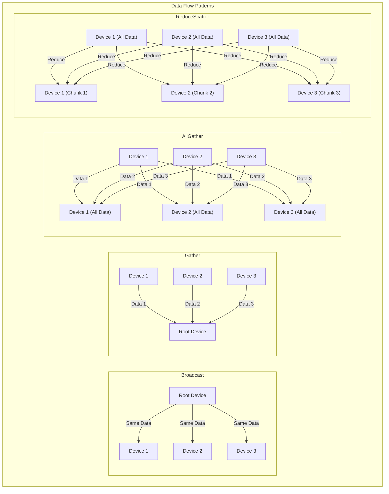

Sources:
- [csrc/multidevice/communication.cpp:263-535]()
- [tests/cpp/test_multidevice_communications.cpp:70-410]()

## Communication Implementation

### Communication Class

The `Communication` class represents collective communication operations in NVFUSER:

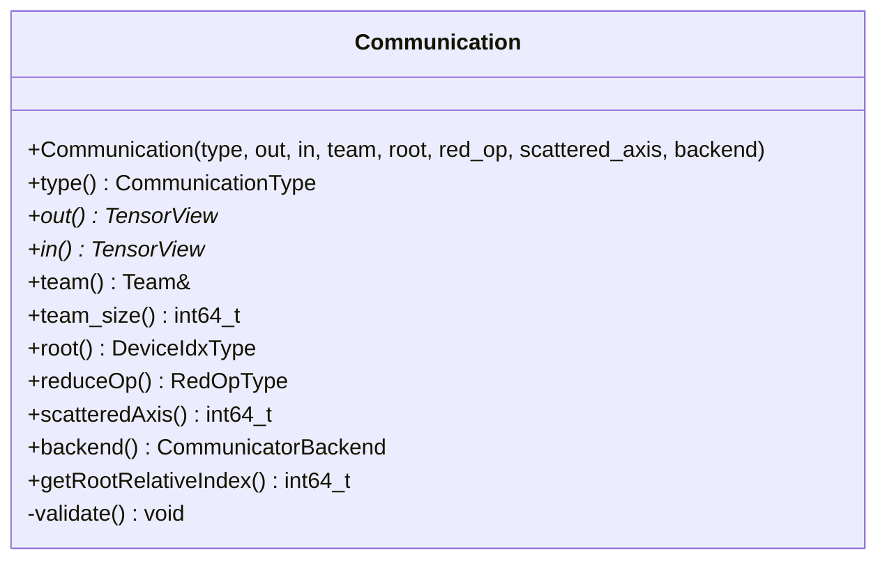

Key components:
- **type**: The type of communication operation (Broadcast, Gather, etc.)
- **in/out**: Input and output tensor views
- **team**: The set of devices participating in the communication
- **root**: The root device for operations that require one (Broadcast, Gather, etc.)
- **red_op**: The reduction operation type for reduction operations
- **scattered_axis**: The axis to scatter data for ReduceScatter operations
- **backend**: The backend implementation to use (NCCL, UCC, CUDA)

Sources:
- [csrc/multidevice/communication.h:46-122]()
- [csrc/multidevice/communication.cpp:140-217]()

### P2PCommunication Class

The `P2PCommunication` class represents point-to-point communication operations:

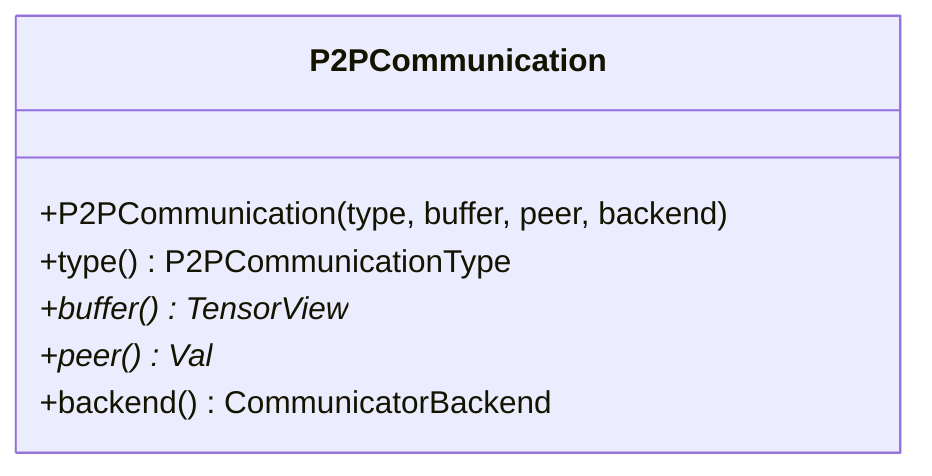

Key components:
- **type**: SEND or RECV
- **buffer**: The tensor view to send or receive
- **peer**: The peer device ID to send to or receive from
- **backend**: The backend implementation to use

Sources:
- [csrc/multidevice/communication.h:128-167]()
- [csrc/multidevice/communication.cpp:233-259]()

### Executing Communications

Communication operations are executed using the `postSingleCommunication` function, which dispatches the appropriate backend implementation based on the communication type:

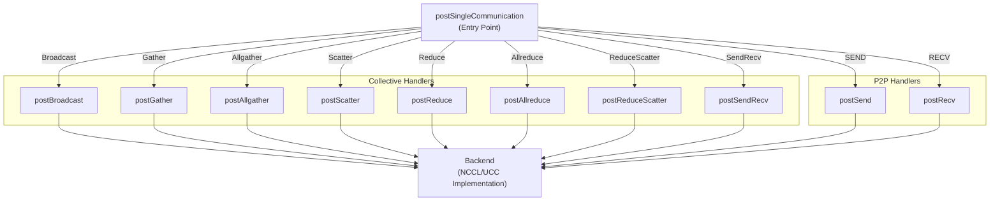

The communication operations are non-blocking and return a `c10d::Work` object that can be waited on for completion.

Sources:
- [csrc/multidevice/communication.cpp:538-632]()
- [tests/cpp/test_multidevice_communications.cpp:71-295]()

## Communication Backends

NVFUSER supports multiple backends for implementing communication operations:

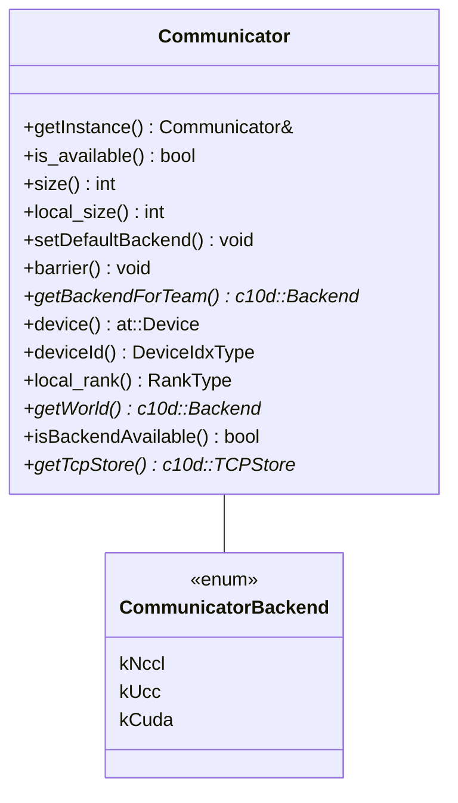

### Backend Types

1. **NCCL (NVIDIA Collective Communications Library)**
   - Optimized for NVIDIA GPU-to-GPU communication
   - Provides high-performance collective operations
   - Primary backend for multi-GPU communications

2. **UCC (Unified Collective Communication)**
   - Alternative backend with different implementation
   - May be used depending on availability and requirements

3. **CUDA**
   - Used for specific point-to-point operations
   - Leverages CUDA IPC for direct GPU memory access

### Communicator Management

The `Communicator` class manages the communication backends and provides an interface for accessing them. It's implemented as a singleton that can be accessed via `Communicator::getInstance()`.

Key responsibilities:
- Managing available backends
- Creating and caching backend instances for specific device teams
- Providing environment information (rank, size, etc.)
- Performing synchronization (barriers)

Sources:
- [csrc/multidevice/communicator.h:26-162]()
- [csrc/multidevice/communicator.cpp:28-401]()

## Integration with Host IR

Communication operations are integrated with NVFUSER's Host IR system to allow them to be included in computational graphs.

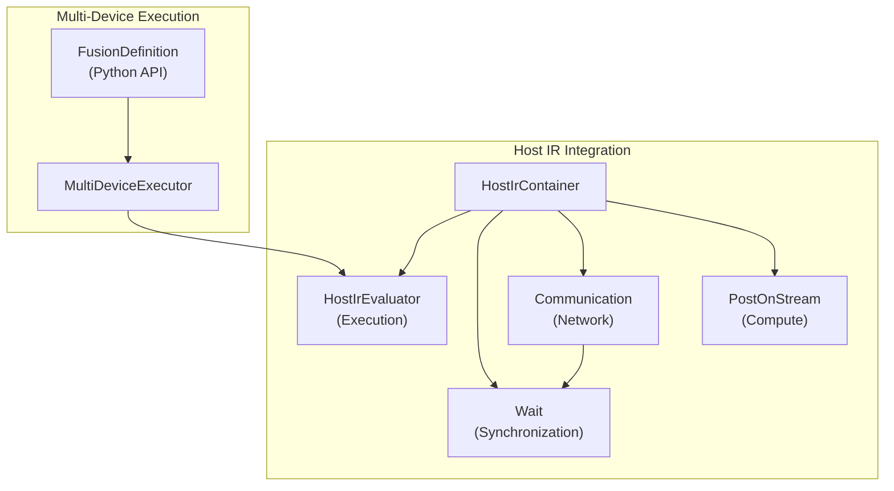

The Host IR system provides:
- A way to express both compute and communication operations in the same IR
- Explicit synchronization through `Wait` operations
- Support for overlapping communication and computation through asynchronous execution

Sources:
- [tests/cpp/test_multidevice_host_ir.cpp:44-487]()
- [csrc/multidevice/executor.h:28-115]()
- [csrc/multidevice/executor.cpp:21-63]()

## Communication Requirements and Behavior

Each communication type has specific requirements and behaviors:

### Broadcast
- **Requirements**:
  - Root must be set and belong to the team
  - Root has one source buffer and optionally one destination buffer
  - Non-roots have no source buffer and one destination buffer
  - All buffers must have the same size
- **Behavior**: Copies the root's source buffer to each device's destination buffer

### Gather
- **Requirements**:
  - Root must be set and belong to the team
  - Root has one source buffer and team_size destination buffers
  - Non-roots have one source buffer and no destination buffer
  - All buffers must have the same size
- **Behavior**: Copies each device's source buffer to the root's respective destination buffer

### AllGather
- **Requirements**:
  - All devices have one source buffer and team_size destination buffers
  - All buffers must have the same size
  - Input and output tensors must be contiguous
- **Behavior**: Copies each device's source buffer to every device's destination buffers

### Scatter
- **Requirements**:
  - Root must be set and belong to the team
  - Root has team_size source buffers and one destination buffer
  - Non-roots have no source buffer and one destination buffer
  - All buffers must have the same size
- **Behavior**: Copies each of the root's source buffers to the corresponding device's destination buffer

### Reduce
- **Requirements**:
  - Root must be set and belong to the team
  - Root has one source buffer and one destination buffer
  - Non-roots have one source buffer and no destination buffer
  - All buffers must have the same size
  - A valid reduction operation must be specified
- **Behavior**: Reduces all source buffers to the root's destination buffer using the specified operation

### AllReduce
- **Requirements**:
  - All devices have one source buffer and one destination buffer
  - All buffers must have the same size
  - A valid reduction operation must be specified
- **Behavior**: Reduces all source buffers and distributes the result to all destination buffers

### ReduceScatter
- **Requirements**:
  - All devices have team_size source buffers and one destination buffer
  - All buffers must have the same size
  - A valid reduction operation must be specified
  - A valid scattered_axis must be specified
- **Behavior**: Reduces all source buffers and scatters the results to destination buffers

### SendRecv
- **Requirements**:
  - Team size must be 1 or 2
  - Root (sender) must be set and belong to the team
  - Sender has one source buffer
  - Receiver has one destination buffer
- **Behavior**: Copies the sender's source buffer to the receiver's destination buffer

Sources:
- [csrc/multidevice/communication.cpp:176-535]()
- [csrc/multidevice/communication.h:177-225]()

## Point-to-Point IPC Communication

NVFUSER supports direct memory access between GPUs using CUDA IPC (Inter-Process Communication) handles:

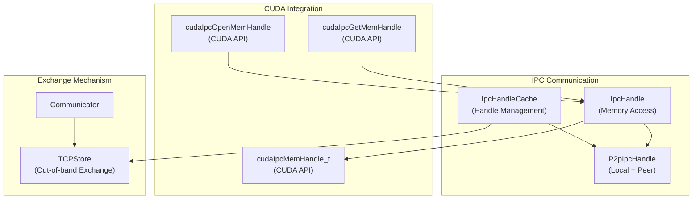

IPC-based communication allows:
- Direct memory access between GPUs in different processes
- Zero-copy data transfer between devices
- Lower latency for large transfers compared to traditional communication

The `IpcHandleCache` provides a way to exchange and cache IPC handles for efficient reuse across multiple communications.

Sources:
- [csrc/multidevice/ipc_handle.cpp:13-162]()
- [tests/cpp/test_multidevice_ipc.cpp:26-186]()

## Example Usage in Host IR

The following is an example of how communication primitives are used within Host IR to implement distributed operations:

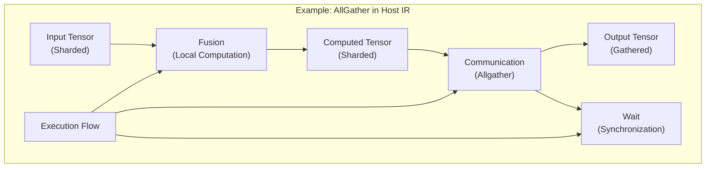

This example shows:
1. A sharded input tensor processed by a local computation
2. The result communicated via AllGather to all devices
3. Explicit synchronization using a Wait operation

Sources:
- [tests/cpp/test_multidevice_host_ir.cpp:44-138]()

## Performance Considerations

Several mechanisms are available to optimize communication performance:

### Communication-Computation Overlap
- **Asynchronous Execution**: Communications return a `Work` object that can be waited on later
- **Stream Management**: Multiple streams can be used to overlap communication and computation

### Optimized Implementations
- **AllGather Base**: For contiguous buffers, `_allgather_base` avoids extra copying
- **ReduceScatter Base**: For axis-0 scatter, `_reduce_scatter_base` provides better performance
- **Local Copies**: Direct copies are used for local transfers to avoid unnecessary network operations

### IPC-Based Zero-Copy Transfer
- **Direct Memory Access**: CUDA IPC handles enable direct access to memory on other devices
- **Reduced Overhead**: Avoids extra copying and serialization for large transfers

Sources:
- [csrc/multidevice/communication.cpp:347-494]()
- [tests/cpp/test_multidevice_host_ir.cpp:365-487]()

---

