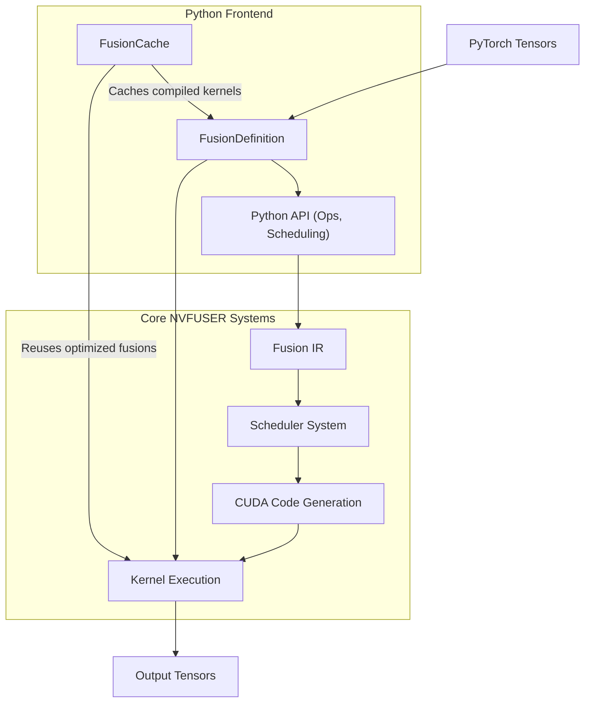
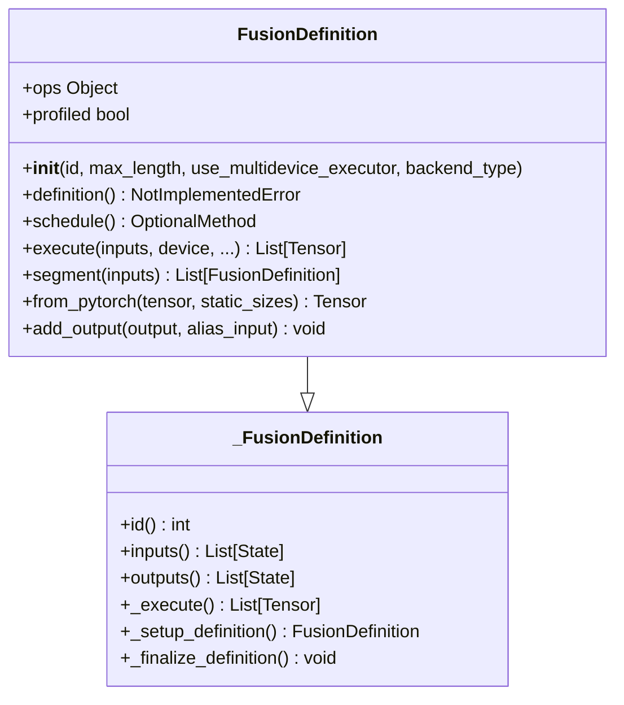
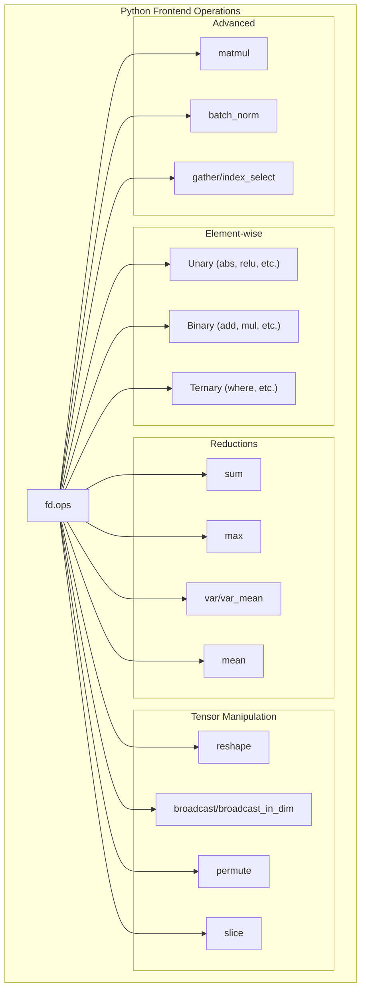
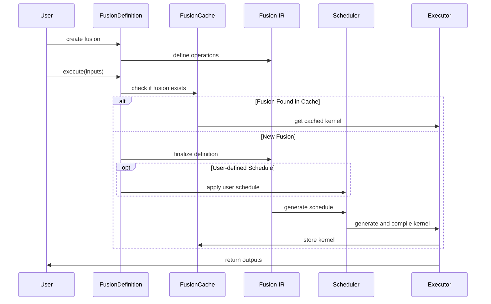
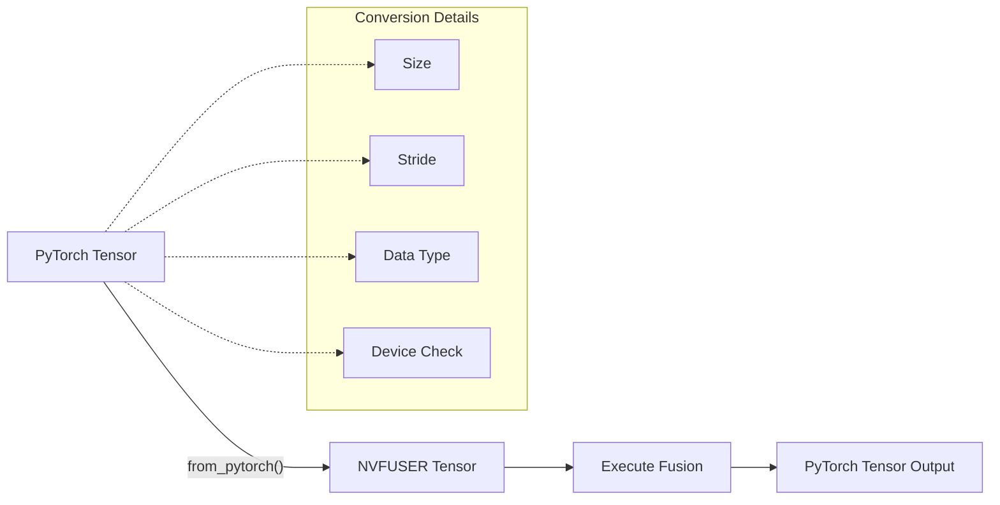
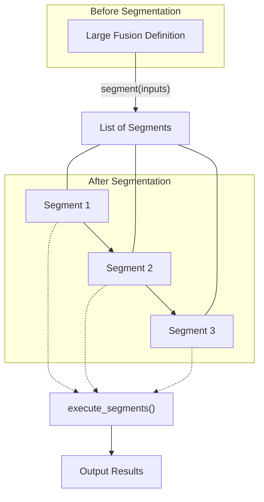
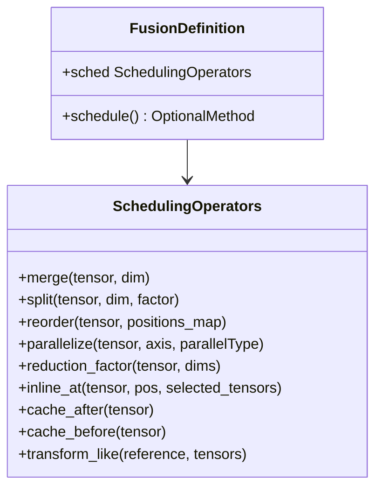
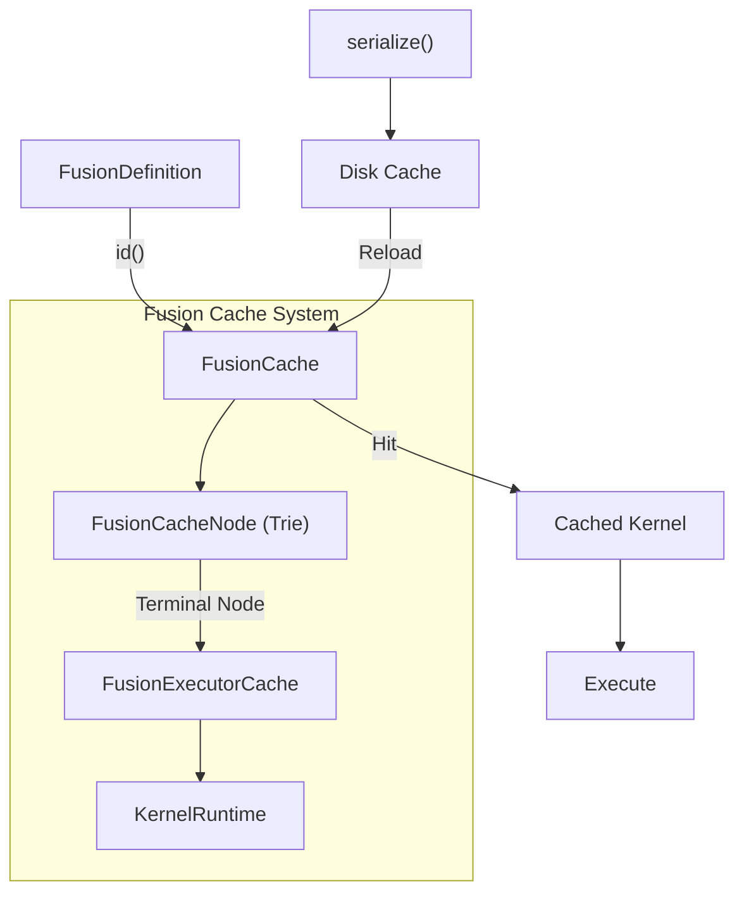

<!-- source: DeepWiki mcp.deepwiki.com · repo NVIDIA/Fuser · page 6 Python Frontend · fetched 2026-10-26 -->

# Python Frontend

<details>
<summary>Relevant source files</summary>

The following files were used as context for generating this wiki page:

- [csrc/serde/fusion_cache.fbs](csrc/serde/fusion_cache.fbs)
- [csrc/serde/fusion_record.cpp](csrc/serde/fusion_record.cpp)
- [nvfuser/__init__.py](nvfuser/__init__.py)
- [tests/python/test_python_frontend.py](tests/python/test_python_frontend.py)
- [tests/python/test_schedule_ops.py](tests/python/test_schedule_ops.py)

</details>


The Python Frontend in NVFUSER provides a high-level, user-friendly API to define, optimize, and execute fused CUDA operations directly from Python code. It serves as the primary interface between PyTorch tensor operations and NVFUSER's optimization and code generation systems.

This document covers the architecture and usage of the Python frontend components. For information about the underlying fusion IR representation, see [Core IR System](#2), and for details on fusion execution and code generation, see [Code Generation](#3).

## Overview of the Python Frontend Architecture



Sources: [nvfuser/__init__.py:1-630](), [tests/python/test_python_frontend.py:1-50]()

The Python Frontend consists of three core components:

1. **FusionDefinition** - The central class that manages the definition, scheduling, and execution of fusion operations
2. **Python API** - A set of operations and utilities to define computations and apply optimizations
3. **FusionCache** - A caching mechanism to store and reuse previously compiled kernels

## The FusionDefinition Class

At the heart of the Python Frontend is the `FusionDefinition` class, which provides the interface for creating, scheduling, and executing fusion operations. It derives from the C++ class `_FusionDefinition` and adds Python-specific functionality.



Sources: [nvfuser/__init__.py:53-611]()

### Key Methods of FusionDefinition

| Method | Description |
|--------|-------------|
| `definition()` | Abstract method that must be implemented by subclasses to define the fusion operations |
| `schedule()` | Optional method for defining custom scheduling strategies |
| `execute(inputs, ...)` | Executes the fusion with the provided inputs, returning output tensors |
| `segment(inputs)` | Decomposes a fusion into smaller segments for better optimization |
| `from_pytorch(tensor, static_sizes)` | Creates an NVFUSER tensor from a PyTorch tensor |

### Creating a Basic Fusion

A fusion can be defined using a context manager pattern or by subclassing `FusionDefinition`:

```python
# Context manager pattern
with FusionDefinition() as fd:
    t0 = fd.from_pytorch(input_tensor)
    t1 = fd.ops.relu(t0)
    fd.add_output(t1)
    
# Subclass pattern
class MyFusion(FusionDefinition):
    def definition(self):
        t0 = self.from_pytorch(input_tensor)
        t1 = self.ops.sigmoid(t0)
        self.add_output(t1)
```

Sources: [tests/python/test_python_frontend.py:914-923]()

## Tensor Operations and API

The Python Frontend provides a comprehensive set of operations through the `ops` namespace within the `FusionDefinition` class. These operations closely mirror PyTorch's tensor operations, making the transition from PyTorch to NVFUSER straightforward.

### Available Operation Categories

1. **Element-wise Operations**: Mathematical operations that apply to individual elements
2. **Reduction Operations**: Operations that reduce tensors along specified dimensions
3. **Tensor Manipulation**: Operations like reshape, broadcast, and permute
4. **Math Functions**: Common mathematical functions like exp, log, and trigonometric functions
5. **Random Number Generation**: Functions to generate random tensors
6. **Advanced Operations**: Including batch normalization, matrix multiplication, etc.



Sources: [tests/python/test_python_frontend.py:50-164](), [csrc/serde/fusion_record.cpp:776-884]()

### Example: Layer Normalization

The following example demonstrates how a layer normalization operation can be implemented using the Python Frontend:

```python
def nvfuser_fusion(fd: FusionDefinition, normalization_axis: int, norm_size: int, 
                   input_shape: List[int], eps: float, keepDim: bool) -> None:
    inputs = fd.define_tensor(shape=[-1, -1, -1], 
                              contiguity=[True, True, True],
                              dtype=DataType.Float)
    weights = fd.define_tensor(shape=[-1], contiguity=[True], dtype=DataType.Float)
    bias = fd.define_tensor(shape=[-1], contiguity=[True], dtype=DataType.Float)
    
    # Calculate mean
    sum0 = fd.ops.sum(inputs, dims=[normalization_axis], keepdim=keepDim)
    norm_const = fd.define_scalar(norm_size)
    mean = fd.ops.div(sum0, norm_const)
    
    # Calculate variance
    diff = fd.ops.sub(inputs, mean)
    diff_sq = fd.ops.mul(diff, diff)
    sum1 = fd.ops.sum(diff_sq, dims=[normalization_axis], keepdim=keepDim)
    var = fd.ops.div(sum1, norm_const)
    
    # Normalize
    eps_const = fd.define_scalar(eps)
    var_eps = fd.ops.add(var, eps_const)
    invstd = fd.ops.rsqrt(var_eps)
    pre_scale_bias = fd.ops.mul(diff, invstd)
    
    # Apply weights and bias
    weights_bcast = fd.ops.broadcast_in_dim(weights, shape=input_shape, broadcast_dims=[2])
    scale = fd.ops.mul(pre_scale_bias, weights_bcast)
    bias_bcast = fd.ops.broadcast_in_dim(bias, shape=input_shape, broadcast_dims=[2])
    out = fd.ops.add(scale, bias_bcast)
    
    fd.add_output(out)
    fd.add_output(mean)
    fd.add_output(invstd)
```

Sources: [tests/python/test_python_frontend.py:291-329]()

## Fusion Execution Flow

When a fusion is executed, it goes through several stages:



Sources: [nvfuser/__init__.py:197-343]()

### The execute() Method

The `execute()` method is the primary entry point for running a fusion:

```python
def execute(
    self,
    inputs,
    *,
    device=None,
    override_user_schedule=False,
    capture_debug_output=False,
    print_repro=False,
    profile=False,
    save_repro_inputs=False,
    _enable_options: list[str] = [],
    _disable_options: list[str] = [],
) -> list[torch.Tensor] | tuple[list[torch.Tensor], list[Sharding]]:
    # Implementation details...
```

Key parameters include:
- `inputs`: List of PyTorch tensors and scalars as inputs to the fusion
- `device`: Optional CUDA device to run the fusion on
- `override_user_schedule`: Whether to ignore user-defined schedules
- `profile`: Whether to capture profiling information
- `print_repro`: Whether to print a reproduction script

Sources: [nvfuser/__init__.py:197-343]()

## Integration with PyTorch

The Python Frontend provides seamless integration with PyTorch tensors through the `from_pytorch()` method, which converts PyTorch tensors into NVFUSER tensors.



Sources: [nvfuser/__init__.py:360-387]()

### Data Type Conversion

When converting from PyTorch tensors to NVFUSER tensors, data types are mapped between the two systems:

| PyTorch Data Type | NVFUSER Data Type |
|-------------------|-------------------|
| torch.float16 | DataType.Half |
| torch.float32 | DataType.Float |
| torch.float64 | DataType.Double |
| torch.int32 | DataType.Int32 |
| torch.int64 | DataType.Int |
| torch.bool | DataType.Bool |
| torch.bfloat16 | DataType.BFloat16 |
| torch.complex32 | DataType.ComplexHalf |
| torch.complex64 | DataType.ComplexFloat |
| torch.complex128 | DataType.ComplexDouble |

Sources: [tests/python/test_python_frontend.py:134-144]()

### Dynamic Shapes Support

The Python Frontend supports both static and dynamic tensor shapes:

```python
# Static shape - dimensions are fixed at definition time
t0 = fd.from_pytorch(inputs[0], static_sizes=True)

# Dynamic shape - dimensions can change between executions
t0 = fd.from_pytorch(inputs[0])  # default is dynamic
```

Dynamic shapes enable creating fusions that can handle tensors of different sizes without recompilation, while static shapes can enable additional optimizations.

Sources: [tests/python/test_python_frontend.py:947-961](), [nvfuser/__init__.py:360-387]()

## Segmentation and Fusion Optimization

For complex fusions, the Python Frontend provides a segmentation mechanism that breaks down large fusions into smaller, more manageable segments that can be individually optimized.



Sources: [nvfuser/__init__.py:66-106](), [nvfuser/__init__.py:122-195]()

### Key Benefits of Segmentation

1. **Memory Optimization**: Intermediate results that are not needed for later segments can be deleted
2. **Performance**: Smaller segments can be optimized more effectively
3. **Resource Management**: Prevents exhausting GPU resources with very large fusions

## User-Defined Scheduling

The Python Frontend allows users to define custom schedules for fusion operations, giving fine-grained control over how operations are executed on the GPU.



Sources: [tests/python/test_schedule_ops.py:118-146]()

### Common Scheduling Operations

| Operation | Description |
|-----------|-------------|
| `merge(tensor, dim)` | Merges two adjacent dimensions in the tensor |
| `split(tensor, dim, factor)` | Splits a dimension into two dimensions |
| `reorder(tensor, positions_map)` | Reorders the dimensions of a tensor |
| `parallelize(tensor, axis, parallelType)` | Assigns a parallel execution type to a dimension |
| `reduction_factor(tensor, dims)` | Factors out reduction dimensions |
| `inline_at(tensor, pos, selected_tensors)` | Performs computeAt-like inlining at position |
| `cache_after(tensor)` | Caches a tensor's values after its computation |
| `cache_before(tensor)` | Caches a tensor's values before its computation |

Sources: [tests/python/test_schedule_ops.py:169-268]()

### Example: User-Defined Schedule

```python
class Pointwise(FusionDefinition):
    def definition(self):
        self.t0 = self.from_pytorch(inputs[0])
        self.t1 = self.from_pytorch(inputs[1])
        self.t2 = self.ops.add(self.t0, self.t1)
        self.add_output(self.t2)

    def schedule(self):
        # Merge outer dimensions, then split for parallelization
        fd.sched.merge(self.t2, dim=0)
        fd.sched.split(self.t2, dim=0, factor=128)
        
        # Parallelize execution
        fd.sched.parallelize(self.t2, axis := 0, ParallelType.grid_x)
        fd.sched.parallelize(self.t2, axis := 1, ParallelType.block_x)
```

Sources: [tests/python/test_schedule_ops.py:330-347]()

### Auto-Schedulers

In addition to manual scheduling, the Python Frontend provides access to NVFUSER's auto-schedulers:

```python
class Pointwise(FusionDefinition):
    def definition(self):
        # Define fusion...
        
    def schedule(self):
        # Apply selected scheduler
        fd.sched.can_schedule(SchedulerType.pointwise)
        fd.sched.schedule(SchedulerType.pointwise)
```

Available auto-schedulers include:
- `SchedulerType.pointwise` - For element-wise operations
- `SchedulerType.reduction` - For reduction operations
- `SchedulerType.inner_persistent` - For operations like normalization
- And others for specialized operations

Sources: [tests/python/test_schedule_ops.py:860-881](), [tests/python/test_schedule_ops.py:882-917]()

## Fusion Cache and Serialization

The Python Frontend leverages a caching mechanism to store and reuse previously compiled fusion kernels, significantly improving performance when the same fusion is executed multiple times.



Sources: [nvfuser/__init__.py:30-51](), [csrc/serde/fusion_cache.fbs:488-519]()

### Automatic Serialization

NVFUSER provides automatic serialization capabilities to save the fusion cache to disk:

```python
# Enable automatic serialization at program exit
nvfuser.enable_automatic_serialization()

# Disable automatic serialization
nvfuser.disable_automatic_serialization()
```

When enabled, the fusion cache is automatically stored to disk when the program exits, allowing kernels to be reused across program invocations.

Sources: [nvfuser/__init__.py:30-51]()

### Cache Structure

The fusion cache is organized as a trie (prefix tree) structure, where:

1. Each node represents a fusion operation
2. Terminal nodes hold compiled fusion kernels
3. The path from the root to a terminal node represents a fusion definition

This structure efficiently identifies whether a given fusion has been previously compiled and optimized.

Sources: [csrc/serde/fusion_cache.fbs:488-519]()

## Debugging and Profiling

The Python Frontend provides several utilities for debugging and profiling fusions:

| Method | Description |
|--------|-------------|
| `debug_output()` | Retrieves debug information from the previous execution |
| `fusion_ir()` | Returns the unscheduled Fusion IR for the definition |
| `last_cuda_code()` | Returns the CUDA code generated for the last execution |
| `cuda_code_for(inputs)` | Returns the CUDA code that would be generated for the given inputs |
| `profile()` | Returns profiling information from the previous execution |
| `last_repro_script()` | Generates a self-contained reproduction script |
| `repro_script_for(inputs)` | Generates a reproduction script for the given inputs |

These methods enable users to understand how their fusion operations are being translated to CUDA code and to diagnose performance issues.

Sources: [nvfuser/__init__.py:389-467](), [nvfuser/__init__.py:493-567]()

## Conclusion

The Python Frontend of NVFUSER provides a powerful yet user-friendly interface for defining, optimizing, and executing fused tensor operations on NVIDIA GPUs. By leveraging PyTorch integration, automatic optimization, and caching capabilities, it enables developers to achieve high-performance tensor computations without deep knowledge of GPU programming.

For more detailed information about specific aspects of NVFUSER, refer to:
- [Fusion Definition](#6.1) for more on defining fusion operations
- [Fusion Cache and Serialization](#6.2) for details on the caching system
- [Scheduling System](#4) for in-depth information about scheduling strategies

---

