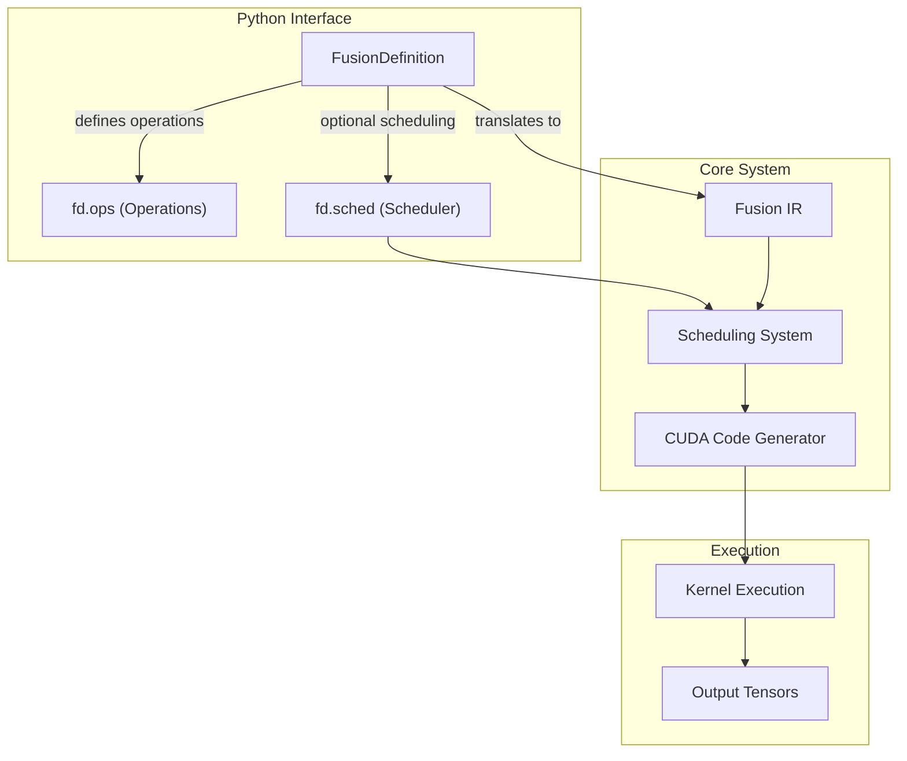
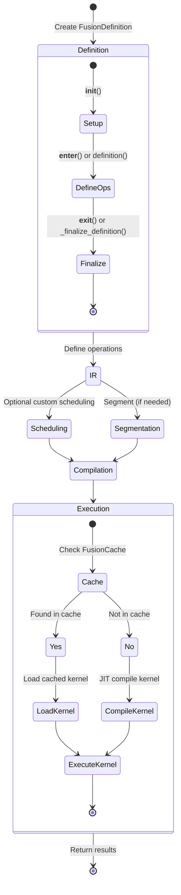
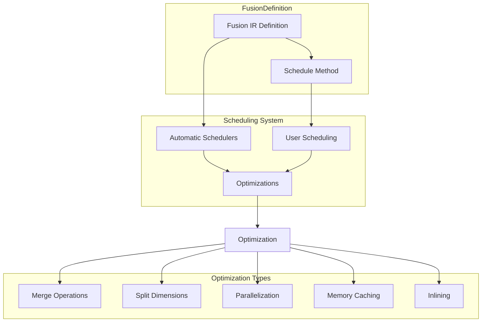

<!-- source: DeepWiki mcp.deepwiki.com · repo NVIDIA/Fuser · page 6.1 Fusion Definition · fetched 2026-10-26 -->

# Fusion Definition

<details>
<summary>Relevant source files</summary>

The following files were used as context for generating this wiki page:

- [csrc/serde/fusion_cache.fbs](csrc/serde/fusion_cache.fbs)
- [csrc/serde/fusion_record.cpp](csrc/serde/fusion_record.cpp)
- [nvfuser/__init__.py](nvfuser/__init__.py)
- [tests/python/test_python_frontend.py](tests/python/test_python_frontend.py)
- [tests/python/test_schedule_ops.py](tests/python/test_schedule_ops.py)

</details>


This page documents NVFUSER's FusionDefinition class, which serves as the primary Python API for defining and executing fused operations on CUDA devices. FusionDefinition provides a Pythonic interface to create computational graphs that can be optimized and compiled to efficient CUDA kernels. For information about caching fusion instances for reuse, see [Fusion Cache and Serialization](#6.2).

## Overview

FusionDefinition is the cornerstone of NVFUSER's Python frontend, enabling users to:

1. Define computational graphs with tensor operations
2. Execute these graphs with automatic optimization
3. Customize execution through manual scheduling
4. Debug and profile kernels



Sources: [nvfuser/__init__.py:53-629](). [tests/python/test_python_frontend.py:20-28]().

## Creating a Fusion Definition

There are two ways to create a fusion definition:

1. **Context Manager Pattern** - Creating an ephemeral definition using a Python context manager
2. **Class Inheritance Pattern** - Creating a reusable definition by subclassing FusionDefinition

### Context Manager Pattern

```python
with FusionDefinition() as fd:
    # Define inputs from PyTorch tensors
    t0 = fd.from_pytorch(input_tensor1)
    t1 = fd.from_pytorch(input_tensor2)
    
    # Define operations
    t2 = fd.ops.add(t0, t1)
    t3 = fd.ops.mul(t2, fd.define_scalar(3.0))
    
    # Specify outputs
    fd.add_output(t3)

# Execute the fusion
result = fd.execute([input_tensor1, input_tensor2])
```

Sources: [tests/python/test_python_frontend.py:42-76]().

### Class Inheritance Pattern

```python
class MyFusion(FusionDefinition):
    def definition(self):
        # Define inputs from PyTorch tensors
        self.t0 = self.from_pytorch(inputs[0])
        
        # Define operations
        self.t1 = self.ops.sigmoid(self.t0)
        
        # Specify outputs
        self.add_output(self.t1)

# Create and execute the fusion
fd = MyFusion()
result = fd.execute([input_tensor])
```

Sources: [tests/python/test_python_frontend.py:914-923](). [nvfuser/__init__.py:118-119]().

## Fusion Definition Lifecycle



Sources: [nvfuser/__init__.py:108-119](). [nvfuser/__init__.py:197-344]().

## Core Components

### FusionDefinition Class

The FusionDefinition class inherits from `_C._FusionDefinition` and provides:

1. Methods for creating tensors and operations
2. Execution of the defined fusion
3. Optional scheduling capabilities
4. Segmentation for complex fusions
5. Debugging and profiling utilities

Sources: [nvfuser/__init__.py:53-68]().

### Tensor Creation and Input Handling

FusionDefinition provides methods to create tensors from PyTorch tensors or define them with symbolic shapes:

| Method | Description |
|--------|-------------|
| `from_pytorch(tensor, static_sizes=False)` | Creates a tensor from a PyTorch tensor |
| `define_tensor(shape, contiguity, dtype, ...)` | Defines a tensor with specified properties |
| `define_scalar(value, dtype=None)` | Creates a scalar value |
| `define_vector(values, dtype=None)` | Creates a vector of values |

Sources: [nvfuser/__init__.py:360-387]().

### Operations

Operations are accessed through the `ops` namespace. Common operations include:

- Mathematical operations: `add`, `sub`, `mul`, `div`
- Unary functions: `relu`, `sigmoid`, `tanh`, `exp`
- Reductions: `sum`, `max`, `min`
- Shape operations: `reshape`, `broadcast_in_dim`, `squeeze`

Sources: [tests/python/test_python_frontend.py:50-58](). [tests/python/test_python_frontend.py:84-94]().

### Output Management

Outputs are specified using the `add_output` method:

```python
fd.add_output(tensor)  # Standard output

# Optionally aliasing an output to input to save memory
fd.add_output(tensor_result, alias_input=tensor_input)
```

Sources: [tests/python/test_python_frontend.py:58-59](). [tests/python/test_python_frontend.py:723-724]().

## Execution

The `execute` method runs the fusion on provided inputs:

```python
results = fd.execute(
    inputs,                      # List of input tensors
    device=None,                 # Optional device override
    override_user_schedule=False, # Override user-defined scheduler
    profile=False,               # Enable performance profiling
    capture_debug_output=False,  # Capture debug information
    print_repro=False            # Print reproduction script
)
```

Sources: [nvfuser/__init__.py:197-344]().

### Execution Workflow

1. **Definition Phase**: Operations are defined to create a fusion IR
2. **Scheduling Phase**: Optional scheduling for performance optimization
3. **Segmentation Phase**: Complex fusions are divided into segments if needed
4. **Execution Phase**: 
   - Input arguments are processed
   - FusionCache is checked for cached compilations
   - Kernels are compiled if not cached
   - Kernels are executed on the CUDA device
   - Results are returned

Sources: [nvfuser/__init__.py:197-344]().

## Scheduling

Scheduling allows optimization of fusion execution. There are two approaches:

1. **Automatic Scheduling**: NVFUSER applies built-in heuristics
2. **Custom Scheduling**: User-defined scheduling through the `schedule` method



Sources: [tests/python/test_schedule_ops.py:67-133](). [tests/python/test_schedule_ops.py:328-418]().

### Custom Scheduling Example

```python
class PointwiseSchedule(FusionDefinition):
    def definition(self):
        self.t0 = self.from_pytorch(inputs[0])
        self.t1 = self.from_pytorch(inputs[1])
        self.t2 = self.ops.add(self.t0, self.t1)
        self.add_output(self.t2)
        
    def schedule(self):
        # Optimize memory access patterns
        self.sched.merge(self.t2, dim=0)
        # Split for parallelism
        self.sched.split(self.t2, dim=0, factor=128)
        # Apply parallelization
        self.sched.parallelize(self.t2, axis=0, ParallelType.grid_x)
        self.sched.parallelize(self.t2, axis=1, ParallelType.block_x)
```

Sources: [tests/python/test_schedule_ops.py:331-386]().

### Common Scheduling Operations

| Operation | Description |
|-----------|-------------|
| `merge(tensor, dim)` | Merges dimensions for more efficient access |
| `split(tensor, dim, factor)` | Splits a dimension for parallelism |
| `parallelize(tensor, axis, type)` | Applies parallelization strategy |
| `cache_after(tensor)` | Creates a cache after computation |
| `cache_before(tensor)` | Creates a cache before computation |
| `set_memory_type(tensor, type)` | Specifies memory location (e.g., shared) |
| `inline_at(tensor, pos)` | Inlines operations at specified position |

Sources: [tests/python/test_schedule_ops.py:180-209](). [tests/python/test_schedule_ops.py:295-324]().

## Segmentation

For complex fusions that can't be efficiently executed as a single kernel, FusionDefinition provides segmentation capabilities:

```python
# Get segments for a fusion
segments = fd.segment(inputs)

# If segments were created, they are executed automatically
results = fd.execute(inputs)
```

The segmentation process:
1. Analyzes the fusion graph
2. Identifies subgraphs that can be efficiently executed
3. Creates separate fusion definitions for each segment
4. Manages data flow between segments during execution

Sources: [nvfuser/__init__.py:66-106](). [nvfuser/__init__.py:122-195]().

## Debugging and Profiling

FusionDefinition provides methods for debugging and profiling:

| Method | Description |
|--------|-------------|
| `debug_output()` | Retrieves debug information from execution |
| `fusion_ir()` | Returns the unscheduled Fusion IR |
| `last_cuda_code(intrinsic_code=False)` | Shows generated CUDA code |
| `profile()` | Returns profiling information (when enabled) |
| `repro_script_for(inputs)` | Generates reproduction script |

Example usage:

```python
# Execute with profiling enabled
result = fd.execute(inputs, profile=True)

# Get profiling information
profile_data = fd.profile()

# Get generated CUDA code
cuda_code = fd.last_cuda_code()

# Generate reproduction script
repro = fd.repro_script_for(inputs)
```

Sources: [nvfuser/__init__.py:345-359](). [nvfuser/__init__.py:466-490]().

## Integration with FusionCache

FusionDefinition works closely with the FusionCache to reuse previously compiled kernels:

```python
# First execution - defines and compiles fusion
nvf_out1, fd = self.exec_nvfuser(fusion_func, inputs)

# Second execution - reuses compiled fusion
nvf_out2, fd2 = self.exec_nvfuser(fusion_func, inputs, new_fusion_expected=False)

# Creating from cached fusion ID
fd3 = FusionDefinition(fd2.id())
nvf_out3 = fd3.execute(inputs)
```

Sources: [tests/python/test_python_frontend.py:61-72]().

## Serialization Support

NVFUSER provides automatic serialization of fusions for persistence across runs:

```python
# Enable automatic serialization at program exit
nvfuser.enable_automatic_serialization()

# Disable automatic serialization
nvfuser.disable_automatic_serialization()
```

Sources: [nvfuser/__init__.py:30-50]().

## Example Use Cases

### Basic Element-wise Operations

```python
with FusionDefinition() as fd:
    t0 = fd.from_pytorch(inputs[0])
    t1 = fd.from_pytorch(inputs[1])
    t2 = fd.ops.add(t0, t1)
    t3 = fd.ops.mul(t2, fd.define_scalar(3.0))
    t4 = fd.ops.sum(t3, [-1], False, DataType.Float)
    fd.add_output(t4)
```

Sources: [tests/python/test_python_frontend.py:50-59]().

### Normalization Patterns

```python
# Layer Normalization
with FusionDefinition() as fd:
    inputs_tensor = fd.from_pytorch(inputs[0])
    weights = fd.from_pytorch(inputs[1])
    bias = fd.from_pytorch(inputs[2])
    
    # Compute mean
    sum0 = fd.ops.sum(inputs_tensor, dims=[normalization_axis], keepdim=True)
    mean = fd.ops.div(sum0, fd.define_scalar(norm_size))
    
    # Compute variance
    diff = fd.ops.sub(inputs_tensor, mean)
    diff_sq = fd.ops.mul(diff, diff)
    sum1 = fd.ops.sum(diff_sq, dims=[normalization_axis], keepdim=True)
    var = fd.ops.div(sum1, fd.define_scalar(norm_size))
    
    # Normalize
    invstd = fd.ops.rsqrt(fd.ops.add(var, fd.define_scalar(eps)))
    normalized = fd.ops.mul(diff, invstd)
    
    # Scale and shift
    weights_bcast = fd.ops.broadcast_in_dim(weights, shape=input_shape, broadcast_dims=[2])
    scaled = fd.ops.mul(normalized, weights_bcast)
    bias_bcast = fd.ops.broadcast_in_dim(bias, shape=input_shape, broadcast_dims=[2])
    output = fd.ops.add(scaled, bias_bcast)
    
    fd.add_output(output)
```

Sources: [tests/python/test_python_frontend.py:299-326]().

### Advanced Transformations

```python
with FusionDefinition() as fd:
    t0 = fd.from_pytorch(inputs[0])
    t1 = fd.from_pytorch(inputs[1])
    
    # Reshape operations
    t1_b = fd.ops.broadcast_in_dim(t1, t0.shape(), [2])
    t2 = fd.ops.add(t0, t1_b)
    
    fd.add_output(t2)
```

Sources: [tests/python/test_python_frontend.py:507-519]().

## Summary

The FusionDefinition class provides a powerful and flexible interface for defining, optimizing, and executing fused operations on CUDA devices. It bridges the gap between PyTorch tensors and efficient CUDA kernel execution, offering both automatic optimization and manual scheduling capabilities. With its comprehensive debugging and profiling tools, it serves as the core entry point for NVFUSER's functionality.

---

