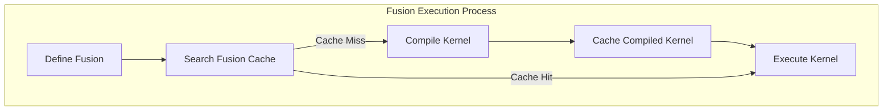
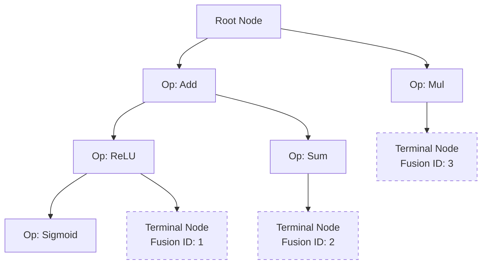
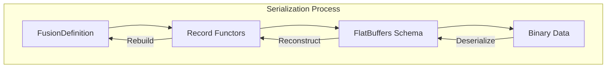
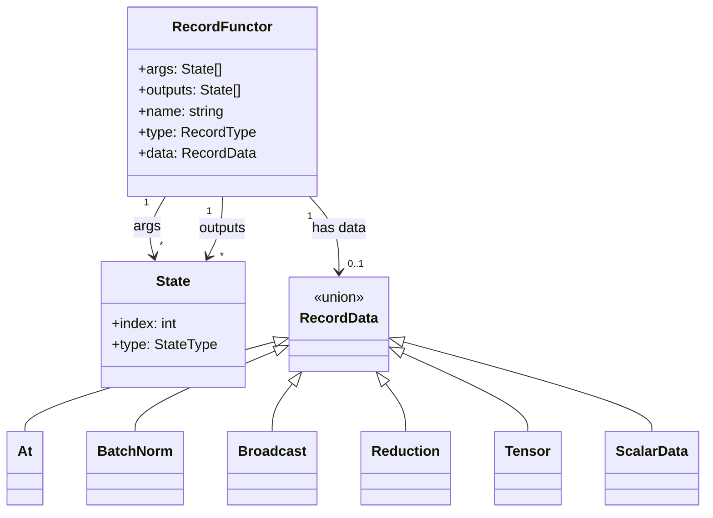
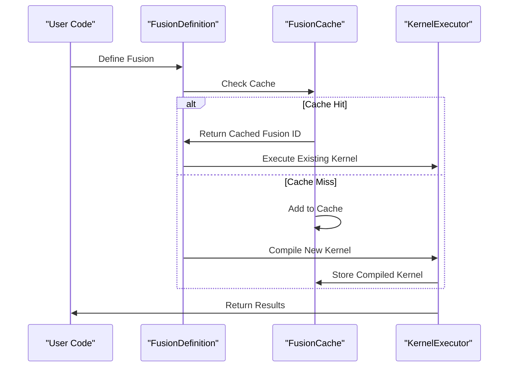
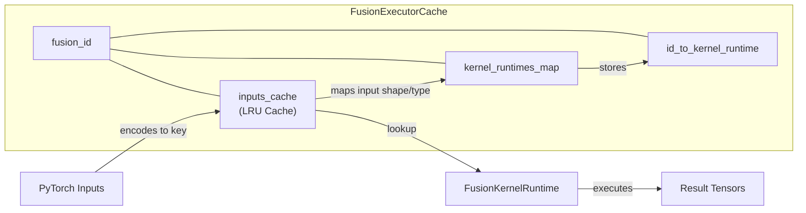
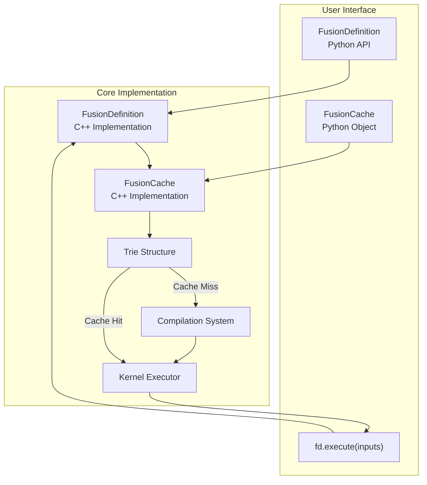
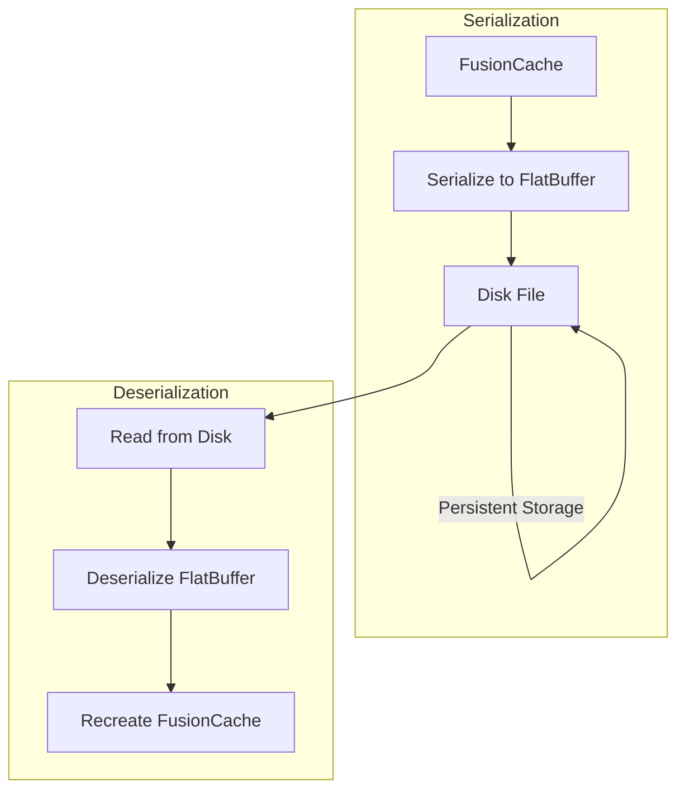

<!-- source: DeepWiki mcp.deepwiki.com · repo NVIDIA/Fuser · page 6.2 Fusion Cache and Serialization · fetched 2026-10-26 -->

# Fusion Cache and Serialization

<details>
<summary>Relevant source files</summary>

The following files were used as context for generating this wiki page:

- [csrc/serde/fusion_cache.fbs](csrc/serde/fusion_cache.fbs)
- [csrc/serde/fusion_record.cpp](csrc/serde/fusion_record.cpp)
- [tests/python/test_python_frontend.py](tests/python/test_python_frontend.py)

</details>


This document describes the Fusion Cache and Serialization systems in NVFUSER, which enable efficient reuse of compiled kernels and persistence of fusion definitions across program executions. These mechanisms significantly improve performance by avoiding redundant kernel compilation and providing the ability to save and load optimized fusion operations.

## 1. Fusion Cache Overview

The Fusion Cache is a key performance optimization in NVFUSER that stores and retrieves previously compiled fusion operations. Instead of recompiling the same operations, NVFUSER can look up and reuse already compiled kernels, substantially reducing runtime overhead.



Sources: [tests/python/test_python_frontend.py:62-72](https://github.com/NVIDIA/Fuser/blob/main/tests/python/test_python_frontend.py#L62-L72)

The Fusion Cache system provides the following capabilities:
- Automatic detection of equivalent fusion operations
- Storage of compiled kernels for reuse
- Serialization for persistent storage across program executions
- Efficient lookup with minimal runtime overhead

## 2. Cache Structure

The Fusion Cache is implemented as a prefix tree (trie) structure, where each path from the root to a leaf represents a sequence of operations that form a fusion definition.



Sources: [csrc/serde/fusion_cache.fbs:487-497](https://github.com/NVIDIA/Fuser/blob/main/csrc/serde/fusion_cache.fbs#L487-L497)

### 2.1 Trie Nodes

Each node in the trie represents a record functor (operation) in the fusion definition. The structure allows efficient matching of fusion definitions by sharing common prefixes.

Key components of a trie node:
- Record: The operation represented by this node
- Children: Pointers to subsequent operations
- Fusion ID: If terminal, the ID of the cached fusion
- Visits: Usage counter for potential cache eviction strategies
- Terminal flag: Indicates if this node represents a complete fusion

Sources: [csrc/serde/fusion_cache.fbs:490-496](https://github.com/NVIDIA/Fuser/blob/main/csrc/serde/fusion_cache.fbs#L490-L496)

## 3. Fusion Serialization

The serialization system uses FlatBuffers to create a compact binary representation of fusion definitions and their compiled kernels. This enables persistence across program executions and sharing of optimized kernels.



Sources: [csrc/serde/fusion_record.cpp:16-38](https://github.com/NVIDIA/Fuser/blob/main/csrc/serde/fusion_record.cpp#L16-L38)

### 3.1 FlatBuffers Schema

The serialization format is defined using a FlatBuffers schema, which provides an efficient binary representation with zero-copy deserialization capabilities. The schema defines all data structures needed to represent the fusion cache.

Key tables in the schema:
- `FusionCache`: Root table representing the entire cache
- `TrieNode`: Represents a node in the trie structure
- `RecordFunctor`: Represents operations in the fusion
- `FusionExecutorCache`: Describes cached executors for fusions
- `KernelExecutor`: Maps to a lowered and compiled kernel

Sources: [csrc/serde/fusion_cache.fbs:506-516](https://github.com/NVIDIA/Fuser/blob/main/csrc/serde/fusion_cache.fbs#L506-L516)

## 4. Record Functors

Record functors represent the operations in a fusion definition. They form the nodes in the graph representation of a fusion, with input and output edges connecting them.



Sources: [csrc/serde/fusion_cache.fbs:109-129](https://github.com/NVIDIA/Fuser/blob/main/csrc/serde/fusion_cache.fbs#L109-L129), [csrc/serde/fusion_cache.fbs:481-487](https://github.com/NVIDIA/Fuser/blob/main/csrc/serde/fusion_cache.fbs#L481-L487)

### 4.1 Record Types

NVFUSER supports a wide variety of operation types that can be serialized and deserialized:

- Unary operations (abs, cos, exp, etc.)
- Binary operations (add, mul, div, etc.)
- Ternary operations (where, lerp, etc.)
- Reduction operations (sum, max, min, prod)
- Special operations (broadcast, reshape, slice, etc.)

Each operation type has specialized serialization and deserialization logic.

Sources: [csrc/serde/fusion_record.cpp:77-662](https://github.com/NVIDIA/Fuser/blob/main/csrc/serde/fusion_record.cpp#L77-L662)

## 5. Cache Lookup and Execution

When a new fusion is defined, NVFUSER first checks if a matching fusion already exists in the cache. If found, the compiled kernel is reused instead of generating a new one.



Sources: [tests/python/test_python_frontend.py:62-72](https://github.com/NVIDIA/Fuser/blob/main/tests/python/test_python_frontend.py#L62-L72), [tests/python/test_python_frontend.py:493-504](https://github.com/NVIDIA/Fuser/blob/main/tests/python/test_python_frontend.py#L493-L504)

### 5.1 Cache Reuse Example

The following example demonstrates how the fusion cache enables reuse of compiled kernels:

```python
# First execution - cache miss, compiles new kernel
with FusionDefinition() as fd:
    t0 = fd.define_tensor(...)
    t1 = fd.ops.relu(t0)
    fd.add_output(t1)
output1 = fd.execute(inputs)

# Second execution with same definition - cache hit, reuses kernel
with FusionDefinition() as fd:
    t0 = fd.define_tensor(...)
    t1 = fd.ops.relu(t0)
    fd.add_output(t1)
output2 = fd.execute(inputs)  # Reuses compiled kernel from first execution
```

The cache system can identify equivalent fusion definitions even when they're created in different instances, enabling efficient reuse.

Sources: [tests/python/test_python_frontend.py:493-504](https://github.com/NVIDIA/Fuser/blob/main/tests/python/test_python_frontend.py#L493-L504)

## 6. Executor Caching and Inputs

The `FusionExecutorCache` manages compiled kernels for fusions, tracking input shapes and types to ensure correct reuse. It uses an LRU (Least Recently Used) cache to manage memory usage.



Sources: [csrc/serde/fusion_cache.fbs:465-477](https://github.com/NVIDIA/Fuser/blob/main/csrc/serde/fusion_cache.fbs#L465-L477)

Key components:
- `inputs_cache`: An LRU cache that maps input tensor metadata to concrete IDs
- `kernel_runtimes_map`: Maps device IDs and concrete IDs to runtime implementations
- `id_to_kernel_runtime`: Direct mapping from runtime IDs to kernel implementations

## 7. Python Frontend Integration

The fusion cache seamlessly integrates with the Python frontend to provide efficient caching of fusion operations.



Sources: [tests/python/test_python_frontend.py:20-26](https://github.com/NVIDIA/Fuser/blob/main/tests/python/test_python_frontend.py#L20-L26)

The `FusionCache` Python class provides methods to:
- Save the cache to disk
- Load the cache from disk
- Clear the cache
- Query cache statistics

Example usage:
```python
from nvfuser import FusionCache

# Access the fusion cache
cache = FusionCache.get()

# Save the cache to disk for later reuse
cache.save("my_fusions.cache")

# Load previously saved cache
cache.load("my_fusions.cache")
```

## 8. Serialization and Persistence

The serialization system enables saving compiled kernels to disk and loading them in subsequent program executions, avoiding compilation overhead entirely.



Sources: [csrc/serde/fusion_cache.fbs:11](https://github.com/NVIDIA/Fuser/blob/main/csrc/serde/fusion_cache.fbs#L11)

The serialization mechanism saves:
- The trie structure for fusion identification
- Compiled CUDA kernels (as PTX and/or cubin)
- Kernel executor metadata and launch parameters
- Device-specific information for proper kernel execution

This enables a workflow where compiled kernels can be distributed with applications, eliminating compilation overhead entirely for end users.

---

