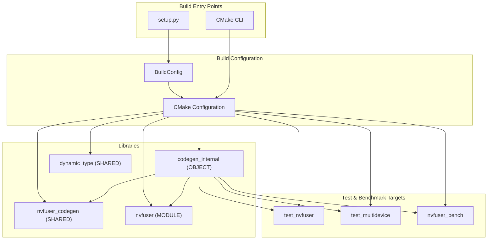
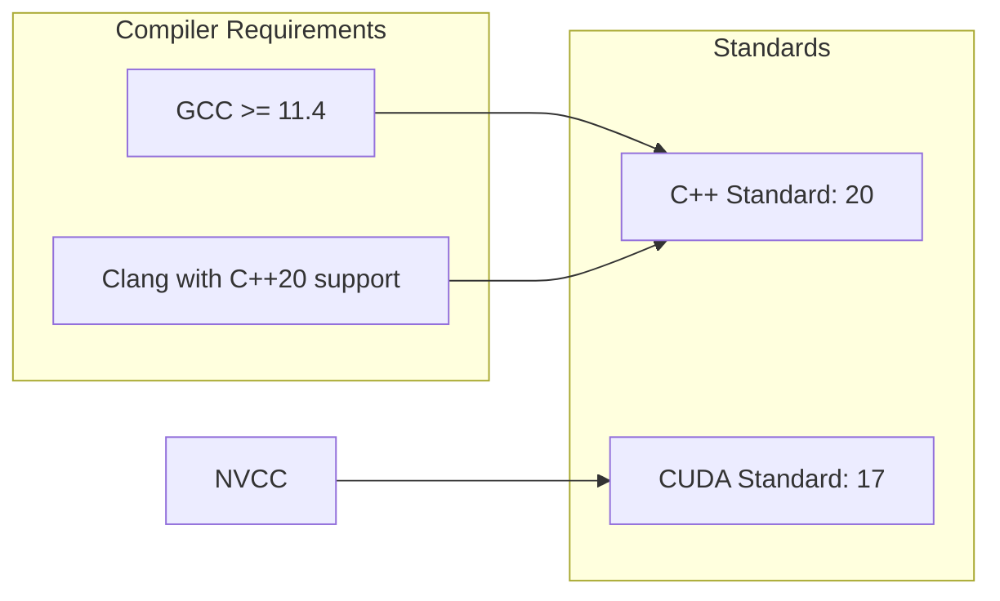
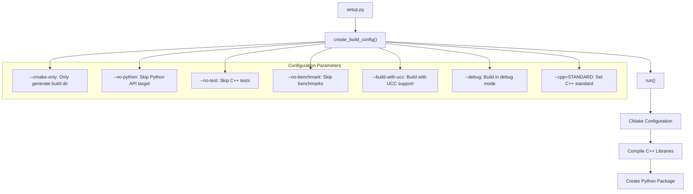
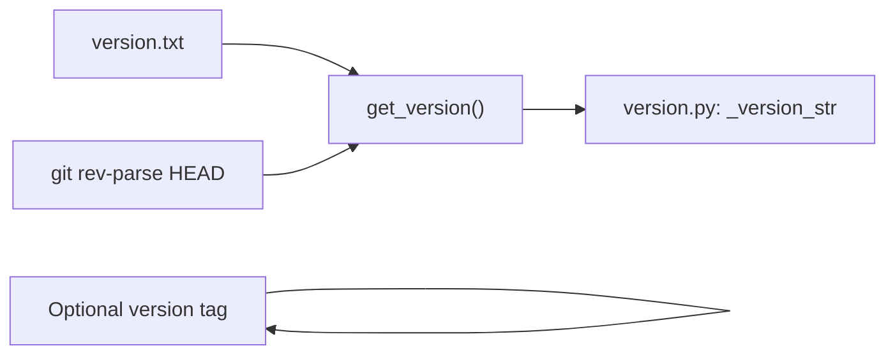
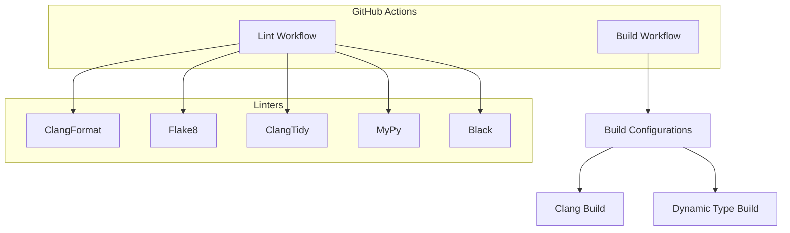

<!-- source: DeepWiki mcp.deepwiki.com · repo NVIDIA/Fuser · page 7 Build System · fetched 2026-10-26 -->

# Build System

<details>
<summary>Relevant source files</summary>

The following files were used as context for generating this wiki page:

- [.github/workflows/build.yml](.github/workflows/build.yml)
- [.github/workflows/lint.yml](.github/workflows/lint.yml)
- [.lintrunner.toml](.lintrunner.toml)
- [CMakeLists.txt](CMakeLists.txt)
- [setup.py](setup.py)
- [tools/apt-install-things.sh](tools/apt-install-things.sh)
- [tools/gen_nvfuser_version.py](tools/gen_nvfuser_version.py)
- [tools/memory.py](tools/memory.py)
- [tools/pip-install-things.sh](tools/pip-install-things.sh)
- [tools/setup-env.sh](tools/setup-env.sh)

</details>


The NVFUSER build system is responsible for compiling the core C++ libraries, building Python bindings, and creating test infrastructure. This page provides a technical overview of the build configuration, compilation process, and available options. For information about installing NVFUSER, see [Getting Started](#1.2).

## Build System Architecture

The NVFUSER build system consists of two main components: a CMake-based build system for C++ components and a Python setup mechanism for package creation.



Sources: [CMakeLists.txt:86-403](), [setup.py:6-103]()

## CMake Configuration

The primary build configuration is defined in `CMakeLists.txt`. This file sets up the build environment, defines targets, and configures dependencies.

### Core Library Targets

NVFUSER builds several library targets:

| Target | Type | Description | Source File |
|--------|------|-------------|-------------|
| `codegen_internal` | OBJECT | Core implementation containing all NVFUSER source files | [CMakeLists.txt:320]() |
| `nvfuser_codegen` | SHARED | Shared library wrapping the internal implementation | [CMakeLists.txt:373]() |
| `nvfuser` | MODULE | Python module for Python API (when `BUILD_PYTHON=ON`) | [CMakeLists.txt:501]() |
| `dynamic_type` | SHARED | Helper library for dynamic typing | [CMakeLists.txt:78]() |

### Build Options

NVFUSER supports several build options that can be configured in CMake:

| Option | Description | Default | Source |
|--------|-------------|---------|--------|
| `NVFUSER_STANDALONE_BUILD_WITH_UCC` | Build with UCC support | OFF | [CMakeLists.txt:16]() |
| `NVFUSER_EXPLICIT_ERROR_CHECK` | Enable explicit error checking | OFF | [CMakeLists.txt:17]() |
| `NVFUSER_BUILD_WITH_ASAN` | Build with AddressSanitizer | OFF | [CMakeLists.txt:23]() |
| `NVFUSER_DISTRIBUTED` | Build with distributed support | ON (if `USE_DISTRIBUTED` is ON) | [CMakeLists.txt:26]() |
| `NVFUSER_C_STANDARD` | C standard to use | 20 | [CMakeLists.txt:43]() |
| `NVFUSER_CPP_STANDARD` | C++ standard to use | 20 | [CMakeLists.txt:44]() |
| `NVFUSER_CUDA_STANDARD` | CUDA C++ standard to use | 17 | [CMakeLists.txt:45]() |

Sources: [CMakeLists.txt:16-45]()

### Compiler Requirements

NVFUSER requires modern compilers with C++20 support. The build system checks compiler versions and sets appropriate flags:



Sources: [CMakeLists.txt:47-55](), [tools/apt-install-things.sh:1-20](), [tools/setup-env.sh:1-9]()

## Python Setup Process

The Python package setup is handled by `setup.py`, which provides a user-friendly interface to configure and build the C++ components through CMake.

### Setup Flow



Sources: [setup.py:6-103]()

### Version Management

NVFUSER's version is determined through:
1. Base version from `version.txt`
2. Git commit SHA appended to the version
3. Optional version tag for specialized builds



Sources: [tools/gen_nvfuser_version.py:1-76](), [setup.py:78-87]()

## Runtime Code Generation

NVFUSER embeds CUDA runtime code into the library to support JIT compilation. The build system processes CUDA files and generates C++ headers with embedded code.

### Runtime Files Processing


The runtime files include crucial CUDA kernels like:
- Array operations
- Block and grid reductions
- Memory management
- Tensor operations
- Random number generation

Sources: [CMakeLists.txt:879-912]()

## Testing Infrastructure

The build system creates several test executables to validate NVFUSER functionality:

| Test Target | Description |
|-------------|-------------|
| `test_nvfuser` | Core functionality tests |
| `test_multidevice` | Multi-device execution tests |
| `test_matmul` | Matrix multiplication tests |
| `test_rng` | Random number generation tests |
| `test_view` | Tensor view tests |
| `test_host_ir` | Host IR tests |
| `test_python_frontend` | Python API tests |

The testing infrastructure uses Google Test for C++ tests.

Sources: [CMakeLists.txt:554-766]()

## Benchmarking

When enabled, the build system creates benchmarking targets:

| Benchmark Target | Description |
|------------------|-------------|
| `nvfuser_bench` | Core benchmarking suite |
| `nvfuser_multidevice_bench` | Multi-device benchmarks |

Benchmarks cover operations like:
- Matrix multiplication
- Layer normalization
- Softmax
- BERT model operations
- Reduction operations

Sources: [CMakeLists.txt:770-874]()

## Continuous Integration and Linting

NVFUSER uses GitHub Actions for CI/CD and includes linting tools to ensure code quality.



Sources: [.github/workflows/lint.yml:1-100](), [.github/workflows/build.yml:1-56](), [.lintrunner.toml:1-371]()

## Building NVFUSER

### Prerequisites

- CMake 3.18 or newer
- CUDA toolkit 
- C++ compiler with C++20 support (GCC 11.4+ or Clang)
- PyTorch (for Python bindings)

### Building with setup.py

```bash
# Basic build
python setup.py develop

# Custom build
python setup.py develop --no-test --no-benchmark --cpp=23
```

### Building with CMake directly

```bash
mkdir build
cd build
cmake -DCMAKE_BUILD_TYPE=Release ..
make -j
```

Sources: [setup.py:6-47](), [CMakeLists.txt:4-9]()

## Memory Management

The build system includes utilities for managing memory during the build process:

```python
def get_available_memory_gb():
    """Returns the available memory in GB."""
    # Check using psutil if available
    # Fall back to /proc/meminfo on Linux
```

This helps optimize parallel builds based on available system resources.

Sources: [tools/memory.py:1-28]()

The build system is a foundational component that enables NVFUSER's complex code generation and optimization capabilities, providing a flexible framework for building, testing, and deploying the system.

---

