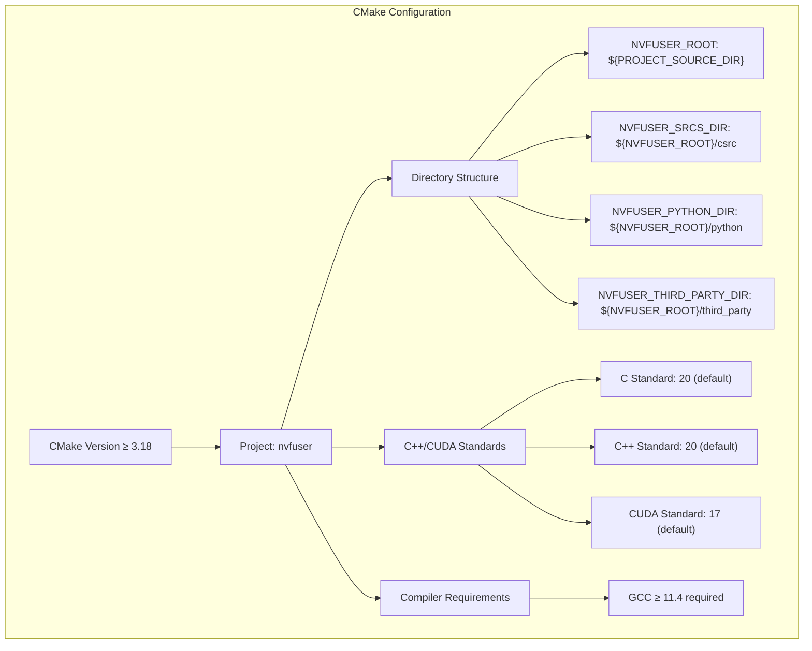
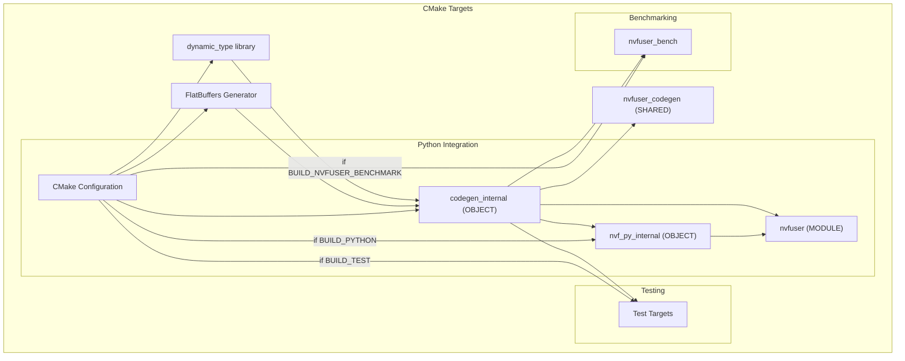
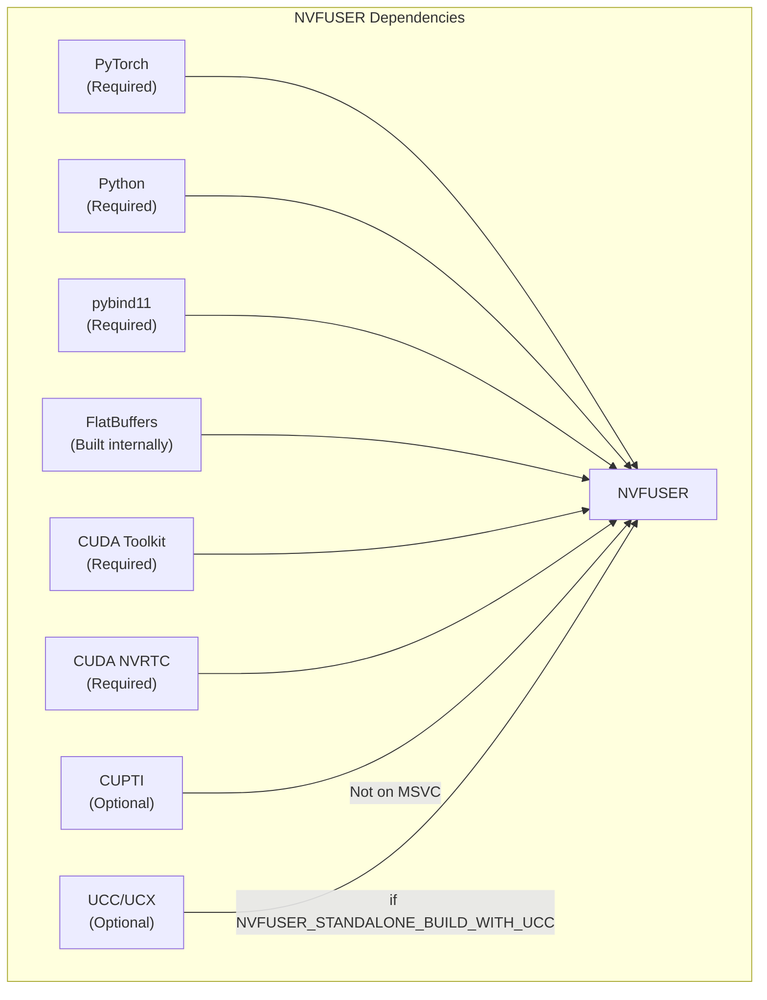
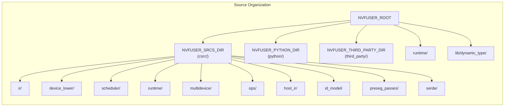

<!-- source: DeepWiki mcp.deepwiki.com · repo NVIDIA/Fuser · page 7.1 CMake Configuration · fetched 2026-10-26 -->

# CMake Configuration

<details>
<summary>Relevant source files</summary>

The following files were used as context for generating this wiki page:

- [.github/workflows/build.yml](.github/workflows/build.yml)
- [.github/workflows/lint.yml](.github/workflows/lint.yml)
- [.lintrunner.toml](.lintrunner.toml)
- [CMakeLists.txt](CMakeLists.txt)
- [setup.py](setup.py)
- [tools/apt-install-things.sh](tools/apt-install-things.sh)
- [tools/gen_nvfuser_version.py](tools/gen_nvfuser_version.py)
- [tools/memory.py](tools/memory.py)
- [tools/pip-install-things.sh](tools/pip-install-things.sh)
- [tools/setup-env.sh](tools/setup-env.sh)

</details>


This document details the CMake-based build configuration system for NVFUSER. It covers the core settings, build options, library structure, and dependencies required to build the NVFUSER codebase. For information about the Python package setup, see [Python Package Setup](#7.2).

## 1. CMake Requirements and Core Settings

NVFUSER requires CMake 3.18 or later and sets up the following core build settings:



Sources: [CMakeLists.txt:4-5](), [CMakeLists.txt:11-14](), [CMakeLists.txt:43-45](), [CMakeLists.txt:47-55]()

The CMake configuration enforces modern C++ standards, with C++20 as the default for host code and C++17 for CUDA code (since CUDA 11 doesn't support C++20). These standards can be overridden via cache variables:

```cmake
NVFUSER_C_STANDARD     # C standard to use for C code
NVFUSER_CPP_STANDARD   # C++ standard to use for C++ code
NVFUSER_CUDA_STANDARD  # C++ standard to use for CUDA code
```

### 1.1 Compiler Requirements

NVFUSER requires GCC 11.4 or later due to compiler bugs in earlier versions. The build system will fail with an error message if an incompatible GCC version is detected.

Sources: [CMakeLists.txt:47-55]()

## 2. Build Options

NVFUSER offers several build options to customize the build process:

| Option | Default | Description |
|--------|---------|-------------|
| `NVFUSER_STANDALONE_BUILD_WITH_UCC` | OFF | Enable UCC support for communication |
| `NVFUSER_EXPLICIT_ERROR_CHECK` | OFF | Enable explicit error checking |
| `NVFUSER_BUILD_WITH_ASAN` | OFF | Build with AddressSanitizer |
| `NVFUSER_DISTRIBUTED` | Depends on PyTorch | Enable distributed computing support |
| `BUILD_PYTHON` | ON (implicit) | Build Python bindings |
| `BUILD_TEST` | ON (implicit) | Build test targets |
| `BUILD_NVFUSER_BENCHMARK` | OFF (implicit) | Build benchmark targets |

Sources: [CMakeLists.txt:16-32](), [CMakeLists.txt:295-306](), [CMakeLists.txt:631](), [CMakeLists.txt:769]()

These options can be set using `-D` flags when invoking CMake:

```bash
cmake -DNVFUSER_DISTRIBUTED=ON -DNVFUSER_BUILD_WITH_ASAN=ON ...
```

From the Python setup.py interface, these options can be controlled with command-line arguments:

| Setup.py Argument | CMake Option | 
|-------------------|--------------|
| `--build-with-ucc` | `NVFUSER_STANDALONE_BUILD_WITH_UCC=ON` |
| `--build-without-distributed` | `NVFUSER_DISTRIBUTED=OFF` |
| `--no-python` | Sets `BUILD_PYTHON=OFF` |
| `--no-test` | Sets `BUILD_TEST=OFF` |
| `--no-benchmark` | Disables benchmarking build |
| `--cpp=STANDARD` | Sets `NVFUSER_CPP_STANDARD` |

Sources: [setup.py:14-62]()

## 3. Build System Structure

The NVFUSER build system creates several targets arranged in the following structure:



Sources: [CMakeLists.txt:86-404](), [CMakeLists.txt:462-552](), [CMakeLists.txt:631-766](), [CMakeLists.txt:769-874]()

### 3.1 Main Libraries

The primary libraries built by the CMake configuration are:

1. **codegen_internal** (OBJECT library): Contains all NVFUSER's core code.
   - Object libraries in CMake are intermediate libraries that don't produce a final library file but are used to build other targets.
   - Contains all source files from csrc/ directory.
   - Used as a building block for other targets.

2. **nvfuser_codegen** (SHARED library): The main shared library exposing NVFUSER's functionality.
   - Built from codegen_internal objects.
   - Installed to the lib directory.

3. **nvfuser** (MODULE library, when BUILD_PYTHON is enabled): The Python module (_C.so).
   - Links against codegen_internal.
   - Enables using NVFUSER from Python.

Sources: [CMakeLists.txt:320](), [CMakeLists.txt:373](), [CMakeLists.txt:501]()

## 4. Dependencies

NVFUSER has several external dependencies, handled by the CMake configuration:



Sources: [CMakeLists.txt:59-61](), [CMakeLists.txt:68-83](), [CMakeLists.txt:419-438]()

The key dependencies are:
1. **PyTorch** - Required for CUDA operations and tensor handling
2. **Python** - Required for Python bindings and interpreter functionality
3. **pybind11** - Used to create Python bindings for C++ code
4. **FlatBuffers** - Used for serialization, built internally
5. **CUDA Toolkit** - Required for GPU operations
6. **CUPTI** - Used for profiling (not on MSVC)
7. **UCC/UCX** - Optional for communication with UCC

The CMake configuration also builds the `dynamic_type` library from source, which is included in the repository.

Sources: [CMakeLists.txt:78]()

### 4.1 Dependency Resolution

Dependencies are found using CMake's `find_package` command:

```cmake
find_package(Torch REQUIRED)
find_package(Python REQUIRED Development.Module Interpreter)
find_package(pybind11 REQUIRED)
```

The CUDA architecture is configured based on PyTorch's configuration:

```cmake
if(TORCH_CUDA_ARCH_LIST)
  set(ARCH_FLAGS)
  cuda_select_nvcc_arch_flags(ARCH_FLAGS ${TORCH_CUDA_ARCH_LIST})
  list(APPEND CUDA_NVCC_FLAGS ${ARCH_FLAGS})
endif()
```

UCC and UCX are found only if `NVFUSER_STANDALONE_BUILD_WITH_UCC` is enabled:

```cmake
if(NVFUSER_STANDALONE_BUILD_WITH_UCC)
  find_package(UCC REQUIRED)
  find_package(UCX REQUIRED)
  # ...
endif()
```

Sources: [CMakeLists.txt:59-76](), [CMakeLists.txt:419-438]()

## 5. Source Organization

The NVFUSER source code is organized in a structured way that is reflected in the CMake configuration:



Sources: [CMakeLists.txt:11-14](), [CMakeLists.txt:89-286]()

The entire source structure is reflected in the source file list used to build `codegen_internal`. The source files are grouped by directory in the `NVFUSER_SRCS` variable, covering all the main subsystems of NVFUSER.

## 6. Build Targets

### 6.1 Main Libraries

The main library targets built by the CMake configuration:

- **codegen_internal** (OBJECT): Contains all of NVFUSER's core functionality
- **nvfuser_codegen** (SHARED): Shared library exposing NVFUSER's API
- **nvfuser** (MODULE): Python module (when BUILD_PYTHON is enabled)

Sources: [CMakeLists.txt:320](), [CMakeLists.txt:373](), [CMakeLists.txt:501]()

### 6.2 Test Targets

When BUILD_TEST is enabled, several test targets are created:

| Test Target | Purpose |
|-------------|---------|
| test_nvfuser | Main test suite |
| test_rng | Tests for random number generation |
| test_multidevice | Tests for multi-device functionality |
| tutorial_multidevice | Tutorials for multi-device usage |
| test_view | Tests for tensor view operations |
| test_matmul | Tests for matrix multiplication |
| test_external_src | Tests for external source support |
| test_tutorial | Tutorials and examples |
| test_host_ir | Tests for host IR functionality |
| test_python_frontend | Tests for Python frontend (if BUILD_PYTHON is enabled) |
| test_profiler | Tests for profiling (not on MSVC) |

Sources: [CMakeLists.txt:680-763]()

### 6.3 Benchmark Targets

When BUILD_NVFUSER_BENCHMARK is enabled:

- **nvfuser_bench**: Main benchmarking executable
- **nvfuser_multidevice_bench**: Multi-device benchmarks (if NVFUSER_DISTRIBUTED is enabled)

Sources: [CMakeLists.txt:769-874]()

## 7. Build Process Flow

The overall build process flow is as follows:

```mermaid
flowchart TD
    subgraph "Build Process Flow"
        CMakeInit["1. Initialize CMake\ncmake_minimum_required()"] --> ProjectDef["2. Define Project\nproject(nvfuser)"]
        ProjectDef --> SetVars["3. Set Core Variables\nNVFUSER_ROOT, etc."]
        SetVars --> SetOptions["4. Configure Options\nNVFUSER_DISTRIBUTED, etc."]
        SetOptions --> FindDeps["5. Find Dependencies\nPyTorch, Python, etc."]
        FindDeps --> IncludeDeps["6. Include Dependencies\nFlatBuffers.cmake, Dependencies.cmake"]
        IncludeDeps --> BuildDynType["7. Build dynamic_type\nadd_subdirectory()"]
        BuildDynType --> DefLib["8. Define Libraries\ncodegen_internal, nvfuser_codegen"]
        DefLib --> GenFlatBuffers["9. Generate FlatBuffers\nbuild_flatbuffer_config"]
        GenFlatBuffers --> ConfigPython["10. Configure Python\n(if BUILD_PYTHON)"]
        ConfigPython --> ConfigTests["11. Configure Tests\n(if BUILD_TEST)"]
        ConfigTests --> ConfigBench["12. Configure Benchmarks\n(if BUILD_NVFUSER_BENCHMARK)"]
        ConfigBench --> GenRuntimeFiles["13. Generate Runtime Files\nstringify_nvfuser_sources()"]
    end
```



Sources: [CMakeLists.txt:4-915]()

## 8. Integration with Python Setup

The CMake configuration integrates with Python's setuptools through `setup.py`, which:

1. Parses command-line arguments and converts them to CMake options
2. Runs CMake to configure the build
3. Builds the project using the configured build tool (e.g., Ninja)
4. Installs the libraries to the appropriate locations for Python

Key flags in setup.py like `--cmake-only`, `--no-python`, and `--build-dir` control the build process and map to corresponding CMake options.

Sources: [setup.py:14-62](), [setup.py:91-103]()

## 9. Runtime File Generation

The CMake configuration also handles the generation of runtime files, which involves "stringifying" CUDA source files for inclusion in C++ code:

```cmake
add_custom_command(
    OUTPUT ${CMAKE_BINARY_DIR}/include/nvfuser_resources/stringify_${INPUT_FILENAME}.h
    # ...
    COMMENT "Stringify ${INPUT_FILENAME} for nvFuser..."
)
```

This process converts CUDA runtime files into C++ header files containing the CUDA code as string literals, allowing NVFUSER to embed CUDA code templates in the C++ library.

Sources: [CMakeLists.txt:880-915]()

## 10. Common Build Workflows

Here are common workflows for building NVFUSER:

### 10.1 Building with CMake Directly

```bash
mkdir build && cd build
cmake .. -DNVFUSER_DISTRIBUTED=ON
cmake --build .
```

### 10.2 Building with Python Setup

```bash
# Basic build
python setup.py develop

# Build with specific options
python setup.py develop --build-with-ucc --cpp=23

# Build in debug mode
python setup.py develop --debug
```

Sources: [setup.py:6-62]()

## 11. Environment Setup

For consistent builds, the environment can be set up using the provided scripts:

- `tools/apt-install-things.sh`: Installs required system packages
- `tools/setup-env.sh`: Sets up environment variables (CUDA path, compiler selection)
- `tools/pip-install-things.sh`: Installs required Python packages

These scripts ensure that the correct versions of compilers, CUDA, and PyTorch are available in the build environment.

Sources: [tools/apt-install-things.sh:1-20](), [tools/setup-env.sh:1-9](), [tools/pip-install-things.sh:1-9]()

---

