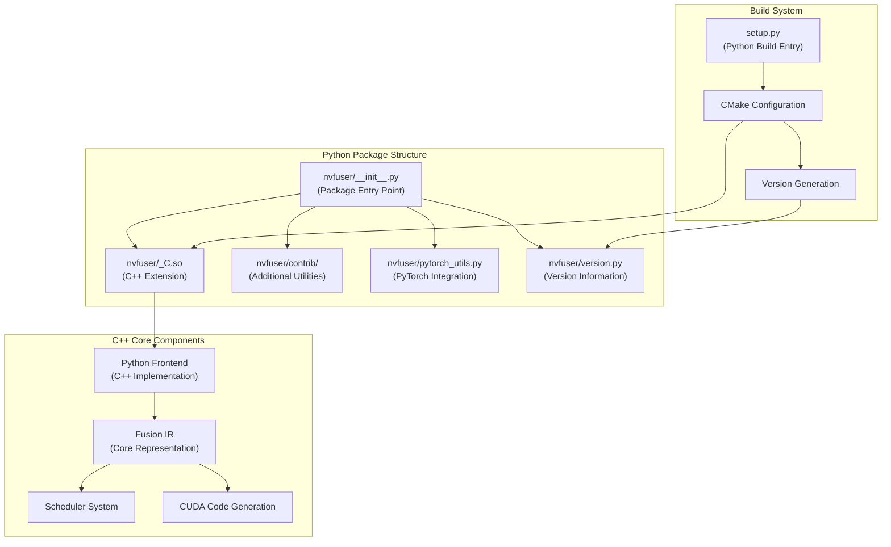
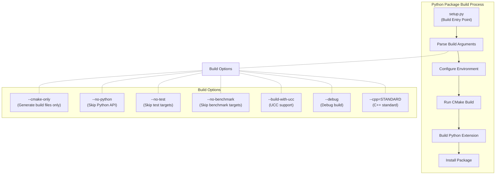
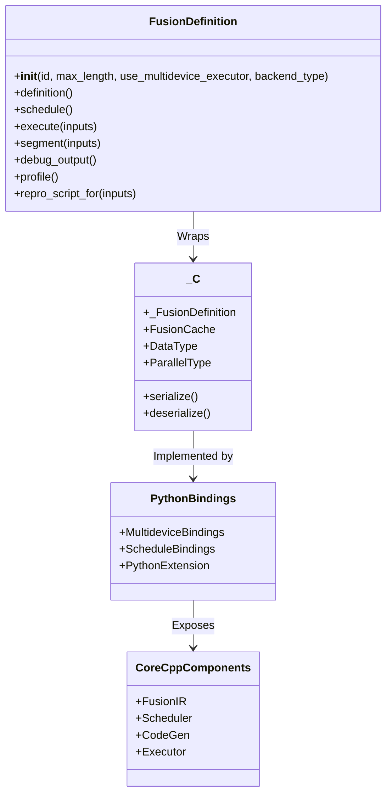
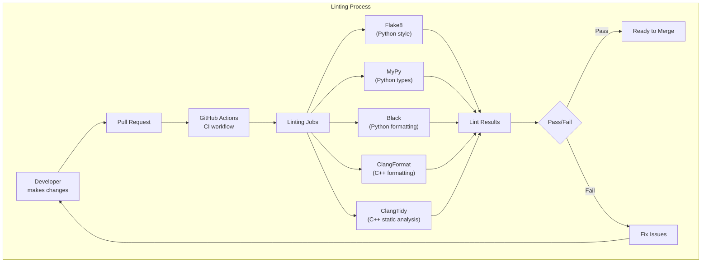

<!-- source: DeepWiki mcp.deepwiki.com · repo NVIDIA/Fuser · page 7.2 Python Package Setup · fetched 2026-10-26 -->

# Python Package Setup

<details>
<summary>Relevant source files</summary>

The following files were used as context for generating this wiki page:

- [.github/workflows/build.yml](.github/workflows/build.yml)
- [.github/workflows/lint.yml](.github/workflows/lint.yml)
- [.lintrunner.toml](.lintrunner.toml)
- [CMakeLists.txt](CMakeLists.txt)
- [nvfuser/__init__.py](nvfuser/__init__.py)
- [setup.py](setup.py)
- [tests/python/test_schedule_ops.py](tests/python/test_schedule_ops.py)
- [tools/apt-install-things.sh](tools/apt-install-things.sh)
- [tools/gen_nvfuser_version.py](tools/gen_nvfuser_version.py)
- [tools/memory.py](tools/memory.py)
- [tools/pip-install-things.sh](tools/pip-install-things.sh)
- [tools/setup-env.sh](tools/setup-env.sh)

</details>


This document describes how NVFUSER's Python package is structured, built, and configured. It covers the build system integration, package initialization, and the connection between Python and C++ components. For information about using the Python API, see [Python Frontend](#6).

## 1. Package Structure Overview

NVFUSER's Python package provides a user-friendly interface to the core C++ fusion functionality. The package consists of both Python modules and compiled C++ extensions that integrate with PyTorch.



Sources: [nvfuser/__init__.py:1-630](), [CMakeLists.txt:460-494]()

## 2. Build System Integration

NVFUSER uses a hybrid build system that combines Python's setuptools with CMake. This approach allows for the compilation of C++ components while maintaining a standard Python package structure.

### 2.1 Setup.py Entry Point

The `setup.py` script serves as the primary entry point for building the Python package. It processes command-line arguments and configures the build environment before invoking CMake.



Key build options available through setup.py include:

| Option | Description |
|--------|-------------|
| `--cmake-only` | Only generate the build directory with CMake setup |
| `--no-python` | Skip building the Python API target |
| `--no-test` | Skip building C++ tests |
| `--no-benchmark` | Skip building benchmark targets |
| `--no-ninja` | Use make instead of ninja for building |
| `--build-with-ucc` | Build with UCC support |
| `--build-without-distributed` | Build without multidevice support |
| `--debug` | Build in debug mode |
| `--cpp=STANDARD` | Specify C++ standard (defaults to C++20) |
| `--build-dir=PATH` | Specify build directory (defaults to "./build") |
| `--install-dir=PATH` | Specify install directory (defaults to "./python/nvfuser") |

Sources: [setup.py:1-108](), [CMakeLists.txt:460-494]()

### 2.2 CMake Configuration

The CMake build system handles the compilation of C++ components and links them with PyTorch libraries. The configuration is primarily defined in `CMakeLists.txt`.

Key aspects of the CMake configuration for the Python package:

1. **Python Extension Target**: The build creates a Python extension module (`nvfuser`) that exposes C++ functionality to Python.
2. **Dependencies**: The build system links against PyTorch, CUDA, and other required libraries.
3. **Install Paths**: The built extension is installed with the appropriate RPATH to find dependencies.
4. **Version Information**: The package version is generated during the build process.

Sources: [CMakeLists.txt:460-494](), [CMakeLists.txt:475-493]()

## 3. Python Extension Architecture

The Python package connects to the C++ implementation through a compiled extension module. This architecture enables high-performance CUDA code generation while providing a Python-friendly interface.



The Python package consists of several key components:

1. **C Extension Module**: The compiled `_C` module exports C++ classes and functions to Python.
2. **FusionDefinition Class**: A Python wrapper that provides a more Pythonic interface to the core fusion functionality.
3. **Bindings**: Python bindings expose C++ implementation details such as scheduling, execution, and fusion cache management.

Sources: [nvfuser/__init__.py:53-429](), [CMakeLists.txt:460-494](), [CMakeLists.txt:297-305]()

### 3.1 Python Binding Files

The Python bindings are implemented in several C++ files that are compiled into the extension module:

| File | Purpose |
|------|---------|
| `python_frontend/python_bindings.cpp` | Core Python bindings |
| `python_frontend/python_bindings_extension.cpp` | Extension module initialization |
| `python_frontend/schedule_bindings.cpp` | Scheduler-related bindings |
| `python_frontend/multidevice_bindings.cpp` | Multidevice support bindings |
| `python_frontend/fusion_definition.cpp` | FusionDefinition implementation |
| `python_frontend/fusion_cache.cpp` | Fusion cache bindings |
| `python_frontend/fusion_state.cpp` | Fusion state management |
| `python_frontend/distributed_tensor.cpp` | Distributed tensor bindings |
| `python_frontend/translation.cpp` | Translation between PyTorch and NVFUSER |

Sources: [CMakeLists.txt:466-470](), [CMakeLists.txt:297-305]()

## 4. Package Initialization

When the NVFUSER package is imported, it performs several initialization steps to set up the environment for fusion operations.

### 4.1 Import Process

The import process includes:

1. Setting up the PyTorch library path in `sys.path`
2. Importing the C extension module (`_C`)
3. Setting up logging
4. Registering serialization hooks

```python
import torch

# Set up PyTorch library path
pytorch_lib_dir = os.path.join(os.path.dirname(torch.__file__), "lib")
if pytorch_lib_dir not in sys.path:
    sys.path.append(pytorch_lib_dir)

# Import C extension
from . import _C
from ._C import *

# Set up logging
logger = logging.getLogger("nvfuser")
```

Sources: [nvfuser/__init__.py:5-27]()

### 4.2 Automatic Serialization

NVFUSER provides functionality to automatically serialize the fusion cache to disk when the Python process exits:

```python
def enable_automatic_serialization():
    import atexit
    atexit.register(_C.serialize)
    
    # A separate process is created for each device in a distributed setting.
    # Each FusionCache becomes associated with a single device.
    # Automatic serialization saves a separate cache for each device.
    env_var_ddp_local_rank = os.environ.get("LOCAL_RANK", None)
    if env_var_ddp_local_rank is not None:
        env_var_ddp_local_rank = int(env_var_ddp_local_rank)
    _C.FusionCache.get(max_fusions := 8192, env_var_ddp_local_rank)
```

Sources: [nvfuser/__init__.py:30-50]()

### 4.3 Version Management

The package version is generated during the build process and made available through the `version()` function:

```python
def version():
    """returns nvfuser version in format of a string 'm.n.p+git[7d-sha]'."""
    return __version__
```

The version generation process:

1. Read base version from `version.txt`
2. Append git commit hash
3. Generate `version.py` during build

Sources: [nvfuser/__init__.py:614-629](), [tools/gen_nvfuser_version.py:1-76]()

## 5. Development and Testing

The Python package includes tests to verify functionality and ensure compatibility with PyTorch. These tests are built as part of the CMake build process.

### 5.1 Python Tests

Python tests are located in the `python/tests` directory and test specific aspects of the Python interface. The tests use PyTorch's testing framework and pytest.

Examples of Python test files:
- `test_schedule_ops.py`: Tests for scheduler operations
- `test_nvfuser_fusion_definition.cpp`: Tests for the FusionDefinition C++ interface
- `test_nvfuser_fusion_cache.cpp`: Tests for the fusion cache interface

Sources: [tests/python/test_schedule_ops.py:1-623](), [CMakeLists.txt:748-757]()

### 5.2 Development Environment Setup

For development, several scripts are provided to set up the environment:

1. `tools/apt-install-things.sh`: Installs required system packages
2. `tools/pip-install-things.sh`: Installs required Python packages
3. `tools/setup-env.sh`: Sets up environment variables

These scripts ensure a consistent development environment with the necessary dependencies installed.

Sources: [tools/apt-install-things.sh:1-20](), [tools/pip-install-things.sh:1-9](), [tools/setup-env.sh:1-9]()

## 6. Building and Installing the Package

To build and install the NVFUSER Python package, you can use the following workflow:

1. **Clone the repository**:
   ```bash
   git clone https://github.com/NVIDIA/Fuser.git
   cd Fuser
   ```

2. **Install dependencies**:
   ```bash
   # Install system dependencies
   ./tools/apt-install-things.sh
   
   # Install Python dependencies
   ./tools/pip-install-things.sh
   
   # Set up environment variables
   source ./tools/setup-env.sh
   ```

3. **Build and install the package**:
   ```bash
   python setup.py install
   ```
   
   Or for development:
   ```bash
   python setup.py develop
   ```

4. **Run tests**:
   ```bash
   pytest -xvs python/tests
   ```

For more complex build options, refer to the command-line arguments available in setup.py.

Sources: [setup.py:1-108]()

## 7. Linting and Code Quality

The Python package includes linting tools to ensure code quality. These are configured in the `.lintrunner.toml` file and run as part of the GitHub Actions CI workflow.

Linting tools include:
- **flake8**: For Python style checking
- **mypy**: For static type checking
- **black**: For code formatting
- **clang-format**: For C++ code formatting
- **clang-tidy**: For C++ static analysis



Sources: [.lintrunner.toml:1-372](), [.github/workflows/lint.yml:1-100]()