# Page: Overview

# Overview

<details>
<summary>Relevant source files</summary>

The following files were used as context for generating this wiki page:

- [.github/workflows/build.yml](.github/workflows/build.yml)
- [.github/workflows/lint.yml](.github/workflows/lint.yml)
- [.lintrunner.toml](.lintrunner.toml)
- [CMakeLists.txt](CMakeLists.txt)
- [csrc/device_lower/pass/alias_memory.cpp](csrc/device_lower/pass/alias_memory.cpp)
- [csrc/device_lower/utils.cpp](csrc/device_lower/utils.cpp)
- [csrc/device_lower/utils.h](csrc/device_lower/utils.h)
- [csrc/ir/interface_nodes.h](csrc/ir/interface_nodes.h)
- [csrc/ir/internal_base_nodes.h](csrc/ir/internal_base_nodes.h)
- [csrc/ir/internal_nodes.h](csrc/ir/internal_nodes.h)
- [csrc/ir/nodes.cpp](csrc/ir/nodes.cpp)
- [csrc/serde/fusion_cache.fbs](csrc/serde/fusion_cache.fbs)
- [csrc/serde/fusion_record.cpp](csrc/serde/fusion_record.cpp)
- [csrc/tensor_view.cpp](csrc/tensor_view.cpp)
- [nvfuser/__init__.py](nvfuser/__init__.py)
- [setup.py](setup.py)
- [tests/python/test_python_frontend.py](tests/python/test_python_frontend.py)
- [tests/python/test_schedule_ops.py](tests/python/test_schedule_ops.py)
- [tools/apt-install-things.sh](tools/apt-install-things.sh)
- [tools/gen_nvfuser_version.py](tools/gen_nvfuser_version.py)
- [tools/memory.py](tools/memory.py)
- [tools/pip-install-things.sh](tools/pip-install-things.sh)
- [tools/setup-env.sh](tools/setup-env.sh)

</details>


NVFUSER is a just-in-time (JIT) CUDA kernel compiler for PyTorch tensor operations. It dynamically fuses operations into efficient CUDA kernels, optimizing execution for NVIDIA GPUs. This page provides a high-level overview of the NVFUSER architecture, key components, and execution flow.

NVFUSER enables significant performance improvements by combining multiple tensor operations into single GPU kernels, eliminating intermediate memory accesses and leveraging hardware-specific optimizations. It supports a wide range of operations including pointwise, reduction, matrix multiplication, and normalization operations.

For specific information about the Python frontend, see [Python Frontend](#6), and for multi-device execution capabilities, see [Multi-Device Support](#5).

Sources: [CMakeLists.txt:4-8](), [nvfuser/__init__.py:5-11]()

## System Architecture

NVFUSER is built around a layered architecture with components for defining operations, building an intermediate representation, optimizing execution, and generating efficient CUDA code.

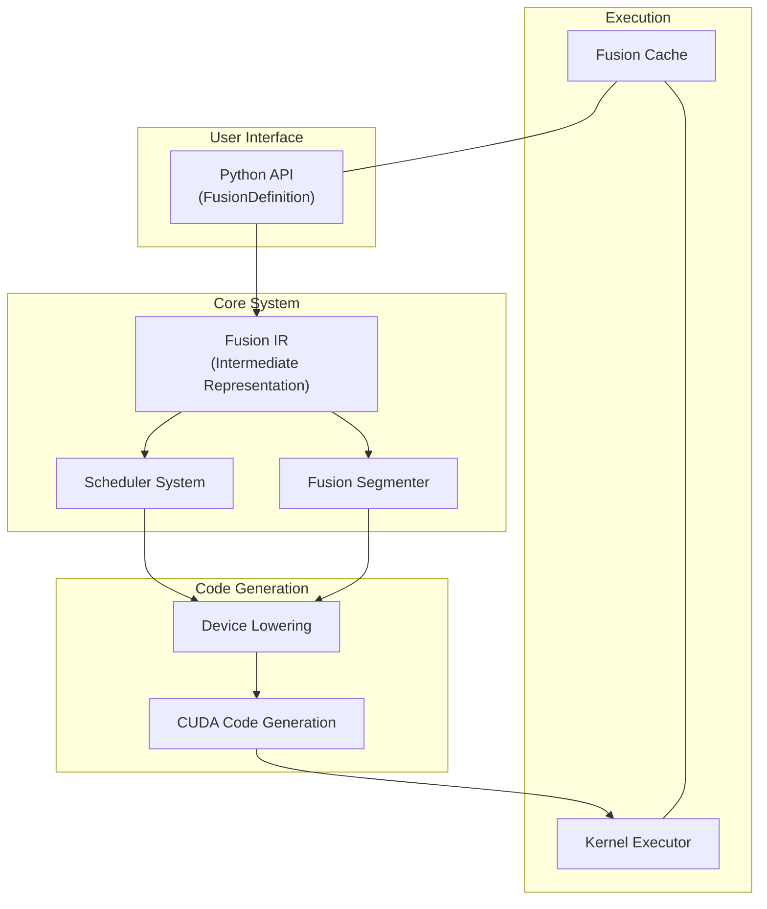

The main system components include:

1. **Python API**: Frontend for defining fusion operations through the `FusionDefinition` class
2. **Fusion IR**: Core representation of operations to be fused
3. **Scheduler System**: Applies optimization strategies based on operation patterns
4. **Fusion Segmenter**: Partitions complex computations into manageable segments
5. **Device Lowering**: Transforms IR into device-specific representations
6. **CUDA Code Generation**: Generates optimized CUDA code
7. **Kernel Executor**: Compiles and runs the generated code
8. **Fusion Cache**: Stores and reuses previously compiled kernels

Sources: [CMakeLists.txt:85-286](), [csrc/ir/nodes.cpp:36-47](), [csrc/ir/interface_nodes.h:37-47](), [csrc/device_lower/utils.cpp:30-46]()

## Core IR System

NVFUSER's IR (Intermediate Representation) is the foundation of the system, providing a flexible and extensible representation of tensor operations. The IR is structured as a hierarchical graph of nodes representing values and operations.

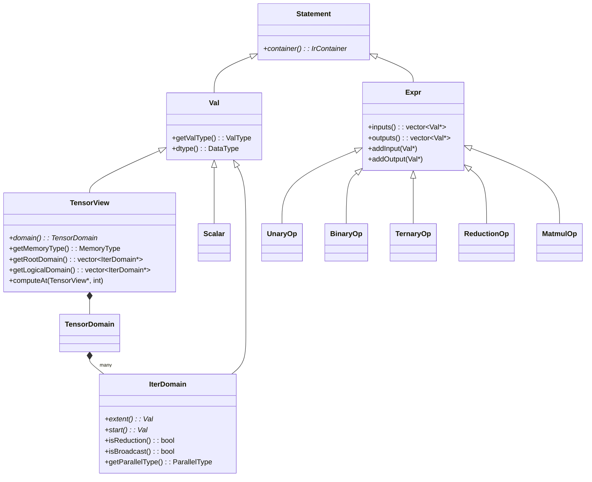

Key components of the IR system:

- **Statement**: Base class for all IR nodes
- **Val**: Represents values (tensors, scalars, domains)
  - **TensorView**: Represents tensors with domains and memory types
  - **IterDomain**: Represents a single dimension of a tensor
  - **Scalar**: Represents scalar values
- **Expr**: Represents operations that transform values
  - **UnaryOp**: Single-input operations (e.g., neg, cast)
  - **BinaryOp**: Two-input operations (e.g., add, mul)
  - **TernaryOp**: Three-input operations (e.g., where, clamp)
  - **ReductionOp**: Reduction operations across dimensions
  - **MatmulOp**: Matrix multiplication operations

The IR system uses a visitor pattern for traversing and transforming the operation graph. This enables optimizations, transformations, and code generation.

Sources: [csrc/ir/internal_nodes.h:41-726](), [csrc/ir/internal_base_nodes.h:34-683](), [csrc/ir/interface_nodes.h:56-393]()

## Python Frontend

The Python frontend provides a user-friendly API for defining fusion operations. It's centered around the `FusionDefinition` class, which serves as a builder for the underlying IR.

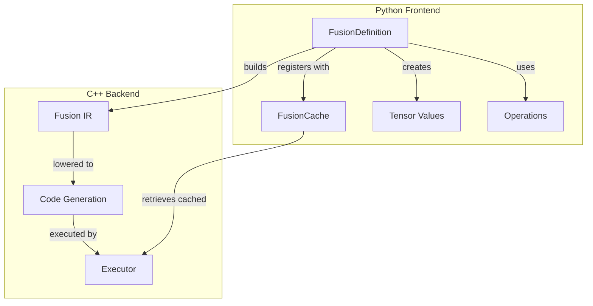

The primary components of the Python frontend are:

- **FusionDefinition**: Context manager for defining a fusion through a Python API
- **FusionCache**: Manages caching and retrieval of compiled fusions
- **Tensor operations**: Methods for defining tensor operations in the fusion

Example usage:

```python
with FusionDefinition() as fd:
    # Define input tensors
    t0 = fd.define_tensor(shape=[-1, -1], contiguity=[True, True])
    t1 = fd.define_tensor(shape=[-1, -1], contiguity=[True, True])
    
    # Define operations
    t2 = fd.ops.add(t0, t1)
    t3 = fd.ops.relu(t2)
    
    # Register output
    fd.add_output(t3)

# Execute the fusion with actual tensors
result = fd.execute([input_tensor1, input_tensor2])
```

The Python frontend handles:
- Translation between PyTorch tensors and NVFUSER's representation
- Building the fusion IR graph
- Managing fusion execution
- Caching compiled kernels for reuse

Sources: [nvfuser/__init__.py:52-307](), [tests/python/test_python_frontend.py:42-77]()

## Scheduling System

The scheduling system is responsible for determining efficient execution strategies for different types of operations. It analyzes the fusion graph and applies specialized optimizations based on operation patterns.

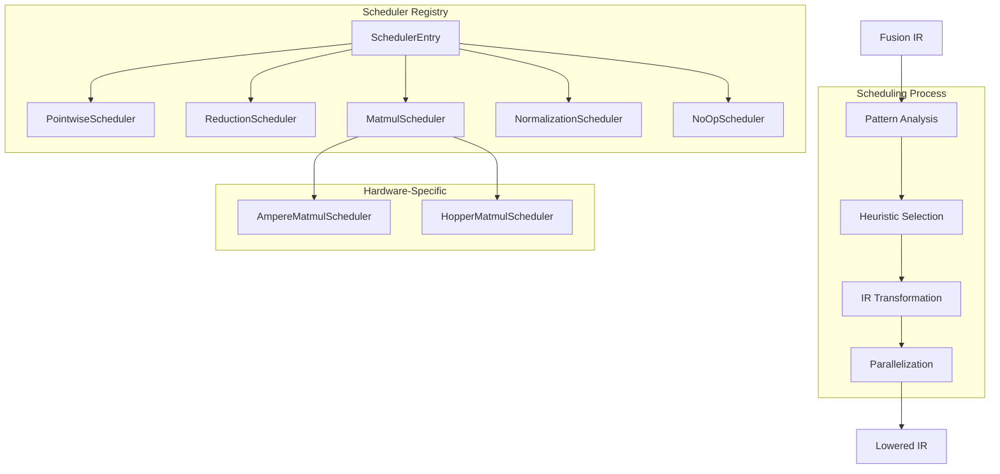

The scheduler system includes:

1. **Scheduler Registry**: Collection of specialized schedulers for different operation patterns
2. **Pattern Analysis**: Identifies operation patterns in the fusion graph
3. **Heuristic Selection**: Chooses appropriate optimization strategies
4. **IR Transformation**: Applies transformations like tiling and fusion
5. **Parallelization**: Maps operations to GPU execution resources (threads, blocks)
6. **Hardware-Specific Schedulers**: Optimizations for specific GPU architectures

The scheduler transforms the logical IR representation into an optimized physical representation by:
- Determining optimal tiling sizes
- Selecting thread and block dimensions
- Deciding on memory access patterns
- Applying architecture-specific optimizations

Sources: [CMakeLists.txt:230-267](), [tests/python/test_schedule_ops.py:25-41]()

## Device Lowering and Code Generation

The device lowering and code generation components transform the optimized IR into executable CUDA code. This process involves several stages of lowering, analysis, and code generation.

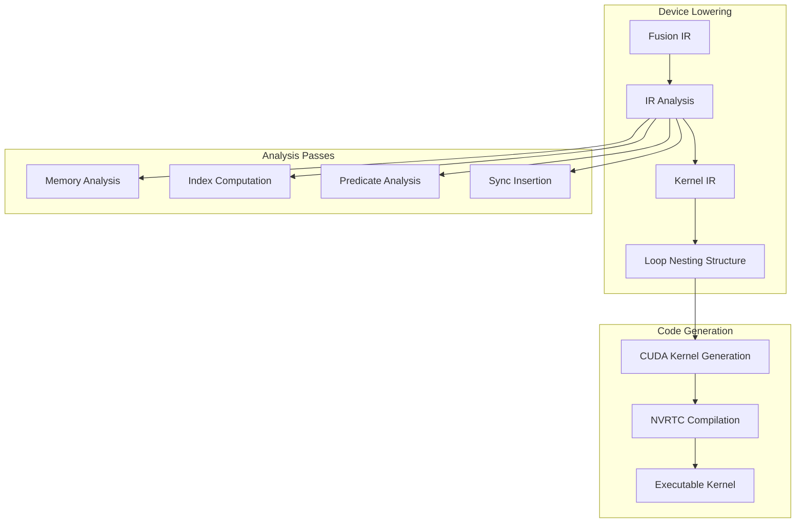

Key components and processes:

1. **IR Analysis**: Analyzes tensor access patterns, dependencies, and parallelization
2. **Memory Analysis**: Determines memory allocation and access patterns
3. **Index Computation**: Calculates tensor indices based on loop iterators
4. **Predicate Analysis**: Generates predicates for conditional execution
5. **Sync Insertion**: Inserts synchronization barriers where needed
6. **Kernel IR**: Lower-level representation focused on GPU execution
7. **Loop Nesting**: Creates loop structures for tensor iteration
8. **CUDA Code Generation**: Generates CUDA C++ code
9. **Runtime Compilation**: Compiles generated code using NVRTC
10. **Executable Kernel**: Final executable kernel ready for execution

The system includes support for generating various GPU-specific features:
- Thread and block parallelism
- Shared memory usage
- Register allocation
- Warp-level operations
- Tensor core operations for matrix multiplication

Sources: [CMakeLists.txt:98-134](), [csrc/device_lower/utils.cpp:132-201]()

## Multi-Device Support

NVFUSER includes support for distributed execution across multiple GPUs through its multi-device system. This system handles data sharding, communication, and synchronization between devices.

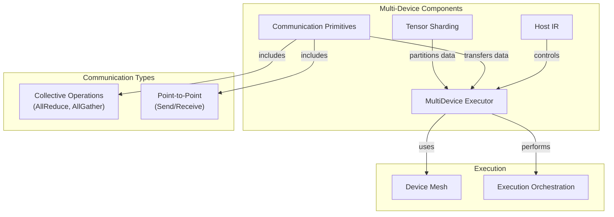

Key components and features:

1. **Multi-Device Executor**: Orchestrates execution across devices
2. **Tensor Sharding**: Partitions tensors across devices
3. **Communication Primitives**: Enables data transfer between devices
   - **Collective Operations**: Global operations like AllReduce and AllGather
   - **Point-to-Point**: Direct device-to-device communication
4. **Host IR**: Represents control flow and synchronization
5. **Device Mesh**: Logical arrangement of devices for execution
6. **Execution Orchestration**: Coordinates computation and communication

This system supports various distributed execution patterns:
- Data parallelism
- Model parallelism
- Pipeline parallelism
- Hybrid parallelism approaches

Sources: [CMakeLists.txt:181-188](), [csrc/device_lower/utils.h:95-102]()

## Execution Flow

The end-to-end execution flow in NVFUSER involves several stages, from fusion definition to compiled kernel execution and result retrieval.

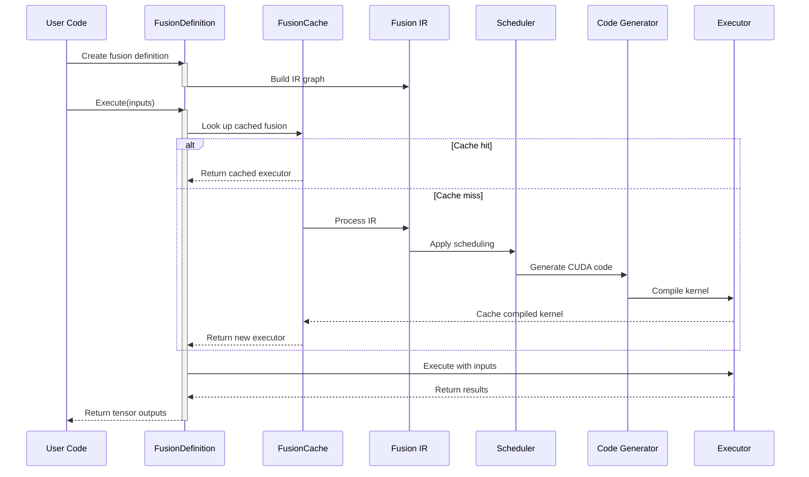

The execution flow consists of these main stages:

1. **Fusion Definition**: User creates a fusion definition using the Python API
2. **IR Construction**: The system builds an IR graph representing the operations
3. **Cache Lookup**: The system checks if this fusion has been compiled before
4. **Scheduling**: If not cached, a scheduler optimizes the execution pattern
5. **Code Generation**: The system generates CUDA code for the fusion
6. **Compilation**: The generated code is compiled into a kernel
7. **Caching**: The compiled kernel is cached for future reuse
8. **Execution**: The kernel is executed with the provided input tensors
9. **Result Return**: Results are returned to the user

For complex fusions, segmentation may occur:
```python
# Segmentation for complex fusions
segments = fusion_definition.segment(inputs)
if segments:
    # Execute each segment in sequence
    results = fusion_definition._execute_segments(inputs)
else:
    # Execute as a single fusion
    results = fusion_definition.execute(inputs)
```

Sources: [nvfuser/__init__.py:118-196](), [tests/python/test_python_frontend.py:70-76]()

## Build System and Integration

NVFUSER uses CMake as its build system and integrates with PyTorch through a Python extension module. The build system handles compilation, library linking, and package generation.

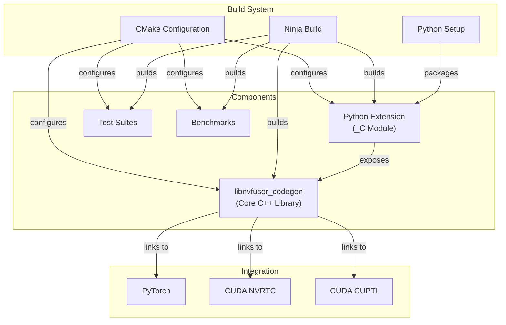

The build system includes:

1. **CMake Configuration**: Manages build settings, dependencies, and targets
2. **Library Targets**:
   - **libnvfuser_codegen**: Core C++ library for fusion compilation
   - **Python Extension**: Python bindings exposing the C++ functionality
   - **Tests**: Test suites for validation
   - **Benchmarks**: Performance benchmarking tools
3. **Dependencies**:
   - **PyTorch**: Integration with the PyTorch ecosystem
   - **CUDA Components**: NVRTC for runtime compilation, CUPTI for profiling
   - **FlatBuffers**: For serialization of fusion cache

Building NVFUSER involves several options:
```bash
# Basic build
python setup.py develop

# With specific options
python setup.py develop --cpp=20 --build-with-ucc --no-benchmark
```

Installation creates a Python package with both high-level API components and the compiled C++ extension.

Sources: [CMakeLists.txt:1-47](), [setup.py:1-47](), [.github/workflows/build.yml:17-36]()

---

# Page: System Architecture

# System Architecture

<details>
<summary>Relevant source files</summary>

The following files were used as context for generating this wiki page:

- [csrc/codegen.cpp](csrc/codegen.cpp)
- [csrc/device_lower/pass/alias_memory.cpp](csrc/device_lower/pass/alias_memory.cpp)
- [csrc/device_lower/pass/allocation.cpp](csrc/device_lower/pass/allocation.cpp)
- [csrc/device_lower/pass/expr_sort.cpp](csrc/device_lower/pass/expr_sort.cpp)
- [csrc/device_lower/pass/index.cpp](csrc/device_lower/pass/index.cpp)
- [csrc/device_lower/pass/index.h](csrc/device_lower/pass/index.h)
- [csrc/device_lower/pass/inline_ptx.cpp](csrc/device_lower/pass/inline_ptx.cpp)
- [csrc/device_lower/pass/insert_syncs.cpp](csrc/device_lower/pass/insert_syncs.cpp)
- [csrc/device_lower/utils.cpp](csrc/device_lower/utils.cpp)
- [csrc/device_lower/utils.h](csrc/device_lower/utils.h)
- [csrc/fusion.cpp](csrc/fusion.cpp)
- [csrc/fusion.h](csrc/fusion.h)
- [csrc/ir/interface_nodes.h](csrc/ir/interface_nodes.h)
- [csrc/ir/internal_base_nodes.h](csrc/ir/internal_base_nodes.h)
- [csrc/ir/internal_nodes.h](csrc/ir/internal_nodes.h)
- [csrc/ir/nodes.cpp](csrc/ir/nodes.cpp)
- [csrc/kernel_ir.cpp](csrc/kernel_ir.cpp)
- [csrc/kernel_ir.h](csrc/kernel_ir.h)
- [csrc/scheduler/compile_time_info.h](csrc/scheduler/compile_time_info.h)
- [csrc/scheduler/pointwise.cpp](csrc/scheduler/pointwise.cpp)
- [csrc/scheduler/reduction.cpp](csrc/scheduler/reduction.cpp)
- [csrc/scheduler/reduction_utils.cpp](csrc/scheduler/reduction_utils.cpp)
- [csrc/scheduler/reduction_utils.h](csrc/scheduler/reduction_utils.h)
- [csrc/scheduler/registry.cpp](csrc/scheduler/registry.cpp)
- [csrc/scheduler/registry.h](csrc/scheduler/registry.h)
- [csrc/scheduler/transpose.cpp](csrc/scheduler/transpose.cpp)
- [csrc/scheduler/utils.cpp](csrc/scheduler/utils.cpp)
- [csrc/scheduler/utils.h](csrc/scheduler/utils.h)
- [csrc/scheduler/vectorize_helper.cpp](csrc/scheduler/vectorize_helper.cpp)
- [csrc/scheduler/vectorize_helper.h](csrc/scheduler/vectorize_helper.h)
- [csrc/tensor_view.cpp](csrc/tensor_view.cpp)
- [csrc/type.cpp](csrc/type.cpp)
- [csrc/type.h](csrc/type.h)

</details>


This document describes the high-level architecture of NVFUSER, focusing on the core components and their interactions. NVFUSER is a just-in-time (JIT) CUDA code generation system for PyTorch tensors that efficiently executes fused operations on NVIDIA GPUs.

For information about specific scheduling algorithms, see [Scheduling System](#4). For details on the Python API, see [Python Frontend](#6). For multidevice support, see [Multi-Device Support](#5).

## Overview

NVFUSER consists of several key components that work together to analyze, optimize, and generate efficient CUDA code from PyTorch tensor operations. The system follows a compiler-like architecture with distinct phases:

1. **IR (Intermediate Representation) System**: A flexible representation of tensor operations
2. **Fusion Representation**: Management of fused operations
3. **Scheduling System**: Application of optimization strategies
4. **Device Lowering**: Translation to device-specific instructions
5. **Code Generation**: Production of executable CUDA code

### System Components Diagram

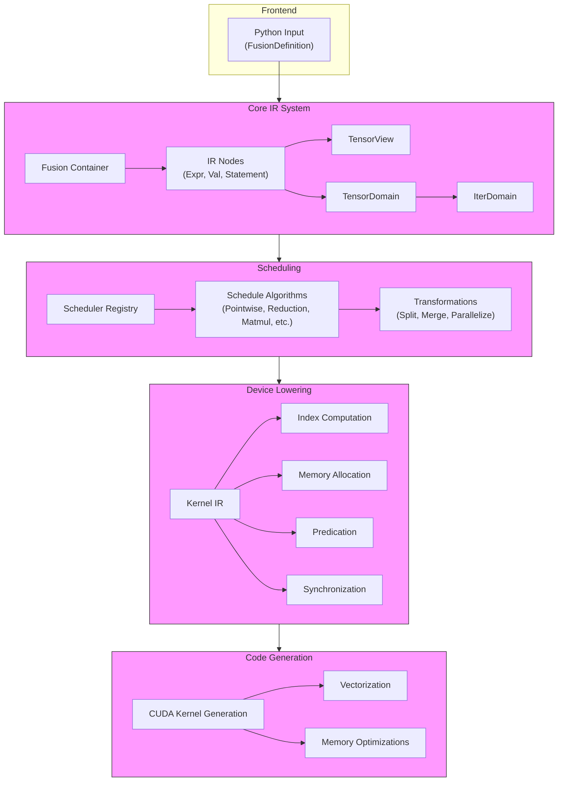

Sources: [csrc/ir/nodes.cpp](https://github.com/NVIDIA/Fuser/blob/main/csrc/ir/nodes.cpp), [csrc/fusion.cpp](https://github.com/NVIDIA/Fuser/blob/main/csrc/fusion.cpp), [csrc/scheduler/registry.cpp](https://github.com/NVIDIA/Fuser/blob/main/csrc/scheduler/registry.cpp), [csrc/device_lower/utils.cpp](https://github.com/NVIDIA/Fuser/blob/main/csrc/device_lower/utils.cpp), [csrc/codegen.cpp](https://github.com/NVIDIA/Fuser/blob/main/csrc/codegen.cpp)

## Core IR System

The Intermediate Representation (IR) system is the foundation of NVFUSER, providing a flexible and extensible representation of tensor operations.

### IR Class Hierarchy

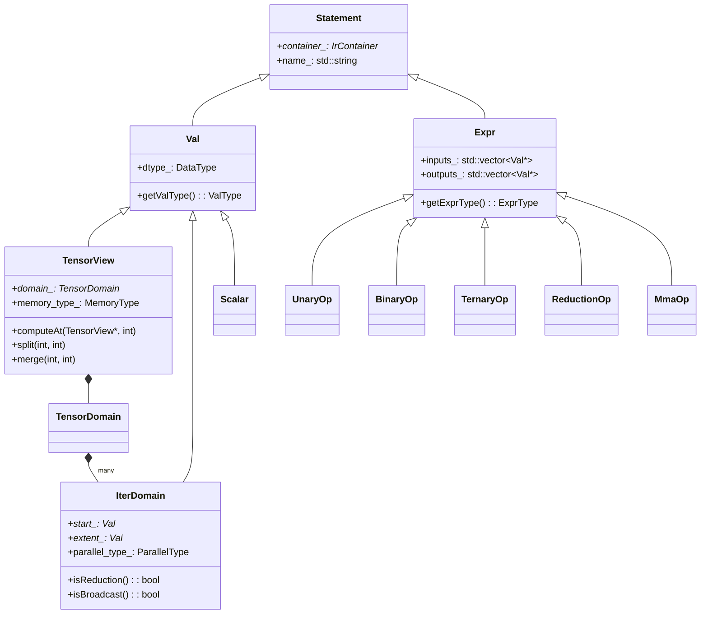

Sources: [csrc/ir/internal_nodes.h:365-617](https://github.com/NVIDIA/Fuser/blob/main/csrc/ir/internal_nodes.h), [csrc/ir/interface_nodes.h:38-75](https://github.com/NVIDIA/Fuser/blob/main/csrc/ir/interface_nodes.h), [csrc/tensor_view.cpp:38-106](https://github.com/NVIDIA/Fuser/blob/main/csrc/tensor_view.cpp)

The core IR system is built around these fundamental abstractions:

1. **Statement**: Base class for all IR nodes
2. **Val**: Represents values (tensors, scalars, domains)
3. **Expr**: Represents operations (add, multiply, reduce)
4. **TensorView**: Primary representation of tensors and their transformations
5. **TensorDomain**: Represents the dimensionality of a tensor
6. **IterDomain**: Represents a single dimension in a tensor

The IR system allows for building computational graphs that can then be analyzed, transformed, and optimized before generating executable code.

Sources: [csrc/ir/internal_base_nodes.h](https://github.com/NVIDIA/Fuser/blob/main/csrc/ir/internal_base_nodes.h), [csrc/ir/internal_nodes.h](https://github.com/NVIDIA/Fuser/blob/main/csrc/ir/internal_nodes.h), [csrc/ir/interface_nodes.h](https://github.com/NVIDIA/Fuser/blob/main/csrc/ir/interface_nodes.h)

### Fusion Container

The `Fusion` class serves as a container for the IR graph, managing inputs, outputs, and all expressions within a fusion group. It provides methods for manipulating the graph and serves as the main entry point for the compilation pipeline.

Key responsibilities of the `Fusion` class:
- Managing the IR graph of computation
- Tracking inputs and outputs
- Supporting cloning and manipulation of the IR
- Interfacing with the segmenter to partition large graphs
- Managing producer-consumer relationships

Sources: [csrc/fusion.cpp:31-112](https://github.com/NVIDIA/Fuser/blob/main/csrc/fusion.cpp), [csrc/fusion.h:29-34](https://github.com/NVIDIA/Fuser/blob/main/csrc/fusion.h)

## Data Flow Through the System

The processing pipeline transforms PyTorch tensor operations into optimized CUDA kernels through several stages:

```mermaid
flowchart LR
    subgraph InputStage["1. Input"]
        PyTorch["PyTorch Tensors"] --> FusionDef["FusionDefinition<br>(Python API)"]
    end
    
    subgraph FusionStage["2. Fusion IR"]
        FusionDef --> Fusion["Fusion IR"]
        Fusion --> ValExpr["Values & Expressions"]
        ValExpr --> TVs["TensorViews"]
    end
    
    subgraph ScheduleStage["3. Scheduling"]
        TVs --> Scheduler["Scheduler Selection"]
        Scheduler --> Heuristics["Apply Heuristics"]
        Heuristics --> Transformed["Transformed IR<br>(split, merge, reorder)"]
    end
    
    subgraph LoweringStage["4. Lowering"]
        Transformed --> KernelIR["Kernel IR"]
        KernelIR --> IndexPass["Index Computation"]
        IndexPass --> AllocPass["Allocation Pass"]
        AllocPass --> SyncPass["Insert Syncs"]
    end
    
    subgraph CodeGenStage["5. Code Generation"]
        SyncPass --> CUDAGen["CUDA Code Generator"]
        CUDAGen --> JITCompile["JIT Compilation"]
        JITCompile --> Kernel["Executable Kernel"]
    end
    
    subgraph ExecutionStage["6. Execution"]
        Kernel --> Execute["Execute on GPU"]
        Execute --> Output["Output Tensors"]
    end
    
    classDef stageClass fill:#f9f,stroke:#333,stroke-width:1px;
    class InputStage,FusionStage,ScheduleStage,LoweringStage,CodeGenStage,ExecutionStage stageClass;
```

Sources: [csrc/fusion.cpp](https://github.com/NVIDIA/Fuser/blob/main/csrc/fusion.cpp), [csrc/scheduler/registry.cpp:115-170](https://github.com/NVIDIA/Fuser/blob/main/csrc/scheduler/registry.cpp), [csrc/device_lower/pass/index.cpp:29-35](https://github.com/NVIDIA/Fuser/blob/main/csrc/device_lower/pass/index.cpp), [csrc/device_lower/pass/allocation.cpp](https://github.com/NVIDIA/Fuser/blob/main/csrc/device_lower/pass/allocation.cpp), [csrc/codegen.cpp:159-182](https://github.com/NVIDIA/Fuser/blob/main/csrc/codegen.cpp)

### 1. Input Stage
PyTorch tensor operations are defined through the Python API (FusionDefinition), which builds the initial computation graph.

### 2. Fusion IR Stage
The computation is represented using the Fusion IR system, with nodes for values (tensors, scalars) and expressions (operations).

### 3. Scheduling Stage
A scheduler is selected based on the computation pattern, and scheduling transformations are applied to optimize performance.

### 4. Lowering Stage
The IR is lowered to Kernel IR, with passes for index computation, memory allocation, and synchronization insertion.

### 5. Code Generation Stage
CUDA code is generated from the Kernel IR and just-in-time compiled into an executable kernel.

### 6. Execution Stage
The compiled kernel is executed on the GPU with the provided tensor inputs, producing the output tensors.

## Core Components in Detail

### TensorView and Domain Representation

TensorView is the central abstraction for representing tensors in NVFUSER. It combines:

1. A **TensorDomain** that describes tensor dimensions
2. **Memory type** (Global, Shared, Local)
3. **Data type** (Float, Int, etc.)
4. Transformation state (computeAt positions, etc.)

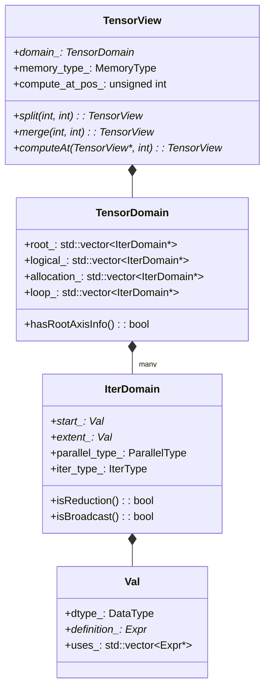

Sources: [csrc/tensor_view.cpp:38-106](https://github.com/NVIDIA/Fuser/blob/main/csrc/tensor_view.cpp), [csrc/ir/interface_nodes.h:138-500](https://github.com/NVIDIA/Fuser/blob/main/csrc/ir/interface_nodes.h)

TensorView supports various transformations including:
- `split`: Divides a dimension into two dimensions
- `merge`: Combines two dimensions into one
- `computeAt`: Sets computation position relative to another tensor
- `broadcast`: Expands a tensor along a new dimension

These transformations enable the scheduling system to optimize memory access patterns and parallelism.

Sources: [csrc/tensor_view.cpp:428-540](https://github.com/NVIDIA/Fuser/blob/main/csrc/tensor_view.cpp)

### Device Lowering System

The Device Lowering system transforms the high-level IR into a device-specific kernel representation through a series of passes:

1. **IndexLowering**: Computes indices for accessing tensor elements
2. **AllocationPass**: Allocates memory for tensors
3. **InsertSyncs**: Inserts synchronization primitives
4. **InlinePTX**: Inlines PTX assembly for special operations
5. **AliasMemory**: Optimizes memory usage through aliasing

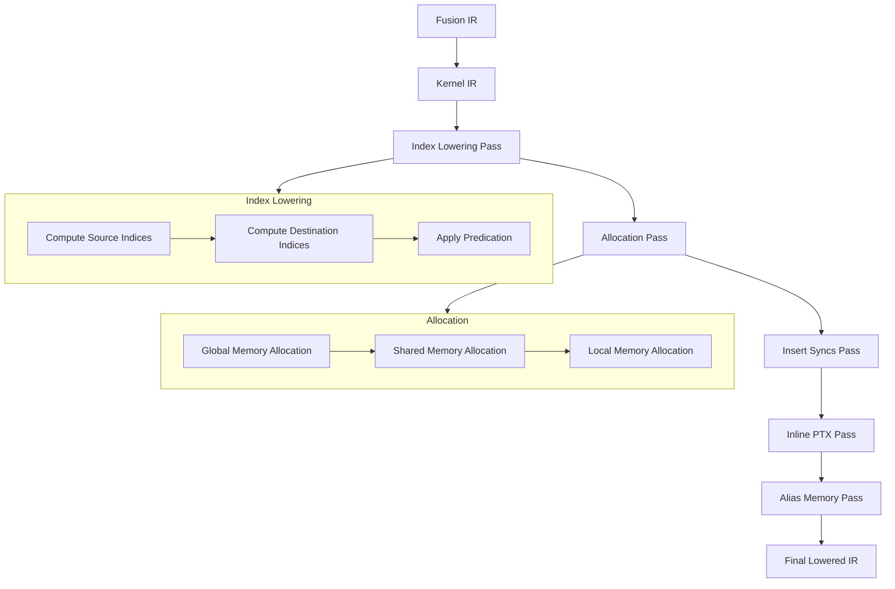

Sources: [csrc/device_lower/pass/index.cpp:29-194](https://github.com/NVIDIA/Fuser/blob/main/csrc/device_lower/pass/index.cpp), [csrc/device_lower/pass/allocation.cpp:23-79](https://github.com/NVIDIA/Fuser/blob/main/csrc/device_lower/pass/allocation.cpp), [csrc/device_lower/pass/insert_syncs.cpp:21-38](https://github.com/NVIDIA/Fuser/blob/main/csrc/device_lower/pass/insert_syncs.cpp), [csrc/device_lower/pass/inline_ptx.cpp](https://github.com/NVIDIA/Fuser/blob/main/csrc/device_lower/pass/inline_ptx.cpp), [csrc/device_lower/pass/alias_memory.cpp](https://github.com/NVIDIA/Fuser/blob/main/csrc/device_lower/pass/alias_memory.cpp)

### Kernel IR

The Kernel IR extends the Fusion IR for device-specific lowering. Key classes include:

- **kir::Kernel**: Container for the lowered kernel
- **kir::TensorIndex**: Device-specific tensor access
- **kir::Predicate**: Execution predicates
- **kir::ForLoop**: Kernel loops and grid mapping
- **kir::IfThenElse**: Conditional execution

The Kernel IR is closer to the generated CUDA code, with explicit constructs for memory access, loops, and control flow.

Sources: [csrc/kernel_ir.h:10-19](https://github.com/NVIDIA/Fuser/blob/main/csrc/kernel_ir.h), [csrc/kernel_ir.cpp:43-113](https://github.com/NVIDIA/Fuser/blob/main/csrc/kernel_ir.cpp)

### Code Generation

The code generation system translates the Kernel IR into executable CUDA code:

1. **CudaKernelGenerator**: Main class for generating kernel code
2. **Kernel definition generation**: Creates function signature and arguments
3. **Prologue generation**: Sets up shared memory and utility functions
4. **Body generation**: Translates Kernel IR to CUDA statements
5. **Expression handling**: Generates code for each expression type

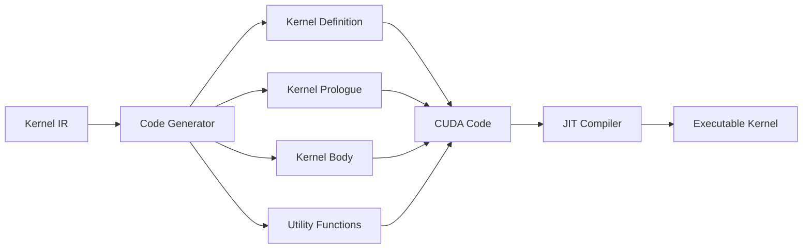

Sources: [csrc/codegen.cpp:155-261](https://github.com/NVIDIA/Fuser/blob/main/csrc/codegen.cpp), [csrc/codegen.cpp:290-384](https://github.com/NVIDIA/Fuser/blob/main/csrc/codegen.cpp)

## Scheduling System

The scheduling system analyzes the computation pattern and applies optimization strategies to maximize performance.

### Scheduler Registry and Selection

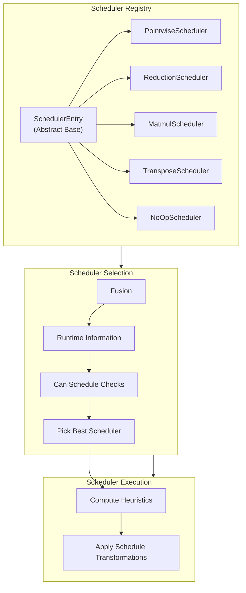

Sources: [csrc/scheduler/registry.cpp:21-168](https://github.com/NVIDIA/Fuser/blob/main/csrc/scheduler/registry.cpp), [csrc/scheduler/utils.cpp:50-141](https://github.com/NVIDIA/Fuser/blob/main/csrc/scheduler/utils.cpp)

The scheduling system selects the appropriate scheduler based on the computation pattern:
1. **Pointwise**: Operations like element-wise add/multiply
2. **Reduction**: Operations that reduce dimensions (sum, max, etc.)
3. **Matmul**: Matrix multiplication operations
4. **Transpose**: Tensor transposition operations
5. **NoOp**: Simple pass-through for trivial operations

Each scheduler has specific heuristics and transformation strategies optimized for its computation pattern.

Sources: [csrc/scheduler/pointwise.cpp](https://github.com/NVIDIA/Fuser/blob/main/csrc/scheduler/pointwise.cpp), [csrc/scheduler/reduction.cpp](https://github.com/NVIDIA/Fuser/blob/main/csrc/scheduler/reduction.cpp), [csrc/scheduler/transpose.cpp](https://github.com/NVIDIA/Fuser/blob/main/csrc/scheduler/transpose.cpp)

### Transformation Operations

Key transformation operations used by schedulers:

1. **Split**: Splits an iteration domain into two parts
   ```
   for i in 0..100:  ->  for i_outer in 0..10:
                            for i_inner in 0..10:
   ```

2. **Merge**: Combines two iteration domains
   ```
   for i in 0..10:    ->  for i_j in 0..100:
     for j in 0..10:
   ```

3. **Reorder**: Changes the order of iteration domains
   ```
   for i in 0..10:    ->  for j in 0..10:
     for j in 0..10:        for i in 0..10:
   ```

4. **Parallelize**: Maps an iteration domain to hardware parallelism
   ```
   for i in 0..100:  ->  parallel_for threadIdx.x in 0..100:
   ```

Sources: [csrc/scheduler/utils.cpp:144-292](https://github.com/NVIDIA/Fuser/blob/main/csrc/scheduler/utils.cpp), [csrc/tensor_view.cpp:428-485](https://github.com/NVIDIA/Fuser/blob/main/csrc/tensor_view.cpp)

## Type System

NVFUSER includes a comprehensive type system to represent various data types:

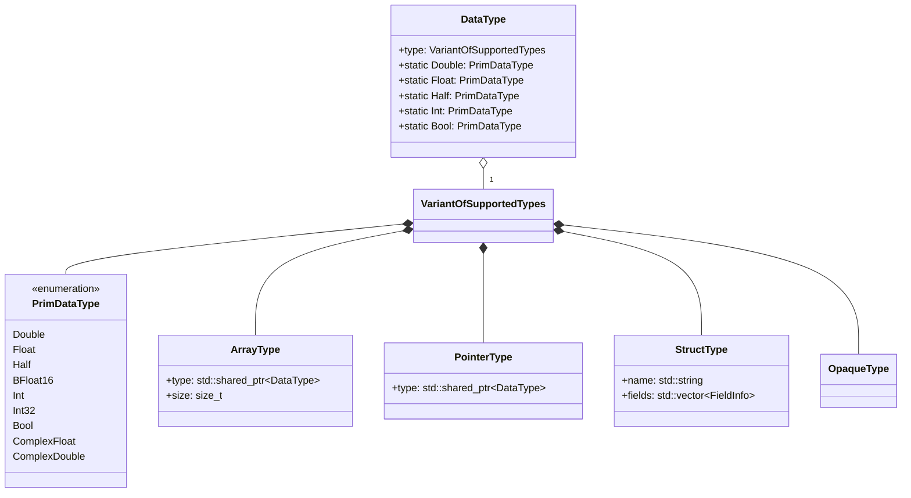

Sources: [csrc/type.h:67-233](https://github.com/NVIDIA/Fuser/blob/main/csrc/type.h), [csrc/type.cpp:25-69](https://github.com/NVIDIA/Fuser/blob/main/csrc/type.cpp)

The type system supports:
- Basic numeric types (Float, Int, Bool)
- Half-precision and BF16 types
- Complex numbers
- Pointer types
- Array types
- Struct types
- Tensor metadata types

This rich type system enables efficient code generation with proper memory layout and alignment.

## Summary

NVFUSER's architecture consists of several key components working together to analyze, optimize, and generate efficient CUDA code:

1. **Core IR System**: Provides a flexible representation of tensor operations
2. **Fusion Management**: Handles fusion of operations for optimization
3. **Scheduling System**: Applies transformation strategies based on computation patterns
4. **Device Lowering**: Translates IR to device-specific kernel representation
5. **Code Generation**: Produces executable CUDA code

This architecture enables NVFUSER to efficiently compile tensor operations on-the-fly, achieving high performance by exploiting hardware-specific optimizations and operation fusion.

Sources: [csrc/fusion.cpp](https://github.com/NVIDIA/Fuser/blob/main/csrc/fusion.cpp), [csrc/tensor_view.cpp](https://github.com/NVIDIA/Fuser/blob/main/csrc/tensor_view.cpp), [csrc/scheduler/registry.cpp](https://github.com/NVIDIA/Fuser/blob/main/csrc/scheduler/registry.cpp), [csrc/device_lower/pass/index.cpp](https://github.com/NVIDIA/Fuser/blob/main/csrc/device_lower/pass/index.cpp), [csrc/codegen.cpp](https://github.com/NVIDIA/Fuser/blob/main/csrc/codegen.cpp)

---

# Page: Getting Started

# Getting Started

<details>
<summary>Relevant source files</summary>

The following files were used as context for generating this wiki page:

- [.github/workflows/build.yml](.github/workflows/build.yml)
- [.github/workflows/lint.yml](.github/workflows/lint.yml)
- [.lintrunner.toml](.lintrunner.toml)
- [CMakeLists.txt](CMakeLists.txt)
- [csrc/serde/fusion_cache.fbs](csrc/serde/fusion_cache.fbs)
- [csrc/serde/fusion_record.cpp](csrc/serde/fusion_record.cpp)
- [nvfuser/__init__.py](nvfuser/__init__.py)
- [setup.py](setup.py)
- [tests/python/test_python_frontend.py](tests/python/test_python_frontend.py)
- [tests/python/test_schedule_ops.py](tests/python/test_schedule_ops.py)
- [tools/apt-install-things.sh](tools/apt-install-things.sh)
- [tools/gen_nvfuser_version.py](tools/gen_nvfuser_version.py)
- [tools/memory.py](tools/memory.py)
- [tools/pip-install-things.sh](tools/pip-install-things.sh)
- [tools/setup-env.sh](tools/setup-env.sh)

</details>


This guide explains how to install, configure, and use NVFUSER to accelerate PyTorch operations on NVIDIA GPUs. NVFUSER is a just-in-time (JIT) CUDA code generation system that enables high-performance fusion of operations in PyTorch. For information about the system architecture, see [System Architecture](#1.1).

## Prerequisites

To use NVFUSER, you'll need:

- NVIDIA GPU with compute capability 7.0+ (Volta, Turing, Ampere, Hopper architectures)
- CUDA Toolkit 11.0+
- PyTorch 2.0+
- Python 3.8+
- C++ compiler compatible with C++17 or higher (GCC 11.4+ recommended)

## Installation Options

NVFUSER can be installed either using pip or by building from source.

### Using pip

```bash
pip install nvfuser
```

Note: The pip package includes pre-compiled binaries for common CUDA versions. If your setup requires a specific configuration, consider building from source.

### Building from Source

Building from source gives you control over the build configuration and allows using the latest code.

1. Clone the repository and its submodules:

```bash
git clone https://github.com/NVIDIA/Fuser.git
cd Fuser
git submodule update --init --recursive
```

2. Install dependencies:

```bash
# Install system dependencies
tools/apt-install-things.sh

# Install Python dependencies
tools/pip-install-things.sh
```

3. Build and install:

```bash
# Basic build
cd python
python setup.py install

# Or with specific options
python setup.py install --cpp=20 --build-with-ucc
```

#### Build Options

NVFUSER provides several build options through the setup.py script:

| Option | Description |
| --- | --- |
| `--cmake-only` | Only generate ./build directory with cmake setup |
| `--no-python` | Skip building Python API (library only) |
| `--no-test` | Skip building C++ tests |
| `--no-benchmark` | Skip building benchmarks |
| `--no-ninja` | Use make instead of ninja for building |
| `--build-with-ucc` | Build with UCC support for communication |
| `--build-without-distributed` | Build without multi-device support |
| `--debug` | Build in debug mode |
| `--build-dir=PATH` | Specify custom build directory |
| `--cpp=STANDARD` | Specify C++ standard (default is 20) |

Sources: [setup.py:6-62](), [CMakeLists.txt:1-54](), [tools/apt-install-things.sh:1-20](), [tools/pip-install-things.sh:1-9]()

## Basic Usage Flow

NVFUSER operates on a fusion definition model where you define a computation graph that is then compiled and executed.

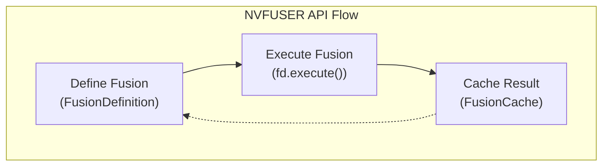

Sources: [nvfuser/__init__.py:52-107](), [tests/python/test_python_frontend.py:45-76]()

### Key Components

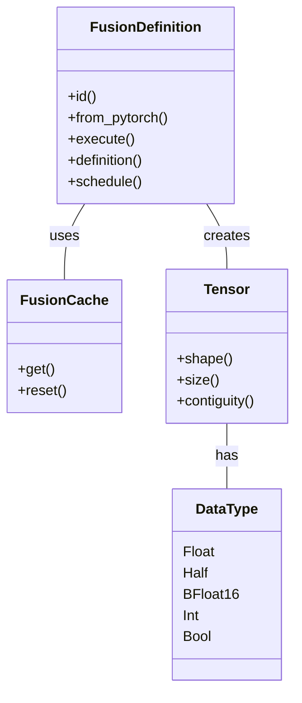

Sources: [nvfuser/__init__.py:52-197](), [tests/python/test_python_frontend.py:14-28]()

### Creating Your First Fusion

A basic fusion involves the following steps:

1. Create a `FusionDefinition` using the context manager
2. Import PyTorch tensors into the fusion
3. Define operations
4. Specify outputs
5. Execute the fusion with inputs

Here's a simple example:

```python
import torch
from nvfuser import FusionDefinition, DataType

# Create some input tensors
t0 = torch.randn(2, 3, 4, device="cuda")
t1 = torch.randn(2, 3, 4, device="cuda")

# Define and execute a fusion
with FusionDefinition() as fd:
    # Import PyTorch tensors
    ft0 = fd.from_pytorch(t0)
    ft1 = fd.from_pytorch(t1)
    
    # Define operations
    ft2 = fd.ops.add(ft0, ft1)
    ft3 = fd.ops.relu(ft2)
    
    # Specify output
    fd.add_output(ft3)
    
# Execute the fusion
result = fd.execute([t0, t1])
```

Sources: [tests/python/test_python_frontend.py:42-76](), [nvfuser/__init__.py:197-211]()

### Understanding Tensor Representation

In NVFUSER, tensors are represented by symbolic descriptions to enable JIT compilation. When you use `from_pytorch()`, it extracts the tensor's metadata (shape, strides, dtype) but not the actual data values.

```python
# Static shape (for compilation optimization)
ft0 = fd.from_pytorch(t0, static_sizes=True)

# Dynamic shape (for flexibility)
ft0 = fd.from_pytorch(t0)  # default is dynamic

# Manual tensor definition
ft0 = fd.define_tensor(
    shape=[-1, -1, -1],  # -1 indicates dynamic dimension
    contiguity=[True, True, True],
    dtype=DataType.Float
)
```

Sources: [nvfuser/__init__.py:360-386](), [tests/python/test_python_frontend.py:166-202]()

### Executing and Caching

NVFUSER automatically caches compiled kernels for reuse:

```python
# First execution compiles the kernel
result1 = fd.execute([t0, t1])

# Second execution reuses the cached kernel
result2 = fd.execute([t0, t1])

# Reset cache if needed
from nvfuser import FusionCache
FusionCache.get().reset()
```

The execution can be customized with options:

```python
# Execute with options
result = fd.execute(
    inputs,
    device=0,            # Specific CUDA device
    profile=True,        # Enable profiling
    capture_debug_output=True,  # Capture debug info
)

# Get debug output
debug_info = fd.debug_output()
```

Sources: [nvfuser/__init__.py:197-344](), [tests/python/test_python_frontend.py:61-76]()

## Common Operations

NVFUSER supports a wide range of operations for tensor manipulation:

### Arithmetic Operations

- Basic operations: add, subtract, multiply, divide
- Element-wise functions: relu, sigmoid, tanh
- Reduction operations: sum, mean, max, min

### Shape Manipulation

- Broadcast and reshape
- Transpose and permute
- Concatenation and slicing

### Advanced Operations

- Normalization (batch norm, layer norm)
- Matrix multiplication
- Convolution

Example with reductions and broadcasting:

```python
with FusionDefinition() as fd:
    ft0 = fd.from_pytorch(t0)
    
    # Reduce sum along dimension 2
    ft1 = fd.ops.sum(ft0, dims=[2], keepdim=False)
    
    # Broadcast back to original shape
    ft2 = fd.ops.broadcast_in_dim(ft1, t0.size(), [0, 1])
    
    # Subtract from original
    ft3 = fd.ops.sub(ft0, ft2)
    
    fd.add_output(ft3)
```

Sources: [tests/python/test_python_frontend.py:166-202](), [tests/python/test_python_frontend.py:657-687]()

## Advanced Usage

### Custom Scheduling

For performance optimization, you can create custom schedules:

```python
class CustomFusionDefinition(FusionDefinition):
    def definition(self):
        # Define fusion operations
        self.t0 = self.from_pytorch(input_tensor)
        self.t1 = self.ops.relu(self.t0)
        self.add_output(self.t1)
    
    def schedule(self):
        # Add scheduling directives
        self.sched.merge(self.t1, dim=0)
        self.sched.split(self.t1, dim=0, factor=128)
        self.sched.parallelize(self.t1, axis=0, ParallelType.grid_x)
```

Sources: [tests/python/test_schedule_ops.py:333-371]()

### Fusion Serialization

NVFUSER can automatically serialize the fusion cache to improve startup performance:

```python
from nvfuser import enable_automatic_serialization

# Enable serialization (saves to disk on program exit)
enable_automatic_serialization()
```

Sources: [nvfuser/__init__.py:30-50]()

### Debugging Fusion Kernels

NVFUSER provides tools to examine the generated CUDA code:

```python
# View the generated CUDA code for debugging
cuda_code = fd.last_cuda_code()
print(cuda_code)

# View the scheduled fusion IR
fusion_ir = fd.scheduled_fusion_ir_for(inputs)
print(fusion_ir)

# Create a reproduction script for bug reports
repro_script = fd.repro_script_for(inputs)
print(repro_script)
```

Sources: [nvfuser/__init__.py:397-464](), [nvfuser/__init__.py:500-567]()

## Next Steps

- Explore performance optimization through custom scheduling
- Learn about multi-device execution and sharding for distributed training
- Understand segmentation for complex fusion patterns
- Check out example notebooks and tutorials in the repository

For more details on the core IR system that powers NVFUSER, see [Core IR System](#2).

---

# Page: Core IR System

# Core IR System

<details>
<summary>Relevant source files</summary>

The following files were used as context for generating this wiki page:

- [csrc/device_lower/pass/alias_memory.cpp](csrc/device_lower/pass/alias_memory.cpp)
- [csrc/device_lower/pass/expr_sort.cpp](csrc/device_lower/pass/expr_sort.cpp)
- [csrc/device_lower/pass/replace_size.cpp](csrc/device_lower/pass/replace_size.cpp)
- [csrc/device_lower/utils.cpp](csrc/device_lower/utils.cpp)
- [csrc/device_lower/utils.h](csrc/device_lower/utils.h)
- [csrc/fusion.cpp](csrc/fusion.cpp)
- [csrc/fusion.h](csrc/fusion.h)
- [csrc/ir/interface_nodes.h](csrc/ir/interface_nodes.h)
- [csrc/ir/internal_base_nodes.h](csrc/ir/internal_base_nodes.h)
- [csrc/ir/internal_nodes.h](csrc/ir/internal_nodes.h)
- [csrc/ir/nodes.cpp](csrc/ir/nodes.cpp)
- [csrc/ir/utils.cpp](csrc/ir/utils.cpp)
- [csrc/ir/utils.h](csrc/ir/utils.h)
- [csrc/iter_visitor.cpp](csrc/iter_visitor.cpp)
- [csrc/iter_visitor.h](csrc/iter_visitor.h)
- [csrc/tensor_view.cpp](csrc/tensor_view.cpp)
- [tests/cpp/test_gpu3.cpp](tests/cpp/test_gpu3.cpp)

</details>


The Core IR System is the fundamental intermediate representation that powers NVFUSER. It provides a hierarchical graph-based structure that represents tensor computations in a way that can be analyzed, transformed, and ultimately compiled into efficient CUDA code. This document explains the key components and concepts of the IR system that forms the foundation for all other subsystems in NVFUSER.

For information about how the Core IR is used by the scheduling system, see [Scheduling System](#4), and for details on code generation, see [Code Generation](#3).

## IR Hierarchy

The NVFUSER Core IR is organized as a directed acyclic graph (DAG) comprising two main types of nodes: values (`Val`) and expressions (`Expr`). These nodes are connected to form a complete representation of tensor computations.

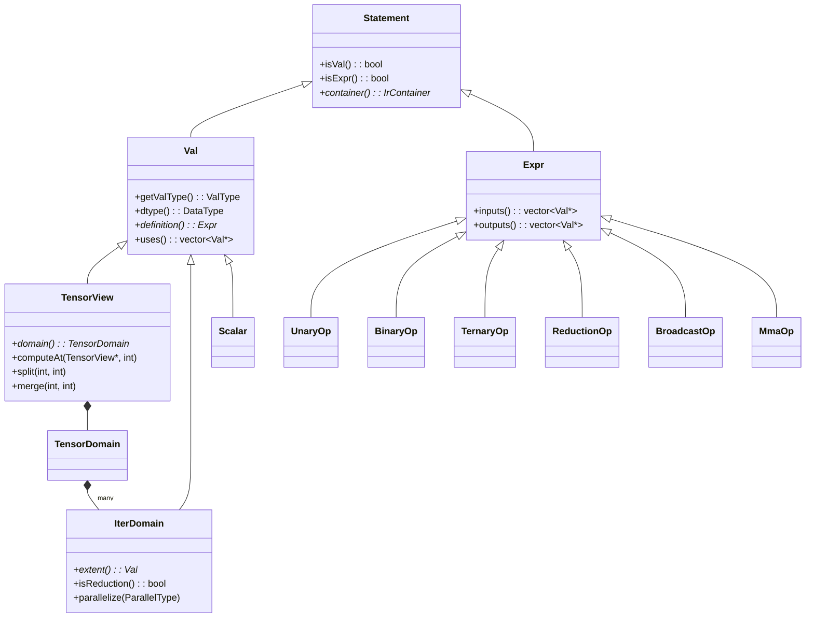

Sources: [csrc/ir/interface_nodes.h](), [csrc/ir/internal_base_nodes.h](), [csrc/ir/internal_nodes.h]()

## Base Components

### Statement

`Statement` is the abstract base class for all IR nodes. It provides common functionality like:
- Checking if a node is a value or expression (`isVal()`, `isExpr()`)
- Access to the container holding the node (`container()`)
- Support for the visitor pattern

Sources: [csrc/ir/base_nodes.h]()

### Val (Values)

Values represent data in the computation graph. Each value:
- Can be created by an expression (`definition()`)
- Can be used by multiple expressions (`uses()`)
- Has a specific data type and value type

Key `Val` subclasses include:

1. **TensorView**: The primary representation for multi-dimensional tensors, with capabilities to:
   - Transform domains through operations like `split()`, `merge()`, and `computeAt()`
   - Specify memory types (Global, Shared, Local)
   - Control parallelization strategies

2. **IterDomain**: Represents a single dimension for iteration with:
   - Start and extent to define the range
   - Flags for reduction dimensions
   - Parallelization settings (threads, blocks)

3. **Scalar**: Represents singular values used in computations

Sources: [csrc/tensor_view.cpp](), [csrc/ir/internal_base_nodes.h]()

### Expr (Expressions)

Expressions represent operations that transform values. Each expression:
- Takes input values (`inputs()`)
- Produces output values (`outputs()`)
- Implements specific computational logic

The primary expression types include:

1. **UnaryOp**: Single-input operations like negation, absolute value, and casting
   ```cpp
   // Example: UnaryOp for negation
   auto negative_x = neg(x);
   ```

2. **BinaryOp**: Two-input operations like addition, multiplication, and division
   ```cpp
   // Example: BinaryOp for addition
   auto sum = add(a, b);
   ```

3. **TernaryOp**: Three-input operations like conditional selection (where)
   ```cpp
   // Example: TernaryOp for where
   auto result = where(condition, true_val, false_val);
   ```

4. **ReductionOp**: Operations that reduce tensor dimensions (sum, max, min)
   ```cpp
   // Example: ReductionOp for sum
   auto reduced = sum(tensor, {0});  // Reduce along dimension 0
   ```

5. **BroadcastOp**: Operations that expand tensor dimensions
   ```cpp
   // Example: BroadcastOp
   auto broadcast_tensor = broadcast(tensor, {true, false});  // Add dimension at index 0
   ```

Sources: [csrc/ir/internal_nodes.h](), [csrc/ir/nodes.cpp]()

## Fusion Container

The `Fusion` class serves as the container for all IR nodes. It's responsible for:
- Managing IR node lifecycle
- Tracking fusion inputs and outputs
- Maintaining the DAG structure
- Providing access to nodes for analysis and transformation

Key operations include:
- `addInput()`: Register a value as an input
- `addOutput()`: Register a value as an output
- `removeExpr()`: Remove an expression from the fusion
- `removeVal()`: Remove a value from the fusion
- `exprs()`: Get all expressions in topological order

Sources: [csrc/fusion.cpp](), [csrc/fusion.h]()

## DAG Structure and Relationships

The IR forms a directed acyclic graph where:
- Values are nodes
- Expressions define edges between nodes
- Inputs are source nodes with no incoming edges
- Outputs are sink nodes explicitly marked for output

The relationships between nodes are key to understanding the computation:

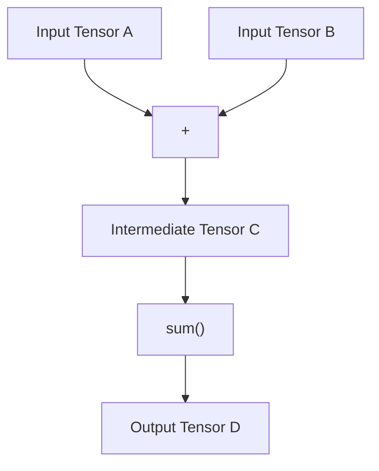

This structure allows for:
- Dependency analysis
- Optimization opportunities (fusion, reordering)
- Parallel execution planning

Sources: [csrc/ir/utils.cpp](), [csrc/iter_visitor.cpp]()

## IR Construction

IR nodes are created through builder functions and connected to form the computational graph:

```cpp
// Create a fusion
Fusion fusion;
FusionGuard fg(&fusion);

// Create input tensors
auto tv0 = makeSymbolicTensor(2);  // 2D tensor
auto tv1 = makeSymbolicTensor(2);  // 2D tensor
fusion.addInput(tv0);
fusion.addInput(tv1);

// Build computation
auto tv2 = add(tv0, tv1);         // Element-wise addition
auto tv3 = sum(tv2, {1});         // Sum reduction along dimension 1
fusion.addOutput(tv3);
```

Each operation (like `add()` or `sum()`) creates the corresponding expression nodes and connects them to their input and output values.

Sources: [csrc/fusion.cpp]()

## Traversal and Manipulation

### Traversal with IterVisitor

The `IterVisitor` class provides mechanisms to traverse the IR graph in topological order:

```cpp
class MyVisitor : public IterVisitor {
protected:
  void handle(Statement* stmt) override {
    // Process each node
  }
};

MyVisitor visitor;
visitor.traverseFrom(&fusion, fusion.outputs());
```

This supports analysis passes like dependency checking and dead code elimination.

Sources: [csrc/iter_visitor.h](), [csrc/iter_visitor.cpp]()

### IR Transformation

The IR can be transformed through various operations:

1. **Domain Transformations**:
   ```cpp
   // Split dimension 0 into two with factor 32
   tv->split(0, 32);
   
   // Merge dimensions 0 and 1
   tv->merge(0, 1);
   ```

2. **Computation Scheduling**:
   ```cpp
   // Compute tv1 at the position corresponding to dimension 1 of tv2
   tv1->computeAt(tv2, 1);
   ```

3. **Parallelization**:
   ```cpp
   // Parallelize dimension 0 with thread blocks
   tv->axis(0)->parallelize(ParallelType::BIDx);
   
   // Parallelize dimension 1 with threads
   tv->axis(1)->parallelize(ParallelType::TIDx);
   ```

Sources: [csrc/tensor_view.cpp](), [csrc/ir/utils.cpp]()

## Integration in NVFUSER

The Core IR is central to NVFUSER's operation:

```mermaid
graph TD
    PythonFrontend["Python Frontend<br>(FusionDefinition)"] --> CoreIR["Core IR System<br>(Fusion)"]
    CoreIR --> Scheduler["Scheduler System<br>(Optimization)"]
    CoreIR --> Segmenter["Fusion Segmenter<br>(Partitioning)"]
    Scheduler --> DeviceLower["Device Lowering<br>(GPU-Specific IR)"]
    Segmenter --> DeviceLower
    DeviceLower --> CodeGen["CUDA Code Generation"]
    CodeGen --> Executor["Kernel Execution"]
```

1. **Creation**: Built by the Python Frontend (FusionDefinition)
2. **Optimization**: Transformed by the Scheduler System
3. **Partitioning**: Split by the Fusion Segmenter when necessary
4. **Lowering**: Converted to device-specific IR for code generation
5. **Execution**: Used to generate and execute CUDA kernels

Sources: [csrc/device_lower/utils.cpp](), [csrc/device_lower/pass/expr_sort.cpp]()

## Key Operations on Values

The Core IR provides numerous operations for creating and manipulating values:

| Operation Category | Examples | Description |
|-------------------|----------|-------------|
| Arithmetic | `add`, `sub`, `mul`, `div` | Basic math operations |
| Comparison | `eq`, `ne`, `gt`, `lt` | Comparison operations |
| Reduction | `sum`, `max`, `min` | Dimension reduction operations |
| Shape Manipulation | `broadcast`, `reshape`, `transpose` | Change tensor shapes |
| Special Functions | `sigmoid`, `tanh`, `relu` | Activation and mathematical functions |
| Matrix Operations | `matmul`, `mma` | Matrix multiplication operations |

Each operation creates the appropriate expression nodes and connects them to input and output values.

Sources: [csrc/ir/nodes.cpp](), [csrc/ir/internal_nodes.h]()

## Common Usage Patterns

### Creating a Simple Fusion

```cpp
Fusion fusion;
FusionGuard fg(&fusion);

// Define inputs
auto x = makeSymbolicTensor(2);  // 2D input tensor
auto y = makeSymbolicTensor(2);  // 2D input tensor
fusion.addInput(x);
fusion.addInput(y);

// Define computation: z = x + y
auto z = add(x, y);
fusion.addOutput(z);
```

### Applying Transformations

```cpp
// Tile the computation for better cache utilization
z->split(0, 32);  // Split the first dimension with factor 32
z->split(2, 4);   // Split the third dimension (previously dimension 1) with factor 4

// Parallelize the computation
z->axis(0)->parallelize(ParallelType::BIDx);  // Distribute across thread blocks
z->axis(1)->parallelize(ParallelType::TIDx);  // Distribute across threads
```

Sources: [csrc/tensor_view.cpp](), [csrc/device_lower/pass/replace_size.cpp]()

## Conclusion

The Core IR System provides a powerful and flexible representation for tensor computations. It serves as the foundation for NVFUSER's ability to generate efficient CUDA kernels by enabling analysis, optimization, and transformation of tensor operations. The hierarchical node structure and the ability to represent complex tensor computations make it suitable for implementing a wide range of deep learning and scientific computing operations.

Sources: [csrc/fusion.cpp](), [csrc/ir/utils.h](), [csrc/device_lower/utils.h]()

---

# Page: IR Nodes and Tensor Views

# IR Nodes and Tensor Views

<details>
<summary>Relevant source files</summary>

The following files were used as context for generating this wiki page:

- [csrc/device_lower/pass/alias_memory.cpp](csrc/device_lower/pass/alias_memory.cpp)
- [csrc/device_lower/pass/replace_size.cpp](csrc/device_lower/pass/replace_size.cpp)
- [csrc/device_lower/utils.cpp](csrc/device_lower/utils.cpp)
- [csrc/device_lower/utils.h](csrc/device_lower/utils.h)
- [csrc/ir/interface_nodes.h](csrc/ir/interface_nodes.h)
- [csrc/ir/internal_base_nodes.h](csrc/ir/internal_base_nodes.h)
- [csrc/ir/internal_nodes.h](csrc/ir/internal_nodes.h)
- [csrc/ir/nodes.cpp](csrc/ir/nodes.cpp)
- [csrc/ir/utils.cpp](csrc/ir/utils.cpp)
- [csrc/ir/utils.h](csrc/ir/utils.h)
- [csrc/iter_visitor.cpp](csrc/iter_visitor.cpp)
- [csrc/iter_visitor.h](csrc/iter_visitor.h)
- [csrc/tensor_view.cpp](csrc/tensor_view.cpp)
- [tests/cpp/test_gpu3.cpp](tests/cpp/test_gpu3.cpp)

</details>


This page provides a detailed explanation of the Intermediate Representation (IR) nodes, tensor views, and their role in representing computations within NVFUSER. The IR system forms the foundation of NVFUSER's ability to represent, transform, and optimize tensor operations before lowering them to efficient CUDA code.

For information about how these IR nodes are generated from Python code, see [Python Frontend](#6). For details on code generation from IR, see [Code Generation](#3).

## IR Hierarchy

NVFUSER's IR system is organized as a hierarchy of node types that represent both data (tensors, scalars) and operations (addition, multiplication, etc.). Understanding this hierarchy is crucial for working with the system.

```mermaid
classDiagram
    Statement <|-- Val
    Statement <|-- Expr
    
    Val <|-- TensorView
    Val <|-- Scalar
    Val <|-- IterDomain
    
    Expr <|-- UnaryOp
    Expr <|-- BinaryOp
    Expr <|-- TernaryOp
    Expr <|-- ReductionOp
    Expr <|-- BroadcastOp
    
    TensorView *-- TensorDomain
    TensorDomain *-- "many" IterDomain
    
    class Statement {
        +name(): std::string
        +container(): IrContainer*
    }
    
    class Val {
        +dtype(): DataType
        +definition(): Expr*
        +uses(): std::vector~Expr*~
    }
    
    class Expr {
        +inputs(): vector~Val*~
        +outputs(): vector~Val*~
        +attributes(): vector~Val*~
    }
    
    class TensorView {
        +domain(): TensorDomain*
        +memoryType(): MemoryType
        +getComputeAtPosition(): int
    }
    
    class IterDomain {
        +start(): Val*
        +extent(): Val*
        +parallel_type(): ParallelType
        +iterType(): IterType
    }
```

The IR hierarchy consists of:

- **Statement**: Base class for all IR nodes
- **Val**: Represents values (tensors, scalars, iteration domains)
- **Expr**: Represents operations that transform values
- **TensorView**: Represents multi-dimensional tensors
- **IterDomain**: Represents a single dimension of a tensor
- **TensorDomain**: Represents the full domain of a tensor (collection of IterDomains)

Sources: [csrc/ir/interface_nodes.h:26-36](), [csrc/ir/internal_base_nodes.h:14-20]()

## TensorView

TensorView is the central class for representing tensors in NVFUSER. It represents an n-dimensional view into a memory region, with operations to transform how that memory is accessed and computed.

```mermaid
graph TD
    TV["TensorView"] --> TD["TensorDomain"]
    TD --> ID1["IterDomain(0)"]
    TD --> ID2["IterDomain(1)"]
    TD --> ID3["IterDomain(...)"]
    
    TV --> MT["MemoryType"]
    TV --> CAP["ComputeAt Position"]
    
    MT --> G["Global"]
    MT --> S["Shared"]
    MT --> L["Local"]
    
    ID1 --> Start["start()"]
    ID1 --> Extent["extent()"]
    ID1 --> PT["parallelType()"]
    ID1 --> IT["iterType()"]
    
    IT --> Iteration["Iteration"]
    IT --> Reduction["Reduction"]
    IT --> Broadcast["Broadcast"]
    
    PT --> Serial["Serial"]
    PT --> TIDx["TIDx"]
    PT --> BIDx["BIDx"]
```

A TensorView contains:

1. **TensorDomain**: Defines the dimensionality and iteration spaces
2. **MemoryType**: Indicates where the tensor data is stored (Global, Shared, Local)
3. **ComputeAt Information**: Controls scheduling relationships with other tensors

TensorView provides methods for transforming tensor dimensions and specifying how computation should be scheduled:

| Operation | Description | Example Usage |
|-----------|-------------|---------------|
| `split(axis, factor)` | Splits a dimension into two | `tv->split(0, 32)` |
| `merge(axis_o, axis_i)` | Merges two dimensions into one | `tv->merge(0, 1)` |
| `computeAt(consumer, pos)` | Sets computation schedule relative to consumer | `tv->computeAt(consumer, 1)` |
| `broadcast(axis)` | Adds a broadcast dimension | `tv->broadcast(0)` |

Sources: [csrc/tensor_view.cpp:38-47](), [csrc/tensor_view.cpp:129-140](), [csrc/ir/interface_nodes.h:422-470]()

## IterDomain and Tensor Domains

IterDomain represents a single dimension of iteration in a tensor. It's a fundamental building block for representing tensor shapes and transformations.

```mermaid
graph TD
    ID["IterDomain"] --> S["start()"]
    ID --> E["extent()"]
    ID --> PT["parallelType()"]
    ID --> IT["iterType()"]
    
    IT --> ITR["Iteration"]
    IT --> RED["Reduction"]
    IT --> BRO["Broadcast"]
    IT --> SYMB["Symbolic"]
    
    PT --> SER["Serial"]
    PT --> TIDX["TIDx (Thread)"]
    PT --> TIDY["TIDy (Thread)"]
    PT --> TIDZ["TIDz (Thread)"]
    PT --> BIDX["BIDx (Block)"]
    PT --> BIDY["BIDy (Block)"]
    PT --> BIDZ["BIDz (Block)"]
    
    ID --> Trans["Transformations"]
    Trans --> Split["split()"]
    Trans --> Merge["merge()"]
    Trans --> Resize["resize()"]
```

Key properties of IterDomain:

- **start**: Starting point of iteration (typically zero)
- **extent**: Size of the dimension
- **iterType**: Type of iteration (normal, reduction, broadcast, etc.)
- **parallelType**: How the iteration is parallelized (serial, thread, block)

TensorDomain combines multiple IterDomains to represent the full multi-dimensional structure of a tensor. It maintains several sets of IterDomains that represent the tensor at different stages of transformation:

- **rootDomain**: Original tensor dimensions
- **logicalDomain**: Dimensions after logical transformations (split, merge)
- **allocationDomain**: Dimensions for memory allocation
- **loopDomain**: Dimensions for generating loops during code generation

Sources: [csrc/ir/internal_base_nodes.h:79-133](), [csrc/ir/internal_base_nodes.h:709-752]()

## IR Nodes for Operations

NVFUSER has a comprehensive set of IR nodes representing different operations on tensors. These nodes connect the tensor representation to actual computational operations.

```mermaid
graph TD
    Expr["Expr (Base)"] --> UOP["UnaryOp"]
    Expr --> BOP["BinaryOp"]
    Expr --> TOP["TernaryOp"]
    Expr --> BCAST["BroadcastOp"]
    Expr --> RED["ReductionOp"]
    Expr --> MAT["MatmulOp"]
    Expr --> MMA["MmaOp"]
    Expr --> LOAD["LoadStoreOp"]
    
    UOP --> CAST["Cast"]
    UOP --> NEG["Neg"]
    UOP --> ABS["Abs"]
    
    BOP --> ADD["Add"]
    BOP --> SUB["Sub"]
    BOP --> MUL["Mul"]
    BOP --> DIV["Div"]
    
    TOP --> WHERE["Where"]
    TOP --> CLAMP["Clamp"]
    TOP --> LERP["Lerp"]
    
    RED --> SUM["Sum"]
    RED --> PROD["Product"]
    RED --> MAX["Max"]
```

Each operation node:
1. Takes input values (tensors, scalars)
2. Performs an operation
3. Produces output values

For example, a BinaryOp represents operations like addition or multiplication:

```
T3 = T1 + T2  // Represented as BinaryOp(Add, T3, T1, T2)
```

The nodes are designed to represent the full range of tensor operations needed for neural network computation, including:

- Basic arithmetic (add, multiply)
- Reductions (sum, max)
- Special operations (matmul, broadcast)
- Type conversions and transformations

Sources: [csrc/ir/internal_nodes.h:359-900](), [csrc/ir/nodes.cpp:38-901]()

## TensorView Transformations

TensorView supports a rich set of transformations that allow restructuring of the computation. These transformations are fundamental to the scheduling system.

Here's a diagram showing key transformations and their effects:

```mermaid
graph TD
    subgraph "Original Tensor [i0, i1]"
        I0I1["TensorView(i0, i1)"]
    end
    
    subgraph "Split i0 into i0o, i0i"
        I0oI0iI1["TensorView(i0o, i0i, i1)"]
    end
    
    subgraph "Merge i0, i1 into i01"
        I01["TensorView(i01)"]
    end
    
    subgraph "Broadcast to add dimension"
        I0I1I2["TensorView(i0, i1, b2)"]
    end
    
    I0I1 -->|"split(0, 32)"| I0oI0iI1
    I0I1 -->|"merge(0, 1)"| I01
    I0I1 -->|"broadcast(2)"| I0I1I2
```

Key transformations include:

1. **Split**: Divides an iteration domain into outer and inner components
   ```
   tv->split(0, 32)  // Split first dimension by factor of 32
   ```

2. **Merge**: Combines two adjacent iteration domains
   ```
   tv->merge(0, 1)  // Combine dimensions 0 and 1
   ```

3. **Reorder**: Changes the order of iteration domains
   ```
   tv->reorder({{0, 1}, {1, 0}})  // Swap dimensions 0 and 1
   ```

4. **Broadcast**: Adds a broadcast dimension
   ```
   tv->broadcast(0)  // Add broadcast dimension at position 0
   ```

These transformations allow for expressing complex loop restructuring operations that are key to performance optimization. They modify the TensorDomain of the TensorView, changing how the tensor is accessed and computed.

Sources: [csrc/tensor_view.cpp:427-631]()

## ComputeAt and Scheduling

The `computeAt` mechanism is a critical feature for scheduling in NVFUSER. It defines producer-consumer relationships and determines when tensors are computed relative to each other.

```mermaid
graph TD
    subgraph "Producer-Consumer Relationship"
        TV1["Producer: T1[i, j]"] -->|"defines"| TV2["Consumer: T2[i, j]"]
    end
    
    subgraph "T1->computeAt(T2, 1) - Compute at position 1"
        FOR_I["for i:"]
        FOR_I -->|"compute T1[i, :]"| T1_I["T1[i, :]"]
        FOR_I -->|"then"| FOR_J["for j:"]
        FOR_J -->|"use"| T1_I
        FOR_J -->|"to compute"| T2_IJ["T2[i, j]"]
    end
    
    subgraph "T1->computeAt(T2, 0) - Compute inline (fully)"
        FOR_I2["for i:"]
        FOR_I2 --> FOR_J2["for j:"]
        FOR_J2 -->|"compute"| T1_IJ["T1[i, j]"]
        FOR_J2 -->|"immediately use for"| T2_IJ2["T2[i, j]"]
    end
```

ComputeAt controls loop nesting and data reuse. When `producer->computeAt(consumer, pos)` is called:

1. The producer is computed inside the consumer's loop at the specified position
2. This affects memory usage, computation order, and data locality
3. Position 0 means compute at the outermost loop, higher values move computation deeper into nested loops

Examples:
- `A->computeAt(B, 0)`: Compute all of A before any of B
- `A->computeAt(B, 1)`: Compute A one row at a time, then use it for B
- `A->computeAt(B, 2)`: Compute each element of A just before it's used in B

ComputeAt is essential for:
- Managing memory hierarchies (registers, shared memory, global memory)
- Controlling data reuse
- Optimizing data locality
- Balancing parallelism and synchronization

Sources: [csrc/tensor_view.cpp:234-264](), [csrc/tensor_view.cpp:146-201](), [csrc/ir/interface_nodes.h:62-69]()

## Traversing the IR Graph

NVFUSER provides utilities for traversing the IR graph, which is essential for analysis, optimization, and code generation.

```mermaid
graph TD
    TV1["TensorView T1"] -->|"definition()"| E1["Expression E1"]
    E1 -->|"inputs()"| TV2["TensorView T2"]
    E1 -->|"inputs()"| TV3["TensorView T3"]
    TV2 -->|"definition()"| E2["Expression E2"]
    
    subgraph "IterVisitor"
        IV["IterVisitor"]
        IV -->|"traverseTo()"| TARGET["Target Nodes"]
        IV -->|"traverseBetween()"| FROMTO["From→To Nodes"]
        IV -->|"traverseAllPaths()"| ALL["All Paths"]
    end
```

The `IterVisitor` class is the primary tool for traversing the IR:

- **traverseTo**: Visits nodes in order from inputs to specified targets
- **traverseBetween**: Visits nodes between specified inputs and outputs
- **traverse**: Visits all nodes in the fusion in topological order
- **traverseAllPaths**: Visits all paths through the graph (may visit nodes multiple times)

Example uses of traversal:
- Analyzing dependencies between operations
- Gathering information for optimization
- Generating code in the correct order
- Validating IR structure and consistency

The IR graph can be traversed in different ways:
- Forward (inputs to outputs)
- Backward (outputs to inputs)
- Across specific paths

Sources: [csrc/iter_visitor.h:38-135](), [csrc/iter_visitor.cpp:16-180]()

## IR Node Types

NVFUSER includes a comprehensive set of IR node types to represent various operations and data structures:

| Node Type | Purpose | Example |
|-----------|---------|---------|
| UnaryOp | Single-input operations | Negation, Casting, Absolute value |
| BinaryOp | Two-input operations | Addition, Multiplication, Division |
| TernaryOp | Three-input operations | Where, Clamp, Lerp |
| ReductionOp | Reduces across dimensions | Sum, Product, Max |
| BroadcastOp | Expands dimensions | Broadcasting a vector to a matrix |
| MatmulOp | Matrix multiplication | Performing matrix multiplication |
| LoadStoreOp | Memory operations | Loading/storing data |
| FullOp | Fill tensor with value | Creating constant tensors |
| GatherOp | Indexed data access | Implementing indexing operations |
| RNGOp | Random number generation | Creating random tensors |

Each node type has specific properties and behaviors tailored to its operation. For instance, a `BinaryOp` contains:
- Type of operation (add, multiply, etc.)
- Input values
- Output value
- Evaluation function for constant folding

Sources: [csrc/ir/internal_nodes.h:359-826](), [csrc/ir/nodes.cpp:38-826]()

## IR Node Evaluation

Many IR nodes include an `evaluate` method that enables constant folding and symbolic evaluation during compilation:

```cpp
std::vector<PolymorphicValue> UnaryOp::evaluate(
    const ExpressionEvaluator& ee,
    const std::vector<PolymorphicValue>& inputs) const {
  // Implement operation evaluation
  // For example: negation, absolute value, etc.
}
```

This allows the compiler to:
1. Evaluate constant expressions at compile time
2. Simplify the IR
3. Make better optimization decisions
4. Generate more efficient code

Sources: [csrc/ir/nodes.cpp:438-567](), [csrc/ir/nodes.cpp:634-729](), [csrc/ir/nodes.cpp:811-840]()

## Size Analysis and Optimization

NVFUSER includes utilities for analyzing and optimizing tensor sizes and extents:

```mermaid
graph TD
    subgraph "Size Analysis and Optimization"
        TV1["TensorView T1 [i, j]"] --> ID1["IterDomain i"]
        TV1 --> ID2["IterDomain j"]
        
        TV2["TensorView T2 [i, j]"] --> ID3["IterDomain i"]
        TV2 --> ID4["IterDomain j"]
        
        ID1 -->|"same extent"| ID3
        ID2 -->|"same extent"| ID4
        
        ID1 --> EXT1["extent(): Val*"]
        ID3 --> EXT2["extent(): Val*"]
        
        EXT1 -->|"simplification map"| UNIFIED["Unified Extent"]
        EXT2 -->|"simplification map"| UNIFIED
    end
```

The system performs:
1. **Extent Tracking**: Records the sizes of tensor dimensions
2. **Exact Mapping**: Identifies dimensions with identical sizes
3. **Size Simplification**: Unifies expressions for tensor sizes to reduce redundancy

This optimization is particularly important for:
- Reducing the number of size parameters in generated code
- Improving the quality of generated CUDA kernels
- Enabling better CSE (Common Subexpression Elimination)

Sources: [csrc/device_lower/pass/replace_size.cpp:22-138](), [csrc/device_lower/utils.h:78-94]()

## Memory Management and Aliasing

NVFUSER includes mechanisms for memory aliasing and optimization:

```mermaid
graph TD
    subgraph "Memory Aliasing"
        A1["Allocate T1"] --> USE_T1["Use T1"]
        USE_T1 --> DONE_T1["T1 No Longer Needed"]
        DONE_T1 --> A2["Allocate T2 (reusing T1's memory)"]
        A2 --> USE_T2["Use T2"]
    end
```

The system analyzes:
1. Live ranges of tensors
2. Memory sizes and types
3. Opportunities for memory reuse

This allows the compiler to:
- Reuse memory allocations
- Reduce peak memory usage
- Optimize memory access patterns

Sources: [csrc/device_lower/pass/alias_memory.cpp:26-153]()

## Conclusion

IR Nodes and Tensor Views form the foundation of NVFUSER's representation system. This representation enables:

1. **Flexible Tensor Manipulation**: Transforming tensor computations through splits, merges, and other operations
2. **Performance Optimization**: Scheduling operations for optimal memory usage and computation
3. **Code Generation**: Translating high-level operations into efficient CUDA code
4. **Analysis and Optimization**: Enabling various optimization passes

Understanding this IR system is essential for working with NVFUSER, whether extending the compiler, adding new optimizations, or debugging generated code.

---

# Page: Fusion Representation

# Fusion Representation

<details>
<summary>Relevant source files</summary>

The following files were used as context for generating this wiki page:

- [csrc/device_lower/pass/expr_sort.cpp](csrc/device_lower/pass/expr_sort.cpp)
- [csrc/fusion.cpp](csrc/fusion.cpp)
- [csrc/fusion.h](csrc/fusion.h)
- [csrc/fusion_segmenter.cpp](csrc/fusion_segmenter.cpp)
- [csrc/fusion_segmenter.h](csrc/fusion_segmenter.h)
- [tests/cpp/test_expr_sort.cpp](tests/cpp/test_expr_sort.cpp)
- [tests/cpp/test_segmentation.cpp](tests/cpp/test_segmentation.cpp)

</details>


This page explains how computational operations are represented within NVFUSER, focusing on the core data structures that form the IR (Intermediate Representation) and how they support segmentation of fusion operations. This document covers the `Fusion` class and the segmented fusion infrastructure, including `SegmentedFusion`, `SegmentedGroup`, and `SegmentedEdge`. For information about code generation from this representation, see [Code Generation](#3).

## Core Fusion Container

The `Fusion` class is the central container for NVFUSER's IR. It manages inputs, outputs, expressions, and relationships between them, forming a directed acyclic graph (DAG) of operations.

```mermaid
classDiagram
    class Fusion {
        +inputs_: vector~Val*~
        +outputs_: vector~Val*~
        +addInput()
        +addOutput()
        +removeExpr()
        +removeVal()
        +exprs()
        +segment()
    }
    
    class Val {
        +definition_: Expr*
        +uses_: vector~Expr*~
        +isA~TensorView~()
        +isFusionInput()
        +isFusionOutput()
    }
    
    class Expr {
        +inputs_: vector~Val*~
        +outputs_: vector~Val*~
    }
    
    Fusion o-- "many" Val : contains
    Fusion o-- "many" Expr : contains
    Val --> "0..1" Expr : defined by
    Expr --> "many" Val : produces
    Expr --> "many" Val : consumes
```

### Key Features

1. **DAG Structure**: The fusion represents a computational graph where:
   - `Val` objects represent values (tensors or scalars)
   - `Expr` objects represent operations that produce values
   - Values can be used by multiple expressions

2. **Input/Output Management**:
   - Methods to add, remove, and replace inputs and outputs
   - Validation to ensure inputs are properly defined

3. **Memory Management**:
   - The fusion owns all IR nodes (expressions and values)
   - Registration system keeps track of all nodes

4. **Graph Traversal**:
   - Methods to traverse the graph from inputs to outputs
   - Facilities to track dependencies between nodes

Sources: [csrc/fusion.h:35-527](csrc/fusion.h:35-527), [csrc/fusion.cpp:10-856](csrc/fusion.cpp:10-856)

## Segmented Fusion Representation

When the computation graph grows large or contains operations that would benefit from different execution strategies, the fusion can be segmented into multiple parts, with each part handled by potentially different schedulers.

```mermaid
classDiagram
    class SegmentedFusion {
        +groups_: vector~SegmentedGroup*~
        +edges_: vector~SegmentedEdge*~
        +complete_fusion_: Fusion*
        +newGroup()
        +newEdge()
        +finalize()
        +serialize()
        +deserialize()
    }
    
    class SegmentedGroup {
        +exprs_: vector~Expr*~
        +input_vals_: VectorOfUniqueEntries~Val*~
        +output_vals_: VectorOfUniqueEntries~Val*~
        +producer_edges: vector~SegmentedEdge*~
        +consumer_edges: vector~SegmentedEdge*~
        +scheduler_type_: SchedulerType
    }
    
    class SegmentedEdge {
        +from: SegmentedGroup*
        +to: SegmentedGroup*
        +val: Val*
    }
    
    SegmentedFusion o-- "1" Fusion : "owns complete_fusion_"
    SegmentedFusion o-- "many" SegmentedGroup : "owns groups_"
    SegmentedFusion o-- "many" SegmentedEdge : "owns edges_"
    SegmentedGroup -- "many" SegmentedEdge : "connected via"
```

### SegmentedFusion

`SegmentedFusion` is the container for a segmented computational graph. It:

- Owns the original, complete fusion (`complete_fusion_`)
- Manages groups of expressions that will be executed together (`groups_`)
- Tracks connections between groups (`edges_`)
- Provides methods to create, manipulate, and serialize the segmented structure

### SegmentedGroup

Each `SegmentedGroup` represents a subset of expressions that will be executed together. It contains:

- A list of expressions in the group (`exprs_`)
- Input and output values specific to this group (`input_vals_`, `output_vals_`)
- Connections to producer and consumer groups (`producer_edges`, `consumer_edges`)
- A scheduler type that determines how the group will be executed (`scheduler_type_`)

### SegmentedEdge

A `SegmentedEdge` represents a data dependency between two groups. It contains:

- Source group (`from`)
- Destination group (`to`)
- The value being passed between groups (`val`)

Sources: [csrc/fusion_segmenter.h:35-169](csrc/fusion_segmenter.h:35-169), [csrc/fusion_segmenter.cpp:10-272](csrc/fusion_segmenter.cpp:10-272)

## Segmentation Process

The process of creating a segmented fusion typically follows these steps:

```mermaid
flowchart TD
    F["Fusion"] --> |"segment()"| SCF["SegmentCandidateFinder"]
    SCF --> |"findSegments()"| SF["SegmentedFusion"]
    
    subgraph "Segmentation Steps"
        INIT["1. Initialize Empty Groups"] --> PART["2. Partition Expressions"]
        PART --> MERGE["3. Merge Compatible Groups"]
        MERGE --> SCHED["4. Assign Scheduler Types"]
        SCHED --> FINAL["5. Finalize Groups/Edges"]
    end
    
    SF --> G1["SegmentedGroup 1\nSchedulerType: Pointwise"]
    SF --> G2["SegmentedGroup 2\nSchedulerType: Reduction"]
    SF --> G3["SegmentedGroup 3\nSchedulerType: Matmul"]
    
    G1 --> |"SegmentedEdge(val1)"| G2
    G2 --> |"SegmentedEdge(val2)"| G3
```

1. **Create Candidate Segments**: The `SegmentCandidateFinder` analyzes the fusion and proposes an initial segmentation.

2. **Merge Compatible Segments**: Groups that can be efficiently computed together are merged, ensuring the graph remains acyclic.

3. **Assign Scheduler Types**: Each group is assigned a scheduler type based on the operations it contains (e.g., pointwise, reduction, matmul).

4. **Finalize Segmentation**: Input and output values for each group are determined, and edges between groups are established.

5. **Prepare for Execution**: Each segment is converted into an executable kernel with appropriate scheduling.

Sources: [csrc/fusion_segmenter.h:470-751](csrc/fusion_segmenter.h:470-751), [tests/cpp/test_segmentation.cpp:10-866](tests/cpp/test_segmentation.cpp:10-866)

## Group Scheduling and Execution

Each `SegmentedGroup` is assigned a `SchedulerType` based on the operations it contains. This determines how the group will be scheduled and executed:

```mermaid
flowchart TD
    SG["SegmentedGroup"] --> |"scheduler_type_"| ST["SchedulerType"]
    ST --> |"Pointwise"| PS["PointwiseScheduler"]
    ST --> |"Reduction"| RS["ReductionScheduler"]
    ST --> |"Matmul"| MS["MatmulScheduler"]
    ST --> |"Normalization"| NS["NormalizationScheduler"]
    
    SG --> CF["cloned_fusion_"]
    CF --> |"Lower to CUDA"| K["CUDA Kernel"]
    
    subgraph "Group Execution"
        K --> EX["Execute Kernel"]
        EX --> |"Output"| OV["Output Values"]
        OV --> |"Input to Next Group"| NG["Next Group"]
    end
```

When a `SegmentedGroup` is prepared for execution:

1. **Create Cloned Fusion**: A new `Fusion` is created containing only the expressions and values in this group.

2. **Apply Scheduling**: Based on the `scheduler_type_`, appropriate transformations are applied to optimize execution.

3. **Lower to CUDA**: The optimized group is lowered to CUDA code.

4. **Execute Kernel**: The generated CUDA kernel is executed with appropriate inputs.

5. **Pass Results**: Outputs from this group may become inputs to other groups.

Sources: [csrc/fusion_segmenter.h:58-245](csrc/fusion_segmenter.h:58-245), [csrc/fusion_segmenter.cpp:143-195](csrc/fusion_segmenter.cpp:143-195)

## Serialization and Persistence

Both `SegmentedFusion` and its components support serialization, allowing fusions to be saved and loaded:

```mermaid
flowchart LR
    SF["SegmentedFusion"] --> |"serialize()"| FB["FlatBufferBuilder"]
    FB --> |"build"| BUF["Serialized Buffer"]
    BUF --> |"deserialize()"| NSF["New SegmentedFusion"]
    
    subgraph "Serialization Process"
        S1["1. Serialize Groups"] --> S2["2. Serialize Edges"]
        S2 --> S3["3. Map Values/Expressions to IDs"]
        S3 --> S4["4. Build Complete Buffer"]
    end
```

The serialization process:
1. Represents all components (groups, edges, values, expressions) as numeric IDs
2. Encodes relationships between components
3. Stores in a flat buffer format for efficient storage and retrieval

This enables:
- Caching of previously compiled fusions
- Sharing optimized fusions between applications
- Persistence of optimized fusion segments

Sources: [csrc/fusion_segmenter.cpp:54-141](csrc/fusion_segmenter.cpp:54-141), [csrc/fusion_segmenter.cpp:476-616](csrc/fusion_segmenter.cpp:476-616)

## Advanced Fusion Features

### Input/Output Aliasing

The fusion representation supports aliasing between inputs and outputs, which enables in-place operations and memory reuse:

```cpp
// Example aliasing an output to an input
fusion.aliasOutputToInput(output_val, input_val, AllocationType::ReuseBuffer);
```

The `AliasInfo` struct tracks:
- The aliasing type (e.g., `ReuseBuffer`, `Evaluate`)
- The input value being aliased
- Whether the output should be hidden from users

Sources: [csrc/fusion.h:70-124](csrc/fusion.h:70-124), [csrc/fusion.cpp:761-820](csrc/fusion.cpp:761-820)

### Expression Sorting

When preparing a fusion for execution, expressions need to be properly ordered. The system uses a sophisticated sorting algorithm that:

1. Ensures values are produced before they are consumed
2. Respects loop nesting requirements for compute-at relationships
3. Handles complex dependencies between operations

The sorting process may involve segmenting expressions into groups that share compatible execution patterns.

Sources: [csrc/device_lower/pass/expr_sort.cpp:10-1097](csrc/device_lower/pass/expr_sort.cpp:10-1097), [tests/cpp/test_expr_sort.cpp:10-247](tests/cpp/test_expr_sort.cpp:10-247)

## Summary

The fusion representation in NVFUSER consists of:

1. **Core Fusion Container**: Manages the complete computational graph
2. **Segmented Fusion Structure**: Divides the graph into executable groups
3. **Scheduling System**: Optimizes each group based on its operation type
4. **Execution Pipeline**: Converts groups to CUDA kernels and manages execution

This architecture enables NVFUSER to efficiently handle complex computations by breaking them into optimally scheduled segments while maintaining correct data dependencies.

---

# Page: Expression Simplification

# Expression Simplification

<details>
<summary>Relevant source files</summary>

The following files were used as context for generating this wiki page:

- [csrc/expr_simplifier.cpp](csrc/expr_simplifier.cpp)
- [csrc/fusion_segmenter.cpp](csrc/fusion_segmenter.cpp)
- [csrc/fusion_segmenter.h](csrc/fusion_segmenter.h)
- [tests/cpp/test_expr_simplifier.cpp](tests/cpp/test_expr_simplifier.cpp)
- [tests/cpp/test_expr_sort.cpp](tests/cpp/test_expr_sort.cpp)
- [tests/cpp/test_segmentation.cpp](tests/cpp/test_segmentation.cpp)

</details>


The Expression Simplification system in NVFUSER is responsible for transforming complex mathematical expressions into simpler, equivalent forms. This optimization pass improves code generation efficiency, reduces register pressure, and makes the generated code more readable. Expression simplification operates on the Fusion IR's scalar expressions before they are lowered to CUDA code.

For information about the broader IR (Intermediate Representation) system that these expressions belong to, see [Core IR System](#2).

## Overview of the Expression Simplifier

The expression simplifier transforms IR expressions like `(x * 1) + ((y + 0) * (z - z))` into their simplified form `x`. It provides a declarative rule-based system that applies algebraic transformations to expressions while preserving their semantic meaning.

```mermaid
flowchart TD
    subgraph "Expression Simplification Pipeline"
        Original["Original Expression"] --> Flattening["1. Expression Flattening"]
        Flattening --> Rules["2. Apply Simplification Rules"]
        Rules --> Unflattening["3. Expression Unflattening"]
        Unflattening --> Simplified["Simplified Expression"]
    end
```

Sources: [csrc/expr_simplifier.cpp:8-159](). The function `simplifyExpr` serves as the main entry point for expression simplification.

## Key Concepts

### Associative and Commutative Operations

The simplifier recognizes and specializes the handling of associative and commutative operations:

- **Associative operations**: Operations where grouping doesn't matter: `(a + b) + c = a + (b + c)`
- **Commutative operations**: Operations where order doesn't matter: `a + b = b + a`

Examples include addition, multiplication, logical AND/OR, and bitwise operations.

```mermaid
flowchart LR
    subgraph "Traditional Nested Binary Operations"
        direction LR
        N1["a"] --> NBinary1["Add"]
        N2["b"] --> NBinary1
        NBinary1 --> NBinary2["Add"]
        N3["c"] --> NBinary2
        NBinary2 --> NBinary3["Add"]
        N4["d"] --> NBinary3
        NBinary3 --> NResult["Result"]
    end

    subgraph "Flattened Associative-Commutative Operation"
        direction LR
        F1["a"] --> FlatOp["FlattenedAdd"]
        F2["b"] --> FlatOp
        F3["c"] --> FlatOp
        F4["d"] --> FlatOp
        FlatOp --> FResult["Result"]
    end
```

Sources: [csrc/expr_simplifier.cpp:470-509]()

### Context for Simplification

The `Context` class encapsulates information needed during simplification:

- Variable ordering for deterministic output
- Sets of variables involved in expressions
- Known relationships between variables (e.g., `x < y`)
- Error preservation flags

Sources: [csrc/expr_simplifier.cpp:165-303]()

### FlattenedAssocCommOp

The `FlattenedAssocCommOp` class represents flattened associative and commutative operations. This representation allows efficient application of simplification rules by working with all operands simultaneously rather than processing nested binary operations.

```mermaid
classDiagram
    class Statement {
        +Val* output()
    }
    class Expr {
        +vector~Val*~ inputs()
        +vector~Val*~ outputs()
    }
    class FlattenedAssocCommOp {
        +BinaryOpType getOpType()
        +vector~Val*~ sortedInputs(Context&)
        +const char* getOpString()
        +bool sameAs(const Statement*)
    }
    
    Statement <|-- Expr
    Expr <|-- FlattenedAssocCommOp
```

Sources: [csrc/expr_simplifier.cpp:600-818]()

## Simplification Process

The expression simplification process follows these key steps:

1. **Flattening**: Convert nested binary operations into flattened form
2. **Rule Application**: Apply algebraic simplification rules
3. **Unflattening**: Convert back to a binary operation tree form

```mermaid
flowchart TD
    subgraph "Example Transformation"
        direction TB
        Original["(a + b) + (c + d)"] --> Flattened["FlattenedAdd(a, b, c, d)"]
        Flattened --> Ordered["FlattenedAdd(a, c, b, d)"]
        Ordered --> Simple["FlattenedAdd(a, c, b, d)"]
        Simple --> Result["((a + c) + b) + d"]
    end
```

Sources: [csrc/expr_simplifier.cpp:850-959](), [csrc/expr_simplifier.cpp:958-1010]()

## Simplification Rules

The expression simplifier applies various algebraic rules to transform expressions:

| Rule Type | Examples | Description |
|-----------|----------|-------------|
| Constant Folding | `2 + 3 → 5` | Evaluate constant expressions at compile time |
| Identity Operations | `x * 1 → x`, `x + 0 → x` | Remove no-op terms |
| Negation Cancellation | `-(-x) → x` | Remove double negations |
| Cancellation | `x - x → 0` | Remove self-cancelling terms |
| Division Simplification | `(a*b)/a → b` | Simplify division with common factors |
| Division/Mod Distribution | `(a*b + c) / a → b + c/a` | Distribute division across terms when appropriate |
| Comparison Simplification | `x <= x → true` | Simplify reflexive comparisons |

Sources: [csrc/expr_simplifier.cpp:542-622]()

## Implementation Details

### Expression Flattening

The `flatten` function (in namespace `assoc_comm`) recursively converts nested binary operations into flattened form:

```mermaid
flowchart TD
    subgraph "Flattening Process"
        direction TB
        input["Input Expression"] --> check["Check if associative & commutative"]
        check -->|Yes| flattenOp["Convert to FlattenedAssocCommOp"]
        check -->|No| recurse["Recursively process inputs"]
        flattenOp --> result["Return flattened expression"]
        recurse --> result
    end
```

Sources: [csrc/expr_simplifier.cpp:850-953]()

### Expression Unflattening

The `unflatten` function converts flattened operations back to nested binary operations. It sorts operands to create the most efficient ordering for evaluation:

```mermaid
flowchart TD
    subgraph "Unflattening Process"
        direction TB
        input["Flattened Expression"] --> sort["Sort operands"]
        sort --> build["Build nested binary operations"]
        build --> result["Return nested expression"]
    end
```

Sources: [csrc/expr_simplifier.cpp:958-1010]()

## Usage in the Fusion Segmenter

The expression simplifier is used in the fusion segmentation process to simplify expressions when determining if segments can be merged. This helps ensure that equivalent expressions are properly recognized and handled as identical, even if they were originally written in different forms.

Sources: [csrc/fusion_segmenter.cpp:267-278]()

## Debug Features

The expression simplifier includes debug features to track and display the transformations being applied:

- Debug logging with the environment variable `NVFUSER_DUMP="expr_simplify"`
- Ability to trace specific simplification passes

The debug output shows each transformation step, making it easier to understand how expressions are being simplified.

Sources: [csrc/expr_simplifier.cpp:47-158]()

## Core Simplification Rules Implementation

The core simplification rules are implemented through a combination of utility functions and recursive tree traversal:

```mermaid
flowchart TD
    subgraph "Rule Application Flow"
        direction TB
        input["Expression"] --> flatten["Flatten associative operations"]
        flatten --> constants["Fold constants"]
        constants --> trivial["Eliminate trivial computations"]
        trivial --> distributing["Apply distribution rules"]
        distributing --> cancel["Apply cancellation"]
        cancel --> divmod["Simplify division/modulo"]
        divmod --> unflatten["Unflatten expressions"]
        unflatten --> result["Simplified expression"]
    end
```

Sources: [csrc/expr_simplifier.cpp:465-546](), [csrc/expr_simplifier.cpp:1011-1050]()

## Example Transformations

Here are some examples of how the expression simplifier transforms expressions:

1. **Identity elimination**: `x * 1 → x`, `x + 0 → x`
2. **Constant folding**: `2 + 3 → 5`, `4 * 5 → 20`
3. **Cancellation**: `x - x → 0`, `(a + b) - (b + c) → a - c`
4. **Division simplification**: `(x * y) / x → y`, `(x * y + z) / x → y + z/x`
5. **Boolean simplification**: `x && true → x`, `x || false → x`

Sources: [tests/cpp/test_expr_simplifier.cpp:497-622]()

## Conclusion

The Expression Simplification system is a crucial component of NVFUSER that optimizes scalar expressions before code generation. By applying algebraic rules and transformations, it helps generate more efficient and maintainable CUDA code, reducing register pressure and improving performance.

---

# Page: Code Generation

# Code Generation

<details>
<summary>Relevant source files</summary>

The following files were used as context for generating this wiki page:

- [csrc/codegen.cpp](csrc/codegen.cpp)
- [csrc/device_lower/pass/allocation.cpp](csrc/device_lower/pass/allocation.cpp)
- [csrc/device_lower/pass/index.cpp](csrc/device_lower/pass/index.cpp)
- [csrc/device_lower/pass/index.h](csrc/device_lower/pass/index.h)
- [csrc/device_lower/pass/inline_ptx.cpp](csrc/device_lower/pass/inline_ptx.cpp)
- [csrc/device_lower/pass/insert_syncs.cpp](csrc/device_lower/pass/insert_syncs.cpp)
- [csrc/id_model/indexing.cpp](csrc/id_model/indexing.cpp)
- [csrc/id_model/indexing.h](csrc/id_model/indexing.h)
- [csrc/index_compute.cpp](csrc/index_compute.cpp)
- [csrc/index_compute.h](csrc/index_compute.h)
- [csrc/kernel_ir.cpp](csrc/kernel_ir.cpp)
- [csrc/kernel_ir.h](csrc/kernel_ir.h)
- [csrc/type.cpp](csrc/type.cpp)
- [csrc/type.h](csrc/type.h)
- [tests/cpp/test_indexing.cpp](tests/cpp/test_indexing.cpp)
- [tests/cpp/test_memory.cpp](tests/cpp/test_memory.cpp)

</details>


This page provides an overview of the code generation system in NVFUSER that transforms the intermediate representation (IR) into executable CUDA code. The code generation process takes the IR graph of operations and produces optimized device code for execution on NVIDIA GPUs.

For related topics, see [Core IR System](#2) for information about the IR nodes that are inputs to code generation, and [CUDA Kernel Generation](#3.1) for details on how specific CUDA kernels are produced.

## Overview of Code Generation

The code generation system is responsible for translating NVFUSER's intermediate representation into optimized CUDA C++ code. This process involves several key steps:

1. Generating kernel declarations with appropriate arguments
2. Creating kernel prologues with memory setup and initialization
3. Converting IR expressions to C++ code
4. Computing and applying memory indexing
5. Optimizing generated code with vectorization and other techniques

```mermaid
flowchart TB
    IR["NVFUSER IR Graph"] --> Lower["Device Lowering\n(Kernel IR)"]
    Lower --> IndexCompute["Index Computation"]
    IndexCompute --> CodeGen["CUDA Code Generation"]
    CodeGen --> Kernel["Generated CUDA Kernel"]
    
    subgraph "Kernel IR Generation"
        Lower
    end
    
    subgraph "Index Generation"
        IndexCompute
    end
    
    subgraph "Code Generation"
        CodeGen
    end
    
    style IR fill:#f9f9f9,stroke:#333
    style Kernel fill:#f9f9f9,stroke:#333
```

The code generation process converts high-level tensor operations into efficient CUDA code, including memory access patterns, thread/block coordination, and specialized optimizations.

Sources: [csrc/codegen.cpp:159-182](). [csrc/device_lower/pass/index.cpp:29-35]().

## CUDA Kernel Generator

The heart of code generation is the `CudaKernelGenerator` class, which is responsible for transforming the lowered kernel IR into CUDA C++ code. This class traverses the IR nodes and generates appropriate code for each type of expression.

```mermaid
classDiagram
    class CudaKernelGenerator {
        -std::stringstream code_
        -std::unordered_map<Val*, std::string> val_to_name_
        -std::unordered_set<Val*> aligned_array_of_regs_
        -int block_nest_level_
        -bool print_inline_
        +generateKernelDefinition(kernel, kernel_name, num_threads_per_cta) std::string
        -genDeclaration(kernel_name, num_threads_per_cta) void
        -genPrologue() void
        -genBody() void
        -handle(Expr*) void
    }
    
    CudaKernelGenerator ..> "Expr Handlers" : dispatches_to
    
    class "Expr Handlers" {
        +handle(UnaryOp*)
        +handle(BinaryOp*)
        +handle(TernaryOp*)
        +handle(ReductionOp*)
        +handle(LoadStoreOp*)
        +handle(ForLoop*)
        +handle(IfThenElse*)
        +handle(kir::TensorIndex*)
    }
```

The kernel generator transforms each expression in the input IR into the corresponding CUDA code by dispatching to type-specific handlers which generate appropriate C++ code.

Sources: [csrc/codegen.cpp:155-182](). [csrc/codegen.cpp:516-566]().

### Kernel Definition Generation

The kernel generation process begins with creating the CUDA kernel function definition, including function parameters and launch bounds:

1. First, a kernel declaration is generated with appropriate attributes such as `__global__` and optional `__launch_bounds__`
2. Parameter declarations are added based on the kernel's inputs
3. Register sharing information is included if enabled
4. Cluster dimensions are specified if the kernel uses CUDA clusters

```mermaid
flowchart TD
    Start["Generate Kernel Definition"] --> Declaration["Generate Function Declaration\nwith __global__ void"]
    Declaration --> CheckRegisterSharing["Check Register Sharing"]
    CheckRegisterSharing -->|Enabled| AddLaunchBounds["Add __launch_bounds__\nwith Thread Count"]
    CheckRegisterSharing -->|Disabled| CheckCluster["Check Cluster Dimensions"]
    AddLaunchBounds --> CheckCluster
    CheckCluster -->|Has Clusters| AddClusterDims["Add __cluster_dims__\nwith Dimensions"]
    CheckCluster -->|No Clusters| Parameters["Generate Parameter Declarations"]
    AddClusterDims --> Parameters
    Parameters --> End["Complete Kernel Definition"]
```

The kernel declaration includes all tensor and scalar parameters needed by the computation, with appropriate CUDA types.

Sources: [csrc/codegen.cpp:289-383](). 

### Kernel Prologue Generation

The kernel prologue contains setup code that runs before the main kernel body, including:

1. Dynamic shared memory setup
2. Special handling for reductions and parallel Welford operations
3. Initialization of synchronization primitives
4. Type-specific initialization code

```cpp
// Example prologue for shared memory setup
alignas(16) extern __shared__ char array[];
void* shared_mem = array;
const unsigned smem_offset = alignBufferSize(blockDim.x * blockDim.y * blockDim.z * sizeof(float), 16);
```

This prologue code creates the foundation for the kernel execution, particularly for operations that require shared memory or synchronization.

Sources: [csrc/codegen.cpp:390-462]().

## Index Computation

Index computation is a critical part of code generation, translating logical tensor indices to physical memory locations. This involves calculating precise memory access patterns for different memory types and tensor layouts.

```mermaid
flowchart TB
    IndexCompute["IndexCompute Class"] --> Split["Handle Split\nTransform"]
    IndexCompute --> Merge["Handle Merge\nTransform"]
    IndexCompute --> Swizzle["Handle Swizzle\nTransform"]
    IndexCompute --> Resize["Handle Resize\nTransform"]
    
    Split --> IndexMap["Index Map"]
    Merge --> IndexMap
    Swizzle --> IndexMap
    Resize --> IndexMap
    
    IndexMap --> LinearIndex["Linear Memory\nIndex"]
    
    subgraph "Transformation Handlers"
        Split
        Merge
        Swizzle
        Resize
    end
```

The index computation system handles various tensor transformations (split, merge, swizzle, resize) and computes the corresponding memory indices for efficient access.

Sources: [csrc/index_compute.cpp:35-193](). [csrc/device_lower/pass/index.cpp:37-81]().

### Tensor Indexing

For tensor operations, the system computes both source (producer) and destination (consumer) indices:

1. Source indices determine where input data is read from
2. Destination indices determine where output data is written to
3. Special handling exists for operations like reductions, broadcasts, and complex transformations

```mermaid
flowchart LR
    LoopNest["Loop Nest Structure"] --> IndexLowering["IndexLowering"]
    IR["IR Expressions"] --> IndexLowering
    
    IndexLowering --> SrcIndex["Lower Source Index\n(Producer)"]
    IndexLowering --> DstIndex["Lower Destination Index\n(Consumer)"]
    
    SrcIndex --> ExprIndex["Indexed Expression"]
    DstIndex --> ExprIndex
    
    ExprIndex --> CodeGen["Generated Code"]
```

The indexing system handles complex memory access patterns, including linearization of multi-dimensional arrays, handling of non-contiguous layouts, and optimization of memory access patterns.

Sources: [csrc/device_lower/pass/index.cpp:37-81](). [csrc/id_model/indexing.cpp:141-226]().

## Handling Different Expression Types

The code generator handles various types of expressions differently:

### Binary Operations

Binary operations (add, multiply, etc.) are translated into the appropriate C++ operators or function calls:

```cpp
// Examples of binary operation code generation:
// Inline expression: out = lhs + rhs;
// or
// Split TensorView expressions across multiple lines:
// out
//    = lhs
//    + rhs;
```

Sources: [csrc/codegen.cpp:1044-1106]().

### Reduction Operations

Reductions require special handling for both block-level and grid-level operations:

1. Block reductions use shared memory and thread synchronization
2. Grid reductions use global memory and multiple kernel launches or persistent thread approaches
3. Work buffers and synchronization buffers are allocated as needed

```mermaid
flowchart TD
    Reduction["Reduction Operation"] --> CheckScope["Check Reduction Scope"]
    CheckScope -->|Block Level| BlockReduction["Handle Block Reduction"]
    CheckScope -->|Grid Level| GridReduction["Handle Grid Reduction"]
    
    BlockReduction --> SharedMemory["Use Shared Memory"]
    BlockReduction --> ThreadSync["Thread Synchronization"]
    
    GridReduction --> WorkBuffer["Allocate Work Buffer"]
    GridReduction --> SyncBuffer["Allocate Sync Buffer"]
    GridReduction --> Persistent{{"Is Persistent?"}}
    
    Persistent -->|Yes| Allreduce["Grid All-Reduce"]
    Persistent -->|No| RegularReduce["Regular Grid Reduction"]
```

Sources: [csrc/device_lower/pass/index.cpp:591-632](). [csrc/device_lower/pass/index.cpp:726-821]().

### Memory Operations

Load and store operations are handled with various optimizations:

1. Vectorized load/store operations for improved memory bandwidth
2. Different cache hints (e.g., `.ca`, `.cg`, `.cs`) for different memory access patterns
3. Special handling for different memory types (global, shared, local)

```cpp
// Examples of different load code generation:
// Global to local: loadGlobalToLocal<float, /*vec_size=*/4, /*is_volatile=*/false, CacheOp::AllLevels>(&out, &in)
// Local to global: loadLocalToGlobal<float, /*vec_size=*/4, /*is_volatile=*/true>(&out, &in)
// Global to global: loadGlobalToGlobal<float, /*vec_size=*/4, /*is_volatile_to=*/false, /*is_volatile_from=*/false>(&out, &in)
```

Sources: [csrc/codegen.cpp:464-511](). [tests/cpp/test_memory.cpp:48-105]().

## Utilities for Code Generation

The code generator uses several utility classes and functions:

### ArgumentBuilder

The `ArgumentBuilder` class handles creating comma-separated argument lists for function calls, with proper indentation and formatting:

```cpp
// Example using ArgumentBuilder to generate function call arguments
ArgumentBuilder args;
args.arg("blockIdx.x").arg("threadIdx.y").arg(loop_var);
code << "my_function(" << args << ")";
```

Sources: [csrc/codegen.cpp:52-107]().

### Type and Literal Handling

The system handles different data types and literal values with proper C++ syntax:

1. Type translation from IR types to C++ types
2. Special handling for floating-point literals (e.g., NaN, infinity)
3. Array and struct type generation
4. Proper suffix generation for literals (e.g., "f" for float, "LL" for long long)

Sources: [csrc/type.cpp:207-286](). [csrc/codegen.cpp:602-656]().

## Memory Types and Cache Operations

NVFUSER supports different memory types and cache operations:

### Memory Types

1. **Global Memory**: GPU's main DRAM memory
2. **Shared Memory**: On-chip memory shared among threads in a block
3. **Local Memory**: Thread-local registers or spilled registers
4. **Tensor Memory**: Special memory type similar to shared memory (recent GPU architectures)

### Cache Operations

Cache operations provide hints to the hardware about memory access patterns:

1. **AllLevels** (`.ca`): Cache at all levels (L1 and L2)
2. **Global** (`.cg`): Cache at global level only (L2)
3. **Streaming** (`.cs`): Streaming load, indicating data is likely to be used only once

The code generator applies appropriate cache hints based on memory access patterns:

```mermaid
flowchart LR
    MemOp["Memory Operation"] --> AnalyzeAccess["Analyze Access Pattern"]
    AnalyzeAccess --> Sequential["Sequential Access"]
    AnalyzeAccess --> Random["Random Access"]
    AnalyzeAccess --> OneTime["One-time Access"]
    
    Sequential --> AllLevels[".ca (AllLevels)"]
    Random --> Global[".cg (Global)"]
    OneTime --> Streaming[".cs (Streaming)"]
    
    AllLevels --> GenerateCode["Generate Load/Store Code"]
    Global --> GenerateCode
    Streaming --> GenerateCode
```

Cache policy refinement analyzes tensor access patterns and automatically selects the appropriate cache hints for optimal performance.

Sources: [tests/cpp/test_memory.cpp:120-177](). [csrc/codegen.cpp:464-511]().

## Vectorization and Optimization

The code generator applies various optimizations:

### Vectorization

Vectorized operations operate on multiple data elements at once:

1. Load/store operations can be vectorized with different vector sizes (2, 4, 8, etc.)
2. Vectorization is applied based on the tensor's access pattern and contiguity
3. Special PTX instructions may be used for optimal performance

Sources: [csrc/codegen.cpp:464-511]().

### Expression Optimization

Complex expressions are optimized during code generation:

1. Simplification of expressions (e.g., replacing `pow(x, 2)` with `x * x`)
2. Type casting and promotion for mixed-type operations
3. Layout optimization for better memory access patterns

Sources: [csrc/codegen.cpp:976-1042]().

## PTX Inline Generation

For certain operations, direct PTX (Parallel Thread Execution) instructions are inlined:

1. Matrix operations (ldmatrix, stmatrix)
2. Asynchronous memory operations (cp.async)
3. Special fence and synchronization operations
4. Warp-level operations and communication

```mermaid
flowchart TD
    LowerToInlinePtx["LowerToInlinePtx"] --> AsyncCommit["Handle AsyncCommit"]
    LowerToInlinePtx --> AsyncWait["Handle AsyncWait"]
    LowerToInlinePtx --> LoadStore["Handle LoadStoreOp"]
    
    AsyncCommit --> PtxAsm["Generate PTX Assembly"]
    AsyncWait --> PtxAsm
    LoadStore -->|Is LdMatrix?| LdMatrixPtx["Generate ldmatrix PTX"]
    LoadStore -->|Is StMatrix?| StMatrixPtx["Generate stmatrix PTX"]
    LoadStore -->|Is CpAsync?| CpAsyncPtx["Generate cp.async PTX"]
    
    LdMatrixPtx --> PtxAsm
    StMatrixPtx --> PtxAsm
    CpAsyncPtx --> PtxAsm
```

This direct PTX generation allows for leveraging hardware-specific features that may not be easily expressible or optimally compiled through standard C++.

Sources: [csrc/device_lower/pass/inline_ptx.cpp:21-102]().

## Conclusion

The code generation system in NVFUSER translates the intermediate representation into highly optimized CUDA code. By handling various operation types, memory layouts, and optimization opportunities, it produces efficient code for execution on NVIDIA GPUs.

Key aspects of the code generation system include:
- Translation of IR expressions to CUDA C++
- Computation of memory indices for efficient data access
- Application of hardware-specific optimizations
- Support for different memory types and access patterns
- Special handling for complex operations like reductions

The code generator serves as the final step in transforming high-level tensor operations into executable GPU code, enabling high-performance deep learning and scientific computing.

---

# Page: CUDA Kernel Generation

# CUDA Kernel Generation

<details>
<summary>Relevant source files</summary>

The following files were used as context for generating this wiki page:

- [csrc/codegen.cpp](csrc/codegen.cpp)
- [csrc/device_lower/pass/allocation.cpp](csrc/device_lower/pass/allocation.cpp)
- [csrc/device_lower/pass/index.cpp](csrc/device_lower/pass/index.cpp)
- [csrc/device_lower/pass/index.h](csrc/device_lower/pass/index.h)
- [csrc/device_lower/pass/inline_ptx.cpp](csrc/device_lower/pass/inline_ptx.cpp)
- [csrc/device_lower/pass/insert_syncs.cpp](csrc/device_lower/pass/insert_syncs.cpp)
- [csrc/id_model/indexing.cpp](csrc/id_model/indexing.cpp)
- [csrc/id_model/indexing.h](csrc/id_model/indexing.h)
- [csrc/index_compute.cpp](csrc/index_compute.cpp)
- [csrc/index_compute.h](csrc/index_compute.h)
- [csrc/kernel_ir.cpp](csrc/kernel_ir.cpp)
- [csrc/kernel_ir.h](csrc/kernel_ir.h)
- [csrc/type.cpp](csrc/type.cpp)
- [csrc/type.h](csrc/type.h)
- [tests/cpp/test_indexing.cpp](tests/cpp/test_indexing.cpp)
- [tests/cpp/test_memory.cpp](tests/cpp/test_memory.cpp)

</details>


This document describes how NVFuser transforms its internal Intermediate Representation (IR) into executable CUDA code. The CUDA Kernel Generation system is responsible for translating the optimized IR into efficient CUDA C++ code that can be compiled and executed on NVIDIA GPUs. For information about predicate and index computation that feeds into this system, see [Index Computation](#3.2).

## Overview of the Kernel Generation Process

The kernel generation process takes a lowered, device-specific IR as input and produces CUDA C++ code as output. This transformation occurs through a series of steps, including generating the kernel signature, prologue code, and translating each IR node into corresponding CUDA code.

```mermaid
flowchart TD
    IR["Fusion IR"] --> IndexLowering["Index Lowering\n(Compute Tensor Indices)"]
    IndexLowering --> KernelGen["CUDA Kernel Generator"]
    KernelGen --> KernelDef["1. Generate Kernel Definition\n(Function Signature)"]
    KernelGen --> Prologue["2. Generate Prologue\n(Setup Code)"]
    KernelGen --> KernelBody["3. Generate Kernel Body\n(IR Translation)"]
    KernelDef --> CUDA["CUDA Kernel Code"]
    Prologue --> CUDA
    KernelBody --> CUDA
    CUDA --> Compilation["Compilation & Execution"]
```

Sources: [csrc/codegen.cpp:159-186](csrc/codegen.cpp:159-186)

## The `CudaKernelGenerator` Class

The core component of the kernel generation system is the `CudaKernelGenerator` class, which provides methods for transforming IR nodes into CUDA code.

```mermaid
classDiagram
    class CudaKernelGenerator {
        -kernel_: kir::Kernel*
        -code_: stringstream
        -utilities_: map~string, stringstream~
        -block_nest_level_: int
        -aligned_scope_exprs_: vector~bool~
        -print_inline_: bool
        +static generateKernelDefinition(kernel, kernel_name, num_threads_per_cta): string
        -genDeclaration(kernel_name, num_threads_per_cta): void
        -genPrologue(): void
        -genBody(): void
        -handle(Val*): void
        -handle(UnaryOp*): void
        -handle(BinaryOp*): void
        -handle(TernaryOp*): void
        -handle(LoadStoreOp*): void
        -startBlock(continuation): void
        -endBlock(sep): void
    }
```

Sources: [csrc/codegen.cpp:155-282](csrc/codegen.cpp:155-282)

### Static Function for Kernel Generation

The entry point for code generation is the static `generateKernelDefinition` method, which orchestrates the entire process:

```cpp
static std::string generateKernelDefinition(
    const kir::Kernel* kernel,
    const std::string& kernel_name,
    std::optional<int64_t> num_threads_per_cta)
```

This method creates a `CudaKernelGenerator` instance, calls methods to generate different parts of the kernel, and assembles the final CUDA code.

Sources: [csrc/codegen.cpp:159-186](csrc/codegen.cpp:159-186)

## Kernel Generation Steps

### 1. Kernel Definition Generation

The kernel definition comprises the function signature, launch bounds, and parameter declarations. The `genDeclaration` method generates this code:

```mermaid
flowchart TD
    Declaration["genDeclaration()"] --> Signature["1. Generate function signature\n__global__ void kernel_name()"]
    Declaration --> LaunchBounds["2. Add launch bounds\n(optional)"]
    Declaration --> ClusterDims["3. Add cluster dimensions\n(optional)"]
    Declaration --> Parameters["4. Generate parameter declarations\nTensor<Type, dims> param_name"]
```

Key aspects of kernel declaration:
- Adds `__global__ void` qualifier for CUDA kernels
- Optionally adds `__launch_bounds__` for register usage optimization
- Optionally adds `__cluster_dims__` for multi-block operations
- Creates properly typed parameters based on tensor dimensions and data types

Sources: [csrc/codegen.cpp:289-383](csrc/codegen.cpp:289-383)

### 2. Prologue Generation

The prologue includes setup code that's executed before the main kernel body. The `genPrologue` method generates this code:

```mermaid
flowchart TD
    Prologue["genPrologue()"] --> SharedMem["1. Allocate shared memory\n(if needed)"]
    Prologue --> Sync["2. Initialize synchronization\n(if using custom block sync)"]
    SharedMem --> SMemReduction["Setup shared memory for reductions\n(if present)"]
    SharedMem --> SMemWelford["Setup shared memory for Welford\n(if present)"]
```

The prologue sets up resources for:
- Dynamic shared memory buffers
- Block reductions and Welford operations
- Custom block synchronization mechanisms

Sources: [csrc/codegen.cpp:390-462](csrc/codegen.cpp:390-462)

### 3. Body Generation

The kernel body translates the IR nodes into CUDA code. The `genBody` method calls `handle` on each top-level expression in the kernel:

```cpp
void genBody() {
  handle(kernel_->topLevelExprs());
}
```

The `handle` methods are overloaded for different IR node types and convert them to CUDA code strings.

Sources: [csrc/codegen.cpp:522-524](csrc/codegen.cpp:522-524)

## IR Node Translation

The `CudaKernelGenerator` class has specialized `handle` methods for different IR node types. These methods translate IR operations into CUDA code.

### Value Handling

Values (scalars, tensor indices, predicates) are converted to appropriate CUDA code representations:

- **Scalar Values**: Translated to literal values with appropriate type specifiers
- **Tensor Indices**: Translated to indexed tensor access with memory type qualifiers
- **Predicates**: Translated to boolean expressions

Sources: [csrc/codegen.cpp:658-746](csrc/codegen.cpp:658-746)

### Expression Handling

Expressions are converted to CUDA operations with appropriate operands:

```mermaid
flowchart TD
    Expr["IR Expression"] --> Type{Expression Type}
    Type -->|"UnaryOp"| Unary["Generate unary operation\n(e.g., abs(x), -x)"]
    Type -->|"BinaryOp"| Binary["Generate binary operation\n(e.g., a + b, a * b)"]
    Type -->|"TernaryOp"| Ternary["Generate ternary operation\n(e.g., cond ? a : b)"]
    Type -->|"LoadStoreOp"| LoadStore["Generate memory access\n(e.g., array[idx])"]
    Type -->|"ReductionOp"| Reduction["Generate reduction operation\n(block/grid reduction)"]
```

#### Unary Operations

Unary operations include operations like negation, absolute value, cast, etc. The code generates appropriate CUDA syntax based on the operation type.

Sources: [csrc/codegen.cpp:833-889](csrc/codegen.cpp:833-889)

#### Binary Operations

Binary operations include arithmetic operations (add, multiply), logical operations (and, or), and comparison operations (equal, less than). The code generates appropriate CUDA syntax based on the operation type.

Sources: [csrc/codegen.cpp:915-1106](csrc/codegen.cpp:915-1106)

#### Ternary Operations

Ternary operations are primarily used for conditional operations. The code generates appropriate CUDA syntax based on the operation type.

Sources: [csrc/codegen.cpp:1108-1268](csrc/codegen.cpp:1108-1268)

#### Load/Store Operations

Load/Store operations handle memory accesses. The code generates appropriate CUDA memory access syntax, including vectorized loads/stores when possible.

```cpp
// Vectorized memory access example
void generateVectorizedLdSt(Val* in, Val* out, CacheOp cache_op, int64_t vector_word_size) {
  // Generate optimized load/store operations based on memory types and cache hints
}
```

Sources: [csrc/codegen.cpp:463-511](csrc/codegen.cpp:463-511)

## Memory Management

The generated kernel code includes memory management operations for different memory types:

### Global Memory

Global memory operations are generated with appropriate cache hints (e.g., `.cg`, `.ca`, `.cs`) to optimize memory access patterns.

Sources: [csrc/tests/cpp/test_memory.cpp:107-118](csrc/tests/cpp/test_memory.cpp:107-118)

### Shared Memory

Shared memory operations are generated with appropriate synchronization to ensure correct execution across threads in a block.

```cpp
// Shared memory allocation example in prologue
indent() << "alignas(" << 16 << ") extern __shared__ char array[];\n";
indent() << "void* shared_mem = array;\n";
```

Sources: [csrc/codegen.cpp:404-407](csrc/codegen.cpp:404-407)

### Local Memory

Local (register) memory operations are generated to maximize register usage efficiency while avoiding register spilling.

Sources: [csrc/index_compute.cpp:222-226](csrc/index_compute.cpp:222-226)

## Index Computation Integration

The kernel generation system integrates with the index computation system to generate efficient tensor access code. This includes:

```mermaid
flowchart TD
    IR["IR Expression"] --> IndexLowering["IndexLowering\n(Compute tensor indices)"]
    IndexLowering --> KernelGen["CudaKernelGenerator\n(Generate CUDA code)"]
    IndexLowering --> LowerSrc["lowerSrcIndex\n(Producer index)"]
    IndexLowering --> LowerDst["lowerDstIndex\n(Consumer index)"]
    LowerSrc --> IndexCompute["IndexCompute\n(Calculate concrete indices)"]
    LowerDst --> IndexCompute
    IndexCompute --> HandleSplit["Handle Split\n(Division of index space)"]
    IndexCompute --> HandleMerge["Handle Merge\n(Combination of indices)"]
    IndexCompute --> HandleSwizzle["Handle Swizzle\n(Index space transformation)"]
```

The `IndexLowering` class transforms expressions by adding indexing information, while the `IndexCompute` class calculates tensor indices for various transformations (split, merge, swizzle, etc.).

Sources: [csrc/device_lower/pass/index.cpp:29-35](csrc/device_lower/pass/index.cpp:29-35), [csrc/index_compute.cpp:36-529](csrc/index_compute.cpp:36-529)

## Special Optimizations

### Vectorized Memory Access

The code generator includes optimizations for vectorized memory access, which improves memory access efficiency by using vector load/store instructions when possible.

```cpp
void generateVectorizedLdSt(Val* in, Val* out, CacheOp cache_op, int64_t vector_word_size) {
  // Generate vectorized load/store operations
}
```

Sources: [csrc/codegen.cpp:463-511](csrc/codegen.cpp:463-511)

### Cache Policy Refinement

The code generator applies cache hints based on memory access patterns, using `.ca` (cache all levels) for data likely to be reused and `.cs` (cache streaming) for data unlikely to be reused.

Sources: [csrc/tests/cpp/test_memory.cpp:120-177](csrc/tests/cpp/test_memory.cpp:120-177)

### Tensor Memory Access (TMA)

Support for Tensor Memory Access (TMA) operations, a hardware feature in newer NVIDIA GPUs that provides efficient tensor memory access patterns.

Sources: [csrc/tests/cpp/test_memory.cpp:180-618](csrc/tests/cpp/test_memory.cpp:180-618)

## Handling Control Flow

The kernel generator handles control flow constructs such as loops and conditionals:

```mermaid
flowchart TD
    CF["Control Flow"] --> FL["ForLoop\n(handle for-loops)"]
    CF --> ITE["IfThenElse\n(handle conditionals)"]
    FL --> Block["startBlock/endBlock\n(Generate braces and indentation)"]
    ITE --> Block
    FL --> Nest["Maintain block_nest_level_\n(For proper indentation)"]
    Block --> Alignment["Track alignment info\n(For divergence prevention)"]
```

Sources: [csrc/codegen.cpp:526-557](csrc/codegen.cpp:526-557)

## Code Formatting and Utilities

The code generator includes utilities for formatting the generated code:

- `indent()`: Adds appropriate indentation based on the current block nesting level
- `startBlock()` and `endBlock()`: Add opening and closing braces with proper indentation
- `genInline()`: Generates code for inline expressions
- `initStringStreamFormat()`: Sets up formatting for numeric literals

Sources: [csrc/codegen.cpp:559-596](csrc/codegen.cpp:559-596)

## Type System Integration

The kernel generator integrates with NVFuser's type system to generate type-correct CUDA code. This includes:

- Proper handling of primitive types (float, int, bool, etc.)
- Support for complex types (arrays, structs, pointers)
- Type conversions and casts

```cpp
// Examples of type handling
void stringify(const PolymorphicValue& value, const DataType dtype) {
  // Convert values to string literals based on their type
}
```

Sources: [csrc/type.h:207-424](csrc/type.h:207-424), [csrc/type.cpp:20-332](csrc/type.cpp:20-332)

## Summary

The CUDA Kernel Generation system in NVFuser transforms the optimized IR into efficient CUDA code through several steps:

1. Generating the kernel definition with appropriate parameters
2. Creating setup code in the prologue
3. Translating IR nodes to CUDA code in the kernel body
4. Optimizing memory access patterns and control flow

This system works closely with the index computation system to ensure efficient tensor access patterns, and integrates with the type system to generate type-correct code.

---

# Page: Index Computation

# Index Computation

<details>
<summary>Relevant source files</summary>

The following files were used as context for generating this wiki page:

- [csrc/id_model/indexing.cpp](csrc/id_model/indexing.cpp)
- [csrc/id_model/indexing.h](csrc/id_model/indexing.h)
- [csrc/index_compute.cpp](csrc/index_compute.cpp)
- [csrc/index_compute.h](csrc/index_compute.h)
- [tests/cpp/test_indexing.cpp](tests/cpp/test_indexing.cpp)
- [tests/cpp/test_memory.cpp](tests/cpp/test_memory.cpp)

</details>


## Purpose and Scope

Index computation is a critical component of the NVFUSER code generation system responsible for mapping logical tensor indices to physical memory locations. This page explains how NVFUSER calculates memory access indices by traversing tensor domain transformations (such as splits, merges, swizzles) to generate the correct addressing expressions for CUDA kernels. For information about CUDA kernel generation more broadly, see [CUDA Kernel Generation](#3.1).

Index computation is the mathematical foundation that enables efficient memory access patterns for various memory types (global, shared, register) while properly handling transformations like split, merge, resize, and swizzle operations that alter the tensor layout.

Sources: [csrc/index_compute.h:17-45]()

## System Overview

```mermaid
flowchart TD
    subgraph "Tensor Representation"
        TensorDomain["TensorDomain"]
        LogicalDomain["Logical Domain"]
        AllocDomain["Allocation Domain"]
    end

    subgraph "Index Computation System"
        IndexCompute["IndexCompute"]
        TensorIndexer["TensorIndexer"]
        IndexSwizzle["IndexSwizzle"]
        PredicateGeneration["Predicate Generation"]
    end

    subgraph "Memory Access"
        GlobalMem["Global Memory"]
        SharedMem["Shared Memory"]
        RegisterMem["Register Memory"]
    end

    LoopIndices["Loop Indices (i,j,k...)"] --> IndexCompute
    TensorDomain --> IndexCompute
    LogicalDomain -->|"Transformations\n(Split/Merge/Swizzle)"| AllocDomain
    
    IndexCompute --> LinearIndices["Linearized Indices"]
    IndexCompute --> IndexSwizzle
    IndexCompute --> PredicateGeneration
    
    TensorIndexer -->|"Uses"| IndexCompute
    
    LinearIndices --> GlobalMem
    LinearIndices --> SharedMem
    LinearIndices --> RegisterMem
```

Index computation is a backward traversal process that starts with loop indices from the surrounding loop nest and computes indices that correspond to the allocation domains of tensors. This process handles all transformation operations that were applied to the tensor domains.

Sources: [csrc/index_compute.h:31-63](), [csrc/index_compute.cpp:34-96]()

## Key Classes and Components

```mermaid
classDiagram
    class BackwardVisitor {
        +handle(Expr*)
        +dispatch(Expr*)
    }
    
    class IndexCompute {
        -TensorDomain* td_
        -map~IterDomain*, Val*~ index_map_
        -map~IterDomain*, Val*~ extent_map_
        -set~IterDomain*~ zero_domains_
        -set~IterDomain*~ zero_merged_in_
        -set~IterDomain*~ contig_ids_
        +run()
        +handle(Split*)
        +handle(Merge*)
        +handle(Swizzle*)
        +handle(Swizzle2D*)
        +handle(Resize*)
    }
    
    class IndexSwizzle {
        -TensorView* tv_
        -set~IterDomain*~ swizzled_ids_
        +run()
        +handle(Swizzle2D*)
    }
    
    class TensorIndexer {
        -IdModel& id_model_
        -map~ValGroup, Val*~ loop_index_map_
        +getLinearIndex()
        +getLoopIndex()
        +getPredicates()
        +getIndexingPath()
    }
    
    class PredicateInfo {
        -Val* start_predicate_
        -Val* stop_predicate_
        -Val* start_offset_
        -Val* stop_offset_
        -set~IterDomain*~ predicated_domains_
        -set~IterDomain*~ loop_domains_
    }
    
    BackwardVisitor <|-- IndexCompute
    IndexCompute <|-- IndexSwizzle
    IndexCompute <-- TensorIndexer : uses
    PredicateInfo <-- TensorIndexer : generates
```

Sources: [csrc/index_compute.h:72-425](), [csrc/id_model/indexing.h:49-232]()

### IndexCompute Class

The `IndexCompute` class is the core component that calculates indices by traversing tensor transformations backward. It inherits from `BackwardVisitor` and implements handlers for different transformation operations:

- **Split**: Handles index computation for split operations
- **Merge**: Handles index computation for merge operations
- **Swizzle**: Handles index computation for swizzle operations
- **Swizzle2D**: Handles index computation for 2D swizzle operations
- **Resize**: Handles index computation for resize operations

Key data structures maintained by `IndexCompute`:

- `index_map_`: Maps IterDomains to their computed indices
- `extent_map_`: Maps IterDomains to their extents
- `zero_domains_`: Set of domains that do not contribute to indexing
- `zero_merged_in_`: Set of domains that have had a zero merged into them
- `contig_ids_`: Set of IDs resulting from contiguous merges

Sources: [csrc/index_compute.cpp:35-153](), [csrc/index_compute.h:72-309]()

### TensorIndexer Class

`TensorIndexer` is a higher-level interface built on top of `IndexCompute` that uses the IdModel to perform index computation. It provides a more abstract way to compute indices for different memory types.

Key methods:
- `getLinearIndex()`: Computes a linearized index for a tensor
- `getLoopIndex()`: Gets the index of a loop domain
- `getPredicates()`: Generates predicates for bounds checking
- `getIndexingPath()`: Finds the traversal path for indexing

Sources: [csrc/id_model/indexing.h:49-232](), [csrc/id_model/indexing.cpp:35-108]()

### IndexSwizzle Class

`IndexSwizzle` extends `IndexCompute` to specifically handle swizzled indices. It applies swizzle transformations to the computed indices to enable optimized memory access patterns.

Sources: [csrc/index_compute.h:330-359](), [csrc/index_compute.cpp:904-988]()

### PredicateInfo Class

`PredicateInfo` stores information about predicates used for conditional execution:
- `start_predicate_`: Lower bound check
- `stop_predicate_`: Upper bound check
- `predicated_domains_`: Domains covered by the predicates
- `loop_domains_`: Loops used for the predicate domains

Sources: [csrc/index_compute.h:364-424]()

## Index Computation Process

The index computation process follows these general steps:

1. **Initialization**: Create an `IndexCompute` instance with initial maps for indices, extents, and special domains
2. **Traverse**: Perform a backward traversal through tensor domain transformations
3. **Compute**: For each transformation operation, compute how it affects the indices
4. **Linearize**: Combine the computed indices and strides to produce a linear memory index

```mermaid
flowchart TD
    Init["1. Initialize\nindex_map_, extent_map_, etc."]
    Traverse["2. Traverse transformations\nbackward from loops to allocation"]
    ComputeSplit["3a. Handle Split\nPropagate indices through split ops"]
    ComputeMerge["3b. Handle Merge\nPropagate indices through merge ops"]
    ComputeSwizzle["3c. Handle Swizzle\nApply swizzle transformations"]
    ComputeResize["3d. Handle Resize\nAdjust indices for resize ops"]
    Linearize["4. Linearize indices\nwith strides"]
    
    Init --> Traverse
    Traverse --> ComputeSplit
    Traverse --> ComputeMerge
    Traverse --> ComputeSwizzle
    Traverse --> ComputeResize
    ComputeSplit --> Linearize
    ComputeMerge --> Linearize
    ComputeSwizzle --> Linearize
    ComputeResize --> Linearize
```

Sources: [csrc/index_compute.cpp:97-449]()

### Handling Split Operations

When a domain is split, the index computation must map back through this operation. For a split of domain `in` into `outer` and `inner` domains:

```
in_idx = outer_idx * inner_extent + inner_idx
```

The implementation in `IndexCompute::handle(Split*)` handles special cases like zero domains and merged domains to correctly propagate indices.

Sources: [csrc/index_compute.cpp:97-152]()

### Handling Merge Operations

When two domains are merged, the index computation must decompose the merged index back into the original domains. For a merge of `outer` and `inner` domains into `out`:

```
outer_idx = out_idx / inner_extent
inner_idx = out_idx % inner_extent
```

Special care is taken for broadcasts, zero domains, and unswitched predicates.

Sources: [csrc/index_compute.cpp:210-349]()

### Handling Swizzle Operations

Swizzle operations transform indices to create more efficient memory access patterns. The `IndexCompute::handle(Swizzle*)` and `IndexCompute::handle(Swizzle2D*)` methods compute the inverse of these transformations to map back to the original indices.

Sources: [csrc/index_compute.cpp:351-419]()

### Handling Resize Operations

Resize operations change the size of a domain. The index computation adjusts for these changes:

```
in_idx = out_idx - left_expand
```

Sources: [csrc/index_compute.cpp:421-449]()

## Memory Types and Indexing

NVFUSER generates different index computations based on the memory type of a tensor:

### Global Memory Indexing

Global memory tensors use the full allocation domain for indexing. All loops that affect the tensor contribute to the index calculation.

### Shared Memory Indexing

For shared memory tensors, only thread block-local indices are used. Global indices (e.g., block indices) are typically replaced with zeros.

### Register Memory Indexing

For register tensors, indices from parallel dimensions are typically replaced with zeros, as each thread has its own separate registers.

```mermaid
flowchart LR
    subgraph "Loop Indices"
        BlockIdx["BlockIdx (BIDx, BIDy, BIDz)"]
        ThreadIdx["ThreadIdx (TIDx, TIDy, TIDz)"]
        SerialIdx["Serial Indices"]
    end
    
    subgraph "Memory Types"
        GlobalMem["Global Memory"]
        SharedMem["Shared Memory"]
        RegisterMem["Register Memory"]
    end
    
    BlockIdx -->|"Used for"| GlobalMem
    BlockIdx -->|"Zero for"| SharedMem
    BlockIdx -->|"Zero for"| RegisterMem
    
    ThreadIdx -->|"Used for"| GlobalMem
    ThreadIdx -->|"Used for"| SharedMem
    ThreadIdx -->|"Zero for"| RegisterMem
    
    SerialIdx -->|"Used for"| GlobalMem
    SerialIdx -->|"Used for"| SharedMem
    SerialIdx -->|"Used for"| RegisterMem
```

Sources: [csrc/index_compute.cpp:677-835](), [csrc/id_model/indexing.cpp:79-108]()

## Predicate Generation

Predicates are conditional expressions used to guard tensor accesses, ensuring they stay within valid bounds. They're particularly important for:

1. Preventing out-of-bounds accesses
2. Handling partial iterations at boundaries
3. Supporting unrolled or vectorized loops

The `TensorIndexer::getPredicates()` method generates these predicates by:

1. Computing indices for predicate domains
2. Generating start predicates: `index + start_offset >= 0`
3. Generating stop predicates: `index + stop_offset < extent`
4. Adding predicates for non-divisible splits

The resulting `PredicateInfo` objects contain all information needed to guard memory accesses.

Sources: [csrc/id_model/indexing.cpp:367-578](), [csrc/index_compute.h:364-424]()

## Advanced Features

### Contiguous Indexing Optimization

NVFUSER optimizes index computation for contiguous memory access patterns. When domains are merged contiguously, the `ContigIDs` class identifies these patterns, and `IndexCompute` can use this information to generate more efficient indexing.

Sources: [csrc/index_compute.cpp:492-509]()

### Loop Index Substitution

For certain cases, loop indices may be substituted with constants:

- **Vectorized domains**: Indices are replaced with 0
- **Bulk/Mma domains**: Indices are replaced with 0
- **Circular buffer loops**: Special handling for producer/consumer indexing

Sources: [csrc/id_model/indexing.cpp:307-365]()

### Magic Zero Addition

To help the CUDA compiler optimize indexing expressions, NVFUSER can add a "magic zero" to certain indices. This is implemented in `TensorIndexer::protectIndicesWithMagicZero()`.

Sources: [csrc/id_model/indexing.cpp:751-785]()

### Unswitched Index Handling

When loops are unswitched (i.e., a predicate is hoisted out of the loop), indices may need special handling, especially when computing predicates through modulo operations. The `isModuloInvalidUnswitchedIndex()` function detects these cases.

Sources: [csrc/index_compute.cpp:154-208]()

## Example Index Computation

Let's look at how index computation works for a simple tensor transformation:

```
Original: TV[I, J]
After split: TV[I/4, 4, J]
```

For a given set of loop indices `{i, j, k}` corresponding to the transformed dimensions:

1. Start with `index_map_ = {[I/4] -> i, [4] -> j, [J] -> k}`
2. During backward traversal, encounter the split that created `[I/4]` and `[4]` from `[I]`
3. Compute the index for `[I]` as `i * 4 + j`
4. The final indices are `{[I] -> i * 4 + j, [J] -> k}`

These indices can then be used with the tensor's strides to compute the linearized memory address.

Sources: [csrc/index_compute.cpp:97-152](), [tests/cpp/test_indexing.cpp:462-549]()

## Integration with CUDA Kernel Generation

The computed indices are used in the CUDA kernel generation phase to produce the actual memory access code:

1. `TensorIndexer` computes indices for tensors in expressions
2. These indices are used to create `kir::TensorIndex` objects
3. `kir::TensorIndex` objects are used in load/store operations in the generated CUDA code

Sources: [csrc/id_model/indexing.cpp:141-172]()

## Conclusion

Index computation is a fundamental component of NVFUSER that bridges the gap between the logical tensor operations and physical memory access. By carefully tracking transformations and applying inverse operations during backward traversal, NVFUSER can generate efficient memory addressing code for complex tensor operations.

---

# Page: Host IR and Execution

# Host IR and Execution

<details>
<summary>Relevant source files</summary>

The following files were used as context for generating this wiki page:

- [csrc/dispatch.cpp](csrc/dispatch.cpp)
- [csrc/dispatch.h](csrc/dispatch.h)
- [csrc/host_ir/executor.cpp](csrc/host_ir/executor.cpp)
- [csrc/host_ir/executor.h](csrc/host_ir/executor.h)
- [csrc/host_ir/host_ir.cpp](csrc/host_ir/host_ir.cpp)
- [csrc/host_ir/host_ir.h](csrc/host_ir/host_ir.h)
- [csrc/ir/iostream.cpp](csrc/ir/iostream.cpp)
- [csrc/ir/iostream.h](csrc/ir/iostream.h)
- [csrc/scheduler/mark_aliases.cpp](csrc/scheduler/mark_aliases.cpp)
- [csrc/scheduler/no_op.cpp](csrc/scheduler/no_op.cpp)
- [tests/cpp/test_host_ir_integration.cpp](tests/cpp/test_host_ir_integration.cpp)
- [tests/cpp/test_host_irs.cpp](tests/cpp/test_host_irs.cpp)

</details>


This document describes the Host IR (Intermediate Representation) and execution infrastructure in NVFUSER. The Host IR provides a representation for host-side operations that orchestrate device kernel execution, stream management, and multi-device communication. This system sits above the device IR and kernel generation ([CUDA Kernel Generation](#3.1)) and provides the control flow logic needed to coordinate kernel execution across multiple streams and devices.

## Overview

The Host IR system provides a way to represent, compile, and execute host-side operations in NVFUSER. While NVFUSER's primary focus is generating optimized CUDA kernels, executing these kernels efficiently requires coordination at the host level, especially for multi-stream or multi-device execution. The Host IR system bridges this gap by providing:

1. A representation for host-side operations
2. An executor for interpreting and running these operations
3. Mechanisms for stream management and synchronization
4. Support for multi-device communication

```mermaid
graph TD
    subgraph "Host IR System"
        HIC["HostIrContainer"]
        HIE["HostIrExecutor"]
        HIEv["HostIrEvaluator"]
        HIR["Host IR Nodes"]
    end
    
    KE["KernelExecutor"]
    F["Fusion"]
    C["Communicator"]
    
    HIC --> HIR
    HIC --> HIE
    HIC --> HIEv
    
    HIE --> KE
    HIEv --> KE
    HIR --> F
    HIE --> C
    HIEv --> C
    
    classDef main fill:#fff,stroke:#000
    classDef component fill:#fff,stroke:#000
    class HIC,HIE,HIEv,HIR main
    class KE,F,C component
```

Sources: [csrc/host_ir/executor.h:25-49](), [csrc/host_ir/executor.h:52-196]()

## Host IR Container

The `HostIrContainer` serves as the main container for Host IR operations. It holds a collection of Host IR nodes and manages their execution. The container defines the program's inputs and outputs and maintains the top-level expressions that make up the host program.

```mermaid
classDiagram
    class HostIrContainer {
        +std::vector~Val*~ inputs_
        +std::vector~Val*~ outputs_
        +std::vector~Expr*~ top_level_exprs_
        +addInput(Val*)
        +addOutput(Val*)
        +pushBackTopLevelExprs(Expr*)
        +setKernelExecutor(int64_t, KernelExecutor)
        +getDefaultStream() Stream*
    }
    
    class IrContainer {
    }
    
    IrContainer <|-- HostIrContainer
```

Sources: [csrc/host_ir/container.h](), [csrc/ir/iostream.cpp:81-117]()

## Host IR Nodes

The Host IR system defines various node types that represent different host-side operations. These nodes inherit from the base IR classes `Expr` and `Val` and are specialized for host-side operations.

```mermaid
graph TD
    subgraph "Host IR Nodes"
        HU["HostUnit"]
        POS["PostOnStream"]
        LK["LaunchKernel"]
        S["Stream"]
        SCS["SetCurrentStream"]
        GCS["GetCurrentStream"]
        W["Wait"]
        Sync["Synchronize"]
        SC["StartCoalescing"]
        EC["EndCoalescing"]
        SMH["ShareMemHandles"]
        HAS["HirAliasSelect"]
    end
    
    Expr --> HU
    Expr --> POS
    Expr --> LK
    Expr --> SCS
    Expr --> GCS
    Expr --> W
    Expr --> Sync
    Expr --> SC
    Expr --> EC
    Expr --> SMH
    Expr --> HAS
    
    Val --> S
    
    classDef expr fill:#fff,stroke:#000
    classDef val fill:#fff,stroke:#000
    class Expr expr
    class Val val
    class HU,POS,LK,SCS,GCS,W,Sync,SC,EC,SMH,HAS expr
    class S val
```

Sources: [csrc/host_ir/host_ir.h:26-395](), [csrc/host_ir/host_ir.cpp:22-403]()

### Key Host IR Nodes

#### HostUnit

Represents a Fusion in the Host Program. It wraps a Fusion object that defines the compute operations to be executed as a single unit.

```cpp
class HostUnit : public Expr {
public:
  Fusion* fusion_to_execute() const;
private:
  std::unique_ptr<Fusion> fusion_;
};
```

Sources: [csrc/host_ir/host_ir.h:48-74](), [csrc/host_ir/host_ir.cpp:24-63]()

#### PostOnStream

Represents the host instruction of executing a HostUnit. It connects the HostUnit with its inputs and outputs, and at runtime, it compiles and launches the kernel lowered from the HostUnit's embedded Fusion.

```cpp
class PostOnStream : public Expr {
public:
  Expr* hostOpToPost() const;
};
```

Sources: [csrc/host_ir/host_ir.h:90-117](), [csrc/host_ir/host_ir.cpp:65-120]()

#### LaunchKernel

Similar to PostOnStream but provides more direct control over launching a kernel with specific parameters.

```cpp
class LaunchKernel : public Expr {
public:
  int64_t getIndex() const;
  const auto& launch_params() const;
  const auto& compile_params() const;
};
```

Sources: [csrc/host_ir/host_ir.h:119-156](), [csrc/host_ir/host_ir.cpp:122-154]()

#### Stream

Represents a CUDA stream that can be used to execute operations asynchronously.

```cpp
class Stream : public Val {
public:
  Val* index() const;
};
```

Sources: [csrc/host_ir/host_ir.h:158-177](), [csrc/host_ir/host_ir.cpp:156-189]()

#### Stream Control Operations

Several Host IR nodes manage stream operations:
- `SetCurrentStream`: Sets the current CUDA stream
- `GetCurrentStream`: Gets the current CUDA stream
- `Synchronize`: Synchronizes streams

Sources: [csrc/host_ir/host_ir.h:179-276](), [csrc/host_ir/host_ir.cpp:191-288]()

#### Communication Operations

Host IR nodes for multi-device communication:
- `Wait`: Waits for a communication operation to complete
- `StartCoalescing`: Starts coalescing communications
- `EndCoalescing`: Ends coalescing communications
- `ShareMemHandles`: Shares memory handles between processes

Sources: [csrc/host_ir/host_ir.h:226-352](), [csrc/host_ir/host_ir.cpp:232-356]()

## Host IR Execution

Two main classes handle the execution of Host IR programs:

### HostIrExecutor

The `HostIrExecutor` compiles and executes Host IR programs, particularly focusing on multi-device communication operations. It inherits from `ExecutorAbstract` and provides methods to check if a fusion is supported, compile the fusion into host IR, and run the host IR program.

```mermaid
classDiagram
    class ExecutorAbstract {
        +virtual bool isCompiled() const
        +virtual KernelArgumentHolder run(KernelArgumentHolder&, KernelArgumentHolder)
    }
    
    class HostIrExecutor {
        -std::unique_ptr~hir::HostIrContainer~ host_ir_container_
        -Communicator* communicator_
        +static bool supported(Fusion*)
        +void compile(Fusion*)
        +bool isCompiled() const
        +KernelArgumentHolder run(KernelArgumentHolder&, KernelArgumentHolder)
    }
    
    ExecutorAbstract <|-- HostIrExecutor
```

Sources: [csrc/host_ir/executor.h:25-49](), [csrc/host_ir/executor.cpp:30-191]()

### HostIrEvaluator

The `HostIrEvaluator` is an interpreter for Host IR programs. It evaluates the host program with concrete inputs by walking through the IR nodes and executing them.

```mermaid
classDiagram
    class OptOutDispatch {
        +virtual void dispatch(Statement*)
        +virtual void dispatch(Expr*)
        +virtual void dispatch(Val*)
    }
    
    class HostIrEvaluator {
        -std::unique_ptr~HostIrContainer~ container_
        -Communicator* communicator_
        -HostIrEvaluatorParams params_
        -ExpressionEvaluator expr_evaluator_
        +KernelArgumentHolder runWithInput(std::unordered_map~Val*, PolymorphicValue~)
        +std::string canRun() const
    }
    
    OptOutDispatch <|-- HostIrEvaluator
```

The `HostIrEvaluator` handles various Host IR nodes through dedicated handler methods defined in its class implementation. For example:

- `handle(SetCurrentStream*)`: Sets the current CUDA stream
- `handle(LaunchKernel*)`: Launches a kernel
- `handle(Communication*)`: Handles a communication operation
- `handle(Wait*)`: Waits for a communication operation
- `handle(ForLoop*)`: Executes a for loop

Sources: [csrc/host_ir/executor.h:82-196](), [csrc/host_ir/executor.cpp:195-818]()

## Execution Flow

When executing a Host IR program, the following flow typically occurs:

1. A `HostIrContainer` is created with the program's Host IR nodes
2. The container is passed to a `HostIrEvaluator` or `HostIrExecutor`
3. The evaluator/executor interprets the Host IR nodes and executes them
4. For each kernel execution node, the associated fusion is compiled and executed
5. Stream management and synchronization nodes control the execution flow
6. Communication nodes handle data transfer between devices

```mermaid
sequenceDiagram
    participant App as Application
    participant HIE as HostIrEvaluator
    participant HIC as HostIrContainer
    participant KE as KernelExecutor
    participant GPU as GPU

    App->>HIC: Create HostIrContainer
    App->>HIC: Add Host IR nodes
    App->>HIE: Create HostIrEvaluator(container)
    App->>HIE: runWithInput(inputs)
    HIE->>HIC: Get top-level expressions
    loop For each expression
        HIE->>HIE: dispatch(expr)
        alt expr is LaunchKernel
            HIE->>KE: run(inputs, outputs)
            KE->>GPU: Execute kernel
            GPU-->>KE: Return results
            KE-->>HIE: Return outputs
        else expr is SetCurrentStream
            HIE->>HIE: Set CUDA stream
        else expr is Communication
            HIE->>HIE: Handle communication
        else expr is Wait
            HIE->>HIE: Wait for completion
        end
    end
    HIE-->>App: Return outputs
```

Sources: [csrc/host_ir/executor.cpp:110-191](), [csrc/host_ir/executor.cpp:224-249]()

## Stream Management

The Host IR system provides a rich set of operations for managing CUDA streams, which are essential for achieving concurrent execution of kernels:

- `Stream`: Represents a CUDA stream
- `SetCurrentStream`: Sets the current CUDA stream for subsequent operations
- `GetCurrentStream`: Gets the current CUDA stream
- `Synchronize`: Makes the current stream wait on another stream

Stream management is particularly useful for overlapping computation and communication, or for executing independent kernels concurrently.

```mermaid
graph LR
    subgraph "Stream Operations"
        S["Stream"]
        SCS["SetCurrentStream"]
        GCS["GetCurrentStream"]
        Sync["Synchronize"]
    end
    
    S --> SCS
    GCS --> S
    S --> Sync
    
    classDef stream fill:#fff,stroke:#000
    class S,SCS,GCS,Sync stream
```

Example of stream usage in host IR:

```
Stream s1 = new Stream()
Stream s2 = new Stream()
SetCurrentStream(s1)
LaunchKernel(...)  // Executes on s1
SetCurrentStream(s2)
LaunchKernel(...)  // Executes on s2
Synchronize(s1)    // Makes s2 wait for s1
```

Sources: [tests/cpp/test_host_irs.cpp:528-639]()

## Multi-Device Support

The Host IR system provides support for multi-device execution through communication operations. These operations facilitate data transfer between devices and synchronization of execution across devices.

Key communication operations include:

- `Communication`: Represents a collective communication operation (e.g., AllReduce, AllGather)
- `P2PCommunication`: Represents a point-to-point communication (e.g., Send, Receive)
- `Wait`: Waits for a communication operation to complete
- `StartCoalescing` / `EndCoalescing`: Group communications for optimized execution

The `Communicator` class provides the underlying implementation for these communication operations.

Sources: [csrc/host_ir/executor.cpp:446-523]()

## Integration with Device IR

The Host IR system integrates with the device IR system through the `HostUnit` node, which encapsulates a Fusion that defines the device operations to be executed. When a `PostOnStream` or `LaunchKernel` node is executed, the associated Fusion is compiled into a device kernel and executed.

```mermaid
graph TD
    subgraph "Host IR"
        HU["HostUnit"]
        POS["PostOnStream"]
        LK["LaunchKernel"]
    end
    
    subgraph "Device IR"
        F["Fusion"]
        KE["KernelExecutor"]
    end
    
    HU -->|contains| F
    POS -->|executes| HU
    LK -->|executes| KE
    F -->|compiles to| KE
    
    classDef host fill:#fff,stroke:#000
    classDef device fill:#fff,stroke:#000
    class HU,POS,LK host
    class F,KE device
```

Sources: [csrc/host_ir/executor.cpp:350-431]()

## Usage Examples

The Host IR system can be used to express complex execution patterns that go beyond what a single fusion can represent. Some common use cases include:

### Sequential Kernel Execution

```mermaid
graph LR
    Input --> K1["Kernel 1"] --> Intermediate --> K2["Kernel 2"] --> Output
    
    classDef kernel fill:#fff,stroke:#000
    classDef data fill:#fff,stroke:#000
    class K1,K2 kernel
    class Input,Intermediate,Output data
```

This pattern executes two kernels in sequence, where the output of the first kernel is the input to the second kernel.

Sources: [tests/cpp/test_host_irs.cpp:159-240]()

### Parallel Kernel Execution with Multiple Streams

```mermaid
graph TD
    Input --> S1["Stream 1"] --> K1["Kernel 1"] --> O1["Output 1"]
    Input --> S2["Stream 2"] --> K2["Kernel 2"] --> O2["Output 2"]
    
    classDef stream fill:#fff,stroke:#000
    classDef kernel fill:#fff,stroke:#000
    classDef data fill:#fff,stroke:#000
    class S1,S2 stream
    class K1,K2 kernel
    class Input,O1,O2 data
```

This pattern executes two kernels in parallel on different streams, both operating on the same input but producing different outputs.

Sources: [tests/cpp/test_host_irs.cpp:641-751]()

### Multi-Device Execution with Communication

```mermaid
graph TD
    subgraph "Device 0"
        I0["Input 0"] --> K0["Kernel 0"] --> O0["Output 0"]
    end
    
    subgraph "Device 1"
        I1["Input 1"] --> K1["Kernel 1"] --> O1["Output 1"]
    end
    
    O0 --> C["Communication"] --> I1
    
    classDef device fill:#fff,stroke:#000
    classDef kernel fill:#fff,stroke:#000
    classDef data fill:#fff,stroke:#000
    classDef comm fill:#fff,stroke:#000
    class "Device 0","Device 1" device
    class K0,K1 kernel
    class I0,O0,I1,O1 data
    class C comm
```

This pattern executes kernels on multiple devices with communication between them. The output from a kernel on one device is transferred to another device as input for its kernel.

Sources: [csrc/host_ir/executor.cpp:446-523]()

## Conclusion

The Host IR and Execution system in NVFUSER provides a flexible framework for orchestrating kernel execution, managing streams, and coordinating multi-device operations. By representing host-side operations as IR nodes, it enables complex execution patterns that go beyond what a single fusion can express, while still leveraging NVFUSER's powerful kernel generation capabilities.

---

# Page: Scheduling System

# Scheduling System

<details>
<summary>Relevant source files</summary>

The following files were used as context for generating this wiki page:

- [csrc/mma_type.cpp](csrc/mma_type.cpp)
- [csrc/mma_type.h](csrc/mma_type.h)
- [csrc/scheduler/compile_time_info.h](csrc/scheduler/compile_time_info.h)
- [csrc/scheduler/matmul.cpp](csrc/scheduler/matmul.cpp)
- [csrc/scheduler/matmul_utils.cpp](csrc/scheduler/matmul_utils.cpp)
- [csrc/scheduler/mma_utils.cpp](csrc/scheduler/mma_utils.cpp)
- [csrc/scheduler/mma_utils.h](csrc/scheduler/mma_utils.h)
- [csrc/scheduler/pointwise.cpp](csrc/scheduler/pointwise.cpp)
- [csrc/scheduler/reduction.cpp](csrc/scheduler/reduction.cpp)
- [csrc/scheduler/reduction_utils.cpp](csrc/scheduler/reduction_utils.cpp)
- [csrc/scheduler/reduction_utils.h](csrc/scheduler/reduction_utils.h)
- [csrc/scheduler/registry.cpp](csrc/scheduler/registry.cpp)
- [csrc/scheduler/registry.h](csrc/scheduler/registry.h)
- [csrc/scheduler/transpose.cpp](csrc/scheduler/transpose.cpp)
- [csrc/scheduler/utils.cpp](csrc/scheduler/utils.cpp)
- [csrc/scheduler/utils.h](csrc/scheduler/utils.h)
- [csrc/scheduler/vectorize_helper.cpp](csrc/scheduler/vectorize_helper.cpp)
- [csrc/scheduler/vectorize_helper.h](csrc/scheduler/vectorize_helper.h)
- [runtime/array.cu](runtime/array.cu)
- [tests/cpp/test_mma.cpp](tests/cpp/test_mma.cpp)

</details>


The NVFUSER Scheduling System is responsible for transforming the intermediate representation (IR) of a fusion into an efficient executable form for NVIDIA GPUs. It analyzes fusion patterns, computes heuristics, and applies transformations to optimize memory access patterns, parallelization, and hardware utilization. This document explains the architecture and key components of the scheduling system.

## Key Concepts

The scheduling system is built around several key concepts:

1. **Scheduler Registry** - Maintains a collection of available scheduler types
2. **Scheduler Entries** - Implementations of scheduling strategies for different computation patterns
3. **Heuristics** - Parameters that guide the scheduling process, computed based on fusion properties
4. **Scheduling Transformations** - Operations like tiling, splitting, merging, and parallelizing

Sources: [csrc/scheduler/registry.cpp:80-112](), [csrc/scheduler/registry.h:25-56]()

## Architecture Overview

```mermaid
flowchart TD
    Fusion["Fusion IR"] --> CanSchedule["CanSchedule
    Checks"]
    CanSchedule -->|Pass| ProposeHeuristics["Propose Scheduler
    Type"]
    ProposeHeuristics --> ComputeHeuristics["Compute
    Scheduling Heuristics"]
    ComputeHeuristics --> Schedule["Apply Schedule
    Transformations"]
    Schedule --> ExecutableFusion["Optimized Fusion"]
    
    HeuristicCache["Heuristic
    Data Cache"] <-.-> ComputeHeuristics
    
    subgraph "Scheduler Registry"
    SchedulerTypes["Available Scheduler Types:
    - PointWise
    - Reduction
    - Matmul
    - Transpose
    - etc."]
    end
    
    ProposeHeuristics <-.-> SchedulerTypes
```

The scheduler system evaluates fusion operations and selects an appropriate scheduler based on pattern recognition. Once a scheduler is selected, it computes specific heuristic parameters and applies transformations to optimize the fusion for GPU execution.

Sources: [csrc/scheduler/registry.cpp:114-131](), [csrc/scheduler/registry.cpp:133-170]()

## Scheduler Registry

The scheduler registry maintains all available scheduling strategies and provides mechanisms for selecting the most appropriate one for a given fusion.

```mermaid
classDiagram
    class SchedulerEntry {
        <<abstract>>
        +schedule(Fusion*, HeuristicParams*)
        +computeHeuristics(Fusion*, SchedulerRuntimeInfo&, HeuristicDataCache*)
        +canScheduleCompileTime(Fusion*)
        +canScheduleRunTime(Fusion*, SchedulerRuntimeInfo&, HeuristicDataCache*)
        +static makeSchedulerInstance(SchedulerType)
    }
    
    SchedulerEntry <|-- PointWiseScheduler
    SchedulerEntry <|-- ReductionScheduler
    SchedulerEntry <|-- MatmulScheduler
    SchedulerEntry <|-- TransposeScheduler
    SchedulerEntry <|-- NoOpScheduler
    SchedulerEntry <|-- OtherSchedulers
    
    class Schedule {
        <<namespace>>
        +canSchedule(SchedulerType, Fusion*, SchedulerRuntimeInfo&)
        +proposeHeuristics(Fusion*, SchedulerRuntimeInfo&)
    }
```

The `SchedulerEntry` class defines the interface that all scheduler implementations must follow. The `Schedule` namespace provides utility functions for checking compatibility and proposing appropriate schedulers.

Sources: [csrc/scheduler/registry.cpp:80-112](), [csrc/scheduler/registry.h:25-56](), [csrc/scheduler/registry.cpp:133-170]()

## Scheduler Selection Process

1. Check if a fusion can be scheduled with a particular scheduler type using both compile-time and runtime checks
2. Iterate through available schedulers in priority order until finding one that can schedule the fusion
3. If no suitable scheduler is found, fusion segmentation may be required

```mermaid
flowchart TD
    Start["Fusion to Schedule"] --> CompileCheck["Compile-time checks
    - Operation types
    - Pattern recognition
    - IR structure"]
    
    CompileCheck -->|Pass| RuntimeCheck["Runtime checks
    - Input sizes
    - Memory requirements
    - Parallelization potential"]
    
    CompileCheck -->|Fail| Reject["Reject scheduler"]
    RuntimeCheck -->|Fail| Reject
    
    RuntimeCheck -->|Pass| Accept["Accept scheduler"]
    
    Accept --> ComputeHeuristics["Compute heuristics
    - Tile sizes
    - Parallelization strategy
    - Vectorization"]
    
    ComputeHeuristics --> ApplySchedule["Apply schedule transformations"]
```

Sources: [csrc/scheduler/registry.cpp:133-170](), [csrc/scheduler/matmul.cpp:37-49]()

## Heuristic Computation

Heuristics are parameters that guide scheduling decisions, such as:
- Tile sizes for different dimensions
- Parallelization strategies
- Vectorization factors
- Memory usage patterns

Different scheduler types compute different heuristics based on the computation pattern they target. The resulting heuristics are captured in scheduler-specific parameter classes (e.g., `MatmulParams` for matrix multiplication).

### Heuristic Data Cache

The `HeuristicDataCache` stores compile-time information that can be reused across scheduling attempts, avoiding redundant computation.

```mermaid
classDiagram
    class HeuristicCompileTime {
        <<namespace>>
    }
    
    class CompileTimeInfoBase {
        <<abstract>>
        +type(): CompileTimeEntryType
    }
    
    class CompileTimeInfo~EntryClass~ {
        -data_: unique_ptr<EntryClass::DataType>
        +get(): EntryClass::DataType*
    }
    
    class HeuristicDataCache {
        -entries_: vector<EntryOwningPtr>
        -entry_type_map_: unordered_map<EntryType, Entry*>
        +insert(EntryOwningPtr)
        +at(EntryType): Entry*
        +hasEntry(EntryType): bool
    }
    
    CompileTimeInfoBase <|-- CompileTimeInfo
    HeuristicDataCache o-- CompileTimeInfoBase
```

Sources: [csrc/scheduler/registry.cpp:173-252](), [csrc/scheduler/compile_time_info.h:1-63]()

## Scheduling Transformations

After computing heuristics, the scheduler applies transformations to the IR to implement the chosen strategy. Common transformations include:

1. **Tiling** - Dividing dimensions into chunks for better locality
2. **Splitting** - Dividing a dimension into inner and outer components for different parallelization strategies
3. **Merging** - Combining dimensions for vectorization or more efficient parallelization
4. **Parallelization** - Assigning dimensions to GPU execution resources (threads, warps, blocks)
5. **Swizzling** - Reorganizing data access patterns to improve performance

### Common Transformation Utilities

```
makeTile(tv, tile_sizes) - Split dimensions according to tile sizes
scheduleContiguousVectorLoad(...) - Set up vectorized memory loading
parallelizeAllLike(...) - Propagate parallelization across tensors
merge_3d(tv) - Merge dimensions for 3D scheduling
```

Sources: [csrc/scheduler/mma_utils.cpp:375-446](), [csrc/scheduler/utils.cpp:50-142](), [csrc/scheduler/utils.cpp:294-371]()

## Specialized Schedulers

### Matrix Multiplication (Matmul) Scheduler

The Matmul scheduler is highly specialized for efficient matrix multiplication operations, with specific optimizations for different GPU architectures.

```mermaid
flowchart TD
    MatmulScheduler["MatmulScheduler"] --> CanSchedule["Check if pattern 
    is a valid matmul"]
    
    CanSchedule --> ComputeHeuristics["Compute matmul
    heuristics"]
    
    ComputeHeuristics --> DetectArch["Detect GPU architecture
    (Turing, Ampere, Hopper)"]
    
    DetectArch --> SelectMacro["Select MMA macro based on
    problem shape and arch"]
    
    SelectMacro --> ComputeTiles["Compute optimal tile sizes
    (CTA, warp, instruction)"]
    
    ComputeTiles --> CircularBuffer["Configure circular buffer
    options"]
    
    CircularBuffer --> Schedule["Schedule the matmul"]
    
    Schedule --> ApplyMMASwizzle["Apply memory access
    patterns for MMA"]
    
    ApplyMMASwizzle --> SetParallelization["Set thread parallelization"]
```

Key components of matmul scheduling:
- **Tile hierarchy**: Hierarchical tiling from grid to warp to instruction level
- **MMA macros**: Hardware-specific matrix multiplication primitives
- **Circular buffering**: Technique to overlap computation and memory access
- **Memory swizzling**: Data layout optimizations for efficient MMA operations

Sources: [csrc/scheduler/matmul.cpp:27-69](), [csrc/scheduler/matmul_utils.cpp:27-250](), [csrc/scheduler/matmul_utils.cpp:423-438](), [csrc/scheduler/mma_utils.cpp:30-76]()

### Other Schedulers

- **PointWise Scheduler**: Optimizes element-wise operations
- **Reduction Scheduler**: Optimizes reduction operations like sum, max, min
- **Transpose Scheduler**: Optimizes tensor transposition operations
- **NoOp Scheduler**: Minimal scheduling for simple operations

Sources: [csrc/scheduler/reduction.cpp:28-76](), [csrc/scheduler/pointwise.cpp:25-85](), [csrc/scheduler/transpose.cpp:23-91]()

## Matrix Multiplication Architecture-Specific Optimizations

The system provides extensive optimizations for matrix multiplication across different NVIDIA GPU architectures:

| Architecture | MMA Macros | Special Features |
|--------------|------------|-----------------|
| Turing       | 16×8×8, 16×8×16, 16×16×16 | Basic tensor core support |
| Ampere       | 16×8×16, 16×16×16 | Enhanced tensor cores, bf16 support |
| Hopper       | 64×n×16 (n=8 to 256) | Warp group MMA, enhanced tensor cores |

The scheduling parameters are tailored to the capabilities of each architecture, with specific strategies for:
- Matrix data layout transformation
- Shared memory access patterns
- Register allocation
- Thread and warp utilization
- Memory transfer optimization

Sources: [csrc/mma_type.h:130-172](), [csrc/scheduler/matmul_utils.cpp:52-172](), [csrc/scheduler/matmul_utils.cpp:244-334]()

## The MmaSwizzler

A key component for matrix multiplication optimization is the `MmaSwizzler`, which transforms memory access patterns to match the requirements of MMA instructions on the GPU.

```mermaid
flowchart LR
    subgraph "MMA Operation Execution"
        MemLoad["Global Memory
        Loading"]
        SmemStore["Shared Memory
        Storing"]
        SmemLoad["Shared Memory
        Loading"]
        MmaOp["MMA Instruction
        Execution"]
        RegStore["Register
        Storage"]
        
        MemLoad --> SmemStore
        SmemStore --> SmemLoad
        SmemLoad --> MmaOp
        MmaOp --> RegStore
    end
    
    subgraph "MmaSwizzler Functions"
        LoadSwizzle["scheduleContiguousVectorLoad()"]
        ReadSwizzle["scheduleOperandRead()"]
        LdMatrix["scheduleLdMatrix()"]
        OutputAlloc["scheduleMmaOutputAllocation()"]
    end
    
    LoadSwizzle -.-> MemLoad
    ReadSwizzle -.-> SmemLoad
    LdMatrix -.-> SmemLoad
    OutputAlloc -.-> RegStore
```

The `MmaSwizzler` applies specific thread and memory access patterns that match the requirements of MMA instructions on different GPU architectures, ensuring efficient data movement between memory hierarchies.

Sources: [csrc/scheduler/mma_utils.cpp:880-953](), [csrc/scheduler/mma_utils.cpp:998-1082](), [csrc/scheduler/mma_utils.h:197-244]()

## Vectorization and Memory Access Optimization

The scheduling system includes utilities for vectorizing memory access, which allows loading multiple data elements in a single instruction:

```mermaid
flowchart TD
    VecAnalysis["Vectorization Analysis"] --> FindContinuous["Find continuous
    dimensions"]
    FindContinuous --> CheckAlignment["Check memory alignment
    and data types"]
    CheckAlignment --> DetermineVecSize["Determine vectorization
    factor (2, 4, 8, 16)"]
    DetermineVecSize --> ApplyVec["Apply vectorization
    to fusion"]
    
    subgraph "Supporting Components"
        ContiguousMapper["ContiguousInnerDimensionsMapper"]
        VectorizableInputs["VectorizableInputsAndOutputs"]
        MaxVectorization["maxVectorizationWidth()"]
    end
    
    ContiguousMapper -.-> FindContinuous
    VectorizableInputs -.-> CheckAlignment
    MaxVectorization -.-> DetermineVecSize
```

Vectorization considerations include:
- Memory alignment constraints
- Data type size
- Hardware capabilities
- Contiguity of tensor dimensions

Sources: [csrc/scheduler/vectorize_helper.cpp:1-206](), [csrc/scheduler/utils.h:47-65]()

## Relationship to Other Systems

The Scheduling System interacts with several other components of NVFUSER:

1. **Fusion IR System**: Provides the operations to be scheduled
2. **Code Generation System**: Uses the scheduled operations to generate CUDA code
3. **Runtime Executor**: Executes the generated code with the provided inputs

For more information on these related systems, see [Core IR System](#2) and [Code Generation](#3).

## Summary

The NVFUSER Scheduling System is a sophisticated component that optimizes fusion operations for efficient execution on NVIDIA GPUs. It employs a variety of specialized schedulers and heuristics to analyze computation patterns and apply appropriate transformations. The system is particularly advanced in handling matrix multiplication operations, with dedicated optimizations for different GPU architectures.

Understanding the scheduling system is essential for comprehending how NVFUSER achieves high performance across a wide range of operations and hardware configurations.

---

# Page: Scheduler Registry and Types

# Scheduler Registry and Types

<details>
<summary>Relevant source files</summary>

The following files were used as context for generating this wiki page:

- [csrc/scheduler/compile_time_info.h](csrc/scheduler/compile_time_info.h)
- [csrc/scheduler/pointwise.cpp](csrc/scheduler/pointwise.cpp)
- [csrc/scheduler/reduction.cpp](csrc/scheduler/reduction.cpp)
- [csrc/scheduler/reduction_utils.cpp](csrc/scheduler/reduction_utils.cpp)
- [csrc/scheduler/reduction_utils.h](csrc/scheduler/reduction_utils.h)
- [csrc/scheduler/registry.cpp](csrc/scheduler/registry.cpp)
- [csrc/scheduler/registry.h](csrc/scheduler/registry.h)
- [csrc/scheduler/transpose.cpp](csrc/scheduler/transpose.cpp)
- [csrc/scheduler/utils.cpp](csrc/scheduler/utils.cpp)
- [csrc/scheduler/utils.h](csrc/scheduler/utils.h)
- [csrc/scheduler/vectorize_helper.cpp](csrc/scheduler/vectorize_helper.cpp)
- [csrc/scheduler/vectorize_helper.h](csrc/scheduler/vectorize_helper.h)

</details>


## Purpose and Scope

The Scheduler Registry is a core component of NVFUSER responsible for managing different types of specialized kernel scheduling strategies. It provides a framework for registering, selecting, and applying various scheduling techniques based on fusion characteristics and runtime constraints. This page explains the architecture of the registry, available scheduler types, and how the selection process works.

For information about specific scheduling strategies like Matmul scheduling, see [Matrix Multiplication Scheduling](#4.2), and for normalization and reduction details, see [Normalization and Reduction Scheduling](#4.3).

## Architecture Overview

The Scheduler Registry is built around the `SchedulerEntry` abstract class, which provides a common interface for all scheduler implementations. The registry maintains a collection of specialized schedulers, each designed to handle specific types of computation patterns efficiently.

```mermaid
classDiagram
    class SchedulerEntry {
        <<abstract>>
        +schedule(Fusion*, HeuristicParams*)
        +computeHeuristics(Fusion*, SchedulerRuntimeInfo&, HeuristicDataCache*)
        +canScheduleCompileTime(Fusion*)
        +canScheduleRunTime(Fusion*, SchedulerRuntimeInfo&, HeuristicDataCache*)
        +static makeSchedulerInstance(SchedulerType)
        +static scheduleWith(Fusion*, SchedulerType, KernelArgumentHolder&, bool)
        #params_: unique_ptr~HeuristicParams~
    }
    
    class SchedulerType {
        <<enumeration>>
        NoOp
        PointWise
        Reduction
        InnerPersistent
        OuterPersistent
        InnerOuterPersistent
        Transpose
        Matmul
        ExprEval
        Resize
        Communication
        None
    }
    
    SchedulerEntry <|-- NoOpScheduler
    SchedulerEntry <|-- PointWiseScheduler
    SchedulerEntry <|-- ReductionScheduler
    SchedulerEntry <|-- InnerPersistentKernelScheduler
    SchedulerEntry <|-- OuterPersistentKernelScheduler
    SchedulerEntry <|-- InnerOuterPersistentKernelScheduler
    SchedulerEntry <|-- TransposeScheduler
    SchedulerEntry <|-- MatmulScheduler
    SchedulerEntry <|-- ExprEvalScheduler
    SchedulerEntry <|-- ResizeScheduler
    SchedulerEntry <|-- CommunicationScheduler
    
    SchedulerEntry --> SchedulerType: uses
```

Sources: [csrc/scheduler/registry.h:16-97](), [csrc/scheduler/registry.cpp:80-112]()

## Scheduler Entry Interface

The `SchedulerEntry` abstract class defines the core interface that all scheduler implementations must provide:

```mermaid
classDiagram
    class SchedulerEntry {
        <<abstract>>
        +schedule(Fusion*, HeuristicParams*): void
        +computeHeuristics(Fusion*, SchedulerRuntimeInfo&, HeuristicDataCache*): unique_ptr~HeuristicParams~
        +canScheduleCompileTime(Fusion*): bool
        +canScheduleRunTime(Fusion*, SchedulerRuntimeInfo&, HeuristicDataCache*): bool
        +params(): const HeuristicParams*
    }
```

Key methods include:
- **schedule**: Applies the scheduling strategy to a fusion
- **computeHeuristics**: Determines optimal parameters for scheduling
- **canScheduleCompileTime**: Static analysis to check if this scheduler can handle the fusion
- **canScheduleRunTime**: Dynamic analysis using runtime information to confirm scheduling capability

Sources: [csrc/scheduler/registry.h:25-76]()

## Scheduler Types

NVFUSER includes multiple specialized scheduler types, each targeted at specific computation patterns:

| Scheduler Type | Purpose |
|----------------|---------|
| NoOp | Basic scheduler that makes minimal changes to the fusion |
| PointWise | Optimizes element-wise operations across tensors |
| Reduction | Specializes in handling reduction operations efficiently |
| InnerPersistent | Persistent kernel scheduler focused on inner dimensions |
| OuterPersistent | Persistent kernel scheduler focused on outer dimensions |
| InnerOuterPersistent | Combines inner and outer persistent kernel strategies |
| Transpose | Optimizes tensor transpose operations |
| Matmul | Specializes in matrix multiplication operations |
| ExprEval | Handles expression evaluation |
| Resize | Handles tensor resize operations |
| Communication | Optimizes multi-device communication patterns |

Sources: [csrc/scheduler/registry.cpp:83-107]()

## Scheduler Selection Process

When a fusion needs to be scheduled, NVFUSER must determine which scheduler is most appropriate. This selection happens through a structured process:

```mermaid
flowchart TD
    Start["Request to schedule fusion"] --> CheckCache["Check cache for existing schedule"]
    CheckCache -- "Cache hit" --> ReturnCached["Use cached schedule"]
    CheckCache -- "Cache miss" --> TrySchedulers["Try schedulers in priority order"]
    
    TrySchedulers --> CompileTimeChecks["Run compile-time checks\ncheckCanSchedule()"]
    CompileTimeChecks -- "Pass" --> RuntimeChecks["Run runtime checks\ncanScheduleRunTime()"]
    CompileTimeChecks -- "Fail" --> NextScheduler["Try next scheduler"]
    
    RuntimeChecks -- "Pass" --> ComputeHeuristics["Compute scheduling parameters\ncomputeHeuristics()"]
    RuntimeChecks -- "Fail" --> NextScheduler
    NextScheduler --> CompileTimeChecks
    
    ComputeHeuristics --> ApplySchedule["Apply schedule\nschedule()"]
    ApplySchedule --> CacheResult["Cache scheduling result"]
    CacheResult --> ReturnSchedule["Return scheduled fusion"]
    
    NextScheduler -- "All schedulers tried" --> FallbackScheduler["Use fallback scheduler\nor report failure"]
```

The selection process includes:

1. **Compile-time checks** - Performed first to quickly filter out incompatible schedulers
2. **Runtime checks** - Use runtime information (tensor shapes, data types) to validate further
3. **Priority order** - Schedulers are tried in a priority sequence defined in `all_heuristics_in_priority_order`

Sources: [csrc/scheduler/registry.cpp:158-169](), [csrc/scheduler/registry.cpp:134-156]()

## Scheduler Registration and Creation

Scheduler instances are created through the `makeSchedulerInstance` static factory method which maps `SchedulerType` enum values to concrete scheduler implementations:

```cpp
std::unique_ptr<SchedulerEntry> SchedulerEntry::makeSchedulerInstance(
    SchedulerType scheduler_type) {
  std::unique_ptr<SchedulerEntry> scheduler = nullptr;
  switch (scheduler_type) {
    case SchedulerType::NoOp:
      return std::make_unique<NoOpScheduler>();
    case SchedulerType::PointWise:
      return std::make_unique<PointWiseScheduler>();
    case SchedulerType::Reduction:
      return std::make_unique<ReductionScheduler>();
    // Additional cases for other scheduler types...
    default:
      NVF_THROW("unreachable");
  }
}
```

Sources: [csrc/scheduler/registry.cpp:83-112]()

## Can Schedule Checks

The scheduler selection process relies on two important checks to determine if a scheduler can handle a fusion:

### Compile-Time Checks

These checks examine the fusion structure and operation types without requiring runtime information:

```mermaid
flowchart TD
    Start["checkCanSchedule(fusion, scheduler_type)"] --> CheckExprEval["Is scheduler ExprEval?"]
    CheckExprEval -- "Yes" --> ReturnTrue["Return true (special case)"]
    CheckExprEval -- "No" --> CheckMatmulOps["Does fusion have MatmulOp/LinearOp/MmaOp?"]
    
    CheckMatmulOps -- "Yes" --> IsMatmulScheduler["Is scheduler Matmul?"]
    IsMatmulScheduler -- "Yes" --> ContinueChecks["Continue checks"]
    IsMatmulScheduler -- "No" --> ReturnFalse["Return false"]
    
    CheckMatmulOps -- "No" --> ContinueChecks
    
    ContinueChecks --> CheckConnected["Is fusion graph connected?"]
    CheckConnected -- "No" --> ReturnFalse
    CheckConnected -- "Yes" --> CheckIterDomainGraph["Check IterDomainGraph for self-mapping"]
    
    CheckIterDomainGraph -- "Has self-mapping" --> ReturnFalse
    CheckIterDomainGraph -- "No self-mapping" --> CheckResizeAndIndexOps["Check for resize and index ops"]
    
    CheckResizeAndIndexOps -- "Has both" --> ReturnFalse
    CheckResizeAndIndexOps -- "Doesn't have both" --> ReturnTrue
```

Sources: [csrc/scheduler/registry.cpp:23-76]()

### Runtime Checks

These checks leverage runtime information (tensor shapes, data types) to further validate if a scheduler can handle a fusion:

1. Each scheduler implements a `canScheduleRunTime` method
2. This method typically analyzes tensor dimensions, data types, and other runtime properties
3. Runtime checks happen after compile-time checks pass

Sources: [csrc/scheduler/registry.cpp:134-156]()

## Heuristic Data Caching

The scheduler system uses a caching mechanism to avoid redundant computations when analyzing fusions. This is implemented through the `HeuristicDataCache` and related classes.

```mermaid
classDiagram
    class HeuristicDataCache {
        -entries_: vector~unique_ptr~CompileTimeInfoBase~~
        -entry_type_map_: unordered_map~EntryType, EntryPtr~
        +hasEntry(EntryType): bool
        +insert(EntryOwningPtr): void
        +at(EntryType): EntryPtr
    }
    
    class CompileTimeInfoBase {
        <<abstract>>
        -entry_type_: CompileTimeEntryType
        +type(): CompileTimeEntryType
    }
    
    class CompileTimeEntryType {
        <<enumeration>>
        DOMAIN_MAP
        REFERENCE_TENSORS
        VECTORIZABLE_INPUTS_AND_OUTPUTS
        REDUCTION_TVS
        PERSISTENT_BUFFER_INFO
        ...
    }
    
    class HeuristicDataCacheEntry~T~ {
        -owned_data_: unique_ptr~T::DataType~
        -data_ptr_: T::DataType*
        +HeuristicDataCacheEntry(HeuristicDataCache*, MakerFnType)
        +get(): T::DataType&
    }
    
    HeuristicDataCache --* CompileTimeInfoBase: stores
    CompileTimeInfoBase --> CompileTimeEntryType: has-a
    HeuristicDataCacheEntry~T~ --> HeuristicDataCache: accesses
```

The caching system includes:

1. **CompileTimeEntryType** - Enum for different types of cached information
2. **CompileTimeInfoBase** - Base class for cache entries
3. **HeuristicDataCache** - Central storage for cached information
4. **HeuristicDataCacheEntry** - Template utility to access cached data

Sources: [csrc/scheduler/compile_time_info.h:13-332](), [csrc/scheduler/registry.cpp:194-252]()

## Scheduler Implementation Pattern

When implementing a new scheduler, developers typically follow this pattern:

1. Create a derived class from `SchedulerEntry`
2. Implement the required virtual methods:
   - `canScheduleCompileTime` - Static analysis of fusion
   - `canScheduleRunTime` - Runtime analysis of fusion
   - `computeHeuristics` - Determine optimal scheduling parameters
   - `schedule` - Apply the actual scheduling transformations

A scheduler implementation first checks if it can handle a fusion (canSchedule methods), then computes the appropriate parameters (computeHeuristics), and finally applies the scheduling transformations (schedule).

Sources: [csrc/scheduler/registry.h:25-76]()

## Utility Functions for Schedulers

The scheduler infrastructure includes several utility functions to assist in implementing specific schedulers:

### Scheduling Utilities

These are helper functions for common scheduling operations:

- **scheduler_utils::merge3d** - Merges dimensions for 3D scheduling
- **scheduler_utils::splitDims** - Splits dimensions based on specified size
- **scheduler_utils::mergeDims** - Merges multiple dimensions
- **scheduler_utils::mergeReduction** - Merges reduction dimensions
- **scheduler_utils::parallelizeAllLike** - Propagates parallelization from a reference tensor

Sources: [csrc/scheduler/utils.h:50-210](), [csrc/scheduler/utils.cpp:50-348]()

### Reduction Utilities

Specialized utilities for reduction operations:

- **reduction_scheduler_utils::scheduleReductionTV** - Schedules a reduction tensor view
- **reduction_scheduler_utils::propagateTransformation** - Propagates transformations with boundaries
- **reduction_scheduler_utils::propagateRFactor** - Propagates RFactor from one reduction tensor to others

Sources: [csrc/scheduler/reduction_utils.h:20-146](), [csrc/scheduler/reduction_utils.cpp:25-331]()

## Type Hierarchy and Registration Flow

The complete type hierarchy and registration flow in the scheduler system:

```mermaid
flowchart TD
    SchedulerEntry["SchedulerEntry (Abstract Base)"] --> NoOpScheduler
    SchedulerEntry --> PointWiseScheduler
    SchedulerEntry --> ReductionScheduler
    SchedulerEntry --> PersistentSchedulers["Persistent Kernel Schedulers"]
    SchedulerEntry --> TransposeScheduler
    SchedulerEntry --> MatmulScheduler
    SchedulerEntry --> ExprEvalScheduler
    SchedulerEntry --> ResizeScheduler
    SchedulerEntry --> CommunicationScheduler
    
    PersistentSchedulers --> InnerPersistentKernelScheduler
    PersistentSchedulers --> OuterPersistentKernelScheduler
    PersistentSchedulers --> InnerOuterPersistentKernelScheduler
    
    SelectScheduler["Schedule::proposeHeuristics()"] --> |"Try in priority order"| SchedulerEntry
    
    SchedulerEntry --> |"1. canScheduleCompileTime()"| CompileChecks["Compile Time Analysis"]
    SchedulerEntry --> |"2. canScheduleRunTime()"| RuntimeChecks["Runtime Analysis"]
    SchedulerEntry --> |"3. computeHeuristics()"| ComputeParams["Compute Parameters"]
    SchedulerEntry --> |"4. schedule()"| ApplySchedule["Apply Scheduling"]
    
    ComputeParams --> HeuristicParams["HeuristicParams"]
    HeuristicParams --> ApplySchedule
    
    CompileChecks --> HeuristicDataCache["Caching System\nHeuristicDataCache"]
    RuntimeChecks --> HeuristicDataCache
    ComputeParams --> HeuristicDataCache
```

Sources: [csrc/scheduler/registry.cpp:83-112](), [csrc/scheduler/registry.cpp:158-169]()

## Conclusion

The Scheduler Registry is a fundamental component of NVFUSER that enables specialized optimization of tensor computations through targeted scheduling strategies. By providing a unified interface through the `SchedulerEntry` class and a selection mechanism through `Schedule::proposeHeuristics`, the system can automatically choose the most appropriate scheduling strategy for a given fusion based on both static analysis and runtime information.

---

# Page: Matrix Multiplication Scheduling

# Matrix Multiplication Scheduling

<details>
<summary>Relevant source files</summary>

The following files were used as context for generating this wiki page:

- [csrc/mma_type.cpp](csrc/mma_type.cpp)
- [csrc/mma_type.h](csrc/mma_type.h)
- [csrc/scheduler/ampere_multi_matmul.cpp](csrc/scheduler/ampere_multi_matmul.cpp)
- [csrc/scheduler/ampere_multi_matmul.h](csrc/scheduler/ampere_multi_matmul.h)
- [csrc/scheduler/hopper_multi_matmul.cpp](csrc/scheduler/hopper_multi_matmul.cpp)
- [csrc/scheduler/hopper_multi_matmul.h](csrc/scheduler/hopper_multi_matmul.h)
- [csrc/scheduler/matmul.cpp](csrc/scheduler/matmul.cpp)
- [csrc/scheduler/matmul_utils.cpp](csrc/scheduler/matmul_utils.cpp)
- [csrc/scheduler/mma_utils.cpp](csrc/scheduler/mma_utils.cpp)
- [csrc/scheduler/mma_utils.h](csrc/scheduler/mma_utils.h)
- [csrc/scheduler/multi_matmul.cpp](csrc/scheduler/multi_matmul.cpp)
- [csrc/scheduler/multi_matmul.h](csrc/scheduler/multi_matmul.h)
- [runtime/array.cu](runtime/array.cu)
- [tests/cpp/test_matmul.cpp](tests/cpp/test_matmul.cpp)
- [tests/cpp/test_matmul_scheduler.cpp](tests/cpp/test_matmul_scheduler.cpp)
- [tests/cpp/test_mma.cpp](tests/cpp/test_mma.cpp)

</details>


This page documents how NVFUSER schedules matrix multiplication operations (matmul) for optimal performance across different NVIDIA GPU architectures. It covers the hierarchical tiling strategies, memory optimization techniques, and architecture-specific scheduling approaches used to generate efficient CUDA kernels for matmul operations.

For information about the different matmul heuristics, see [Scheduler Registry and Types](#4.1). For details on normalization and reduction operations, see [Normalization and Reduction Scheduling](#4.3).

## Matrix Multiplication Scheduling Architecture

Matrix multiplication scheduling in NVFUSER is implemented through a system of specialized schedulers that handle different GPU architectures and scheduling strategies.

```mermaid
graph TD
    subgraph "Entry Points"
      SchedulerEntry --> |"makeSchedulerInstance()"| MatmulScheduler
      MatmulScheduler --> |"schedule()"| scheduleMultipleMatmuls
    end
    
    scheduleMultipleMatmuls --> MultipleMatmulScheduler["MultipleMatmulScheduler (abstract)"]
    
    MultipleMatmulScheduler --> AmpereMatmulScheduler["AmpereMultipleMatmulScheduler"]
    MultipleMatmulScheduler --> HopperMatmulScheduler["HopperMultipleMatmulScheduler"]
    
    subgraph "Core Functions"
      MultipleMatmulScheduler --> findPatterns["findPatterns()"]
      findPatterns --> translatePatterns["translatePatterns()"]
      translatePatterns --> findRoles["findRoles()"]
      findRoles --> cacheInputsAndOutputs["cacheInputsAndOutputs()"]
    end
    
    AmpereMatmulScheduler --> scheduleMmaResults["scheduleMmaResults()"]
    HopperMatmulScheduler --> scheduleMmaResults
    
    scheduleMmaResults --> scheduleEpilogue["scheduleEpilogue()"]
    scheduleEpilogue --> setUpCircularBuffering["setUpCircularBuffering()"]
```

Sources: [csrc/scheduler/matmul.cpp:61-69](), [csrc/scheduler/multi_matmul.cpp:17-68](), [csrc/scheduler/hopper_multi_matmul.cpp:129-169]()

## Matmul Tiling Hierarchy

NVFUSER uses a hierarchical tiling strategy for matrix multiplications. This enables efficient parallelization across the entire GPU programming model, from thread blocks down to individual threads.

```mermaid
graph TD
    Problem["Problem Matrix M×N×K"] --> CTATiles["CTA Tiles (thread blocks)"]
    CTATiles --> WarpTiles["Warp Tiles (32 threads)"]
    WarpTiles --> InstructionTiles["Instruction Tiles (MMA operations)"]
    
    subgraph "Tiling Configuration"
      MatMulTileOptions["MatMulTileOptions"] --> cta_tile["cta_tile (GemmTile)"]
      MatMulTileOptions --> warp_tile["warp_tile (GemmTile)"]
      cta_tile --> |"Example"| CTAExample["M=128, N=128, K=32"]
      warp_tile --> |"Example"| WarpExample["M=64, N=64, K=32"]
    end
    
    subgraph "Hardware Mapping"
      CTATiles --> |"Maps to"| ThreadBlocks["CUDA Thread Blocks (GridDim)"]
      WarpTiles --> |"Maps to"| Warps["CUDA Warps"]
      InstructionTiles --> |"Maps to"| MMAInstruction["Hardware MMA Units"]
    end
```

The tiling hierarchy is defined by the `MatMulTileOptions` structure, which specifies tile sizes at different levels:

```
struct MatMulTileOptions {
  GemmTile cta_tile;    // Thread block (CTA) level tile
  GemmTile warp_tile;   // Warp level tile
};
```

Where `GemmTile` contains dimensions for the three matmul dimensions:

```
struct GemmTile {
  int64_t m, n, k;
};
```

Sources: [csrc/mma_type.h:48-64](), [csrc/scheduler/mma_utils.cpp:374-511](), [csrc/scheduler/matmul_utils.cpp:139-188]()

## Matrix Multiplication Data Flow

NVFUSER implements a carefully orchestrated data flow for matrix multiplication that maximizes data reuse and computational efficiency:

```mermaid
graph LR
    subgraph "Global Memory"
        A["Input A"] --> |"Load"| AR["A (Register Cache)"]
        B["Input B"] --> |"Load"| BR["B (Register Cache)"]
    end
    
    subgraph "Shared Memory"
        AR --> ACW["acw_smem"]
        BR --> BCW["bcw_smem"]
    end
    
    subgraph "Register Memory"
        ACW --> |"ldmatrix"| ACR["acr (Register)"]
        BCW --> |"ldmatrix"| BCR["bcr (Register)"]
        
        ACR --> |"broadcast"| AB["ab (Formatted A)"]
        BCR --> |"broadcast"| BB["bb (Formatted B)"]
        
        AB --> |"MMA Op"| MmaResult["mma_result (Accumulator)"]
        BB --> |"MMA Op"| MmaResult
    end
    
    subgraph "Epilogue"
        MmaResult --> |"Split-K Reduction"| SplitK["splitk_sum (Optional)"]
        SplitK --> |"Shared Memory Epilogue"| SmemEpilogue["smem_epilogue (Optional)"]
        SmemEpilogue --> |"Other Ops"| Epilogue["Bias/Activation/etc."]
    end
    
    Epilogue --> |"Store"| Output["Output (Global Memory)"]
```

The naming convention follows this pattern:
* **A, B**: Input matrices in global memory
* **acw_smem, bcw_smem**: Shared memory cache for A and B (cache write)
* **acr, bcr**: Register cache for data loaded from shared memory
* **ab, bb**: Broadcast and formatted operands ready for MMA operation
* **mma_result**: The output of the MMA operation (accumulation registers)
* **splitk_sum**: Optional tensor for Split-K reduction
* **smem_epilogue**: Optional shared memory tensor for epilogue operations

Sources: [csrc/scheduler/ampere_multi_matmul.h:15-66](), [csrc/scheduler/hopper_multi_matmul.h:15-62](), [csrc/scheduler/multi_matmul.cpp:427-498]()

## Architecture-Specific Matrix Multiplication 

NVFUSER provides specialized matrix multiplication implementations for different NVIDIA GPU architectures, leveraging hardware-specific features to maximize performance.

### Turing (SM 7.5) Matrix Multiplication

On Turing GPUs, NVFUSER uses:
- **MMA macros**: `Turing_16_8_8`, `Turing_16_8_16`, and `Turing_16_16_16`
- **Memory access**: `ldmatrix` instruction for efficient shared memory to register loading
- **Matrix instructions**: `mma.sync.m16n8k8` and similar instructions

### Ampere (SM 8.0+) Matrix Multiplication

For Ampere GPUs, NVFUSER implements:
- **MMA macros**: `Ampere_16_8_16` and `Ampere_16_16_16` 
- **Data types**: Support for both `Half` and `BFloat16`
- **Async memory operations**: `cp.async` for global to shared memory transfers
- **Circular buffering**: Advanced pipelining with configurable buffer stages

```mermaid
graph LR
    subgraph "Circular Buffering"
        GlobalMem["Global Memory"] --> |"cp.async"| Stage1["Buffer Stage 1"]
        Stage1 --> |"register load"| Compute1["Compute Stage 1"]
        Stage1 --> Stage2["Buffer Stage 2"]
        Stage2 --> |"register load"| Compute2["Compute Stage 2"]
        Stage2 --> Stage3["Buffer Stage 3"]
        Stage3 --> |"register load"| Compute3["Compute Stage 3"]
    end
```

### Hopper (SM 9.0+) Matrix Multiplication

On Hopper GPUs, NVFUSER utilizes:
- **Warp Group MMA**: A variety of `wgmma` instructions with different tile sizes
- **TMA (Tensor Memory Accelerator)**: Efficient bulk transfers from global to shared memory
- **CGA (Cooperative Grid Array)**: Multi-level parallelism including cluster grid arrays
- **Flexible tiles**: Support for various MMA instructions from 64×8×16 up to 64×256×16
- **Memory swizzling**: Advanced swizzling patterns to avoid shared memory bank conflicts

Sources: [csrc/mma_type.h:131-246](), [csrc/scheduler/matmul_utils.cpp:139-335](), [csrc/scheduler/hopper_multi_matmul.cpp:74-510](), [csrc/scheduler/ampere_multi_matmul.cpp:32-152]()

## Scheduling Process for Matrix Multiplication

The scheduling process for matrix multiplication operations in NVFUSER follows a systematic approach that transforms fusion IR into optimized CUDA kernels:

```mermaid
flowchart TD
    IR["Input Fusion IR"] --> FindPatterns["1. Find Matmul Patterns"]
    FindPatterns --> TranslatePatterns["2. Translate to MMA Ops"]
    TranslatePatterns --> FindRoles["3. Assign Tensor and Dimension Roles"]
    FindRoles --> CacheIO["4. Cache Inputs and Outputs"]
    CacheIO --> ScheduleOperands["5. Schedule Operand Loading"]
    ScheduleOperands --> ScheduleMMA["6. Schedule MMA Operations"]
    ScheduleMMA --> ScheduleEpilogue["7. Schedule Epilogue"]
    ScheduleEpilogue --> CircularBuffer["8. Set Up Circular Buffering"]
    CircularBuffer --> Inlining["9. Set Up Inlining"]
```

1. **Find Patterns**: Detect matrix multiplication patterns in the fusion IR
2. **Translate Patterns**: Convert these patterns to MMA operations
3. **Find Roles**: Assign roles to tensors (operands, outputs) and dimensions (M, N, K, batch)
4. **Cache I/O**: Set up memory hierarchy with caching operations
5. **Schedule Operands**: Configure efficient loading of operands
6. **Schedule MMA Operations**: Set up the core matrix multiplication computations
7. **Schedule Epilogue**: Configure post-processing operations
8. **Set Up Circular Buffering**: Implement pipeline optimization
9. **Set Up Inlining**: Optimize the fusion structure

### Step 1-2: Finding and Translating Matmul Patterns

The scheduler first identifies matrix multiplication patterns in the fusion IR (e.g., `fusedMultiplySum` operations) and translates them to MMA operations with the appropriate macro.

```cpp
// Pattern identification and translation
void MultipleMatmulScheduler::findPatterns() {
  patterns_ = mma_utils::findMatmulPatterns(fusion_);
}

void MultipleMatmulScheduler::translatePatterns() {
  for (mma_utils::MatmulPattern& pattern : patterns_) {
    mma_utils::MatmulPattern::TranslationResult res = 
        pattern.translateToMmaOp();
    mma_results_.push_back(res.mma->out()->as<TensorView>());
  }
}
```

### Step 3: Assigning Tensor and Dimension Roles

The scheduler assigns roles to tensors (OPERAND_A, OPERAND_B, OUTPUT) and dimensions (M, N, K, Batch) to guide the scheduling process.

```cpp
// Role assignment
void MultipleMatmulScheduler::findRoles() {
  updateIdModel();
  const auto roles_opt = mma_utils::allPatternRoles(id_model_, patterns_);
  std::tie(id_roles_, tensor_roles_) = roles_opt.value();
}
```

### Step 4-9: Setting Up Memory Hierarchy and Scheduling

The scheduler then proceeds to set up the memory hierarchy, schedule the operations, and implement optimizations like circular buffering:

```cpp
// Key scheduling functions
void HopperMultipleMatmulScheduler::run() {
  findPatterns();
  translatePatterns();
  findRoles();
  cacheInputsAndOutputs(/*skip_intermediates=*/true);
  findRoles();
  inspectPrologues();
  setCGADims();
  scheduleOperands();
  scheduleMmaResults();
  scheduleEpilogue();
  scheduleSplitKSum();
  setUpInlining();
  setUpCircularBuffering();
}
```

Sources: [csrc/scheduler/multi_matmul.cpp:17-103](), [csrc/scheduler/hopper_multi_matmul.cpp:129-169](), [csrc/scheduler/ampere_multi_matmul.cpp:234-296]()

## Matrix Multiplication Scheduling Parameters

Matrix multiplication scheduling is controlled by a comprehensive set of parameters defined in the `MatmulParams` structure:

| Parameter | Description |
|-----------|-------------|
| `tile_sizes` | CTA and warp tile dimensions |
| `mma_macro` | The MMA instruction type (Turing, Ampere, Hopper) |
| `splitk_factor` | Factor for splitting K dimension across thread blocks |
| `async_gmem_load_operands` | Use async loads for global memory |
| `circular_buffer_options` | Configuration for circular buffering |
| `tiling_strategy` | How tiles are distributed across SMs |
| `cta_order` | Row or column-major traversal of tiles |
| `grid_traversal_factor` | Swizzle factor for grid traversal |
| `cluster_dims` | Dimensions for cluster grid array (Hopper) |

### Circular Buffer Options

Circular buffering is a key optimization technique that overlaps computation with memory operations:

```cpp
struct CircularBufferOptions {
  // Whether to use circular buffering for shared memory writes
  bool circular_buffer_smem_write = false;
  
  // Whether to use circular buffering for shared memory reads
  bool circular_buffer_smem_read = false;
  
  // Number of stages in the circular buffer
  int smem_circular_buffer_stage = 2;
};
```

Sources: [csrc/scheduler/matmul_heuristic.h:61-209](), [csrc/scheduler/matmul_utils.cpp:116-135](), [csrc/scheduler/mma_utils.cpp:78-98]()

## Scheduling Utilities for Matrix Multiplication

NVFUSER provides a rich set of utilities to implement the various aspects of matrix multiplication scheduling:

### Tile Scheduling Utilities

These functions help create and manage the hierarchical tiling:

```cpp
// Create hierarchical tiles for matmul
void makeTile(TensorView* tv, const std::vector<int64_t>& tile_sizes);

// Schedule warp-level tiles for tensors with reduction
void scheduleWarpTileWithReduction(
    TensorView* tv,
    MatMulTileOptions tile,
    MmaMacro macro);

// Schedule warp-level tiles for tensors without reduction
void scheduleWarpTileWithNoReduction(
    TensorView* tv,
    MatMulTileOptions tile,
    MmaMacro macro);
```

### Memory Access Utilities

These functions optimize memory access patterns:

```cpp
// Schedule vectorized loads from global to shared memory
void scheduleContiguousVectorLoad(
    TensorView* tv,
    MatMulTileOptions tile,
    int64_t vector_word,
    bool vectorize = true);

// Apply MMA swizzle patterns to operands
void scheduleOperandRead(TensorView* tv, MmaOperand operand);

// Schedule TMA loads for Hopper
void scheduleTMALoadForMma(
    TensorView* tv,
    MmaInputSmemSwizzle swizzle);

// Apply shared memory swizzling for bank conflict avoidance
AbstractTensor swizzleSharedMemory(TensorView* shared_mem_tv);
```

Sources: [csrc/scheduler/mma_utils.h:38-151](), [csrc/scheduler/mma_utils.cpp:253-954]()

## Conclusion

Matrix multiplication scheduling in NVFUSER is a sophisticated system that leverages architecture-specific optimizations and careful memory hierarchy management to achieve high performance. By using hierarchical tiling, memory access optimizations, and specialized hardware instructions, NVFUSER generates efficient CUDA kernels for matrix multiplication operations across different NVIDIA GPU architectures.

The scheduling approach adaptively selects the best strategies based on the problem size, GPU architecture, and other factors, ensuring optimal performance for this critical operation in deep learning and scientific computing workloads.

---

# Page: Normalization and Reduction Scheduling

# Normalization and Reduction Scheduling

<details>
<summary>Relevant source files</summary>

The following files were used as context for generating this wiki page:

- [csrc/scheduler/compile_time_info.h](csrc/scheduler/compile_time_info.h)
- [csrc/scheduler/normalization_inner.cpp](csrc/scheduler/normalization_inner.cpp)
- [csrc/scheduler/normalization_inner_outer.cpp](csrc/scheduler/normalization_inner_outer.cpp)
- [csrc/scheduler/normalization_outer.cpp](csrc/scheduler/normalization_outer.cpp)
- [csrc/scheduler/normalization_utils.cpp](csrc/scheduler/normalization_utils.cpp)
- [csrc/scheduler/normalization_utils.h](csrc/scheduler/normalization_utils.h)
- [csrc/scheduler/pointwise.cpp](csrc/scheduler/pointwise.cpp)
- [csrc/scheduler/reduction.cpp](csrc/scheduler/reduction.cpp)
- [csrc/scheduler/reduction_utils.cpp](csrc/scheduler/reduction_utils.cpp)
- [csrc/scheduler/reduction_utils.h](csrc/scheduler/reduction_utils.h)
- [csrc/scheduler/registry.cpp](csrc/scheduler/registry.cpp)
- [csrc/scheduler/registry.h](csrc/scheduler/registry.h)
- [csrc/scheduler/transpose.cpp](csrc/scheduler/transpose.cpp)
- [csrc/scheduler/utils.cpp](csrc/scheduler/utils.cpp)
- [csrc/scheduler/utils.h](csrc/scheduler/utils.h)
- [csrc/scheduler/vectorize_helper.cpp](csrc/scheduler/vectorize_helper.cpp)
- [csrc/scheduler/vectorize_helper.h](csrc/scheduler/vectorize_helper.h)
- [tests/cpp/test_combined_inner_outer_reduction.cpp](tests/cpp/test_combined_inner_outer_reduction.cpp)
- [tests/cpp/test_persistent_buffer.cpp](tests/cpp/test_persistent_buffer.cpp)

</details>


This page explains how NVFUSER schedules and optimizes normalization operations (like LayerNorm, BatchNorm) and reduction operations (sum, mean, etc.) using specialized scheduling strategies. The document covers how these schedulers analyze fusion patterns, manage persistent buffers, optimize launch configurations, and incorporate vectorization to maximize performance on NVIDIA GPUs.

For general information about the Scheduling System, see [Scheduling System](#4). For detailed information about Matrix Multiplication scheduling, see [Matrix Multiplication Scheduling](#4.2).

## Reduction Types and Scheduling Strategies

NVFUSER identifies three main reduction patterns and provides specialized schedulers for each:

```mermaid
graph TD
    subgraph "Reduction Classification"
        A["Analyze Tensor View"] --> B{"Determine Reduction Type"}
        B -->|"Reductions on inner dims"| C["Inner Reduction<br>(InnerPersistentScheduler)"]
        B -->|"Reductions on outer dims"| D["Outer Reduction<br>(OuterPersistentScheduler)"]
        B -->|"Mix of inner and outer dims"| E["Inner-Outer Reduction<br>(InnerOuterPersistentScheduler)"]
    end

    subgraph "Characteristic Properties"
        C --- C1["Pattern: [I,I,...,R,R]"]
        D --- D1["Pattern: [R,R,...,I,I]"]
        E --- E1["Both patterns present<br>and interconnected"]
    end
```

The reduction type classification is determined by the position of reduction domains in tensor views:

- **Inner Reduction**: Reduction axes are innermost, following the iteration axes
- **Outer Reduction**: Reduction axes are outermost, preceding the iteration axes
- **Combined Inner-Outer**: Both patterns exist in the same fusion

Sources: [csrc/scheduler/normalization_inner_outer.cpp:182-207](). [csrc/scheduler/normalization_utils.cpp:517-665]().

### Key Dimensions in Reductions

When scheduling reductions, NVFUSER analyzes the following key properties:

```mermaid
graph LR
    subgraph "Reduction Properties"
        P1["total_reduction_numel<br>(How many elements to reduce)"]
        P2["total_iteration_numel<br>(How many separate reductions)"]
        P3["inner_most_dimension_numel<br>(Size of innermost dim)"]
        P4["fastest_dim_reduction<br>(Is innermost dim a reduction?)"]
        P5["dimensionality<br>(Inner/outer structure)"]
    end
```

These properties affect thread assignment, block size choices, vectorization, and persistent buffer planning decisions.

Sources: [csrc/scheduler/utils.cpp:761-829](), [csrc/scheduler/reduction_utils.cpp:25-53]().

## Persistent Buffer Management

Normalization and reduction operations often benefit from persistent buffers to avoid recomputing intermediate results. NVFUSER employs sophisticated analysis to identify and manage these buffers.

### Identifying Persistent Buffers

Persistent buffers are identified by mapping relationships between tensor iteration domains:

```mermaid
flowchart TD
    A["Analyze Fusion Graph"] --> B["Find Unmappable Domains<br>between Producer-Consumer"]
    B --> C{"Is Projection Possible?"}
    C -->|"Yes"| D["Mark as Projectable<br>Persistent Buffer"]
    C -->|"No"| E["Mark as Regular<br>Persistent Buffer"]
    D --> F["Calculate Buffer Size"]
    E --> F
    F --> G["Determine Storage Strategy<br>(Registers vs Shared Memory)"]
    G --> H["Plan Buffer Lifetime<br>Find Resolution Points"]
```

Resolution points determine how long a persistent buffer must stay live in the kernel.

Sources: [csrc/scheduler/utils.cpp:581-759]().

### Buffer Projection Strategies

NVFUSER can optimize memory usage by projecting persistent buffers:

| Strategy | Description | When Used |
|----------|-------------|-----------|
| **NoProjection** | Use persistent buffer directly | Default approach when projection provides no benefits |
| **ProjectToInputs** | Recompute from inputs instead of storing | When input data is smaller than intermediate buffers |
| **UseSmem** | Store in shared memory | For large buffers that exceed register limits |

The choice depends on buffer size, available resources, and the presence of expensive operators like `exp()` or random number generation.

Sources: [csrc/scheduler/normalization_utils.cpp:806-906](), [csrc/scheduler/utils.cpp:582-759]().

## Launch Configuration Optimization

NVFUSER tunes launch configurations based on reduction properties and persistent buffer requirements.

### Grid Outer Normalization Parameters

For outer reductions, NVFUSER optimizes thread block and grid dimensions using a specialized approach:

```mermaid
flowchart LR
    subgraph "Launch Config Optimization"
        A["Start with Largest BlockDim.x"] --> B["Evaluate GridDim Config Candidates"]
        B --> C{"Check Register Pressure"}
        C -->|"Too High"| D["Try Next GridDim Config"]
        D --> C
        C -->|"Acceptable"| E["Fine-tune Buffer Size<br>for Block Specialization"]
        E --> F["Set Unswitch Factor"]
        F --> G["Final Launch Parameters"]
    end
```

The `PreferredLaunchConfig` class manages the search through possible configurations, prioritizing those that minimize register spilling while maximizing occupancy.

Sources: [csrc/scheduler/normalization_utils.cpp:375-515]().

### Register vs. Shared Memory Allocation

NVFUSER carefully balances register usage and shared memory for persistent buffers:

```mermaid
flowchart TD
    A["Calculate Persistent<br>Buffer Size"] --> B{"Is Buffer Size<br>Too Large for Registers?"}
    B -->|"Yes"| C["Allocate in Shared Memory"]
    B -->|"No"| D["Allocate in Registers"]
    C --> E["Calculate Buffer Iteration<br>and Synchronization Strategy"]
    D --> F["Calculate Register Pressure<br>and Occupancy Impact"]
    E --> G["Final Storage Decision"]
    F --> G
```

The decision considers overhead factors, thread count, and warp utilization.

Sources: [csrc/scheduler/normalization_utils.cpp:778-806]().

## Inner Reduction Scheduling

Inner reduction scheduling optimizes for scenarios where reduction dimensions appear at the innermost positions of tensors.

### Key Scheduling Steps for Inner Reduction

1. Identify if reduction is on fastest dimensions
2. Determine persistent buffer size and storage location
3. Choose between persistent kernel approaches
4. Configure thread/block parallelization and vectorization

Example inner reduction TensorView scheduling:

```
tv[I0, I1, ..., R0, R1] → Split/Merge → tv[I_merged, R_merged] → 
Parallelization: I_merged(BIDx, TIDy), R_merged(TIDx, Vectorize)
```

This approach maps well to GPU architectures as it allows coalesced memory access for the innermost reduction dimensions.

Sources: [csrc/scheduler/normalization_inner.cpp:130-350](), [csrc/scheduler/reduction.cpp:61-142]().

## Outer Reduction Scheduling

Outer reduction scheduling handles cases where reduction dimensions appear at the outermost positions of tensors.

### Grid Persistent Strategy for Outer Reductions

NVFUSER implements grid persistence for outer reductions to maximize utilization:

```mermaid
flowchart TD
    A["Analyze Outer Reduction"] --> B["Configure Grid Persistence"]
    B --> C["Determine Persistent<br>Buffer Factor"]
    C --> D["Set Unswitch Factor<br>for Block Specialization"]
    D --> E["Configure Block and Grid<br>Dimensions"]
    E --> F["Schedule Parallelization<br>and Vectorization"]
```

The scheduler applies specialized thread block organization and synchronization strategies to optimize performance.

Sources: [csrc/scheduler/normalization_outer.cpp:62-217](), [csrc/scheduler/reduction_utils.cpp:122-145]().

## Combined Inner-Outer Reduction Scheduling

For fusions containing both inner and outer reductions (like many normalization operations), NVFUSER provides an integrated scheduler that handles both patterns simultaneously.

### Qualifying Criteria for Combined Scheduling

```mermaid
flowchart TD
    A["Check Combined<br>Reduction Pattern"] --> B{"Are Reductions<br>in Correct Form?"}
    B -->|"No"| C["Reject for<br>Combined Scheduling"]
    B -->|"Yes"| D{"Do Inner/Outer Reductions<br>Share Inputs?"}
    D -->|"No"| C
    D -->|"Yes"| E{"Reduction-Iteration<br>Axes Match?"}
    E -->|"No"| C
    E -->|"Yes"| F["Accept for<br>Combined Scheduling"]
```

Sources: [csrc/scheduler/normalization_inner_outer.cpp:175-274]().

### Multi-Wave vs. Warp-Specialized Implementations

NVFUSER offers two implementation strategies for combined inner-outer scheduling:

| Strategy | Characteristics | Best For |
|----------|----------------|----------|
| **Multi-Wave** | Traditional approach with multiple waves of thread blocks | General case, widely applicable |
| **Warp-Specialized** | Uses specialized warp-level primitives to optimize communication | Newer hardware, can enable better performance |

The choice between these strategies can be controlled through runtime configuration options.

Sources: [csrc/scheduler/normalization_inner_outer.cpp:114-142]().

## Performance Optimization Techniques

NVFUSER employs several optimization techniques for normalization and reduction operations.

### Vectorization in Reduction Scheduling

Vectorization plays a critical role in reduction performance:

```mermaid
flowchart LR
    A["Identify Vectorizable<br>TensorViews"] --> B["Determine Max<br>Vectorization Factor"]
    B --> C["Check Memory<br>Access Patterns"]
    C --> D["Set Vectorize<br>ParallelType"]
    D --> E["Configure Register<br>Allocation Strategy"]
```

Vectorization allows multiple elements to be processed simultaneously, greatly improving memory bandwidth utilization and computational throughput.

Sources: [csrc/scheduler/vectorize_helper.cpp:124-184](), [csrc/scheduler/reduction.cpp:170-197]().

### Block Specialization for Efficient Predication

For persistent reductions, NVFUSER optimizes the handling of edge cases:

```mermaid
flowchart TD
    A["Analyze Persistent<br>Buffer Requirements"] --> B["Calculate Last Block<br>Work Ratio"]
    B --> C{"Is Work Ratio<br>Imbalanced?"}
    C -->|"Yes"| D["Adjust Buffer Size<br>and GridDim.y"]
    C -->|"No"| E["Use Default<br>Configuration"]
    D --> F["Set Unswitch Factor<br>Based on Balance"]
    E --> F
```

This optimization reduces branch divergence and improves efficiency by creating more balanced work distribution across thread blocks.

Sources: [csrc/scheduler/normalization_utils.cpp:259-374]().

## Example: Layer Normalization Backward Pass

Layer normalization backward pass exemplifies the benefits of combined inner-outer reduction scheduling:

```mermaid
flowchart TD
    subgraph "LayerNorm Backward Operation"
        A["grad_out [batch, hidden]"] --> C["Compute grad_input"]
        B["input [batch, hidden]"] --> C
        D["mean [batch, 1]"] --> C
        E["rstd [batch, 1]"] --> C
        F["weight [hidden]"] --> C
        
        C --> G["grad_input [batch, hidden]"]
        C --> H["grad_weight [hidden]"]
        C --> I["grad_bias [hidden]"]
    end
    
    subgraph "Reduction Patterns"
        J["Inner Reduction:<br>For grad_weight and grad_bias<br>[I,...,R]"]
        K["Outer Reduction:<br>For mean/variance components<br>[R,...,I]"]
    end
```

This pattern is efficiently handled by the inner-outer persistent kernel scheduler, which balances resource utilization and ensures high performance.

Sources: [tests/cpp/test_combined_inner_outer_reduction.cpp:50-141]().

## Registration in Scheduler System

Normalization and reduction schedulers are registered with NVFUSER's scheduler system to enable automatic selection based on fusion patterns.

```mermaid
classDiagram
    class SchedulerEntry {
        <<abstract>>
        +canScheduleCompileTime(Fusion*)
        +canScheduleRunTime(Fusion*, SchedulerRuntimeInfo&)
        +computeHeuristics(Fusion*, SchedulerRuntimeInfo&)
        +schedule(Fusion*, HeuristicParams*)
    }
    
    SchedulerEntry <|-- ReductionScheduler
    SchedulerEntry <|-- InnerPersistentKernelScheduler
    SchedulerEntry <|-- OuterPersistentKernelScheduler
    SchedulerEntry <|-- InnerOuterPersistentKernelScheduler
    
    class ReductionParams {
        +persistent_kernel: bool
        +vectorize_inner_reduction: bool
        +project_persistent_buffers: bool
        +batches_per_block_inner_reduction: int64_t
    }
    
    InnerPersistentKernelScheduler ..> ReductionParams
    OuterPersistentKernelScheduler ..> ReductionParams
    InnerOuterPersistentKernelScheduler ..> ReductionParams
```

The `SchedulerEntry::makeSchedulerInstance` factory method creates the appropriate scheduler based on the identified type.

Sources: [csrc/scheduler/registry.cpp:83-112](), [csrc/scheduler/normalization_utils.cpp:695-706]().

## Summary

NVFUSER's normalization and reduction scheduling system provides specialized optimizations for different reduction patterns. The system:

1. Classifies reductions as inner, outer, or combined
2. Manages persistent buffers to minimize recomputation
3. Optimizes launch configurations for specific reduction patterns
4. Applies vectorization and smart predication handling
5. Projects buffers to inputs when beneficial
6. Balances register and shared memory usage

These capabilities enable high-performance implementations of normalization operations like LayerNorm, BatchNorm, and various reduction operations across diverse workloads.

---

# Page: Multi-Device Support

# Multi-Device Support

<details>
<summary>Relevant source files</summary>

The following files were used as context for generating this wiki page:

- [csrc/multidevice/c10d_mock.h](csrc/multidevice/c10d_mock.h)
- [csrc/multidevice/communication.cpp](csrc/multidevice/communication.cpp)
- [csrc/multidevice/communication.h](csrc/multidevice/communication.h)
- [csrc/multidevice/communicator.cpp](csrc/multidevice/communicator.cpp)
- [csrc/multidevice/communicator.h](csrc/multidevice/communicator.h)
- [csrc/multidevice/executor.cpp](csrc/multidevice/executor.cpp)
- [csrc/multidevice/executor.h](csrc/multidevice/executor.h)
- [csrc/multidevice/ipc_handle.cpp](csrc/multidevice/ipc_handle.cpp)
- [csrc/multidevice/utils.cpp](csrc/multidevice/utils.cpp)
- [csrc/multidevice/utils.h](csrc/multidevice/utils.h)
- [csrc/preseg_passes/insert_reshardings.cpp](csrc/preseg_passes/insert_reshardings.cpp)
- [tests/cpp/test_multidevice_communications.cpp](tests/cpp/test_multidevice_communications.cpp)
- [tests/cpp/test_multidevice_host_ir.cpp](tests/cpp/test_multidevice_host_ir.cpp)
- [tests/cpp/test_multidevice_ipc.cpp](tests/cpp/test_multidevice_ipc.cpp)
- [tests/cpp/test_multidevice_sharding.cpp](tests/cpp/test_multidevice_sharding.cpp)
- [tests/cpp/test_resharding.cpp](tests/cpp/test_resharding.cpp)
- [tests/cpp/test_sharding.cpp](tests/cpp/test_sharding.cpp)

</details>


This page documents NVFUSER's multi-device support capabilities for executing fused operations across multiple NVIDIA GPUs. It covers the system architecture for tensor sharding, distributed execution, and inter-device communication. For device-specific code generation, see [Code Generation](#3), and for scheduling strategies, see [Scheduling System](#4).

## Architecture Overview

NVFUSER's multi-device system enables distributed tensor operations by providing mechanisms for:

1. **Tensor Sharding**: Distributing tensor data across multiple devices
2. **Communication Primitives**: Transferring data between devices
3. **Coordinated Execution**: Orchestrating execution across the device mesh

The architecture follows a device-mesh model where computations are distributed based on parallel annotations in the IR, with explicit communication operations for data exchange.

```mermaid
flowchart TB
    subgraph "Multi-Device System"
        DeviceMesh["DeviceMesh\nLogical topology of GPU devices"]
        Communicator["Communicator\nProcess/device coordination"]
        Communications["Communication Operations\nAllreduce, AllGather, etc."]
        Utils["Sharding Utilities\nshardTensor, getResharding"]
        MDExecutor["MultiDeviceExecutor\nDistributed execution control"]
        
        DeviceMesh --- Utils
        Communicator --- Communications
        Utils --- MDExecutor
        Communications --- MDExecutor
    end
    
    subgraph "Integration"
        Fusion["Fusion IR"]
        HostIR["Host IR\n(Execution Orchestration)"]
        TensorViews["TensorViews\n(with DID parallel types)"]
        
        Fusion --> TensorViews
        TensorViews --> HostIR
    end
    
    TensorViews --> Utils
    HostIR --> MDExecutor
    Communicator <--> MDExecutor
```

Sources: [csrc/multidevice/utils.h:19-164](), [csrc/multidevice/communicator.h:30-160](), [csrc/multidevice/executor.h:25-115]()

## Device Mesh

The `DeviceMesh` represents a logical organization of GPU devices and defines how tensors are distributed across devices.

```mermaid
classDiagram
    class DeviceMesh {
        -vector~DeviceIdxType~ device_ids_
        -vector~int64_t~ shape_
        +vector() : vector~DeviceIdxType~
        +size() : int64_t
        +size(ParallelType) : int64_t
        +has(DeviceIdxType) : bool
        +getSlice(DeviceIdxType, ParallelType) : vector~DeviceIdxType~
        +getIndices(DeviceIdxType) : vector~int64_t~
        +maxDeviceId() : DeviceIdxType
    }
    
    class TensorView {
        +setDeviceMesh(DeviceMesh)
        +getDeviceMesh() : DeviceMesh
        +hasDeviceMesh() : bool
    }
    
    DeviceMesh -- TensorView : associates with
```

Device meshes can be:

1. **1D**: Linear array of devices (most common)
2. **2D/3D**: Multi-dimensional arrangement for more complex distribution patterns

Each device in the mesh is identified by a unique `DeviceIdxType` which corresponds to its GPU index (CUDA device ID).

Sources: [csrc/multidevice/utils.h:31-43](), [tests/cpp/test_sharding.cpp:210-235]()

## Tensor Sharding

Tensor sharding is the process of distributing a tensor across multiple devices. NVFUSER implements this through parallelization of TensorView domains with device-specific parallel types.

### Sharding Mechanism

Sharding is applied to tensor dimensions using the `DIDx` parallel type (and other device dimension types):

```mermaid
flowchart LR
    subgraph "Physical Tensor Representation"
        direction TB
        Physical["Local tensor portion"]
    end
    
    subgraph "Logical Tensor"
        direction TB
        Global["Global tensor view"]
    end
    
    subgraph "Distribution"
        Shard["shard(tensor, axis, mesh, device_id)"]
    end
    
    Global -- "axis parallelized with DIDx" --> Shard
    Shard --> Physical
```

Key components:

1. **Parallel Types**: `ParallelType::DIDx`, `ParallelType::DIDy`, `ParallelType::DIDz` - Designate dimensions to be distributed
2. **DeviceMesh Association**: Tensors must be associated with a device mesh
3. **Sharding Functions**: Utilities to distribute and recombine tensors

Sources: [csrc/multidevice/utils.cpp:260-291](), [csrc/multidevice/utils.cpp:26-53]()

### Core Sharding Functions

```
shardTensor(at::Tensor tensor, int64_t axis, const DeviceMesh& mesh, DeviceIdxType device_id)
```
Slices a tensor along a specified axis based on the device's position in the mesh.

```
isSharded(const TensorView* tv)
```
Determines if a tensor view has a dimension parallelized with a device dimension.

```
unshardedSizes(const TensorView* tv, c10::IntArrayRef sizes)
```
Calculates the global tensor shape from a local sharded tensor shape.

Sources: [csrc/multidevice/utils.cpp:91-291](), [csrc/multidevice/utils.cpp:260-277]()

### Resharding

Resharding occurs when tensors with different sharding patterns need to interact. The system can detect and handle different sharding patterns through:

```
haveDifferentShardings(const TensorView* producer, const TensorView* consumer)
```
Detects if two tensors have incompatible sharding.

```
isResharding(const Expr* expr)
```
Determines if an expression requires resharding due to different sharding between inputs and outputs.

When resharding is required, the system may insert communication operations automatically.

Sources: [csrc/multidevice/utils.cpp:373-587](), [preseg_passes/insert_reshardings.cpp:20-297]()

## Communication System

NVFUSER's communication system provides primitives for data exchange between devices, built on top of existing communication libraries like NCCL and UCC.

### Communication Types

```mermaid
classDiagram
    class Communication {
        +type() : CommunicationType
        +team() : Team
        +root() : DeviceIdxType
        +in() : TensorView*
        +out() : TensorView*
        +reduceOp() : RedOpType
        +backend() : CommunicatorBackend
    }
    
    class CommunicationType {
        <<enumeration>>
        Gather
        Allgather
        Scatter
        Reduce
        Allreduce
        ReduceScatter
        Broadcast
        SendRecv
    }
    
    class P2PCommunication {
        +type() : P2PCommunicationType
        +buffer() : TensorView*
        +peer() : Val*
        +backend() : CommunicatorBackend
    }
    
    class P2PCommunicationType {
        <<enumeration>>
        SEND
        RECV
    }
    
    class CommunicatorBackend {
        <<enumeration>>
        kNccl
        kUcc
        kCuda
    }
    
    CommunicationType <-- Communication
    CommunicatorBackend <-- Communication
    CommunicatorBackend <-- P2PCommunication
    P2PCommunicationType <-- P2PCommunication
```

The communication system supports two main categories:

1. **Collective Operations**: Operations involving multiple devices
   - `Allreduce`: Reduces values across devices and distributes results to all
   - `Allgather`: Gathers values from all devices to all devices
   - `ReduceScatter`: Reduces values and scatters the results
   - `Broadcast`: Distributes values from one device to all others

2. **Point-to-Point Operations**: Direct communications between pairs of devices
   - `Send`: Transmits data from one device to another
   - `Recv`: Receives data from another device

Sources: [csrc/multidevice/communication.h:26-167](), [csrc/multidevice/communication.cpp:19-49]()

### Communicator

The `Communicator` class manages the device coordination and backend creation:

```mermaid
flowchart TB
    subgraph "Communicator"
        direction TB
        Instance["Singleton Instance"]
        Config["Environment Configuration\nrank, size, master_addr, etc."]
        Backend["Backend Management\nNCCL/UCC Backends"]
        Store["TCP Store\nFor coordination"]
        
        Instance --- Config
        Instance --- Backend
        Instance --- Store
    end
    
    subgraph "Client Code"
        getBackend["getBackendForTeam(team, backend)"]
        barrier["barrier()"]
    end
    
    Client --> Instance
    getBackend --> Backend
    barrier --> Backend
```

Key capabilities:
- Backend creation and management for device teams
- Process identification and coordination
- Environment parsing for distributed configuration
- Barrier synchronization

Sources: [csrc/multidevice/communicator.cpp:165-401](), [csrc/multidevice/communicator.h:48-160]()

## MultiDevice Execution

The `MultiDeviceExecutor` orchestrates the execution of a fusion across multiple devices:

```mermaid
flowchart TB
    subgraph "MultiDeviceExecutor"
        direction TB
        Lower["HostIrLower\nLowers Fusion to Host IR"]
        HostIR["HostIrEvaluator\nManages execution"]
        RunInput["runWithInput()\nExecutes with input tensors"]
        
        Lower --> HostIR
        HostIR --> RunInput
    end
    
    subgraph "External Components"
        Fusion["Fusion\nWith DID parallelized TensorViews"]
        Comm["Communicator\nDevice coordination"]
        Inputs["Input Tensors"]
        Outputs["Output Tensors"]
    end
    
    Fusion --> Lower
    Comm --> HostIR
    Inputs --> RunInput
    RunInput --> Outputs
```

The execution process involves:
1. **Lowering**: Converting the fusion to host IR with appropriate communication operations
2. **Execution**: Running the host IR program across devices
3. **Synchronization**: Coordinating execution and communication between devices

Sources: [csrc/multidevice/executor.cpp:23-62](), [csrc/multidevice/executor.h:77-115]()

## Practical Usage

To use multi-device capabilities:

1. **Define Device Mesh**:
   ```cpp
   auto mesh = DeviceMesh::createForNumDevices(num_devices);
   ```

2. **Associate Tensors with Mesh**:
   ```cpp
   tv->setDeviceMesh(mesh);
   ```

3. **Apply Parallelization**:
   ```cpp
   tv->axis(axis_index)->parallelize(ParallelType::DIDx);
   ```

4. **Execute with MultiDeviceExecutor**:
   ```cpp
   MultiDeviceExecutor executor(std::move(fusion), communicator);
   auto outputs = executor.runWithInput(inputs);
   ```

### Common Patterns

#### 1. Data-Parallel Execution

Distribute tensors along the batch dimension for data-parallel training.

```cpp
// Shard on the batch dimension (0)
tv->axis(0)->parallelize(ParallelType::DIDx);
```

#### 2. Model-Parallel Execution

Distribute tensors along feature dimensions for model-parallel training.

```cpp
// Shard on a feature dimension
tv->axis(2)->parallelize(ParallelType::DIDx);
```

#### 3. Combining Sharded Operations

```cpp
// Input sharded along dim 0
tv0->axis(0)->parallelize(ParallelType::DIDx);

// Computation preserves sharding
tv1 = add(tv0, tv0);

// Reduction along non-sharded dimension (no communication)
tv2 = sum(tv1, {1});

// Reduction along sharded dimension (requires allreduce)
tv3 = sum(tv1, {0});
```

Sources: [tests/cpp/test_multidevice_sharding.cpp:31-152](), [tests/cpp/test_multidevice_host_ir.cpp:44-237]()

## Performance Considerations

1. **Minimize Resharding**: Avoid operations that change sharding patterns
2. **Coalesce Communications**: Group communications to reduce latency
3. **Choose Appropriate Sharding Dimensions**: Consider computation patterns
4. **Balance Computation and Communication**: Find optimal distribution strategy

Sources: [tests/cpp/test_multidevice_communications.cpp:420-487]()

## Limitations

1. Currently supports 1D device meshes most robustly, with experimental support for multi-dimensional meshes
2. Only one dimension per tensor can be parallelized with `DIDx`
3. Inner resharding (resharding non-outer dimensions) has limited support
4. Auto-scheduling for multi-device is under development

Sources: [csrc/multidevice/executor.h:39-76]()

## Implementation Requirements

1. Distributed environment (multiple GPUs)
2. Proper environment configuration
3. Communication backend support (NCCL or UCC)

Sources: [csrc/multidevice/communicator.cpp:84-124]()

---

# Page: Tensor Sharding

# Tensor Sharding

<details>
<summary>Relevant source files</summary>

The following files were used as context for generating this wiki page:

- [csrc/multidevice/utils.cpp](csrc/multidevice/utils.cpp)
- [csrc/multidevice/utils.h](csrc/multidevice/utils.h)
- [csrc/preseg_passes/insert_reshardings.cpp](csrc/preseg_passes/insert_reshardings.cpp)
- [tests/cpp/test_multidevice_sharding.cpp](tests/cpp/test_multidevice_sharding.cpp)
- [tests/cpp/test_resharding.cpp](tests/cpp/test_resharding.cpp)
- [tests/cpp/test_sharding.cpp](tests/cpp/test_sharding.cpp)

</details>


This document explains tensor sharding in NVFUSER, which is a key mechanism for distributing tensor computations across multiple GPUs. We'll cover how tensors are partitioned (sharded) across devices, how sharding is represented in the NVFUSER IR system, and how tensor operations across different sharding configurations are handled. For related multi-device communication primitives, see [Communication Primitives](#5.2).

## Introduction to Tensor Sharding

Tensor sharding refers to partitioning a tensor along one or more dimensions and distributing the pieces across multiple compute devices (GPUs). This enables:

1. Parallel computation across devices
2. Processing tensors larger than a single device's memory
3. Communication-efficient distributed algorithms

In NVFUSER, sharding is represented through:
- **Device Meshes**: Logical arrangements of devices
- **Device Parallel Types**: Special parallel types like `DIDx` assigned to IterDomains
- **Sharding Operations**: Functions to partition tensors and analyze sharding properties

### Basic Tensor Sharding Example

Tensor Sharding Visualization
```mermaid
graph LR
    subgraph "Unsharded Tensor [6, 4]"
        UT["0 1 2 3<br>4 5 6 7<br>8 9 10 11<br>12 13 14 15<br>16 17 18 19<br>20 21 22 23"]
    end
    
    UT -->|"Shard on dim 0<br>across 2 devices"| D0
    UT -->|"Shard on dim 0<br>across 2 devices"| D1
    
    subgraph "Device 0"
        D0["0 1 2 3<br>4 5 6 7<br>8 9 10 11"]
    end
    
    subgraph "Device 1"
        D1["12 13 14 15<br>16 17 18 19<br>20 21 22 23"]
    end
```

Sources: [csrc/multidevice/utils.cpp:260-277](), [tests/cpp/test_multidevice_sharding.cpp:539-563]()

## Device Mesh

A `DeviceMesh` is a container representing the logical arrangement of CUDA devices used for distributed computation. It may be one-dimensional (a simple array of device indices) or multi-dimensional (a grid of devices).

Device Mesh Structure
```mermaid
classDiagram
    class DeviceMesh {
        -std::vector~DeviceIdxType~ devices_
        -std::vector~int64_t~ shape_
        +createForNumDevices(int64_t n) DeviceMesh
        +idxOf(DeviceIdxType device_id) int64_t
        +size() int64_t
        +vector() std::vector~DeviceIdxType~&
        +getSlice(DeviceIdxType device_id, ParallelType) std::vector~DeviceIdxType~
    }
```

### Examples of Device Meshes

Device Mesh Examples
```mermaid
graph TD
    subgraph "1D Device Mesh"
        A1["Device 0"] --- A2["Device 1"] --- A3["Device 2"] --- A4["Device 3"]
    end
    
    subgraph "2D Device Mesh (2×3)"
        B1["Device 0"] --- B2["Device 1"] --- B3["Device 2"]
        B4["Device 3"] --- B5["Device 4"] --- B6["Device 5"]
        B1 --- B4
        B2 --- B5
        B3 --- B6
    end
```

Common creation patterns:
```
// 1D mesh with sequential device IDs
DeviceMesh mesh = DeviceMesh::createForNumDevices(num_devices);

// 2D mesh with specific device IDs and shape
DeviceMesh mesh({0, 1, 2, 3, 4, 5}, {2, 3});
```

Sources: [tests/cpp/test_sharding.cpp:210-235]()

## Sharding Representation in IR

In NVFUSER's IR system, tensor sharding is represented by marking specific IterDomains with device parallel types such as `ParallelType::DIDx`. This indicates that the dimension should be divided across the devices in the mesh.

Tensor Domain and Sharding
```mermaid
graph TD
    subgraph "TensorView"
        LD["Logical Domain<br>[i{M}, i{N}]"]
        AD["Allocation Domain<br>[iDIDx{D}, i{N/D}, i{M}]"]
    end
    
    LD -- "outer_split(1, D)" --> INT["Intermediate Domain<br>[i{M}, i{D}, i{N/D}]"]
    INT -- "axis(1)->parallelize(DIDx)" --> PAR["Parallel Domain<br>[i{M}, iDIDx{D}, i{N/D}]"]
    PAR -- "setAllocationDomain()" --> AD
```

Each TensorView in NVFUSER has:
1. **Logical Domain**: The original tensor dimensions before sharding
2. **Loop Domain**: The domain with transformations including splits for sharding
3. **Allocation Domain**: The domain that defines physical memory layout

Sources: [csrc/multidevice/utils.cpp:91-118](), [tests/cpp/test_sharding.cpp:32-64]()

## Sharding Operations

### Sharding a Tensor

The `shardTensor` function divides a tensor along a specified axis for a particular device in the mesh:

```
// Shard a tensor along axis 0 for the current device
at::Tensor sharded = shardTensor(tensor, /*axis=*/0, mesh, device_id);
```

Sharding Operation
```mermaid
graph LR
    FT["Full Tensor<br>[N, M]"] --> |"shardTensor(tensor, 0, mesh, 0)"| D0["Device 0<br>[N/D, M]"]
    FT --> |"shardTensor(tensor, 0, mesh, 1)"| D1["Device 1<br>[N/D, M]"]
    FT --> |"..."| DOTS["..."]
    FT --> |"shardTensor(tensor, 0, mesh, D-1)"| DD["Device D-1<br>[N/D, M]"]
```

Sources: [csrc/multidevice/utils.cpp:260-277](), [tests/cpp/test_multidevice_sharding.cpp:539-563]()

### Analyzing Sharding Properties

NVFUSER provides several functions to analyze the sharding properties of tensors:

| Function | Purpose |
|----------|---------|
| `isSharded(tv)` | Determines if a TensorView has any dimension sharded |
| `getShardedLogicalAxis(tv, PT)` | Returns the logical axis sharded with the given parallel type |
| `getShardedLoopAxis(tv, PT)` | Returns the loop axis parallelized with the given parallel type |
| `haveDifferentShardings(producer, consumer)` | Checks if two tensors have incompatible shardings |
| `numDeviceDims(tv)` | Counts device parallel dimensions in a TensorView |

Sources: [csrc/multidevice/utils.h:37-56](), [csrc/multidevice/utils.cpp:91-118](), [csrc/multidevice/utils.cpp:169-243](), [csrc/multidevice/utils.cpp:373-587]()

## Resharding Operations

When tensors with different sharding patterns need to interact, resharding operations are required. These operations transform the data distribution to ensure compatible tensor layouts.

Resharding Patterns
```mermaid
graph TD
    subgraph "Common Resharding Patterns"
        AG["AllGather<br>iDIDx{D}, i{N/D} → i{N}"]
        AR["AllReduce<br>iDIDx{D}, i{N} → i{N}"]
        RS["ReduceScatter<br>i{N} → iDIDx{D}, i{N/D}"]
    end
    
    subgraph "Implementation"
        DETECT["isResharding()<br>haveDifferentShardings()"]
        INSERT["InsertReshardingsPass<br>insertReshardingSetsAfter()<br>insertReshardingSetsBefore()"]
        IMPL["set() operation<br>with shardAllLike()"]
    end
    
    DETECT --> INSERT
    INSERT --> IMPL
```

Common resharding patterns:

1. **AllGather**: Combines sharded data from all devices into a complete tensor
2. **AllReduce**: Reduces values across all devices and broadcasts the result
3. **ReduceScatter**: Reduces values across devices and distributes results

Sources: [csrc/preseg_passes/insert_reshardings.cpp:20-237](), [csrc/multidevice/utils.cpp:56-89](), [tests/cpp/test_resharding.cpp:398-447]()

## Detection and Insertion of Resharding Operations

NVFUSER automatically detects when resharding is needed and inserts appropriate operations. This is handled primarily through pre-segmentation passes.

```mermaid
graph TD
    subgraph "Resharding Detection and Insertion Process"
        FUSION["Fusion with Mixed Sharding"]
        DETECT["Detect Sharding Incompatibilities<br>isResharding()<br>haveDifferentShardings()"]
        INSERT["Insert Resharding Operations<br>InsertReshardingsPass"]
        REORDER["Optimize Axis Ordering<br>ReorderShardedAxisPass"]
        RESULT["Fusion with Explicit Resharding"]
    end
    
    FUSION --> DETECT
    DETECT --> INSERT
    INSERT --> REORDER
    REORDER --> RESULT
```

The resharding insertion process:

1. **Detect incompatibilities** using `isResharding()` and `haveDifferentShardings()`
2. **Insert resharding** with `set()` operations via `InsertReshardingsPass`
3. **Optimize axis ordering** with `ReorderShardedAxisPass`
4. **Make resharding contiguous** with `MakeReshardingContiguousPass`

Sources: [csrc/preseg_passes/insert_reshardings.cpp:30-131](), [tests/cpp/test_resharding.cpp:512-572]()

## Common Sharding Transformations

### Outer Split Sharding

The most common pattern is to use an outer split to create a sharded dimension:

```
// Shard a tensor on dimension 1 across the device mesh
tv->outer_split(1, mesh.size());
tv->axis(1)->parallelize(ParallelType::DIDx);
```

### Sharding with Loop Transformations

Sharding can be combined with other loop transformations:

Sharding with Transformations
```mermaid
graph TD
    LD["Logical Domain<br>[i{M}, i{N}]"] -- "Split" --> SD["Split Domain<br>[i{M}, i{D}, i{N/D}]"]
    SD -- "Parallelize" --> PD["Parallel Domain<br>[i{M}, iDIDx{D}, i{N/D}]"]
    PD -- "Reorder" --> RD["Reordered Domain<br>[iDIDx{D}, i{M}, i{N/D}]"]
    
    subgraph "Common Patterns"
        P1["reorderDIDToFront(tv)<br>Moves DID axes to front"]
        P2["shardAllLike(ref, tvs)<br>Apply same sharding to multiple TVs"]
        P3["shardBetween(from, to, ref)<br>Shard intermediate tensors"]
    end
```

Some common sharding transformations:

1. `reorderDIDToFront(tv)`: Reorder loops to place DID-parallelized axes at the beginning
2. `shardAllLike(ref, tvs)`: Apply the same sharding pattern to multiple tensors
3. `shardBetween(from, to, ref)`: Shard all tensors between two sets of expressions

Sources: [csrc/multidevice/utils.cpp:633-683](), [csrc/multidevice/utils.cpp:724-740](), [tests/cpp/test_multidevice_sharding.cpp:714-746]()

## Handling Special Cases

### Broadcast Domains

Broadcast domains require special handling in sharded tensors since they're expanded during computation.

```
// Broadcast with sharding
TensorView* in = makeTensor({D*3, 8});
in->axis(0)->parallelize(ParallelType::DIDx);
TensorView* broadcasted = broadcast(in, {true, false, false}); // [1, D*3, 8]
```

### Reduction Operations

Reduction operations across sharded dimensions result in AllReduce communication patterns:

```
// Reduction with sharding (AllReduce)
TensorView* in = makeTensor({D, N});
in->axis(0)->parallelize(ParallelType::DIDx); // [DIDx{D}, N]
TensorView* out = sum(in, {0}); // Allreduce
```

Sources: [tests/cpp/test_multidevice_sharding.cpp:457-535](), [tests/cpp/test_resharding.cpp:430-447]()

## Practical Sharding Patterns

### Column-Parallel Sharding

```
// Shard tensor along columns (dimension 1)
tv->outer_split(1, mesh.size());
tv->axis(1)->parallelize(ParallelType::DIDx);
```

### Row-Parallel Sharding

```
// Shard tensor along rows (dimension 0)
tv->outer_split(0, mesh.size());
tv->axis(0)->parallelize(ParallelType::DIDx);
```

### Multi-Dimensional Sharding

With 2D or 3D device meshes, tensors can be sharded along multiple dimensions:

```
// 2D sharding pattern
tv->outer_split(0, mesh.size(ParallelType::DIDx));
tv->outer_split(1, mesh.size(ParallelType::DIDy));
tv->axis(0)->parallelize(ParallelType::DIDx);
tv->axis(2)->parallelize(ParallelType::DIDy);
```

Sources: [tests/cpp/test_sharding.cpp:210-235](), [tests/cpp/test_multidevice_sharding.cpp:342-378]()

## Integration with Fusion System

The tensor sharding system integrates with NVFUSER's fusion system through several components:

Sharding in Fusion Context
```mermaid
graph TD
    subgraph "Fusion System"
        DEF["Fusion Definition<br>(Python API)"]
        SCHED["Scheduler<br>(Optimization)"]
        SEG["Segmenter<br>(Partitioning)"]
        EXEC["Executor<br>(Running Kernels)"]
    end
    
    subgraph "Sharding Components"
        MESH["DeviceMesh<br>Logical Device Layout"]
        SHARD["Sharding Operations<br>shardTensor, etc."]
        RPASSES["Resharding Passes<br>Analysis & Optimization"]
        COMM["Communication<br>AllReduce, etc."]
    end
    
    DEF --> MESH
    MESH --> SHARD
    SHARD --> RPASSES
    RPASSES --> COMM
    
    MESH --> SCHED
    SHARD --> SEG
    RPASSES --> SEG
    COMM --> EXEC
```

Key integration points:

1. **Pre-segmentation Passes**: Analyze and optimize sharding before segmentation
2. **Segmentation**: Respect sharding boundaries during fusion segmentation
3. **Scheduling**: Apply device-specific optimizations for sharded tensors
4. **Execution**: Handle device communication during kernel execution

Sources: [csrc/multidevice/utils.cpp:724-775](), [tests/cpp/test_multidevice_sharding.cpp:17-31]()

## Performance Considerations

Tensor sharding introduces several performance considerations:

1. **Resharding Costs**: Communication operations like AllGather and AllReduce can be expensive
2. **Parallelization Benefits**: Sharding enables parallel computation across devices
3. **Memory Distribution**: Sharding allows processing larger tensors by distributing memory requirements

Optimizing sharded tensor operations typically involves:

- Minimizing the number of resharding operations
- Ensuring sharded axes are in optimal positions (using `reorderDIDToFront`)
- Choosing appropriate dimensions to shard based on operation patterns
- Using appropriate device mesh configurations for the algorithm

Sources: [csrc/multidevice/utils.cpp:607-631](), [csrc/multidevice/utils.cpp:724-740]()

---

# Page: Communication Primitives

# Communication Primitives

<details>
<summary>Relevant source files</summary>

The following files were used as context for generating this wiki page:

- [csrc/multidevice/c10d_mock.h](csrc/multidevice/c10d_mock.h)
- [csrc/multidevice/communication.cpp](csrc/multidevice/communication.cpp)
- [csrc/multidevice/communication.h](csrc/multidevice/communication.h)
- [csrc/multidevice/communicator.cpp](csrc/multidevice/communicator.cpp)
- [csrc/multidevice/communicator.h](csrc/multidevice/communicator.h)
- [csrc/multidevice/executor.cpp](csrc/multidevice/executor.cpp)
- [csrc/multidevice/executor.h](csrc/multidevice/executor.h)
- [csrc/multidevice/ipc_handle.cpp](csrc/multidevice/ipc_handle.cpp)
- [tests/cpp/test_multidevice_communications.cpp](tests/cpp/test_multidevice_communications.cpp)
- [tests/cpp/test_multidevice_host_ir.cpp](tests/cpp/test_multidevice_host_ir.cpp)
- [tests/cpp/test_multidevice_ipc.cpp](tests/cpp/test_multidevice_ipc.cpp)

</details>


## Purpose and Scope

This document describes the communication primitives available in NVFUSER's multi-device support system. These primitives enable distributed tensor operations across multiple GPUs by providing efficient inter-device data transfer mechanisms. This page covers both collective operations (like AllReduce, AllGather) and point-to-point communications, along with their implementation details and usage.

For information about tensor sharding across devices, see [Tensor Sharding](#5.1).

## Architecture Overview

NVFUSER's communication system provides abstractions for various types of inter-GPU communications built on top of backend libraries like NCCL and UCC. The system integrates with NVFUSER's Host IR system to execute communication operations as part of tensor computation graphs.

```mermaid
flowchart TD
    subgraph "Communication Abstraction"
        Comm["Communication Class<br>(Collective Operations)"]
        P2PComm["P2PCommunication Class<br>(Point-to-Point)"]
        CommType["CommunicationType Enum"]
        P2PType["P2PCommunicationType Enum"]
        
        Comm --- CommType
        P2PComm --- P2PType
    end
    
    subgraph "Backend Management"
        Communicator["Communicator Class<br>(Process Group Manager)"]
        Backend["Backend Implementations<br>(NCCL, UCC, CUDA)"]
        
        Communicator --> Backend
    end
    
    subgraph "Execution"
        PostSingleComm["postSingleCommunication<br>(Execution Functions)"]
        Wait["Wait Operations<br>(Synchronization)"]
        
        PostSingleComm --> Wait
    end
    
    Comm --> PostSingleComm
    P2PComm --> PostSingleComm
    Backend --> PostSingleComm
    Communicator --> Comm
    Communicator --> P2PComm
```

Sources:
- [csrc/multidevice/communication.h:25-168]()
- [csrc/multidevice/communicator.h:26-162]()
- [csrc/multidevice/communication.cpp:17-635]()

## Communication Types

NVFUSER supports two main categories of communication operations:

1. **Collective Operations** - Communication operations involving multiple devices in coordinated patterns
2. **Point-to-Point Operations** - Direct communication between two specific devices

### Collective Communication Types

```mermaid
classDiagram
    class CommunicationType{
        <<enum>>
        Gather
        Allgather
        Scatter
        Reduce
        Allreduce
        ReduceScatter
        Broadcast
        SendRecv
    }
    
    class Communication{
        +type() CommunicationType
        +out() TensorView*
        +in() TensorView*
        +team() Team&
        +team_size() int64_t
        +root() DeviceIdxType
        +reduceOp() RedOpType
        +scatteredAxis() int64_t
        +backend() CommunicatorBackend
        +getRootRelativeIndex() int64_t
    }
    
    Communication -- CommunicationType
```

Sources:
- [csrc/multidevice/communication.h:26-122]()
- [csrc/multidevice/communication.cpp:19-218]()

The following collective communication operations are supported:

| Operation | Description | Root Required | Data Pattern |
|-----------|-------------|--------------|--------------|
| **Broadcast** | Copies data from root to all devices | Yes | Single source → Multiple destinations |
| **Gather** | Collects data from all devices to root | Yes | Multiple sources → Single destination |
| **AllGather** | Each device collects data from all devices | No | Multiple sources → Multiple destinations |
| **Scatter** | Distributes data from root to all devices | Yes | Single source → Multiple destinations |
| **Reduce** | Reduces data from all devices to root using specified operation | Yes | Multiple sources → Single destination |
| **AllReduce** | Reduces data from all devices and distributes result to all | No | Multiple sources → Multiple destinations |
| **ReduceScatter** | Reduces data from all devices and scatters results | No | Multiple sources → Multiple destinations |
| **SendRecv** | Direct point-to-point communication | Yes (sender) | Single source → Single destination |

Sources:
- [csrc/multidevice/communication.cpp:104-136]()
- [csrc/multidevice/communication.cpp:550-578]()

### Point-to-Point Communication Types

```mermaid
classDiagram
    class P2PCommunicationType{
        <<enum>>
        SEND
        RECV
    }
    
    class P2PCommunication{
        +type() P2PCommunicationType
        +buffer() TensorView*
        +peer() Val*
        +backend() CommunicatorBackend
    }
    
    P2PCommunication -- P2PCommunicationType
```

Point-to-point communications allow direct data transfer between two specific devices:
- **SEND**: Sends data from the local device to a specified peer device
- **RECV**: Receives data from a specified peer device to the local device

Sources:
- [csrc/multidevice/communication.h:124-167]()
- [csrc/multidevice/communication.cpp:219-260]()

## Data Flow Patterns

The following diagram illustrates the data flow patterns for the different collective communication operations:

```mermaid
flowchart TD
    subgraph "Data Flow Patterns"
        subgraph "Broadcast"
            B_root["Root Device"] -->|"Same Data"| B_dev1["Device 1"]
            B_root -->|"Same Data"| B_dev2["Device 2"]
            B_root -->|"Same Data"| B_dev3["Device 3"]
        end
        
        subgraph "Gather"
            G_dev1["Device 1"] -->|"Data 1"| G_root["Root Device"]
            G_dev2["Device 2"] -->|"Data 2"| G_root
            G_dev3["Device 3"] -->|"Data 3"| G_root
        end
        
        subgraph "AllGather"
            AG_dev1["Device 1"] -->|"Data 1"| AG_all1["Device 1 (All Data)"]
            AG_dev2["Device 2"] -->|"Data 2"| AG_all1
            AG_dev3["Device 3"] -->|"Data 3"| AG_all1
            
            AG_dev1 -->|"Data 1"| AG_all2["Device 2 (All Data)"]
            AG_dev2 -->|"Data 2"| AG_all2
            AG_dev3 -->|"Data 3"| AG_all2
            
            AG_dev1 -->|"Data 1"| AG_all3["Device 3 (All Data)"]
            AG_dev2 -->|"Data 2"| AG_all3
            AG_dev3 -->|"Data 3"| AG_all3
        end
        
        subgraph "ReduceScatter"
            RS_dev1["Device 1 (All Data)"] -->|"Reduce"| RS_chunk1["Device 1 (Chunk 1)"]
            RS_dev2["Device 2 (All Data)"] -->|"Reduce"| RS_chunk1
            RS_dev3["Device 3 (All Data)"] -->|"Reduce"| RS_chunk1
            
            RS_dev1 -->|"Reduce"| RS_chunk2["Device 2 (Chunk 2)"]
            RS_dev2 -->|"Reduce"| RS_chunk2
            RS_dev3 -->|"Reduce"| RS_chunk2
            
            RS_dev1 -->|"Reduce"| RS_chunk3["Device 3 (Chunk 3)"]
            RS_dev2 -->|"Reduce"| RS_chunk3
            RS_dev3 -->|"Reduce"| RS_chunk3
        end
    end
```

Sources:
- [csrc/multidevice/communication.cpp:263-535]()
- [tests/cpp/test_multidevice_communications.cpp:70-410]()

## Communication Implementation

### Communication Class

The `Communication` class represents collective communication operations in NVFUSER:

```mermaid
classDiagram
    class Communication {
        +Communication(type, out, in, team, root, red_op, scattered_axis, backend)
        +type() CommunicationType
        +out() TensorView*
        +in() TensorView*
        +team() Team&
        +team_size() int64_t
        +root() DeviceIdxType
        +reduceOp() RedOpType
        +scatteredAxis() int64_t
        +backend() CommunicatorBackend
        +getRootRelativeIndex() int64_t
        -validate() void
    }
```

Key components:
- **type**: The type of communication operation (Broadcast, Gather, etc.)
- **in/out**: Input and output tensor views
- **team**: The set of devices participating in the communication
- **root**: The root device for operations that require one (Broadcast, Gather, etc.)
- **red_op**: The reduction operation type for reduction operations
- **scattered_axis**: The axis to scatter data for ReduceScatter operations
- **backend**: The backend implementation to use (NCCL, UCC, CUDA)

Sources:
- [csrc/multidevice/communication.h:46-122]()
- [csrc/multidevice/communication.cpp:140-217]()

### P2PCommunication Class

The `P2PCommunication` class represents point-to-point communication operations:

```mermaid
classDiagram
    class P2PCommunication {
        +P2PCommunication(type, buffer, peer, backend)
        +type() P2PCommunicationType
        +buffer() TensorView*
        +peer() Val*
        +backend() CommunicatorBackend
    }
```

Key components:
- **type**: SEND or RECV
- **buffer**: The tensor view to send or receive
- **peer**: The peer device ID to send to or receive from
- **backend**: The backend implementation to use

Sources:
- [csrc/multidevice/communication.h:128-167]()
- [csrc/multidevice/communication.cpp:233-259]()

### Executing Communications

Communication operations are executed using the `postSingleCommunication` function, which dispatches the appropriate backend implementation based on the communication type:

```mermaid
flowchart TD
    postSingleCommunication["postSingleCommunication<br>(Entry Point)"]
    
    subgraph "Collective Handlers"
        postBroadcast["postBroadcast"]
        postGather["postGather"]
        postAllgather["postAllgather"]
        postScatter["postScatter"]
        postReduce["postReduce"]
        postAllreduce["postAllreduce"]
        postReduceScatter["postReduceScatter"]
        postSendRecv["postSendRecv"]
    end
    
    subgraph "P2P Handlers"
        postSend["postSend"]
        postRecv["postRecv"]
    end

    postSingleCommunication -->|"Broadcast"| postBroadcast
    postSingleCommunication -->|"Gather"| postGather
    postSingleCommunication -->|"Allgather"| postAllgather
    postSingleCommunication -->|"Scatter"| postScatter
    postSingleCommunication -->|"Reduce"| postReduce
    postSingleCommunication -->|"Allreduce"| postAllreduce
    postSingleCommunication -->|"ReduceScatter"| postReduceScatter
    postSingleCommunication -->|"SendRecv"| postSendRecv
    
    postSingleCommunication -->|"SEND"| postSend
    postSingleCommunication -->|"RECV"| postRecv
    
    Backend["Backend<br>(NCCL/UCC Implementation)"]
    
    postBroadcast --> Backend
    postGather --> Backend
    postAllgather --> Backend
    postScatter --> Backend
    postReduce --> Backend
    postAllreduce --> Backend
    postReduceScatter --> Backend
    postSendRecv --> Backend
    postSend --> Backend
    postRecv --> Backend
```

The communication operations are non-blocking and return a `c10d::Work` object that can be waited on for completion.

Sources:
- [csrc/multidevice/communication.cpp:538-632]()
- [tests/cpp/test_multidevice_communications.cpp:71-295]()

## Communication Backends

NVFUSER supports multiple backends for implementing communication operations:

```mermaid
classDiagram
    class CommunicatorBackend{
        <<enum>>
        kNccl
        kUcc
        kCuda
    }
    
    class Communicator{
        +getInstance() Communicator&
        +is_available() bool
        +size() int
        +local_size() int
        +setDefaultBackend() void
        +barrier() void
        +getBackendForTeam() c10d::Backend*
        +device() at::Device
        +deviceId() DeviceIdxType
        +local_rank() RankType
        +getWorld() c10d::Backend*
        +isBackendAvailable() bool
        +getTcpStore() c10d::TCPStore*
    }
    
    Communicator -- CommunicatorBackend
```

### Backend Types

1. **NCCL (NVIDIA Collective Communications Library)**
   - Optimized for NVIDIA GPU-to-GPU communication
   - Provides high-performance collective operations
   - Primary backend for multi-GPU communications

2. **UCC (Unified Collective Communication)**
   - Alternative backend with different implementation
   - May be used depending on availability and requirements

3. **CUDA**
   - Used for specific point-to-point operations
   - Leverages CUDA IPC for direct GPU memory access

### Communicator Management

The `Communicator` class manages the communication backends and provides an interface for accessing them. It's implemented as a singleton that can be accessed via `Communicator::getInstance()`.

Key responsibilities:
- Managing available backends
- Creating and caching backend instances for specific device teams
- Providing environment information (rank, size, etc.)
- Performing synchronization (barriers)

Sources:
- [csrc/multidevice/communicator.h:26-162]()
- [csrc/multidevice/communicator.cpp:28-401]()

## Integration with Host IR

Communication operations are integrated with NVFUSER's Host IR system to allow them to be included in computational graphs.

```mermaid
flowchart TD
    subgraph "Host IR Integration"
        HostIR["HostIrContainer"]
        PostOnStream["PostOnStream<br>(Compute)"]
        CommExpr["Communication<br>(Network)"]
        Wait["Wait<br>(Synchronization)"]
        
        HostIR --> PostOnStream
        HostIR --> CommExpr
        HostIR --> Wait
        CommExpr --> Wait
        
        HostIrEvaluator["HostIrEvaluator<br>(Execution)"]
        HostIR --> HostIrEvaluator
    end
    
    subgraph "Multi-Device Execution"
        MDExecutor["MultiDeviceExecutor"]
        MDExecutor --> HostIrEvaluator
        
        FusionDef["FusionDefinition<br>(Python API)"]
        FusionDef --> MDExecutor
    end
```

The Host IR system provides:
- A way to express both compute and communication operations in the same IR
- Explicit synchronization through `Wait` operations
- Support for overlapping communication and computation through asynchronous execution

Sources:
- [tests/cpp/test_multidevice_host_ir.cpp:44-487]()
- [csrc/multidevice/executor.h:28-115]()
- [csrc/multidevice/executor.cpp:21-63]()

## Communication Requirements and Behavior

Each communication type has specific requirements and behaviors:

### Broadcast
- **Requirements**:
  - Root must be set and belong to the team
  - Root has one source buffer and optionally one destination buffer
  - Non-roots have no source buffer and one destination buffer
  - All buffers must have the same size
- **Behavior**: Copies the root's source buffer to each device's destination buffer

### Gather
- **Requirements**:
  - Root must be set and belong to the team
  - Root has one source buffer and team_size destination buffers
  - Non-roots have one source buffer and no destination buffer
  - All buffers must have the same size
- **Behavior**: Copies each device's source buffer to the root's respective destination buffer

### AllGather
- **Requirements**:
  - All devices have one source buffer and team_size destination buffers
  - All buffers must have the same size
  - Input and output tensors must be contiguous
- **Behavior**: Copies each device's source buffer to every device's destination buffers

### Scatter
- **Requirements**:
  - Root must be set and belong to the team
  - Root has team_size source buffers and one destination buffer
  - Non-roots have no source buffer and one destination buffer
  - All buffers must have the same size
- **Behavior**: Copies each of the root's source buffers to the corresponding device's destination buffer

### Reduce
- **Requirements**:
  - Root must be set and belong to the team
  - Root has one source buffer and one destination buffer
  - Non-roots have one source buffer and no destination buffer
  - All buffers must have the same size
  - A valid reduction operation must be specified
- **Behavior**: Reduces all source buffers to the root's destination buffer using the specified operation

### AllReduce
- **Requirements**:
  - All devices have one source buffer and one destination buffer
  - All buffers must have the same size
  - A valid reduction operation must be specified
- **Behavior**: Reduces all source buffers and distributes the result to all destination buffers

### ReduceScatter
- **Requirements**:
  - All devices have team_size source buffers and one destination buffer
  - All buffers must have the same size
  - A valid reduction operation must be specified
  - A valid scattered_axis must be specified
- **Behavior**: Reduces all source buffers and scatters the results to destination buffers

### SendRecv
- **Requirements**:
  - Team size must be 1 or 2
  - Root (sender) must be set and belong to the team
  - Sender has one source buffer
  - Receiver has one destination buffer
- **Behavior**: Copies the sender's source buffer to the receiver's destination buffer

Sources:
- [csrc/multidevice/communication.cpp:176-535]()
- [csrc/multidevice/communication.h:177-225]()

## Point-to-Point IPC Communication

NVFUSER supports direct memory access between GPUs using CUDA IPC (Inter-Process Communication) handles:

```mermaid
flowchart TD
    subgraph "IPC Communication"
        IpcHandle["IpcHandle<br>(Memory Access)"]
        P2pIpcHandle["P2pIpcHandle<br>(Local + Peer)"]
        IpcHandleCache["IpcHandleCache<br>(Handle Management)"]
        
        IpcHandle --> P2pIpcHandle
        IpcHandleCache --> P2pIpcHandle
    end
    
    subgraph "CUDA Integration"
        cudaIpcMemHandle["cudaIpcMemHandle_t<br>(CUDA API)"]
        cudaIpcOpenMemHandle["cudaIpcOpenMemHandle<br>(CUDA API)"]
        cudaIpcGetMemHandle["cudaIpcGetMemHandle<br>(CUDA API)"]
        
        IpcHandle --> cudaIpcMemHandle
        cudaIpcGetMemHandle --> IpcHandle
        cudaIpcOpenMemHandle --> IpcHandle
    end
    
    subgraph "Exchange Mechanism"
        TCPStore["TCPStore<br>(Out-of-band Exchange)"]
        Communicator --> TCPStore
        IpcHandleCache --> TCPStore
    end
```

IPC-based communication allows:
- Direct memory access between GPUs in different processes
- Zero-copy data transfer between devices
- Lower latency for large transfers compared to traditional communication

The `IpcHandleCache` provides a way to exchange and cache IPC handles for efficient reuse across multiple communications.

Sources:
- [csrc/multidevice/ipc_handle.cpp:13-162]()
- [tests/cpp/test_multidevice_ipc.cpp:26-186]()

## Example Usage in Host IR

The following is an example of how communication primitives are used within Host IR to implement distributed operations:

```mermaid
flowchart TD
    subgraph "Example: AllGather in Host IR"
        tv0["Input Tensor<br>(Sharded)"]
        tv1["Computed Tensor<br>(Sharded)"]
        tv2["Output Tensor<br>(Gathered)"]
        
        fusion["Fusion<br>(Local Computation)"]
        tv0 --> fusion
        fusion --> tv1
        
        comm["Communication<br>(Allgather)"]
        tv1 --> comm
        comm --> tv2
        
        wait["Wait<br>(Synchronization)"]
        comm --> wait
        
        execution["Execution Flow"]
        execution --> fusion
        execution --> comm
        execution --> wait
    end
```

This example shows:
1. A sharded input tensor processed by a local computation
2. The result communicated via AllGather to all devices
3. Explicit synchronization using a Wait operation

Sources:
- [tests/cpp/test_multidevice_host_ir.cpp:44-138]()

## Performance Considerations

Several mechanisms are available to optimize communication performance:

### Communication-Computation Overlap
- **Asynchronous Execution**: Communications return a `Work` object that can be waited on later
- **Stream Management**: Multiple streams can be used to overlap communication and computation

### Optimized Implementations
- **AllGather Base**: For contiguous buffers, `_allgather_base` avoids extra copying
- **ReduceScatter Base**: For axis-0 scatter, `_reduce_scatter_base` provides better performance
- **Local Copies**: Direct copies are used for local transfers to avoid unnecessary network operations

### IPC-Based Zero-Copy Transfer
- **Direct Memory Access**: CUDA IPC handles enable direct access to memory on other devices
- **Reduced Overhead**: Avoids extra copying and serialization for large transfers

Sources:
- [csrc/multidevice/communication.cpp:347-494]()
- [tests/cpp/test_multidevice_host_ir.cpp:365-487]()

---

# Page: Python Frontend

# Python Frontend

<details>
<summary>Relevant source files</summary>

The following files were used as context for generating this wiki page:

- [csrc/serde/fusion_cache.fbs](csrc/serde/fusion_cache.fbs)
- [csrc/serde/fusion_record.cpp](csrc/serde/fusion_record.cpp)
- [nvfuser/__init__.py](nvfuser/__init__.py)
- [tests/python/test_python_frontend.py](tests/python/test_python_frontend.py)
- [tests/python/test_schedule_ops.py](tests/python/test_schedule_ops.py)

</details>


The Python Frontend in NVFUSER provides a high-level, user-friendly API to define, optimize, and execute fused CUDA operations directly from Python code. It serves as the primary interface between PyTorch tensor operations and NVFUSER's optimization and code generation systems.

This document covers the architecture and usage of the Python frontend components. For information about the underlying fusion IR representation, see [Core IR System](#2), and for details on fusion execution and code generation, see [Code Generation](#3).

## Overview of the Python Frontend Architecture

```mermaid
flowchart TB
    subgraph "Python Frontend"
        FD["FusionDefinition"]
        PythonAPI["Python API (Ops, Scheduling)"]
        FCache["FusionCache"]
    end
    
    subgraph "Core NVFUSER Systems"
        FusionIR["Fusion IR"]
        Scheduler["Scheduler System"]
        CodeGen["CUDA Code Generation"]
        Executor["Kernel Execution"]
    end
    
    PyTorch["PyTorch Tensors"] --> FD
    FD --> PythonAPI
    PythonAPI --> FusionIR
    FD --> Executor
    FCache -- "Caches compiled kernels" --> FD
    FCache -- "Reuses optimized fusions" --> Executor
    
    FusionIR --> Scheduler
    Scheduler --> CodeGen
    CodeGen --> Executor
    Executor --> Output["Output Tensors"]
```

Sources: [nvfuser/__init__.py:1-630](), [tests/python/test_python_frontend.py:1-50]()

The Python Frontend consists of three core components:

1. **FusionDefinition** - The central class that manages the definition, scheduling, and execution of fusion operations
2. **Python API** - A set of operations and utilities to define computations and apply optimizations
3. **FusionCache** - A caching mechanism to store and reuse previously compiled kernels

## The FusionDefinition Class

At the heart of the Python Frontend is the `FusionDefinition` class, which provides the interface for creating, scheduling, and executing fusion operations. It derives from the C++ class `_FusionDefinition` and adds Python-specific functionality.

```mermaid
classDiagram
    class FusionDefinition {
        +__init__(id, max_length, use_multidevice_executor, backend_type)
        +definition() NotImplementedError
        +schedule() OptionalMethod
        +execute(inputs, device, ...) List[Tensor]
        +segment(inputs) List[FusionDefinition]
        +from_pytorch(tensor, static_sizes) Tensor
        +ops Object
        +add_output(output, alias_input) void
        +profiled bool
    }
    
    class _FusionDefinition {
        +id() int
        +inputs() List[State]
        +outputs() List[State]
        +_execute() List[Tensor]
        +_setup_definition() FusionDefinition
        +_finalize_definition() void
    }
    
    FusionDefinition --|> _FusionDefinition
```

Sources: [nvfuser/__init__.py:53-611]()

### Key Methods of FusionDefinition

| Method | Description |
|--------|-------------|
| `definition()` | Abstract method that must be implemented by subclasses to define the fusion operations |
| `schedule()` | Optional method for defining custom scheduling strategies |
| `execute(inputs, ...)` | Executes the fusion with the provided inputs, returning output tensors |
| `segment(inputs)` | Decomposes a fusion into smaller segments for better optimization |
| `from_pytorch(tensor, static_sizes)` | Creates an NVFUSER tensor from a PyTorch tensor |

### Creating a Basic Fusion

A fusion can be defined using a context manager pattern or by subclassing `FusionDefinition`:

```python
# Context manager pattern
with FusionDefinition() as fd:
    t0 = fd.from_pytorch(input_tensor)
    t1 = fd.ops.relu(t0)
    fd.add_output(t1)
    
# Subclass pattern
class MyFusion(FusionDefinition):
    def definition(self):
        t0 = self.from_pytorch(input_tensor)
        t1 = self.ops.sigmoid(t0)
        self.add_output(t1)
```

Sources: [tests/python/test_python_frontend.py:914-923]()

## Tensor Operations and API

The Python Frontend provides a comprehensive set of operations through the `ops` namespace within the `FusionDefinition` class. These operations closely mirror PyTorch's tensor operations, making the transition from PyTorch to NVFUSER straightforward.

### Available Operation Categories

1. **Element-wise Operations**: Mathematical operations that apply to individual elements
2. **Reduction Operations**: Operations that reduce tensors along specified dimensions
3. **Tensor Manipulation**: Operations like reshape, broadcast, and permute
4. **Math Functions**: Common mathematical functions like exp, log, and trigonometric functions
5. **Random Number Generation**: Functions to generate random tensors
6. **Advanced Operations**: Including batch normalization, matrix multiplication, etc.

```mermaid
graph TD
    subgraph "Python Frontend Operations"
        Ops["fd.ops"]
        
        subgraph "Element-wise"
            Unary["Unary (abs, relu, etc.)"]
            Binary["Binary (add, mul, etc.)"]
            Ternary["Ternary (where, etc.)"]
        end
        
        subgraph "Reductions"
            Sum["sum"]
            Max["max"]
            Var["var/var_mean"]
            Mean["mean"]
        end
        
        subgraph "Tensor Manipulation"
            Reshape["reshape"]
            Broadcast["broadcast/broadcast_in_dim"]
            Permute["permute"]
            Slice["slice"]
        end
        
        subgraph "Advanced"
            MatMul["matmul"]
            BatchNorm["batch_norm"]
            Gather["gather/index_select"]
        end
    end
    
    Ops --> Unary
    Ops --> Binary
    Ops --> Ternary
    Ops --> Sum
    Ops --> Max
    Ops --> Var
    Ops --> Mean
    Ops --> Reshape
    Ops --> Broadcast
    Ops --> Permute
    Ops --> Slice
    Ops --> MatMul
    Ops --> BatchNorm
    Ops --> Gather
```

Sources: [tests/python/test_python_frontend.py:50-164](), [csrc/serde/fusion_record.cpp:776-884]()

### Example: Layer Normalization

The following example demonstrates how a layer normalization operation can be implemented using the Python Frontend:

```python
def nvfuser_fusion(fd: FusionDefinition, normalization_axis: int, norm_size: int, 
                   input_shape: List[int], eps: float, keepDim: bool) -> None:
    inputs = fd.define_tensor(shape=[-1, -1, -1], 
                              contiguity=[True, True, True],
                              dtype=DataType.Float)
    weights = fd.define_tensor(shape=[-1], contiguity=[True], dtype=DataType.Float)
    bias = fd.define_tensor(shape=[-1], contiguity=[True], dtype=DataType.Float)
    
    # Calculate mean
    sum0 = fd.ops.sum(inputs, dims=[normalization_axis], keepdim=keepDim)
    norm_const = fd.define_scalar(norm_size)
    mean = fd.ops.div(sum0, norm_const)
    
    # Calculate variance
    diff = fd.ops.sub(inputs, mean)
    diff_sq = fd.ops.mul(diff, diff)
    sum1 = fd.ops.sum(diff_sq, dims=[normalization_axis], keepdim=keepDim)
    var = fd.ops.div(sum1, norm_const)
    
    # Normalize
    eps_const = fd.define_scalar(eps)
    var_eps = fd.ops.add(var, eps_const)
    invstd = fd.ops.rsqrt(var_eps)
    pre_scale_bias = fd.ops.mul(diff, invstd)
    
    # Apply weights and bias
    weights_bcast = fd.ops.broadcast_in_dim(weights, shape=input_shape, broadcast_dims=[2])
    scale = fd.ops.mul(pre_scale_bias, weights_bcast)
    bias_bcast = fd.ops.broadcast_in_dim(bias, shape=input_shape, broadcast_dims=[2])
    out = fd.ops.add(scale, bias_bcast)
    
    fd.add_output(out)
    fd.add_output(mean)
    fd.add_output(invstd)
```

Sources: [tests/python/test_python_frontend.py:291-329]()

## Fusion Execution Flow

When a fusion is executed, it goes through several stages:

```mermaid
sequenceDiagram
    participant User
    participant FD as FusionDefinition
    participant Cache as FusionCache
    participant IR as Fusion IR
    participant Scheduler
    participant Executor
    
    User->>FD: create fusion
    FD->>IR: define operations
    User->>FD: execute(inputs)
    
    FD->>Cache: check if fusion exists
    
    alt Fusion Found in Cache
        Cache->>Executor: get cached kernel
    else New Fusion
        FD->>IR: finalize definition
        opt User-defined Schedule
            FD->>Scheduler: apply user schedule
        end
        IR->>Scheduler: generate schedule
        Scheduler->>Executor: generate and compile kernel
        Executor->>Cache: store kernel
    end
    
    Executor->>User: return outputs
```

Sources: [nvfuser/__init__.py:197-343]()

### The execute() Method

The `execute()` method is the primary entry point for running a fusion:

```python
def execute(
    self,
    inputs,
    *,
    device=None,
    override_user_schedule=False,
    capture_debug_output=False,
    print_repro=False,
    profile=False,
    save_repro_inputs=False,
    _enable_options: list[str] = [],
    _disable_options: list[str] = [],
) -> list[torch.Tensor] | tuple[list[torch.Tensor], list[Sharding]]:
    # Implementation details...
```

Key parameters include:
- `inputs`: List of PyTorch tensors and scalars as inputs to the fusion
- `device`: Optional CUDA device to run the fusion on
- `override_user_schedule`: Whether to ignore user-defined schedules
- `profile`: Whether to capture profiling information
- `print_repro`: Whether to print a reproduction script

Sources: [nvfuser/__init__.py:197-343]()

## Integration with PyTorch

The Python Frontend provides seamless integration with PyTorch tensors through the `from_pytorch()` method, which converts PyTorch tensors into NVFUSER tensors.

```mermaid
flowchart LR
    PyTorch["PyTorch Tensor"] -->|"from_pytorch()"| NVFuseTensor["NVFUSER Tensor"]
    
    subgraph "Conversion Details"
        direction TB
        Size["Size"]
        Stride["Stride"]
        DataType["Data Type"]
        Device["Device Check"]
    end
    
    NVFuseTensor --> Execute["Execute Fusion"]
    Execute --> Output["PyTorch Tensor Output"]
    
    PyTorch -.-> Size
    PyTorch -.-> Stride
    PyTorch -.-> DataType
    PyTorch -.-> Device
```

Sources: [nvfuser/__init__.py:360-387]()

### Data Type Conversion

When converting from PyTorch tensors to NVFUSER tensors, data types are mapped between the two systems:

| PyTorch Data Type | NVFUSER Data Type |
|-------------------|-------------------|
| torch.float16 | DataType.Half |
| torch.float32 | DataType.Float |
| torch.float64 | DataType.Double |
| torch.int32 | DataType.Int32 |
| torch.int64 | DataType.Int |
| torch.bool | DataType.Bool |
| torch.bfloat16 | DataType.BFloat16 |
| torch.complex32 | DataType.ComplexHalf |
| torch.complex64 | DataType.ComplexFloat |
| torch.complex128 | DataType.ComplexDouble |

Sources: [tests/python/test_python_frontend.py:134-144]()

### Dynamic Shapes Support

The Python Frontend supports both static and dynamic tensor shapes:

```python
# Static shape - dimensions are fixed at definition time
t0 = fd.from_pytorch(inputs[0], static_sizes=True)

# Dynamic shape - dimensions can change between executions
t0 = fd.from_pytorch(inputs[0])  # default is dynamic
```

Dynamic shapes enable creating fusions that can handle tensors of different sizes without recompilation, while static shapes can enable additional optimizations.

Sources: [tests/python/test_python_frontend.py:947-961](), [nvfuser/__init__.py:360-387]()

## Segmentation and Fusion Optimization

For complex fusions, the Python Frontend provides a segmentation mechanism that breaks down large fusions into smaller, more manageable segments that can be individually optimized.

```mermaid
flowchart TB
    subgraph "Before Segmentation"
        OriginalFusion["Large Fusion Definition"]
    end
    
    subgraph "After Segmentation"
        Segment1["Segment 1"]
        Segment2["Segment 2"]
        Segment3["Segment 3"]
        
        Segment1 --> Segment2
        Segment2 --> Segment3
    end
    
    OriginalFusion -->|"segment(inputs)"| Segments["List of Segments"]
    Segments --- Segment1
    Segments --- Segment2
    Segments --- Segment3
    
    Execute["execute_segments()"] --> Result["Output Results"]
    Segment1 -.-> Execute
    Segment2 -.-> Execute
    Segment3 -.-> Execute
```

Sources: [nvfuser/__init__.py:66-106](), [nvfuser/__init__.py:122-195]()

### Key Benefits of Segmentation

1. **Memory Optimization**: Intermediate results that are not needed for later segments can be deleted
2. **Performance**: Smaller segments can be optimized more effectively
3. **Resource Management**: Prevents exhausting GPU resources with very large fusions

## User-Defined Scheduling

The Python Frontend allows users to define custom schedules for fusion operations, giving fine-grained control over how operations are executed on the GPU.

```mermaid
classDiagram
    class FusionDefinition {
        +schedule() OptionalMethod
        +sched SchedulingOperators
    }
    
    class SchedulingOperators {
        +merge(tensor, dim)
        +split(tensor, dim, factor)
        +reorder(tensor, positions_map)
        +parallelize(tensor, axis, parallelType)
        +reduction_factor(tensor, dims)
        +inline_at(tensor, pos, selected_tensors)
        +cache_after(tensor)
        +cache_before(tensor)
        +transform_like(reference, tensors)
    }
    
    FusionDefinition --> SchedulingOperators
```

Sources: [tests/python/test_schedule_ops.py:118-146]()

### Common Scheduling Operations

| Operation | Description |
|-----------|-------------|
| `merge(tensor, dim)` | Merges two adjacent dimensions in the tensor |
| `split(tensor, dim, factor)` | Splits a dimension into two dimensions |
| `reorder(tensor, positions_map)` | Reorders the dimensions of a tensor |
| `parallelize(tensor, axis, parallelType)` | Assigns a parallel execution type to a dimension |
| `reduction_factor(tensor, dims)` | Factors out reduction dimensions |
| `inline_at(tensor, pos, selected_tensors)` | Performs computeAt-like inlining at position |
| `cache_after(tensor)` | Caches a tensor's values after its computation |
| `cache_before(tensor)` | Caches a tensor's values before its computation |

Sources: [tests/python/test_schedule_ops.py:169-268]()

### Example: User-Defined Schedule

```python
class Pointwise(FusionDefinition):
    def definition(self):
        self.t0 = self.from_pytorch(inputs[0])
        self.t1 = self.from_pytorch(inputs[1])
        self.t2 = self.ops.add(self.t0, self.t1)
        self.add_output(self.t2)

    def schedule(self):
        # Merge outer dimensions, then split for parallelization
        fd.sched.merge(self.t2, dim=0)
        fd.sched.split(self.t2, dim=0, factor=128)
        
        # Parallelize execution
        fd.sched.parallelize(self.t2, axis := 0, ParallelType.grid_x)
        fd.sched.parallelize(self.t2, axis := 1, ParallelType.block_x)
```

Sources: [tests/python/test_schedule_ops.py:330-347]()

### Auto-Schedulers

In addition to manual scheduling, the Python Frontend provides access to NVFUSER's auto-schedulers:

```python
class Pointwise(FusionDefinition):
    def definition(self):
        # Define fusion...
        
    def schedule(self):
        # Apply selected scheduler
        fd.sched.can_schedule(SchedulerType.pointwise)
        fd.sched.schedule(SchedulerType.pointwise)
```

Available auto-schedulers include:
- `SchedulerType.pointwise` - For element-wise operations
- `SchedulerType.reduction` - For reduction operations
- `SchedulerType.inner_persistent` - For operations like normalization
- And others for specialized operations

Sources: [tests/python/test_schedule_ops.py:860-881](), [tests/python/test_schedule_ops.py:882-917]()

## Fusion Cache and Serialization

The Python Frontend leverages a caching mechanism to store and reuse previously compiled fusion kernels, significantly improving performance when the same fusion is executed multiple times.

```mermaid
flowchart TB
    subgraph "Fusion Cache System"
        FCache["FusionCache"]
        FCNode["FusionCacheNode (Trie)"]
        FECache["FusionExecutorCache"]
        KRuntime["KernelRuntime"]
        
        FCache --> FCNode
        FCNode -->|"Terminal Node"| FECache
        FECache --> KRuntime
    end
    
    FusionDef["FusionDefinition"] -->|"id()"| FCache
    FCache -->|"Hit"| CachedKernel["Cached Kernel"]
    CachedKernel --> Execute["Execute"]
    
    Serialize["serialize()"] --> DiskCache["Disk Cache"]
    DiskCache -->|"Reload"| FCache
```

Sources: [nvfuser/__init__.py:30-51](), [csrc/serde/fusion_cache.fbs:488-519]()

### Automatic Serialization

NVFUSER provides automatic serialization capabilities to save the fusion cache to disk:

```python
# Enable automatic serialization at program exit
nvfuser.enable_automatic_serialization()

# Disable automatic serialization
nvfuser.disable_automatic_serialization()
```

When enabled, the fusion cache is automatically stored to disk when the program exits, allowing kernels to be reused across program invocations.

Sources: [nvfuser/__init__.py:30-51]()

### Cache Structure

The fusion cache is organized as a trie (prefix tree) structure, where:

1. Each node represents a fusion operation
2. Terminal nodes hold compiled fusion kernels
3. The path from the root to a terminal node represents a fusion definition

This structure efficiently identifies whether a given fusion has been previously compiled and optimized.

Sources: [csrc/serde/fusion_cache.fbs:488-519]()

## Debugging and Profiling

The Python Frontend provides several utilities for debugging and profiling fusions:

| Method | Description |
|--------|-------------|
| `debug_output()` | Retrieves debug information from the previous execution |
| `fusion_ir()` | Returns the unscheduled Fusion IR for the definition |
| `last_cuda_code()` | Returns the CUDA code generated for the last execution |
| `cuda_code_for(inputs)` | Returns the CUDA code that would be generated for the given inputs |
| `profile()` | Returns profiling information from the previous execution |
| `last_repro_script()` | Generates a self-contained reproduction script |
| `repro_script_for(inputs)` | Generates a reproduction script for the given inputs |

These methods enable users to understand how their fusion operations are being translated to CUDA code and to diagnose performance issues.

Sources: [nvfuser/__init__.py:389-467](), [nvfuser/__init__.py:493-567]()

## Conclusion

The Python Frontend of NVFUSER provides a powerful yet user-friendly interface for defining, optimizing, and executing fused tensor operations on NVIDIA GPUs. By leveraging PyTorch integration, automatic optimization, and caching capabilities, it enables developers to achieve high-performance tensor computations without deep knowledge of GPU programming.

For more detailed information about specific aspects of NVFUSER, refer to:
- [Fusion Definition](#6.1) for more on defining fusion operations
- [Fusion Cache and Serialization](#6.2) for details on the caching system
- [Scheduling System](#4) for in-depth information about scheduling strategies

---

# Page: Fusion Definition

# Fusion Definition

<details>
<summary>Relevant source files</summary>

The following files were used as context for generating this wiki page:

- [csrc/serde/fusion_cache.fbs](csrc/serde/fusion_cache.fbs)
- [csrc/serde/fusion_record.cpp](csrc/serde/fusion_record.cpp)
- [nvfuser/__init__.py](nvfuser/__init__.py)
- [tests/python/test_python_frontend.py](tests/python/test_python_frontend.py)
- [tests/python/test_schedule_ops.py](tests/python/test_schedule_ops.py)

</details>


This page documents NVFUSER's FusionDefinition class, which serves as the primary Python API for defining and executing fused operations on CUDA devices. FusionDefinition provides a Pythonic interface to create computational graphs that can be optimized and compiled to efficient CUDA kernels. For information about caching fusion instances for reuse, see [Fusion Cache and Serialization](#6.2).

## Overview

FusionDefinition is the cornerstone of NVFUSER's Python frontend, enabling users to:

1. Define computational graphs with tensor operations
2. Execute these graphs with automatic optimization
3. Customize execution through manual scheduling
4. Debug and profile kernels

```mermaid
flowchart TB
    subgraph "Python Interface"
        fd["FusionDefinition"]
        ops["fd.ops (Operations)"]
        sched["fd.sched (Scheduler)"]
    end
    
    subgraph "Core System"
        FusionIR["Fusion IR"]
        Scheduler["Scheduling System"]
        CodeGen["CUDA Code Generator"]
    end
    
    subgraph "Execution"
        KernelExec["Kernel Execution"]
        Output["Output Tensors"]
    end
    
    fd --> |"defines operations"| ops
    fd --> |"optional scheduling"| sched
    fd --> |"translates to"| FusionIR
    sched --> Scheduler
    FusionIR --> Scheduler
    Scheduler --> CodeGen
    CodeGen --> KernelExec
    KernelExec --> Output
```

Sources: [nvfuser/__init__.py:53-629](). [tests/python/test_python_frontend.py:20-28]().

## Creating a Fusion Definition

There are two ways to create a fusion definition:

1. **Context Manager Pattern** - Creating an ephemeral definition using a Python context manager
2. **Class Inheritance Pattern** - Creating a reusable definition by subclassing FusionDefinition

### Context Manager Pattern

```python
with FusionDefinition() as fd:
    # Define inputs from PyTorch tensors
    t0 = fd.from_pytorch(input_tensor1)
    t1 = fd.from_pytorch(input_tensor2)
    
    # Define operations
    t2 = fd.ops.add(t0, t1)
    t3 = fd.ops.mul(t2, fd.define_scalar(3.0))
    
    # Specify outputs
    fd.add_output(t3)

# Execute the fusion
result = fd.execute([input_tensor1, input_tensor2])
```

Sources: [tests/python/test_python_frontend.py:42-76]().

### Class Inheritance Pattern

```python
class MyFusion(FusionDefinition):
    def definition(self):
        # Define inputs from PyTorch tensors
        self.t0 = self.from_pytorch(inputs[0])
        
        # Define operations
        self.t1 = self.ops.sigmoid(self.t0)
        
        # Specify outputs
        self.add_output(self.t1)

# Create and execute the fusion
fd = MyFusion()
result = fd.execute([input_tensor])
```

Sources: [tests/python/test_python_frontend.py:914-923](). [nvfuser/__init__.py:118-119]().

## Fusion Definition Lifecycle

```mermaid
stateDiagram-v2
    [*] --> Definition: Create FusionDefinition
    Definition --> IR: Define operations
    IR --> Segmentation: Segment (if needed)
    IR --> Scheduling: Optional custom scheduling
    Scheduling --> Compilation
    Segmentation --> Compilation
    Compilation --> Execution
    Execution --> [*]: Return results
    
    state Definition {
        [*] --> Setup: __init__()
        Setup --> DefineOps: __enter__() or definition()
        DefineOps --> Finalize: __exit__() or _finalize_definition()
        Finalize --> [*]
    }
    
    state Execution {
        [*] --> Cache: Check FusionCache
        Cache --> Yes: Found in cache
        Cache --> No: Not in cache
        Yes --> LoadKernel: Load cached kernel
        No --> CompileKernel: JIT compile kernel
        LoadKernel --> ExecuteKernel
        CompileKernel --> ExecuteKernel
        ExecuteKernel --> [*]
    }
```

Sources: [nvfuser/__init__.py:108-119](). [nvfuser/__init__.py:197-344]().

## Core Components

### FusionDefinition Class

The FusionDefinition class inherits from `_C._FusionDefinition` and provides:

1. Methods for creating tensors and operations
2. Execution of the defined fusion
3. Optional scheduling capabilities
4. Segmentation for complex fusions
5. Debugging and profiling utilities

Sources: [nvfuser/__init__.py:53-68]().

### Tensor Creation and Input Handling

FusionDefinition provides methods to create tensors from PyTorch tensors or define them with symbolic shapes:

| Method | Description |
|--------|-------------|
| `from_pytorch(tensor, static_sizes=False)` | Creates a tensor from a PyTorch tensor |
| `define_tensor(shape, contiguity, dtype, ...)` | Defines a tensor with specified properties |
| `define_scalar(value, dtype=None)` | Creates a scalar value |
| `define_vector(values, dtype=None)` | Creates a vector of values |

Sources: [nvfuser/__init__.py:360-387]().

### Operations

Operations are accessed through the `ops` namespace. Common operations include:

- Mathematical operations: `add`, `sub`, `mul`, `div`
- Unary functions: `relu`, `sigmoid`, `tanh`, `exp`
- Reductions: `sum`, `max`, `min`
- Shape operations: `reshape`, `broadcast_in_dim`, `squeeze`

Sources: [tests/python/test_python_frontend.py:50-58](). [tests/python/test_python_frontend.py:84-94]().

### Output Management

Outputs are specified using the `add_output` method:

```python
fd.add_output(tensor)  # Standard output

# Optionally aliasing an output to input to save memory
fd.add_output(tensor_result, alias_input=tensor_input)
```

Sources: [tests/python/test_python_frontend.py:58-59](). [tests/python/test_python_frontend.py:723-724]().

## Execution

The `execute` method runs the fusion on provided inputs:

```python
results = fd.execute(
    inputs,                      # List of input tensors
    device=None,                 # Optional device override
    override_user_schedule=False, # Override user-defined scheduler
    profile=False,               # Enable performance profiling
    capture_debug_output=False,  # Capture debug information
    print_repro=False            # Print reproduction script
)
```

Sources: [nvfuser/__init__.py:197-344]().

### Execution Workflow

1. **Definition Phase**: Operations are defined to create a fusion IR
2. **Scheduling Phase**: Optional scheduling for performance optimization
3. **Segmentation Phase**: Complex fusions are divided into segments if needed
4. **Execution Phase**: 
   - Input arguments are processed
   - FusionCache is checked for cached compilations
   - Kernels are compiled if not cached
   - Kernels are executed on the CUDA device
   - Results are returned

Sources: [nvfuser/__init__.py:197-344]().

## Scheduling

Scheduling allows optimization of fusion execution. There are two approaches:

1. **Automatic Scheduling**: NVFUSER applies built-in heuristics
2. **Custom Scheduling**: User-defined scheduling through the `schedule` method

```mermaid
flowchart TB
    subgraph "FusionDefinition"
        IR["Fusion IR Definition"]
        Sched["Schedule Method"]
    end
    
    subgraph "Scheduling System"
        Auto["Automatic Schedulers"]
        Custom["User Scheduling"]
        Opts["Optimizations"]
    end
    
    IR --> Auto
    IR --> Sched
    Sched --> Custom
    Auto --> Opts
    Custom --> Opts
    
    subgraph "Optimization Types"
        direction LR
        Merge["Merge Operations"]
        Split["Split Dimensions"]
        Parallel["Parallelization"]
        Cache["Memory Caching"]
        Inline["Inlining"]
    end
    
    Opts --> Optimization
    Optimization --> Merge
    Optimization --> Split
    Optimization --> Parallel
    Optimization --> Cache
    Optimization --> Inline
```

Sources: [tests/python/test_schedule_ops.py:67-133](). [tests/python/test_schedule_ops.py:328-418]().

### Custom Scheduling Example

```python
class PointwiseSchedule(FusionDefinition):
    def definition(self):
        self.t0 = self.from_pytorch(inputs[0])
        self.t1 = self.from_pytorch(inputs[1])
        self.t2 = self.ops.add(self.t0, self.t1)
        self.add_output(self.t2)
        
    def schedule(self):
        # Optimize memory access patterns
        self.sched.merge(self.t2, dim=0)
        # Split for parallelism
        self.sched.split(self.t2, dim=0, factor=128)
        # Apply parallelization
        self.sched.parallelize(self.t2, axis=0, ParallelType.grid_x)
        self.sched.parallelize(self.t2, axis=1, ParallelType.block_x)
```

Sources: [tests/python/test_schedule_ops.py:331-386]().

### Common Scheduling Operations

| Operation | Description |
|-----------|-------------|
| `merge(tensor, dim)` | Merges dimensions for more efficient access |
| `split(tensor, dim, factor)` | Splits a dimension for parallelism |
| `parallelize(tensor, axis, type)` | Applies parallelization strategy |
| `cache_after(tensor)` | Creates a cache after computation |
| `cache_before(tensor)` | Creates a cache before computation |
| `set_memory_type(tensor, type)` | Specifies memory location (e.g., shared) |
| `inline_at(tensor, pos)` | Inlines operations at specified position |

Sources: [tests/python/test_schedule_ops.py:180-209](). [tests/python/test_schedule_ops.py:295-324]().

## Segmentation

For complex fusions that can't be efficiently executed as a single kernel, FusionDefinition provides segmentation capabilities:

```python
# Get segments for a fusion
segments = fd.segment(inputs)

# If segments were created, they are executed automatically
results = fd.execute(inputs)
```

The segmentation process:
1. Analyzes the fusion graph
2. Identifies subgraphs that can be efficiently executed
3. Creates separate fusion definitions for each segment
4. Manages data flow between segments during execution

Sources: [nvfuser/__init__.py:66-106](). [nvfuser/__init__.py:122-195]().

## Debugging and Profiling

FusionDefinition provides methods for debugging and profiling:

| Method | Description |
|--------|-------------|
| `debug_output()` | Retrieves debug information from execution |
| `fusion_ir()` | Returns the unscheduled Fusion IR |
| `last_cuda_code(intrinsic_code=False)` | Shows generated CUDA code |
| `profile()` | Returns profiling information (when enabled) |
| `repro_script_for(inputs)` | Generates reproduction script |

Example usage:

```python
# Execute with profiling enabled
result = fd.execute(inputs, profile=True)

# Get profiling information
profile_data = fd.profile()

# Get generated CUDA code
cuda_code = fd.last_cuda_code()

# Generate reproduction script
repro = fd.repro_script_for(inputs)
```

Sources: [nvfuser/__init__.py:345-359](). [nvfuser/__init__.py:466-490]().

## Integration with FusionCache

FusionDefinition works closely with the FusionCache to reuse previously compiled kernels:

```python
# First execution - defines and compiles fusion
nvf_out1, fd = self.exec_nvfuser(fusion_func, inputs)

# Second execution - reuses compiled fusion
nvf_out2, fd2 = self.exec_nvfuser(fusion_func, inputs, new_fusion_expected=False)

# Creating from cached fusion ID
fd3 = FusionDefinition(fd2.id())
nvf_out3 = fd3.execute(inputs)
```

Sources: [tests/python/test_python_frontend.py:61-72]().

## Serialization Support

NVFUSER provides automatic serialization of fusions for persistence across runs:

```python
# Enable automatic serialization at program exit
nvfuser.enable_automatic_serialization()

# Disable automatic serialization
nvfuser.disable_automatic_serialization()
```

Sources: [nvfuser/__init__.py:30-50]().

## Example Use Cases

### Basic Element-wise Operations

```python
with FusionDefinition() as fd:
    t0 = fd.from_pytorch(inputs[0])
    t1 = fd.from_pytorch(inputs[1])
    t2 = fd.ops.add(t0, t1)
    t3 = fd.ops.mul(t2, fd.define_scalar(3.0))
    t4 = fd.ops.sum(t3, [-1], False, DataType.Float)
    fd.add_output(t4)
```

Sources: [tests/python/test_python_frontend.py:50-59]().

### Normalization Patterns

```python
# Layer Normalization
with FusionDefinition() as fd:
    inputs_tensor = fd.from_pytorch(inputs[0])
    weights = fd.from_pytorch(inputs[1])
    bias = fd.from_pytorch(inputs[2])
    
    # Compute mean
    sum0 = fd.ops.sum(inputs_tensor, dims=[normalization_axis], keepdim=True)
    mean = fd.ops.div(sum0, fd.define_scalar(norm_size))
    
    # Compute variance
    diff = fd.ops.sub(inputs_tensor, mean)
    diff_sq = fd.ops.mul(diff, diff)
    sum1 = fd.ops.sum(diff_sq, dims=[normalization_axis], keepdim=True)
    var = fd.ops.div(sum1, fd.define_scalar(norm_size))
    
    # Normalize
    invstd = fd.ops.rsqrt(fd.ops.add(var, fd.define_scalar(eps)))
    normalized = fd.ops.mul(diff, invstd)
    
    # Scale and shift
    weights_bcast = fd.ops.broadcast_in_dim(weights, shape=input_shape, broadcast_dims=[2])
    scaled = fd.ops.mul(normalized, weights_bcast)
    bias_bcast = fd.ops.broadcast_in_dim(bias, shape=input_shape, broadcast_dims=[2])
    output = fd.ops.add(scaled, bias_bcast)
    
    fd.add_output(output)
```

Sources: [tests/python/test_python_frontend.py:299-326]().

### Advanced Transformations

```python
with FusionDefinition() as fd:
    t0 = fd.from_pytorch(inputs[0])
    t1 = fd.from_pytorch(inputs[1])
    
    # Reshape operations
    t1_b = fd.ops.broadcast_in_dim(t1, t0.shape(), [2])
    t2 = fd.ops.add(t0, t1_b)
    
    fd.add_output(t2)
```

Sources: [tests/python/test_python_frontend.py:507-519]().

## Summary

The FusionDefinition class provides a powerful and flexible interface for defining, optimizing, and executing fused operations on CUDA devices. It bridges the gap between PyTorch tensors and efficient CUDA kernel execution, offering both automatic optimization and manual scheduling capabilities. With its comprehensive debugging and profiling tools, it serves as the core entry point for NVFUSER's functionality.

---

# Page: Fusion Cache and Serialization

# Fusion Cache and Serialization

<details>
<summary>Relevant source files</summary>

The following files were used as context for generating this wiki page:

- [csrc/serde/fusion_cache.fbs](csrc/serde/fusion_cache.fbs)
- [csrc/serde/fusion_record.cpp](csrc/serde/fusion_record.cpp)
- [tests/python/test_python_frontend.py](tests/python/test_python_frontend.py)

</details>


This document describes the Fusion Cache and Serialization systems in NVFUSER, which enable efficient reuse of compiled kernels and persistence of fusion definitions across program executions. These mechanisms significantly improve performance by avoiding redundant kernel compilation and providing the ability to save and load optimized fusion operations.

## 1. Fusion Cache Overview

The Fusion Cache is a key performance optimization in NVFUSER that stores and retrieves previously compiled fusion operations. Instead of recompiling the same operations, NVFUSER can look up and reuse already compiled kernels, substantially reducing runtime overhead.

```mermaid
flowchart TD
    subgraph "Fusion Execution Process"
        DefFusion["Define Fusion"]
        SearchCache["Search Fusion Cache"]
        CompileKernel["Compile Kernel"]
        CacheKernel["Cache Compiled Kernel"]
        Execute["Execute Kernel"]
        
        DefFusion --> SearchCache
        SearchCache -- "Cache Miss" --> CompileKernel
        CompileKernel --> CacheKernel
        CacheKernel --> Execute
        SearchCache -- "Cache Hit" --> Execute
    end
```

Sources: [tests/python/test_python_frontend.py:62-72](https://github.com/NVIDIA/Fuser/blob/main/tests/python/test_python_frontend.py#L62-L72)

The Fusion Cache system provides the following capabilities:
- Automatic detection of equivalent fusion operations
- Storage of compiled kernels for reuse
- Serialization for persistent storage across program executions
- Efficient lookup with minimal runtime overhead

## 2. Cache Structure

The Fusion Cache is implemented as a prefix tree (trie) structure, where each path from the root to a leaf represents a sequence of operations that form a fusion definition.

```mermaid
graph TD
    Root["Root Node"]
    Op1a["Op: Add"]
    Op1b["Op: Mul"]
    Op2a["Op: ReLU"]
    Op2b["Op: Sum"]
    Op3a["Op: Sigmoid"]
    Term1["Terminal Node<br>Fusion ID: 1"]
    Term2["Terminal Node<br>Fusion ID: 2"]
    Term3["Terminal Node<br>Fusion ID: 3"]
    
    Root --> Op1a
    Root --> Op1b
    Op1a --> Op2a
    Op1a --> Op2b
    Op2a --> Op3a
    Op2a --> Term1
    Op2b --> Term2
    Op1b --> Term3
    
    class Term1,Term2,Term3 terminal
    classDef terminal stroke-dasharray: 5 5
```

Sources: [csrc/serde/fusion_cache.fbs:487-497](https://github.com/NVIDIA/Fuser/blob/main/csrc/serde/fusion_cache.fbs#L487-L497)

### 2.1 Trie Nodes

Each node in the trie represents a record functor (operation) in the fusion definition. The structure allows efficient matching of fusion definitions by sharing common prefixes.

Key components of a trie node:
- Record: The operation represented by this node
- Children: Pointers to subsequent operations
- Fusion ID: If terminal, the ID of the cached fusion
- Visits: Usage counter for potential cache eviction strategies
- Terminal flag: Indicates if this node represents a complete fusion

Sources: [csrc/serde/fusion_cache.fbs:490-496](https://github.com/NVIDIA/Fuser/blob/main/csrc/serde/fusion_cache.fbs#L490-L496)

## 3. Fusion Serialization

The serialization system uses FlatBuffers to create a compact binary representation of fusion definitions and their compiled kernels. This enables persistence across program executions and sharing of optimized kernels.

```mermaid
graph TD
    subgraph "Serialization Process"
        FusionDef["FusionDefinition"]
        RecordFunctors["Record Functors"]
        FlatBuffer["FlatBuffers Schema"]
        BinaryData["Binary Data"]
        
        FusionDef --> RecordFunctors
        RecordFunctors --> FlatBuffer
        FlatBuffer --> BinaryData
        
        BinaryData -- "Deserialize" --> FlatBuffer
        FlatBuffer -- "Reconstruct" --> RecordFunctors
        RecordFunctors -- "Rebuild" --> FusionDef
    end
```

Sources: [csrc/serde/fusion_record.cpp:16-38](https://github.com/NVIDIA/Fuser/blob/main/csrc/serde/fusion_record.cpp#L16-L38)

### 3.1 FlatBuffers Schema

The serialization format is defined using a FlatBuffers schema, which provides an efficient binary representation with zero-copy deserialization capabilities. The schema defines all data structures needed to represent the fusion cache.

Key tables in the schema:
- `FusionCache`: Root table representing the entire cache
- `TrieNode`: Represents a node in the trie structure
- `RecordFunctor`: Represents operations in the fusion
- `FusionExecutorCache`: Describes cached executors for fusions
- `KernelExecutor`: Maps to a lowered and compiled kernel

Sources: [csrc/serde/fusion_cache.fbs:506-516](https://github.com/NVIDIA/Fuser/blob/main/csrc/serde/fusion_cache.fbs#L506-L516)

## 4. Record Functors

Record functors represent the operations in a fusion definition. They form the nodes in the graph representation of a fusion, with input and output edges connecting them.

```mermaid
classDiagram
    class RecordFunctor {
        +args: State[]
        +outputs: State[]
        +name: string
        +type: RecordType
        +data: RecordData
    }
    
    class State {
        +index: int
        +type: StateType
    }
    
    RecordFunctor "1" --> "*" State : args
    RecordFunctor "1" --> "*" State : outputs
    RecordFunctor "1" --> "0..1" RecordData : has data
    
    class RecordData {
        <<union>>
    }
    
    RecordData <|-- At
    RecordData <|-- BatchNorm
    RecordData <|-- Broadcast
    RecordData <|-- Reduction
    RecordData <|-- Tensor
    RecordData <|-- ScalarData
```

Sources: [csrc/serde/fusion_cache.fbs:109-129](https://github.com/NVIDIA/Fuser/blob/main/csrc/serde/fusion_cache.fbs#L109-L129), [csrc/serde/fusion_cache.fbs:481-487](https://github.com/NVIDIA/Fuser/blob/main/csrc/serde/fusion_cache.fbs#L481-L487)

### 4.1 Record Types

NVFUSER supports a wide variety of operation types that can be serialized and deserialized:

- Unary operations (abs, cos, exp, etc.)
- Binary operations (add, mul, div, etc.)
- Ternary operations (where, lerp, etc.)
- Reduction operations (sum, max, min, prod)
- Special operations (broadcast, reshape, slice, etc.)

Each operation type has specialized serialization and deserialization logic.

Sources: [csrc/serde/fusion_record.cpp:77-662](https://github.com/NVIDIA/Fuser/blob/main/csrc/serde/fusion_record.cpp#L77-L662)

## 5. Cache Lookup and Execution

When a new fusion is defined, NVFUSER first checks if a matching fusion already exists in the cache. If found, the compiled kernel is reused instead of generating a new one.

```mermaid
sequenceDiagram
    participant User as "User Code"
    participant FD as "FusionDefinition"
    participant FC as "FusionCache"
    participant KE as "KernelExecutor"
    
    User->>FD: Define Fusion
    FD->>FC: Check Cache
    
    alt Cache Hit
        FC->>FD: Return Cached Fusion ID
        FD->>KE: Execute Existing Kernel
    else Cache Miss
        FC->>FC: Add to Cache
        FD->>KE: Compile New Kernel
        KE->>FC: Store Compiled Kernel
    end
    
    KE->>User: Return Results
```

Sources: [tests/python/test_python_frontend.py:62-72](https://github.com/NVIDIA/Fuser/blob/main/tests/python/test_python_frontend.py#L62-L72), [tests/python/test_python_frontend.py:493-504](https://github.com/NVIDIA/Fuser/blob/main/tests/python/test_python_frontend.py#L493-L504)

### 5.1 Cache Reuse Example

The following example demonstrates how the fusion cache enables reuse of compiled kernels:

```python
# First execution - cache miss, compiles new kernel
with FusionDefinition() as fd:
    t0 = fd.define_tensor(...)
    t1 = fd.ops.relu(t0)
    fd.add_output(t1)
output1 = fd.execute(inputs)

# Second execution with same definition - cache hit, reuses kernel
with FusionDefinition() as fd:
    t0 = fd.define_tensor(...)
    t1 = fd.ops.relu(t0)
    fd.add_output(t1)
output2 = fd.execute(inputs)  # Reuses compiled kernel from first execution
```

The cache system can identify equivalent fusion definitions even when they're created in different instances, enabling efficient reuse.

Sources: [tests/python/test_python_frontend.py:493-504](https://github.com/NVIDIA/Fuser/blob/main/tests/python/test_python_frontend.py#L493-L504)

## 6. Executor Caching and Inputs

The `FusionExecutorCache` manages compiled kernels for fusions, tracking input shapes and types to ensure correct reuse. It uses an LRU (Least Recently Used) cache to manage memory usage.

```mermaid
graph LR
    subgraph "FusionExecutorCache"
        FID["fusion_id"]
        InputsCache["inputs_cache<br>(LRU Cache)"]
        KernelRuntimes["kernel_runtimes_map"]
        KernelCache["id_to_kernel_runtime"]
        
        FID --- InputsCache
        FID --- KernelRuntimes
        FID --- KernelCache
        
        InputsCache -- "maps input shape/type" --> KernelRuntimes
        KernelRuntimes -- "stores" --> KernelCache
    end
    
    Inputs["PyTorch Inputs"] -- "encodes to key" --> InputsCache
    InputsCache -- "lookup" --> KernelRuntime["FusionKernelRuntime"]
    KernelRuntime -- "executes" --> Output["Result Tensors"]
```

Sources: [csrc/serde/fusion_cache.fbs:465-477](https://github.com/NVIDIA/Fuser/blob/main/csrc/serde/fusion_cache.fbs#L465-L477)

Key components:
- `inputs_cache`: An LRU cache that maps input tensor metadata to concrete IDs
- `kernel_runtimes_map`: Maps device IDs and concrete IDs to runtime implementations
- `id_to_kernel_runtime`: Direct mapping from runtime IDs to kernel implementations

## 7. Python Frontend Integration

The fusion cache seamlessly integrates with the Python frontend to provide efficient caching of fusion operations.

```mermaid
graph TD
    subgraph "User Interface"
        FD["FusionDefinition<br>Python API"]
        FC["FusionCache<br>Python Object"]
        Execute["fd.execute(inputs)"]
    end
    
    subgraph "Core Implementation"
        NativeFD["FusionDefinition<br>C++ Implementation"]
        NativeFC["FusionCache<br>C++ Implementation"]
        Trie["Trie Structure"]
        Compile["Compilation System"]
        Executor["Kernel Executor"]
    end
    
    FD --> NativeFD
    FC --> NativeFC
    Execute --> NativeFD
    
    NativeFD --> NativeFC
    NativeFC --> Trie
    Trie -- "Cache Miss" --> Compile
    Trie -- "Cache Hit" --> Executor
    Compile --> Executor
    Executor --> Execute
```

Sources: [tests/python/test_python_frontend.py:20-26](https://github.com/NVIDIA/Fuser/blob/main/tests/python/test_python_frontend.py#L20-L26)

The `FusionCache` Python class provides methods to:
- Save the cache to disk
- Load the cache from disk
- Clear the cache
- Query cache statistics

Example usage:
```python
from nvfuser import FusionCache

# Access the fusion cache
cache = FusionCache.get()

# Save the cache to disk for later reuse
cache.save("my_fusions.cache")

# Load previously saved cache
cache.load("my_fusions.cache")
```

## 8. Serialization and Persistence

The serialization system enables saving compiled kernels to disk and loading them in subsequent program executions, avoiding compilation overhead entirely.

```mermaid
flowchart TD
    subgraph "Serialization"
        FC["FusionCache"]
        Serialize["Serialize to FlatBuffer"]
        File["Disk File"]
        
        FC --> Serialize
        Serialize --> File
    end
    
    subgraph "Deserialization"
        ReadFile["Read from Disk"]
        Deserialize["Deserialize FlatBuffer"]
        RecreateFC["Recreate FusionCache"]
        
        File --> ReadFile
        ReadFile --> Deserialize
        Deserialize --> RecreateFC
    end
    
    File -- "Persistent Storage" --> File
```

Sources: [csrc/serde/fusion_cache.fbs:11](https://github.com/NVIDIA/Fuser/blob/main/csrc/serde/fusion_cache.fbs#L11)

The serialization mechanism saves:
- The trie structure for fusion identification
- Compiled CUDA kernels (as PTX and/or cubin)
- Kernel executor metadata and launch parameters
- Device-specific information for proper kernel execution

This enables a workflow where compiled kernels can be distributed with applications, eliminating compilation overhead entirely for end users.

---

# Page: Build System

# Build System

<details>
<summary>Relevant source files</summary>

The following files were used as context for generating this wiki page:

- [.github/workflows/build.yml](.github/workflows/build.yml)
- [.github/workflows/lint.yml](.github/workflows/lint.yml)
- [.lintrunner.toml](.lintrunner.toml)
- [CMakeLists.txt](CMakeLists.txt)
- [setup.py](setup.py)
- [tools/apt-install-things.sh](tools/apt-install-things.sh)
- [tools/gen_nvfuser_version.py](tools/gen_nvfuser_version.py)
- [tools/memory.py](tools/memory.py)
- [tools/pip-install-things.sh](tools/pip-install-things.sh)
- [tools/setup-env.sh](tools/setup-env.sh)

</details>


The NVFUSER build system is responsible for compiling the core C++ libraries, building Python bindings, and creating test infrastructure. This page provides a technical overview of the build configuration, compilation process, and available options. For information about installing NVFUSER, see [Getting Started](#1.2).

## Build System Architecture

The NVFUSER build system consists of two main components: a CMake-based build system for C++ components and a Python setup mechanism for package creation.

```mermaid
flowchart TD
    subgraph "Build Entry Points"
        setuppy["setup.py"]
        cmakeCLI["CMake CLI"]
    end
    
    subgraph "Build Configuration"
        buildConfig["BuildConfig"]
        cmakeConfig["CMake Configuration"]
    end
    
    subgraph "Libraries"
        codegenInternal["codegen_internal (OBJECT)"]
        nvfuserCodegen["nvfuser_codegen (SHARED)"]
        nvfuserModule["nvfuser (MODULE)"]
        dynamicType["dynamic_type (SHARED)"]
    end
    
    subgraph "Test & Benchmark Targets"
        testNvfuser["test_nvfuser"]
        testMultidevice["test_multidevice"]
        nvfuserBench["nvfuser_bench"]
    end
    
    setuppy --> buildConfig
    buildConfig --> cmakeConfig
    cmakeCLI --> cmakeConfig
    
    cmakeConfig --> codegenInternal
    cmakeConfig --> nvfuserCodegen
    cmakeConfig --> nvfuserModule
    cmakeConfig --> dynamicType
    
    cmakeConfig --> testNvfuser
    cmakeConfig --> testMultidevice
    cmakeConfig --> nvfuserBench
    
    codegenInternal --> nvfuserCodegen
    codegenInternal --> nvfuserModule
    codegenInternal --> testNvfuser
    codegenInternal --> testMultidevice
    codegenInternal --> nvfuserBench
```

Sources: [CMakeLists.txt:86-403](), [setup.py:6-103]()

## CMake Configuration

The primary build configuration is defined in `CMakeLists.txt`. This file sets up the build environment, defines targets, and configures dependencies.

### Core Library Targets

NVFUSER builds several library targets:

| Target | Type | Description | Source File |
|--------|------|-------------|-------------|
| `codegen_internal` | OBJECT | Core implementation containing all NVFUSER source files | [CMakeLists.txt:320]() |
| `nvfuser_codegen` | SHARED | Shared library wrapping the internal implementation | [CMakeLists.txt:373]() |
| `nvfuser` | MODULE | Python module for Python API (when `BUILD_PYTHON=ON`) | [CMakeLists.txt:501]() |
| `dynamic_type` | SHARED | Helper library for dynamic typing | [CMakeLists.txt:78]() |

### Build Options

NVFUSER supports several build options that can be configured in CMake:

| Option | Description | Default | Source |
|--------|-------------|---------|--------|
| `NVFUSER_STANDALONE_BUILD_WITH_UCC` | Build with UCC support | OFF | [CMakeLists.txt:16]() |
| `NVFUSER_EXPLICIT_ERROR_CHECK` | Enable explicit error checking | OFF | [CMakeLists.txt:17]() |
| `NVFUSER_BUILD_WITH_ASAN` | Build with AddressSanitizer | OFF | [CMakeLists.txt:23]() |
| `NVFUSER_DISTRIBUTED` | Build with distributed support | ON (if `USE_DISTRIBUTED` is ON) | [CMakeLists.txt:26]() |
| `NVFUSER_C_STANDARD` | C standard to use | 20 | [CMakeLists.txt:43]() |
| `NVFUSER_CPP_STANDARD` | C++ standard to use | 20 | [CMakeLists.txt:44]() |
| `NVFUSER_CUDA_STANDARD` | CUDA C++ standard to use | 17 | [CMakeLists.txt:45]() |

Sources: [CMakeLists.txt:16-45]()

### Compiler Requirements

NVFUSER requires modern compilers with C++20 support. The build system checks compiler versions and sets appropriate flags:

```mermaid
flowchart LR
    subgraph "Compiler Requirements"
        gcc["GCC >= 11.4"]
        clang["Clang with C++20 support"]
    end
    
    subgraph "Standards"
        cppStd["C++ Standard: 20"]
        cudaStd["CUDA Standard: 17"]
    end
    
    gcc --> cppStd
    clang --> cppStd
    nvcc["NVCC"] --> cudaStd
```

Sources: [CMakeLists.txt:47-55](), [tools/apt-install-things.sh:1-20](), [tools/setup-env.sh:1-9]()

## Python Setup Process

The Python package setup is handled by `setup.py`, which provides a user-friendly interface to configure and build the C++ components through CMake.

### Setup Flow

```mermaid
flowchart TD
    setupPy["setup.py"]
    buildConfig["create_build_config()"]
    runBuild["run()"]
    cmakeConfig["CMake Configuration"]
    compile["Compile C++ Libraries"]
    package["Create Python Package"]
    
    setupPy --> buildConfig
    buildConfig --> runBuild
    runBuild --> cmakeConfig
    cmakeConfig --> compile
    compile --> package
    
    subgraph "Configuration Parameters"
        param1["--cmake-only: Only generate build dir"]
        param2["--no-python: Skip Python API target"]
        param3["--no-test: Skip C++ tests"]
        param4["--no-benchmark: Skip benchmarks"]
        param5["--build-with-ucc: Build with UCC support"]
        param6["--debug: Build in debug mode"]
        param7["--cpp=STANDARD: Set C++ standard"]
    end
    
    buildConfig --> param1
    buildConfig --> param2
    buildConfig --> param3
    buildConfig --> param4
    buildConfig --> param5
    buildConfig --> param6
    buildConfig --> param7
```

Sources: [setup.py:6-103]()

### Version Management

NVFUSER's version is determined through:
1. Base version from `version.txt`
2. Git commit SHA appended to the version
3. Optional version tag for specialized builds

```mermaid
flowchart LR
    versionTxt["version.txt"]
    gitSHA["git rev-parse HEAD"]
    versionTag["--version-tag parameter"]
    
    versionTxt --> getVersion["get_version()"]
    gitSHA --> getVersion
    versionTag --> versionTag["Optional version tag"]
    
    getVersion --> finalVersion["version.py: _version_str"]
```

Sources: [tools/gen_nvfuser_version.py:1-76](), [setup.py:78-87]()

## Runtime Code Generation

NVFUSER embeds CUDA runtime code into the library to support JIT compilation. The build system processes CUDA files and generates C++ headers with embedded code.

### Runtime Files Processing

```mermaid
flowchart LR
    runtimeFiles["Runtime .cu Files"]
    processFiles["Process Files"]
    generateHeaders["Generate C++ Headers"]
    embedInLibrary["Embed in Library"]
    
    runtimeFiles --> processFiles
    processFiles --> generateHeaders
    generateHeaders --> embedInLibrary
```

The runtime files include crucial CUDA kernels like:
- Array operations
- Block and grid reductions
- Memory management
- Tensor operations
- Random number generation

Sources: [CMakeLists.txt:879-912]()

## Testing Infrastructure

The build system creates several test executables to validate NVFUSER functionality:

| Test Target | Description |
|-------------|-------------|
| `test_nvfuser` | Core functionality tests |
| `test_multidevice` | Multi-device execution tests |
| `test_matmul` | Matrix multiplication tests |
| `test_rng` | Random number generation tests |
| `test_view` | Tensor view tests |
| `test_host_ir` | Host IR tests |
| `test_python_frontend` | Python API tests |

The testing infrastructure uses Google Test for C++ tests.

Sources: [CMakeLists.txt:554-766]()

## Benchmarking

When enabled, the build system creates benchmarking targets:

| Benchmark Target | Description |
|------------------|-------------|
| `nvfuser_bench` | Core benchmarking suite |
| `nvfuser_multidevice_bench` | Multi-device benchmarks |

Benchmarks cover operations like:
- Matrix multiplication
- Layer normalization
- Softmax
- BERT model operations
- Reduction operations

Sources: [CMakeLists.txt:770-874]()

## Continuous Integration and Linting

NVFUSER uses GitHub Actions for CI/CD and includes linting tools to ensure code quality.

```mermaid
flowchart TD
    subgraph "GitHub Actions"
        lint["Lint Workflow"]
        build["Build Workflow"]
    end
    
    subgraph "Linters"
        clangFormat["ClangFormat"]
        flake8["Flake8"]
        clangTidy["ClangTidy"]
        mypy["MyPy"]
        black["Black"]
    end
    
    lint --> clangFormat
    lint --> flake8
    lint --> clangTidy
    lint --> mypy
    lint --> black
    
    build --> buildConfigs["Build Configurations"]
    buildConfigs --> clangBuild["Clang Build"]
    buildConfigs --> dynamicTypeBuild["Dynamic Type Build"]
```

Sources: [.github/workflows/lint.yml:1-100](), [.github/workflows/build.yml:1-56](), [.lintrunner.toml:1-371]()

## Building NVFUSER

### Prerequisites

- CMake 3.18 or newer
- CUDA toolkit 
- C++ compiler with C++20 support (GCC 11.4+ or Clang)
- PyTorch (for Python bindings)

### Building with setup.py

```bash
# Basic build
python setup.py develop

# Custom build
python setup.py develop --no-test --no-benchmark --cpp=23
```

### Building with CMake directly

```bash
mkdir build
cd build
cmake -DCMAKE_BUILD_TYPE=Release ..
make -j
```

Sources: [setup.py:6-47](), [CMakeLists.txt:4-9]()

## Memory Management

The build system includes utilities for managing memory during the build process:

```python
def get_available_memory_gb():
    """Returns the available memory in GB."""
    # Check using psutil if available
    # Fall back to /proc/meminfo on Linux
```

This helps optimize parallel builds based on available system resources.

Sources: [tools/memory.py:1-28]()

The build system is a foundational component that enables NVFUSER's complex code generation and optimization capabilities, providing a flexible framework for building, testing, and deploying the system.

---

# Page: CMake Configuration

# CMake Configuration

<details>
<summary>Relevant source files</summary>

The following files were used as context for generating this wiki page:

- [.github/workflows/build.yml](.github/workflows/build.yml)
- [.github/workflows/lint.yml](.github/workflows/lint.yml)
- [.lintrunner.toml](.lintrunner.toml)
- [CMakeLists.txt](CMakeLists.txt)
- [setup.py](setup.py)
- [tools/apt-install-things.sh](tools/apt-install-things.sh)
- [tools/gen_nvfuser_version.py](tools/gen_nvfuser_version.py)
- [tools/memory.py](tools/memory.py)
- [tools/pip-install-things.sh](tools/pip-install-things.sh)
- [tools/setup-env.sh](tools/setup-env.sh)

</details>


This document details the CMake-based build configuration system for NVFUSER. It covers the core settings, build options, library structure, and dependencies required to build the NVFUSER codebase. For information about the Python package setup, see [Python Package Setup](#7.2).

## 1. CMake Requirements and Core Settings

NVFUSER requires CMake 3.18 or later and sets up the following core build settings:

```mermaid
flowchart TD
    subgraph "CMake Configuration"
        A["CMake Version ≥ 3.18"] --> B["Project: nvfuser"]
        B --> C["Directory Structure"]
        B --> D["C++/CUDA Standards"]
        B --> E["Compiler Requirements"]

        C --> C1["NVFUSER_ROOT: ${PROJECT_SOURCE_DIR}"]
        C --> C2["NVFUSER_SRCS_DIR: ${NVFUSER_ROOT}/csrc"]
        C --> C3["NVFUSER_PYTHON_DIR: ${NVFUSER_ROOT}/python"]
        C --> C4["NVFUSER_THIRD_PARTY_DIR: ${NVFUSER_ROOT}/third_party"]

        D --> D1["C Standard: 20 (default)"]
        D --> D2["C++ Standard: 20 (default)"]
        D --> D3["CUDA Standard: 17 (default)"]

        E --> E1["GCC ≥ 11.4 required"]
    end
```

Sources: [CMakeLists.txt:4-5](), [CMakeLists.txt:11-14](), [CMakeLists.txt:43-45](), [CMakeLists.txt:47-55]()

The CMake configuration enforces modern C++ standards, with C++20 as the default for host code and C++17 for CUDA code (since CUDA 11 doesn't support C++20). These standards can be overridden via cache variables:

```cmake
NVFUSER_C_STANDARD     # C standard to use for C code
NVFUSER_CPP_STANDARD   # C++ standard to use for C++ code
NVFUSER_CUDA_STANDARD  # C++ standard to use for CUDA code
```

### 1.1 Compiler Requirements

NVFUSER requires GCC 11.4 or later due to compiler bugs in earlier versions. The build system will fail with an error message if an incompatible GCC version is detected.

Sources: [CMakeLists.txt:47-55]()

## 2. Build Options

NVFUSER offers several build options to customize the build process:

| Option | Default | Description |
|--------|---------|-------------|
| `NVFUSER_STANDALONE_BUILD_WITH_UCC` | OFF | Enable UCC support for communication |
| `NVFUSER_EXPLICIT_ERROR_CHECK` | OFF | Enable explicit error checking |
| `NVFUSER_BUILD_WITH_ASAN` | OFF | Build with AddressSanitizer |
| `NVFUSER_DISTRIBUTED` | Depends on PyTorch | Enable distributed computing support |
| `BUILD_PYTHON` | ON (implicit) | Build Python bindings |
| `BUILD_TEST` | ON (implicit) | Build test targets |
| `BUILD_NVFUSER_BENCHMARK` | OFF (implicit) | Build benchmark targets |

Sources: [CMakeLists.txt:16-32](), [CMakeLists.txt:295-306](), [CMakeLists.txt:631](), [CMakeLists.txt:769]()

These options can be set using `-D` flags when invoking CMake:

```bash
cmake -DNVFUSER_DISTRIBUTED=ON -DNVFUSER_BUILD_WITH_ASAN=ON ...
```

From the Python setup.py interface, these options can be controlled with command-line arguments:

| Setup.py Argument | CMake Option | 
|-------------------|--------------|
| `--build-with-ucc` | `NVFUSER_STANDALONE_BUILD_WITH_UCC=ON` |
| `--build-without-distributed` | `NVFUSER_DISTRIBUTED=OFF` |
| `--no-python` | Sets `BUILD_PYTHON=OFF` |
| `--no-test` | Sets `BUILD_TEST=OFF` |
| `--no-benchmark` | Disables benchmarking build |
| `--cpp=STANDARD` | Sets `NVFUSER_CPP_STANDARD` |

Sources: [setup.py:14-62]()

## 3. Build System Structure

The NVFUSER build system creates several targets arranged in the following structure:

```mermaid
flowchart TD
    subgraph "CMake Targets"
        CMake["CMake Configuration"] --> FlatBuffers["FlatBuffers Generator"]
        CMake --> DynamicType["dynamic_type library"]
        
        CMake --> CodegenInternal["codegen_internal (OBJECT)"]
        FlatBuffers --> CodegenInternal
        DynamicType --> CodegenInternal
        
        CodegenInternal --> NVFuserCodegen["nvfuser_codegen (SHARED)"]
        
        subgraph "Python Integration"
            direction TB
            CMake --> |"if BUILD_PYTHON"| PyInternal["nvf_py_internal (OBJECT)"]
            PyInternal --> NVFuser["nvfuser (MODULE)"]
            CodegenInternal --> PyInternal
            CodegenInternal --> NVFuser
        end
        
        subgraph "Testing"
            direction TB
            CMake --> |"if BUILD_TEST"| Tests["Test Targets"]
            CodegenInternal --> Tests
        end
        
        subgraph "Benchmarking"
            direction TB
            CMake --> |"if BUILD_NVFUSER_BENCHMARK"| Benchmarks["nvfuser_bench"]
            CodegenInternal --> Benchmarks
        end
    end
```

Sources: [CMakeLists.txt:86-404](), [CMakeLists.txt:462-552](), [CMakeLists.txt:631-766](), [CMakeLists.txt:769-874]()

### 3.1 Main Libraries

The primary libraries built by the CMake configuration are:

1. **codegen_internal** (OBJECT library): Contains all NVFUSER's core code.
   - Object libraries in CMake are intermediate libraries that don't produce a final library file but are used to build other targets.
   - Contains all source files from csrc/ directory.
   - Used as a building block for other targets.

2. **nvfuser_codegen** (SHARED library): The main shared library exposing NVFUSER's functionality.
   - Built from codegen_internal objects.
   - Installed to the lib directory.

3. **nvfuser** (MODULE library, when BUILD_PYTHON is enabled): The Python module (_C.so).
   - Links against codegen_internal.
   - Enables using NVFUSER from Python.

Sources: [CMakeLists.txt:320](), [CMakeLists.txt:373](), [CMakeLists.txt:501]()

## 4. Dependencies

NVFUSER has several external dependencies, handled by the CMake configuration:

```mermaid
flowchart TD
    subgraph "NVFUSER Dependencies"
        Torch["PyTorch\n(Required)"]
        Python["Python\n(Required)"]
        Pybind11["pybind11\n(Required)"]
        FlatBuffers["FlatBuffers\n(Built internally)"]
        CUDA["CUDA Toolkit\n(Required)"]
        NVRTC["CUDA NVRTC\n(Required)"]
        CUPTI["CUPTI\n(Optional)"]
        UCC["UCC/UCX\n(Optional)"]
        
        Torch --> NVFuser["NVFUSER"]
        Python --> NVFuser
        Pybind11 --> NVFuser
        FlatBuffers --> NVFuser
        CUDA --> NVFuser
        NVRTC --> NVFuser
        CUPTI --> |"Not on MSVC"| NVFuser
        UCC --> |"if NVFUSER_STANDALONE_BUILD_WITH_UCC"| NVFuser
    end
```

Sources: [CMakeLists.txt:59-61](), [CMakeLists.txt:68-83](), [CMakeLists.txt:419-438]()

The key dependencies are:
1. **PyTorch** - Required for CUDA operations and tensor handling
2. **Python** - Required for Python bindings and interpreter functionality
3. **pybind11** - Used to create Python bindings for C++ code
4. **FlatBuffers** - Used for serialization, built internally
5. **CUDA Toolkit** - Required for GPU operations
6. **CUPTI** - Used for profiling (not on MSVC)
7. **UCC/UCX** - Optional for communication with UCC

The CMake configuration also builds the `dynamic_type` library from source, which is included in the repository.

Sources: [CMakeLists.txt:78]()

### 4.1 Dependency Resolution

Dependencies are found using CMake's `find_package` command:

```cmake
find_package(Torch REQUIRED)
find_package(Python REQUIRED Development.Module Interpreter)
find_package(pybind11 REQUIRED)
```

The CUDA architecture is configured based on PyTorch's configuration:

```cmake
if(TORCH_CUDA_ARCH_LIST)
  set(ARCH_FLAGS)
  cuda_select_nvcc_arch_flags(ARCH_FLAGS ${TORCH_CUDA_ARCH_LIST})
  list(APPEND CUDA_NVCC_FLAGS ${ARCH_FLAGS})
endif()
```

UCC and UCX are found only if `NVFUSER_STANDALONE_BUILD_WITH_UCC` is enabled:

```cmake
if(NVFUSER_STANDALONE_BUILD_WITH_UCC)
  find_package(UCC REQUIRED)
  find_package(UCX REQUIRED)
  # ...
endif()
```

Sources: [CMakeLists.txt:59-76](), [CMakeLists.txt:419-438]()

## 5. Source Organization

The NVFUSER source code is organized in a structured way that is reflected in the CMake configuration:

```mermaid
flowchart LR
    subgraph "Source Organization"
        direction TB
        Root["NVFUSER_ROOT"] --> Src["NVFUSER_SRCS_DIR\n(csrc/)"]
        Root --> Python["NVFUSER_PYTHON_DIR\n(python/)"]
        Root --> ThirdParty["NVFUSER_THIRD_PARTY_DIR\n(third_party/)"]
        Root --> Runtime["runtime/"]
        Root --> Lib["lib/dynamic_type/"]
        
        Src --> IR["ir/"]
        Src --> DeviceLower["device_lower/"]
        Src --> Scheduler["scheduler/"]
        Src --> Runtime2["runtime/"]
        Src --> MultiDevice["multidevice/"]
        Src --> Ops["ops/"]
        Src --> HostIR["host_ir/"]
        Src --> IDModel["id_model/"]
        Src --> PreSegPasses["preseg_passes/"]
        Src --> Serde["serde/"]
    end
```

Sources: [CMakeLists.txt:11-14](), [CMakeLists.txt:89-286]()

The entire source structure is reflected in the source file list used to build `codegen_internal`. The source files are grouped by directory in the `NVFUSER_SRCS` variable, covering all the main subsystems of NVFUSER.

## 6. Build Targets

### 6.1 Main Libraries

The main library targets built by the CMake configuration:

- **codegen_internal** (OBJECT): Contains all of NVFUSER's core functionality
- **nvfuser_codegen** (SHARED): Shared library exposing NVFUSER's API
- **nvfuser** (MODULE): Python module (when BUILD_PYTHON is enabled)

Sources: [CMakeLists.txt:320](), [CMakeLists.txt:373](), [CMakeLists.txt:501]()

### 6.2 Test Targets

When BUILD_TEST is enabled, several test targets are created:

| Test Target | Purpose |
|-------------|---------|
| test_nvfuser | Main test suite |
| test_rng | Tests for random number generation |
| test_multidevice | Tests for multi-device functionality |
| tutorial_multidevice | Tutorials for multi-device usage |
| test_view | Tests for tensor view operations |
| test_matmul | Tests for matrix multiplication |
| test_external_src | Tests for external source support |
| test_tutorial | Tutorials and examples |
| test_host_ir | Tests for host IR functionality |
| test_python_frontend | Tests for Python frontend (if BUILD_PYTHON is enabled) |
| test_profiler | Tests for profiling (not on MSVC) |

Sources: [CMakeLists.txt:680-763]()

### 6.3 Benchmark Targets

When BUILD_NVFUSER_BENCHMARK is enabled:

- **nvfuser_bench**: Main benchmarking executable
- **nvfuser_multidevice_bench**: Multi-device benchmarks (if NVFUSER_DISTRIBUTED is enabled)

Sources: [CMakeLists.txt:769-874]()

## 7. Build Process Flow

The overall build process flow is as follows:

```mermaid
flowchart TD
    subgraph "Build Process Flow"
        CMakeInit["1. Initialize CMake\ncmake_minimum_required()"] --> ProjectDef["2. Define Project\nproject(nvfuser)"]
        ProjectDef --> SetVars["3. Set Core Variables\nNVFUSER_ROOT, etc."]
        SetVars --> SetOptions["4. Configure Options\nNVFUSER_DISTRIBUTED, etc."]
        SetOptions --> FindDeps["5. Find Dependencies\nPyTorch, Python, etc."]
        FindDeps --> IncludeDeps["6. Include Dependencies\nFlatBuffers.cmake, Dependencies.cmake"]
        IncludeDeps --> BuildDynType["7. Build dynamic_type\nadd_subdirectory()"]
        BuildDynType --> DefLib["8. Define Libraries\ncodegen_internal, nvfuser_codegen"]
        DefLib --> GenFlatBuffers["9. Generate FlatBuffers\nbuild_flatbuffer_config"]
        GenFlatBuffers --> ConfigPython["10. Configure Python\n(if BUILD_PYTHON)"]
        ConfigPython --> ConfigTests["11. Configure Tests\n(if BUILD_TEST)"]
        ConfigTests --> ConfigBench["12. Configure Benchmarks\n(if BUILD_NVFUSER_BENCHMARK)"]
        ConfigBench --> GenRuntimeFiles["13. Generate Runtime Files\nstringify_nvfuser_sources()"]
    end
```

Sources: [CMakeLists.txt:4-915]()

## 8. Integration with Python Setup

The CMake configuration integrates with Python's setuptools through `setup.py`, which:

1. Parses command-line arguments and converts them to CMake options
2. Runs CMake to configure the build
3. Builds the project using the configured build tool (e.g., Ninja)
4. Installs the libraries to the appropriate locations for Python

Key flags in setup.py like `--cmake-only`, `--no-python`, and `--build-dir` control the build process and map to corresponding CMake options.

Sources: [setup.py:14-62](), [setup.py:91-103]()

## 9. Runtime File Generation

The CMake configuration also handles the generation of runtime files, which involves "stringifying" CUDA source files for inclusion in C++ code:

```cmake
add_custom_command(
    OUTPUT ${CMAKE_BINARY_DIR}/include/nvfuser_resources/stringify_${INPUT_FILENAME}.h
    # ...
    COMMENT "Stringify ${INPUT_FILENAME} for nvFuser..."
)
```

This process converts CUDA runtime files into C++ header files containing the CUDA code as string literals, allowing NVFUSER to embed CUDA code templates in the C++ library.

Sources: [CMakeLists.txt:880-915]()

## 10. Common Build Workflows

Here are common workflows for building NVFUSER:

### 10.1 Building with CMake Directly

```bash
mkdir build && cd build
cmake .. -DNVFUSER_DISTRIBUTED=ON
cmake --build .
```

### 10.2 Building with Python Setup

```bash
# Basic build
python setup.py develop

# Build with specific options
python setup.py develop --build-with-ucc --cpp=23

# Build in debug mode
python setup.py develop --debug
```

Sources: [setup.py:6-62]()

## 11. Environment Setup

For consistent builds, the environment can be set up using the provided scripts:

- `tools/apt-install-things.sh`: Installs required system packages
- `tools/setup-env.sh`: Sets up environment variables (CUDA path, compiler selection)
- `tools/pip-install-things.sh`: Installs required Python packages

These scripts ensure that the correct versions of compilers, CUDA, and PyTorch are available in the build environment.

Sources: [tools/apt-install-things.sh:1-20](), [tools/setup-env.sh:1-9](), [tools/pip-install-things.sh:1-9]()

---

# Page: Python Package Setup

# Python Package Setup

<details>
<summary>Relevant source files</summary>

The following files were used as context for generating this wiki page:

- [.github/workflows/build.yml](.github/workflows/build.yml)
- [.github/workflows/lint.yml](.github/workflows/lint.yml)
- [.lintrunner.toml](.lintrunner.toml)
- [CMakeLists.txt](CMakeLists.txt)
- [nvfuser/__init__.py](nvfuser/__init__.py)
- [setup.py](setup.py)
- [tests/python/test_schedule_ops.py](tests/python/test_schedule_ops.py)
- [tools/apt-install-things.sh](tools/apt-install-things.sh)
- [tools/gen_nvfuser_version.py](tools/gen_nvfuser_version.py)
- [tools/memory.py](tools/memory.py)
- [tools/pip-install-things.sh](tools/pip-install-things.sh)
- [tools/setup-env.sh](tools/setup-env.sh)

</details>


This document describes how NVFUSER's Python package is structured, built, and configured. It covers the build system integration, package initialization, and the connection between Python and C++ components. For information about using the Python API, see [Python Frontend](#6).

## 1. Package Structure Overview

NVFUSER's Python package provides a user-friendly interface to the core C++ fusion functionality. The package consists of both Python modules and compiled C++ extensions that integrate with PyTorch.

```mermaid
graph TD
    subgraph "Python Package Structure"
        PyInit["nvfuser/__init__.py<br>(Package Entry Point)"] --> PyC["nvfuser/_C.so<br>(C++ Extension)"]
        PyInit --> PyContrib["nvfuser/contrib/<br>(Additional Utilities)"]
        PyInit --> PyUtils["nvfuser/pytorch_utils.py<br>(PyTorch Integration)"]
        PyInit --> PyVersion["nvfuser/version.py<br>(Version Information)"]
    end
    
    subgraph "C++ Core Components"
        FusionIR["Fusion IR<br>(Core Representation)"]
        PyC --> FusionFrontend["Python Frontend<br>(C++ Implementation)"]
        FusionFrontend --> FusionIR
        FusionIR --> Scheduler["Scheduler System"]
        FusionIR --> CodeGen["CUDA Code Generation"]
    end
    
    subgraph "Build System"
        SetupPy["setup.py<br>(Python Build Entry)"] --> CMake["CMake Configuration"]
        CMake --> PyC
        CMake --> VersionGen["Version Generation"]
        VersionGen --> PyVersion
    end
```

Sources: [nvfuser/__init__.py:1-630](), [CMakeLists.txt:460-494]()

## 2. Build System Integration

NVFUSER uses a hybrid build system that combines Python's setuptools with CMake. This approach allows for the compilation of C++ components while maintaining a standard Python package structure.

### 2.1 Setup.py Entry Point

The `setup.py` script serves as the primary entry point for building the Python package. It processes command-line arguments and configures the build environment before invoking CMake.

```mermaid
flowchart TD
    subgraph "Python Package Build Process"
        SetupPy["setup.py<br>(Build Entry Point)"] --> ParseArgs["Parse Build Arguments"]
        ParseArgs --> ConfigEnv["Configure Environment"]
        ConfigEnv --> RunCMake["Run CMake Build"]
        RunCMake --> BuildPyExt["Build Python Extension"]
        BuildPyExt --> InstallPkg["Install Package"]
    end
    
    subgraph "Build Options"
        CmakeOnly["--cmake-only<br>(Generate build files only)"]
        NoPython["--no-python<br>(Skip Python API)"]
        NoTest["--no-test<br>(Skip test targets)"]
        NoBenchmark["--no-benchmark<br>(Skip benchmark targets)"]
        BuildWithUCC["--build-with-ucc<br>(UCC support)"]
        Debug["--debug<br>(Debug build)"]
        CPPStd["--cpp=STANDARD<br>(C++ standard)"]
    end
    
    ParseArgs -.- BuildOptions["Build Options"]
    BuildOptions -.- CmakeOnly
    BuildOptions -.- NoPython
    BuildOptions -.- NoTest
    BuildOptions -.- NoBenchmark
    BuildOptions -.- BuildWithUCC
    BuildOptions -.- Debug
    BuildOptions -.- CPPStd
```

Key build options available through setup.py include:

| Option | Description |
|--------|-------------|
| `--cmake-only` | Only generate the build directory with CMake setup |
| `--no-python` | Skip building the Python API target |
| `--no-test` | Skip building C++ tests |
| `--no-benchmark` | Skip building benchmark targets |
| `--no-ninja` | Use make instead of ninja for building |
| `--build-with-ucc` | Build with UCC support |
| `--build-without-distributed` | Build without multidevice support |
| `--debug` | Build in debug mode |
| `--cpp=STANDARD` | Specify C++ standard (defaults to C++20) |
| `--build-dir=PATH` | Specify build directory (defaults to "./build") |
| `--install-dir=PATH` | Specify install directory (defaults to "./python/nvfuser") |

Sources: [setup.py:1-108](), [CMakeLists.txt:460-494]()

### 2.2 CMake Configuration

The CMake build system handles the compilation of C++ components and links them with PyTorch libraries. The configuration is primarily defined in `CMakeLists.txt`.

Key aspects of the CMake configuration for the Python package:

1. **Python Extension Target**: The build creates a Python extension module (`nvfuser`) that exposes C++ functionality to Python.
2. **Dependencies**: The build system links against PyTorch, CUDA, and other required libraries.
3. **Install Paths**: The built extension is installed with the appropriate RPATH to find dependencies.
4. **Version Information**: The package version is generated during the build process.

Sources: [CMakeLists.txt:460-494](), [CMakeLists.txt:475-493]()

## 3. Python Extension Architecture

The Python package connects to the C++ implementation through a compiled extension module. This architecture enables high-performance CUDA code generation while providing a Python-friendly interface.

```mermaid
classDiagram
    class FusionDefinition {
        +__init__(id, max_length, use_multidevice_executor, backend_type)
        +definition()
        +schedule()
        +execute(inputs)
        +segment(inputs)
        +debug_output()
        +profile()
        +repro_script_for(inputs)
    }
    
    class _C {
        +_FusionDefinition
        +FusionCache
        +DataType
        +ParallelType
        +serialize()
        +deserialize()
    }
    
    class PythonBindings {
        +MultideviceBindings
        +ScheduleBindings
        +PythonExtension
    }
    
    FusionDefinition --> _C : Wraps
    _C --> PythonBindings : Implemented by
    
    class CoreCppComponents {
        +FusionIR
        +Scheduler
        +CodeGen
        +Executor
    }
    
    PythonBindings --> CoreCppComponents : Exposes
```

The Python package consists of several key components:

1. **C Extension Module**: The compiled `_C` module exports C++ classes and functions to Python.
2. **FusionDefinition Class**: A Python wrapper that provides a more Pythonic interface to the core fusion functionality.
3. **Bindings**: Python bindings expose C++ implementation details such as scheduling, execution, and fusion cache management.

Sources: [nvfuser/__init__.py:53-429](), [CMakeLists.txt:460-494](), [CMakeLists.txt:297-305]()

### 3.1 Python Binding Files

The Python bindings are implemented in several C++ files that are compiled into the extension module:

| File | Purpose |
|------|---------|
| `python_frontend/python_bindings.cpp` | Core Python bindings |
| `python_frontend/python_bindings_extension.cpp` | Extension module initialization |
| `python_frontend/schedule_bindings.cpp` | Scheduler-related bindings |
| `python_frontend/multidevice_bindings.cpp` | Multidevice support bindings |
| `python_frontend/fusion_definition.cpp` | FusionDefinition implementation |
| `python_frontend/fusion_cache.cpp` | Fusion cache bindings |
| `python_frontend/fusion_state.cpp` | Fusion state management |
| `python_frontend/distributed_tensor.cpp` | Distributed tensor bindings |
| `python_frontend/translation.cpp` | Translation between PyTorch and NVFUSER |

Sources: [CMakeLists.txt:466-470](), [CMakeLists.txt:297-305]()

## 4. Package Initialization

When the NVFUSER package is imported, it performs several initialization steps to set up the environment for fusion operations.

### 4.1 Import Process

The import process includes:

1. Setting up the PyTorch library path in `sys.path`
2. Importing the C extension module (`_C`)
3. Setting up logging
4. Registering serialization hooks

```python
import torch

# Set up PyTorch library path
pytorch_lib_dir = os.path.join(os.path.dirname(torch.__file__), "lib")
if pytorch_lib_dir not in sys.path:
    sys.path.append(pytorch_lib_dir)

# Import C extension
from . import _C
from ._C import *

# Set up logging
logger = logging.getLogger("nvfuser")
```

Sources: [nvfuser/__init__.py:5-27]()

### 4.2 Automatic Serialization

NVFUSER provides functionality to automatically serialize the fusion cache to disk when the Python process exits:

```python
def enable_automatic_serialization():
    import atexit
    atexit.register(_C.serialize)
    
    # A separate process is created for each device in a distributed setting.
    # Each FusionCache becomes associated with a single device.
    # Automatic serialization saves a separate cache for each device.
    env_var_ddp_local_rank = os.environ.get("LOCAL_RANK", None)
    if env_var_ddp_local_rank is not None:
        env_var_ddp_local_rank = int(env_var_ddp_local_rank)
    _C.FusionCache.get(max_fusions := 8192, env_var_ddp_local_rank)
```

Sources: [nvfuser/__init__.py:30-50]()

### 4.3 Version Management

The package version is generated during the build process and made available through the `version()` function:

```python
def version():
    """returns nvfuser version in format of a string 'm.n.p+git[7d-sha]'."""
    return __version__
```

The version generation process:

1. Read base version from `version.txt`
2. Append git commit hash
3. Generate `version.py` during build

Sources: [nvfuser/__init__.py:614-629](), [tools/gen_nvfuser_version.py:1-76]()

## 5. Development and Testing

The Python package includes tests to verify functionality and ensure compatibility with PyTorch. These tests are built as part of the CMake build process.

### 5.1 Python Tests

Python tests are located in the `python/tests` directory and test specific aspects of the Python interface. The tests use PyTorch's testing framework and pytest.

Examples of Python test files:
- `test_schedule_ops.py`: Tests for scheduler operations
- `test_nvfuser_fusion_definition.cpp`: Tests for the FusionDefinition C++ interface
- `test_nvfuser_fusion_cache.cpp`: Tests for the fusion cache interface

Sources: [tests/python/test_schedule_ops.py:1-623](), [CMakeLists.txt:748-757]()

### 5.2 Development Environment Setup

For development, several scripts are provided to set up the environment:

1. `tools/apt-install-things.sh`: Installs required system packages
2. `tools/pip-install-things.sh`: Installs required Python packages
3. `tools/setup-env.sh`: Sets up environment variables

These scripts ensure a consistent development environment with the necessary dependencies installed.

Sources: [tools/apt-install-things.sh:1-20](), [tools/pip-install-things.sh:1-9](), [tools/setup-env.sh:1-9]()

## 6. Building and Installing the Package

To build and install the NVFUSER Python package, you can use the following workflow:

1. **Clone the repository**:
   ```bash
   git clone https://github.com/NVIDIA/Fuser.git
   cd Fuser
   ```

2. **Install dependencies**:
   ```bash
   # Install system dependencies
   ./tools/apt-install-things.sh
   
   # Install Python dependencies
   ./tools/pip-install-things.sh
   
   # Set up environment variables
   source ./tools/setup-env.sh
   ```

3. **Build and install the package**:
   ```bash
   python setup.py install
   ```
   
   Or for development:
   ```bash
   python setup.py develop
   ```

4. **Run tests**:
   ```bash
   pytest -xvs python/tests
   ```

For more complex build options, refer to the command-line arguments available in setup.py.

Sources: [setup.py:1-108]()

## 7. Linting and Code Quality

The Python package includes linting tools to ensure code quality. These are configured in the `.lintrunner.toml` file and run as part of the GitHub Actions CI workflow.

Linting tools include:
- **flake8**: For Python style checking
- **mypy**: For static type checking
- **black**: For code formatting
- **clang-format**: For C++ code formatting
- **clang-tidy**: For C++ static analysis

```mermaid
flowchart TD
    subgraph "Linting Process"
        Dev["Developer<br>makes changes"] --> PR["Pull Request"]
        PR --> GHA["GitHub Actions<br>CI workflow"]
        GHA --> Lint["Linting Jobs"]
        
        Lint --> Flake8["Flake8<br>(Python style)"]
        Lint --> Mypy["MyPy<br>(Python types)"]
        Lint --> Black["Black<br>(Python formatting)"]
        Lint --> ClangFormat["ClangFormat<br>(C++ formatting)"]
        Lint --> ClangTidy["ClangTidy<br>(C++ static analysis)"]
        
        Flake8 --> Results["Lint Results"]
        Mypy --> Results
        Black --> Results
        ClangFormat --> Results
        ClangTidy --> Results
        
        Results --> Pass{"Pass/Fail"}
        Pass -->|Pass| Merge["Ready to Merge"]
        Pass -->|Fail| Fix["Fix Issues"]
        Fix --> Dev
    end
```

Sources: [.lintrunner.toml:1-372](), [.github/workflows/lint.yml:1-100]()