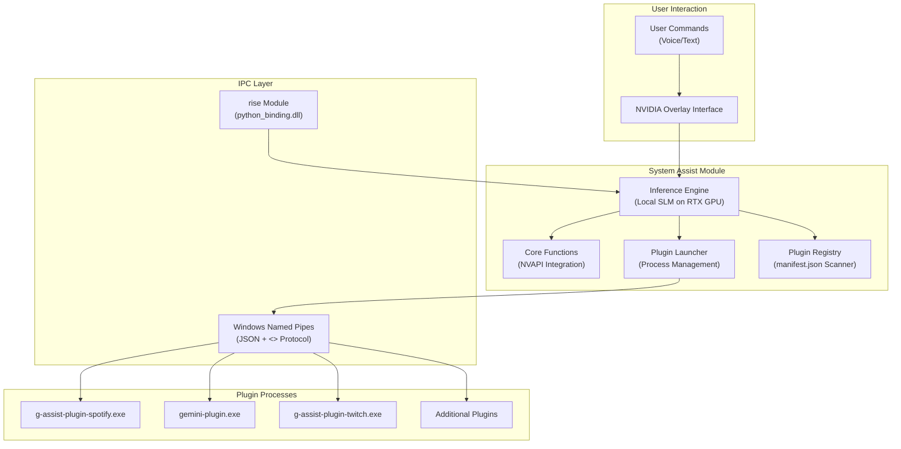
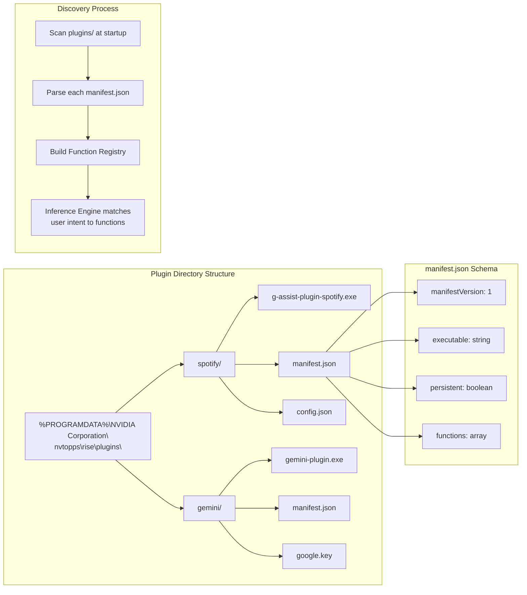
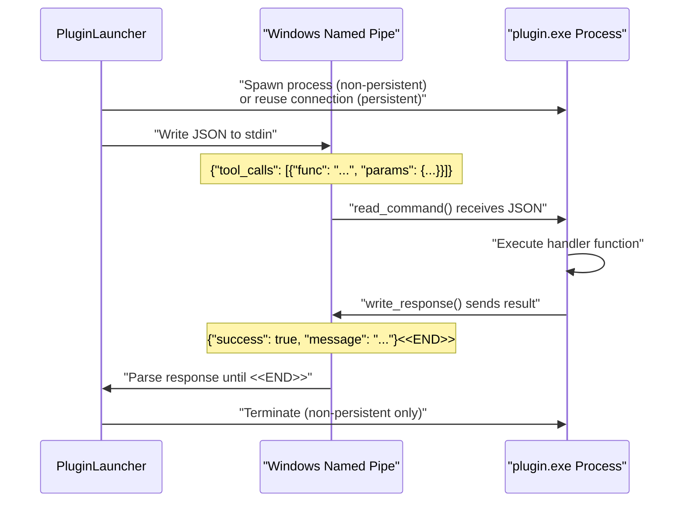
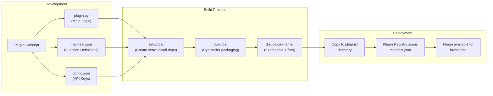

<!-- source: DeepWiki mcp.deepwiki.com · repo NVIDIA/G-Assist · page 1 Overview · fetched 2026-10-26 -->

# Overview

<details>
<summary>Relevant source files</summary>

The following files were used as context for generating this wiki page:

- [README.md](README.md)
- [api/bindings/python/README.md](api/bindings/python/README.md)
- [plugins/examples/twitch/README.md](plugins/examples/twitch/README.md)

</details>


## Purpose and Scope

This document provides a high-level overview of the G-Assist platform architecture, its core components, and the plugin ecosystem. It introduces the key systems that enable G-Assist to function as an on-device AI assistant for RTX users, including the inference engine, plugin architecture, and communication protocols.

For detailed information about specific subsystems:
- Plugin development workflows: see [Plugin Development Guide](#5)
- Python API usage: see [Python Bindings (rise module)](#4)
- Communication protocol specifications: see [Communication Protocol](#3.3)
- Individual plugin implementations: see [Plugin Examples](#6)

## What is G-Assist

G-Assist is an experimental on-device AI assistant platform that runs a Small Language Model (SLM) locally on NVIDIA RTX GPUs. The platform enables users to control PC settings, peripheral hardware, and third-party services through natural language voice or text commands delivered via the NVIDIA Overlay interface.

The system operates entirely on-device, leveraging RTX GPU acceleration for inference rather than relying on cloud-based AI services. The core architecture supports extensibility through a modular plugin system, allowing developers to add new capabilities without modifying the core platform.

**Sources:** [README.md:1-13]()

## Core System Architecture



The System Assist Module consists of three primary components:

1. **Inference Engine**: Executes the local SLM on RTX hardware to analyze user commands, extract intent, and determine appropriate function routing.

2. **Core Functions**: Built-in capabilities that directly interface with NVAPI for GPU information, performance monitoring, and system control operations.

3. **Plugin Launcher**: Manages the lifecycle of plugin processes, including spawning non-persistent plugins on-demand and maintaining persistent plugin connections.

**Sources:** [README.md:120-133]()

## Plugin Discovery and Manifest System



Each plugin resides in a self-contained directory under the G-Assist plugins path. The `manifest.json` file defines the contract between plugin and platform:

| Field | Type | Description |
|-------|------|-------------|
| `manifestVersion` | integer | Schema version (currently 1) |
| `executable` | string | Name of plugin executable file |
| `persistent` | boolean | Whether plugin remains active throughout G-Assist lifecycle |
| `functions` | array | List of function definitions with parameters |

At startup, the Plugin Registry scans all subdirectories under `plugins/`, parses each `manifest.json`, and constructs a searchable index mapping function descriptions, tags, and parameters to their respective plugins.

**Sources:** [README.md:141-159](), [plugins/examples/twitch/README.md:103-122]()

## Plugin Invocation Methods

G-Assist supports two distinct invocation patterns:

### Zero-Shot Function Calling

The inference engine analyzes natural language commands and automatically selects the appropriate plugin and function without explicit plugin naming:

```
User: "What are the top upcoming games for 2025?"
→ Inference Engine analyzes intent
→ Routes to gemini plugin
→ Calls search function with extracted parameters
```

The AI model uses function descriptions and tags from manifest files to determine routing.

### Direct Plugin Invocation

Users explicitly name the target plugin, and the inference engine extracts function and parameters from the remaining command:

```
User: "Hey spotify, play some jazz"
→ Plugin name "spotify" explicitly specified
→ Inference Engine selects "play" function from spotify manifest
→ Extracts genre parameter: "jazz"
```

Both invocation methods leverage the same manifest-based function registry and parameter extraction system.

**Sources:** [README.md:162-191]()

## Communication Protocol



Plugins communicate with the System Assist Module through Windows Named Pipes using a JSON-based protocol. Commands follow this structure:

```json
{
  "tool_calls": [
    {
      "func": "check_twitch_live_status",
      "params": {
        "username": "nvidia"
      }
    }
  ]
}
```

Responses must include the `<<END>>` marker for message termination:

```json
{
  "success": true,
  "message": "nvidia is LIVE!\nTitle: Stream Title\nViewers: 1234"
}<<END>>
```

The pipe communication is implemented using Windows kernel32 API functions `ReadFile` and `WriteFile` for stdin/stdout handles.

**Sources:** [plugins/examples/twitch/README.md:299-367](), [plugins/examples/twitch/README.md:381-399]()

## Python Bindings Interface

The `rise` module provides a synchronous Python API for interacting with G-Assist:

| Function | Purpose |
|----------|---------|
| `rise.register_rise_client()` | Initialize connection to G-Assist, wait for READY signal |
| `rise.send_rise_command(cmd: str) -> str` | Send command and block until response received |
| `base_function_callback()` | Internal callback invoked by `python_binding.dll` for async events |

The module abstracts the underlying C++ NVAPI and RISE Backend communication through `python_binding.dll`, which exposes `register_rise_callback` and `request_rise` functions via CTypes interop.

Example usage:

```python
from rise import rise

rise.register_rise_client()
response = rise.send_rise_command("What is my GPU?")
# Response: Your GPU is an NVIDIA GeForce RTX 5090 with a Driver version of 572.83.
```

The synchronous API is implemented through polling of global state variables (`response`, `response_done`, `ready`) that are updated by the native callback function.

**Sources:** [api/bindings/python/README.md:1-67]()

## Plugin Development Lifecycle



Plugin development follows a standardized workflow:

1. **Development**: Create `plugin.py` with command handlers, define functions in `manifest.json`, store credentials in `config.json`

2. **Build**: Execute `setup.bat` to create virtual environment and install dependencies from `requirements.txt`, then run `build.bat` to package with PyInstaller

3. **Deployment**: Copy the `dist/plugin-name/` directory to `%PROGRAMDATA%\NVIDIA Corporation\nvtopps\rise\plugins\`

4. **Discovery**: G-Assist automatically scans and registers the plugin at next startup

The Plugin Builder tool uses OpenAI GPT to generate initial scaffolding code, accelerating the development process.

**Sources:** [README.md:139-159](), [plugins/examples/twitch/README.md:38-59](), [plugins/examples/twitch/README.md:449-485]()

## Plugin Categories

The ecosystem includes four primary plugin categories:

| Category | Examples | Functionality |
|----------|----------|---------------|
| **AI & Search** | Gemini | Google AI integration, web search classification |
| **Media Integration** | Spotify, Twitch, Discord | Music control, stream status, message/file sharing |
| **Hardware Control** | Corsair, LogiLED, Nanoleaf | RGB lighting, peripheral illumination, smart lighting |
| **Information Services** | Weather, Stock | wttr.in API, market data via Twelve Data API |

All plugins follow the same manifest-based discovery, pipe communication protocol, and response format regardless of category.

**Sources:** [README.md:193-213]()

## Configuration and Security

Plugins store sensitive credentials in `config.json` files within their respective plugin directories. This file should be excluded from version control:

```json
{
  "TWITCH_CLIENT_ID": "your_client_id_here",
  "TWITCH_CLIENT_SECRET": "your_client_secret_here"
}
```

The configuration file path resolves to `%PROGRAMDATA%\NVIDIA Corporation\nvtopps\rise\plugins\<plugin-name>\config.json` at runtime. Log files are written to `%USERPROFILE%\<plugin-name>.log` for debugging.

**Sources:** [plugins/examples/twitch/README.md:124-130](), [plugins/examples/twitch/README.md:153-178]()

## Key Design Principles

1. **Modularity**: Plugins run as separate processes, isolating failures and enabling independent versioning
2. **Declarative Configuration**: The manifest.json system allows discovery without code execution
3. **On-Device Processing**: Local SLM inference on RTX GPUs eliminates cloud dependency
4. **Standardized Communication**: All plugins use identical JSON protocol over named pipes
5. **AI-Driven Routing**: Zero-shot function calling enables natural language command interpretation
6. **Developer Accessibility**: Python-first development with build automation reduces time to deployment

**Sources:** [README.md:1-24](), [README.md:120-133]()

---

