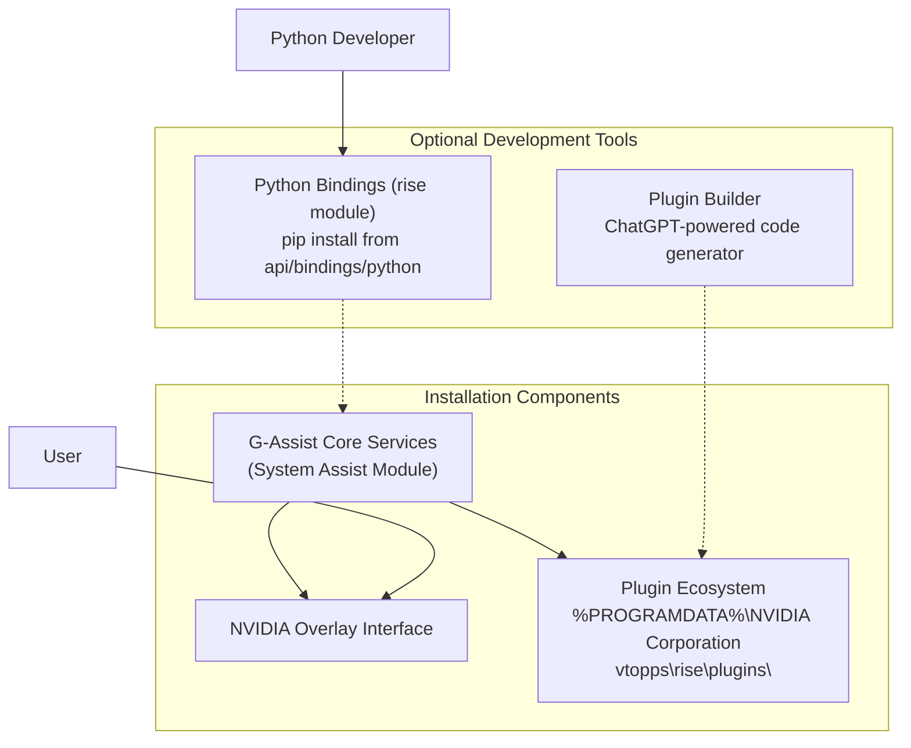
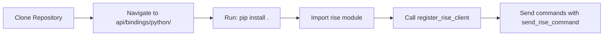
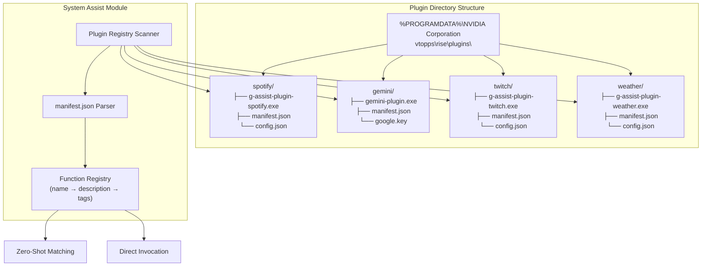

<!-- source: DeepWiki mcp.deepwiki.com · repo NVIDIA/G-Assist · page 2 Getting Started · fetched 2026-10-26 -->

# Getting Started

<details>
<summary>Relevant source files</summary>

The following files were used as context for generating this wiki page:

- [README.md](README.md)
- [api/bindings/python/README.md](api/bindings/python/README.md)
- [plugins/examples/twitch/README.md](plugins/examples/twitch/README.md)

</details>


This page provides a quick start guide for using G-Assist and developing plugins. It covers installation, basic command usage, Python bindings setup, and an overview of available plugins. For detailed architectural information, see [Architecture](#3). For comprehensive plugin development instructions, see [Plugin Development Guide](#5).

## Prerequisites

Before using G-Assist, ensure you have the following installed:

**For Users:**
- Windows operating system
- NVIDIA RTX GPU
- G-Assist core services installed (System Assist Module)
- NVIDIA Overlay interface

**For Developers:**
- Python 3.x or higher
- pip package manager
- Visual C++ Build Tools (for Python bindings)
  - Option 1: [Visual Studio Community](https://visualstudio.microsoft.com/vs/community/) with "Desktop development with C++"
  - Option 2: [Visual C++ Redistributable](https://aka.ms/vs/17/release/vc_redist.x64.exe) (x64 version)

Sources: [api/bindings/python/README.md:11-42](), [README.md:53-56]()

## Installation Overview

The G-Assist platform consists of three main components that work together:



**Directory Structure:**

| Path | Contents | Purpose |
|------|----------|---------|
| `%PROGRAMDATA%\NVIDIA Corporation\nvtopps\rise\plugins\` | Plugin directories | Runtime plugin location scanned by G-Assist |
| `%USERPROFILE%\<plugin-name>.log` | Log files | Plugin execution logs |
| `api/bindings/python/` | Python source | Python bindings for programmatic access |

Sources: [README.md:143-158](), [plugins/examples/twitch/README.md:51-60]()

## Using G-Assist: Voice and Text Commands

G-Assist accepts commands through the NVIDIA Overlay interface via voice or text input. Commands are processed by the System Assist Module's inference engine, which runs a local Small Language Model (SLM) on your RTX GPU.

### Command Invocation Methods

G-Assist supports two distinct methods for invoking plugin functionality:

```mermaid
sequenceDiagram
    participant User
    participant Overlay["NVIDIA Overlay"]
    participant SAM["System Assist Module<br/>(Inference Engine)"]
    participant Registry["Plugin Registry<br/>(manifest.json scanner)"]
    participant Plugin
    
    Note over User,Plugin: Method 1: Zero-Shot Function Calling
    User->>Overlay: "/fc What are the top games for 2025?"
    Overlay->>SAM: Forward command
    SAM->>Registry: Query available functions
    Registry-->>SAM: Return function definitions
    SAM->>SAM: AI analyzes intent<br/>Selects gemini plugin<br/>Chooses search function
    SAM->>Plugin: Execute with parameters
    
    Note over User,Plugin: Method 2: Direct Plugin Invocation
    User->>Overlay: "Hey spotify, play some jazz"
    Overlay->>SAM: Forward command
    SAM->>Registry: Lookup "spotify" plugin
    Registry-->>SAM: Return spotify functions
    SAM->>SAM: AI extracts "play" function<br/>Parameters: genre=jazz
    SAM->>Plugin: Execute with parameters
```

**1. Zero-Shot Function Calling**

The AI model automatically selects the appropriate plugin and function based on user intent:

```
/fc What are the top upcoming games for 2025?
```

Process:
1. System Assist Module analyzes the natural language command
2. Inference engine matches intent to plugin function descriptions and tags in `manifest.json`
3. Extracts required parameters from the command
4. Routes to the appropriate plugin (e.g., `gemini` plugin's `search` function)

**2. Direct Plugin Invocation**

User explicitly specifies the plugin name:

```
Hey logiled, change my keyboard lights to green
/logiled change my keyboard lights to green
```

Process:
1. System identifies "logiled" as the target plugin name (matching plugin directory)
2. AI determines the appropriate function from that plugin's manifest
3. Extracts parameters from the natural language portion
4. Routes to the specified plugin (e.g., `logiled` plugin's color control function)

Sources: [README.md:163-191](), [README.md:25-28]()

### Example Commands by Plugin

| Plugin | Command Example | Function Invoked |
|--------|----------------|------------------|
| `twitch` | "Hey Twitch, is Ninja live?" | `check_twitch_live_status` |
| `spotify` | "Hey spotify, play some jazz" | Music playback control |
| `gemini` | "/fc What's the weather?" | Search with AI classification |
| `logiled` | "/logiled set keyboard to blue" | Device illumination control |
| `weather` | "/fc What's the weather in Seattle?" | `get_weather_info` |

Sources: [README.md:62-81](), [plugins/examples/twitch/README.md:64-67]()

## Python Development Quick Start

The `rise` module provides Python bindings to G-Assist's C++ APIs, enabling programmatic interaction with the System Assist Module.

### Installing the Python Bindings



**Installation Steps:**

1. Navigate to the Python bindings directory:
```bash
cd api/bindings/python
```

2. Install the package:
```bash
pip install .
```

3. Verify installation by importing the module:
```python
from rise import rise
```

Sources: [api/bindings/python/README.md:45-49](), [README.md:30-34]()

### Basic Usage Example

The `rise` module abstracts complex asynchronous callbacks into synchronous, blocking function calls:

```python
from rise import rise

# Initialize connection to G-Assist core services
rise.register_rise_client()

# Send command and receive synchronous response
response = rise.send_rise_command("What is my GPU?")
print(f'Response: {response}')
```

**Expected Output:**
```
Response: Your GPU is an NVIDIA GeForce RTX 5090 with a Driver version of 572.83.
```

The implementation details:
- `register_rise_client()` initializes the connection to `python_binding.dll` and waits for the `READY` signal
- `send_rise_command(str)` sends the command via `request_rise` and polls the global `response_done` flag
- Response is populated by `base_function_callback` which handles `TEXT`, `GRAPH`, `PROGRESS_UPDATE` content types

For detailed API documentation including callback mechanisms and content types, see [Python Bindings API Reference](#4.1) and [Content Types and Callbacks](#4.2).

Sources: [README.md:36-49](), [api/bindings/python/README.md:52-67]()

### Interactive Chat Example

The Python bindings enable building custom interfaces. Here's a complete chat application with visual feedback:

```python
from rise import rise
import time
import sys
import threading

def thinking_bubble(stop_event):
    """Animated thinking indicator while processing"""
    while not stop_event.is_set():
        for _ in range(3):
            if stop_event.is_set():
                break
            sys.stdout.write('.')
            sys.stdout.flush()
            time.sleep(0.5)
        sys.stdout.write('\b\b\b   \b\b\b')

def main():
    rise.register_rise_client()
    
    while True:
        user_prompt = input("ME: ")
        stop_event = threading.Event()
        thinking_thread = threading.Thread(
            target=thinking_bubble, args=(stop_event,))
        thinking_thread.start()
        
        response = rise.send_rise_command(user_prompt)
        
        stop_event.set()
        thinking_thread.join()
        print(f"RISE: {response}")

if __name__ == "__main__":
    main()
```

This example demonstrates the synchronous API pattern where `send_rise_command` blocks until `response_done` is set by the callback handler.

For the complete GUI application using Flask and Electron, see [GUI Application (rise-gui.py)](#4.3).

Sources: [api/bindings/python/README.md:69-107]()

## Available Plugins

G-Assist includes several example plugins demonstrating different integration patterns. Plugins are discovered at runtime by scanning the `plugins/` directory for `manifest.json` files.

### Plugin Discovery and Loading



Each plugin directory contains:
- **Executable**: The plugin binary (e.g., `g-assist-plugin-<name>.exe`)
- **manifest.json**: Function definitions, descriptions, tags, and persistence settings
- **config.json**: API credentials and plugin-specific configuration (not committed to version control)

Sources: [README.md:141-160]()

### Plugin Categories

**AI & Search Integrations:**

| Plugin | Functionality | Key Functions |
|--------|--------------|---------------|
| `gemini` | Google AI + Search integration | `search` with AI classification |
| | LLM query routing | Multi-API integration pattern |

**Media Integration:**

| Plugin | Functionality | Key Functions |
|--------|--------------|---------------|
| `spotify` | Music playback control | Track play, pause, skip |
| | Playlist management | OAuth authentication pattern |
| `twitch` | Stream status checking | `check_twitch_live_status` |
| | Streamer information | OAuth token management |
| `discord` | Message sending | Text, chart, file sharing |
| | Channel integration | Webhook-based integration |

**Hardware Control:**

| Plugin | Functionality | Key Functions |
|--------|--------------|---------------|
| `logiled` | Logitech device lighting | RGB control, effect patterns |
| `corsair` | Corsair iCUE integration | RGB lighting control |
| `nanoleaf` | Smart lighting control | Room lighting automation |

**Information Services:**

| Plugin | Functionality | Key Functions |
|--------|--------------|---------------|
| `weather` | Weather information | `get_weather_info` via wttr.in API |
| `stock` | Market data retrieval | Stock price queries via Twelve Data API |

For detailed implementation guides for each plugin, see [Plugin Examples](#6).

Sources: [README.md:193-201](), [README.md:23-23]()

### Plugin Persistence Modes

Plugins operate in two modes defined by the `persistent` flag in `manifest.json`:

**Non-Persistent (persistent: false):**
- Plugin process spawned on-demand by the Plugin Launcher
- Executes command and terminates
- Example: `twitch` plugin for status checks

**Persistent (persistent: true):**
- Plugin process starts at G-Assist initialization
- Continues listening on the named pipe
- Suitable for plugins requiring state or frequent invocation
- Example: Hardware control plugins maintaining connection state

The persistence mode is specified in each plugin's manifest file at [plugins/<plugin-name>/manifest.json:7]().

Sources: [README.md:152-158]()

## Plugin Communication Protocol

Plugins communicate with G-Assist through Windows Named Pipes using a JSON-based protocol. Understanding this protocol is essential for both using and developing plugins.

### Message Flow

```mermaid
sequenceDiagram
    participant PL["Plugin Launcher"]
    participant Pipe["Windows Named Pipe<br/>(stdin/stdout)"]
    participant Plugin["Plugin Process<br/>(plugin.py main loop)"]
    
    PL->>Pipe: Write JSON command
    Note right of Pipe: {"tool_calls": [{"func": "...", "params": {...}}]}
    Pipe->>Plugin: read_command() via GetStdHandle
    Plugin->>Plugin: Parse JSON<br/>Execute function
    Plugin->>Pipe: write_response() via GetStdHandle
    Note right of Pipe: {"success": true, "message": "..."}<<END>>
    Pipe->>PL: Read response until <<END>> marker
```

**Command Format:**
```json
{
    "tool_calls": [
        {
            "func": "check_twitch_live_status",
            "params": {
                "username": "nvidia"
            }
        }
    ]
}
```

**Response Format:**
```json
{
    "success": true,
    "message": "nvidia is LIVE!\nTitle: Gaming Stream\nViewers: 1234"
}<<END>>
```

The `<<END>>` marker signals message termination and is required for proper protocol operation.

Key implementation details:
- Commands are read using `windll.kernel32.ReadFile` with `STD_INPUT_HANDLE = -10`
- Responses are written using `windll.kernel32.WriteFile` with `STD_OUTPUT_HANDLE = -11`
- Buffer size is typically `4096` bytes
- Large messages are read in chunks

For complete pipe communication implementation details, see [Communication Protocol](#3.3).

Sources: [plugins/examples/twitch/README.md:299-401](), [plugins/examples/twitch/README.md:381-399]()

## Next Steps

**For Users:**
- Explore available plugins and their commands
- Try both zero-shot and direct invocation methods
- Review plugin-specific documentation for advanced features

**For Developers:**

1. **Learn the Architecture:** See [Architecture](#3) for detailed system design
2. **Build Your First Plugin:** Follow [Plugin Development Guide](#5)
3. **Use the Plugin Builder:** Leverage the [ChatGPT-powered Plugin Builder](#5.1) for rapid scaffolding
4. **Study Examples:** Review detailed walkthroughs in [Plugin Examples](#6)
5. **Understand the Protocol:** Deep dive into [Communication Protocol](#3.3)

**Development Resources:**

| Resource | Location | Purpose |
|----------|----------|---------|
| Python Bindings | [api/bindings/python/](../../api/bindings/python/) | Programmatic G-Assist access |
| Plugin Builder | [plugins/plugin-builder/](../../plugins/plugin-builder/) | Automated plugin generation |
| Example Plugins | [plugins/examples/](../../plugins/examples/) | Reference implementations |
| Manifest Schema | [Manifest Schema](#7.1) | Plugin configuration reference |

Sources: [README.md:211-213](), [README.md:101-118]()

---

