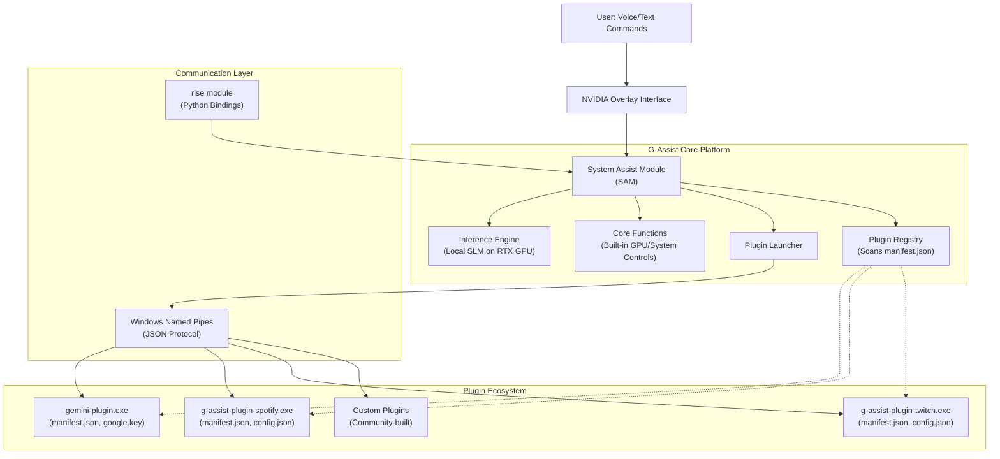
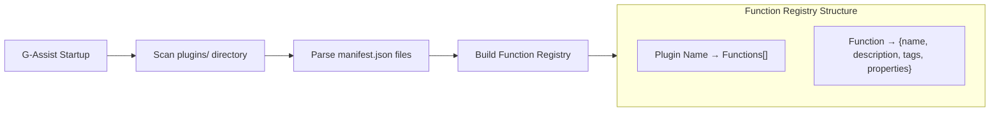
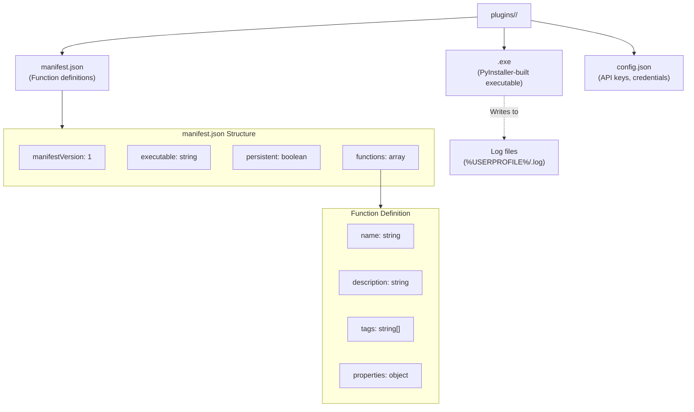
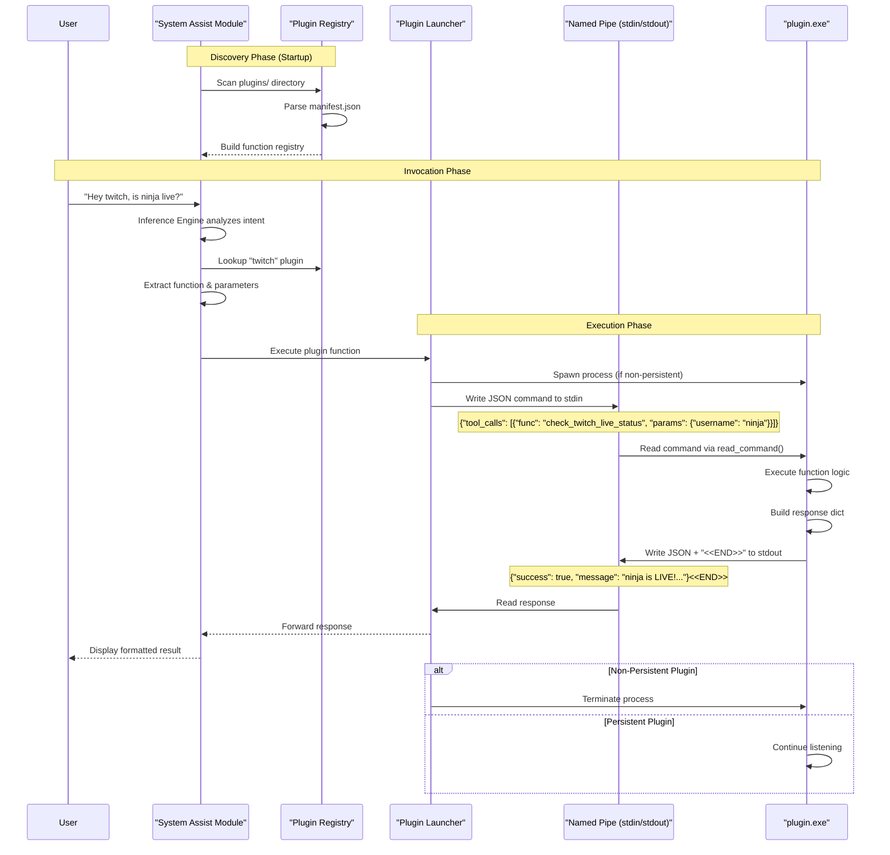
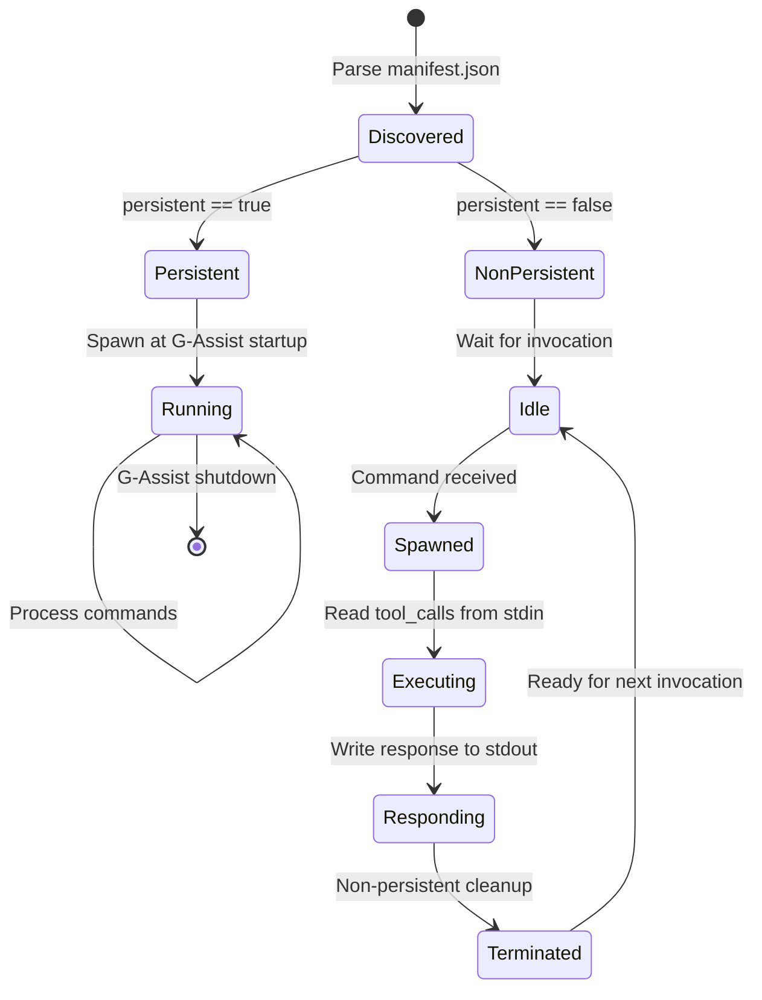

<!-- source: DeepWiki mcp.deepwiki.com · repo NVIDIA/G-Assist · page 3 Architecture · fetched 2026-10-26 -->

# Architecture

<details>
<summary>Relevant source files</summary>

The following files were used as context for generating this wiki page:

- [README.md](README.md)
- [api/bindings/python/README.md](api/bindings/python/README.md)
- [plugins/examples/twitch/README.md](plugins/examples/twitch/README.md)

</details>


This document provides a comprehensive technical overview of G-Assist's system architecture, including the core components, plugin system design, and inter-process communication mechanisms. For information about specific subsystems, see [System Assist Module](#3.1), [Plugin Architecture](#3.2), [Communication Protocol](#3.3), and [Plugin Invocation Methods](#3.4). For practical development guidance, refer to [Plugin Development Guide](#5).

## System Overview

G-Assist is architected as a modular, AI-orchestrated platform consisting of a core System Assist Module and an extensible plugin ecosystem communicating via Windows Named Pipes. The architecture follows a clear separation between the core inference engine, plugin launcher, and individual plugin processes.



**Sources:** [README.md:122-133](), [README.md:1-23]()

## Core Components

The G-Assist platform consists of four primary architectural layers:

### System Assist Module (SAM)

The System Assist Module serves as the central orchestration layer. It integrates three key subsystems:

| Subsystem | Responsibilities |
|-----------|-----------------|
| Inference Engine | Executes local Small Language Model (SLM) on RTX GPU for intent analysis, plugin selection, and parameter extraction |
| Core Functions | Implements built-in GPU and system controls via NVAPI |
| Plugin Launcher | Manages plugin process lifecycle, spawning and terminating as needed |

The inference engine analyzes user commands to determine the appropriate action—whether to invoke built-in functions or delegate to plugins. See [System Assist Module](#3.1) for detailed implementation.

**Sources:** [README.md:122-133](), [README.md:3-13]()

### Plugin Registry

The Plugin Registry performs automatic discovery by scanning the plugin directory at `%PROGRAMDATA%\NVIDIA Corporation\nvtopps\rise\plugins\`. It parses each `manifest.json` file to build an indexed function registry used for zero-shot function calling.



**Sources:** [README.md:143-159](), [README.md:163-166]()

### Plugin Launcher

The Plugin Launcher manages plugin process lifecycle based on the `persistent` flag in `manifest.json`:

- **Non-Persistent Plugins**: Spawned on-demand, executed, then terminated
- **Persistent Plugins**: Spawned once at startup, remain active throughout G-Assist lifecycle

**Sources:** [README.md:157]()

### Communication Layer

Two primary interfaces enable interaction with G-Assist:

1. **Windows Named Pipes**: IPC mechanism for plugin communication using JSON protocol with `<<END>>` message terminator
2. **rise Module**: Python bindings providing `register_rise_client()` and `send_rise_command()` functions for application integration

See [Communication Protocol](#3.3) for protocol specification.

**Sources:** [api/bindings/python/README.md:1-10](), [plugins/examples/twitch/README.md:297-367]()

## Plugin Architecture Structure

Each plugin resides in a self-contained directory with standardized artifacts:



**Sources:** [README.md:143-159](), [plugins/examples/twitch/README.md:103-122]()

### Manifest Schema Components

The `manifest.json` file defines the contract between G-Assist and the plugin:

| Field | Type | Purpose |
|-------|------|---------|
| `manifestVersion` | integer | Schema version (currently 1) |
| `executable` | string | Name of the plugin executable file |
| `persistent` | boolean | Whether plugin remains active throughout G-Assist lifecycle |
| `functions` | array | List of callable functions with their signatures |

Each function definition includes:

| Field | Type | Purpose |
|-------|------|---------|
| `name` | string | Function identifier used in `tool_calls` |
| `description` | string | Natural language description for AI model matching |
| `tags` | string[] | Keywords for zero-shot function discovery |
| `properties` | object | Parameter schema defining expected inputs |

**Sources:** [README.md:151-158](), [plugins/examples/twitch/README.md:103-122]()

## Communication Protocol Flow

The plugin communication protocol uses Windows Named Pipes with a JSON-based message format. The following sequence illustrates the complete invocation lifecycle:



**Sources:** [README.md:163-191](), [plugins/examples/twitch/README.md:297-401]()

## Plugin Invocation Methods

G-Assist supports two distinct invocation patterns, both leveraging the inference engine for intelligent routing:

### Zero-Shot Function Calling

The AI model automatically selects the appropriate plugin and function based on user intent without explicit plugin naming:

```
User Command: "/fc What are the top upcoming games for 2025?"

Processing Flow:
1. Inference Engine analyzes intent
2. Matches to plugin functions via manifest descriptions/tags
3. Selects appropriate plugin (e.g., gemini plugin)
4. Extracts required parameters
5. Invokes plugin function
```

**Sources:** [README.md:169-178]()

### Direct Plugin Invocation

User explicitly names the target plugin, then AI determines the function and parameters:

```
User Command: "Hey spotify, play some jazz"
or
User Command: "/spotify play some jazz"

Processing Flow:
1. User specifies "spotify" plugin
2. Inference Engine determines function from spotify's manifest
3. Extracts parameters ("jazz" → search query)
4. Invokes plugin function
```

**Sources:** [README.md:179-191]()

### Command and Response Format

Plugin commands follow a standardized JSON structure using the `tool_calls` array pattern:

**Command Structure** (written to plugin stdin):
```json
{
  "tool_calls": [
    {
      "func": "check_twitch_live_status",
      "params": {
        "username": "nvidia"
      }
    }
  ]
}
```

**Response Structure** (written to plugin stdout):
```json
{
  "success": true,
  "message": "nvidia is LIVE!\nTitle: NVIDIA Gaming Stream\nGame: Cyberpunk 2077\nViewers: 1234"
}<<END>>
```

The `<<END>>` marker signals message termination and must be appended to all responses.

**Sources:** [plugins/examples/twitch/README.md:381-399](), [plugins/examples/twitch/README.md:261-268]()

## Process Lifecycle Management

The Plugin Launcher implements lifecycle management based on the `persistent` flag:



**Sources:** [README.md:157]()

## Code Implementation Bridge

The following table maps architectural components to their concrete code implementations:

| Architectural Component | Code Entity | Location |
|------------------------|-------------|----------|
| Plugin command reader | `read_command()` function | [plugins/examples/twitch/README.md:302-343]() |
| Plugin response writer | `write_response()` function | [plugins/examples/twitch/README.md:345-367]() |
| Plugin manifest | `manifest.json` file | `plugins/<name>/manifest.json` |
| Plugin configuration | `config.json` file | `plugins/<name>/config.json` |
| Plugin executable | `<plugin-name>.exe` | `plugins/<name>/<plugin-name>.exe` |
| Python bindings registration | `rise.register_rise_client()` | [api/bindings/python/README.md:56-57]() |
| Python bindings command | `rise.send_rise_command()` | [api/bindings/python/README.md:60]() |
| Windows pipe stdin handle | `STD_INPUT_HANDLE = -10` | [plugins/examples/twitch/README.md:376]() |
| Windows pipe stdout handle | `STD_OUTPUT_HANDLE = -11` | [plugins/examples/twitch/README.md:377]() |
| Message terminator | `"<<END>>"` string | [plugins/examples/twitch/README.md:354]() |

**Sources:** [plugins/examples/twitch/README.md:297-401](), [api/bindings/python/README.md:52-67]()

## Key Architectural Design Principles

### Process Isolation
Plugins execute in separate processes, ensuring:
- Crash isolation (plugin failure doesn't affect G-Assist core)
- Security boundary between untrusted plugin code and core system
- Independent resource management

### Declarative Configuration
The `manifest.json` approach enables:
- Plugin discovery without code execution
- Hot-swapping of plugins (dynamic loading/unloading)
- Version-independent plugin registry
- AI-driven function matching via descriptions and tags

### AI-Driven Orchestration
The local SLM inference engine provides:
- Natural language understanding for command interpretation
- Intelligent plugin selection via zero-shot function calling
- Parameter extraction from unstructured user input
- Context-aware routing between built-in functions and plugins

### Synchronous Python Bindings
The `rise` module abstracts async C++ APIs into synchronous Python calls by:
- Polling global state variables (`response_done`, `ready`)
- Using callbacks to update state asynchronously
- Providing blocking `send_rise_command()` for ease of use

**Sources:** [README.md:1-23](), [api/bindings/python/README.md:1-10]()

## Directory Structure

Standard installation layout for G-Assist and plugins:

```
%PROGRAMDATA%\NVIDIA Corporation\nvtopps\rise\
└── plugins/
    ├── spotify/
    │   ├── g-assist-plugin-spotify.exe
    │   ├── manifest.json
    │   └── config.json
    ├── gemini/
    │   ├── gemini-plugin.exe
    │   ├── manifest.json
    │   └── google.key
    └── twitch/
        ├── g-assist-plugin-twitch.exe
        ├── manifest.json
        └── config.json

%USERPROFILE%/
├── spotify.log
├── gemini.log
└── twitch.log
```

Plugin files reside in `%PROGRAMDATA%`, while log files are written to `%USERPROFILE%` for per-user isolation.

**Sources:** [README.md:90-97](), [plugins/examples/twitch/README.md:154-160]()

---

