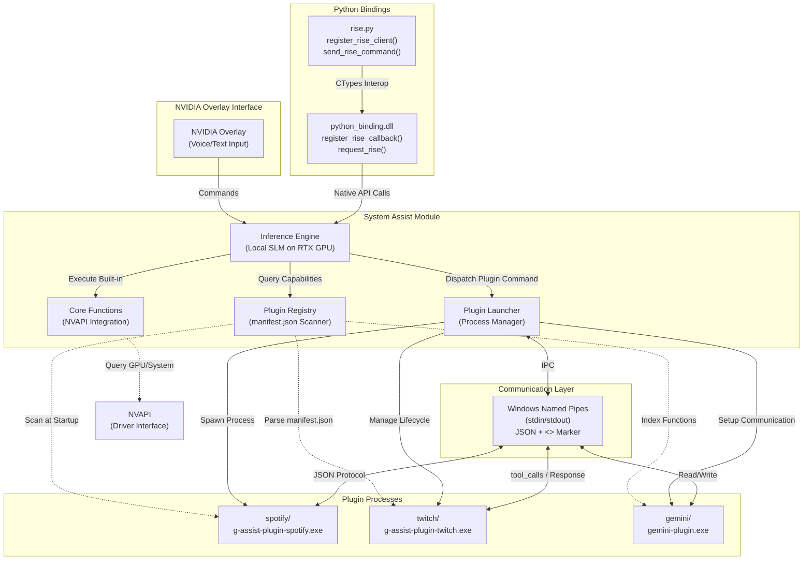
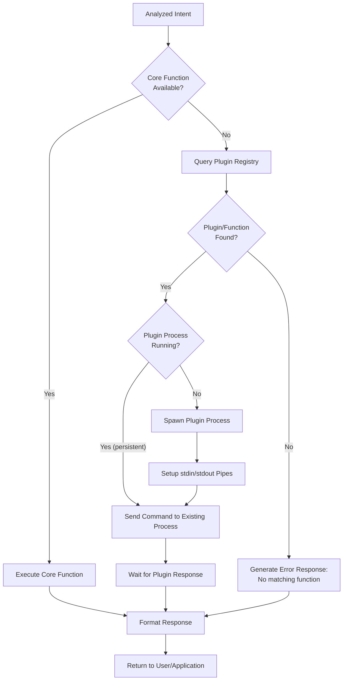

<!-- source: DeepWiki mcp.deepwiki.com · repo NVIDIA/G-Assist · page 3.1 System Assist Module · fetched 2026-10-26 -->

# System Assist Module

<details>
<summary>Relevant source files</summary>

The following files were used as context for generating this wiki page:

- [README.md](README.md)
- [api/bindings/python/README.md](api/bindings/python/README.md)
- [plugins/examples/twitch/README.md](plugins/examples/twitch/README.md)

</details>


## Purpose and Scope

The System Assist Module (SAM) is the central orchestration layer of the G-Assist platform. It serves as the primary interface between user commands and plugin execution, responsible for analyzing natural language input, routing commands to appropriate handlers, and managing the plugin ecosystem lifecycle.

This document covers the internal architecture and operation of the System Assist Module, including its inference engine, core functions, and plugin management capabilities. For details on the plugin architecture itself, see [Plugin Architecture](#3.2). For communication protocol specifications, see [Communication Protocol](#3.3). For information on how commands are interpreted and routed, see [Plugin Invocation Methods](#3.4).

**Sources:** [README.md:120-133]()

## Core Components

The System Assist Module consists of four primary subsystems that work together to provide AI-driven command orchestration:

| Component | Purpose | Key Responsibilities |
|-----------|---------|---------------------|
| **Inference Engine** | AI model for command interpretation | Natural language understanding, function selection, parameter extraction |
| **Core Functions** | Built-in system capabilities | GPU information, system settings, performance metrics via NVAPI |
| **Plugin Launcher** | External plugin process management | Spawning executables, pipe setup, lifecycle control |
| **Plugin Registry** | Plugin discovery and indexing | Scanning manifest.json files, building function catalog |

**Sources:** [README.md:120-133]()

### Inference Engine

The Inference Engine runs a local Small Language Model (SLM) on the RTX GPU, providing on-device AI inference without cloud dependencies. This engine analyzes user commands to:

- **Parse natural language intent** - Convert voice or text commands into structured function calls
- **Select appropriate handlers** - Match user requests to either core functions or plugin capabilities
- **Extract parameters** - Identify and structure arguments needed for function execution
- **Enable zero-shot function calling** - Route commands to plugins without explicit plugin names

The inference engine operates continuously, processing commands as they arrive from the NVIDIA Overlay interface or through the Python bindings (`rise.send_rise_command()`).

**Sources:** [README.md:3-13](), [README.md:169-178]()

### Core Functions

Core Functions represent built-in capabilities implemented directly within the System Assist Module, without requiring external plugin processes. These functions leverage NVAPI for direct hardware and driver interaction:

- GPU identification and specification queries
- Driver version information
- System performance metrics
- Display configuration
- Power management settings

The core functions are invoked through the same inference pipeline as plugins but execute synchronously within the SAM process rather than spawning external executables.

**Sources:** [README.md:120-133](), [api/bindings/python/README.md:60-67]()

### Plugin Launcher

The Plugin Launcher manages the lifecycle of external plugin processes:

1. **Process Spawning** - Creates plugin executable processes when needed
2. **Pipe Setup** - Establishes Windows Named Pipes for stdin/stdout communication
3. **Persistence Management** - Handles both persistent (long-running) and non-persistent (on-demand) plugins based on `manifest.json` configuration
4. **Termination Control** - Closes plugin processes when no longer needed or on shutdown

The launcher references the Plugin Registry to determine which executable to spawn and whether the plugin should remain running (`persistent: true`) or be terminated after command completion (`persistent: false`).

**Sources:** [README.md:124-133](), [README.md:151-158]()

### Plugin Registry

The Plugin Registry maintains an indexed catalog of available plugins by scanning the plugins directory at startup and during runtime discovery:

```
%PROGRAMDATA%\NVIDIA Corporation\nvtopps\rise\plugins\
```

For each plugin directory discovered, the registry:

1. **Parses manifest.json** - Extracts plugin metadata, executable name, and function definitions
2. **Indexes functions** - Builds searchable mappings from function names, descriptions, and tags to plugin executables
3. **Validates schemas** - Ensures manifest structure meets required specifications
4. **Tracks plugin state** - Monitors which plugins are currently loaded and available

The registry data structure supports both zero-shot function calling (AI matches description/tags to user intent) and direct invocation (user specifies plugin name explicitly).

**Sources:** [README.md:141-160](), [README.md:165-167]()

## System Architecture

### Component Interaction Model



**Sources:** [README.md:120-133](), [api/bindings/python/README.md:1-20](), [plugins/examples/twitch/README.md:298-401]()

### Data Flow Architecture

```mermaid
graph LR
    subgraph "Input Sources"
        UserVoice["User Voice Command"]
        UserText["User Text Command"]
        PythonApp["Python Application<br/>rise.send_rise_command()"]
    end
    
    subgraph "System Assist Module Processing"
        CommandReceiver["Command Receiver"]
        InferenceEngine["Inference Engine<br/>(SLM Analysis)"]
        FunctionResolver["Function Resolver"]
        
        CommandReceiver --> InferenceEngine
        InferenceEngine --> FunctionResolver
        
        FunctionResolver -->|"Core Function"| CoreExecutor["Core Function Executor"]
        FunctionResolver -->|"Plugin Function"| PluginDispatcher["Plugin Dispatcher"]
    end
    
    subgraph "Execution Layer"
        CoreExecutor --> NVAPI["NVAPI Calls"]
        PluginDispatcher --> PluginLauncher["Plugin Launcher"]
        PluginLauncher --> PluginProcess["Plugin Process<br/>plugin.exe"]
        
        PluginProcess -->|"read_command()"| PipeIn["stdin Pipe"]
        PluginProcess -->|"write_response()"| PipeOut["stdout Pipe"]
    end
    
    subgraph "Response Path"
        NVAPI --> ResponseFormatter["Response Formatter"]
        PipeOut --> ResponseFormatter
        ResponseFormatter --> OutputHandler["Output Handler"]
    end
    
    UserVoice --> CommandReceiver
    UserText --> CommandReceiver
    PythonApp --> CommandReceiver
    
    OutputHandler --> DisplayOverlay["NVIDIA Overlay Display"]
    OutputHandler --> PythonResponse["Python Response Object"]
```



**Sources:** [README.md:169-190](), [plugins/examples/twitch/README.md:270-295]()

## Command Processing Pipeline

The System Assist Module processes commands through a multi-stage pipeline:

### Stage 1: Command Reception

Commands arrive at the System Assist Module through two primary interfaces:

1. **NVIDIA Overlay Interface** - Voice or text commands from the G-Assist UI
2. **Python Bindings Interface** - Programmatic commands via `rise.send_rise_command()`

Both interfaces normalize input into a common internal format for processing by the Inference Engine.

**Sources:** [README.md:40-49](), [api/bindings/python/README.md:52-67]()

### Stage 2: Intent Analysis

The Inference Engine performs natural language understanding to extract:

```
Input: "What is my GPU?"
↓ [Inference Engine Analysis]
├─ Intent: Query GPU information
├─ Function Category: Core function
├─ Target Function: get_gpu_info
└─ Parameters: {} (none required)
```

```
Input: "Hey spotify, play some jazz"
↓ [Inference Engine Analysis]
├─ Intent: Play music
├─ Plugin: spotify (explicit)
├─ Function: play_music or search_and_play
└─ Parameters: { "query": "jazz", "type": "genre" }
```

**Sources:** [README.md:169-190](), [api/bindings/python/README.md:60-67]()

### Stage 3: Function Resolution

The Function Resolver queries the Plugin Registry to match the analyzed intent to available capabilities:



**Sources:** [README.md:169-190](), [README.md:141-160]()

### Stage 4: Execution

For **core functions**, execution occurs synchronously within the System Assist Module process, typically involving NVAPI calls.

For **plugin functions**, the Plugin Launcher:

1. Checks if plugin process is already running (for persistent plugins)
2. Spawns new process if needed (executable name from `manifest.json`)
3. Writes JSON command to stdin pipe:
   ```json
   {
       "tool_calls": [{
           "func": "check_twitch_live_status",
           "params": {
               "username": "nvidia"
           }
       }]
   }
   ```
4. Waits for response on stdout pipe (terminated by `<<END>>` marker)

**Sources:** [plugins/examples/twitch/README.md:381-399](), [README.md:151-158]()

### Stage 5: Response Handling

Plugin responses follow a standardized format:

```json
{
    "success": true,
    "message": "nvidia is LIVE!\nTitle: NVIDIA Gaming Stream\nGame: Cyberpunk 2077\nViewers: 1234"
}<<END>>
```

The System Assist Module:

1. Parses the JSON response
2. Checks the `success` field for error handling
3. Formats the `message` for display or returns it to the calling application
4. For non-persistent plugins, signals the Plugin Launcher to terminate the process

**Sources:** [plugins/examples/twitch/README.md:260-268](), [plugins/examples/twitch/README.md:393-399]()

## Plugin Lifecycle Management

### Discovery Phase

At startup, the Plugin Registry scans the plugins directory:

```
%PROGRAMDATA%\NVIDIA Corporation\nvtopps\rise\plugins\
```

For each subdirectory (e.g., `spotify/`, `twitch/`, `gemini/`), the registry:

1. Checks for `manifest.json` existence
2. Parses the manifest structure:
   - `manifestVersion`: Schema version (currently 1)
   - `executable`: Name of the plugin executable
   - `persistent`: Boolean indicating lifecycle mode
   - `functions`: Array of function definitions with names, descriptions, tags, and parameter schemas

3. Builds internal index mapping:
   - Function names → Plugin directory + executable
   - Description keywords → Function definitions
   - Tags → Function definitions

**Sources:** [README.md:141-160](), [plugins/examples/twitch/README.md:102-122]()

### Launch Phase

When a command targets a plugin function, the Plugin Launcher:

**For Non-Persistent Plugins** (`persistent: false`):
1. Spawns process: `CreateProcess(executable_path, ...)`
2. Creates anonymous pipes for stdin/stdout
3. Redirects process handles to pipes
4. Waits for process initialization
5. Sends command via stdin pipe
6. Waits for response on stdout pipe
7. Terminates process after response received

**For Persistent Plugins** (`persistent: true`):
1. On first invocation: Spawns process and keeps it running
2. Maintains pipe connections for duration of G-Assist session
3. Reuses existing process for subsequent commands
4. Process remains alive until G-Assist shutdown or explicit termination

**Sources:** [README.md:151-158](), [plugins/examples/twitch/README.md:102-122]()

### Execution Phase

During command execution, the plugin:

1. Reads command from stdin via `read_command()` function
2. Parses JSON to extract `tool_calls` array
3. Iterates through tool calls, matching `func` field to handler functions
4. Executes business logic (API calls, file operations, etc.)
5. Formats response as JSON with `success` and `message` fields
6. Writes response to stdout via `write_response()` with `<<END>>` marker

**Sources:** [plugins/examples/twitch/README.md:270-295](), [plugins/examples/twitch/README.md:298-367]()

### Termination Phase

The System Assist Module handles graceful shutdown:

1. **Shutdown Signal**: Sends `{"tool_calls": [{"func": "shutdown"}]}` to all running plugins
2. **Process Wait**: Allows plugins to clean up resources (close connections, save state)
3. **Force Termination**: If plugin doesn't exit within timeout, forcibly terminates process
4. **Pipe Cleanup**: Closes all pipe handles
5. **Registry Clear**: Releases plugin registry resources

**Sources:** [plugins/examples/twitch/README.md:270-295]()

## Communication Interfaces

### NVIDIA Overlay Interface

The NVIDIA Overlay serves as the primary user-facing interface for G-Assist. Commands flow from the overlay to the System Assist Module through an internal communication mechanism (implementation details not exposed in plugin API).

The overlay formats user voice/text input and transmits it to the SAM Command Receiver, which then invokes the Inference Engine for processing.

**Sources:** [README.md:3-13]()

### Plugin Communication Interface

The System Assist Module communicates with plugins via Windows Named Pipes using a JSON-based protocol:

**Command Format** (SAM → Plugin):
```json
{
    "tool_calls": [
        {
            "func": "function_name",
            "params": {
                "param1": "value1",
                "param2": "value2"
            }
        }
    ]
}
```

**Response Format** (Plugin → SAM):
```json
{
    "success": true,
    "message": "Response text for user"
}<<END>>
```

The `<<END>>` marker is critical for message framing, allowing the System Assist Module to detect response completion when reading from the stdout pipe.

Plugins implement this protocol using the Windows API directly:

- `GetStdHandle(STD_INPUT_HANDLE)` - Retrieve stdin pipe handle
- `ReadFile()` - Read command bytes from pipe
- `GetStdHandle(STD_OUTPUT_HANDLE)` - Retrieve stdout pipe handle  
- `WriteFile()` - Write response bytes to pipe

**Sources:** [plugins/examples/twitch/README.md:298-367](), [plugins/examples/twitch/README.md:369-380]()

### Python Bindings Interface

The `rise` Python module provides a simplified interface to the System Assist Module through `python_binding.dll`:

**Registration** (`rise.register_rise_client()`):
1. Calls `register_rise_callback()` in `python_binding.dll`
2. Registers `base_function_callback()` as callback handler
3. Waits for `READY` signal indicating SAM connection established
4. Initializes global state variables: `response`, `chart`, `response_done`, `ready`, `progress_bar`

**Command Execution** (`rise.send_rise_command(command_string)`):
1. Calls `request_rise()` in `python_binding.dll` with command text
2. Resets `response_done` flag
3. Polls `response_done` in tight loop until callback sets it
4. Returns accumulated `response` string to caller

**Callback Processing** (`base_function_callback()`):
- Invoked asynchronously by `python_binding.dll` when SAM sends data
- Handles multiple content types:
  - `NV_RISE_CONTENT_TYPE_TEXT`: Appends to `response` string
  - `NV_RISE_CONTENT_TYPE_GRAPH`: Stores chart data in `chart` variable
  - `NV_RISE_CONTENT_TYPE_PROGRESS_UPDATE`: Updates `progress_bar` value
  - `NV_RISE_CONTENT_TYPE_READY`: Sets `ready` flag
- Sets `response_done` flag when complete

The DLL layer uses CTypes structures (`NV_RISE_CALLBACK_DATA_V1`, `NV_REQUEST_RISE_SETTINGS_V1`) to bridge Python and native C++ code, providing access to NVAPI and the RISE Backend (Runtime Inference System Engine).

**Sources:** [api/bindings/python/README.md:1-67]()

## Integration Points

### NVAPI Integration

Core functions within the System Assist Module leverage NVAPI to query hardware and driver state:

- GPU identification and specifications
- Driver version information  
- Display configuration and refresh rates
- Power management and thermal monitoring
- Performance metrics and frame rate statistics

The NVAPI headers ([nvapi.h:25283]()) define the interface exposed to G-Assist for these queries.

**Sources:** [README.md:28](), [api/bindings/python/README.md:16-18]()

### External API Integration

While the System Assist Module itself doesn't directly call external APIs, it orchestrates plugins that integrate with external services:

- **Gemini Plugin**: Google AI and Search APIs
- **Spotify Plugin**: Spotify Web API with OAuth 2.0 authentication  
- **Twitch Plugin**: Twitch Helix API with client credentials flow
- **Weather Plugin**: wttr.in HTTP API
- **Stock Plugin**: Twelve Data financial API
- **Discord Plugin**: Discord webhook and bot APIs

The SAM Plugin Launcher ensures these plugins have isolated configuration files (`config.json`) for API credentials, preventing credential leakage between plugins.

**Sources:** [README.md:193-201](), [plugins/examples/twitch/README.md:130-179]()

### Agentic Framework Integration

The Python bindings enable integration with agentic AI frameworks like Langflow. The `rise` module can be imported into agent nodes, allowing G-Assist to serve as:

- A tool provider for AI agents (executing commands on behalf of agents)
- An orchestration layer for multi-step AI workflows
- A hardware control interface for AI-driven automation

Applications can combine `rise.send_rise_command()` with other AI APIs to build complex autonomous systems that leverage G-Assist's local SLM and plugin ecosystem.

**Sources:** [README.md:12-13](), [api/bindings/python/README.md:1-10]()

---

