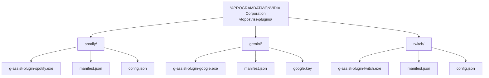
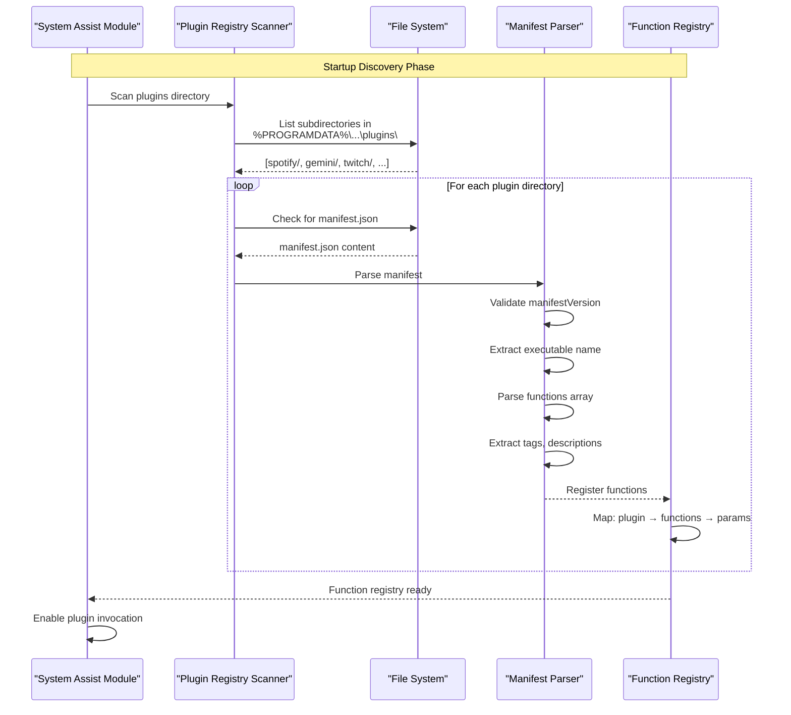
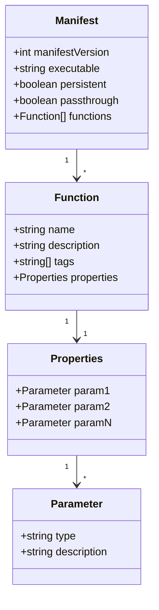
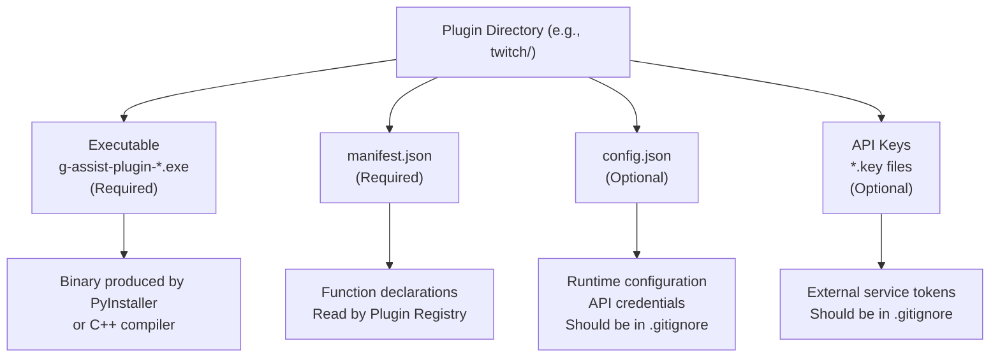
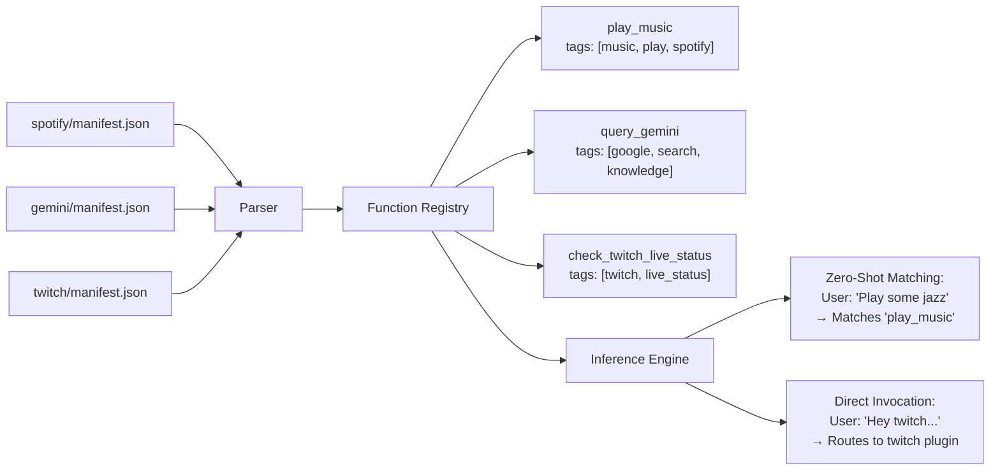

<!-- source: DeepWiki mcp.deepwiki.com · repo NVIDIA/G-Assist · page 3.2 Plugin Architecture · fetched 2026-10-26 -->

# Plugin Architecture

<details>
<summary>Relevant source files</summary>

The following files were used as context for generating this wiki page:

- [README.md](README.md)
- [api/bindings/python/README.md](api/bindings/python/README.md)
- [plugins/examples/gemini/.gitattributes](plugins/examples/gemini/.gitattributes)
- [plugins/examples/gemini/Release/g-assist-plugin-google.exe](plugins/examples/gemini/Release/g-assist-plugin-google.exe)
- [plugins/examples/gemini/Release/manifest.json](plugins/examples/gemini/Release/manifest.json)
- [plugins/examples/gemini/gemini.py](plugins/examples/gemini/gemini.py)
- [plugins/examples/gemini/manifest.json](plugins/examples/gemini/manifest.json)
- [plugins/examples/gemini/requirements.txt](plugins/examples/gemini/requirements.txt)
- [plugins/examples/twitch/README.md](plugins/examples/twitch/README.md)

</details>


This document describes the modular plugin system in G-Assist, including the plugin directory structure, discovery mechanism, manifest specification, and plugin lifecycle modes. It focuses on how plugins are organized, discovered, and configured by the System Assist Module.

For details about how plugins communicate with G-Assist, see [Communication Protocol](#3.3). For information about how plugins are invoked by users, see [Plugin Invocation Methods](#3.4). For implementing a plugin, see [Plugin Development Guide](#5).

## Overview

G-Assist uses a plugin-based architecture where each plugin is a self-contained executable process that extends G-Assist's capabilities. Plugins are discovered at runtime through a directory scanning mechanism that reads `manifest.json` files to understand each plugin's capabilities.

The plugin system enables:
- Isolation: Each plugin runs in its own process space
- Discoverability: Plugins declare their functions through standardized manifests
- Extensibility: New plugins can be added without modifying G-Assist core
- Flexibility: Plugins can be persistent (long-running) or non-persistent (spawned on-demand)

**Sources:** [README.md:135-191]()

## Plugin Directory Structure

Each plugin resides in a dedicated subdirectory within the G-Assist plugins directory. The subdirectory name serves as the plugin's identifier for direct invocation.

### Standard Directory Layout



**Sources:** [README.md:143-149]()

### Plugin Directory Components

| File/Directory | Required | Purpose |
|---------------|----------|---------|
| Plugin directory name | Yes | Used as invocation identifier (e.g., "spotify" allows "Hey spotify, ...") |
| Executable (`.exe`) | Yes | Plugin process that handles commands |
| `manifest.json` | Yes | Declares plugin capabilities, functions, and metadata |
| `config.json` | No | Runtime configuration and API credentials |
| API key files | No | External service credentials (e.g., `google.key`) |

The directory name convention determines how users invoke the plugin directly. For example, a plugin in the `logiled/` directory can be invoked with "Hey logiled, change my keyboard lights to green".

**Sources:** [README.md:141-160](), [plugins/examples/twitch/README.md:51-59]()

## Plugin Discovery Process

G-Assist discovers plugins at startup by scanning the plugins directory and parsing each plugin's manifest file.

### Discovery Workflow



**Sources:** [README.md:162-166]()

### Discovery Details

The discovery process:

1. **Directory Enumeration**: Scans `%PROGRAMDATA%\NVIDIA Corporation\nvtopps\rise\plugins\` for subdirectories
2. **Manifest Location**: Each subdirectory must contain a `manifest.json` file
3. **Manifest Parsing**: Reads and validates the manifest structure
4. **Function Registration**: Builds an index mapping function names, descriptions, and tags to plugin executables
5. **Invocation Enablement**: Makes functions available for both zero-shot and direct invocation modes

The registry enables the System Assist Module's inference engine to match user intent to appropriate plugin functions.

**Sources:** [README.md:165-166]()

## Manifest File Specification

The `manifest.json` file is the contract between a plugin and G-Assist, declaring all functions the plugin can execute.

### Manifest Schema



**Sources:** [README.md:152-158](), [plugins/examples/gemini/manifest.json:1-23](), [plugins/examples/twitch/README.md:103-122]()

### Manifest Fields

#### Top-Level Fields

| Field | Type | Required | Description |
|-------|------|----------|-------------|
| `manifestVersion` | integer | Yes | Schema version (currently `1`) |
| `executable` | string | Yes | Name of executable file (e.g., `"g-assist-plugin-twitch.exe"`) |
| `persistent` | boolean | Yes | If `true`, plugin remains running; if `false`, spawned per-invocation |
| `passthrough` | boolean | No | If `true`, allows streaming response chunks back to G-Assist |
| `functions` | array | Yes | Array of function definitions |

**Sources:** [README.md:152-158](), [plugins/examples/gemini/manifest.json:3-5]()

#### Function Definition Fields

Each object in the `functions` array contains:

| Field | Type | Required | Description |
|-------|------|----------|-------------|
| `name` | string | Yes | Function identifier used in `tool_calls` |
| `description` | string | Yes | Natural language description for AI matching |
| `tags` | string[] | Yes | Keywords for discovery and zero-shot invocation |
| `properties` | object | Yes | Parameter definitions |

**Sources:** [plugins/examples/twitch/README.md:110-119]()

#### Parameter Definition Fields

Each property in the `properties` object contains:

| Field | Type | Required | Description |
|-------|------|----------|-------------|
| `type` | string | Yes | Parameter type (e.g., `"string"`) |
| `description` | string | Yes | Natural language description for parameter extraction |

**Sources:** [plugins/examples/twitch/README.md:114-117]()

### Example: Twitch Plugin Manifest

```json
{
  "manifestVersion": 1,
  "executable": "g-assist-plugin-twitch.exe",
  "persistent": false,
  "functions": [
    {
      "name": "check_twitch_live_status",
      "description": "Checks if a Twitch user is live and retrieves stream details.",
      "tags": ["twitch", "live_status"],
      "properties": {
        "username": {
          "type": "string",
          "description": "The Twitch username to check."
        }
      }
    }
  ]
}
```

**Sources:** [plugins/examples/twitch/README.md:103-122]()

### Example: Gemini Plugin Manifest

```json
{
  "manifestVersion": 1,
  "executable": "g-assist-plugin-google.exe",
  "persistent": false,
  "passthrough": true,
  "functions": [
    {
      "name": "query_gemini",
      "description": "Google/Gemini tool search for real time access of general topic queries including but not limited to gaming wiki queries, weather, news, food, etc.",
      "tags": ["gemini", "google", "chat", "question", "answers", "query", "knowledge", "queries"],
      "properties": {
        "input": {
          "type": "string",
          "description": "the user's input"
        },
        "game": {
          "type": "string",
          "description": "an optional parameter that specifies which game is currently being played"
        }
      }
    }
  ]
}
```

**Sources:** [plugins/examples/gemini/manifest.json:1-23]()

### Manifest Usage in Discovery

The System Assist Module uses manifest data to:

1. **Function Matching**: Match user queries to functions using `description` and `tags` fields
2. **Parameter Extraction**: Parse user input to extract values for parameters defined in `properties`
3. **Plugin Selection**: Determine which plugin to launch based on function ownership
4. **Process Management**: Use `persistent` flag to decide whether to spawn a new process or reuse an existing one

**Sources:** [README.md:165-191]()

## Plugin Lifecycle Modes

Plugins operate in one of two lifecycle modes determined by the `persistent` field in their manifest.

### Lifecycle Mode Comparison

```mermaid
graph TB
    subgraph NonPersistent["Non-Persistent Plugin (persistent: false)"]
        NP1["User Command Received"]
        NP2["Plugin Launcher spawns process"]
        NP3["Process executes command"]
        NP4["Process writes response"]
        NP5["Process terminates"]
        
        NP1 --> NP2
        NP2 --> NP3
        NP3 --> NP4
        NP4 --> NP5
    end
    
    subgraph Persistent["Persistent Plugin (persistent: true)"]
        P1["G-Assist Startup"]
        P2["Plugin Launcher spawns process"]
        P3["Process enters listen loop"]
        P4["User Command 1 Received"]
        P5["Process executes command"]
        P6["Process writes response"]
        P7["Process returns to listen loop"]
        P8["User Command 2 Received"]
        P9["Process executes command"]
        P10["Process writes response"]
        P11["Process continues listening..."]
        
        P1 --> P2
        P2 --> P3
        P3 --> P4
        P4 --> P5
        P5 --> P6
        P6 --> P7
        P7 --> P8
        P8 --> P9
        P9 --> P10
        P10 --> P11
    end
```



**Sources:** [README.md:157]()

### Non-Persistent Plugins

**Configuration:** `"persistent": false`

**Behavior:**
- Process spawned only when function is invoked
- Process executes single command and terminates
- No state preservation between invocations
- Lower resource usage when idle

**Use Cases:**
- Stateless API queries (weather, stock prices)
- One-time operations (file conversions)
- Plugins invoked infrequently

**Example Plugins:**
- Twitch: Spawned per stream status check
- Gemini: Spawned per query

**Sources:** [README.md:157](), [plugins/examples/twitch/README.md:107](), [plugins/examples/gemini/manifest.json:4]()

### Persistent Plugins

**Configuration:** `"persistent": true`

**Behavior:**
- Process spawned at G-Assist startup
- Process runs continuously, listening for commands
- Can maintain state across invocations
- Faster response times (no spawn overhead)

**Use Cases:**
- Hardware control requiring state (RGB lighting patterns)
- Services requiring authentication persistence
- High-frequency operations
- Plugins needing startup initialization

**Example Plugins:**
- Hardware control plugins (Corsair, LogiLED, Nanoleaf)
- Services maintaining connections

**Sources:** [README.md:157]()

### Lifecycle Mode Selection

| Consideration | Non-Persistent | Persistent |
|--------------|----------------|------------|
| Resource efficiency | Better for infrequent use | Better for frequent use |
| Response latency | Higher (spawn overhead) | Lower (process ready) |
| State preservation | Not supported | Supported |
| Initialization cost | Paid per invocation | Paid once at startup |
| Idle resource usage | None | Process memory + CPU |

**Sources:** [README.md:157]()

## Plugin File Organization

Beyond the manifest, plugins typically include additional files for configuration and secrets management.

### Standard Plugin Files



**Sources:** [README.md:143-159](), [plugins/examples/twitch/README.md:51-59]()

### Configuration File Pattern

The `config.json` file stores runtime configuration and credentials:

**Purpose:**
- API keys and secrets
- Service endpoints
- User preferences
- Plugin-specific settings

**Location:** Same directory as plugin executable  
**Security:** Must be added to `.gitignore` to prevent credential leaks

**Example Structure:**
```json
{
  "TWITCH_CLIENT_ID": "your_client_id_here",
  "TWITCH_CLIENT_SECRET": "your_client_secret_here"
}
```

**Code Usage:** Plugins read this file at startup [plugins/examples/twitch/README.md:154-178]()

**Sources:** [README.md:158](), [plugins/examples/twitch/README.md:124-129]()

### Executable Naming Convention

Plugin executables follow the naming pattern: `g-assist-plugin-<name>.exe`

**Examples:**
- `g-assist-plugin-twitch.exe` for Twitch plugin
- `g-assist-plugin-google.exe` for Gemini plugin
- `g-assist-plugin-spotify.exe` for Spotify plugin

The executable name must match the `executable` field in `manifest.json` exactly.

**Sources:** [README.md:146](), [plugins/examples/twitch/README.md:106](), [plugins/examples/gemini/manifest.json:3]()

## Manifest-Driven Function Registry

The System Assist Module builds a function registry from all discovered manifests, enabling both zero-shot and direct invocation modes.

### Registry Construction



**Sources:** [README.md:165-191]()

### Registry Data Structure

For each function, the registry maintains:

| Field | Source | Use |
|-------|--------|-----|
| Function name | `manifest.json → functions[].name` | Command routing |
| Plugin directory | Directory name | Plugin identification |
| Executable path | `manifest.json → executable` | Process spawning |
| Description | `manifest.json → functions[].description` | AI intent matching |
| Tags | `manifest.json → functions[].tags` | Keyword-based search |
| Parameter schema | `manifest.json → functions[].properties` | Argument validation |
| Persistence mode | `manifest.json → persistent` | Lifecycle management |

This registry enables the System Assist Module to route user commands to appropriate plugins without hardcoded plugin logic.

**Sources:** [README.md:152-191]()

## Plugin Interface Contract

The manifest establishes a formal interface between G-Assist and plugins:

### G-Assist Responsibilities

1. Scan plugin directories at startup
2. Parse and validate manifest files
3. Build function registry
4. Match user intent to registered functions
5. Launch plugin processes according to `persistent` flag
6. Send commands with extracted parameters
7. Handle responses and stream output to users

### Plugin Responsibilities

1. Provide valid `manifest.json` with `manifestVersion: 1`
2. Implement all functions declared in manifest
3. Accept commands via stdin pipe in JSON format
4. Validate incoming parameters against manifest schema
5. Write responses to stdout pipe with `<<END>>` marker
6. Handle `initialize` and `shutdown` commands
7. Implement continuous listen loop if `persistent: true`

This contract enables plugins to be developed independently while maintaining compatibility with G-Assist core.

**Sources:** [README.md:135-191](), [plugins/examples/twitch/README.md:270-295]()

---

