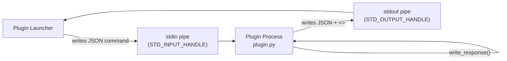
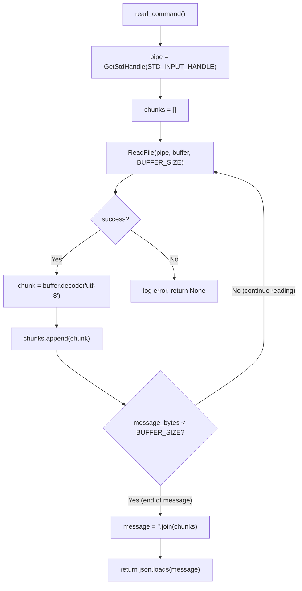
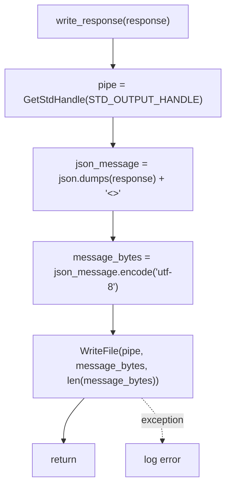
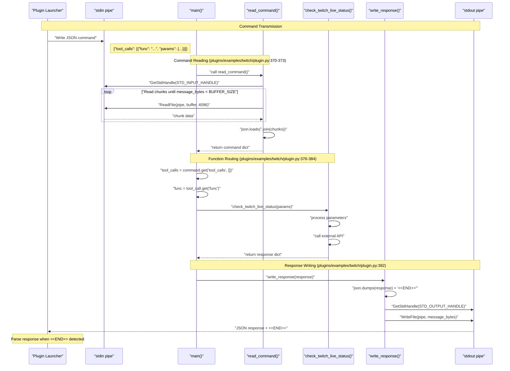
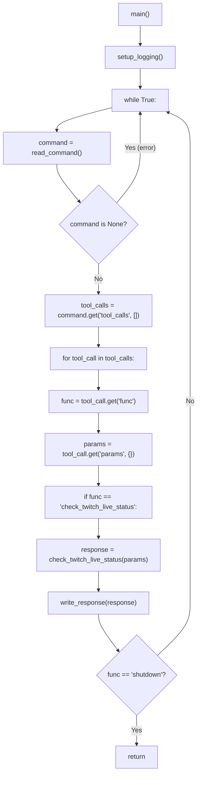

<!-- source: DeepWiki mcp.deepwiki.com · repo NVIDIA/G-Assist · page 3.3 Communication Protocol · fetched 2026-10-26 -->

# Communication Protocol

<details>
<summary>Relevant source files</summary>

The following files were used as context for generating this wiki page:

- [README.md](README.md)
- [api/bindings/python/README.md](api/bindings/python/README.md)
- [plugins/examples/twitch/README.md](plugins/examples/twitch/README.md)
- [plugins/examples/twitch/plugin.py](plugins/examples/twitch/plugin.py)

</details>


## Purpose and Scope

This document describes the inter-process communication (IPC) protocol used between G-Assist's Plugin Launcher and plugin processes. The protocol is based on Windows Named Pipes with a JSON-based message format. This page covers the pipe mechanism, message structure, the `tool_calls` command format, the `<<END>>` termination marker, and implementation details for reading and writing messages.

For information about how plugins are discovered and registered, see [Plugin Architecture](#3.2). For details on how the AI model selects which plugins to invoke, see [Plugin Invocation Methods](#3.4).

## Protocol Overview

G-Assist plugins communicate with the Plugin Launcher using Windows Named Pipes connected to the plugin process's standard input (stdin) and standard output (stdout). The Plugin Launcher writes JSON-formatted commands to the plugin's stdin, and the plugin writes JSON-formatted responses to its stdout. All responses must be terminated with the `<<END>>` marker to signal message completion.



**Sources:** [README.md:86-88](), [plugins/examples/twitch/README.md:298-401]()

## Command Message Format

Commands sent from the Plugin Launcher to plugins follow a standardized JSON structure with a `tool_calls` array. Each element in the array specifies a function to execute and its parameters.

### Command Structure

| Field | Type | Required | Description |
|-------|------|----------|-------------|
| `tool_calls` | array | Yes | Array of function calls to execute |
| `tool_calls[].func` | string | Yes | Name of the function to invoke |
| `tool_calls[].params` | object | No | Dictionary of parameters for the function |

### Example Command

```json
{
    "tool_calls": [
        {
            "func": "check_twitch_live_status",
            "params": {
                "username": "nvidia"
            }
        }
    ]
}
```

The `func` field must match one of the function names defined in the plugin's `manifest.json` file. The `params` object contains key-value pairs where keys correspond to the property names defined in the manifest's function schema.

**Sources:** [plugins/examples/twitch/README.md:381-391](), [plugins/examples/twitch/plugin.py:237-258]()

## Response Message Format

Plugins must respond with a JSON object containing a `success` field and an optional `message` field. The response must be terminated with the `<<END>>` marker.

### Response Structure

| Field | Type | Required | Description |
|-------|------|----------|-------------|
| `success` | boolean | Yes | Indicates whether the operation succeeded |
| `message` | string | No | Human-readable result message |

### Example Responses

**Successful response:**
```json
{
    "success": true,
    "message": "nvidia is LIVE!\nTitle: NVIDIA Gaming Stream\nGame: Cyberpunk 2077\nViewers: 1234"
}<<END>>
```

**Error response:**
```json
{
    "success": false,
    "message": "Failed to authenticate with Twitch"
}<<END>>
```

The `<<END>>` marker is mandatory and signals to the Plugin Launcher that the response is complete. Without this marker, the launcher will continue reading from the pipe indefinitely.

**Sources:** [plugins/examples/twitch/README.md:262-268](), [plugins/examples/twitch/README.md:393-399](), [plugins/examples/twitch/plugin.py:297-324]()

## The <<END>> Marker Protocol

The `<<END>>` marker serves as a message termination indicator in the pipe protocol. This marker solves the problem of message boundary detection in streaming protocols.

### Why <<END>> is Required

Windows Named Pipes do not have built-in message boundaries. When reading from a pipe, the receiver must know when a complete message has been received. The `<<END>>` marker provides this signal without requiring message length prefixes or complex framing protocols.

### Implementation Details

The marker is appended directly to the JSON string before encoding to bytes:

```python
json_message = json.dumps(response) + '<<END>>'
```

The Plugin Launcher reads from the plugin's stdout pipe until it encounters the `<<END>>` sequence, at which point it knows the response is complete and can parse the JSON.

**Sources:** [plugins/examples/twitch/README.md:369-372](), [plugins/examples/twitch/plugin.py:310-313]()

## Windows Pipe Implementation

Plugins use the Windows API via `ctypes` to read from stdin and write to stdout pipes. The implementation handles chunked reading for large messages and proper error handling.

### Pipe Handle Constants

```python
STD_INPUT_HANDLE = -10   # Windows constant for stdin
STD_OUTPUT_HANDLE = -11  # Windows constant for stdout
BUFFER_SIZE = 4096       # Size of read buffer in bytes
```

These constants are used with `windll.kernel32.GetStdHandle()` to obtain pipe handles.

**Sources:** [plugins/examples/twitch/plugin.py:41-48]()

### Reading Commands from Stdin

The `read_command()` function implements chunked reading from the stdin pipe:



The function reads in chunks because messages may exceed the buffer size. The loop continues until `ReadFile()` returns fewer bytes than `BUFFER_SIZE`, indicating the end of the message.

**Sources:** [plugins/examples/twitch/plugin.py:237-295](), [plugins/examples/twitch/README.md:302-343]()

### Writing Responses to Stdout

The `write_response()` function writes JSON responses with the `<<END>>` marker:



The response is written in a single `WriteFile()` call. The Windows kernel handles buffering if the message exceeds pipe buffer capacity.

**Sources:** [plugins/examples/twitch/plugin.py:297-324](), [plugins/examples/twitch/README.md:345-367]()

## Complete Message Flow

This diagram shows the full communication lifecycle between the Plugin Launcher and a plugin process, mapping natural language operations to specific code entities:



**Sources:** [plugins/examples/twitch/plugin.py:348-393]()

## Error Handling in the Protocol

Both reading and writing operations include error handling to manage pipe failures, JSON parsing errors, and encoding issues.

### Read Error Scenarios

| Error Type | Detection | Handling |
|------------|-----------|----------|
| Pipe read failure | `ReadFile()` returns `False` | Log error, return `None` from `read_command()` |
| Invalid JSON | `json.loads()` raises `JSONDecodeError` | Log error with raw input, return `None` |
| Encoding errors | `decode('utf-8')` raises `UnicodeDecodeError` | Log error, return `None` |

When `read_command()` returns `None`, the main loop continues and attempts to read the next command rather than crashing the plugin.

**Sources:** [plugins/examples/twitch/plugin.py:289-295](), [plugins/examples/twitch/plugin.py:370-374]()

### Write Error Scenarios

| Error Type | Detection | Handling |
|------------|-----------|----------|
| Pipe write failure | `WriteFile()` fails | Log error via exception handler |
| Encoding errors | `encode('utf-8')` raises `UnicodeEncodeError` | Caught by exception handler |
| JSON serialization failure | `json.dumps()` raises `TypeError` | Caught by exception handler |

Write errors are logged but not propagated. The plugin continues running and can process subsequent commands.

**Sources:** [plugins/examples/twitch/plugin.py:323-324]()

## Plugin Main Loop Pattern

All plugins follow a standard main loop pattern that continuously reads commands, routes them to handlers, and writes responses:



This pattern ensures plugins can handle multiple commands in sequence and gracefully shutdown when requested.

**Sources:** [plugins/examples/twitch/plugin.py:348-393]()

## Protocol Conformance Requirements

For a plugin to properly integrate with G-Assist, it must:

1. **Read from stdin using Windows pipe APIs**: Use `GetStdHandle(STD_INPUT_HANDLE)` and `ReadFile()` with chunked reading [plugins/examples/twitch/plugin.py:260-287]()

2. **Write to stdout using Windows pipe APIs**: Use `GetStdHandle(STD_OUTPUT_HANDLE)` and `WriteFile()` [plugins/examples/twitch/plugin.py:311-322]()

3. **Parse incoming commands as JSON**: Extract `tool_calls` array and route to function handlers [plugins/examples/twitch/plugin.py:376-384]()

4. **Generate responses with required fields**: Include `success` boolean and optional `message` string [plugins/examples/twitch/plugin.py:156-169]()

5. **Terminate all responses with <<END>>**: Append marker before encoding and writing [plugins/examples/twitch/plugin.py:312]()

6. **Handle the shutdown command**: Exit gracefully when `func == "shutdown"` is received [plugins/examples/twitch/plugin.py:385-388]()

7. **Implement error handling**: Return `None` or log errors without crashing the process [plugins/examples/twitch/plugin.py:289-295]()

Failure to conform to these requirements will result in plugin communication failures, timeouts, or process hangs.

**Sources:** [plugins/examples/twitch/README.md:369-380](), [plugins/examples/twitch/plugin.py:237-393]()

---

